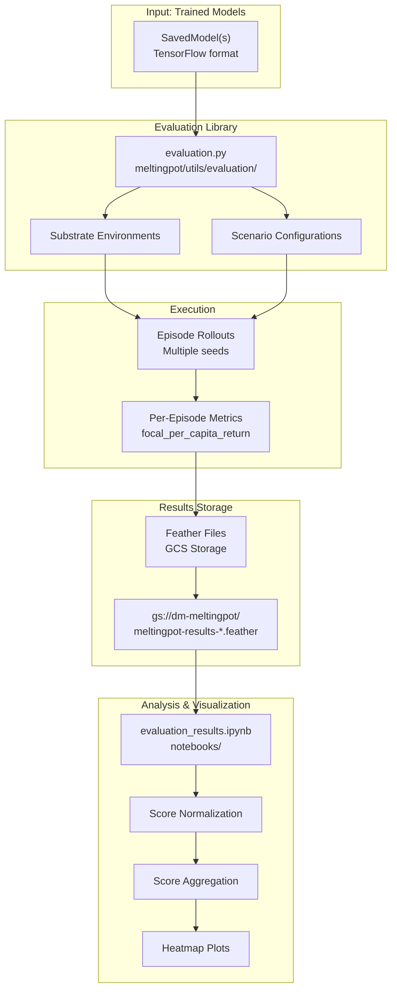
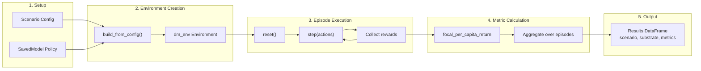
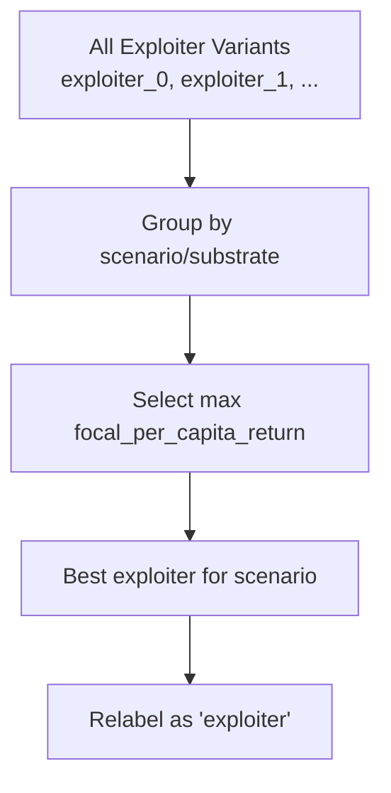
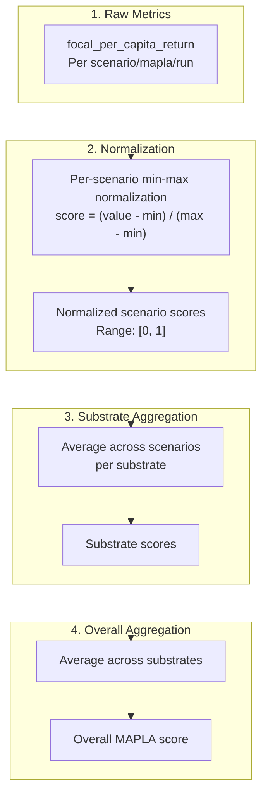
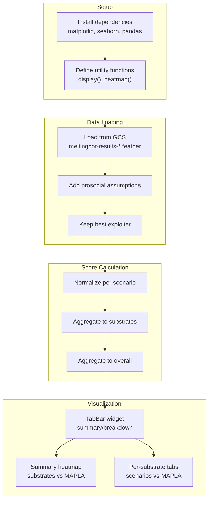
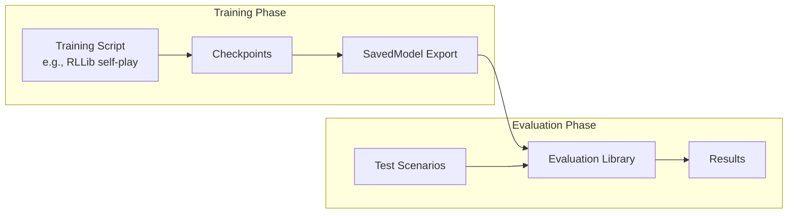

<!-- source: DeepWiki mcp.deepwiki.com · repo google-deepmind/meltingpot · page 8.3 Evaluation System · fetched 2026-10-26 -->

# Evaluation System

<details>
<summary>Relevant source files</summary>

The following files were used as context for generating this wiki page:

- [.gitignore](.gitignore)
- [CHANGELOG.md](CHANGELOG.md)
- [README.md](README.md)
- [notebooks/evaluation_results.ipynb](notebooks/evaluation_results.ipynb)
- [setup.py](setup.py)

</details>


## Purpose and Scope

The Evaluation System provides tools and infrastructure for assessing the performance of trained multi-agent reinforcement learning policies on Melting Pot substrates and scenarios. It enables researchers to:

- Evaluate TensorFlow `SavedModel`s across multiple test scenarios
- Compare different training approaches using standardized metrics
- Analyze generalization to novel social situations
- Reproduce and visualize published benchmark results

For information about training agents, see [Training with RLLib](#8.1). For interactive testing during development, see [Human Play Mode](#8.2).

**Sources:** [README.md:124-129](), [CHANGELOG.md:100]()

---

## System Architecture

The evaluation system consists of three main components: an evaluation library for running evaluations, cloud storage for results, and analysis notebooks for visualization.



**Sources:** [README.md:124-129](), [notebooks/evaluation_results.ipynb:274-288]()

---

## Evaluation Library

The evaluation library at [meltingpot/utils/evaluation/evaluation.py]() provides the core functionality for running systematic evaluations of trained policies.

### Key Features

| Feature | Description |
|---------|-------------|
| **SavedModel Support** | Evaluates TensorFlow SavedModel policies |
| **Scenario Iteration** | Runs policies across multiple test scenarios |
| **Multi-Episode Evaluation** | Averages results over multiple episode rollouts |
| **Standardized Metrics** | Collects focal_per_capita_return and other metrics |

### Evaluation Process



**Sources:** [README.md:124-126](), [CHANGELOG.md:100]()

---

## Results Storage Format

Evaluation results are stored in Apache Feather format on Google Cloud Storage for efficient loading and sharing.

### Storage Location

Results are hosted at:
```
https://storage.googleapis.com/dm-meltingpot/meltingpot-results-<VERSION>.feather
```

Current version: `meltingpot-results-2.3.0.feather`

### Data Schema

Results are stored as a pandas DataFrame with the following structure:

| Column | Type | Description |
|--------|------|-------------|
| `scenario` | string | Scenario identifier (e.g., `clean_up_0`) |
| `substrate` | string | Base substrate name (e.g., `clean_up`) |
| `mapla` | string | MAPLA variant identifier (e.g., `acb`, `opre`, `exploiter`) |
| `training_run` | int | Training run index for averaging |
| `focal_per_capita_return` | float | Mean return per focal agent |
| `<substrate>` | float | Training performance on each substrate (dropped for evaluation) |

The DataFrame uses a multi-index on `['scenario', 'substrate', 'mapla', 'training_run']` for efficient querying.

**Sources:** [notebooks/evaluation_results.ipynb:274-288]()

---

## MAPLA Variants

MAPLA (Multi-Agent Policies for Learning Agents) refers to the different training approaches evaluated in Melting Pot.

### Common MAPLA Types

| MAPLA ID | Description |
|----------|-------------|
| `acb` | Asynchronous Counterfactual Baseline |
| `opre` | Off-Policy Relational Experience |
| `acb_prosocial` | ACB with prosocial rewards (collective return substrates) |
| `opre_prosocial` | OPRE with prosocial rewards (collective return substrates) |
| `exploiter` | Best exploiter across multiple exploiter variants |

### Exploiter Selection

The evaluation system automatically selects the best-performing exploiter for each scenario:



**Sources:** [notebooks/evaluation_results.ipynb:341-359]()

---

## Scoring System

The evaluation system uses a normalization and aggregation pipeline to produce comparable scores across different scenarios and substrates.

### Score Calculation Pipeline



### Normalization Algorithm

The normalization process ensures scores are comparable across scenarios with different reward scales:

**Per-scenario normalization:**
```
lower = min(all_mapla_performance) - 1e-8
upper = max(all_mapla_performance)
scale = upper - lower
normalized_score = (performance - lower) / scale
```

This produces scores in the range [0, 1] where:
- 0 = worst performing MAPLA on this scenario
- 1 = best performing MAPLA on this scenario

**Sources:** [notebooks/evaluation_results.ipynb:380-395]()

### Substrate Score Aggregation

Substrate scores aggregate normalized scenario scores:

```
scenarios_per_substrate = count(scenarios for substrate)
substrate_score = sum(scenario_scores) / scenarios_per_substrate
```

**Sources:** [notebooks/evaluation_results.ipynb:407-418]()

### Overall Score Calculation

Overall scores aggregate substrate scores:

```
total_substrates = count(substrates)
overall_score = sum(substrate_scores) / total_substrates
```

**Sources:** [notebooks/evaluation_results.ipynb:429-439]()

---

## Prosocial MAPLA Handling

For collective return substrates, prosocial MAPLA variants receive identical rewards to non-prosocial variants (except for scaling). The evaluation system handles this by copying non-prosocial scores:

### Collective Return Substrates

The following substrates use collective returns:
- `collaborative_cooking__asymmetric`
- `collaborative_cooking__circuit`
- `collaborative_cooking__cramped`
- `collaborative_cooking__crowded`
- `collaborative_cooking__figure_eight`
- `collaborative_cooking__forced`
- `collaborative_cooking__ring`

For these substrates, `acb_prosocial` copies `acb` scores and `opre_prosocial` copies `opre` scores.

**Sources:** [notebooks/evaluation_results.ipynb:299-329]()

---

## Visualization Notebook

The evaluation results notebook at [notebooks/evaluation_results.ipynb]() provides interactive visualization of benchmark results.

### Notebook Structure



### Interactive Features

The notebook provides two main views:

**Summary View:**
- Heatmap showing substrate scores vs MAPLA variants
- Overall scores displayed at the top
- Color-coded performance (0=blue, 1=red)

**Breakdown View:**
- Tabs for each substrate
- Per-scenario performance within each substrate
- Comparison to overall and substrate-level scores

### Heatmap Configuration

The notebook uses custom heatmap functions that:
- Automatically format annotations based on value magnitude
- Support adding context rows (overall scores, substrate scores)
- Display labels on all four sides for easy reading
- Use consistent color mapping (coolwarm, vmin=0, vmax=1)

**Sources:** [notebooks/evaluation_results.ipynb:130-253](), [notebooks/evaluation_results.ipynb:460-495]()

---

## Running Evaluations

### Using the Evaluation Library

To evaluate a trained model using the evaluation library:

```python
from meltingpot.utils.evaluation import evaluation

# Evaluate a SavedModel on specific scenarios
results = evaluation.evaluate_saved_model(
    model_path='/path/to/saved_model',
    scenarios=['clean_up_0', 'clean_up_1'],
    num_episodes=10
)
```

The evaluation library handles:
- Loading the SavedModel policy
- Creating appropriate test environments
- Running multiple episode rollouts
- Collecting and aggregating metrics

**Sources:** [README.md:124-126]()

### Accessing Published Results

To view published benchmark results:

1. **Open the Colab notebook:**
   - Navigate to [notebooks/evaluation_results.ipynb]()
   - Click the "Open in Colab" badge
   - Or access directly via the GitHub Colab integration

2. **Run the notebook:**
   - Click "Connect" to start a runtime
   - Select "Runtime → Run all"
   - Results load from GCS automatically

3. **Explore the visualizations:**
   - View the summary heatmap for overall performance
   - Navigate breakdown tabs for per-substrate analysis
   - Compare different MAPLA approaches

**Sources:** [README.md:128-131](), [notebooks/evaluation_results.ipynb:31-42]()

---

## Integration with Other Systems

### Relationship to Training

The evaluation system is designed to work with models produced by training systems:



Training scripts (see [Training with RLLib](#8.1)) export TensorFlow SavedModels that the evaluation library can consume.

### Relationship to Human Play

While human play mode (see [Human Play Mode](#8.2)) is useful for interactive debugging and qualitative assessment, the evaluation system provides:
- Quantitative metrics
- Reproducible results
- Statistical significance through multiple runs
- Standardized comparison across approaches

**Sources:** [README.md:149-175]()

---

## Results File Versioning

Results files on GCS are versioned separately from the codebase:

| Version | Asset Version | Code Version | Notes |
|---------|---------------|--------------|-------|
| 2.3.0 | meltingpot-assets-2.3.0 | dm-meltingpot 2.3.0+ | Current results, includes NeurIPS 2023 competition baselines |
| Earlier | N/A | dm-meltingpot <2.3.0 | Results from Melting Pot 2.0 Tech Report |

The notebook dynamically loads the specified version:
```python
path = 'https://storage.googleapis.com/dm-meltingpot/meltingpot-results-2.3.0.feather'
```

**Sources:** [notebooks/evaluation_results.ipynb:275](), [CHANGELOG.md:23-32](), [setup.py:25-26]()

---

## Key Metrics

### Primary Metric: focal_per_capita_return

The primary evaluation metric is `focal_per_capita_return`, which measures:
- The average episodic return received by focal agents
- Normalized by the number of focal agents
- Averaged across multiple episode rollouts

This metric captures how well agents perform in test scenarios while accounting for varying numbers of focal agents across scenarios.

### Additional Considerations

The evaluation framework is designed to assess:
- **Generalization:** Performance on held-out test scenarios
- **Robustness:** Performance with unfamiliar co-players (bots)
- **Social competence:** Handling diverse social situations

**Sources:** [README.md:29-43](), [notebooks/evaluation_results.ipynb:349]()

---

## Summary

The Evaluation System provides a complete pipeline for:

1. **Running evaluations** via the evaluation library
2. **Storing results** in standardized feather format on GCS
3. **Calculating scores** through normalization and aggregation
4. **Visualizing performance** with interactive notebooks

This infrastructure enables reproducible comparison of multi-agent RL approaches and serves as the foundation for the Melting Pot benchmark.

**Sources:** [README.md:124-131](), [CHANGELOG.md:100]()