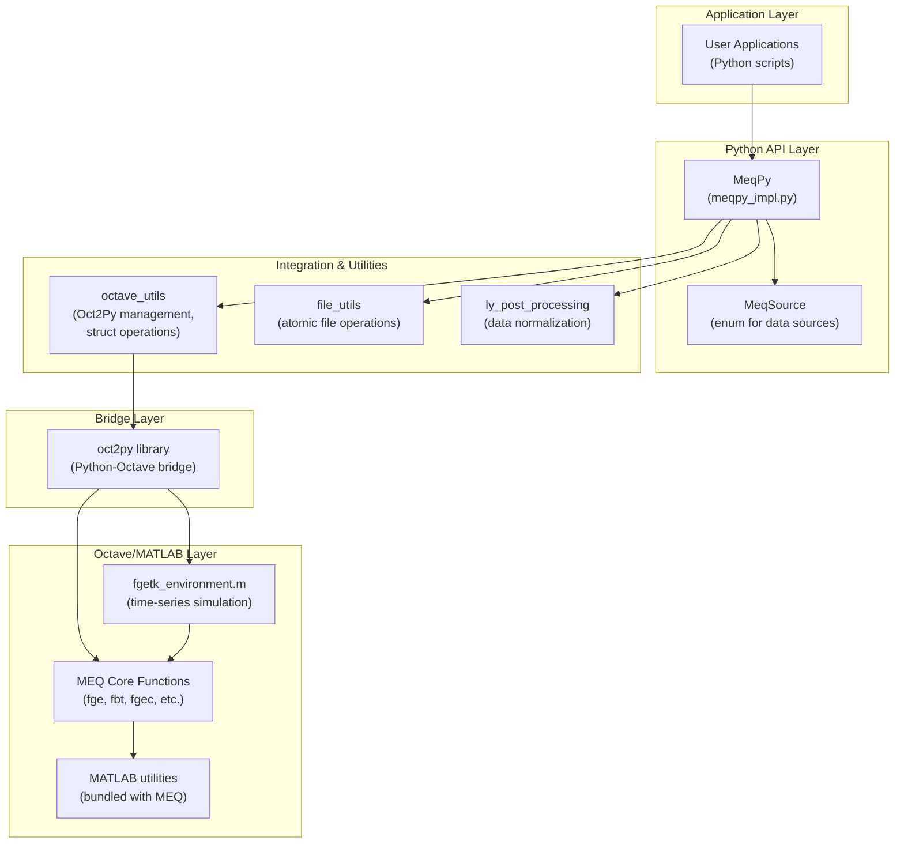
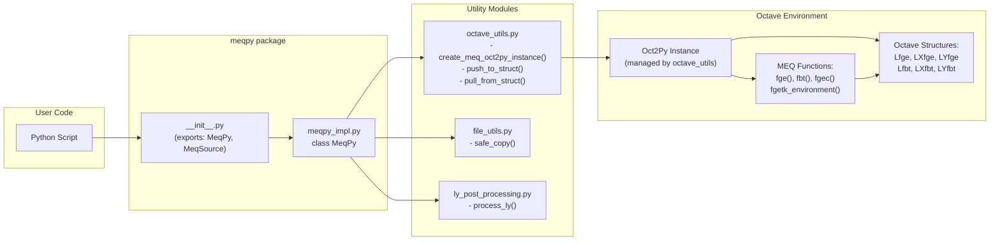
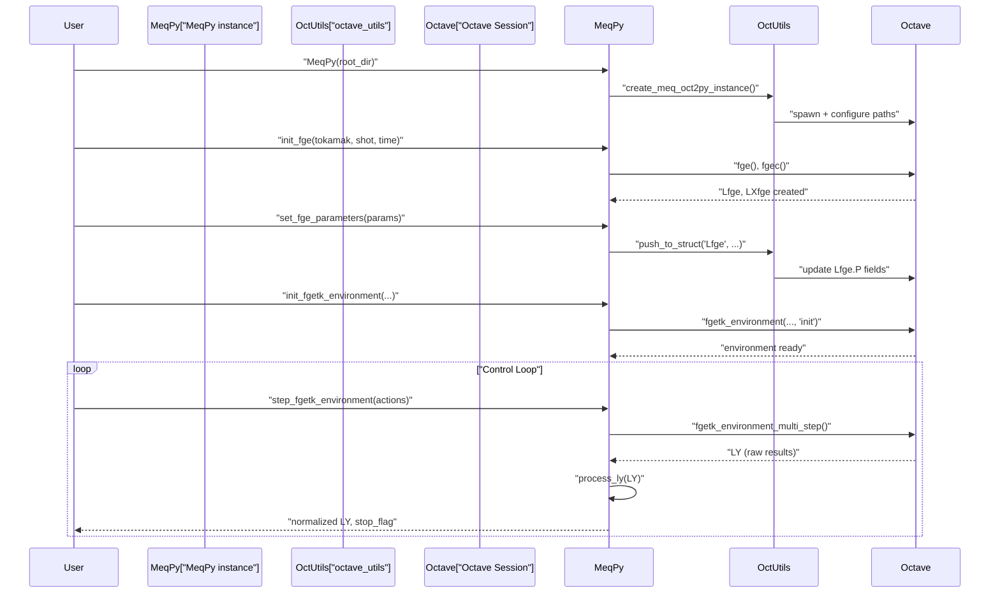

<!-- source: DeepWiki mcp.deepwiki.com · repo google-deepmind/meqpy · page 1 Overview · fetched 2026-10-26 -->

# Overview

<details>
<summary>Relevant source files</summary>

The following files were used as context for generating this wiki page:

- [README.md](README.md)
- [meqpy/__init__.py](meqpy/__init__.py)
- [pyproject.toml](pyproject.toml)

</details>


## Purpose and Scope

This page provides a high-level introduction to MeqPy, a Python wrapper for the MEQ tokamak magnetic equilibrium simulation suite. It covers the system's purpose, architecture, core components, and operational patterns. For detailed installation instructions, see [Installation and Setup](#1.1). For a hands-on introduction, see [Quick Start Guide](#1.2). For in-depth information about specific simulation types, see [Simulation Modes](#3).

## What is MeqPy?

MeqPy is a Python interface to MEQ, a suite of codes for tokamak magnetic equilibrium calculations developed by SPC-EPFL. The library enables Python applications to leverage existing Octave/MATLAB implementations of equilibrium solvers without requiring rewrites of the computational core. MeqPy manages the communication between Python and Octave, handles data structure conversions, and provides a Pythonic API for configuring and executing plasma equilibrium simulations.

The primary use cases include:
- **Fast equilibrium reconstruction** using the FGE (Fast Grad-Shafranov Equilibrium) solver
- **Boundary tracing** using the FBT (Fast Boundary Tracing) solver  
- **Time-dependent control simulations** using the FGETK environment for reinforcement learning and control applications

**Sources:** [README.md:1-5](), [meqpy/__init__.py:15]()

## System Architecture

MeqPy follows a layered architecture that separates concerns across Python application code, integration utilities, a bridge layer, and Octave/MATLAB computational code.

### Architectural Layers



**Sources:** [meqpy/__init__.py:17-18](), [README.md:2-4]()

### Component Interactions

The following diagram maps system concepts to actual code entities:



**Sources:** [meqpy/__init__.py:17-20](), [README.md:59-60]()

## Core Components

### MeqPy Class

The `MeqPy` class in [meqpy/meqpy_impl.py]() serves as the primary interface for all operations. It provides methods for:
- Initializing simulation environments (`init_fge`, `init_fbt`)
- Configuring parameters and geometry (`set_fge_parameters`, `set_fge_geometry`)
- Executing simulations (`run_fbt`, `step_fgetk_environment`)
- Managing state persistence (`save_to_file`, `load_from_file`)

The class maintains a single `Oct2Py` instance throughout its lifetime and manages the lifecycle of Octave variables.

**Sources:** [meqpy/__init__.py:17](), [README.md:79]()

### MeqSource Enum

The `MeqSource` enumeration defines data source options for initialization:
- `MEQ_DIRECT`: Load data directly from MEQ databases
- Other sources for different initialization methods

**Sources:** [meqpy/__init__.py:18](), [README.md:71]()

### Integration Utilities

| Module | Purpose | Key Functions |
|--------|---------|---------------|
| `octave_utils` | Manages Oct2Py instances and struct operations | `create_meq_oct2py_instance()`, `push_to_struct()`, `pull_from_struct()` |
| `file_utils` | Provides atomic file operations | `safe_copy()` |
| `ly_post_processing` | Normalizes MATLAB data structures for Python | `process_ly()` |

**Sources:** [README.md:8-50]()

## Simulation Modes

MeqPy supports three primary simulation modes, each with distinct initialization and execution patterns:

### Mode Comparison

| Mode | Octave Structures | Primary Methods | Use Case |
|------|-------------------|-----------------|----------|
| **FGE** | `Lfge`, `LXfge`, `LYfge` | `init_fge()`, `_run_fget()` | Fast equilibrium reconstruction |
| **FBT** | `Lfbt`, `LXfbt`, `LYfbt` | `init_fbt()`, `run_fbt()` | Boundary tracing |
| **FGETK** | Extends FGE structures | `init_fgetk_environment()`, `step_fgetk_environment()` | Time-dependent control simulations |

### Workflow Pattern



**Sources:** [README.md:59-110]()

## Key Design Patterns

### Structure-Based Configuration

MeqPy uses a structure-based approach inherited from MATLAB/MEQ conventions. Each simulation mode organizes data into three categories:

- **L structures**: Configuration containing parameters (`P`) and geometry (`G`)
- **LX structures**: Input data for simulations
- **LY structures**: Output results from simulations

For example, FGE mode uses `Lfge`, `LXfge`, and `LYfge`, while FBT mode uses `Lfbt`, `LXfbt`, and `LYfbt`.

**Sources:** [README.md:59-60]()

### Octave Session Management

The `octave_utils` module creates and configures a single `Oct2Py` instance per `MeqPy` object. This instance:
- Has its working directory set to the MEQ root
- Has the MEQ `genlib` directory added to its path  
- Persists for the lifetime of the `MeqPy` object
- Enables bidirectional data exchange via struct manipulation

**Sources:** [README.md:10-14](), [README.md:33-43]()

### Data Normalization Pipeline

Output from Octave functions returns MATLAB-style structures that require normalization for Python use. The `ly_post_processing` module converts these structures by:
- Flattening nested fields
- Converting MATLAB arrays to NumPy arrays
- Handling dimension mismatches
- Classifying fields by type

**Sources:** [README.md:86-110]()

### Atomic File Operations

The `file_utils.safe_copy()` function implements atomic file copying using temporary files and rename operations. This ensures data integrity during save/load operations, particularly important when serializing simulation state with function handle conversions.

## Environment Variables and Configuration

MeqPy requires the `MAT_ROOT` environment variable to locate MEQ and associated MATLAB files. This path is used by `octave_utils` to configure the Octave session. Additional paths can be provided via the `extra_paths` parameter in the `MeqPy` constructor or by setting `root_dir` explicitly.

**Sources:** [README.md:33-43](), [pyproject.toml:22-27]()

## Dependencies

| Dependency | Version | Purpose |
|------------|---------|---------|
| `oct2py` | ≥ 5.8.0 | Python-Octave bridge |
| `numpy` | ≥ 1.26 | Numerical operations |
| `jax` | ≥ 0.4 | Data structure handling in post-processing |
| `absl-py` | ≥ 2.0 | Application utilities |
| Octave | (system) | Runtime for MATLAB code execution |

**Sources:** [pyproject.toml:22-27](), [README.md:10-14]()

## Typical Usage Flow

A typical MeqPy workflow follows this pattern:

1. **Initialize**: Create a `MeqPy()` instance, which spawns an Octave session
2. **Configure**: Call `init_fge()` or `init_fbt()` to set up simulation structures
3. **Customize**: Use `set_*_parameters()` and `set_*_geometry()` to adjust configuration
4. **Execute**: 
   - For single-shot: Call `run_fbt()` or `_run_fget()`
   - For time-series: Call `init_fgetk_environment()` then loop with `step_fgetk_environment()`
5. **Persist**: Use `save_to_file()` to checkpoint state for later recovery

Example from the minimal Anamak demonstration:

```python
meq_instance = meqpy.MeqPy()
meq_instance.init_fge(tokamak, shot, time, source, ...)
meq_instance.init_fgetk_environment(control_timestep, simulator_timestep, ...)
for i in range(num_steps):
    LY, stop = meq_instance.step_fgetk_environment(actions, {})
```

**Sources:** [README.md:63-110]()

## Navigation

This overview provides context for understanding MeqPy's architecture. For more specific information:

- Installation procedures: See [Installation and Setup](#1.1)
- Quick start tutorial: See [Quick Start Guide](#1.2)
- Detailed architecture: See [Core Architecture](#2)
- FGE simulations: See [FGE - Fast Grad-Shafranov Equilibrium](#3.1)
- FBT simulations: See [FBT - Fast Boundary Tracing](#3.2)
- Time-dependent control: See [FGETK Environment - Time-Dependent Simulations](#3.4)

---

