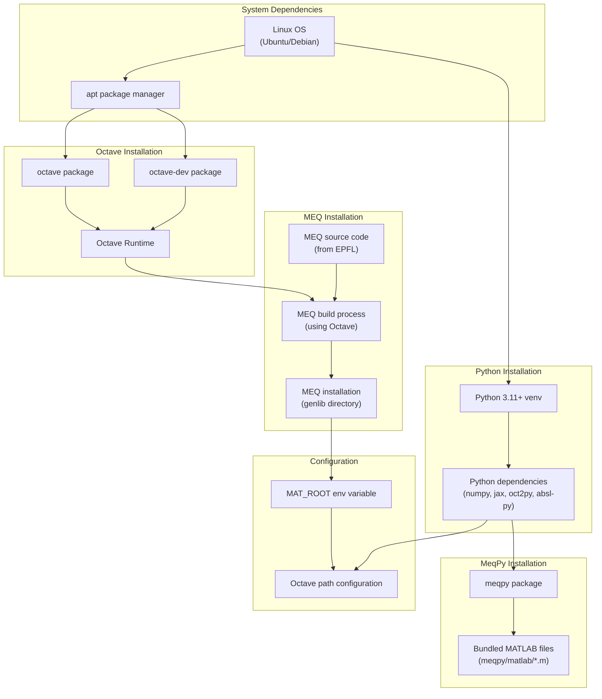
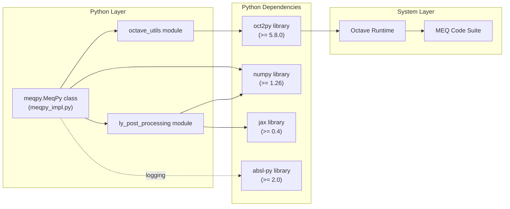
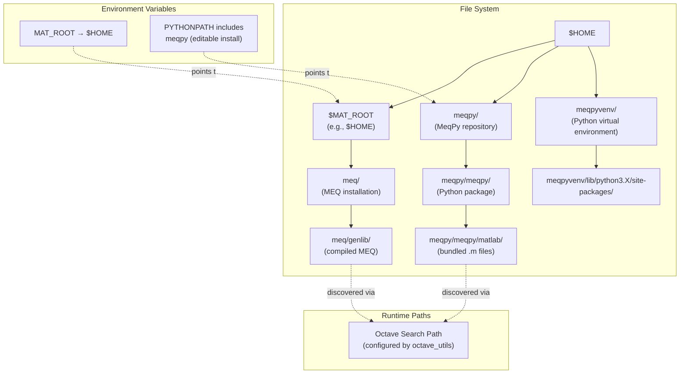

<!-- source: DeepWiki mcp.deepwiki.com · repo google-deepmind/meqpy · page 1.1 Installation and Setup · fetched 2026-10-26 -->

# Installation and Setup

<details>
<summary>Relevant source files</summary>

The following files were used as context for generating this wiki page:

- [MANIFEST.in](MANIFEST.in)
- [README.md](README.md)
- [pyproject.toml](pyproject.toml)

</details>


## Purpose and Scope

This document provides step-by-step instructions for installing MeqPy and configuring its dependencies. It covers Octave installation, MEQ code setup, Python environment configuration, and verification procedures. For information about running your first simulation after installation, see [Quick Start Guide](#1.2). For detailed information about project structure and build configuration, see [Project Structure and Build System](#9.1).

## Overview

MeqPy is a Python wrapper that interfaces with the MEQ code suite via Octave. The installation process requires setting up multiple components in the correct order:



**Installation Dependency Flow**

Sources: [README.md:6-54](), [pyproject.toml:1-35]()

## Prerequisites

### Operating System Requirements

MeqPy is designed for Linux systems. The installation instructions are tested on Ubuntu/Debian-based distributions. Other Linux distributions may require adjustments to package manager commands.

### Required System Packages

The following system packages must be available:
- `octave`: The GNU Octave interpreter (version 5.0 or higher recommended)
- `octave-dev`: Development files for Octave (required for oct2py integration)
- `python3-tk`: Tkinter support for Python (required by some dependencies)
- `python3.11-venv` or higher: Python virtual environment support

Sources: [README.md:10-14](), [README.md:27-28]()

## Step 1: Octave Installation

Install Octave and its development headers using the system package manager:

```bash
sudo apt-get update
sudo apt-get install octave
sudo apt-get install octave-dev
```

**Verification**: After installation, verify Octave is available:

```bash
octave --version
```

The output should display the Octave version number (5.0 or higher recommended).

Sources: [README.md:10-14]()

## Step 2: MEQ Code Installation

### Obtaining MEQ

MEQ is a suite of codes for tokamak magnetic equilibrium calculations developed by SPC-EPFL. Access to MEQ requires authorization from EPFL.

1. Request access via the EPFL Swiss Plasma Center: https://www.epfl.ch/research/domains/swiss-plasma-center/meq/
2. Follow the repository-specific installation instructions provided by EPFL

### Building MEQ

After obtaining the MEQ source code:

```bash
cd <path-to-meq>
# Follow MEQ-specific build instructions using Octave
```

The build process creates a `genlib` directory containing compiled MEQ components. This directory structure is critical for MeqPy operation.

**Directory Structure**: A properly installed MEQ should have the following structure:
```
<MEQ_ROOT>/
├── meq/                  # Core MEQ code
│   ├── genlib/          # Compiled libraries
│   └── ...
└── ...
```

Sources: [README.md:16-23]()

## Step 3: Python Environment Setup

### Creating the Virtual Environment

MeqPy requires Python 3.11 or higher. Create a dedicated virtual environment:

```bash
# Install venv support if not already installed
sudo apt install python3.11-venv

# Create virtual environment
python3 -m venv meqpyvenv

# Activate the environment
source meqpyvenv/bin/activate
```

The virtual environment isolates MeqPy dependencies from other Python projects.

Sources: [README.md:25-31](), [pyproject.toml:21-21]()

### Python Dependencies

MeqPy declares the following Python dependencies in [pyproject.toml:22-27]():

| Dependency | Version Requirement | Purpose |
|------------|-------------------|---------|
| `numpy` | >= 1.26 | Numerical array operations |
| `absl-py` | >= 2.0 | Application utilities and logging |
| `jax` | >= 0.4 | Data structure handling in `ly_post_processing` |
| `oct2py` | >= 5.8.0 | Python-Octave bridge |

These dependencies are automatically installed during MeqPy installation (Step 4).



**Python Dependency Chain from MeqPy to System Components**

Sources: [pyproject.toml:22-27]()

## Step 4: MeqPy Package Installation

### Cloning the Repository

```bash
git clone <meqpy-repository-url>
cd meqpy
```

### Installing MeqPy

Install MeqPy in editable mode to enable development and testing:

```bash
pip install -e .
```

The `-e` flag installs the package in "editable" mode, meaning changes to the source code are immediately reflected without reinstallation.

### What Gets Installed

The installation process:

1. Installs all Python dependencies listed in [pyproject.toml:22-27]()
2. Bundles MATLAB/Octave files according to [MANIFEST.in:1]()
3. Makes the `meqpy` package importable in Python

The bundled MATLAB files include:
- `meqpy/matlab/*.m`: Time-series simulation functions (`fgetk_environment.m` and related files)

Sources: [README.md:45-49](), [MANIFEST.in:1](), [pyproject.toml:1-35]()

## Step 5: Environment Configuration

### MAT_ROOT Environment Variable

The `MAT_ROOT` environment variable specifies the root directory containing the MEQ installation. MeqPy uses this to locate MEQ code at runtime.

**Setting MAT_ROOT**: If MEQ is installed at `$HOME/meq`, set:

```bash
export MAT_ROOT=$HOME
```

Note that `MAT_ROOT` should point to the **parent directory** of the `meq` folder, not the `meq` folder itself.

**Persistent Configuration**: To make this permanent, add the export command to your shell configuration file:

```bash
# For bash
echo 'export MAT_ROOT=$HOME' >> ~/.bashrc
source ~/.bashrc

# For zsh
echo 'export MAT_ROOT=$HOME' >> ~/.zshrc
source ~/.zshrc
```

### Alternative: Programmatic Configuration

Instead of using the environment variable, you can specify the path when creating a `MeqPy` instance:

```python
from meqpy import MeqPy

meq = MeqPy(root_dir="/path/to/mat/root")
```

The `root_dir` parameter in the constructor overrides the `MAT_ROOT` environment variable. However, using the environment variable is recommended for testing and development.

Sources: [README.md:33-43]()

### Additional Paths

If you have other MATLAB files outside the standard MEQ installation, pass them using the `extra_paths` parameter:

```python
meq = MeqPy(extra_paths=["/path/to/additional/matlab/files"])
```

Sources: [README.md:36-36]()

## Step 6: Installation Verification

### Running Tests

Verify the installation by running the test suite:

```bash
pytest
```

The test suite exercises core functionality including:
- Octave session initialization (`octave_utils_test`)
- File operations (`file_utils_test`)
- FGE and FBT simulation workflows (`meqpy_fge_test_mixin`, `meqpy_fbt_test_mixin`)

A successful test run indicates that:
- Python dependencies are correctly installed
- Octave is accessible via `oct2py`
- MEQ code is properly located via `MAT_ROOT`
- All system components can communicate

Sources: [README.md:51-54](), [pyproject.toml:30-35]()

### Manual Verification

Test the installation manually with a minimal Python script:

```python
from meqpy import MeqPy

# Create MeqPy instance (will fail if MAT_ROOT not configured)
meq = MeqPy()
print("MeqPy initialized successfully")

# Verify Octave session is working
tokamak = "ana"
shot = 1
time = 0
meq.init_fge(tokamak, shot, time)
print("FGE initialization successful")
```

If this script runs without errors, the installation is complete and functional.

## Installation Architecture

The following diagram shows the file system layout after successful installation:



**File System Layout After Installation**

Sources: [README.md:33-43](), [MANIFEST.in:1]()

## Troubleshooting

### Common Issues

**Issue: `oct2py` cannot find Octave**
- Verify Octave is installed: `which octave`
- Ensure `octave` is in your `PATH`
- Check Octave version: `octave --version` (should be 5.0+)

**Issue: `MAT_ROOT` not found errors**
- Verify environment variable: `echo $MAT_ROOT`
- Ensure `MAT_ROOT` points to the parent of the `meq` directory
- Check that `$MAT_ROOT/meq/genlib` exists

**Issue: Import errors for `meqpy` package**
- Verify virtual environment is activated
- Reinstall: `pip install -e .` from the meqpy repository root
- Check Python version: `python --version` (must be 3.11+)

**Issue: Test failures**
- Run with verbose output: `pytest -v`
- Check that MEQ is properly built with a `genlib` directory
- Verify all system packages are installed (`octave-dev`, `python3-tk`)

**Issue: Function handles not found in loaded state files**
- This is expected behavior when loading `.mat` files that contain function handles
- The `meqpy_impl` module includes restoration logic for common function handles
- See [State Persistence and Recovery](#5) for details on function handle management

Sources: [README.md:6-54]()

## Next Steps

After successful installation:
1. Review the [Quick Start Guide](#1.2) for a simple example
2. Explore [Simulation Modes](#3) to understand FGE, FBT, and FGETK environments
3. Consult [Core Architecture](#2) to understand how components interact

---

