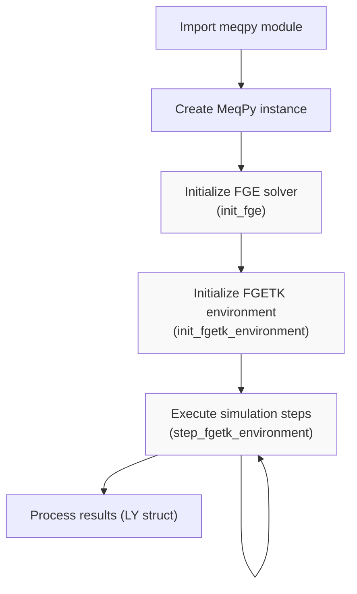
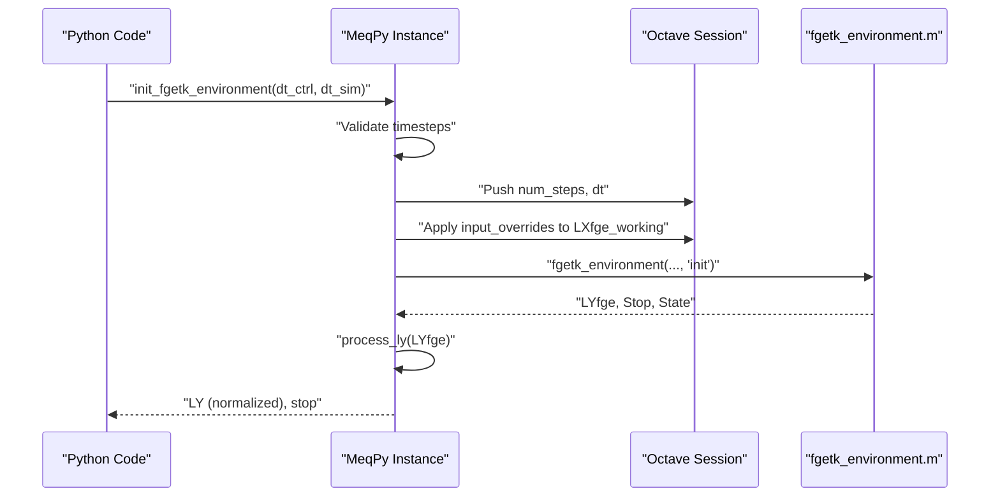
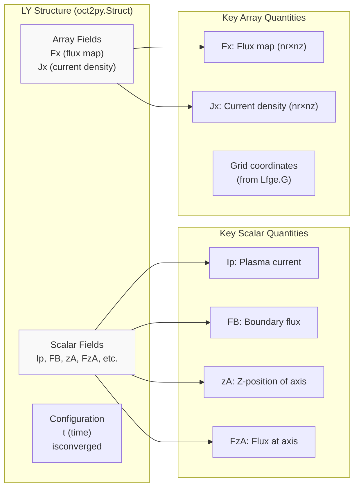
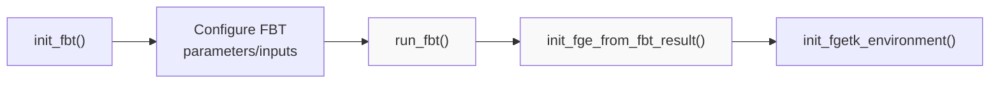

<!-- source: DeepWiki mcp.deepwiki.com · repo google-deepmind/meqpy · page 1.2 Quick Start Guide · fetched 2026-10-26 -->

# Quick Start Guide

<details>
<summary>Relevant source files</summary>

The following files were used as context for generating this wiki page:

- [README.md](README.md)
- [meqpy/__init__.py](meqpy/__init__.py)
- [meqpy/meqpy_impl.py](meqpy/meqpy_impl.py)

</details>


## Purpose and Scope

This guide provides a practical introduction to running your first MeqPy simulation. It demonstrates the basic workflow for initializing a tokamak equilibrium, setting up a time-dependent simulation environment, and interpreting results. 

For installation instructions and environment configuration, see [Installation and Setup](#1.1). For detailed documentation of simulation modes and advanced configuration, see [Simulation Modes](#3) and [Core Architecture](#2).

Sources: [README.md:56-111]()

---

## Basic Workflow Overview

The typical MeqPy workflow follows this sequence:



**Diagram: Basic MeqPy Simulation Workflow** - The core sequence from initialization to results extraction.

Sources: [meqpy_impl.py:75-134](), [README.md:56-111]()

---

## Minimal Working Example

This example demonstrates initializing and running a basic time-dependent FGE simulation using the analytical Anamak tokamak:

```python
import meqpy
import numpy as np

# Configuration
tokamak = "ana"  # Anamak analytical tokamak
shot = 2  # Diverted configuration
time = 0.0  # Initial time (seconds)
source = meqpy.MeqSource.MEQ_DIRECT

# Time stepping parameters
control_timestep = 1e-4  # Control action update rate
simulator_timestep = 1e-4  # Internal simulation timestep

# Create MeqPy instance
meq = meqpy.MeqPy()

# Initialize FGE equilibrium solver
meq.init_fge(
    tokamak=tokamak,
    shot=shot,
    time=time,
    source=source,
    default_meq_params={'debug': 2}
)

# Initialize time-dependent environment
original_bp = meq.get_fge_input('bpD')
ly_init, stop = meq.init_fgetk_environment(
    control_timestep=control_timestep,
    simulator_timestep=simulator_timestep,
    input_overrides={'bpD': original_bp * 1.001}
)

# Get control circuit names
circuit_names = meq.get_fgetk_circuit_names()
num_actions = len(circuit_names)

# Define actions (voltages to apply)
actions = np.full((num_actions,), 10.0)

# Execute simulation steps
for i in range(5):
    ly, stop = meq.step_fgetk_environment(actions, {})
    
    print(f"Step {i}: Ip={ly.Ip:.0f}A, FB={ly.FB[0]:.6f}, zA={ly.zA[0]:.6f}")
    
    if stop != 'ok':
        print(f"Simulation stopped: {stop}")
        break
```

Sources: [README.md:56-111](), [meqpy_impl.py:83-97](), [meqpy_impl.py:135-180]()

---

## Step-by-Step Breakdown

### 1. Import and Configuration

```python
import meqpy
```

The `meqpy` package exports two main symbols: the `MeqPy` class and the `MeqSource` enum.

| Parameter | Type | Description |
|-----------|------|-------------|
| `tokamak` | `str` | Tokamak identifier (e.g., "ana" for Anamak) |
| `shot` | `int` | Shot number defining geometry/configuration |
| `time` | `float` | Initial simulation time in seconds |
| `source` | `MeqSource` | Data source (use `MeqSource.MEQ_DIRECT`) |

Sources: [meqpy/__init__.py:15-20](), [meqpy_impl.py:69-73]()

### 2. Create MeqPy Instance

```python
meq = meqpy.MeqPy()
```

This initializes an Octave session and configures MEQ paths. The constructor accepts optional parameters:

| Parameter | Type | Default | Description |
|-----------|------|---------|-------------|
| `root_dir` | `str \| None` | `None` | MEQ installation root (uses `MAT_ROOT` env var if `None`) |
| `extra_paths` | `Sequence[str]` | `()` | Additional paths relative to `root_dir` |

The instance maintains an Octave session throughout its lifetime. Always call `cleanup()` or use context management when done.

Sources: [meqpy_impl.py:83-97]()

### 3. Initialize FGE Solver

```python
meq.init_fge(
    tokamak=tokamak,
    shot=shot,
    time=time,
    source=source,
    default_meq_params={'debug': 2}
)
```

This creates the `Lfge` (configuration) and `LXfge` (inputs) structures in Octave. The `default_meq_params` dictionary sets parameters in `Lfge.P`:

| Common Parameter | Description |
|------------------|-------------|
| `debug` | Debug level (0=off, 1=basic, 2=verbose) |
| `nit` | Maximum iterations for convergence |
| `err` | Convergence error tolerance |

Sources: [meqpy_impl.py:135-180](), [meqpy_impl.py:305-327]()

### 4. Initialize FGETK Environment

```python
ly_init, stop = meq.init_fgetk_environment(
    control_timestep=control_timestep,
    simulator_timestep=simulator_timestep,
    input_overrides={'bpD': original_bp * 1.001}
)
```

This initializes the time-dependent simulation environment by calling `fgetk_environment` with mode `'init'`. Key constraints:

- `control_timestep` must be an integer multiple of `simulator_timestep`
- Returns initial `LY` (results) and stop condition string
- `input_overrides` allows modifying initial conditions



**Diagram: FGETK Environment Initialization Sequence** - Shows the initialization call flow from Python to Octave.

Sources: [meqpy_impl.py:474-511](), [matlab/fgetk_environment.m]()

### 5. Execute Simulation Steps

```python
for i in range(num_steps):
    ly, stop = meq.step_fgetk_environment(actions, input_overrides={})
```

Each call to `step_fgetk_environment` advances the simulation by one control timestep:

| Parameter | Type | Description |
|-----------|------|-------------|
| `actions` | `np.ndarray` | Voltages for each control circuit (shape: `(num_actions,)`) |
| `input_overrides` | `Mapping[str, np.ndarray]` | Optional overrides for LX fields |

**Returns**: Tuple of `(LY, stop)` where:
- `LY` is the results structure (see below)
- `stop` is a string indicating simulation status (`'ok'`, `'diverged'`, etc.)

**Important**: The returned `LY` corresponds to the *previous* timestep, reflecting real control system delays where actions at time `n` are based on observations from time `n-1`.

Sources: [meqpy_impl.py:513-545](), [matlab/fgetk_environment_multi_step.m]()

---

## Understanding Results

The `LY` structure returned by simulation steps contains computed equilibrium quantities:



**Diagram: LY Results Structure** - Key fields in the equilibrium results returned by FGE.

### Accessing Result Fields

```python
# Scalar quantities
plasma_current = ly.Ip  # Plasma current (Amperes)
boundary_flux = ly.FB[0]  # Boundary flux (Weber)
z_axis = ly.zA[0]  # Vertical position of magnetic axis (meters)

# 2D arrays (flux map)
flux_map = ly.Fx  # Shape: (nr, nz)
current_density = ly.Jx  # Shape: (nr, nz)

# Grid coordinates (from geometry)
rx = meq.get_fge_geometry('rx').reshape(-1)  # Radial coordinates
zx = meq.get_fge_geometry('zx').reshape(-1)  # Vertical coordinates
```

### Plotting Flux Contours

```python
import matplotlib.pyplot as plt

# Plot flux contours
plt.contour(rx, zx, flux_map - boundary_flux, 21)
plt.contour(rx, zx, flux_map, [boundary_flux], colors='k', linewidths=2)
plt.axis('equal')
plt.xlabel('R (m)')
plt.ylabel('Z (m)')
plt.title(f'Flux Contours at t={ly.t:.4f}s')
plt.show()
```

Sources: [meqpy_impl.py:358-365](), [ly_post_processing.py](), [README.md:96-110]()

---

## Code Entity Reference

The following table maps conceptual operations to specific code entities:

| Operation | Class/Function | File | Purpose |
|-----------|---------------|------|---------|
| Create instance | `MeqPy.__init__()` | [meqpy_impl.py:83-97]() | Initialize Octave session |
| Initialize FGE | `MeqPy.init_fge()` | [meqpy_impl.py:135-180]() | Create `Lfge`, `LXfge` structures |
| Initialize environment | `MeqPy.init_fgetk_environment()` | [meqpy_impl.py:474-511]() | Setup time-dependent simulation |
| Execute step | `MeqPy.step_fgetk_environment()` | [meqpy_impl.py:513-545]() | Advance simulation by one control timestep |
| Get parameter | `MeqPy.get_fge_parameter()` | [meqpy_impl.py:433-434]() | Read value from `Lfge.P` |
| Get geometry | `MeqPy.get_fge_geometry()` | [meqpy_impl.py:436-437]() | Read value from `Lfge.G` |
| Get input | `MeqPy.get_fge_input()` | [meqpy_impl.py:439-440]() | Read value from `LXfge` |
| Normalize results | `process_ly()` | [ly_post_processing.py]() | Convert MATLAB structs to Python-friendly format |

Sources: [meqpy_impl.py:75-785]()

---

## Alternative Workflows

### Two-Stage Initialization (FBT → FGE)

For more control over boundary reconstruction, you can run FBT separately before initializing FGE:



**Diagram: Two-Stage Initialization Workflow** - Using FBT results to initialize FGE.

```python
# Stage 1: Run FBT
meq.init_fbt(tokamak, shot, time, source)
meq.set_fbt_parameters(parameters={'debug': 2})
ly_fbt = meq.run_fbt()

# Stage 2: Initialize FGE from FBT result
meq.init_fge_from_fbt_result(tokamak, shot, time, source)
ly_init, stop = meq.init_fgetk_environment(control_timestep, simulator_timestep)
```

For details on FBT, see [FBT - Fast Boundary Tracing](#3.2) and [FBT to FGE Integration](#3.3).

Sources: [meqpy_impl.py:202-220](), [meqpy_impl.py:239-287]()

---

## Common Patterns

### Accessing Control Circuit Information

```python
# Get list of control circuit names
circuit_names = meq.get_fgetk_circuit_names()
# Returns: array(['OH', 'FUP', 'FLO', ...])

# Get number of circuits for action vector sizing
num_actions = len(circuit_names)
```

Sources: [meqpy_impl.py:564-565]()

### Checking Simulation Status

```python
ly, stop = meq.step_fgetk_environment(actions, {})

if stop != 'ok':
    if stop == 'diverged':
        print("Simulation diverged - check parameters")
    elif stop == 'time_limit':
        print("Reached time limit")
    else:
        print(f"Unexpected stop condition: {stop}")
```

Sources: [meqpy_impl.py:513-545](), [matlab/fgetk_environment.m]()

### Resource Cleanup

```python
# Explicit cleanup
meq.cleanup()

# Or use try-finally
meq = meqpy.MeqPy()
try:
    # ... simulation code ...
finally:
    meq.cleanup()
```

Sources: [meqpy_impl.py:101-109]()

---

## Next Steps

After completing this quick start guide:

- **Detailed Configuration**: Learn about parameter tuning and geometry settings in [Parameter and Geometry Configuration](#8.1)
- **Simulation Modes**: Explore FGE, FBT, and FGETK modes in detail in [Simulation Modes](#3)
- **State Persistence**: Save and load simulation states for debugging in [State Persistence and Recovery](#5)
- **Error Handling**: Understand common errors and debugging strategies in [Error Handling and Debugging](#8.2)

Sources: [meqpy_impl.py:1-785](), [README.md:1-131]()

---

