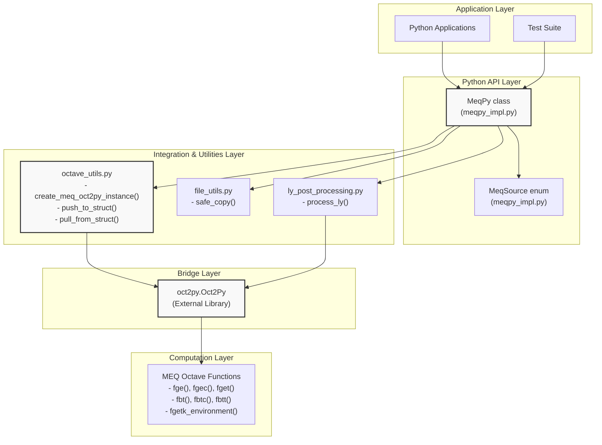
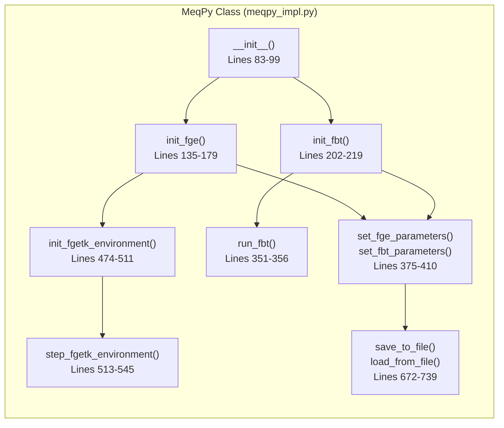
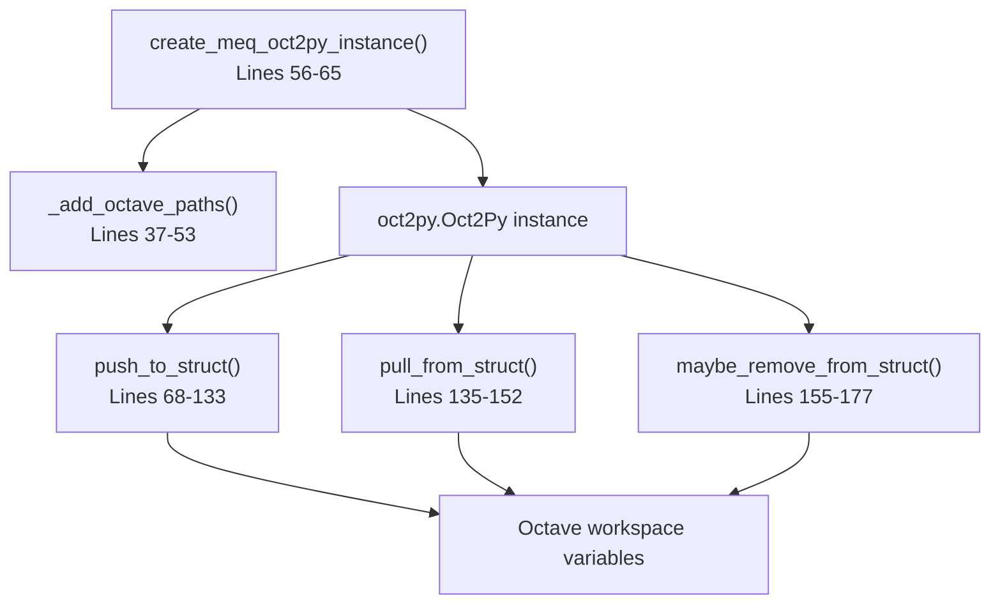
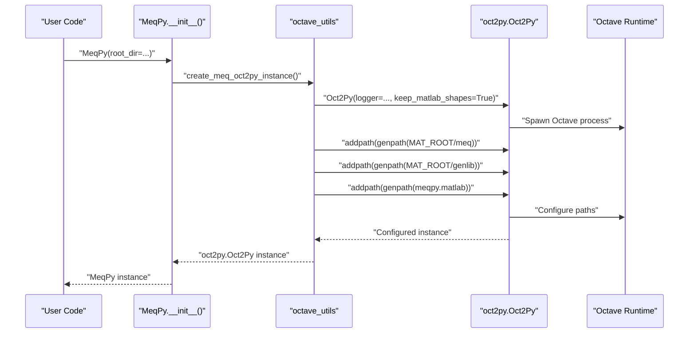
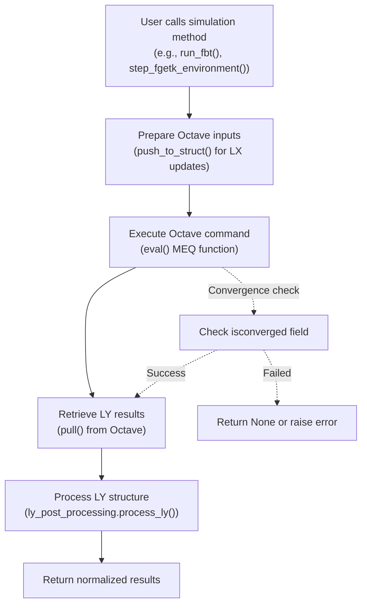
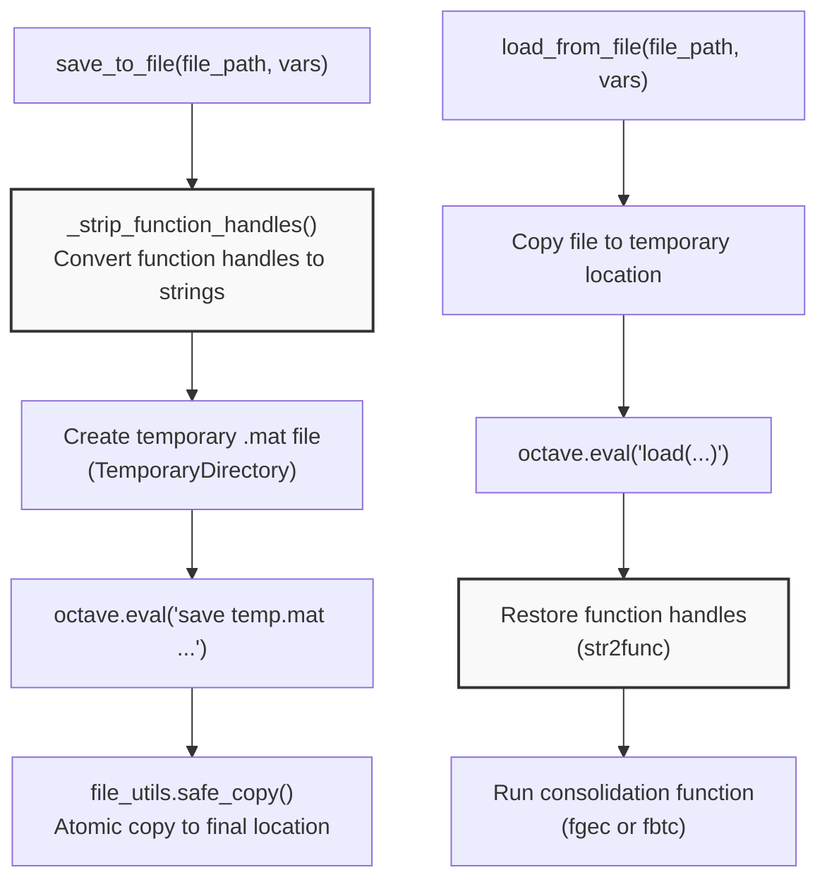
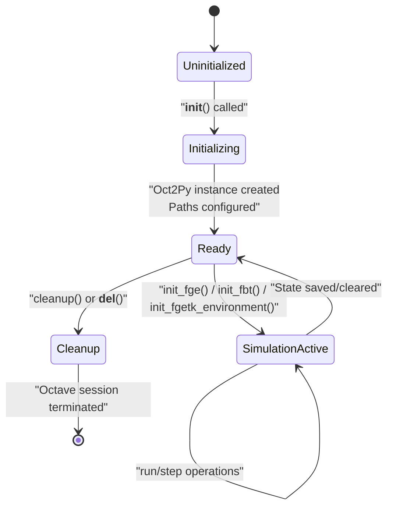

<!-- source: DeepWiki mcp.deepwiki.com · repo google-deepmind/meqpy · page 2 Core Architecture · fetched 2026-10-26 -->

# Core Architecture

<details>
<summary>Relevant source files</summary>

The following files were used as context for generating this wiki page:

- [meqpy/__init__.py](meqpy/__init__.py)
- [meqpy/meqpy_impl.py](meqpy/meqpy_impl.py)
- [meqpy/octave_utils.py](meqpy/octave_utils.py)

</details>


## Purpose and Scope

This document explains the layered architecture of MeqPy, detailing how Python components interface with the Octave/MATLAB-based MEQ computational engine. It covers the overall system structure, component responsibilities, and inter-layer communication patterns.

For detailed information about specific components, see:
- The main API class and its methods: [The MeqPy Class](#2.1)
- Octave bridge utilities and struct operations: [Octave Integration Layer](#2.2)
- Data structure conventions between Python and Octave: [Data Structures and Conventions](#2.3)

---

## Architectural Overview

MeqPy implements a **layered architecture** that separates concerns across five distinct layers, enabling Python applications to leverage existing Octave/MATLAB MEQ implementations without requiring reimplementation of the computational core.

### Layer Architecture



**Sources:** [meqpy/__init__.py:1-21](), [meqpy/meqpy_impl.py:1-100](), [meqpy/octave_utils.py:1-66]()

---

## Component Layers

### Layer 1: Application Layer

The application layer consists of end-user Python code and the test infrastructure. Users interact exclusively with the public API exposed through the `MeqPy` class and `MeqSource` enum.

| Component | Module | Purpose |
|-----------|--------|---------|
| Public API | `meqpy/__init__.py` | Exports `MeqPy` and `MeqSource` |
| User Applications | External | Scientific simulations, control algorithms |
| Test Infrastructure | `meqpy/*_test.py` | Validation and regression testing |

**Sources:** [meqpy/__init__.py:15-20]()

### Layer 2: Python API Layer

The `MeqPy` class in `meqpy_impl.py` serves as the central orchestrator, providing a stateful interface to MEQ functionality.



**Key Responsibilities:**
- **Lifecycle Management**: Initializes and maintains the Octave session via `_octave` attribute [meqpy/meqpy_impl.py:95-97]()
- **Simulation Mode Control**: Provides distinct initialization paths for FGE, FBT, and FGETK environments
- **State Persistence**: Implements save/load mechanisms for debugging and reproducibility [meqpy/meqpy_impl.py:672-739]()
- **Parameter Configuration**: Exposes methods to set parameters and geometry for both FGE and FBT modes

The `MeqSource` enum defines data source types, currently supporting `MEQ_DIRECT` for direct MEQ method invocation [meqpy/meqpy_impl.py:69-73]().

**Sources:** [meqpy/meqpy_impl.py:75-134](), [meqpy/meqpy_impl.py:135-240](), [meqpy/meqpy_impl.py:474-545]()

### Layer 3: Integration & Utilities Layer

This layer provides specialized utilities that bridge Python and Octave paradigms.

#### octave_utils Module



**Functions:**

| Function | Lines | Purpose |
|----------|-------|---------|
| `create_meq_oct2py_instance()` | 56-65 | Creates and configures Oct2Py instance with MEQ paths |
| `push_to_struct()` | 68-133 | Assigns Python dict values to Octave struct fields with validation |
| `pull_from_struct()` | 135-152 | Retrieves Octave struct field values to Python |
| `maybe_remove_from_struct()` | 155-177 | Conditionally removes struct fields if they exist |

The path configuration includes MEQ core, genlib, octave_optim, octave_control, and the bundled `meqpy.matlab` package [meqpy/octave_utils.py:29-51]().

**Sources:** [meqpy/octave_utils.py:56-177]()

#### file_utils Module

Provides atomic file operations via `safe_copy()` to ensure data integrity during persistence operations, particularly important when saving Octave state to `.mat` files.

**Sources:** [meqpy/meqpy_impl.py:720-722]()

#### ly_post_processing Module

The `process_ly()` function normalizes MATLAB-style data structures (LY outputs) into Python-friendly formats, handling dimension squeezing and field classification.

**Sources:** [meqpy/meqpy_impl.py:364](), [meqpy/meqpy_impl.py:511](), [meqpy/meqpy_impl.py:545]()

### Layer 4: Bridge Layer

The `oct2py` library (version ≥ 5.8.0) provides the Python-to-Octave bridge. The `MeqPy` class configures it with `keep_matlab_shapes=True` to preserve array dimensions [meqpy/octave_utils.py:62]().

**Key Features Used:**
- `eval()`: Execute Octave commands
- `push()`: Transfer Python variables to Octave workspace
- `pull()`: Retrieve Octave variables to Python
- `addpath()`, `genpath()`: Configure Octave search paths

**Sources:** [meqpy/octave_utils.py:56-65]()

### Layer 5: Computation Layer

The computation layer consists of Octave/MATLAB functions from the MEQ codebase (located via `MAT_ROOT` environment variable) and bundled MATLAB code in `meqpy.matlab`.

**MEQ Core Functions:**

| Function | Purpose | Called From |
|----------|---------|-------------|
| `fge()` | Initialize FGE structure (L) | [meqpy/meqpy_impl.py:323-326]() |
| `fgec()` | Consolidate FGE structure after parameter changes | [meqpy/meqpy_impl.py:396]() |
| `fget()` | Run time-dependent FGE simulation | [meqpy/meqpy_impl.py:472]() |
| `fbt()` | Initialize FBT structure (L) | [meqpy/meqpy_impl.py:342]() |
| `fbtc()` | Consolidate FBT structure | [meqpy/meqpy_impl.py:410]() |
| `fbtt()` | Run FBT simulation | [meqpy/meqpy_impl.py:360]() |
| `fgetk_environment()` | Time-stepping simulation environment | [meqpy/meqpy_impl.py:507]() |

**Bundled MATLAB Code:**

The `meqpy.matlab` package includes specialized functions for control-oriented simulations:
- `fgetk_environment.m`: Main environment controller
- `fgetk_environment_loop.m`: Inner loop logic
- `fgetk_environment_multi_step.m`: Multi-step execution
- `fgetk_environment_test.m`: Test utilities

**Sources:** [meqpy/octave_utils.py:29-51](), [meqpy/meqpy_impl.py:323-360]()

---

## Data Flow and Communication Patterns

### Initialization Flow



**Sources:** [meqpy/meqpy_impl.py:83-99](), [meqpy/octave_utils.py:56-65](), [meqpy/octave_utils.py:37-53]()

### Parameter Configuration Flow

The parameter configuration flow demonstrates bidirectional communication between Python and Octave:

```mermaid
sequenceDiagram
    participant User as "User Code"
    participant MeqPy as "MeqPy"
    participant OctUtils as "octave_utils"
    participant Oct2Py as "oct2py.Oct2Py"
    participant Octave as "Octave Workspace"
    
    User->>MeqPy: "set_fge_parameters(params={'debug': 1})"
    MeqPy->>OctUtils: "push_to_struct(octave, 'Lfge.P', params)"
    OctUtils->>Oct2Py: "eval('isfield(Lfge.P, {'debug'})')"
    Oct2Py->>Octave: "Check field exists"
    Octave-->>Oct2Py: "True"
    OctUtils->>Oct2Py: "push(['debug_temp'], [1])"
    Oct2Py->>Octave: "Create debug_temp = 1"
    OctUtils->>Oct2Py: "eval('Lfge.P.debug = debug_temp; clear debug_temp;')"
    Oct2Py->>Octave: "Assign and cleanup"
    OctUtils-->>MeqPy: "Complete"
    MeqPy->>Oct2Py: "eval('Lfge = fgec(Lfge.P, Lfge.G);')"
    Oct2Py->>Octave: "Run consolidation"
    Octave-->>Oct2Py: "Updated Lfge"
    MeqPy-->>User: "Parameters set"
```

**Key Design Decisions:**
1. **Field Validation**: `push_to_struct()` validates that all fields exist before assignment to prevent silent failures [meqpy/octave_utils.py:107-129]()
2. **Temporary Variables**: Uses temporary variables during assignment to enable atomic batch updates [meqpy/octave_utils.py:93-101]()
3. **Consolidation**: Always runs consolidation functions (`fgec()`, `fbtc()`) after parameter changes to regenerate derived quantities [meqpy/meqpy_impl.py:396](), [meqpy/meqpy_impl.py:410]()

**Sources:** [meqpy/meqpy_impl.py:375-410](), [meqpy/octave_utils.py:68-133]()

---

## Execution and Result Processing

### Simulation Execution Pattern



**Example: FBT Execution** [meqpy/meqpy_impl.py:351-364]()

1. **Execute**: `octave_eval("LYfbt = fbtt(Lfbt, LXfbt);")`
2. **Validate**: Check `LYfbt.isconverged` field
3. **Retrieve**: `octave.pull("LYfbt")`
4. **Process**: `ly_post_processing.process_ly(ly)`
5. **Return**: Normalized `oct2py.Struct` to user

**Sources:** [meqpy/meqpy_impl.py:351-364](), [meqpy/meqpy_impl.py:513-545]()

---

## State Management and Persistence

The `MeqPy` class maintains simulation state through the Octave session and provides mechanisms for saving and loading state for debugging and reproducibility.

### State Variables by Mode

| Mode | Configuration (L) | Inputs (LX) | Results (LY) | Additional State |
|------|-------------------|-------------|--------------|------------------|
| FGE | `Lfge` (with `Lfge.P`, `Lfge.G`) | `LXfge` | `LYfge` | - |
| FBT | `Lfbt` (with `Lfbt.P`, `Lfbt.G`) | `LXfbt` | `LYfbt` | - |
| FGETK | `Lfge` (reused) | `LXfge_sequence` | `LYfge` | `State`, `State_prev`, `Actions`, `num_steps` |

**Sources:** [meqpy/meqpy_impl.py:45-58]()

### Persistence Mechanism



**Function Handle Conversion:**

Octave function handles (e.g., `@bfgen`, `@inflinR`) cannot be directly serialized. The persistence mechanism:
1. **On Save**: Converts function handles to strings using `strip_function_handles()` [meqpy/meqpy_impl.py:661-670]()
2. **On Load**: Reconstructs function handles using `str2func()` and runs consolidation to regenerate derived quantities [meqpy/meqpy_impl.py:593-608]()

**Temporary File Strategy:**

Uses `tmpfs` (if available) or system temp directory for intermediate file operations to avoid Octave's file access limitations [meqpy/meqpy_impl.py:711-722](), [meqpy/meqpy_impl.py:770-784]().

**Sources:** [meqpy/meqpy_impl.py:672-739](), [meqpy/meqpy_impl.py:661-670](), [meqpy/meqpy_impl.py:581-608]()

---

## Lifecycle and Resource Management

### Instance Lifecycle



**Key Attributes:**
- `_octave`: The `oct2py.Oct2Py` instance holding Octave session [meqpy/meqpy_impl.py:95-96]()
- `_is_open`: Boolean flag tracking Octave session state [meqpy/meqpy_impl.py:94](), [meqpy/meqpy_impl.py:106-109]()
- `_env_num_steps`: Cached ratio of control timestep to simulator timestep for FGETK mode [meqpy/meqpy_impl.py:99](), [meqpy/meqpy_impl.py:481-487]()

### Cleanup and Resource Release

The `cleanup()` method ensures proper resource release:
1. Clears all Octave workspace variables: `eval("clear all;")`
2. Terminates Octave session: `_octave.exit()`
3. Sets `_is_open = False`

The `__del__()` destructor calls `cleanup()` to ensure cleanup occurs even if not explicitly called [meqpy/meqpy_impl.py:101-109]().

**Sources:** [meqpy/meqpy_impl.py:83-109]()

---

## Cross-Layer Interaction Summary

The following table summarizes how different architectural concerns are addressed across layers:

| Concern | Python API Layer | Integration Layer | Bridge Layer | Computation Layer |
|---------|------------------|-------------------|--------------|-------------------|
| **Simulation Control** | `MeqPy.init_fge()`, `run_fbt()`, `step_fgetk_environment()` | Path configuration, struct operations | Command execution | MEQ algorithms (fge, fbt, fgetk) |
| **Data Transfer** | Method parameters and returns | `push_to_struct()`, `pull_from_struct()` | `push()`, `pull()`, `eval()` | Octave workspace variables |
| **Error Handling** | Convergence checks, ValueError exceptions | Field validation in `push_to_struct()` | Oct2Py exceptions | Octave error messages |
| **State Management** | `save_to_file()`, `load_from_file()` | Function handle conversion | `.mat` file I/O | Persistent workspace variables |
| **Type Conversion** | NumPy arrays, Python dicts | `process_ly()` normalization | oct2py type mapping | MATLAB/Octave arrays, structs |

**Sources:** [meqpy/meqpy_impl.py:75-785](), [meqpy/octave_utils.py:56-177]()

---

## Summary

The MeqPy architecture achieves clean separation of concerns through its five-layer design:

1. **Application Layer**: User-facing Python applications and tests
2. **API Layer**: The `MeqPy` class providing stateful orchestration
3. **Integration Layer**: Utility modules (`octave_utils`, `file_utils`, `ly_post_processing`) bridging Python and Octave paradigms
4. **Bridge Layer**: The `oct2py` library enabling Python-Octave communication
5. **Computation Layer**: MEQ Octave/MATLAB functions performing plasma equilibrium calculations

This architecture enables Python applications to leverage existing MEQ implementations while maintaining type safety, data integrity, and a Pythonic interface. For implementation details of specific components, refer to the sub-pages linked at the beginning of this document.

---

