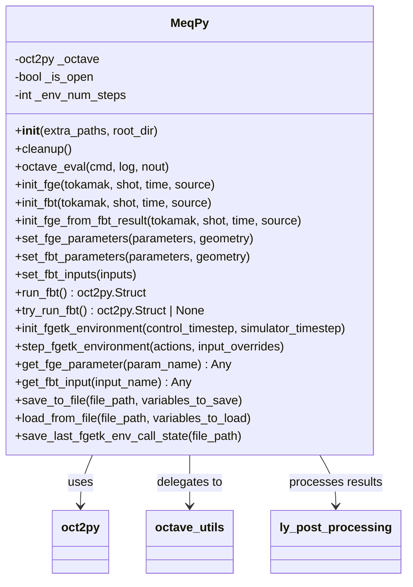
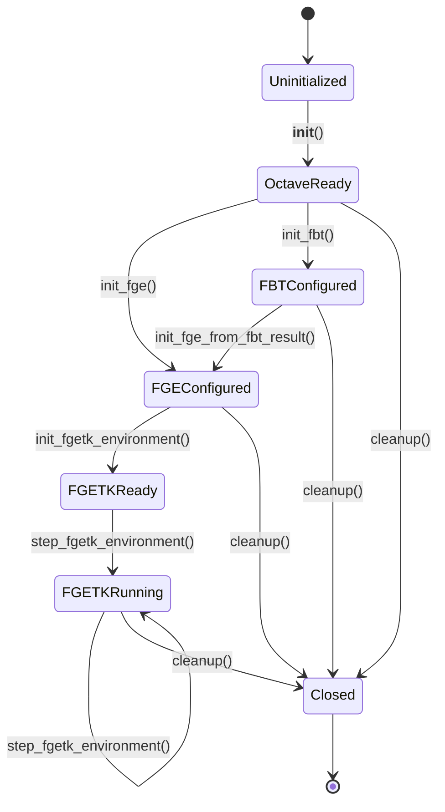
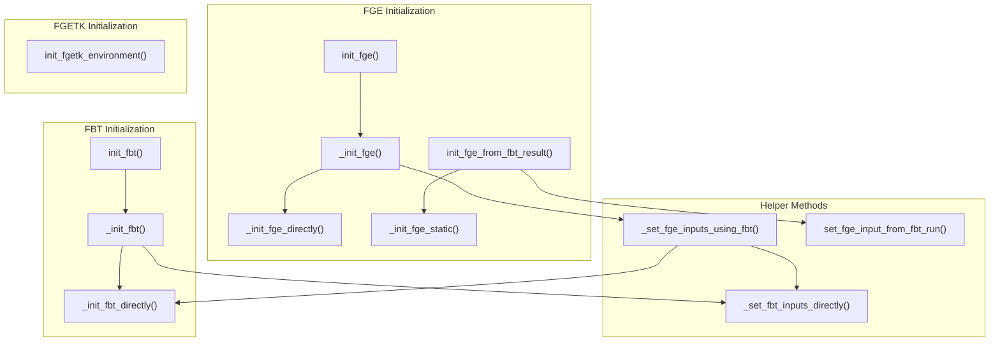
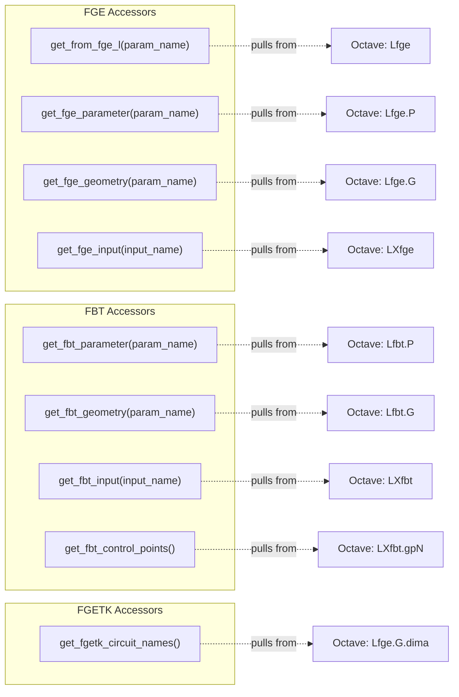
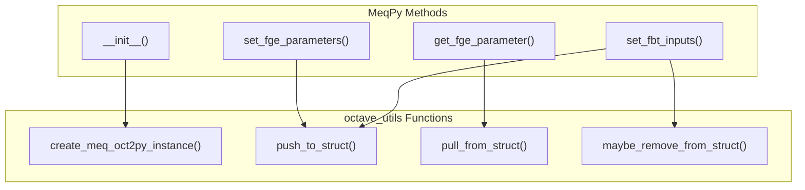

<!-- source: DeepWiki mcp.deepwiki.com · repo google-deepmind/meqpy · page 2.1 The MeqPy Class · fetched 2026-10-26 -->

# The MeqPy Class

<details>
<summary>Relevant source files</summary>

The following files were used as context for generating this wiki page:

- [meqpy/__init__.py](meqpy/__init__.py)
- [meqpy/meqpy_impl.py](meqpy/meqpy_impl.py)

</details>


This document describes the `MeqPy` class, which serves as the primary Python interface for controlling MEQ simulations. The `MeqPy` class manages the Octave session, orchestrates simulation workflows (FGE, FBT, FGETK), and provides methods for parameter configuration, state persistence, and result retrieval.

For information about the Octave integration layer that `MeqPy` relies on, see [Octave Integration Layer](#2.2). For details on the data structures used by MEQ, see [Data Structures and Conventions](#2.3). For specific simulation mode usage, see [Simulation Modes](#3).

**Scope**: This page focuses on the `MeqPy` class itself—its initialization, lifecycle, method organization, and state management. Implementation details of individual simulation modes are covered in their respective sections.

---

## Class Overview

The `MeqPy` class is defined in [meqpy/meqpy_impl.py:75-753]() and serves as a stateful wrapper around an Octave session. It maintains simulation state through Octave variables and provides a Pythonic API for MEQ operations.

### Core Responsibilities

| Responsibility | Description | Key Methods |
|---|---|---|
| **Session Management** | Initialize and maintain Octave session | `__init__`, `cleanup`, `octave_eval` |
| **FGE Operations** | Fast Grad-Shafranov Equilibrium simulations | `init_fge`, `set_fge_parameters`, `_run_fget` |
| **FBT Operations** | Fast Boundary Tracing simulations | `init_fbt`, `run_fbt`, `set_fbt_inputs` |
| **FGETK Environment** | Time-dependent control simulations | `init_fgetk_environment`, `step_fgetk_environment` |
| **State Persistence** | Save and restore simulation state | `save_to_file`, `load_from_file` |
| **Data Access** | Query parameters, geometry, and inputs | `get_fge_parameter`, `get_fbt_geometry` |

**MeqPy Class Structure**



Sources: [meqpy/meqpy_impl.py:75-753]()

---

## Initialization and Lifecycle

### Constructor

The `MeqPy` constructor [meqpy/meqpy_impl.py:83-97]() initializes the Octave session and prepares the MEQ environment:

```python
def __init__(self, *, extra_paths: Sequence[str] = (),
             root_dir: str | None = None):
```

**Parameters:**
- `extra_paths`: Additional paths to add to the Octave path, relative to `root_dir`
- `root_dir`: Root directory for MEQ code (typically the `MAT_ROOT` environment variable)

**Behavior:**
1. Calls `octave_utils.create_meq_oct2py_instance()` [meqpy/meqpy_impl.py:95-96]() to spawn and configure the Octave session
2. Sets `_is_open = True` to track session state
3. Initializes `_env_num_steps = 0` for FGETK environment tracking

**Lifecycle States**



Sources: [meqpy/meqpy_impl.py:83-109]()

### Cleanup and Resource Management

The class implements cleanup through both `__del__` [meqpy/meqpy_impl.py:101-102]() and explicit `cleanup()` [meqpy/meqpy_impl.py:104-109]():

```python
def cleanup(self) -> None:
    """Cleanup the MEQ Oct2py instance."""
    if self._is_open:
        self._octave.eval("clear all;")
        self._octave.exit()
        self._is_open = False
```

The cleanup process:
1. Clears all Octave variables with `clear all`
2. Exits the Octave session via `oct2py`
3. Marks the session as closed to prevent further operations

Sources: [meqpy/meqpy_impl.py:101-109]()

---

## Method Categories

The `MeqPy` class organizes its methods into distinct functional categories, each serving a specific role in the simulation workflow.

### Initialization Methods

**Method Organization by Simulation Type**



Sources: [meqpy/meqpy_impl.py:135-349]()

| Method | Visibility | Purpose | Line Reference |
|---|---|---|---|
| `init_fge` | Public | Initialize FGE with tokamak, shot, time | [135-179]() |
| `init_fbt` | Public | Initialize FBT with tokamak, shot, time | [202-219]() |
| `init_fge_from_fbt_result` | Public | Initialize FGE using existing FBT results | [239-286]() |
| `_init_fge` | Private | Route FGE initialization based on source | [181-200]() |
| `_init_fbt` | Private | Route FBT initialization based on source | [221-237]() |
| `_init_fge_directly` | Private | Call MEQ `fge()` function directly | [305-327]() |
| `_init_fbt_directly` | Private | Call MEQ `fbt()` function directly | [339-343]() |

### Configuration Methods

Configuration methods modify parameters (`L.P`), geometry (`L.G`), and inputs (`LX`) for both FGE and FBT simulations:

| Method | Modifies | Consolidation | Line Reference |
|---|---|---|---|
| `set_fge_parameters` | `Lfge.P`, `Lfge.G` | Calls `fgec()` | [375-396]() |
| `set_fbt_parameters` | `Lfbt.P`, `Lfbt.G` | Calls `fbtc()` | [398-410]() |
| `set_fbt_inputs` | `LXfbt` | Calls `fbtx()` | [412-417]() |
| `set_fbt_control_point` | `LXfbt.gpN` fields | Calls `fbtx()` | [419-428]() |

**Note**: All configuration methods that modify `L.P` or `L.G` call consolidation functions (`fgec`, `fbtc`) to regenerate derived quantities and maintain consistency.

Sources: [meqpy/meqpy_impl.py:375-428]()

### Data Access Methods

Data access methods retrieve values from Octave structures using `octave_utils.pull_from_struct()`:



Sources: [meqpy/meqpy_impl.py:430-566]()

### Execution Methods

| Method | Simulation Mode | Return Type | Line Reference |
|---|---|---|---|
| `run_fbt` | FBT | `oct2py.Struct` | [351-356]() |
| `try_run_fbt` | FBT | `oct2py.Struct \| None` | [358-364]() |
| `_run_fget` | FGE (test only) | `None` | [470-472]() |
| `step_fgetk_environment` | FGETK | `tuple[oct2py.Struct, str]` | [513-545]() |

**FBT Execution Flow:**

```mermaid
sequenceDiagram
    participant User
    participant MeqPy
    participant Octave
    participant LYProc as ly_post_processing
    
    User->>MeqPy: run_fbt()
    MeqPy->>MeqPy: try_run_fbt()
    MeqPy->>Octave: eval("LYfbt = fbtt(Lfbt, LXfbt);")
    Octave-->>MeqPy: LYfbt
    MeqPy->>Octave: eval("~isempty(LYfbt) && LYfbt.isconverged;")
    Octave-->>MeqPy: convergence status
    alt Converged
        MeqPy->>Octave: pull("LYfbt")
        Octave-->>MeqPy: LYfbt (raw)
        MeqPy->>LYProc: process_ly(ly)
        LYProc-->>MeqPy: processed LY
        MeqPy-->>User: oct2py.Struct
    else Not Converged
        MeqPy-->>User: ValueError
    end
```

Sources: [meqpy/meqpy_impl.py:351-364](), [meqpy/meqpy_impl.py:470-472](), [meqpy/meqpy_impl.py:513-545]()

### Persistence Methods

State persistence methods handle saving and loading simulation state to/from `.mat` files:

| Method | Purpose | Variables Saved | Line Reference |
|---|---|---|---|
| `save_to_file` | Generic save operation | User-specified | [672-722]() |
| `load_from_file` | Generic load operation | User-specified | [724-739]() |
| `save_last_fgetk_env_call_state` | Save FGETK environment state | See `_FGETK_ENV_VARS_TO_SAVE` | [567-579]() |
| `save_run_fbt_inputs` | Save FBT inputs | See `_FBTT_VARS_TO_SAVE` | [622-634]() |
| `save_fields_to_json` | Save struct fields to JSON | User-specified | [741-752]() |
| `_restore_fgetk_env_state` | Restore FGETK state | From saved file | [581-608]() |
| `_restore_fbt_state` | Restore FBT state | From saved file | [636-659]() |

**Constants for State Persistence:**

```python
_FGETK_ENV_VARS_TO_SAVE = (
    "LPfge", "LGfge", "State_prev", "Actions", 
    "LXfge_sequence", "num_steps"
)  # [meqpy/meqpy_impl.py:45-52]()

_FBTT_VARS_TO_SAVE = (
    "LPfbt", "LGfbt", "LXfbt"
)  # [meqpy/meqpy_impl.py:54-58]()
```

**Function Handle Conversion**: The persistence methods handle MATLAB function handles specially using `_strip_function_handles()` [meqpy/meqpy_impl.py:661-670]() to convert them to strings before saving, and restore methods convert them back using Octave's `str2func()`.

Sources: [meqpy/meqpy_impl.py:45-58](), [meqpy/meqpy_impl.py:567-752]()

---

## Internal State Management

### Octave Session State

The `MeqPy` class maintains all simulation state within the Octave session through named variables:

**Key Octave Variables**

| Variable | Type | Purpose | Created By |
|---|---|---|---|
| `Lfge` | Struct | FGE configuration (parameters + geometry) | `init_fge`, `fgec` |
| `LXfge` | Struct | FGE inputs | `init_fge`, `fgex` |
| `LYfge` | Struct | FGE results | `_run_fget`, `fget` |
| `Lfbt` | Struct | FBT configuration (parameters + geometry) | `init_fbt`, `fbtc` |
| `LXfbt` | Struct | FBT inputs | `init_fbt`, `fbtx` |
| `LYfbt` | Struct | FBT results | `run_fbt`, `fbtt` |
| `State` | Struct | FGETK environment state | `init_fgetk_environment` |
| `State_prev` | Struct | Previous FGETK state | `step_fgetk_environment` |
| `LXfge_sequence` | Struct | Sequence of FGE inputs for FGETK | `init_fgetk_environment` |
| `Actions` | Array | Control actions for FGETK | `step_fgetk_environment` |

Sources: [meqpy/meqpy_impl.py:135-753]()

### Python Instance State

The `MeqPy` instance maintains minimal state in Python:

```python
class MeqPy:
    _octave: oct2py.Oct2Py          # Octave session
    _is_open: bool                   # Session status flag
    _env_num_steps: int              # FGETK steps per control step
```

**State Fields:**
- `_octave` [meqpy/meqpy_impl.py:95](): The `oct2py.Oct2Py` instance managing the Octave process
- `_is_open` [meqpy/meqpy_impl.py:94](): Boolean flag tracking whether the Octave session is active
- `_env_num_steps` [meqpy/meqpy_impl.py:99](): Number of simulator steps per control step in FGETK environment, computed as `control_timestep / simulator_timestep`

Sources: [meqpy/meqpy_impl.py:94-99]()

---

## Integration with Supporting Modules

### octave_utils Integration

The `MeqPy` class delegates all struct manipulation operations to `octave_utils`:

**Key octave_utils Functions Used**



| octave_utils Function | Used By | Purpose |
|---|---|---|
| `create_meq_oct2py_instance` | `__init__` | Initialize Octave session with MEQ paths |
| `push_to_struct` | `set_fge_parameters`, `set_fbt_parameters`, `set_fbt_inputs`, `_process_input_overrides` | Write values to Octave structs |
| `pull_from_struct` | `get_fge_parameter`, `get_fbt_input`, `save_fields_to_json` | Read values from Octave structs |
| `maybe_remove_from_struct` | `set_fbt_inputs`, `init_fgetk_environment` | Remove fields from Octave structs |

Sources: [meqpy/meqpy_impl.py:35](), [meqpy/meqpy_impl.py:95](), [meqpy/meqpy_impl.py:391-416](), [meqpy/meqpy_impl.py:430-468]()

### ly_post_processing Integration

All result structures (`LY`) are processed through `ly_post_processing.process_ly()` before being returned to users:

```python
# In try_run_fbt() [meqpy/meqpy_impl.py:363-364]()
ly = self._octave.pull("LYfbt")
return ly_post_processing.process_ly(ly)

# In step_fgetk_environment() [meqpy/meqpy_impl.py:545]()
ly, stop = self.octave_eval(octave_cmd, nout=2)
return ly_post_processing.process_ly(ly), str(stop)
```

This ensures that MATLAB-style arrays are normalized to NumPy/Python conventions. For details on the normalization process, see [Data Post-Processing](#4.3).

Sources: [meqpy/meqpy_impl.py:36](), [meqpy/meqpy_impl.py:364](), [meqpy/meqpy_impl.py:511](), [meqpy/meqpy_impl.py:545](), [meqpy/meqpy_impl.py:620]()

---

## Advanced Features

### Field Validation

The `_check_correct_fields_and_get_to_remove()` helper function [meqpy/meqpy_impl.py:755-767]() enforces the use of per-domain fields (e.g., `IpD`, `bpD`) instead of generic fields (e.g., `Ip`, `bp`) defined in `_SINGLET_DOUBLET_FIELDS` [meqpy/meqpy_impl.py:64-66](). This ensures compatibility between singlet and doublet tokamak configurations.

**Singlet/Doublet Fields:**
```python
_SINGLET_DOUBLET_FIELDS = frozenset(
    ["Ip", "bp", "bt", "Wk", "li"]
)
```

When a per-domain field like `IpD` is set, the generic field `Ip` is automatically removed from the struct to prevent conflicts.

Sources: [meqpy/meqpy_impl.py:64-67](), [meqpy/meqpy_impl.py:755-767]()

### Temporary Directory Management

The `choose_temporary_directory()` function [meqpy/meqpy_impl.py:770-784]() selects an optimal location for temporary files:

1. Checks for a `tmpfs` directory in the current working directory
2. If found, uses `tmpfs` (in-memory filesystem) for performance
3. Otherwise, falls back to the system default temporary directory

This is used by `save_to_file()` and `load_from_file()` to write temporary files before copying to persistent storage via `file_utils.safe_copy()`.

Sources: [meqpy/meqpy_impl.py:770-784](), [meqpy/meqpy_impl.py:711-722](), [meqpy/meqpy_impl.py:730-733]()

### Direct Octave Evaluation

The `octave_eval()` method [meqpy/meqpy_impl.py:111-133]() provides a wrapper around `oct2py.eval()` with optional logging:

```python
def octave_eval(self, cmd: str, log: bool = True, nout: int = 0, **kwargs):
    """Wrapper for octave eval with optional logging."""
    if log:
        logging.info("Executing octave command: %s", cmd)
    return self._octave.eval(cmd, verbose=True, nout=nout, **kwargs)
```

**Use Cases:**
- Internal use by other `MeqPy` methods
- Advanced debugging scenarios
- Custom operations not covered by standard methods

**Note**: The documentation [meqpy/meqpy_impl.py:114-116]() emphasizes that most MEQ functionality should be accessed through dedicated methods rather than direct Octave commands.

Sources: [meqpy/meqpy_impl.py:111-133]()

---

## Usage Patterns

### Basic FGE Workflow

```python
# Initialize MeqPy instance
meq = MeqPy(root_dir="/path/to/MAT_ROOT")

# Initialize FGE for a specific tokamak/shot/time
meq.init_fge(
    tokamak="anamak",
    shot=1,
    time=0.5,
    source=MeqSource.MEQ_DIRECT
)

# Configure parameters
meq.set_fge_parameters(
    parameters={"debug": 1, "maxit": 100}
)

# Query configuration
debug_value = meq.get_fge_parameter("debug")
```

Sources: [meqpy/meqpy_impl.py:83-179](), [meqpy/meqpy_impl.py:375-437]()

### Two-Stage FBT-to-FGE Workflow

```python
# Initialize and configure FBT
meq.init_fbt(tokamak="anamak", shot=1, time=0.5, source=MeqSource.MEQ_DIRECT)
meq.set_fbt_parameters(parameters={"custom_param": value})
ly_fbt = meq.run_fbt()

# Initialize FGE using FBT results
meq.init_fge_from_fbt_result(
    tokamak="anamak", 
    shot=1, 
    time=0.5, 
    source=MeqSource.MEQ_DIRECT
)
```

Sources: [meqpy/meqpy_impl.py:202-337](), [meqpy/meqpy_impl.py:239-286]()

### FGETK Time-Stepping

```python
# Initialize environment
ly_init, stop = meq.init_fgetk_environment(
    control_timestep=0.01,
    simulator_timestep=0.001
)

# Step through time
actions = np.array([...])  # Control actions
ly, stop = meq.step_fgetk_environment(
    actions=actions,
    input_overrides={"custom_input": value}
)
```

Sources: [meqpy/meqpy_impl.py:474-563]()

### State Persistence

```python
# Save FGETK environment state
meq.save_last_fgetk_env_call_state("/path/to/state.mat")

# Later: restore and rerun
meq = MeqPy(root_dir="/path/to/MAT_ROOT")
ly = meq.run_fgetk_env_from_loaded_file("/path/to/state.mat")
```

Sources: [meqpy/meqpy_impl.py:567-620]()

---

## Public API Surface

The `MeqPy` class is exported through [meqpy/__init__.py:17]() as part of the public API. The companion enum `MeqSource` [meqpy/meqpy_impl.py:69-72]() defines the data source for initialization:

```python
class MeqSource(enum.Enum):
    MEQ_DIRECT = "meq-direct"  # Use MEQ methods directly
```

Currently, only `MEQ_DIRECT` is supported, which uses MEQ's built-in initialization functions (`fge`, `fbt`, `fbtx`, etc.).

Sources: [meqpy/__init__.py:17-18](), [meqpy/meqpy_impl.py:69-72]()

---

