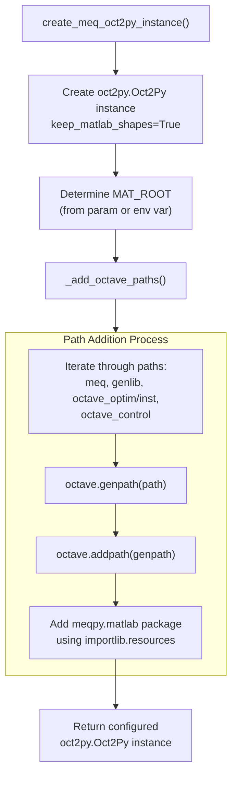
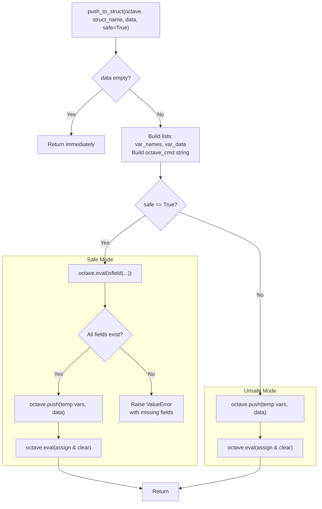
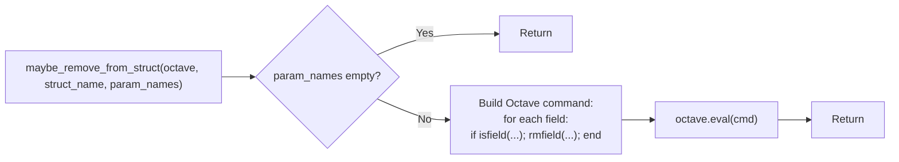
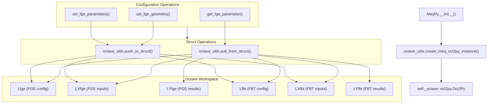

<!-- source: DeepWiki mcp.deepwiki.com · repo google-deepmind/meqpy · page 2.2 Octave Integration Layer · fetched 2026-10-26 -->

# Octave Integration Layer

<details>
<summary>Relevant source files</summary>

The following files were used as context for generating this wiki page:

- [meqpy/octave_utils.py](meqpy/octave_utils.py)
- [tests/octave_utils_test.py](tests/octave_utils_test.py)

</details>


## Purpose and Scope

The Octave Integration Layer provides the critical bridge between Python and Octave/MATLAB computation environments. This layer is implemented primarily in the `octave_utils` module and manages all aspects of Octave session lifecycle, path configuration, and bi-directional data exchange through struct manipulation operations. 

The layer enables MeqPy to leverage existing Octave/MATLAB MEQ code without rewriting computational kernels, while providing Pythonic interfaces for configuration and data access. For information about the higher-level MeqPy API that uses this layer, see [The MeqPy Class](#2.1). For details on the data structures exchanged through this layer, see [Data Structures and Conventions](#2.3).

Sources: [meqpy/octave_utils.py:1-178]()

---

## Octave Session Management

### Creating and Configuring Oct2Py Instances

The `create_meq_oct2py_instance()` function serves as the entry point for establishing an Octave session. This function instantiates an `oct2py.Oct2Py` object with specific configurations and automatically adds required paths to the Octave search path.



**Octave Session Initialization Flow**

The initialization process follows these steps:

1. **Instance Creation**: An `oct2py.Oct2Py` object is created with `keep_matlab_shapes=True` to preserve MATLAB/Octave array dimensionality [meqpy/octave_utils.py:62]().

2. **Root Directory Resolution**: The MEQ root directory is determined either from the `root_dir` parameter or the `MAT_ROOT` environment variable [meqpy/octave_utils.py:41-42]().

3. **Standard Path Addition**: The following paths are added via `genpath()` and `addpath()` [meqpy/octave_utils.py:29-34]():
   - `meq` - Core MEQ functions
   - `genlib` - General library utilities
   - `octave_optim/inst` - Optimization toolbox
   - `octave_control` - Control system functions

4. **Python Package Path Addition**: The bundled `meqpy.matlab` package is located using `importlib.resources` and added to the Octave path [meqpy/octave_utils.py:48-51]().

Sources: [meqpy/octave_utils.py:56-65](), [meqpy/octave_utils.py:37-53]()

### Path Configuration Details

The path configuration mechanism uses Octave's `genpath()` function to recursively discover all subdirectories, ensuring that nested MATLAB/Octave functions are accessible. This is critical because MEQ code is organized hierarchically across multiple directories.

| Path Component | Source | Purpose |
|----------------|--------|---------|
| `meq` | `MAT_ROOT/meq` | Core MEQ equilibrium solvers (FGE, FBT) |
| `genlib` | `MAT_ROOT/genlib` | General utility functions |
| `octave_optim/inst` | `MAT_ROOT/octave_optim/inst` | Optimization algorithms |
| `octave_control` | `MAT_ROOT/octave_control` | Control system utilities |
| `meqpy.matlab` | Python package resources | Python-provided Octave functions (e.g., `fgetk_environment.m`) |

The `MAT_ROOT` environment variable must point to a valid MEQ installation. Additional paths can be provided via the `octave_paths` parameter to `create_meq_oct2py_instance()` [meqpy/octave_utils.py:57-58]().

Sources: [meqpy/octave_utils.py:29-53]()

---

## Struct Operations

Octave/MATLAB structs are the primary data exchange mechanism between Python and Octave. The `octave_utils` module provides three core operations for struct manipulation: `push_to_struct()`, `pull_from_struct()`, and `maybe_remove_from_struct()`.

### Push Operations

The `push_to_struct()` function assigns Python dictionary values to fields of an existing Octave struct. This function implements a sophisticated multi-stage process to ensure data integrity and provide meaningful error messages.



**Push Operation Process Flow**

The push operation consists of several stages [meqpy/octave_utils.py:68-132]():

1. **Empty Check**: If the data dictionary is empty, the function returns immediately without executing any Octave commands [meqpy/octave_utils.py:84-86]().

2. **Command Building**: The function iterates through the data dictionary to build:
   - `var_names`: List of field names to update
   - `var_data`: List of corresponding values
   - `octave_cmd`: String of Octave commands to execute [meqpy/octave_utils.py:93-101]()

3. **Field Validation (Safe Mode)**: When `safe=True` (default), the function validates that all field names exist in the target struct using `isfield()` [meqpy/octave_utils.py:107-110](). If any fields are missing, a `ValueError` is raised with the list of missing fields [meqpy/octave_utils.py:122-129]().

4. **Temporary Variable Assignment**: Values are pushed to temporary variables with names like `{name}_temp` using `octave.push()` [meqpy/octave_utils.py:119]().

5. **Struct Assignment**: A single `octave.eval()` command assigns all temporary variables to their corresponding struct fields and clears the temporaries [meqpy/octave_utils.py:120]().

**Example Octave Command Generated**:
```
Lfge.P.a = a_temp; clear a_temp;
Lfge.P.b = b_temp; clear b_temp;
```

Sources: [meqpy/octave_utils.py:68-132]()

### Pull Operations

The `pull_from_struct()` function retrieves a single field value from an Octave struct. This operation is simpler than push operations since it involves reading rather than modifying data.

```python
# Implementation concept
def pull_from_struct(octave, struct_name, param_name):
    return octave.eval(f'{struct_name}.{param_name};', nout=1)
```

The function constructs a simple Octave expression to access the field and evaluates it with `nout=1` to retrieve the value [meqpy/octave_utils.py:135-152](). The returned value's type depends on the Octave data:

| Octave Type | Python Type | Notes |
|-------------|-------------|-------|
| Scalar | `float` or `int` | Direct conversion |
| Array | `numpy.ndarray` | May contain extra dimensions from MATLAB |
| String | `str` | Converted directly |
| Cell Array | `numpy.ndarray` | Nested array structure |
| Boolean | `bool` | Direct conversion |

**Important**: NumPy arrays returned from Octave may have extra dimensions due to MATLAB's indexing conventions. Users may need to apply `np.squeeze()` to remove singleton dimensions [meqpy/octave_utils.py:141-142]().

Sources: [meqpy/octave_utils.py:135-152](), [tests/octave_utils_test.py:52-59]()

### Remove Operations

The `maybe_remove_from_struct()` function conditionally removes fields from an Octave struct if they exist. This is useful for cleaning up temporary or optional fields.



**Conditional Field Removal Process**

The function generates Octave commands that check for field existence before removal [meqpy/octave_utils.py:155-177]():

```octave
if isfield(Lfge, 'temp_field'); Lfge = rmfield(Lfge, 'temp_field'); end;
```

This pattern prevents errors that would occur from attempting to remove non-existent fields. The function accepts a sequence of field names and processes all removals in a single `octave.eval()` call for efficiency [meqpy/octave_utils.py:172-177]().

Sources: [meqpy/octave_utils.py:155-177]()

---

## Data Type Handling

The Octave integration layer handles various data type conversions between Python and Octave. Understanding these conversions is critical for correct usage.

### Type Conversion Matrix

| Python Type | Octave Type | Conversion Notes | Test Reference |
|-------------|-------------|------------------|----------------|
| `int`, `float` | Scalar double | Direct conversion | [tests/octave_utils_test.py:28-34]() |
| `str` | Character array | Direct conversion | [tests/octave_utils_test.py:44-50]() |
| `list`, `tuple` | Row vector | Converted to 1×N array | [tests/octave_utils_test.py:52-59]() |
| `numpy.ndarray` | Matrix | Preserves shape | [tests/octave_utils_test.py:52-59]() |
| `bool` | Logical | Direct conversion | [tests/octave_utils_test.py:61-65]() |
| `list[str]` | Cell array | Nested array structure | [tests/octave_utils_test.py:67-74]() |

### Shape Preservation

The `keep_matlab_shapes=True` configuration ensures that MATLAB/Octave array shapes are preserved when transferring data [meqpy/octave_utils.py:62](). This is essential for maintaining compatibility with MEQ functions that expect specific array orientations (row vs. column vectors).

**Example**: A Python list `[1, 2, 3]` becomes a 1×3 row vector in Octave, not a 3×1 column vector. This matches MATLAB's default behavior.

### Cell Array Handling

Cell arrays require special handling. When pulled from Octave, they are returned as nested NumPy arrays [tests/octave_utils_test.py:67-74]():

```python
# Octave: a.foo = {"1", "2", "3"};
cell_value = pull_from_struct(octave, 'a', 'foo')
# Result: numpy.ndarray containing [['1', '2', '3']]
python_list = cell_value.tolist()[0]  # Extract to Python list
```

Sources: [meqpy/octave_utils.py:62](), [tests/octave_utils_test.py:28-74]()

---

## Error Handling and Safety

### Safe Mode Field Validation

The `push_to_struct()` function's `safe` parameter (default `True`) provides protection against typos and programming errors. When enabled, the function verifies that all fields exist before attempting assignment [meqpy/octave_utils.py:79-80]().

**Field Validation Process**:

1. Collect all field names from the data dictionary
2. Execute `isfield(struct_name, field_names)` in Octave
3. Check if all results are `true`
4. If any field is missing, raise `ValueError` with the list of missing fields

**Example Error**:
```python
push_to_struct(octave, 'Lfge', {'typo_field': 123})
# Raises: ValueError: Struct Lfge is missing fields: ['typo_field']
```

Test coverage: [tests/octave_utils_test.py:76-80]()

### Oct2Py Error Propagation

When pulling from a struct, if the field does not exist, `oct2py` raises an `Oct2PyError` that propagates to the caller [tests/octave_utils_test.py:82-85]():

```python
pull_from_struct(octave, 'a', 'missing_field')
# Raises: oct2py.utils.Oct2PyError: ...bar...
```

### Unsafe Mode Usage

Setting `safe=False` disables field validation, which can be useful when:
- Performance is critical and fields are known to exist
- Dynamically creating new struct fields (though this is not the typical use case)

When using unsafe mode, non-existent fields will silently create new fields in the Octave struct rather than raising an error [meqpy/octave_utils.py:130-132]().

Sources: [meqpy/octave_utils.py:79-80, 107-129](), [tests/octave_utils_test.py:76-85]()

---

## Integration with MeqPy

The `octave_utils` module is used extensively throughout MeqPy for all Octave interactions. The MeqPy class maintains a single `oct2py.Oct2Py` instance for its lifetime, created during initialization.



**MeqPy's Use of Octave Integration**

The diagram illustrates how MeqPy's high-level methods (parameter setting, geometry configuration) are implemented using the struct operation primitives provided by `octave_utils`. Each simulation mode (FGE, FBT) maintains multiple structs in the Octave workspace, and `push_to_struct()`/`pull_from_struct()` provide the mechanism for Python code to read and modify these structs.

Sources: [meqpy/octave_utils.py:1-178]()

---

## Summary

The Octave Integration Layer provides:

1. **Session Management**: Creation and configuration of `oct2py.Oct2Py` instances with proper path setup
2. **Struct Operations**: Robust push/pull/remove operations with optional safety checks
3. **Type Conversion**: Automatic handling of Python↔Octave type conversions
4. **Error Handling**: Validation of field names and meaningful error messages

This layer abstracts the complexities of inter-process communication with Octave, allowing higher-level MeqPy code to focus on simulation logic rather than integration details. The design emphasizes data integrity through safe-by-default operations while providing performance escape hatches when needed.

Sources: [meqpy/octave_utils.py:1-178](), [tests/octave_utils_test.py:1-89]()

---

