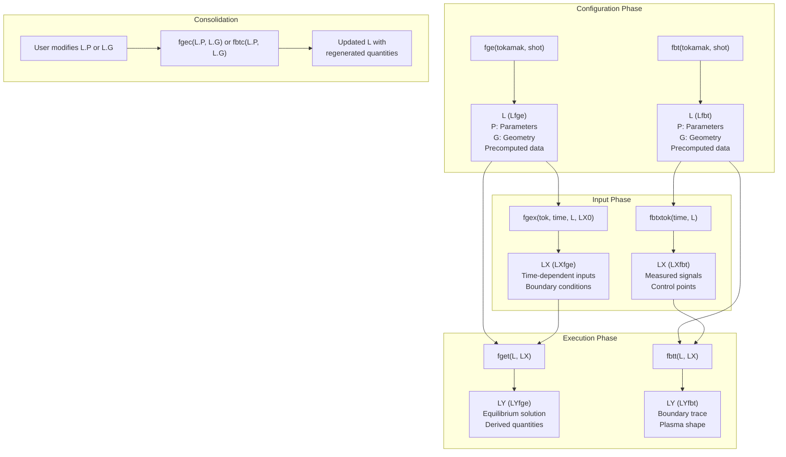
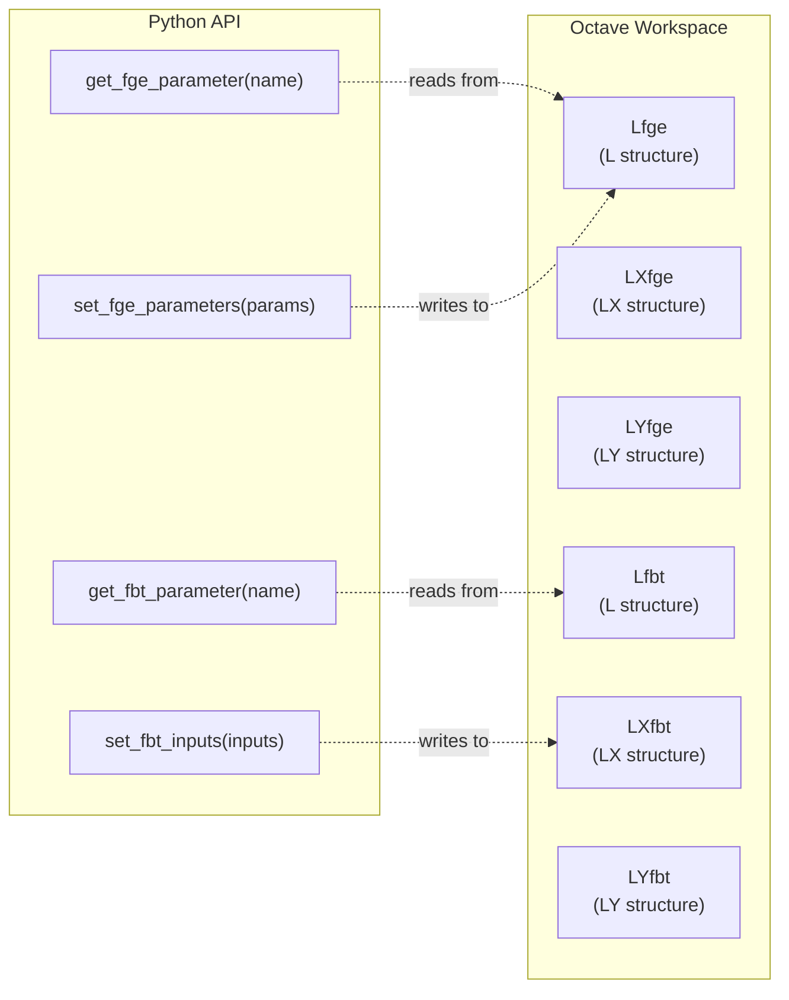
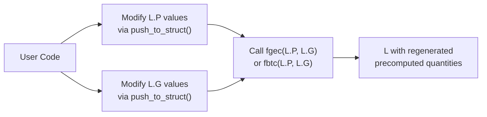
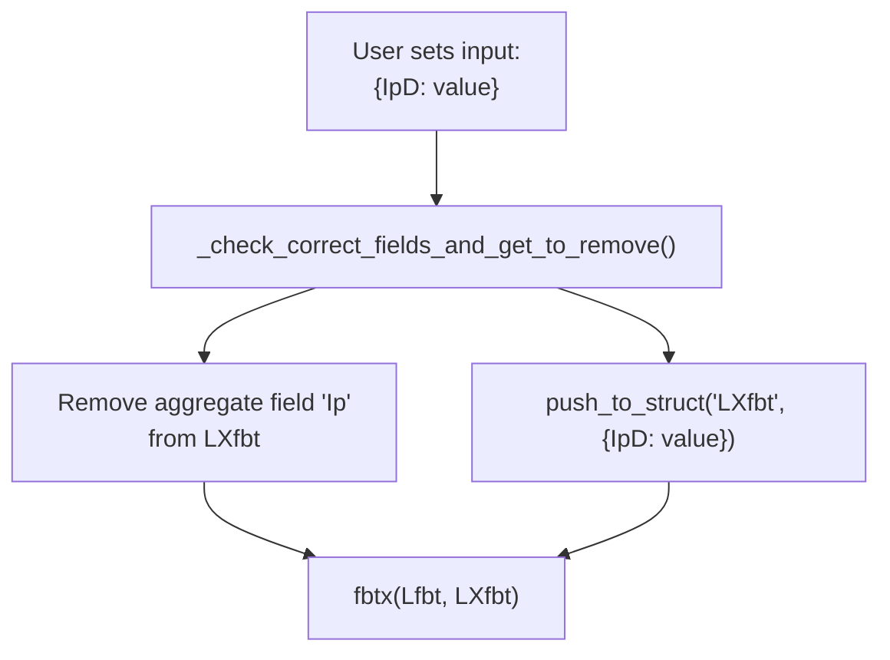
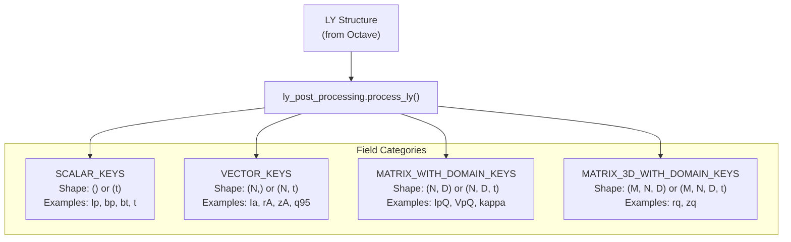
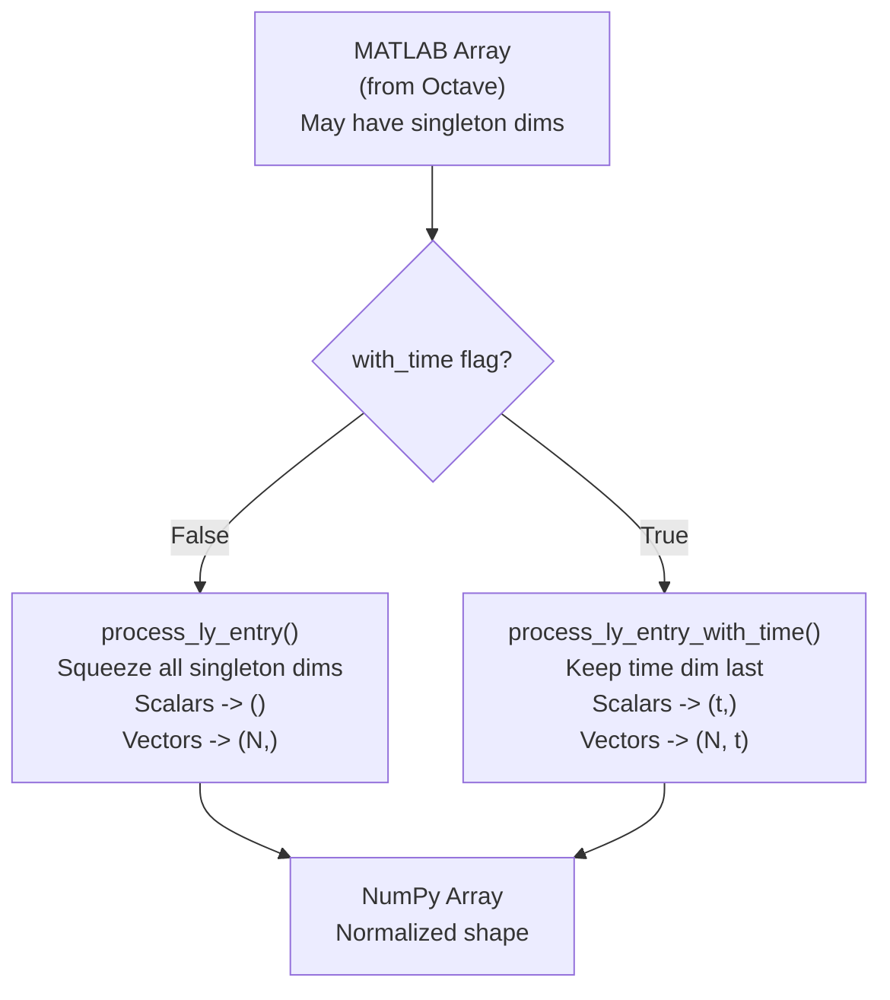
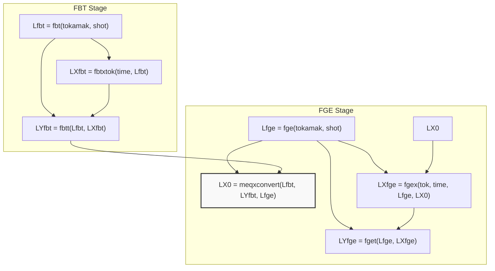
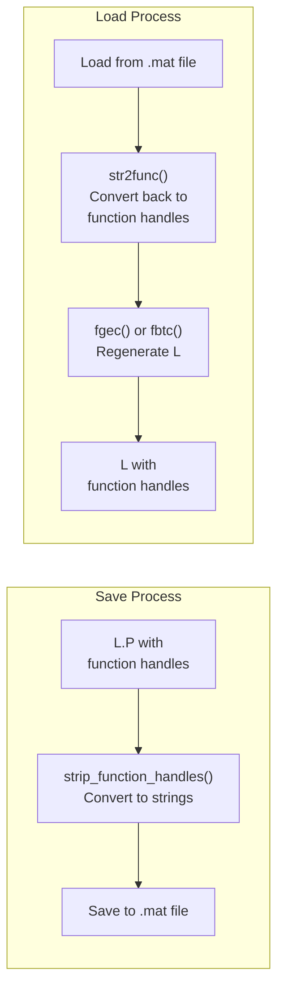
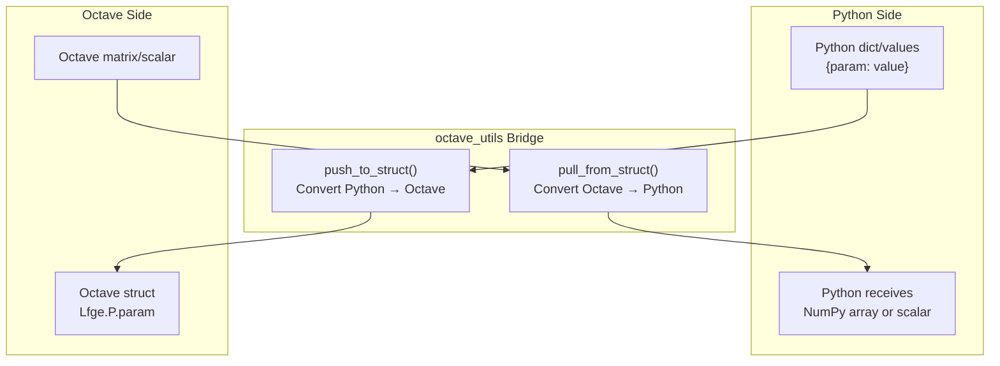

<!-- source: DeepWiki mcp.deepwiki.com · repo google-deepmind/meqpy · page 2.3 Data Structures and Conventions · fetched 2026-10-26 -->

# Data Structures and Conventions

<details>
<summary>Relevant source files</summary>

The following files were used as context for generating this wiki page:

- [meqpy/ly_post_processing.py](meqpy/ly_post_processing.py)
- [meqpy/meqpy_impl.py](meqpy/meqpy_impl.py)

</details>


## Purpose and Scope

This page documents the core data structures used throughout MeqPy and the underlying MEQ system, including naming conventions, field types, and data flow patterns between Python and Octave. Understanding these structures is essential for configuring simulations, providing inputs, and interpreting results.

For information about how these structures are manipulated through the MeqPy API, see [The MeqPy Class](#2.1). For details on Octave struct operations, see [Octave Struct Manipulation](#4.2). For LY result processing specifics, see [Data Post-Processing](#4.3).

---

## The L/LX/LY Structure System

MEQ organizes simulation data into three primary structure types, each serving a distinct purpose in the computational workflow:

| Structure | Full Name | Purpose | Persistence |
|-----------|-----------|---------|-------------|
| **L** | Configuration Structure | Contains parameters (`L.P`), geometry (`L.G`), and precomputed quantities | Created once, modified through consolidation |
| **LX** | Input Structure | Contains time-dependent inputs and boundary conditions | Created/updated for each simulation |
| **LY** | Output Structure | Contains simulation results and convergence information | Generated by solver functions |



**Sources:** [meqpy/meqpy_impl.py:147-151](), [meqpy/meqpy_impl.py:323-349](), [meqpy/meqpy_impl.py:360-373]()

---

## Structure Naming Conventions

To maintain clarity when working with both FGE and FBT simulations simultaneously, MeqPy appends mode suffixes to structure variable names in the Octave workspace:

| Python Context | Octave Variable | Structure Type | Mode |
|----------------|-----------------|----------------|------|
| FGE Configuration | `Lfge` | L | Fast Grad-Shafranov Equilibrium |
| FGE Inputs | `LXfge` | LX | Fast Grad-Shafranov Equilibrium |
| FGE Results | `LYfge` | LY | Fast Grad-Shafranov Equilibrium |
| FBT Configuration | `Lfbt` | L | Fast Boundary Tracing |
| FBT Inputs | `LXfbt` | LX | Fast Boundary Tracing |
| FBT Results | `LYfbt` | LY | Fast Boundary Tracing |
| Environment State | `LPfge`, `LGfge` | L.P, L.G | Saved separately for fgetk |



**Sources:** [meqpy/meqpy_impl.py:147-151](), [meqpy/meqpy_impl.py:323-343]()

---

## L Structure - Configuration and Precomputed Data

The `L` structure contains all configuration data and precomputed quantities needed for simulation. It has two primary sub-structures:

### L.P - Parameters

Contains numerical parameters that control solver behavior, physics models, and convergence criteria. These can be modified by the user through `set_fge_parameters()` or `set_fbt_parameters()`.

**Key Parameter Categories:**

| Category | Example Fields | Purpose |
|----------|---------------|---------|
| Solver Control | `debug`, `maxit`, `tol` | Debugging and convergence settings |
| Physics | `Ip`, `bp`, `bt`, `Wk`, `li` | Plasma current, poloidal/toroidal fields, energy, inductance |
| Basis Functions | `bfct`, `infct`, `eqfct` | Function handles for basis functions |
| Grid | `ns`, `nf`, `nr`, `nz` | Grid resolution parameters |
| Tokamak ID | `tok`, `shot` | Machine name and shot number |

### L.G - Geometry

Contains geometric data describing the tokamak structure, including limiter positions, coil locations, and vessel boundaries.

**Key Geometry Fields:**

| Field | Type | Description |
|-------|------|-------------|
| `dima` | Cell array of strings | Circuit/actuator names |
| `rlim`, `zlim` | Vectors | Limiter coordinates |
| `rcl`, `zcl` | Matrices | Coil center positions |
| `nw`, `nh` | Vectors | Coil dimensions (width, height) |

### Consolidation Mechanism

After modifying `L.P` or `L.G`, a consolidation function must be called to regenerate derived quantities:



**Sources:** [meqpy/meqpy_impl.py:375-396](), [meqpy/meqpy_impl.py:398-410](), [meqpy/meqpy_impl.py:430-449]()

---

## LX Structure - Inputs

The `LX` structure contains time-dependent inputs and boundary conditions for simulations. Content varies significantly between FGE and FBT modes.

### FGE Inputs (LXfge)

| Field Type | Examples | Description |
|------------|----------|-------------|
| Time | `t` | Simulation time(s) |
| Currents | `Ia`, `Ie`, `Iv` | Actuator, external, vessel currents |
| Profiles | `F0`, `F1`, `Ff` | Flux function profiles |
| Boundary | `rbdry`, `zbdry` | Boundary point coordinates |

### FBT Inputs (LXfbt)

| Field Type | Examples | Description |
|------------|----------|-------------|
| Time | `t` | Simulation time |
| Measurements | `IpD`, `bpD`, `btD` | Measured plasma current, fields (per-domain) |
| Control Points | `gp1`, `gp2`, ..., `gpN` | Shape control point coordinates |
| Profiles | `F0`, `F1` | Initial flux profiles |

### Singlet/Doublet Field Convention

MEQ supports both singlet and doublet configurations. When setting inputs, use per-domain fields (ending in `D`) rather than aggregate fields:

| Aggregate Field | Per-Domain Field | Notes |
|-----------------|------------------|-------|
| `Ip` | `IpD` | **Use `IpD`** - plasma current per domain |
| `bp` | `bpD` | **Use `bpD`** - poloidal field per domain |
| `bt` | `btD` | **Use `btD`** - toroidal field per domain |
| `Wk` | `WkD` | **Use `WkD`** - kinetic energy per domain |
| `li` | `liD` | **Use `liD`** - internal inductance per domain |

When a per-domain field is set, the aggregate field is automatically removed to prevent conflicts:



**Sources:** [meqpy/meqpy_impl.py:64-66](), [meqpy/meqpy_impl.py:412-417](), [meqpy/meqpy_impl.py:755-767]()

---

## LY Structure - Results

The `LY` structure contains simulation outputs, including the computed equilibrium/boundary and derived quantities. It has a convergence flag and extensive physics data.

### Common LY Fields

| Category | Fields | Description |
|----------|--------|-------------|
| Convergence | `isconverged`, `err`, `niter` | Solver status and metrics |
| Time | `t` | Simulation time |
| Current | `Ip`, `IpD` | Total and per-domain plasma current |
| Magnetic Fields | `bp`, `bt`, `bpD`, `btD` | Poloidal and toroidal fields |
| Energy | `Wk`, `Wp` | Kinetic and poloidal energy |
| Shape | `rA`, `zA`, `rX`, `zX` | Separatrix and X-point coordinates |
| Profiles | `q95`, `qmin`, `li` | Safety factor at 95% flux, minimum q, inductance |

### Field Type Classification

`LY` fields are categorized by dimensionality for proper Python/NumPy compatibility:



**Sources:** [meqpy/ly_post_processing.py:66-94](), [meqpy/meqpy_impl.py:360-364](), [meqpy/meqpy_impl.py:502-511]()

---

## Field Types and Dimension Handling

MeqPy normalizes MATLAB/Octave arrays to Python/NumPy conventions by squeezing singleton dimensions and ensuring consistent shapes.

### Single Timeslice (Default)

For results representing a single point in time:

| Field Category | Target Shape | Processing | Example Fields |
|----------------|--------------|------------|----------------|
| **Scalars** | `()` | Squeeze all dimensions | `Ip`, `bp`, `bt`, `t`, `Wk` |
| **Vectors** | `(N,)` | Squeeze to 1D | `Ia`, `rA`, `zA`, `q95`, `Uf` |
| **Domain Matrices** | `(N, D)` | Add domain dim if missing | `IpQ`, `VpQ`, `kappa` |
| **3D Matrices** | `(M, N, D)` | Add domain dim if missing | `rq`, `zq` |

### Multi-Timeslice (with_time=True)

For results representing a trajectory over time:

| Field Category | Target Shape | Processing | Example Fields |
|----------------|--------------|------------|----------------|
| **Scalars** | `(t,)` | Keep time dimension | `Ip`, `bp`, `bt`, `t`, `Wk` |
| **Vectors** | `(N, t)` | Keep time as last dim | `Ia`, `rA`, `zA`, `q95`, `Uf` |
| **Domain Matrices** | `(N, D, t)` | Add domain if missing, time last | `IpQ`, `VpQ`, `kappa` |
| **3D Matrices** | `(M, N, D, t)` | Add domain if missing, time last | `rq`, `zq` |



### Special Cases

Some fields have non-standard handling:

- **`rBt`**: Classified as scalar but kept as 1D vector for observation compatibility
- **`dz`, `dzg`**: Ignored - not squeezed to preserve MATLAB compatibility
- **`aW`**: Explicitly converted to ndarray before processing due to upstream inconsistencies

**Sources:** [meqpy/ly_post_processing.py:66-114](), [meqpy/ly_post_processing.py:128-166](), [meqpy/ly_post_processing.py:168-219](), [meqpy/ly_post_processing.py:260-267]()

---

## Data Flow Between Structures

Structures can be converted and combined to enable multi-stage workflows:



**Key Conversion Functions:**

| Function | Purpose | Inputs | Output |
|----------|---------|--------|--------|
| `meqxconvert` | Convert FBT result to FGE input | `Lfbt`, `LYfbt`, `Lfge` | `LX0` (initial condition) |
| `fgex` | Create time-sequence LX for FGE | `tok`, `time`, `Lfge`, `LX0` | `LXfge` |
| `fbtx` | Populate defaults in FBT input | `Lfbt`, `LXfbt` | `LXfbt` (consolidated) |

**Sources:** [meqpy/meqpy_impl.py:369-373](), [meqpy/meqpy_impl.py:239-287](), [meqpy/meqpy_impl.py:329-337]()

---

## State Persistence

For debugging and reproducibility, MeqPy can save and restore complete simulation states:

### FGETK Environment State

Variables saved for time-dependent simulations:

```python
_FGETK_ENV_VARS_TO_SAVE = (
    "LPfge",          # Parameters (function handles → strings)
    "LGfge",          # Geometry
    "State_prev",     # Previous state from environment
    "Actions",        # Applied actions
    "LXfge_sequence", # Input sequence
    "num_steps",      # Steps per control timestep
)
```

### FBT State

Variables saved for boundary tracing:

```python
_FBTT_VARS_TO_SAVE = (
    "LPfbt",   # Parameters (function handles → strings)
    "LGfbt",   # Geometry
    "LXfbt",   # Inputs
)
```

### Function Handle Conversion

MATLAB/Octave function handles cannot be directly serialized. MeqPy converts them:



**Key Fields Converted:**
- `L.P.bfct` - Basis function
- `L.P.infct` - Initial condition function  
- `L.P.eqfct` - Equilibrium function
- `L.P.bfp{iD,1}` - Doublet basis function parameters

**Sources:** [meqpy/meqpy_impl.py:45-58](), [meqpy/meqpy_impl.py:567-608](), [meqpy/meqpy_impl.py:622-659](), [meqpy/meqpy_impl.py:661-670]()

---

## Python-Octave Data Exchange

Data flows bidirectionally between Python and Octave through the `octave_utils` module:



**Type Conversions:**

| Python Type | Octave Type | Notes |
|-------------|-------------|-------|
| `dict` | `struct` | Field-by-field assignment |
| `np.ndarray` | Matrix | Shape preserved |
| `float`, `int` | Scalar | Direct conversion |
| `list` | Column vector | Auto-converts to Nx1 |
| `oct2py.Struct` | `struct` | Direct passthrough |

**Sources:** [meqpy/meqpy_impl.py:391-392](), [meqpy/meqpy_impl.py:405-406](), [meqpy/meqpy_impl.py:430-449]()

---

