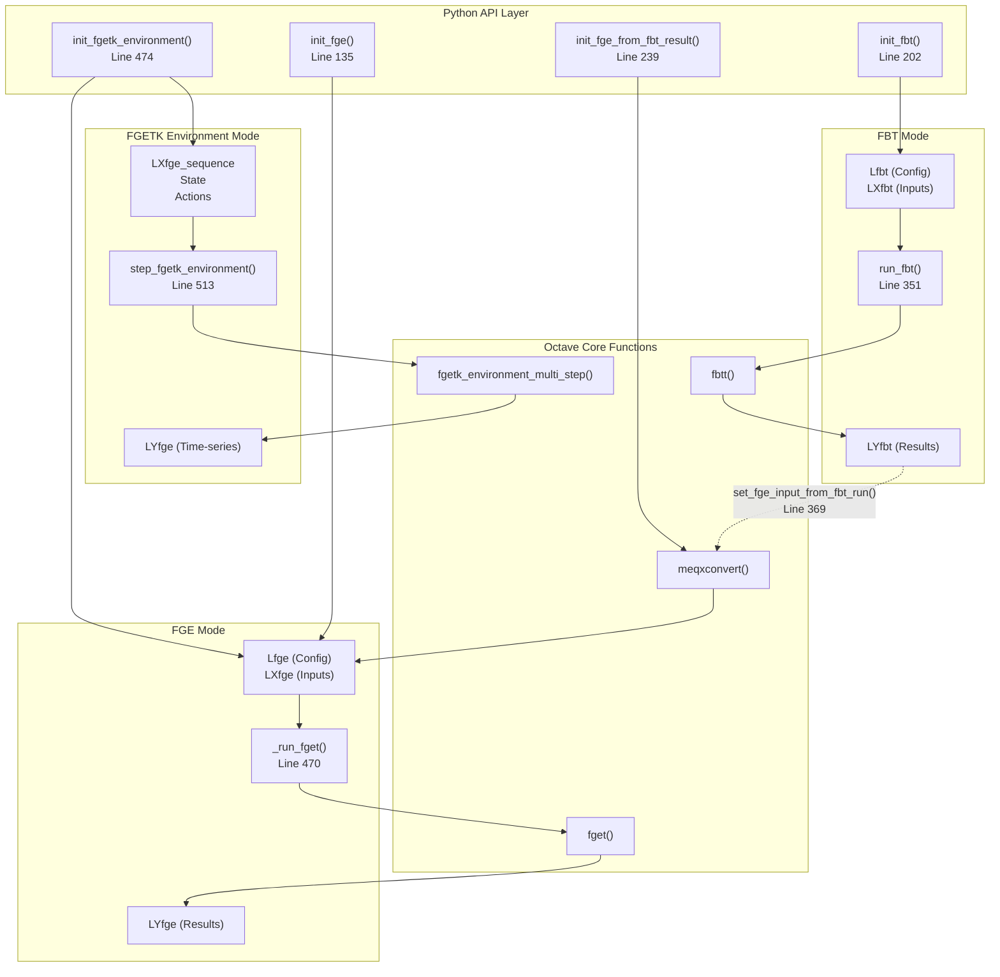
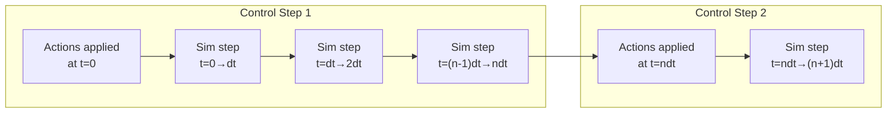
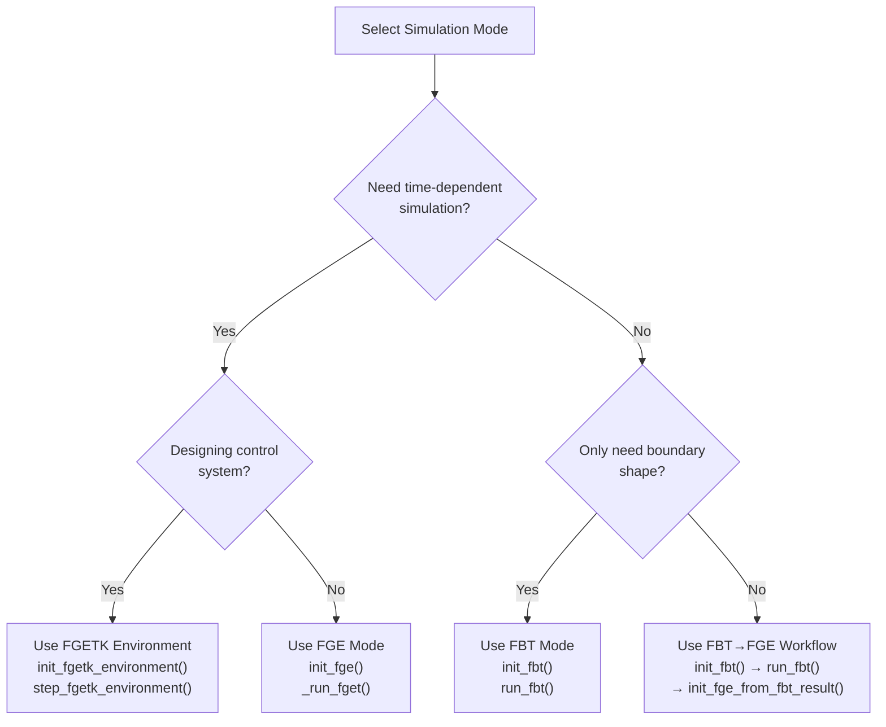
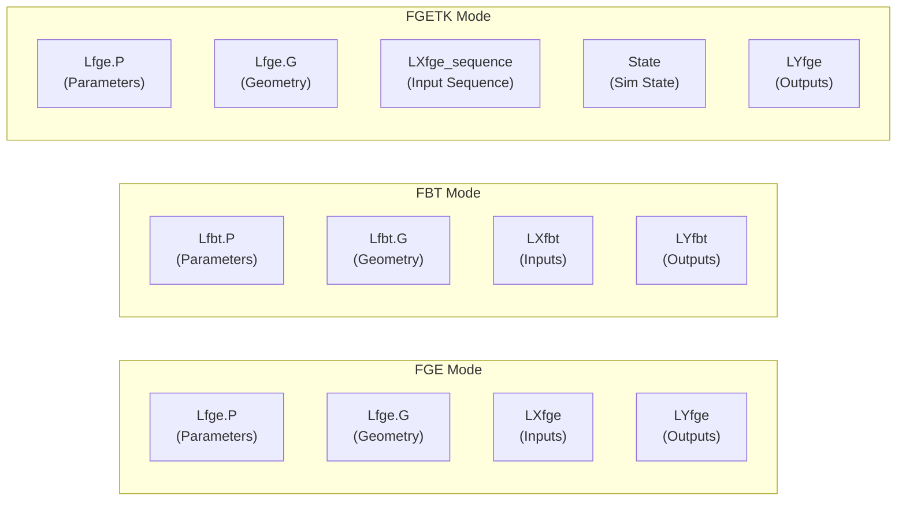
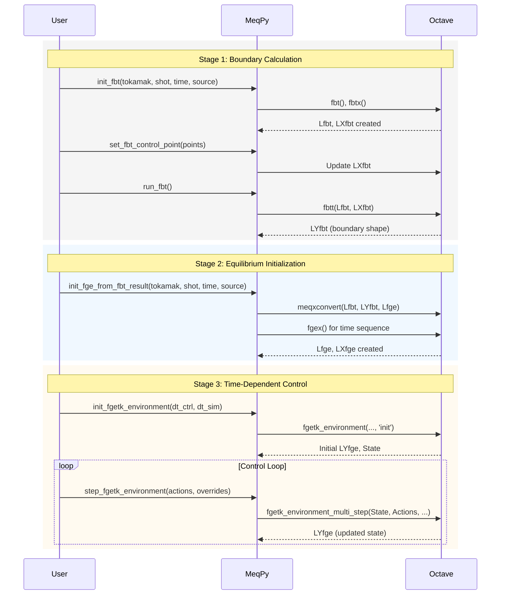

<!-- source: DeepWiki mcp.deepwiki.com · repo google-deepmind/meqpy · page 3 Simulation Modes · fetched 2026-10-26 -->

# Simulation Modes

Relevant source files

The following files were used as context for generating this wiki page:

- [README.md](README.md)
- [meqpy/meqpy_impl.py](meqpy/meqpy_impl.py)

## Purpose and Scope

MeqPy provides three distinct simulation modes for tokamak plasma equilibrium calculations, each serving different purposes in the equilibrium reconstruction and control workflow. This page provides an overview of all three modes, their characteristics, and guidance on when to use each. For detailed implementation guides, see:
- [FGE Mode](#3.1) - Equilibrium reconstruction details
- [FBT Mode](#3.2) - Boundary tracing details  
- [FBT to FGE Integration](#3.3) - Two-stage workflow details
- [FGETK Environment](#3.4) - Time-dependent simulation details

Sources: [meqpy/meqpy_impl.py:15-24]()

---

## Mode Comparison

MeqPy supports three simulation modes that can be used independently or in combination:

| Mode | Primary Function | Key Methods | Output Structure | Use Case |
|------|-----------------|-------------|-----------------|----------|
| **FGE** | Fast Grad-Shafranov Equilibrium | `init_fge()`, `_run_fget()` | `LYfge` | Equilibrium reconstruction from diagnostics |
| **FBT** | Fast Boundary Tracing | `init_fbt()`, `run_fbt()` | `LYfbt` | Plasma boundary shape calculation |
| **FGETK** | Time-dependent FGE Environment | `init_fgetk_environment()`, `step_fgetk_environment()` | `LYfge` (per step) | Control system simulation and design |

Sources: [meqpy/meqpy_impl.py:135-179](), [meqpy/meqpy_impl.py:202-219](), [meqpy/meqpy_impl.py:474-511]()

---

## Simulation Mode Architecture

The following diagram illustrates how the three simulation modes relate to each other and the core Octave structures they operate on:

Sources: [meqpy/meqpy_impl.py:135-179](), [meqpy/meqpy_impl.py:202-238](), [meqpy/meqpy_impl.py:239-286](), [meqpy/meqpy_impl.py:474-545]()

---

## FGE Mode: Fast Grad-Shafranov Equilibrium

### Overview

FGE mode solves the Grad-Shafranov equation to compute magnetic equilibrium from diagnostic measurements. It reconstructs the full 2D flux distribution, plasma current profile, and geometric parameters.

### Initialization

FGE is initialized through `init_fge()`, which creates two primary structures:
- **`Lfge`**: Configuration structure containing parameters (`Lfge.P`) and geometry (`Lfge.G`)
- **`LXfge`**: Input structure containing diagnostic measurements and boundary conditions

### Key Methods

| Method | Purpose | Line Reference |
|--------|---------|----------------|
| `init_fge()` | Initialize FGE structures | [135-179]() |
| `_init_fge_directly()` | Direct initialization using MEQ | [305-327]() |
| `_run_fget()` | Execute time-dependent equilibrium solve | [470-472]() |
| `set_fge_parameters()` | Update configuration parameters | [375-396]() |
| `get_fge_parameter()` | Retrieve parameter values | [433-434]() |

### Initialization Sources

FGE can be initialized from two sources:
1. **Direct initialization**: Uses MEQ's `fge()` and `fgec()` functions with tokamak geometry files
2. **From FBT results**: Converts boundary tracing output to FGE inputs via `meqxconvert()`

Sources: [meqpy/meqpy_impl.py:135-179](), [meqpy/meqpy_impl.py:305-327](), [meqpy/meqpy_impl.py:375-396]()

---

## FBT Mode: Fast Boundary Tracing

### Overview

FBT mode computes the plasma boundary shape from a specified set of control points or flux measurements. It traces magnetic field lines to determine the Last Closed Flux Surface (LCFS) and related geometric quantities.

### Initialization

FBT is initialized through `init_fbt()`, which creates:
- **`Lfbt`**: Configuration structure containing parameters (`Lfbt.P`) and geometry (`Lfbt.G`)
- **`LXfbt`**: Input structure containing control points, current, and magnetic field measurements

### Key Methods

| Method | Purpose | Line Reference |
|--------|---------|----------------|
| `init_fbt()` | Initialize FBT structures | [202-219]() |
| `_init_fbt_directly()` | Direct initialization using MEQ | [339-343]() |
| `run_fbt()` | Execute boundary tracing | [351-356]() |
| `try_run_fbt()` | Attempt tracing, return None if failed | [358-364]() |
| `set_fbt_parameters()` | Update configuration parameters | [398-410]() |
| `set_fbt_inputs()` | Update input measurements | [412-417]() |
| `set_fbt_control_point()` | Set geometric control points | [419-428]() |

### Input Handling

FBT inputs use a domain-specific naming convention where fields ending in `D` (e.g., `IpD`, `bpD`) represent per-domain values. The code automatically handles conversion between singlet and doublet configurations by removing non-domain fields when domain fields are set.

Sources: [meqpy/meqpy_impl.py:202-238](), [meqpy/meqpy_impl.py:339-364](), [meqpy/meqpy_impl.py:398-428](), [meqpy/meqpy_impl.py:755-767]()

---

## FGETK Environment: Time-Dependent Simulation

### Overview

The FGETK environment provides a control-oriented interface for time-dependent plasma evolution. It runs FGE in a step-by-step fashion, allowing control actions (coil voltages) to be applied at each timestep.

### Timing Model

The environment supports two distinct timesteps:
- **Control timestep** (`control_timestep`): How often control actions are updated
- **Simulator timestep** (`simulator_timestep`): Internal simulation resolution

The control timestep must be an integer multiple of the simulator timestep. The environment automatically performs multiple simulation steps per control step when these differ.

Sources: [meqpy/meqpy_impl.py:474-487]()

### Key Methods

| Method | Purpose | Line Reference |
|--------|---------|----------------|
| `init_fgetk_environment()` | Initialize time-series simulation | [474-511]() |
| `step_fgetk_environment()` | Execute one control step | [513-545]() |
| `get_fgetk_circuit_names()` | Get actuator circuit names | [564-565]() |
| `save_last_fgetk_env_call_state()` | Save environment state for debugging | [567-579]() |

### State Management

The environment maintains several key variables:
- **`LXfge_sequence`**: Packed sequence of inputs for multiple simulation steps
- **`State`**: Current simulation state (position, velocities, history)
- **`State_prev`**: Previous state (for rollback/debugging)
- **`Actions`**: Control actions (coil voltages) to apply
- **`num_steps`**: Number of simulation steps per control step

Sources: [meqpy/meqpy_impl.py:45-52](), [meqpy/meqpy_impl.py:474-545]()

### Action Delay Handling

The FGETK environment implements realistic action delay: the result returned by `step_fgetk_environment()` reflects the state at the **beginning** of the current control step, not the end. This ensures that control decisions at timestep `n+1` are based on observations from timestep `n`, matching real-world tokamak control systems where sensor measurements arrive after the state they measure.

Sources: [meqpy/meqpy_impl.py:528-533](), [README.md:99-109]()

---

## Mode Selection Guide

### Decision Tree

Sources: [meqpy/meqpy_impl.py:135-286](), [meqpy/meqpy_impl.py:474-545]()

### Use Case Examples

| Scenario | Recommended Mode | Rationale |
|----------|------------------|-----------|
| Equilibrium reconstruction from experimental data | FGE | Direct solve with full flux distribution |
| Rapid boundary shape estimation | FBT | Faster computation, boundary-focused |
| Initial condition generation for FGE | FBT → FGE | Two-stage workflow with customizable boundary |
| Controller design and testing | FGETK | Step-by-step control with action delays |
| Scenario simulation with varying inputs | FGETK | Time-series evolution with input overrides |
| One-shot equilibrium calculation | FGE | Single solve without time evolution |

Sources: [meqpy/meqpy_impl.py:239-286](), [README.md:56-110]()

---

## Data Structure Patterns

All three modes follow a consistent pattern for organizing simulation data:

### Structure Naming Convention

### Common Structure Elements

- **`L.P`**: Parameters controlling solver behavior (convergence criteria, basis functions, debug flags)
- **`L.G`**: Geometric data (grid points, limiter shape, coil positions)
- **`LX`**: Time-specific inputs (currents, magnetic fields, control points)
- **`LY`**: Computed outputs (flux distribution, geometric parameters, convergence status)

For detailed field descriptions, see [Data Structures and Conventions](#2.3).

Sources: [meqpy/meqpy_impl.py:135-179](), [meqpy/meqpy_impl.py:202-238](), [meqpy/meqpy_impl.py:474-511]()

---

## Mode Interaction Workflow

The following diagram shows a typical workflow that uses all three modes in sequence:

Sources: [meqpy/meqpy_impl.py:202-238](), [meqpy/meqpy_impl.py:239-286](), [meqpy/meqpy_impl.py:474-545]()

---

## Configuration and Parameter Management

Each mode supports configuration through parameter and geometry settings. Parameters are consolidated automatically after updates to maintain internal consistency.

### Parameter Update Methods

| Mode | Parameter Method | Geometry Method | Consolidation Function |
|------|-----------------|-----------------|------------------------|
| FGE | `set_fge_parameters()` | `set_fge_parameters(geometry=...)` | `fgec()` |
| FBT | `set_fbt_parameters()` | `set_fbt_parameters(geometry=...)` | `fbtc()` |

### Consolidation Process

After updating parameters or geometry, the corresponding consolidation function (`fgec()` or `fbtc()`) regenerates derived quantities to maintain consistency. This includes:
- Grid spacing and indexing
- Basis function weights
- Geometric constraint matrices
- Precomputed solver coefficients

Sources: [meqpy/meqpy_impl.py:375-410]()

---

## Next Steps

For detailed implementation guides on each mode:
- [FGE Mode](#3.1) - Parameter configuration, input handling, running calculations
- [FBT Mode](#3.2) - Control point management, boundary tracing, convergence
- [FBT to FGE Integration](#3.3) - Two-stage workflow, data conversion, use cases
- [FGETK Environment](#3.4) - Time-stepping, action delays, state management

For information on the underlying data structures, see [Data Structures and Conventions](#2.3).

For state persistence across modes, see [State Persistence and Recovery](#5).

Sources: [meqpy/meqpy_impl.py:1-785]()

---

