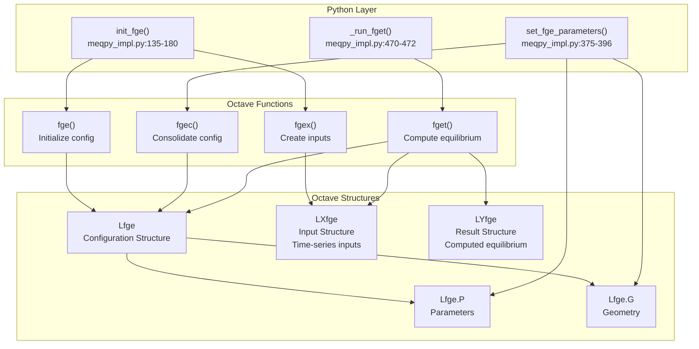
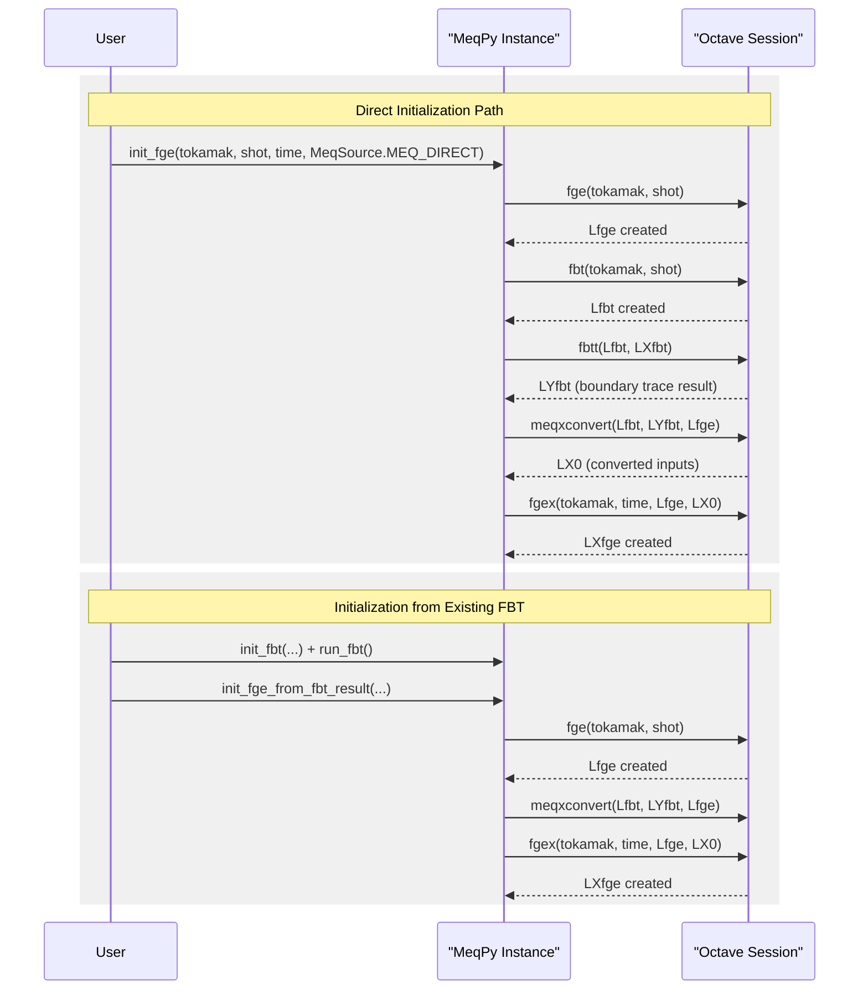
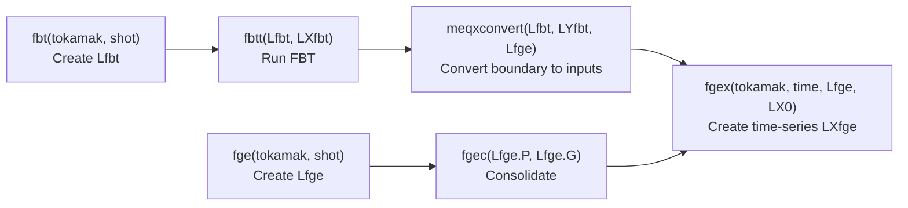
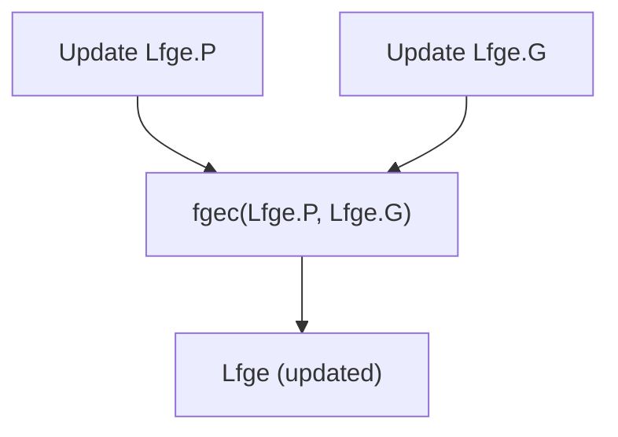
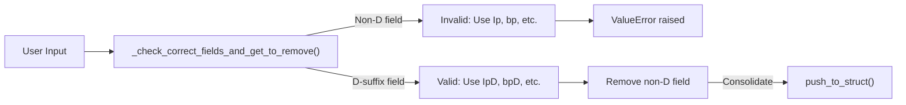

<!-- source: DeepWiki mcp.deepwiki.com · repo google-deepmind/meqpy · page 3.1 FGE - Fast Grad-Shafranov Equilibrium · fetched 2026-10-26 -->

# FGE - Fast Grad-Shafranov Equilibrium

<details>
<summary>Relevant source files</summary>

The following files were used as context for generating this wiki page:

- [meqpy/meqpy_fge_test_mixin.py](meqpy/meqpy_fge_test_mixin.py)
- [meqpy/meqpy_impl.py](meqpy/meqpy_impl.py)

</details>


## Purpose and Scope

This page documents the Fast Grad-Shafranov Equilibrium (FGE) functionality in MeqPy, which computes the plasma equilibrium state in tokamak simulations by solving the Grad-Shafranov equation. FGE is one of the three main simulation modes provided by MeqPy.

This page covers FGE initialization, parameter and geometry configuration, and running equilibrium calculations. For information about:
- Fast Boundary Tracing (FBT) simulation mode, see [FBT - Fast Boundary Tracing](#3.2)
- Initializing FGE from FBT results, see [FBT to FGE Integration](#3.3)  
- Time-dependent FGE simulations, see [FGETK Environment - Time-Dependent Simulations](#3.4)
- The overall architecture and data flow, see [Core Architecture](#2)

## Overview

FGE solves the Grad-Shafranov equation to compute magnetic equilibrium configurations in tokamaks. The computation is "fast" because it uses precomputed basis functions and geometry information stored in the configuration structure (`Lfge`).

### Key Components



**Sources:** [meqpy/meqpy_impl.py:135-180](), [meqpy/meqpy_impl.py:375-396](), [meqpy/meqpy_impl.py:470-472]()

## FGE Data Structures

FGE uses three primary Octave structures that maintain state throughout the simulation lifecycle:

| Structure | Variable Name | Purpose | Key Fields |
|-----------|---------------|---------|------------|
| Configuration | `Lfge` | Stores parameters, geometry, and precomputed quantities | `P` (parameters), `G` (geometry) |
| Inputs | `LXfge` | Time-series boundary conditions and constraints | `t` (time), `bpD` (poloidal beta), `btD` (toroidal beta), `IpD` (plasma current) |
| Results | `LYfge` | Computed equilibrium state | `isconverged`, `psi` (poloidal flux), plasma shapes |

### Lfge - Configuration Structure

The `Lfge` structure contains two main sub-structures:

#### Lfge.P - Parameters

Parameters control the numerical methods and physical models used in FGE calculations. Common parameters include:

- `debug`: Debug output level (0-3)
- `anajac`: Use analytical Jacobian (boolean)
- `usepreconditioner`: Use preconditioner for faster convergence (boolean)
- `bfct`: Basis function type (function handle)
- `infct`: Initialization function (function handle)
- `eqfct`: Equilibrium constraint function (function handle)

#### Lfge.G - Geometry

Geometry fields define the tokamak physical configuration:

- `Vamax`: Maximum coil voltages (array)
- `Iamax`: Maximum coil currents (array)
- `Vadelay`: Action delays for each circuit (array)
- `dima`: Circuit/coil names (cell array)

**Sources:** [meqpy/meqpy_impl.py:375-396](), [meqpy/meqpy_fge_test_mixin.py:96-138]()

### LXfge - Input Structure

`LXfge` represents the boundary conditions and constraints for FGE computation. For time-dependent simulations, it contains time-series data with one column per timestep.

Key input fields (per-domain versions with 'D' suffix should be used):

- `t`: Time values
- `IpD`: Plasma current (per domain)
- `bpD`: Poloidal beta (per domain)
- `btD`: Toroidal beta (per domain)
- `WkD`: Kinetic energy (per domain)
- `liD`: Internal inductance (per domain)

**Note:** Always use per-domain fields (e.g., `IpD`, `bpD`) rather than singlet fields (e.g., `Ip`, `bp`) to maintain compatibility with both singlet and doublet configurations. See [meqpy/meqpy_impl.py:64-66]() for restricted field names.

**Sources:** [meqpy/meqpy_impl.py:329-337](), [meqpy/meqpy_impl.py:755-767]()

### LYfge - Result Structure

`LYfge` contains the computed equilibrium state after running FGE. The structure is post-processed by [ly_post_processing](#4.3) to normalize MATLAB conventions for Python compatibility.

**Sources:** [meqpy/meqpy_impl.py:470-472](), [meqpy/ly_post_processing.py]()

## FGE Initialization

FGE can be initialized through two primary pathways: direct initialization or initialization from FBT results.



**Sources:** [meqpy/meqpy_impl.py:135-201](), [meqpy/meqpy_impl.py:239-287]()

### Direct Initialization

The `init_fge()` method provides the standard initialization pathway. It automatically runs FBT internally to generate initial conditions.

**Method Signature:**
```python
def init_fge(
    tokamak: str,
    shot: int,
    time: float,
    source: MeqSource,
    cde: str | None = None,
    icsint: bool = False,
    ilim: int = 1,
    default_meq_params: MutableMapping[str, Any] | None = None,
    default_fbt_params: MutableMapping[str, Any] | None = None,
) -> None
```

**Parameters:**
- `tokamak`: Tokamak name (e.g., `"anamak"`)
- `shot`: Shot number for tokamak configuration
- `time`: Initial simulation time (seconds)
- `source`: Data source (use `MeqSource.MEQ_DIRECT`)
- `cde`: CDE identifier (optional, unused for `MEQ_DIRECT`)
- `icsint`: Use cubic spline interpolation for initial condition (default: `False`)
- `ilim`: Limiter interpolation method (default: `1`)
- `default_meq_params`: Parameter overrides for `Lfge.P`
- `default_fbt_params`: Parameter overrides for internal FBT run

**Example:**
```python
meq = meqpy.MeqPy()
meq.init_fge(
    tokamak="anamak",
    shot=1,
    time=0.5,
    source=meqpy.MeqSource.MEQ_DIRECT,
    default_meq_params={'debug': 2, 'anajac': True}
)
```

**Sources:** [meqpy/meqpy_impl.py:135-180](), [meqpy/meqpy_fge_test_mixin.py:33-69]()

### Initialization from FBT Results

For advanced use cases where FBT parameters need custom configuration before FGE initialization, use `init_fge_from_fbt_result()`. This requires that FBT has already been initialized and run.

**Method Signature:**
```python
def init_fge_from_fbt_result(
    tokamak: str,
    shot: int,
    time: float,
    source: MeqSource,
    default_meq_params: MutableMapping[str, Any] | None = None,
    cde: str | None = None,
) -> None
```

**Example:**
```python
meq = meqpy.MeqPy()

# First, run FBT with custom parameters
meq.init_fbt("anamak", 1, 0.5, meqpy.MeqSource.MEQ_DIRECT)
meq.set_fbt_parameters(parameters={'custom_param': value})
meq.run_fbt()

# Then initialize FGE using those results
meq.init_fge_from_fbt_result(
    tokamak="anamak",
    shot=1,
    time=0.5,
    source=meqpy.MeqSource.MEQ_DIRECT
)
```

For more details on FBT-to-FGE workflows, see [FBT to FGE Integration](#3.3).

**Sources:** [meqpy/meqpy_impl.py:239-287]()

### Internal Initialization Process

The initialization process involves several Octave function calls:



**Sources:** [meqpy/meqpy_impl.py:305-327](), [meqpy/meqpy_impl.py:329-350]()

## Parameter and Geometry Configuration

After initialization, FGE parameters and geometry can be modified using `set_fge_parameters()`. This method handles both parameter updates and the required consolidation step to maintain internal consistency.

### Setting Parameters

**Method Signature:**
```python
def set_fge_parameters(
    *,
    parameters: Mapping[str, Any] | None = None,
    geometry: Mapping[str, Any] | None = None,
) -> None
```

**Key Points:**
- Parameters are set in `Lfge.P`
- Geometry is set in `Lfge.G`
- The method automatically calls `fgec()` to consolidate changes
- Updates should be batched to minimize consolidation overhead

**Example:**
```python
# Set multiple parameters at once
meq.set_fge_parameters(
    parameters={
        'debug': 2,
        'anajac': True,
        'usepreconditioner': True
    },
    geometry={
        'Vamax': new_voltage_limits,
        'Vadelay': action_delays
    }
)
```

**Sources:** [meqpy/meqpy_impl.py:375-396](), [meqpy/meqpy_fge_test_mixin.py:96-118]()

### Consolidation Process

When parameters or geometry are updated, the `fgec()` Octave function regenerates derived quantities. This ensures that precomputed values remain consistent with the updated configuration.



**Note:** Consolidation can be computationally expensive, so batch parameter updates when possible.

**Sources:** [meqpy/meqpy_impl.py:394-396]()

### Getting Configuration Values

MeqPy provides several methods to retrieve values from FGE structures:

| Method | Structure | Example Usage |
|--------|-----------|---------------|
| `get_fge_parameter(name)` | `Lfge.P` | `debug = meq.get_fge_parameter('debug')` |
| `get_fge_geometry(name)` | `Lfge.G` | `vamax = meq.get_fge_geometry('Vamax')` |
| `get_fge_input(name)` | `LXfge` | `bp = meq.get_fge_input('bpD')` |
| `get_from_fge_l(name)` | `Lfge` | `full_p = meq.get_from_fge_l('P')` |

**Example:**
```python
# Get single parameter
debug_level = meq.get_fge_parameter('debug')

# Get geometry setting
voltage_limits = meq.get_fge_geometry('Vamax')

# Get entire parameter structure
all_params = meq.get_from_fge_l('P')
```

**Sources:** [meqpy/meqpy_impl.py:430-440](), [meqpy/meqpy_fge_test_mixin.py:96-171]()

## Running FGE Calculations

### Time-Dependent FGE

The `_run_fget()` method runs the time-dependent FGE solver. This is primarily used for testing convergence behavior.

**Method:**
```python
def _run_fget(self) -> None
```

This calls the Octave function `fget(Lfge, LXfge)` which:
1. Iterates through timesteps in `LXfge`
2. Solves the Grad-Shafranov equation at each timestep
3. Stores results in `LYfge`

**Note:** For control-oriented time-series simulations, use the FGETK environment instead (see [FGETK Environment](#3.4)).

**Example:**
```python
meq = meqpy.MeqPy()
meq.init_fge("anamak", 1, 0.5, meqpy.MeqSource.MEQ_DIRECT)
meq._run_fget()  # Runs full time-series simulation
```

**Sources:** [meqpy/meqpy_impl.py:470-472](), [meqpy/meqpy_fge_test_mixin.py:91-94]()

### Solver Configuration

FGE convergence behavior can be tuned through parameters:

| Parameter | Type | Description |
|-----------|------|-------------|
| `anajac` | boolean | Use analytical Jacobian (faster convergence) |
| `usepreconditioner` | boolean | Use preconditioning (improves numerical stability) |
| `debug` | integer (0-3) | Debug output verbosity |
| `maxit` | integer | Maximum iterations |
| `tol` | float | Convergence tolerance |

**Performance Tip:** Enable both `anajac` and `usepreconditioner` for faster simulations:

```python
meq.set_fge_parameters(
    parameters={
        'anajac': True,
        'usepreconditioner': True
    }
)
```

**Sources:** [meqpy/meqpy_fge_test_mixin.py:67-68]()

## Parameter Field Restrictions

When setting FGE inputs, certain fields have per-domain variants that must be used instead of the base field. This ensures compatibility with both singlet and doublet configurations.

### Restricted Fields

The following fields should **not** be set directly. Use their per-domain variants (with 'D' suffix) instead:

- `Ip` → use `IpD`
- `bp` → use `bpD`
- `bt` → use `btD`
- `Wk` → use `WkD`
- `li` → use `liD`

**Enforcement:** Setting restricted fields raises a `ValueError`. See [meqpy/meqpy_impl.py:64-66]() for the complete list.



**Sources:** [meqpy/meqpy_impl.py:755-767](), [meqpy/meqpy_impl.py:413-417]()

## Common Workflows

### Typical FGE Setup

```python
import meqpy
import numpy as np

# 1. Create and initialize FGE
meq = meqpy.MeqPy()
meq.init_fge(
    tokamak="anamak",
    shot=1,
    time=0.5,
    source=meqpy.MeqSource.MEQ_DIRECT,
    default_meq_params={
        'debug': 2,
        'anajac': True,
        'usepreconditioner': True
    }
)

# 2. Configure parameters
meq.set_fge_parameters(
    parameters={'debug': 1},
    geometry={'Vamax': new_limits}
)

# 3. Run equilibrium calculation
meq._run_fget()
```

### Testing Parameter Changes

```python
# Save original value
original_value = meq.get_fge_parameter('debug')

# Test with new value
meq.set_fge_parameters(parameters={'debug': 3})
meq._run_fget()

# Restore original
meq.set_fge_parameters(parameters={'debug': original_value})
```

**Sources:** [meqpy/meqpy_fge_test_mixin.py:91-138]()

## Error Handling

### Common Errors

| Error | Cause | Solution |
|-------|-------|----------|
| `ValueError: Input Ip is not supported` | Setting restricted field | Use `IpD` instead of `Ip` |
| `ValueError: foo` | Setting non-existent parameter | Check parameter name spelling |
| `Oct2PyError: structure has no member 'foo'` | Getting non-existent field | Verify field exists in structure |
| `ValueError: FBT must have been run` | Calling `init_fge_from_fbt_result()` without prior FBT | Run `init_fbt()` and `run_fbt()` first |

### Debugging

Enable debug output for troubleshooting:

```python
meq.set_fge_parameters(parameters={'debug': 3})  # Maximum verbosity
```

Debug levels:
- `0`: No debug output
- `1`: Basic information
- `2`: Detailed information  
- `3`: Verbose debug output

**Sources:** [meqpy/meqpy_fge_test_mixin.py:140-171]()

## Related Pages

- [FBT - Fast Boundary Tracing](#3.2) - Using FBT for boundary reconstruction
- [FBT to FGE Integration](#3.3) - Two-stage equilibrium reconstruction
- [FGETK Environment - Time-Dependent Simulations](#3.4) - Control-oriented time-series
- [Data Structures and Conventions](#2.3) - L, LX, LY structure details
- [Octave Struct Manipulation](#4.2) - Low-level struct operations
- [State Persistence and Recovery](#5) - Saving/loading FGE state

---

