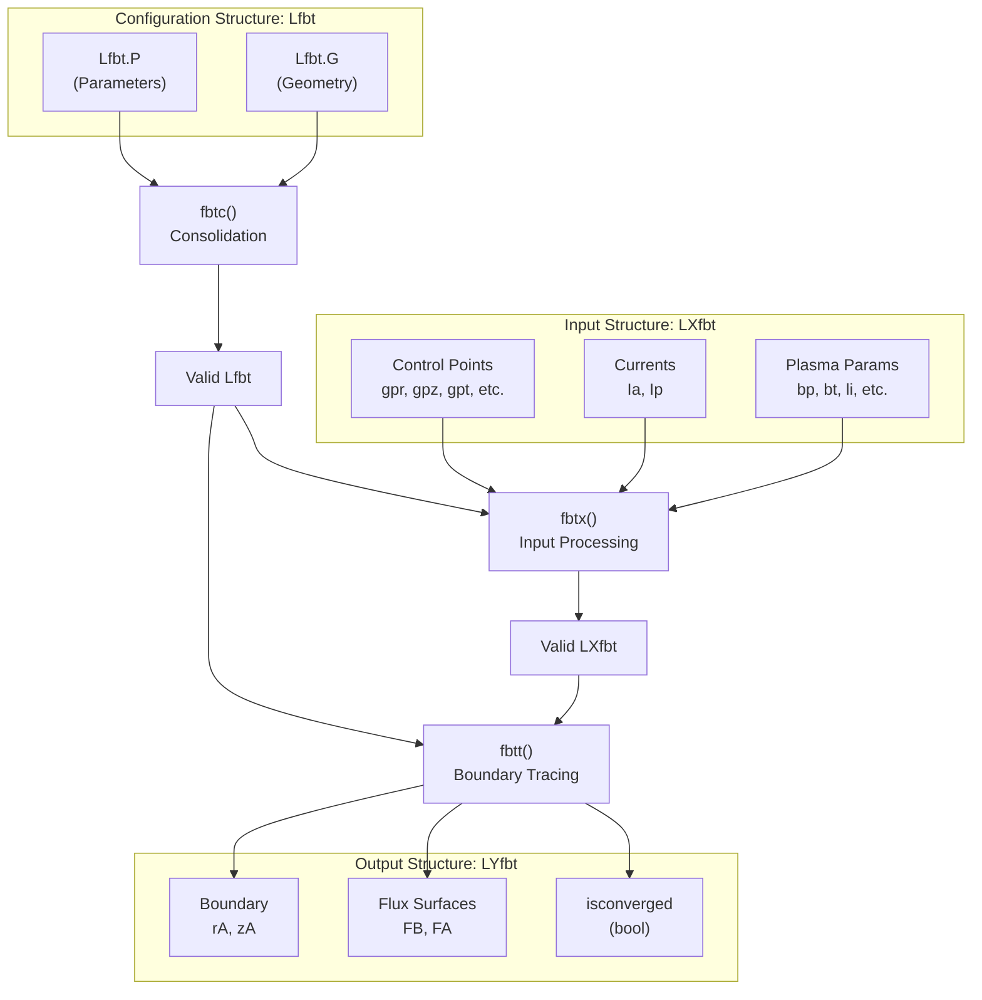
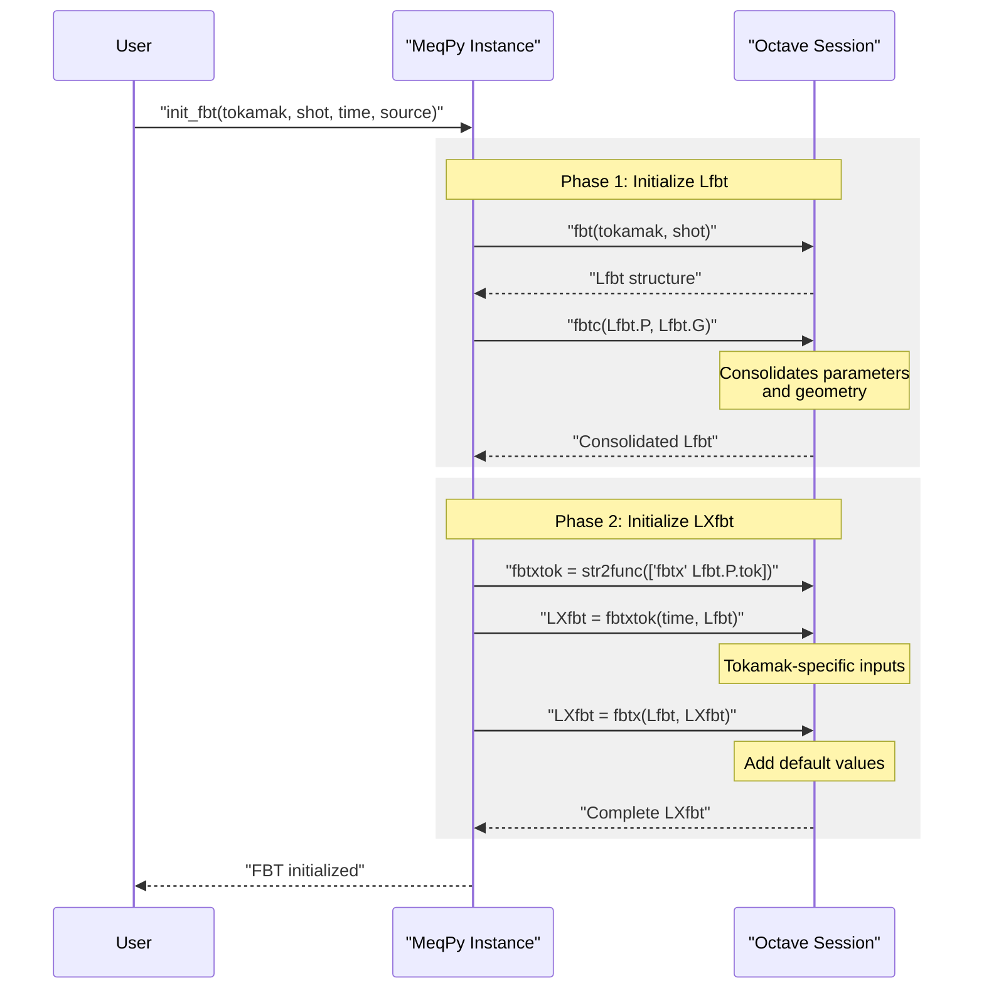
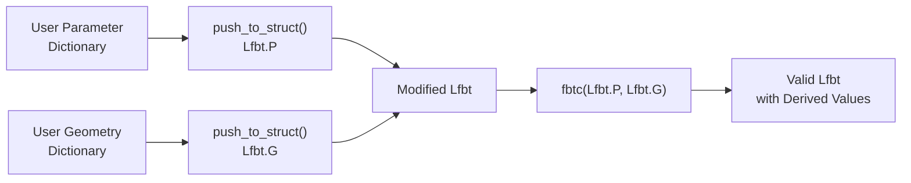
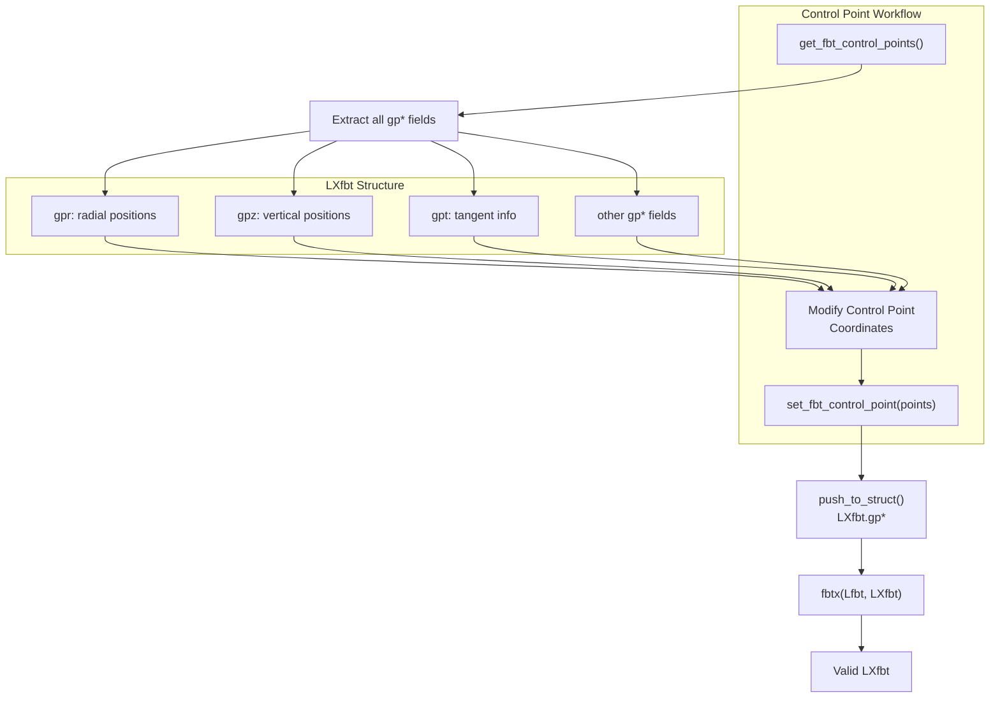
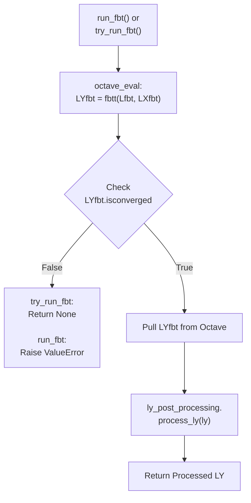
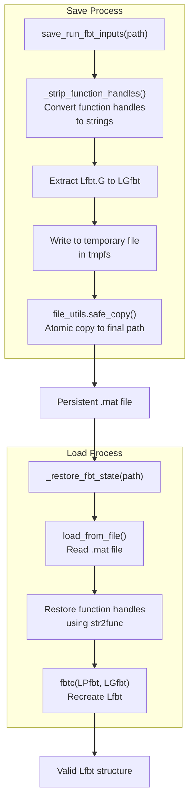

<!-- source: DeepWiki mcp.deepwiki.com · repo google-deepmind/meqpy · page 3.2 FBT - Fast Boundary Tracing · fetched 2026-10-26 -->

# FBT - Fast Boundary Tracing

<details>
<summary>Relevant source files</summary>

The following files were used as context for generating this wiki page:

- [meqpy/meqpy_fbt_test_mixin.py](meqpy/meqpy_fbt_test_mixin.py)
- [meqpy/meqpy_impl.py](meqpy/meqpy_impl.py)

</details>


## Purpose and Scope

This page documents the Fast Boundary Tracing (FBT) simulation mode in MeqPy. FBT is a rapid method for calculating plasma boundary shapes and magnetic flux surfaces in tokamak equilibria. Unlike FGE, which solves the full Grad-Shafranov equation, FBT uses a simplified approach that traces the plasma boundary based on control points and magnetic field constraints.

FBT is typically used as a first stage in equilibrium reconstruction workflows. Its outputs can be used to initialize FGE simulations for more accurate equilibrium calculations. For information about using FBT results to initialize FGE, see [FBT to FGE Integration](#3.3). For general information about FGE simulations, see [FGE - Fast Grad-Shafranov Equilibrium](#3.1).

**Sources:** [meqpy/meqpy_impl.py:15-24]()

## FBT Data Structures

FBT uses three primary Octave structures that are maintained in the MeqPy instance:

| Structure | Variable Name | Description |
|-----------|---------------|-------------|
| **L** | `Lfbt` | FBT configuration containing parameters (`P` field) and geometry (`G` field) |
| **LX** | `LXfbt` | FBT inputs including control points, coil currents, and plasma parameters |
| **LY** | `LYfbt` | FBT results including boundary coordinates, convergence status, and derived quantities |



**Sources:** [meqpy/meqpy_impl.py:202-237](), [meqpy/meqpy_impl.py:339-349]()

## Initialization

FBT initialization requires specifying the tokamak configuration, shot number, and time. The `init_fbt()` method creates the `Lfbt` and `LXfbt` structures.

### Basic Initialization

```python
from meqpy import MeqPy, MeqSource

meq = MeqPy()
meq.init_fbt(
    tokamak='anamak',
    shot=1,
    time=0.5,
    source=MeqSource.MEQ_DIRECT
)
```

The initialization process performs the following steps:



### Initialization with Default Parameters

You can override default FBT parameters during initialization:

```python
meq.init_fbt(
    tokamak='anamak',
    shot=1,
    time=0.5,
    source=MeqSource.MEQ_DIRECT,
    default_fbt_params={'debug': 2, 'nit': 100}
)
```

**Sources:** [meqpy/meqpy_impl.py:202-237](), [meqpy/meqpy_impl.py:339-349]()

## Parameter Configuration

After initialization, you can modify FBT parameters and geometry settings using the `set_fbt_parameters()` method. This method automatically runs consolidation to maintain consistency.

### Setting Parameters

Parameters are stored in `Lfbt.P`:

```python
# Set individual parameters
meq.set_fbt_parameters(parameters={
    'debug': 2,      # Debug verbosity level
    'nit': 100,      # Maximum iterations
    'tol': 1e-6      # Convergence tolerance
})

# Set geometry parameters
meq.set_fbt_parameters(geometry={
    'R0': 1.5,       # Major radius
    'a': 0.5         # Minor radius
})
```

### Getting Parameters

```python
# Retrieve parameters
debug_level = meq.get_fbt_parameter('debug')
r0 = meq.get_fbt_geometry('R0')
```

### Parameter Update Flow



**Note:** The consolidation step regenerates derived quantities in `Lfbt` to maintain consistency after parameter modifications. This is performed automatically by the `set_fbt_parameters()` method.

**Sources:** [meqpy/meqpy_impl.py:398-410](), [meqpy/meqpy_impl.py:442-449]()

## Setting FBT Inputs

FBT inputs in `LXfbt` define the boundary conditions and constraints for the tracing algorithm. There are two primary methods for setting inputs: direct input modification and control point specification.

### Direct Input Modification

The `set_fbt_inputs()` method allows setting individual fields in `LXfbt`:

```python
meq.set_fbt_inputs({
    'IpD': 500000.0,   # Plasma current (Amperes)
    'gpr': 1.7,        # Radial position of geometric center
    'gpz': 0.0,        # Vertical position of geometric center
})
```

**Important:** Use domain-specific fields ending in `D` (e.g., `IpD`) rather than singlet fields (e.g., `Ip`) for compatibility with both singlet and doublet configurations. The method validates this automatically and raises an error if singlet fields are used.

### Control Point Configuration

Control points define specific boundary locations that the FBT algorithm must satisfy. These are stored in `LXfbt` fields prefixed with `gp`.

```python
# Get current control points
control_points = meq.get_fbt_control_points()
# Returns: oct2py.Struct with fields like 'r', 'z', 't', etc.

# Modify control points
control_points['r'] = control_points['r'] + 0.01  # Shift radially
control_points['z'] = control_points['z'] - 0.005  # Shift vertically

# Set new control points
meq.set_fbt_control_point(control_points)
```

The `set_fbt_control_point()` method:
1. Clears existing control point fields (fields starting with `gp`)
2. Sets new control point values
3. Runs `fbtx()` consolidation to ensure consistency

### Control Point Field Structure

Common control point fields in `LXfbt`:

| Field | Description |
|-------|-------------|
| `gpr` | Radial coordinates of control points |
| `gpz` | Vertical coordinates of control points |
| `gpt` | Angular/tangent information |
| `gpp` | Pressure-related constraints |



**Sources:** [meqpy/meqpy_impl.py:412-428](), [meqpy/meqpy_impl.py:451-468](), [meqpy/meqpy_fbt_test_mixin.py:101-114]()

## Running FBT

FBT execution is performed by the `run_fbt()` or `try_run_fbt()` methods. These methods call the Octave `fbtt()` function, which performs the boundary tracing calculation.

### Basic Execution

```python
# Run FBT - raises error if not converged
ly = meq.run_fbt()

# Or use try_run_fbt for conditional execution
ly = meq.try_run_fbt()
if ly is None:
    print("FBT did not converge")
else:
    print("FBT converged successfully")
```

### Execution Flow



The `run_fbt()` method differs from `try_run_fbt()` only in error handling:
- `run_fbt()`: Raises `ValueError` if FBT does not converge
- `try_run_fbt()`: Returns `None` if FBT does not converge

### Display Inputs

Before running FBT, you can display the current inputs for verification:

```python
meq.display_fbt_inputs()
```

This calls the Octave `fbtxdisp(Lfbt, LXfbt)` function, which prints a formatted summary of all input values.

**Sources:** [meqpy/meqpy_impl.py:351-367]()

## FBT Results

The `LYfbt` structure returned by FBT contains the calculated boundary shape, flux surfaces, and convergence information. After processing by `ly_post_processing.process_ly()`, the structure is normalized for Python/NumPy compatibility.

### Key Result Fields

| Field | Type | Description |
|-------|------|-------------|
| `isconverged` | bool | Whether FBT converged successfully |
| `rA` | ndarray | Radial coordinates of plasma boundary |
| `zA` | ndarray | Vertical coordinates of plasma boundary |
| `FB` | ndarray | Boundary flux values |
| `FA` | ndarray | Axis flux values |
| `Ia` | ndarray | Coil currents |

### Example Result Access

```python
ly = meq.run_fbt()

if ly.isconverged:
    # Access boundary coordinates
    r_boundary = ly.rA
    z_boundary = ly.zA
    
    # Access flux values
    flux_boundary = ly.FB
    flux_axis = ly.FA
    
    # Access currents
    coil_currents = ly.Ia
```

### Result Processing

The `ly_post_processing.process_ly()` function normalizes the raw Octave struct:
1. Converts MATLAB-style arrays to NumPy arrays
2. Squeezes singleton dimensions
3. Ensures consistent field naming
4. Handles special field types (e.g., booleans, strings)

**Sources:** [meqpy/meqpy_impl.py:351-364](), [meqpy/meqpy_fbt_test_mixin.py:86-99]()

## State Persistence

FBT state can be saved and restored for debugging, checkpointing, or result reproduction. The saved state includes all information needed to re-run the `fbtt()` call.

### Saving FBT State

```python
meq.save_run_fbt_inputs('fbt_state.mat')
```

This saves the following variables to a MATLAB `.mat` file:

| Variable | Description |
|----------|-------------|
| `LPfbt` | Parameters from `Lfbt.P` with function handles converted to strings |
| `LGfbt` | Geometry from `Lfbt.G` |
| `LXfbt` | Complete input structure |

### Loading and Restoring State

```python
# Create new instance
new_meq = MeqPy()

# Restore state (internal method)
new_meq._restore_fbt_state('fbt_state.mat')

# Re-run FBT with restored state
ly = new_meq.run_fbt()
```

### Persistence Flow



### Function Handle Conversion

FBT parameters may contain function handles (e.g., `bfct`, `infct`, `eqfct`) that cannot be directly serialized to `.mat` files. The save process converts these to strings, and the restore process converts them back using Octave's `str2func()`.

Special handling for doublet basis functions:
```octave
if strcmp(LPfbt.bfct,'bfgenD') | strcmp(LPfbt.bfct,'bfdoublet')
  for iD = 1:size(LPfbt.bfp,1)
    LPfbt.bfp{iD,1} = str2func(LPfbt.bfp{iD,1});
  end
end
```

**Sources:** [meqpy/meqpy_impl.py:622-659](), [meqpy/meqpy_fbt_test_mixin.py:74-87]()

## Complete Usage Example

```python
from meqpy import MeqPy, MeqSource

# Initialize MeqPy
meq = MeqPy()

# Initialize FBT
meq.init_fbt(
    tokamak='anamak',
    shot=1,
    time=0.5,
    source=MeqSource.MEQ_DIRECT,
    default_fbt_params={'debug': 2}
)

# Set custom parameters
meq.set_fbt_parameters(parameters={'nit': 150})

# Modify control points
control_points = meq.get_fbt_control_points()
control_points['r'] = control_points['r'] + 0.02
meq.set_fbt_control_point(control_points)

# Set plasma parameters
meq.set_fbt_inputs({'IpD': 500000.0})

# Display inputs for verification
meq.display_fbt_inputs()

# Run FBT
ly = meq.run_fbt()

# Access results
if ly.isconverged:
    print(f"Boundary points: {len(ly.rA)}")
    print(f"Axis flux: {ly.FA}")
    
# Save state for later
meq.save_run_fbt_inputs('fbt_checkpoint.mat')
```

**Sources:** [meqpy/meqpy_impl.py:202-468](), [meqpy/meqpy_fbt_test_mixin.py:89-114]()

---

