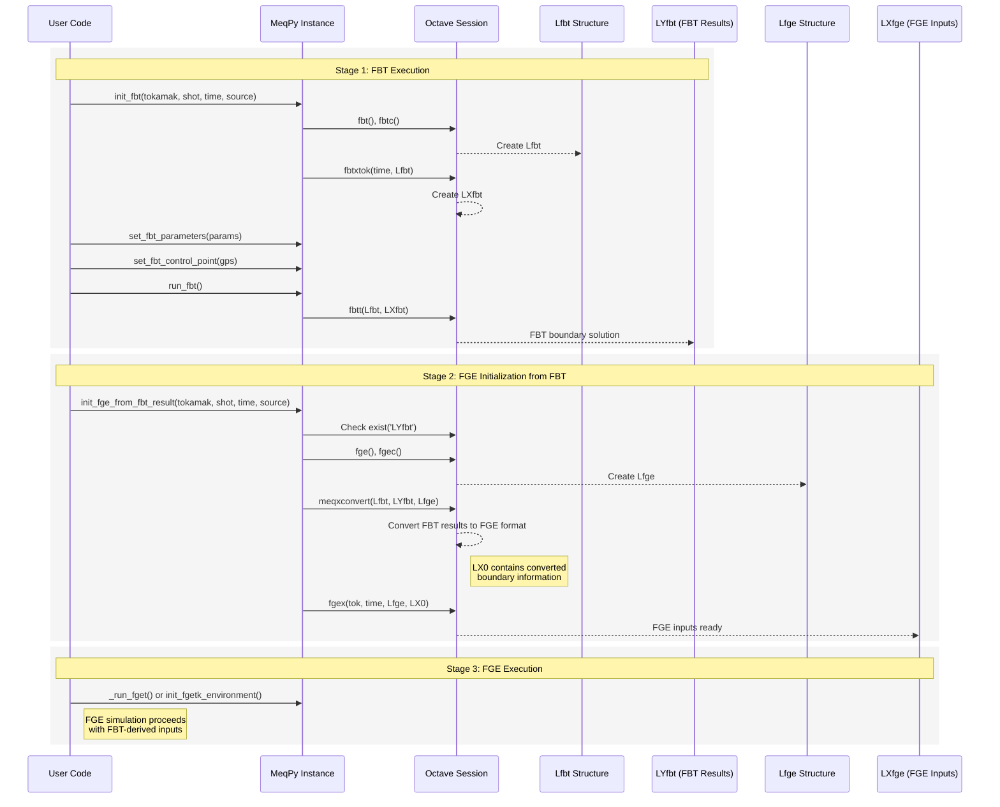
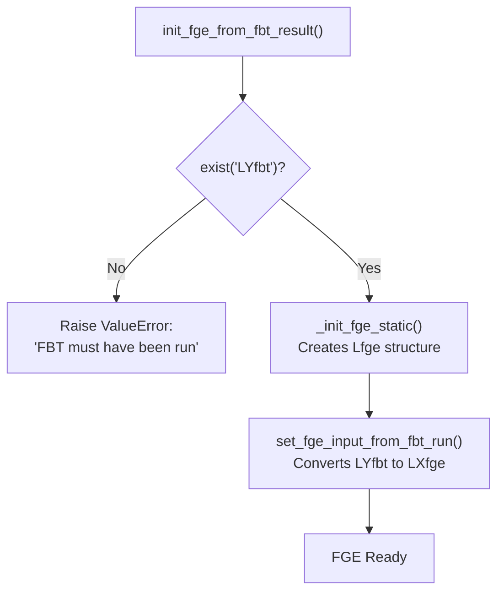
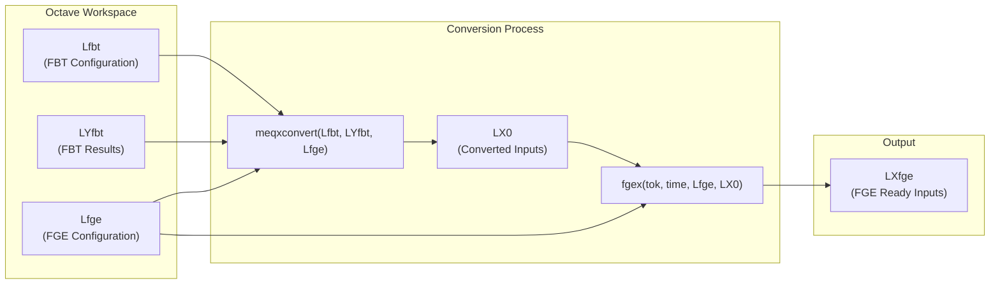
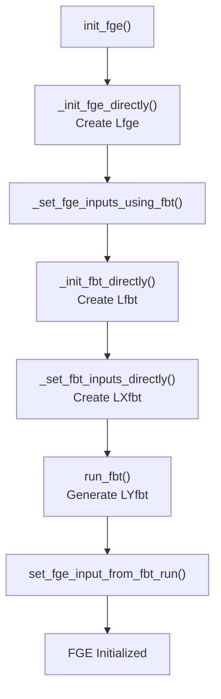
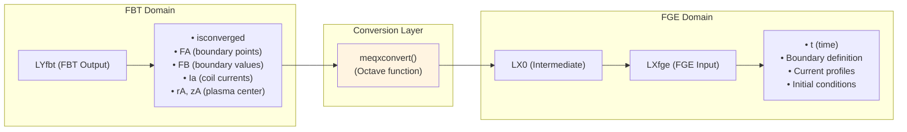

<!-- source: DeepWiki mcp.deepwiki.com · repo google-deepmind/meqpy · page 3.3 FBT to FGE Integration · fetched 2026-10-26 -->

# FBT to FGE Integration

<details>
<summary>Relevant source files</summary>

The following files were used as context for generating this wiki page:

- [meqpy/meqpy_fbt_test_mixin.py](meqpy/meqpy_fbt_test_mixin.py)
- [meqpy/meqpy_impl.py](meqpy/meqpy_impl.py)

</details>


This page documents the integration mechanism that allows initializing FGE (Fast Grad-Shafranov Equilibrium) simulations using FBT (Fast Boundary Tracing) results, enabling two-stage equilibrium reconstruction workflows. This integration provides greater control over the boundary tracing process before computing the full equilibrium solution.

For details on FBT initialization and configuration, see [FBT - Fast Boundary Tracing](#3.2). For FGE initialization without FBT, see [FGE - Fast Grad-Shafranov Equilibrium](#3.1).

## Purpose and Use Cases

The FBT-to-FGE integration enables advanced equilibrium reconstruction scenarios where:

- **Custom boundary control**: You need to modify FBT parameters or control points before running the equilibrium solver
- **Shape override**: You want to override the default plasma shape determination
- **Iterative refinement**: You need to run FBT multiple times with different parameters before selecting a result for equilibrium calculation
- **Debugging workflows**: You want to inspect or modify FBT results before passing them to FGE

The standard `init_fge()` method internally runs FBT automatically, but `init_fge_from_fbt_result()` gives you explicit control over the FBT execution step.

Sources: [meqpy/meqpy_impl.py:239-286](), [meqpy/meqpy_impl.py:15-24]()

## Two-Stage Reconstruction Workflow



**Workflow Comparison: Standard vs Two-Stage**

| Aspect | Standard `init_fge()` | Two-Stage with `init_fge_from_fbt_result()` |
|--------|----------------------|---------------------------------------------|
| FBT Control | Automatic, internal | Explicit, user-controlled |
| FBT Parameter Access | Via `default_fbt_params` only | Full access via `set_fbt_parameters()` |
| Control Point Modification | Not possible | Available via `set_fbt_control_point()` |
| FBT Result Inspection | Not accessible | Available via `run_fbt()` return value |
| Use Case | Standard simulations | Advanced boundary control |

Sources: [meqpy/meqpy_impl.py:135-180](), [meqpy/meqpy_impl.py:239-286]()

## Core Integration Methods

### init_fge_from_fbt_result()

The primary method for two-stage initialization that requires FBT to have already been run and converged.



**Method Signature and Parameters:**

| Parameter | Type | Purpose |
|-----------|------|---------|
| `tokamak` | `str` | Tokamak identifier (e.g., 'anamak', 'diiid') |
| `shot` | `int` | Shot number for geometry configuration |
| `time` | `float` | Simulation time point |
| `source` | `MeqSource` | Data source (currently `MEQ_DIRECT`) |
| `default_meq_params` | `MutableMapping[str, Any]` | Override L.P parameters for FGE |
| `cde` | `str` | CDE specification (optional) |

Sources: [meqpy/meqpy_impl.py:239-286]()

### set_fge_input_from_fbt_run()

Converts FBT results (`LYfbt`) to FGE inputs (`LXfge`) using the MEQ conversion function.



**Key Data Transformations:**

The `meqxconvert` Octave function extracts the following from `LYfbt`:
- Plasma boundary points
- Current distribution information
- Shape parameters
- Diagnostic measurements

These are reformatted into the `LX0` structure compatible with FGE input requirements. The `fgex` function then populates time-series fields.

Sources: [meqpy/meqpy_impl.py:369-373]()

## Internal FBT Usage in Standard init_fge()

For comparison, the standard `init_fge()` method uses FBT internally through `_set_fge_inputs_using_fbt()`:



This diagram shows that `init_fge()` internally performs all FBT steps automatically but does not expose the intermediate results to the user.

Sources: [meqpy/meqpy_impl.py:329-337](), [meqpy/meqpy_impl.py:181-200]()

## Usage Pattern and Example

### Basic Two-Stage Workflow

```python
# Stage 1: Run FBT with custom control
instance = meqpy.MeqPy()
instance.init_fbt(tokamak='anamak', shot=1, time=0.0, 
                  source=meqpy.MeqSource.MEQ_DIRECT)

# Customize FBT execution
instance.set_fbt_parameters(parameters={'debug': 2})
gps = instance.get_fbt_control_points()
gps['r'] = gps['r'] + 0.01  # Shift plasma boundary
instance.set_fbt_control_point(gps)

# Execute FBT and verify convergence
ly_fbt = instance.run_fbt()

# Stage 2: Initialize FGE using FBT results
instance.init_fge_from_fbt_result(
    tokamak='anamak',
    shot=1,
    time=0.0,
    source=meqpy.MeqSource.MEQ_DIRECT,
    default_meq_params={'debug': 1}
)

# Now run FGE simulation
instance._run_fget()
```

### State Requirements

Before calling `init_fge_from_fbt_result()`, the Octave session must contain:

| Variable | Type | Created By | Purpose |
|----------|------|------------|---------|
| `LYfbt` | Struct | `run_fbt()` or `try_run_fbt()` | FBT converged results |
| `Lfbt` | Struct | `init_fbt()` | FBT configuration (used in conversion) |

The method validates that `LYfbt` exists by checking `exist('LYfbt', 'var')`.

Sources: [meqpy/meqpy_impl.py:275-276]()

## Data Structure Mapping

### FBT Output to FGE Input Conversion



The conversion maintains physical consistency while transforming from boundary-focused (FBT) to equilibrium-focused (FGE) representations.

Sources: [meqpy/meqpy_impl.py:369-373]()

## Comparison with Direct FGE Initialization

### Method Decision Matrix

| Scenario | Use Method | Rationale |
|----------|-----------|-----------|
| Standard simulation | `init_fge()` | Simpler API, automatic FBT |
| Need custom FBT parameters | `init_fge_from_fbt_result()` | Explicit FBT control |
| Shape override required | `init_fge_from_fbt_result()` | Modify control points |
| Testing FBT convergence | `init_fge_from_fbt_result()` | Inspect `LYfbt` before FGE |
| Multiple FBT attempts | `init_fge_from_fbt_result()` | Run FBT until satisfied |
| Debugging workflow | `init_fge_from_fbt_result()` | Checkpoint FBT state |

### Code Path Comparison


The two-stage path provides user intervention points (shown in light blue boxes) where the direct path offers none.

Sources: [meqpy/meqpy_impl.py:135-200](), [meqpy/meqpy_impl.py:239-286]()

## Testing and Validation

The test suite validates the FBT-to-FGE integration through the `test_init_fge_from_fbt()` test method:

**Test Workflow:**
1. Creates FBT instance via `get_meq_fbt_instance()`
2. Executes `run_fbt()` to generate `LYfbt`
3. Calls `init_fge_from_fbt_result()` with test parameters
4. Verifies FGE initialization by running `_run_fget()`

This test ensures that:
- FBT results are correctly converted to FGE inputs
- The converted inputs produce valid FGE solutions
- The two-stage workflow is functionally equivalent to direct initialization

Sources: [meqpy/meqpy_fbt_test_mixin.py:116-125]()

## Error Handling

### Common Errors and Solutions

| Error | Cause | Solution |
|-------|-------|----------|
| `ValueError: FBT must have been run` | `LYfbt` doesn't exist | Call `run_fbt()` before `init_fge_from_fbt_result()` |
| `ValueError: FBT failed to converge` | `run_fbt()` returned None | Check FBT parameters, inputs, and control points |
| Invalid parameters after conversion | Parameter mismatch between FBT/FGE | Ensure `default_meq_params` compatible with both |

### Validation Check

The method performs an explicit check before proceeding:

```octave
exist('LYfbt', 'var')  % Must return true
```

If this check fails, a `ValueError` is raised with a clear message indicating that FBT must be run first.

Sources: [meqpy/meqpy_impl.py:275-276]()

## Integration Points Summary

### Key Classes and Methods

| Code Entity | Location | Purpose |
|-------------|----------|---------|
| `MeqPy.init_fge_from_fbt_result()` | [meqpy/meqpy_impl.py:239-286]() | Main two-stage initialization method |
| `MeqPy._init_fge_static()` | [meqpy/meqpy_impl.py:288-303]() | Creates FGE structure without FBT |
| `MeqPy.set_fge_input_from_fbt_run()` | [meqpy/meqpy_impl.py:369-373]() | Converts FBT results to FGE inputs |
| `MeqPy._set_fge_inputs_using_fbt()` | [meqpy/meqpy_impl.py:329-337]() | Internal FBT usage in standard init |
| `MeqPy.run_fbt()` | [meqpy/meqpy_impl.py:351-356]() | Executes FBT and validates convergence |

### Octave Functions Called

| Function | Purpose | Called From |
|----------|---------|-------------|
| `meqxconvert(Lfbt, LYfbt, Lfge)` | Convert FBT output to FGE input format | `set_fge_input_from_fbt_run()` |
| `fgex(tok, time, Lfge, LX0)` | Populate time-series FGE inputs | `set_fge_input_from_fbt_run()` |
| `fge(tokamak, shot)` | Initialize FGE structure | `_init_fge_directly()` |
| `fgec(P, G)` | Consolidate FGE parameters | `_init_fge_directly()` |

Sources: [meqpy/meqpy_impl.py:239-373]()

---

