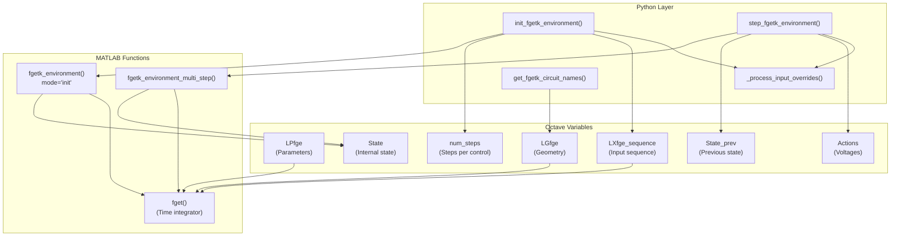
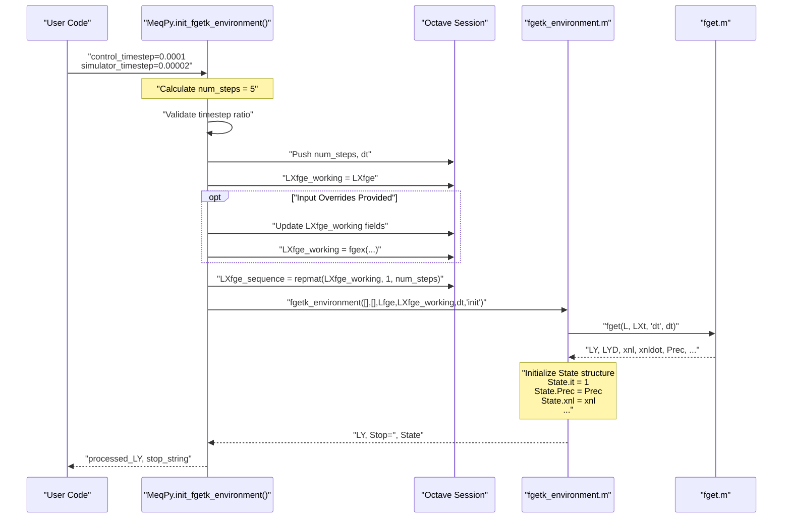
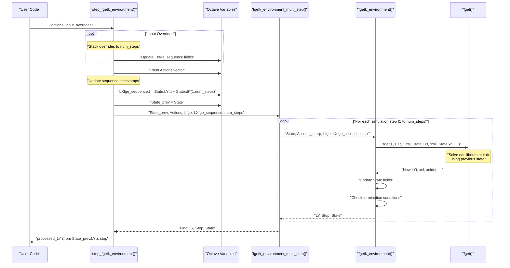
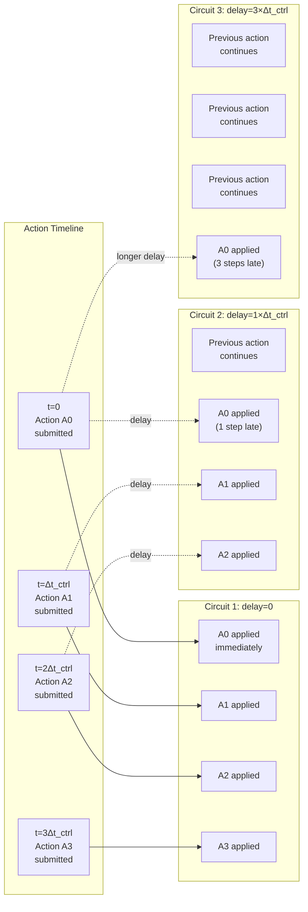
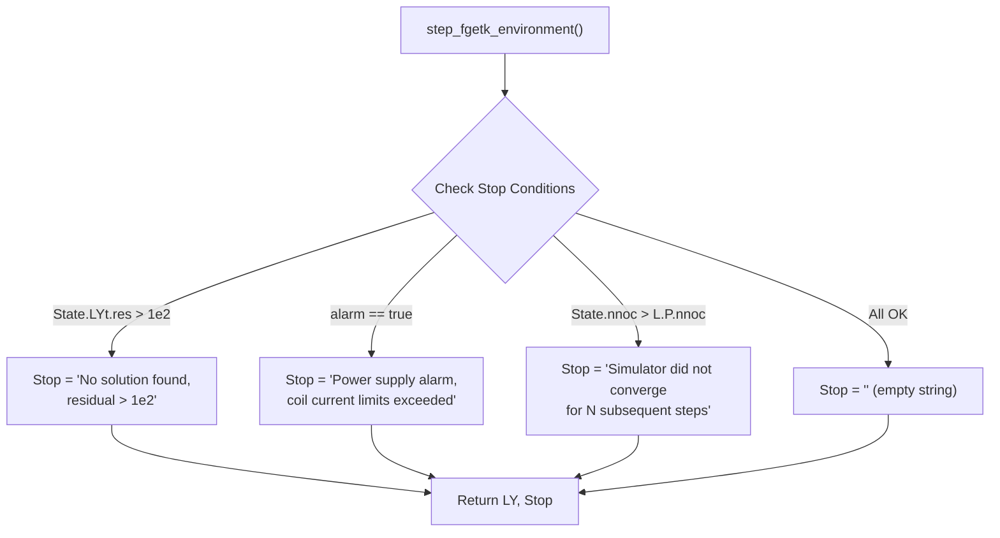

<!-- source: DeepWiki mcp.deepwiki.com · repo google-deepmind/meqpy · page 3.4 FGETK Environment - Time-Dependent Simulations · fetched 2026-10-26 -->

# FGETK Environment - Time-Dependent Simulations

<details>
<summary>Relevant source files</summary>

The following files were used as context for generating this wiki page:

- [meqpy/matlab/fgetk_environment.m](meqpy/matlab/fgetk_environment.m)
- [meqpy/meqpy_fge_test_mixin.py](meqpy/meqpy_fge_test_mixin.py)
- [meqpy/meqpy_impl.py](meqpy/meqpy_impl.py)

</details>


## Purpose and Scope

This page documents the FGETK (Fast Grad-Shafranov Equilibrium Time-dependent Kernel) environment, which enables time-series simulations of tokamak plasma equilibrium evolution for control-oriented applications. The FGETK environment provides a step-by-step interface suitable for reinforcement learning, model predictive control, and other control algorithm development.

For information about initializing FGE for single equilibrium calculations, see [FGE - Fast Grad-Shafranov Equilibrium](#3.1). For general FGE concepts and data structures, also refer to [FGE](#3.1) and [Data Structures and Conventions](#2.3).

**Sources:** [meqpy/meqpy_impl.py:15-24]()

## Overview

The FGETK environment wraps the underlying `fget` time-dependent solver in a control-friendly interface that:

- Maintains internal simulation state between steps
- Accepts control actions (circuit voltages) at each step
- Returns observations from the previous timestep (mimicking real-world measurement delays)
- Supports different control and simulation timesteps
- Handles action delays to model realistic actuator response
- Detects and reports termination conditions

The environment operates in two modes: **initialization** (`'init'`) and **stepping** (`'step'`). State is maintained in a `State` structure that persists across steps.

**Sources:** [meqpy/matlab/fgetk_environment.m:14-31](), [meqpy/meqpy_impl.py:474-620]()

## Architecture

### Component Interaction



**Sources:** [meqpy/meqpy_impl.py:474-565](), [meqpy/matlab/fgetk_environment.m:14-100]()

### State Management

The FGETK environment maintains a `State` structure in Octave that persists across timesteps:

| State Field | Description | Initialized In |
|-------------|-------------|----------------|
| `State.it` | Iteration counter | `fgetk_environment` 'init' |
| `State.Prec` | Preconditioner for Newton solver | `fget` |
| `State.xnl` | Nonlinear state vector | `fget` |
| `State.xnldot` | Time derivative of state | `fget` |
| `State.Tstate` | Transport state | `fget` |
| `State.PSstate` | Power supply state | `fget` |
| `State.dstate` | Disruption detector state | `fget` |
| `State.nnoc` | Non-convergence counter | `fget` |
| `State.LYt` | Previous timestep result | `fget` |
| `State.dt` | Timestep size | User-specified |
| `State.Vact` | Actual applied voltages | Computed from `LY.Va` |

**Sources:** [meqpy/matlab/fgetk_environment.m:44-53](), [meqpy/matlab/fgetk_environment.m:89]()

## Initialization

### Basic Initialization

Before initializing the FGETK environment, you must have already initialized FGE (see [FGE](#3.1)). The environment initialization requires two timesteps:

- **Control timestep** (`dt_ctrl`): How frequently control actions are applied
- **Simulator timestep** (`dt_sim`): Internal simulation timestep for numerical integration

The control timestep must be an integer multiple of the simulator timestep.

```python
# Example: Control at 100 μs intervals, simulate at 20 μs intervals
meq_instance.init_fgetk_environment(
    control_timestep=0.0001,  # 100 μs
    simulator_timestep=0.00002  # 20 μs
)
```

**Sources:** [meqpy/meqpy_impl.py:474-511](), [meqpy/meqpy_fge_test_mixin.py:26-27]()

### Initialization Flow



**Sources:** [meqpy/meqpy_impl.py:474-511](), [meqpy/matlab/fgetk_environment.m:36-54]()

### Input Overrides

The `init_fgetk_environment` method accepts an optional `input_overrides` parameter to modify inputs before initialization:

```python
meq_instance.init_fgetk_environment(
    control_timestep=0.0001,
    simulator_timestep=0.00002,
    input_overrides={'bpD': original_bp * 1.001}
)
```

Overridden inputs are applied to `LXfge_working`, and then `fgex` is called to consolidate derived quantities before creating the input sequence.

**Sources:** [meqpy/meqpy_impl.py:492-501](), [meqpy/meqpy_fge_test_mixin.py:176-179]()

## Stepping the Environment

### Control Step Execution

After initialization, the environment is advanced using `step_fgetk_environment`, which accepts:

1. **Actions**: A 1D numpy array of voltage setpoints for each circuit (in `L.G.dima` order)
2. **Input overrides** (optional): Dictionary mapping input names to values

The method returns the observation from the **previous timestep** and a stop condition string.

```python
num_actions = len(meq_instance.get_fgetk_circuit_names())
actions = np.full((num_actions,), 10.0)  # 10V on all circuits

ly, stop = meq_instance.step_fgetk_environment(actions, {})
```

**Sources:** [meqpy/meqpy_impl.py:513-545](), [meqpy/meqpy_fge_test_mixin.py:182-191]()

### Multi-Step Execution



When `num_steps > 1`, `fgetk_environment_multi_step` is called, which executes multiple simulation steps for each control step. This function:

1. Interpolates actions based on action delays (see [Action Delays](#action-delays))
2. Calls `fgetk_environment` with mode `'step'` for each simulation timestep
3. Returns the result after all steps complete

The key insight: **the returned `LY` is from `State_prev.LYt`**, representing the observation at the **beginning** of the control interval. This one-step delay mimics realistic control scenarios where measurements are available from the previous timestep.

**Sources:** [meqpy/meqpy_impl.py:513-545](), [meqpy/matlab/fgetk_environment.m:56-83]()

### Circuit Names and Action Ordering

The action array must match the ordering of circuit names returned by `get_fgetk_circuit_names()`:

```python
circuit_names = meq_instance.get_fgetk_circuit_names()
# circuit_names might be ['OH', 'PF1U', 'PF1L', 'PF2U', 'PF2L', ...]

actions = np.array([10.0, 5.0, 5.0, -2.0, -2.0, ...])  # Same length and order
```

**Sources:** [meqpy/meqpy_impl.py:564-565](), [meqpy/meqpy_fge_test_mixin.py:182-183]()

## Action Delays

### Delay Configuration

Action delays model realistic actuator response times and communication latencies. Delays are configured via the `L.G.Vadelay` geometry field:

```python
num_circuits = len(meq_instance.get_fgetk_circuit_names())
delays = np.array([0.0003, 0.0001, 0.0001, 0.0003, ...])  # Seconds per circuit

meq_instance.set_fge_parameters(geometry={'Vadelay': delays})
```

Each circuit can have a different delay. The delay is specified in seconds and must be a multiple of the control timestep.

**Sources:** [meqpy/meqpy_fge_test_mixin.py:208-211]()

### Delay Implementation



During each control step, actions are interpolated based on their delays using `fgetk_environment_loop.m` or `fgetk_environment_multi_step.m`. Actions with delay `d` are held at their previous value for `d` seconds before the new action takes effect.

**Sources:** [meqpy/meqpy_fge_test_mixin.py:196-245]()

### Delay Testing Example

The test demonstrates delay behavior:

```python
# Set delays: 0, 1, 3, ... control timesteps
delay_steps = [0, 1, 3, ...]
delays = np.array(delay_steps) * control_timestep

# Apply first action for 5 steps
for _ in range(5):
    ly, _ = meq_instance.step_fgetk_environment(first_actions)
    results.append(ly.Va)

# Apply second action for 5 steps
for _ in range(5):
    ly, _ = meq_instance.step_fgetk_environment(second_actions)
    results.append(ly.Va)

# Verify: first action appears after delay_steps[i] + 1 steps
# (The +1 is due to one-step observation delay)
```

**Sources:** [meqpy/meqpy_fge_test_mixin.py:196-245]()

## State Persistence

### Saving Environment State

To save the complete state of the environment for debugging or checkpointing:

```python
meq_instance.save_last_fgetk_env_call_state('/path/to/state.mat')
```

This saves the following variables to a `.mat` file:

| Variable | Description |
|----------|-------------|
| `LPfge` | FGE parameters (function handles converted to strings) |
| `LGfge` | FGE geometry |
| `State_prev` | Previous timestep state |
| `Actions` | Last action vector |
| `LXfge_sequence` | Input sequence for the last step |
| `num_steps` | Number of simulator steps per control step |

**Sources:** [meqpy/meqpy_impl.py:45-52](), [meqpy/meqpy_impl.py:567-579]()

### Loading and Restoring State

To restore and re-run from a saved state:

```python
new_instance = meqpy.MeqPy()
ly = new_instance.run_fgetk_env_from_loaded_file('/path/to/state.mat')
```

The restoration process:
1. Loads all saved variables from the `.mat` file
2. Converts function handle strings back to function handles using `str2func`
3. Runs consolidation (`fgec`) to recreate the `Lfge` structure
4. Executes `fgetk_environment_multi_step` with the restored state

**Sources:** [meqpy/meqpy_impl.py:581-620](), [meqpy/meqpy_fge_test_mixin.py:260-279]()

### Function Handle Conversion

The `Lfge.P` structure contains function handles (e.g., `bfct`, `infct`, `eqfct`) that cannot be directly serialized. During save:

```octave
LPfge = strip_function_handles(Lfge.P, 'string');
```

During load:

```octave
for var = {'bfct','infct', 'eqfct'}
  if isfield(LPfge,var) && ischar(LPfge.(var{:}))
    LPfge.(var{:}) = str2func(LPfge.(var{:}));
  end
end
```

Special handling exists for doublet basis functions where `LPfge.bfp` also contains function handles.

**Sources:** [meqpy/meqpy_impl.py:591-608](), [meqpy/meqpy_impl.py:661-670]()

## Termination Conditions

The environment monitors several conditions that can trigger termination:



### Termination Condition Details

| Condition | Field Checked | Threshold | Meaning |
|-----------|---------------|-----------|---------|
| High residual | `State.LYt.res` | `> 1e2` | Newton solver failed to converge to acceptable tolerance |
| Power supply alarm | `alarm` (from `fget`) | `true` | Coil current limits exceeded (may cause damage) |
| Persistent non-convergence | `State.nnoc` | `> L.P.nnoc` | Solver failed to converge for too many consecutive steps |

When any condition is met, the `Stop` string contains a descriptive message. Otherwise, `Stop` is an empty string.

**Sources:** [meqpy/matlab/fgetk_environment.m:89-98]()

## Complete Usage Example

```python
import numpy as np
from meqpy import MeqPy, MeqSource

# 1. Initialize MeqPy and FGE
meq = MeqPy()
meq.init_fge(
    tokamak='anamak',
    shot=1,
    time=0.1,
    source=MeqSource.MEQ_DIRECT,
    default_meq_params={'debug': 2}
)

# 2. Configure for faster convergence
meq.set_fge_parameters(parameters={
    'anajac': True,
    'usepreconditioner': True
})

# 3. Set action delays (optional)
num_circuits = len(meq.get_fgetk_circuit_names())
delays = np.array([0.0003] * num_circuits)
meq.set_fge_parameters(geometry={'Vadelay': delays})

# 4. Initialize FGETK environment
ly_init, stop = meq.init_fgetk_environment(
    control_timestep=0.0001,
    simulator_timestep=0.00002,
    input_overrides={'bpD': original_bp * 1.01}
)
print(f"Initialization: t={ly_init.t}, stop='{stop}'")

# 5. Run control loop
for step in range(100):
    # Compute actions (e.g., from a controller)
    actions = compute_control_actions(ly_init)
    
    # Step environment
    ly, stop = meq.step_fgetk_environment(actions, {})
    
    if stop:
        print(f"Termination at step {step}: {stop}")
        break
    
    # Use observation for next control decision
    ly_init = ly

# 6. Save final state for debugging
meq.save_last_fgetk_env_call_state('/tmp/final_state.mat')
```

**Sources:** [meqpy/meqpy_fge_test_mixin.py:173-195](), [meqpy/meqpy_impl.py:474-545]()

## Key Implementation Details

### Timestep Validation

The environment strictly enforces that the control timestep is an integer multiple of the simulator timestep:

```python
self._env_num_steps = control_timestep / simulator_timestep
if abs(self._env_num_steps - int(self._env_num_steps)) > 1e-12:
    raise ValueError("Control timestep must be a multiple of simulator timestep")
```

**Sources:** [meqpy/meqpy_impl.py:481-487]()

### Input Override Processing

When `input_overrides` are provided during stepping:

1. Each override value is stacked `num_steps` times along the last dimension
2. The stacked values are pushed to `LXfge_sequence`
3. This creates a sequence where each override is constant across the control interval

```python
if stack_inputs:
    input_overrides = {
        k: np.stack([v] * self._env_num_steps, axis=-1)
        for k, v in input_overrides.items()
    }
```

**Sources:** [meqpy/meqpy_impl.py:547-562](), [meqpy/meqpy_impl.py:535]()

### One-Step Observation Delay

The environment returns `State_prev.LYt` rather than the newly computed `State.LYt`:

```octave
LY = State.LYt; % Must also return previous LY
```

This ensures observations correspond to the state at the **beginning** of the control interval, matching real tokamak measurement latencies.

**Sources:** [meqpy/matlab/fgetk_environment.m:69](), [meqpy/meqpy_fge_test_mixin.py:186-191]()

## Related Functions

The following MATLAB functions support the FGETK environment:

- **`fgetk_environment.m`**: Core environment function with 'init' and 'step' modes
- **`fgetk_environment_multi_step.m`**: Executes multiple simulation steps per control step
- **`fgetk_environment_loop.m`**: Legacy loop-based multi-step implementation
- **`fgetk_environment_test.m`**: Test utilities for the environment

For detailed documentation of these functions, see [Supporting MATLAB Functions](#6.2).

**Sources:** [meqpy/matlab/fgetk_environment.m:1-100]()

---

