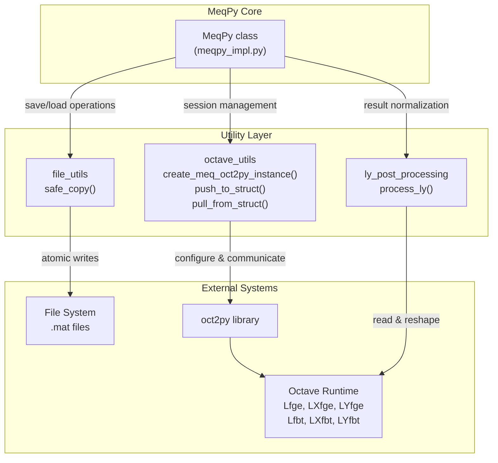
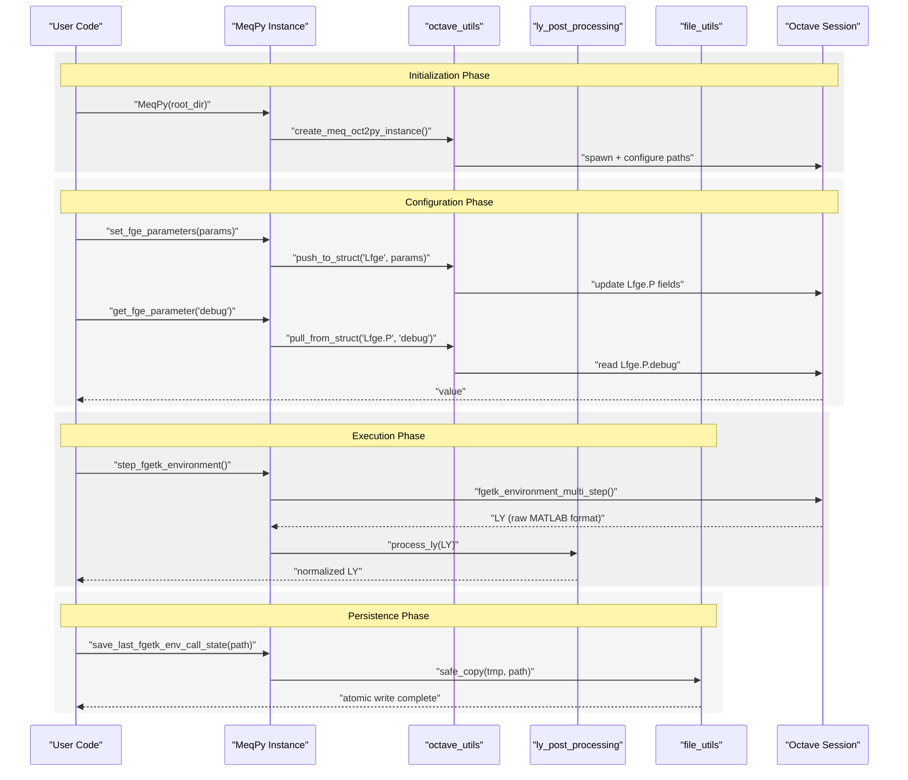
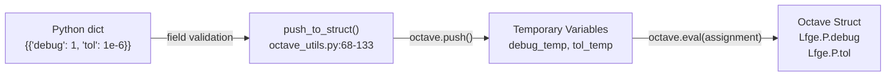
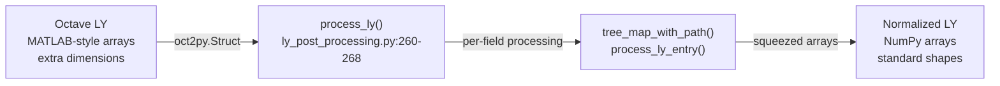
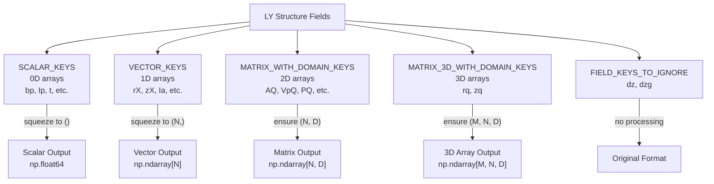
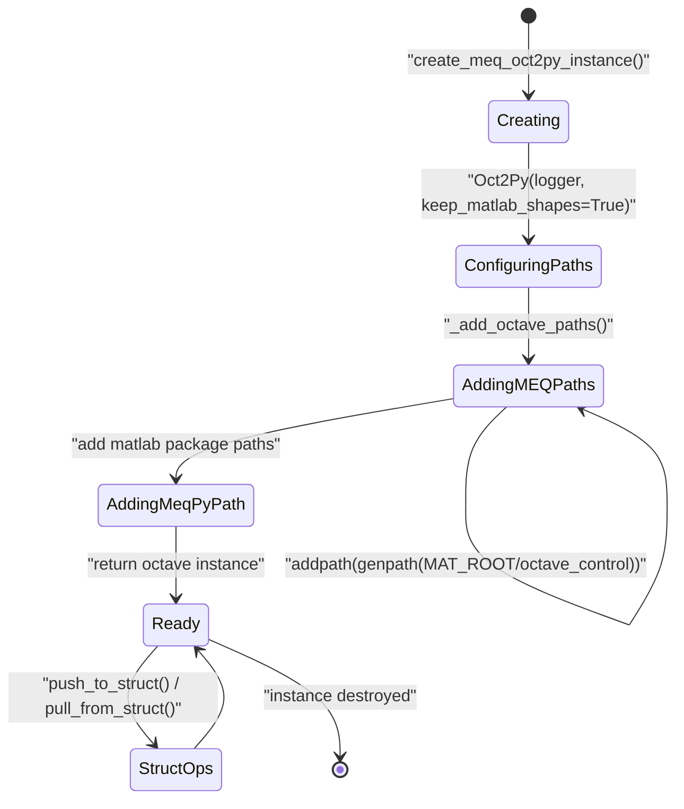
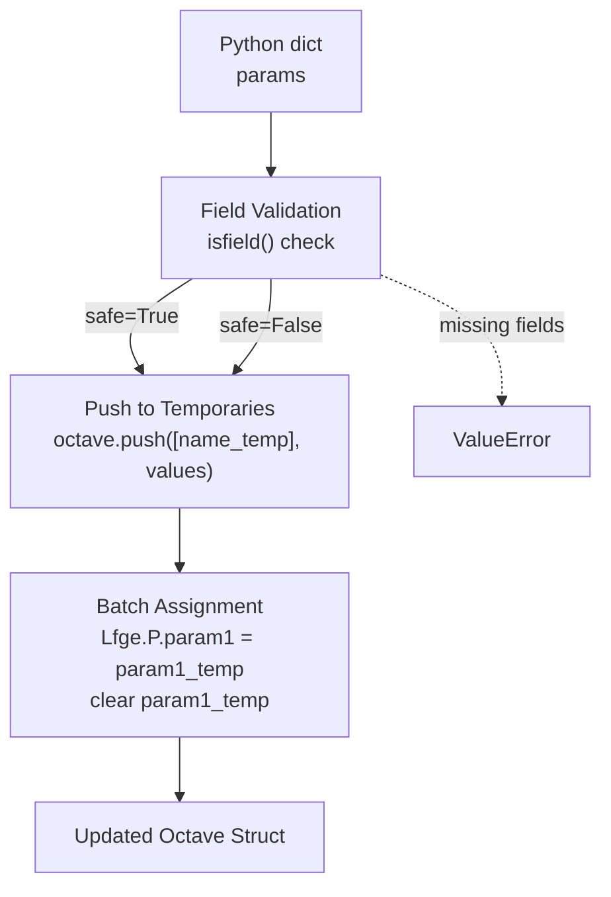
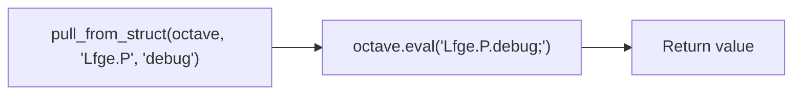
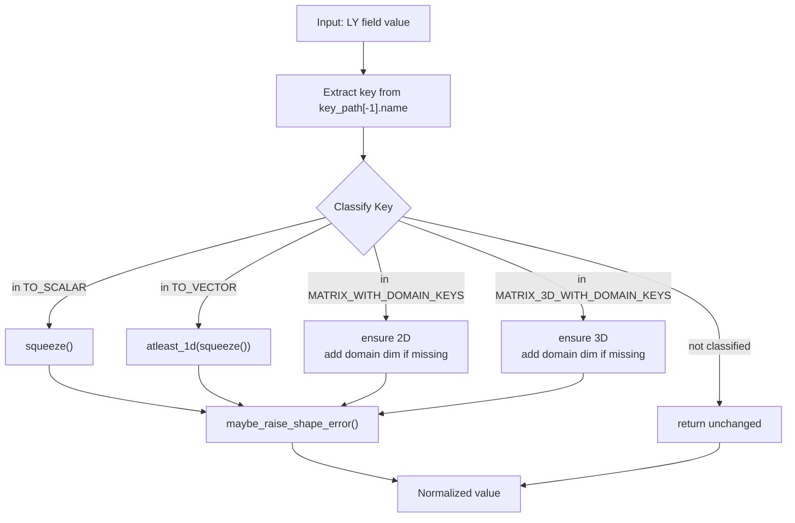
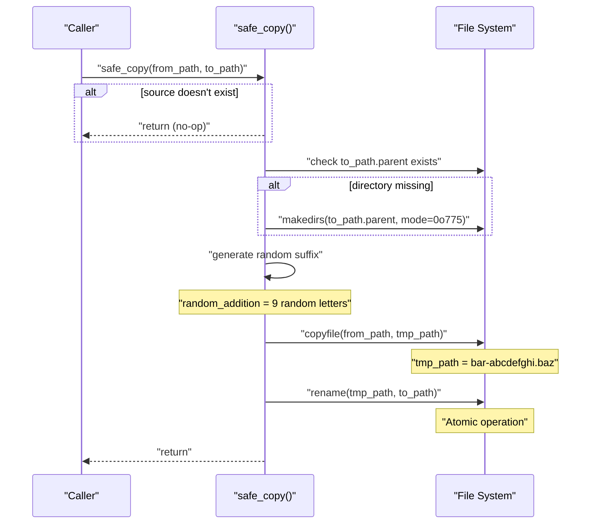

<!-- source: DeepWiki mcp.deepwiki.com · repo google-deepmind/meqpy · page 4 Utility Modules · fetched 2026-10-26 -->

# Utility Modules

<details>
<summary>Relevant source files</summary>

The following files were used as context for generating this wiki page:

- [meqpy/file_utils.py](meqpy/file_utils.py)
- [meqpy/ly_post_processing.py](meqpy/ly_post_processing.py)
- [meqpy/octave_utils.py](meqpy/octave_utils.py)

</details>


This page provides an overview of the three core utility modules that support MeqPy's operation: file operations, Octave integration, and data post-processing. These modules handle the critical infrastructure for Python-Octave communication, atomic file operations, and data normalization between MATLAB and Python conventions.

For detailed documentation on specific utilities, see:
- **File Operations**: [File Operations (file_utils)](#4.1)
- **Octave Struct Manipulation**: [Octave Struct Manipulation (octave_utils)](#4.2)
- **Data Post-Processing**: [Data Post-Processing (ly_post_processing)](#4.3)

For information on how the main `MeqPy` class uses these utilities, see [The MeqPy Class](#2.1).

**Sources:** [meqpy/file_utils.py](), [meqpy/octave_utils.py](), [meqpy/ly_post_processing.py]()

---

## Architecture Overview

The three utility modules form distinct layers in MeqPy's architecture, each addressing a specific integration challenge:



**Purpose of Each Module:**

| Module | Primary Responsibility | Key Functions |
|--------|------------------------|---------------|
| `file_utils` | Atomic file operations to prevent corruption | `safe_copy()` |
| `octave_utils` | Bridge between Python and Octave, struct manipulation | `create_meq_oct2py_instance()`, `push_to_struct()`, `pull_from_struct()` |
| `ly_post_processing` | Normalize MATLAB data structures for Python/NumPy | `process_ly()`, field classification constants |

**Sources:** [meqpy/file_utils.py](), [meqpy/octave_utils.py](), [meqpy/ly_post_processing.py]()

---

## Module Interactions in Typical Workflows

The utilities are invoked at different stages of a simulation lifecycle:



**Sources:** [meqpy/meqpy_impl.py](), [meqpy/octave_utils.py](), [meqpy/ly_post_processing.py](), [meqpy/file_utils.py]()

---

## Common Data Flow Patterns

### Parameter Configuration Pattern

When setting parameters, data flows from Python dictionaries through `push_to_struct()` to Octave struct fields:



**Sources:** [meqpy/octave_utils.py:68-133]()

### Result Normalization Pattern

When reading results, data flows from Octave LY structures through normalization to Python-compatible formats:



**Sources:** [meqpy/ly_post_processing.py:260-268](), [meqpy/ly_post_processing.py:128-166]()

---

## Field Classification System

The `ly_post_processing` module defines explicit classification of all LY fields to ensure consistent dimensionality. This is necessary because MATLAB treats all data as matrices, while Python/NumPy has distinct scalar, vector, and matrix types.

### Field Categories



**Field Classification Constants:**

| Constant | Defined At | Count | Purpose |
|----------|-----------|-------|---------|
| `SCALAR_KEYS` | [meqpy/ly_post_processing.py:66-70]() | 30 fields | Physics scalars (Ip, bp, t, etc.) |
| `VECTOR_KEYS` | [meqpy/ly_post_processing.py:73-80]() | 63 fields | 1D arrays (positions, currents, etc.) |
| `MATRIX_WITH_DOMAIN_KEYS` | [meqpy/ly_post_processing.py:84-89]() | 37 fields | 2D profiles over flux surface domain |
| `MATRIX_3D_WITH_DOMAIN_KEYS` | [meqpy/ly_post_processing.py:94]() | 2 fields | 3D coordinate arrays (rq, zq) |

**Sources:** [meqpy/ly_post_processing.py:66-106]()

---

## Octave Session Management

The `octave_utils` module manages the lifecycle of Oct2Py instances, which provide the bridge to Octave:



**Path Configuration:**

The default paths added from `MAT_ROOT` environment variable ([meqpy/octave_utils.py:29-34]()):

| Path | Purpose |
|------|---------|
| `meq` | Core MEQ solver functions (FGE, FBT) |
| `genlib` | General utility functions |
| `octave_optim/inst` | Optimization toolbox |
| `octave_control` | Control system functions |

Additionally, the bundled `meqpy.matlab` package is added to the path ([meqpy/octave_utils.py:48-51]()).

**Sources:** [meqpy/octave_utils.py:29-66]()

---

## Struct Operation Mechanics

The `push_to_struct()` and `pull_from_struct()` functions implement bidirectional data transfer between Python and Octave:

### Push Operation Flow



**Key Implementation Details:**

1. **Field Validation** ([meqpy/octave_utils.py:106-129]()): When `safe=True`, verifies all fields exist using `isfield()` before assignment
2. **Temporary Variables** ([meqpy/octave_utils.py:89-102]()): Uses temporary variable names with `_temp` suffix to avoid conflicts
3. **Batch Operations** ([meqpy/octave_utils.py:95-102]()): Builds a single Octave command string for all assignments to minimize communication overhead
4. **Error Handling** ([meqpy/octave_utils.py:122-129]()): Raises `ValueError` with list of missing fields if validation fails

**Sources:** [meqpy/octave_utils.py:68-133]()

### Pull Operation

The `pull_from_struct()` function is simpler, directly evaluating the struct field access:



**Implementation:** [meqpy/octave_utils.py:135-153]()

**Sources:** [meqpy/octave_utils.py:135-153]()

---

## LY Structure Normalization Details

### Single Timeslice vs. Time Series

The `ly_post_processing` module handles two distinct LY formats:

| Format | Scalar Shape | Vector Shape | Matrix Shape | Processing Function |
|--------|--------------|--------------|--------------|---------------------|
| Single Timeslice | `()` | `(N,)` | `(N, D)` | `process_ly_entry()` |
| Time Series | `(t,)` | `(N, t)` | `(N, D, t)` | `process_ly_entry_with_time()` |

**Key Difference:** MATLAB treats singleton dimensions as optional and allows indexing into them regardless. Python/NumPy requires explicit dimensionality, so the normalization functions ensure consistent shapes.

### Normalization Algorithm



**Sources:** [meqpy/ly_post_processing.py:128-220]()

### Example Transformations

For a single timeslice LY:

```
Input Field: 'Ip' (SCALAR_KEY)
MATLAB shape: (1, 1) or (1,)
Output shape: () [scalar float]

Input Field: 'rX' (VECTOR_KEY) 
MATLAB shape: (N, 1) or (1, N)
Output shape: (N,)

Input Field: 'AQ' (MATRIX_WITH_DOMAIN_KEY)
MATLAB shape: (N,) [domain dimension squeezed]
Output shape: (N, 1) [domain dimension restored]
```

For a time series LY:

```
Input Field: 'Ip' (SCALAR_KEY)
MATLAB shape: (1, t)
Output shape: (t,)

Input Field: 'rX' (VECTOR_KEY)
MATLAB shape: (N, t) or (1, N, t)
Output shape: (N, t) [singleton first dimension squeezed if present]

Input Field: 'AQ' (MATRIX_WITH_DOMAIN_KEY)
MATLAB shape: (N, t) [domain dimension squeezed]
Output shape: (N, 1, t) [domain dimension restored]
```

**Sources:** [meqpy/ly_post_processing.py:128-220]()

---

## Atomic File Operations

The `safe_copy()` function implements a two-stage write process to prevent file corruption:



**Atomic Rename Guarantee:**

The `os.rename()` operation is atomic on POSIX systems, meaning:
- Either the rename completes fully or not at all
- Concurrent processes cannot observe a partially written file at `to_path`
- Prevents corruption from simultaneous writes by multiple processes

**Implementation Details:**

1. **Random Suffix** ([meqpy/file_utils.py:46-48]()): 9 random ASCII letters prevent collisions when multiple processes write simultaneously
2. **Directory Creation** ([meqpy/file_utils.py:44-45]()): Ensures parent directory exists with appropriate permissions
3. **No-op on Missing Source** ([meqpy/file_utils.py:42-43]()): Silently succeeds if source file doesn't exist

**Sources:** [meqpy/file_utils.py:25-51]()

---

## JAX Integration for Tree Operations

The `ly_post_processing` module registers `oct2py.Struct` as a JAX pytree to enable tree mapping operations:

```python
# Registration at meqpy/ly_post_processing.py:41-45
jax.tree_util.register_pytree_with_keys(
    oct2py.Struct,
    _flatten_oct2py_struct,
    _unflatten_oct2py_struct,
)
```

This enables the use of `jax.tree_util.tree_map_with_path()` for processing all fields in an LY structure recursively ([meqpy/ly_post_processing.py:265-267]()).

**Benefits:**

- **Path Information**: `tree_map_with_path` provides the full key path to each field, enabling field-specific processing based on the field name
- **Consistency**: Ensures all fields are processed systematically
- **Composability**: Allows easy composition of validation and transformation operations

**Sources:** [meqpy/ly_post_processing.py:24-45](), [meqpy/ly_post_processing.py:260-279]()

---

## Error Handling Patterns

### Struct Operation Errors

The `push_to_struct()` function validates field names when `safe=True`:

```python
# Validation logic at meqpy/octave_utils.py:108-129
if safe:
    is_field = octave.eval(f'isfield({struct_name}, {var_names_octave_compatible});')
    if not is_field.all():
        missing_fields = [name for name, exists in zip(...) if not exists]
        raise ValueError(f'Struct {struct_name} is missing fields: {missing_fields}')
```

**Common Errors:**

| Error Condition | Exception | Typical Cause |
|----------------|-----------|---------------|
| Field doesn't exist | `ValueError` | Typo in parameter name or wrong struct version |
| Wrong struct name | Runtime error from Octave | Struct not initialized |

**Sources:** [meqpy/octave_utils.py:106-129]()

### Shape Validation Errors

The `maybe_raise_shape_error()` function validates field dimensions after processing:

```python
# Shape validation at meqpy/ly_post_processing.py:116-125
if np.ndim(new_value) != goal:
    err_msg = f'{key} should be {goal} dimensions got {np.ndim(new_value)}...'
    raise ValueError(err_msg)
```

This catches cases where field classifications are incorrect or upstream data format has changed.

**Sources:** [meqpy/ly_post_processing.py:116-126]()

---

## Performance Considerations

### Batch Operations in push_to_struct()

The function builds a single Octave command string to assign all fields ([meqpy/octave_utils.py:95-102]()) rather than executing individual assignments. This minimizes Python-Octave communication overhead, which can be significant.

**Trade-off:**
- **Better**: Single eval with N assignments: 1 round-trip
- **Worse**: N separate evals: N round-trips

### keep_matlab_shapes Configuration

The Oct2Py instance is created with `keep_matlab_shapes=True` ([meqpy/octave_utils.py:62]()):

```python
octave = oct2py.Oct2Py(logger=logger, keep_matlab_shapes=True)
```

This preserves MATLAB's column-vector convention, which is then normalized by `ly_post_processing` in a controlled manner.

**Sources:** [meqpy/octave_utils.py:56-66](), [meqpy/octave_utils.py:89-133]()

---

## Usage Examples

### Setting Multiple Parameters

```python
# Using push_to_struct via MeqPy wrapper
meqpy_instance.set_fge_parameters({
    'debug': 1,
    'tol': 1e-6,
    'maxiter': 100
})

# Internally calls: 
# octave_utils.push_to_struct(octave, 'Lfge.P', params, safe=True)
```

### Reading and Normalizing Results

```python
# After running simulation
raw_ly = octave.eval('LYfge', nout=1)  # Returns oct2py.Struct

# Normalize for Python use
from meqpy import ly_post_processing
normalized_ly = ly_post_processing.process_ly(raw_ly, with_time=False)

# Now fields have predictable shapes:
# normalized_ly.Ip is a scalar (shape ())
# normalized_ly.rX is a 1D array (shape (N,))
# normalized_ly.AQ is a 2D array (shape (N, D))
```

### Safe File Persistence

```python
from meqpy import file_utils
import pathlib

# Copy state file atomically
source = pathlib.Path('/tmp/state.mat')
destination = pathlib.Path('/data/simulation/state.mat')
file_utils.safe_copy(source, destination)

# Even if another process writes to destination simultaneously,
# the atomic rename ensures no corruption
```

**Sources:** [meqpy/octave_utils.py:68-178](), [meqpy/ly_post_processing.py:260-268](), [meqpy/file_utils.py:25-51]()

---

