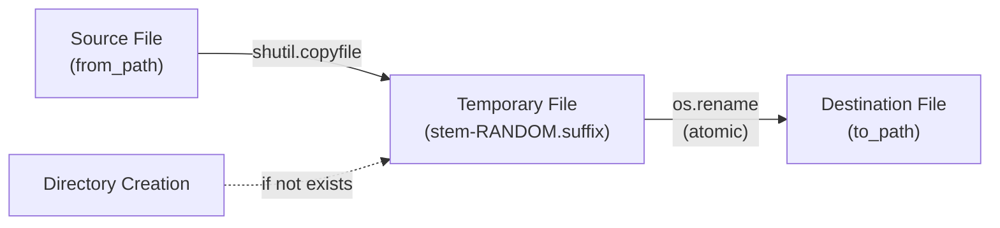
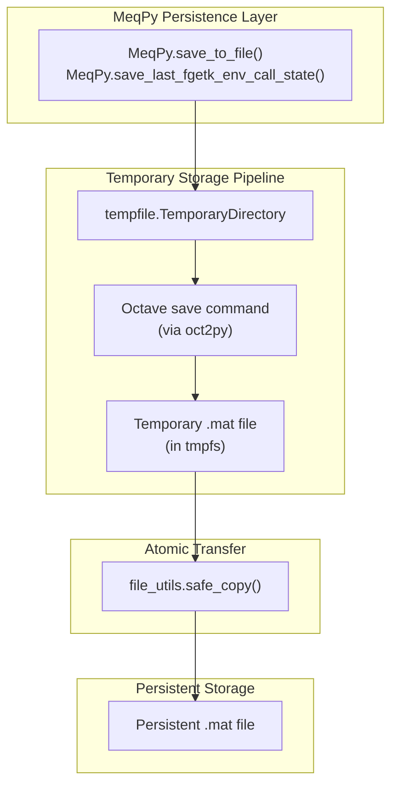
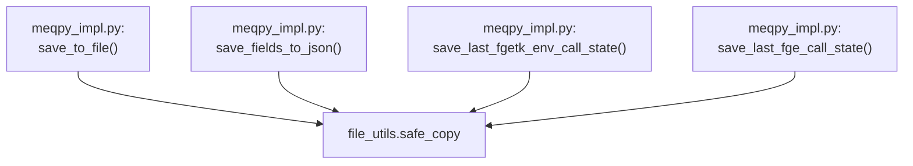

<!-- source: DeepWiki mcp.deepwiki.com · repo google-deepmind/meqpy · page 4.1 File Operations (file_utils) · fetched 2026-10-26 -->

# File Operations (file_utils)

<details>
<summary>Relevant source files</summary>

The following files were used as context for generating this wiki page:

- [meqpy/file_utils.py](meqpy/file_utils.py)
- [tests/file_utils_test.py](tests/file_utils_test.py)

</details>


## Purpose and Scope

This document describes the `file_utils` module, which provides atomic file operations to ensure data integrity during file transfers. The module contains utilities for safely copying files to prevent corruption when multiple processes may access the same destination path simultaneously.

For information about how file operations are used in the broader persistence architecture, see [State Persistence and Recovery](#5). For Octave-specific struct operations and data exchange, see [Octave Struct Manipulation](#4.2).

**Sources:** [meqpy/file_utils.py:1-51]()

## Module Overview

The `file_utils` module is a lightweight utility module located at [meqpy/file_utils.py](). It provides file operation primitives used throughout MeqPy's persistence layer to ensure atomic file writes. The module has no external dependencies beyond Python's standard library (`pathlib`, `shutil`, `os`, `random`, `string`).

The module exports a single public function:
- `safe_copy(from_path, to_path)` - Performs atomic file copying with automatic directory creation

**Sources:** [meqpy/file_utils.py:15-23]()

## The safe_copy Function

### Function Signature and Purpose

```python
def safe_copy(from_path: pathlib.PurePath, to_path: pathlib.PurePath) -> None
```

The `safe_copy` function performs an atomic file copy operation by using an intermediate temporary file followed by an atomic rename. This pattern prevents file corruption when multiple processes attempt to write to the same destination path concurrently.

**Sources:** [meqpy/file_utils.py:25-41]()

### Implementation Details

The function follows a three-stage pipeline to ensure atomicity:



**Diagram: safe_copy three-stage pipeline showing intermediate temporary file**

#### Stage 1: Directory Creation

```python
if not os.path.exists(to_path.parent):
    os.makedirs(to_path.parent, mode=0o775)
```

If the destination directory does not exist, it is created with permissions `0o775` (owner and group have full access, others have read and execute).

**Sources:** [meqpy/file_utils.py:44-45]()

#### Stage 2: Copy to Temporary File

```python
random_addition = ''.join(random.sample(string.ascii_letters, 9))
new_name = f'{to_path.stem}-{random_addition}{to_path.suffix}'
tmp_path = to_path.with_name(new_name)
shutil.copyfile(from_path, tmp_path)
```

The function generates a temporary filename by appending a 9-character random string to the destination file's stem. For example:
- Destination: `/foo/bar.baz`
- Temporary: `/foo/bar-abcdefghi.baz`

This ensures that concurrent copy operations to the same destination do not interfere with each other during the copy phase.

**Sources:** [meqpy/file_utils.py:46-49]()

#### Stage 3: Atomic Rename

```python
os.rename(tmp_path, to_path)
```

The final stage uses `os.rename`, which is guaranteed to be atomic on POSIX systems. If multiple processes attempt to rename to the same destination simultaneously, only one will succeed, and the destination file will contain complete data from one source or the other (never partial or corrupted data).

**Sources:** [meqpy/file_utils.py:50]()

### Edge Cases

The function handles the following edge case:

```python
if not os.path.exists(from_path):
    return
```

If the source file does not exist, the function silently returns without performing any operation. This allows callers to use `safe_copy` optimistically without checking for file existence first.

**Sources:** [meqpy/file_utils.py:42-43]()

## Integration with MeqPy Persistence Architecture

The `safe_copy` function is integrated into MeqPy's persistence pipeline as shown in the following data flow:



**Diagram: safe_copy integration in MeqPy persistence pipeline**

The persistence workflow uses `safe_copy` as the final stage when saving simulation state:

1. **Temporary Creation**: MeqPy creates a temporary directory using `tempfile.TemporaryDirectory`
2. **Octave Save**: The Octave session saves variables to a `.mat` file in the temporary directory
3. **Atomic Copy**: `safe_copy` transfers the temporary file to the persistent destination
4. **Cleanup**: The temporary directory is automatically cleaned up

This pattern provides several benefits:

| Benefit | Description |
|---------|-------------|
| **Data Integrity** | Destination files are never in a partially-written state |
| **Concurrent Safety** | Multiple processes can save to the same path without corruption |
| **Fast Writes** | Temporary files in tmpfs provide faster I/O during Octave save operations |
| **Automatic Recovery** | If a process crashes during save, the destination file remains intact |

**Sources:** [meqpy/file_utils.py:25-50](), Diagram 5 from architecture overview

## File Naming Convention

The temporary file naming scheme follows this pattern:

| Component | Source | Example |
|-----------|--------|---------|
| Directory | `to_path.parent` | `/foo/` |
| Stem | `to_path.stem` | `bar` |
| Random Suffix | 9-letter random sample from `string.ascii_letters` | `abcdefghi` |
| Extension | `to_path.suffix` | `.baz` |
| **Full Temporary Path** | - | `/foo/bar-abcdefghi.baz` |

The random suffix ensures uniqueness across concurrent operations while maintaining a recognizable connection to the destination filename.

**Sources:** [meqpy/file_utils.py:46-48]()

## Usage in MeqPy Codebase

The `safe_copy` function is used in the following contexts within MeqPy:



**Diagram: safe_copy usage across MeqPy save methods**

Each of these methods follows a similar pattern:
1. Create a temporary directory
2. Write data to a temporary file
3. Use `safe_copy` to atomically move the file to its final destination
4. Clean up the temporary directory

**Sources:** [meqpy/file_utils.py:25](), architectural context from Diagram 5

## Testing

The module includes a test suite at [tests/file_utils_test.py]() that verifies basic functionality:

### Test Coverage

The test suite (`FileHelpersTest`) validates:

1. **Simple Copy Operation**: Verifies that a file can be copied from one location to another
2. **Content Preservation**: Ensures the copied file contains identical content to the source
3. **Directory Handling**: Tests automatic directory creation when the destination parent does not exist

```python
# Test creates input JSON file, copies it, verifies output
input_file = path / "input.json"
output_file = path / "output.json"
file_utils.safe_copy(pathlib.Path(input_file), pathlib.Path(output_file))
```

**Sources:** [tests/file_utils_test.py:27-37]()

## Error Handling and Edge Cases

### Error Conditions

The `safe_copy` function handles errors through Python's standard exception mechanism:

| Error Condition | Behavior | Exception Type |
|----------------|----------|----------------|
| Source file does not exist | Silently returns (no-op) | None |
| Permission denied on source | Raises exception | `PermissionError` |
| Permission denied on destination directory | Raises exception | `PermissionError` |
| Disk full during copy | Raises exception | `OSError` |
| Disk full during rename | Raises exception | `OSError` |

### Atomicity Guarantees

The atomic rename operation (`os.rename`) provides the following guarantees on POSIX systems:

1. **All-or-nothing**: The destination file either contains the complete new content or remains unchanged
2. **Single winner**: If multiple processes rename to the same destination, exactly one succeeds
3. **No corruption**: Readers never observe partially-written or corrupted content
4. **Same filesystem**: Source and destination must be on the same filesystem for atomicity

**Note**: On non-POSIX systems (e.g., Windows), atomicity guarantees may differ. Consult `os.rename` documentation for platform-specific behavior.

**Sources:** [meqpy/file_utils.py:25-50]()

## Performance Considerations

### Optimization Strategy

The persistence architecture uses `safe_copy` as part of a two-tier storage strategy:

1. **Fast Tier (tmpfs)**: Octave writes to temporary files in memory-backed storage
2. **Slow Tier (disk)**: `safe_copy` transfers completed files to persistent storage

This approach optimizes for:
- **Fast writes**: Octave `save` operations complete quickly in tmpfs
- **Safe persistence**: Only completed files are transferred to disk
- **Minimal overhead**: The random string generation and rename operation add negligible latency

### Scalability

The function is designed for single-file operations. For bulk file transfers, consider:
- Parallelizing copy operations across multiple files
- Using batch rename operations if the underlying filesystem supports them
- Monitoring temporary directory space if working with large files

**Sources:** [meqpy/file_utils.py:1-51](), architectural context from Diagram 5

## Best Practices

When using `safe_copy` in your own code:

1. **Use pathlib.Path objects**: The function signature accepts `pathlib.PurePath`, which provides platform-independent path handling
2. **Prepare for exceptions**: Wrap calls in try-except blocks if you need custom error handling
3. **Clean up temporary files**: Use `tempfile.TemporaryDirectory` as a context manager to ensure cleanup
4. **Verify filesystem**: Ensure source and destination are on the same filesystem for atomic guarantees
5. **Check disk space**: The function does not pre-check available space; handle `OSError` for disk-full conditions

**Sources:** [meqpy/file_utils.py:25-41]()

---

