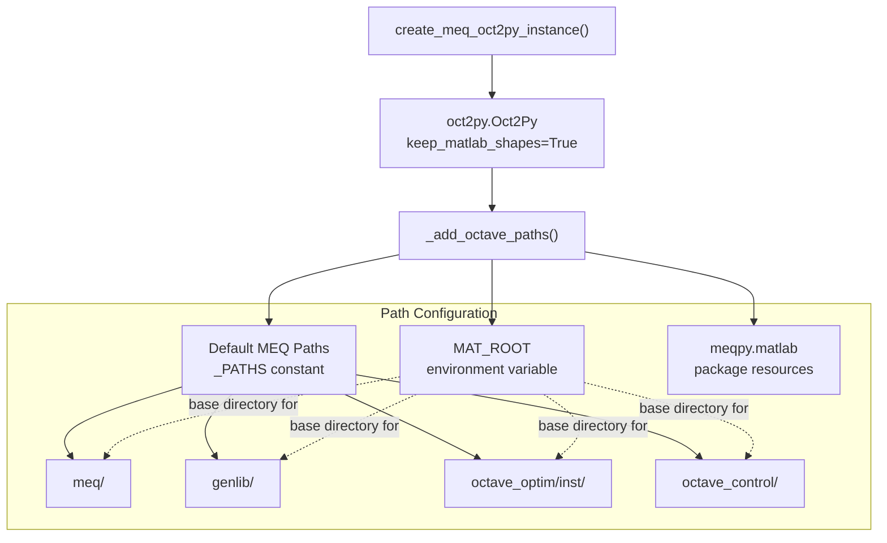
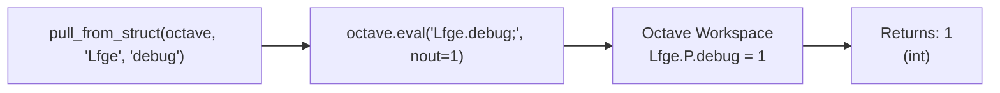
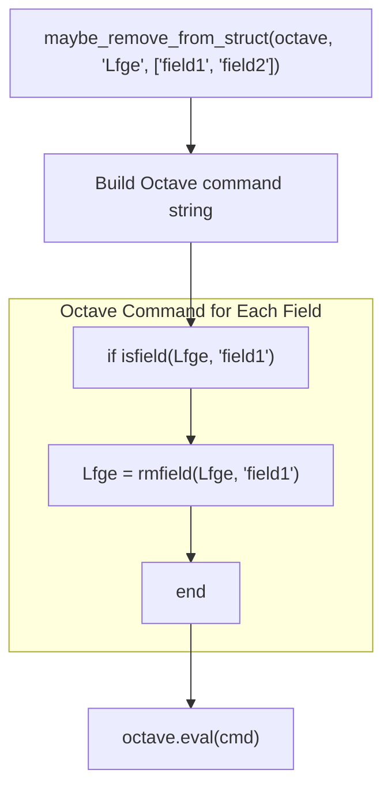
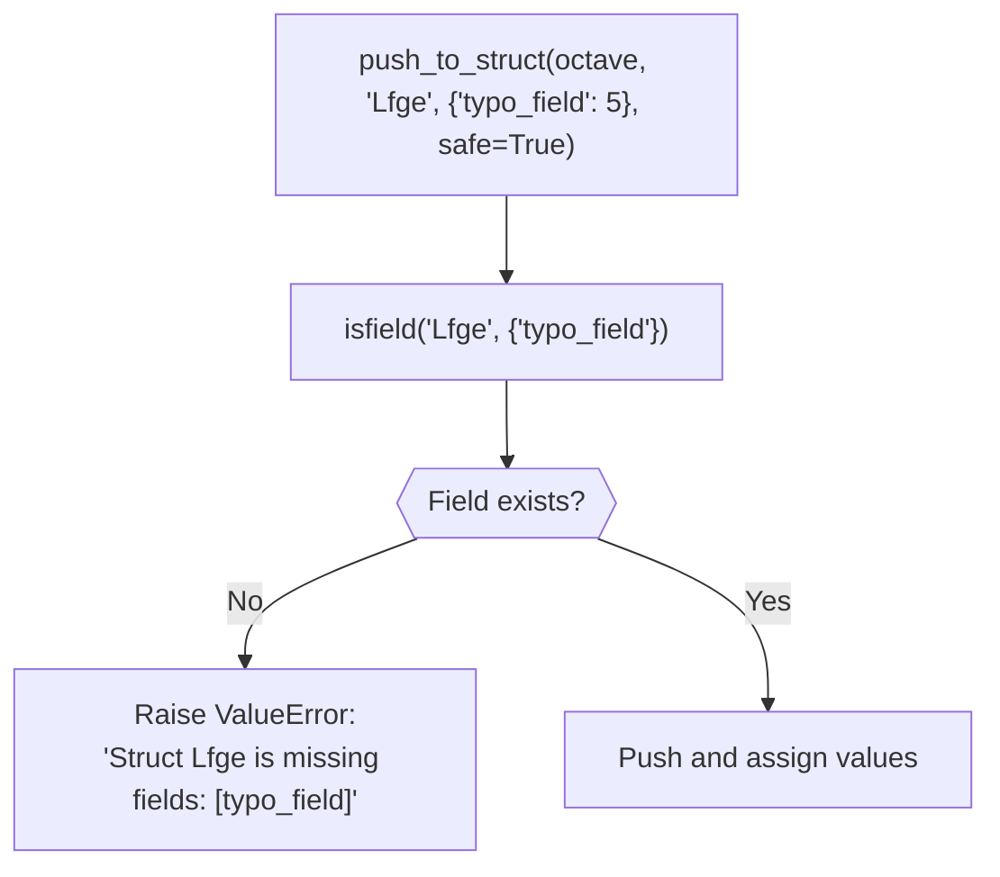
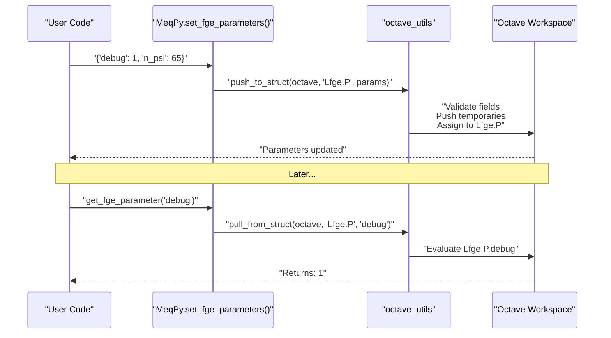

<!-- source: DeepWiki mcp.deepwiki.com · repo google-deepmind/meqpy · page 4.2 Octave Struct Manipulation (octave_utils) · fetched 2026-10-26 -->

# Octave Struct Manipulation (octave_utils)

<details>
<summary>Relevant source files</summary>

The following files were used as context for generating this wiki page:

- [meqpy/octave_utils.py](meqpy/octave_utils.py)
- [tests/octave_utils_test.py](tests/octave_utils_test.py)

</details>


## Purpose and Scope

The `octave_utils` module provides the core interface for Python-Octave data exchange in MeqPy. It manages Oct2Py instance creation, Octave path configuration, and bidirectional struct field manipulation. This module is the primary bridge between Python dictionaries and Octave struct data structures, enabling the MeqPy API to control MEQ simulations without requiring users to interact directly with oct2py.

For information about the broader Octave integration architecture, see [Core Architecture](#2). For details on the MeqPy class that uses these utilities, see [The MeqPy Class](#2.1).

**Sources:** [meqpy/octave_utils.py:1-178]()

---

## Module Overview

The `octave_utils` module consists of four primary functions that work together to enable Python control of Octave-based simulations:

| Function | Purpose | Primary Use Case |
|----------|---------|------------------|
| `create_meq_oct2py_instance` | Initialize Oct2Py with MEQ paths | Session setup |
| `push_to_struct` | Write Python dict values to Octave struct fields | Parameter configuration |
| `pull_from_struct` | Read Octave struct field values to Python | State inspection |
| `maybe_remove_from_struct` | Conditionally remove struct fields | Cleanup operations |

The module bridges the conceptual gap between Python's dictionary-based data structures and MATLAB/Octave's struct-based paradigm, handling type conversions and providing safety mechanisms to prevent silent failures.

**Sources:** [meqpy/octave_utils.py:15-178]()

---

## Oct2Py Instance Creation and Configuration

### Function: `create_meq_oct2py_instance`

The `create_meq_oct2py_instance` function initializes an Oct2Py session configured for MEQ operations. It performs two critical setup tasks:

1. **Creates Oct2Py instance** with `keep_matlab_shapes=True` to preserve MATLAB's shape conventions
2. **Configures Octave search paths** for MEQ dependencies and bundled MATLAB code



**Diagram: Oct2Py Instance Creation and Path Configuration**

**Sources:** [meqpy/octave_utils.py:56-66](), [meqpy/octave_utils.py:37-54](), [meqpy/octave_utils.py:29-34]()

### Path Configuration Details

The `_add_octave_paths` helper function adds multiple directory trees to Octave's search path:

- **MEQ Core Paths** (from `MAT_ROOT`): `meq`, `genlib`, `octave_optim/inst`, `octave_control`
- **Bundled MATLAB Code**: Functions in the `meqpy.matlab` package (e.g., `fgetk_environment.m`)

The function uses `octave.genpath()` to recursively add all subdirectories, ensuring that nested MEQ functions are accessible. The `MAT_ROOT` environment variable must point to the base directory containing the MEQ installation.

**Sources:** [meqpy/octave_utils.py:37-54]()

---

## Struct Manipulation Functions

### Function: `push_to_struct`

The `push_to_struct` function assigns values from a Python dictionary to fields of an Octave struct. It implements a three-stage execution model to ensure atomic operations and field validation.

```mermaid
sequenceDiagram
    participant PythonCode as "Python Code"
    participant PushFunc as "push_to_struct()"
    participant OctaveSession as "Oct2Py Session"
    participant OctaveStruct as "Octave Struct"
    
    PythonCode->>PushFunc: "dict {'field1': val1, 'field2': val2}"
    
    alt safe=True
        PushFunc->>OctaveSession: "isfield(struct, fieldnames)"
        OctaveSession->>PushFunc: "boolean array"
        
        alt All fields exist
            Note over PushFunc: "Stage 1: Validation passed"
        else Missing fields
            PushFunc-->>PythonCode: "ValueError: missing fields"
        end
    end
    
    Note over PushFunc: "Stage 2: Push to temporaries"
    PushFunc->>OctaveSession: "octave.push(['field1_temp', 'field2_temp'], values)"
    
    Note over PushFunc: "Stage 3: Assign and cleanup"
    PushFunc->>OctaveSession: "struct.field1 = field1_temp; clear field1_temp;"
    OctaveSession->>OctaveStruct: "Update fields atomically"
    
    OctaveStruct-->>PythonCode: "Success"
```

**Diagram: push_to_struct Execution Flow**

**Sources:** [meqpy/octave_utils.py:68-133]()

#### Implementation Details

The function operates in three distinct stages:

**Stage 1: Validation (when `safe=True`)**
- Constructs a set of field names from the input dictionary
- Executes `isfield(struct_name, field_names)` in Octave to verify all fields exist
- Raises `ValueError` if any fields are missing, preventing silent failures

**Stage 2: Temporary Variable Creation**
- Uses `octave.push()` to transfer data to temporary variables (e.g., `field_name_temp`)
- Batches all values into a single push operation for efficiency
- Temporary names prevent conflicts with existing Octave variables

**Stage 3: Atomic Assignment**
- Constructs a multi-line Octave command string assigning temporaries to struct fields
- Clears temporary variables immediately after assignment
- Executes as a single `octave.eval()` call to ensure atomicity

**Sources:** [meqpy/octave_utils.py:88-133]()

#### Function Signature

```python
def push_to_struct(
    octave: oct2py.Oct2Py,
    struct_name: str,
    data: Mapping[str, Any] | None,
    safe: bool = True) -> None
```

**Parameters:**
- `octave`: The Oct2Py instance managing the Octave session
- `struct_name`: Name of the target struct variable in Octave workspace
- `data`: Dictionary mapping field names to values (or `None` for no-op)
- `safe`: Enable field existence validation (default: `True`)

**Sources:** [meqpy/octave_utils.py:68-83]()

### Function: `pull_from_struct`

The `pull_from_struct` function retrieves a single field value from an Octave struct. It executes an Octave expression and returns the result to Python.



**Diagram: pull_from_struct Data Flow**

**Sources:** [meqpy/octave_utils.py:135-153]()

#### Implementation Details

The function constructs an Octave expression of the form `struct_name.param_name;` and evaluates it with `nout=1` to capture a single return value. The oct2py library handles type conversion from Octave to Python, including:

- Scalars → Python primitives (`int`, `float`, `bool`)
- Arrays → NumPy arrays (with MATLAB shape conventions preserved)
- Strings → Python strings
- Cell arrays → NumPy object arrays

**Note:** NumPy arrays returned from Octave may have an extra dimension due to MATLAB's shape conventions. Users should apply `np.squeeze()` when necessary.

**Sources:** [meqpy/octave_utils.py:135-153]()

#### Function Signature

```python
def pull_from_struct(
    octave: oct2py.Oct2Py,
    struct_name: str,
    param_name: str) -> Any
```

**Parameters:**
- `octave`: The Oct2Py instance managing the Octave session
- `struct_name`: Name of the source struct variable (e.g., `'Lfge'`, `'Lfge.P'`)
- `param_name`: Name of the field to retrieve (e.g., `'debug'`, `'n_psi'`)

**Returns:** The field value with appropriate Python type conversion applied.

**Sources:** [meqpy/octave_utils.py:135-153]()

### Function: `maybe_remove_from_struct`

The `maybe_remove_from_struct` function conditionally removes fields from an Octave struct. It uses `isfield()` checks to prevent errors when removing non-existent fields.



**Diagram: maybe_remove_from_struct Execution Model**

**Sources:** [meqpy/octave_utils.py:155-178]()

#### Implementation Details

For each field name in the input sequence, the function generates an Octave conditional statement:

```octave
if isfield(struct_name, 'field_name'); 
    struct_name = rmfield(struct_name, 'field_name'); 
end;
```

All conditional statements are concatenated and executed in a single `octave.eval()` call. This approach is safe for removing fields that may or may not exist, making it suitable for cleanup operations where field presence is uncertain.

**Sources:** [meqpy/octave_utils.py:169-177]()

#### Function Signature

```python
def maybe_remove_from_struct(
    octave: oct2py.Oct2Py,
    struct_name: str,
    param_names: Sequence[str]) -> None
```

**Parameters:**
- `octave`: The Oct2Py instance managing the Octave session
- `struct_name`: Name of the target struct variable
- `param_names`: Sequence of field names to remove (if they exist)

**Sources:** [meqpy/octave_utils.py:155-168]()

---

## Data Type Handling

### Supported Types

The struct manipulation functions support bidirectional conversion for common data types:

| Python Type | Octave Type | Notes |
|-------------|-------------|-------|
| `int`, `float` | Scalars | Direct conversion |
| `bool` | Logical | Preserves boolean semantics |
| `str` | Character array | Handles single strings |
| `list`, `tuple` | Arrays | Converted to NumPy first |
| `numpy.ndarray` | Matrices | Shape conventions preserved with `keep_matlab_shapes=True` |
| `list` of `str` | Cell arrays | Requires special handling via `.tolist()[0]` |

**Sources:** [tests/octave_utils_test.py:28-75]()

### Shape Conventions

The Oct2Py instance is initialized with `keep_matlab_shapes=True`, which preserves MATLAB's column-major conventions and ensures that:

- MATLAB row vectors `[1, 2, 3]` remain as shape `(1, 3)` in NumPy
- MATLAB column vectors remain as shape `(3, 1)` in NumPy
- Scalar values may be wrapped in arrays depending on context

Users retrieving arrays via `pull_from_struct` may need to apply `np.squeeze()` to remove singleton dimensions for Python processing.

**Sources:** [meqpy/octave_utils.py:62](), [meqpy/octave_utils.py:141-143]()

### Cell Array Handling

Octave cell arrays are converted to NumPy object arrays with nested list structure. To access the contents:

```python
# Octave: a.foo = {"1", "2", "3"}
cell_data = pull_from_struct(octave, 'a', 'foo')
python_list = cell_data.tolist()[0]  # ['1', '2', '3']
```

The `.tolist()[0]` pattern extracts the first (and typically only) element of the outer list, revealing the actual cell contents.

**Sources:** [tests/octave_utils_test.py:67-74]()

---

## Safety Mechanisms and Error Handling

### Field Validation

The `safe=True` parameter (default) in `push_to_struct` provides critical safety by:

1. **Preventing Silent Failures**: Setting a non-existent field in Octave creates it rather than erroring, which can lead to subtle bugs
2. **Early Error Detection**: Validation occurs before any data is pushed, ensuring atomicity
3. **Clear Error Messages**: Missing fields are reported in the exception message



**Diagram: Field Validation Error Path**

**Sources:** [meqpy/octave_utils.py:106-129]()

### Exception Types

The module can raise the following exceptions:

| Exception | Source Function | Condition |
|-----------|-----------------|-----------|
| `ValueError` | `push_to_struct` | Missing struct fields when `safe=True` |
| `oct2py.utils.Oct2PyError` | `pull_from_struct` | Field does not exist in struct |
| `oct2py.utils.Oct2PyError` | Any function | Octave evaluation error |

**Sources:** [tests/octave_utils_test.py:76-85](), [meqpy/octave_utils.py:127-129]()

### Disabling Safety

Setting `safe=False` bypasses field validation, which may be necessary when:

- Adding new fields dynamically
- Performance is critical and field existence is guaranteed
- Working with non-standard struct manipulation patterns

**Warning**: Disabling safety can mask configuration errors. Use with caution.

**Sources:** [meqpy/octave_utils.py:79]()

---

## Usage Patterns in MeqPy

### Configuration Workflow

The struct manipulation functions enable MeqPy's parameter configuration API:



**Diagram: MeqPy Parameter Configuration Pattern**

This pattern is used throughout MeqPy for:
- Setting FGE parameters via `set_fge_parameters()` → pushes to `Lfge.P`
- Setting FGE geometry via `set_fge_geometry()` → pushes to `Lfge.G`
- Setting FBT inputs via `set_fbt_inputs()` → pushes to `LXfbt`
- Retrieving configuration via `get_fge_parameter()` → pulls from `Lfge.P`

**Sources:** [meqpy/octave_utils.py:68-178]()

### Struct Hierarchy Navigation

The functions support dotted field access for nested structs:

```python
# Access nested fields
value = pull_from_struct(octave, 'Lfge.P', 'debug')  # Lfge.P.debug
push_to_struct(octave, 'Lfge.G', {'R0': 1.65})       # Lfge.G.R0
```

The `struct_name` parameter can represent any level of the struct hierarchy, enabling flexible access patterns.

**Sources:** [meqpy/octave_utils.py:77-78](), [meqpy/octave_utils.py:137]()

---

## Testing Coverage

### Test Suite Structure

The `octave_utils_test.py` module provides comprehensive coverage of struct manipulation operations:

```mermaid
graph TD
    TestClass["OctaveUtilsTest"]
    
    subgraph "Data Type Tests"
        TestSingle["test_push_a_single_value_to_a_struct"]
        TestCollection["test_push_a_collection_of_values_to_a_struct"]
        TestString["test_push_a_string_to_a_struct"]
        TestArray["test_push_an_array_to_a_struct"]
        TestBool["test_push_bool_to_struct"]
        TestCell["test_pull_and_push_a_cell_to_struct"]
    end
    
    subgraph "Error Handling Tests"
        TestMissingPush["test_try_to_push_a_value_to_a_missing_field"]
        TestMissingPull["test_try_to_pull_a_missing_field"]
    end
    
    TestClass --> TestSingle
    TestClass --> TestCollection
    TestClass --> TestString
    TestClass --> TestArray
    TestClass --> TestBool
    TestClass --> TestCell
    TestClass --> TestMissingPush
    TestClass --> TestMissingPull
```



**Diagram: octave_utils Test Coverage**

**Sources:** [tests/octave_utils_test.py:22-88]()

### Key Test Cases

| Test Case | Purpose | Validated Behavior |
|-----------|---------|-------------------|
| `test_push_a_single_value_to_a_struct` | Single field update | Scalar assignment works |
| `test_push_a_collection_of_values_to_a_struct` | Multiple field update | Batch operations are atomic |
| `test_push_a_string_to_a_struct` | String handling | Character array conversion |
| `test_push_an_array_to_a_struct` | Array handling | NumPy array transfer |
| `test_push_bool_to_struct` | Boolean handling | Logical type conversion |
| `test_pull_and_push_a_cell_to_struct` | Cell array round-trip | Complex type preservation |
| `test_try_to_push_a_value_to_a_missing_field` | Error handling | `ValueError` for missing fields |
| `test_try_to_pull_a_missing_field` | Error handling | `Oct2PyError` for missing fields |

**Sources:** [tests/octave_utils_test.py:28-86]()

### Test Setup

Each test creates a fresh Oct2Py instance in `setUp()`:

```python
def setUp(self):
    super().setUp()
    self.octave = oct2py.Oct2Py()
```

This ensures test isolation and prevents cross-test contamination of the Octave workspace. The tests directly create structs using `octave.eval()` to establish known initial states before exercising the utility functions.

**Sources:** [tests/octave_utils_test.py:24-26]()

---

## Summary

The `octave_utils` module provides the essential bridge between Python and Octave for MeqPy:

- **Instance Management**: `create_meq_oct2py_instance()` initializes Oct2Py with correct paths
- **Data Exchange**: `push_to_struct()` and `pull_from_struct()` enable bidirectional struct field access
- **Safety**: Field validation prevents silent failures and provides clear error messages
- **Type Support**: Handles scalars, arrays, strings, booleans, and cell arrays with appropriate conversions
- **Testing**: Comprehensive test suite validates all data types and error conditions

This module is fundamental to MeqPy's architecture, enabling the high-level API in [The MeqPy Class](#2.1) to control MEQ simulations without requiring users to understand oct2py or MATLAB/Octave struct manipulation.

**Sources:** [meqpy/octave_utils.py:1-178](), [tests/octave_utils_test.py:1-89]()

---

