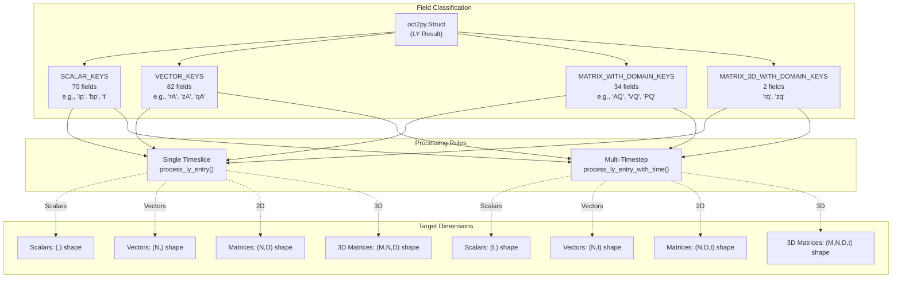
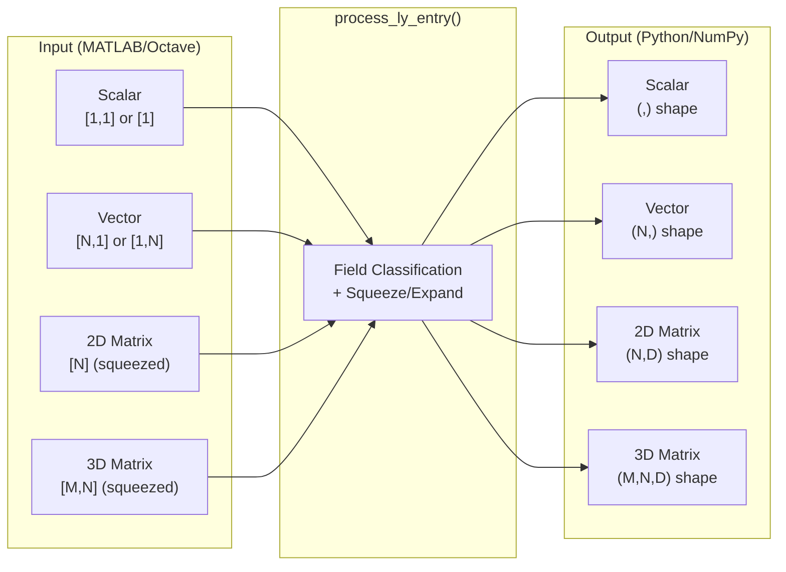
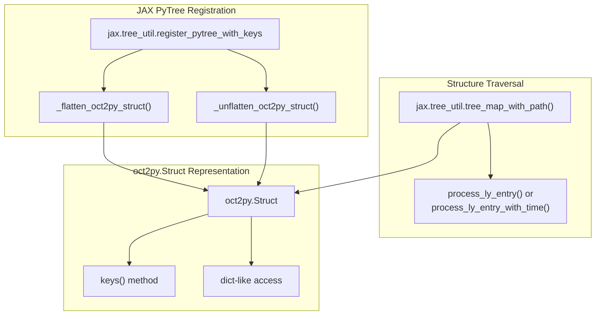
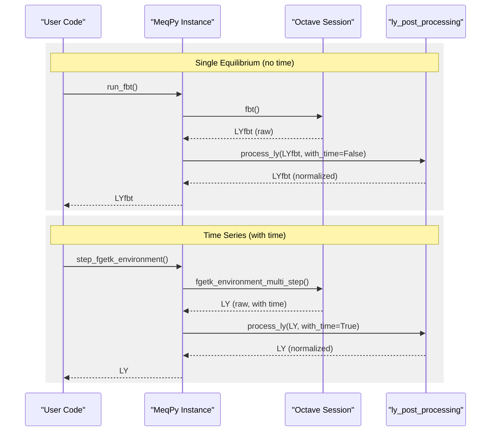

<!-- source: DeepWiki mcp.deepwiki.com · repo google-deepmind/meqpy · page 4.3 Data Post-Processing (ly_post_processing) · fetched 2026-10-26 -->

# Data Post-Processing (ly_post_processing)

<details>
<summary>Relevant source files</summary>

The following files were used as context for generating this wiki page:

- [meqpy/ly_post_processing.py](meqpy/ly_post_processing.py)

</details>


## Purpose and Scope

The `ly_post_processing` module normalizes LY (result) data structures returned from MEQ Octave/MATLAB functions to be compatible with Python and NumPy conventions. This module addresses the fundamental incompatibility between MATLAB's implicit singleton dimension handling and Python's explicit array shape requirements.

For information about LY structures and their role in the simulation pipeline, see [Data Structures and Conventions](#2.3). For the complete simulation lifecycle, see [FGETK Environment - Time-Dependent Simulations](#3.4).

**Sources:** [meqpy/ly_post_processing.py:1-23]()

---

## The MATLAB-Python Dimension Problem

MATLAB treats all data as matrices and allows implicit indexing into singleton dimensions. Python and NumPy require explicit shape specifications and do not support automatic singleton dimension expansion. This creates shape mismatches when transferring LY structures from Octave to Python.

### Key Differences

| Aspect | MATLAB/Octave | Python/NumPy |
|--------|---------------|--------------|
| Scalar representation | `[1x1]` matrix | `()` shape (0-dimensional) |
| Singleton time dimension | Can index into `[Nx1]` as `[N]` | Requires explicit squeeze/expand |
| Vector with time | `[N,1]` or `[1,N]` interchangeable | Shape matters for operations |
| Default behavior | Everything is 2D minimum | Scalars are 0D, vectors 1D |

The `ly_post_processing` module bridges this gap by normalizing field shapes based on their semantic meaning rather than their raw MATLAB representation.

**Sources:** [meqpy/ly_post_processing.py:53-65]()

---

## LY Field Classification System

Fields in LY structures are classified into four categories based on their expected dimensionality. This classification is defined by constant frozen sets that determine how each field is processed.



**Diagram: LY Field Classification and Dimension Mapping**

### Field Category Constants

The classification is defined by four frozen sets:

- **`SCALAR_KEYS`**: 70 fields representing single values per timestep, including plasma current (`'Ip'`), poloidal beta (`'bp'`), and time (`'t'`). These are squeezed to scalar (0-dimensional) arrays for single timeslices.

- **`VECTOR_KEYS`**: 82 fields representing 1D arrays per timestep, such as X-point positions (`'rX'`, `'zX'`), flux surface quantities (`'rA'`, `'zA'`), and coil currents (`'Ia'`).

- **`MATRIX_WITH_DOMAIN_KEYS`**: 34 fields representing 2D arrays with a domain coordinate, including flux surface profiles (`'PQ'`, `'TQ'`, `'VQ'`), shape parameters (`'kappa'`, `'delta'`), and geometry quantities.

- **`MATRIX_3D_WITH_DOMAIN_KEYS`**: 2 fields (`'rq'`, `'zq'`) representing flux surface contour data with shape (M, N, D).

**Sources:** [meqpy/ly_post_processing.py:66-94]()

### Special Cases and Exceptions

Two frozen sets modify default behavior:

```python
SCALAR_KEYS_AS_VECTORS = frozenset(['rBt'])  # Kept as (N,) even though conceptually scalar
FIELD_KEYS_TO_IGNORE = frozenset(['dz', 'dzg'])  # No processing applied
```

The `'rBt'` field (major radius at toroidal field coil) is treated as a vector for observation interface compatibility. Fields in `FIELD_KEYS_TO_IGNORE` are not processed due to special handling requirements that will be addressed in a future MEQ upgrade.

**Sources:** [meqpy/ly_post_processing.py:98-114]()

---

## Single Timeslice Processing

Single timeslice processing handles LY structures representing a single equilibrium state. The `process_ly_entry()` function normalizes each field based on its classification.

### Dimension Transformation Rules



**Diagram: Single Timeslice Dimension Transformations**

### Processing Logic

The `process_ly_entry()` function at [meqpy/ly_post_processing.py:128-166]() implements the following logic:

1. **Scalar Fields (TO_SCALAR)**: Apply `squeeze()` to remove all singleton dimensions, resulting in 0-dimensional arrays. Validate result is scalar.

2. **Vector Fields (TO_VECTOR)**: Apply `squeeze()` then `np.atleast_1d()` to ensure exactly 1 dimension. Handles both `[N,1]` and `[1,N]` MATLAB representations.

3. **2D Matrix Fields (MATRIX_WITH_DOMAIN_KEYS)**: If input is 1D (domain dimension squeezed), expand with `[:, None]` to restore the domain axis. Otherwise, leave unchanged.

4. **3D Matrix Fields (MATRIX_3D_WITH_DOMAIN_KEYS)**: If input is 2D (domain dimension squeezed), expand with `[:, :, None]` to restore the domain axis.

### Error Handling

The `maybe_raise_shape_error()` helper at [meqpy/ly_post_processing.py:116-126]() validates that processed fields have the expected number of dimensions. If validation fails, it raises a `ValueError` with diagnostic information including the field key, expected dimensions, actual dimensions, and original shape.

**Sources:** [meqpy/ly_post_processing.py:128-166](), [meqpy/ly_post_processing.py:116-126]()

---

## Multi-Timestep Processing

Multi-timestep processing handles LY structures containing time-series data from simulations. When the time dimension is present, all fields gain an additional trailing dimension.

### Dimension Transformation with Time

| Field Type | Single Timeslice | With Time Dimension |
|------------|------------------|---------------------|
| Scalar | `()` | `(t,)` |
| Vector | `(N,)` | `(N, t)` |
| 2D Matrix | `(N, D)` | `(N, D, t)` |
| 3D Matrix | `(M, N, D)` | `(M, N, D, t)` |

The time dimension is always the **last** dimension in the array shape.

### Processing Logic

The `process_ly_entry_with_time()` function at [meqpy/ly_post_processing.py:168-220]() implements dimension-specific logic:

**Scalars with Time:**
```python
# Input: (1, t) or (1, 1, t) from MATLAB
# Output: (t,) for Python
new_value = np.atleast_1d(np.squeeze(value))
```

**Vectors with Time:**
```python
# Input: (N, t) or (1, N, t) from MATLAB
# Output: (N, t) for Python - squeeze all but last dimension
squeeze_dims = tuple([i for i, s in enumerate(value.shape[:-1]) if s == 1])
new_value = np.atleast_2d(np.squeeze(value, axis=squeeze_dims))
```

**2D Matrices with Time:**
```python
# Input: (N, t) when domain squeezed, or (N, D, t)
# Output: (N, D, t) - restore domain dimension if missing
if np.ndim(value) == 2:
    new_value = value[:, None, :]  # Insert domain axis
```

**3D Matrices with Time:**
```python
# Input: (M, N, t) when domain squeezed, or (M, N, D, t)
# Output: (M, N, D, t) - restore domain dimension if missing
if np.ndim(value) == 3:
    new_value = value[:, :, None, :]  # Insert domain axis
```

**Sources:** [meqpy/ly_post_processing.py:168-220]()

---

## JAX PyTree Integration

The module registers `oct2py.Struct` as a JAX pytree, enabling JAX transformations (e.g., `tree_map`, `tree_map_with_path`) to traverse LY structures automatically.



**Diagram: JAX PyTree Integration for oct2py.Struct**

### Flattening and Unflattening

The `_flatten_oct2py_struct()` function at [meqpy/ly_post_processing.py:24-29]() converts an `oct2py.Struct` into:
- **Flattened data**: List of `(GetAttrKey(k), value)` tuples
- **Auxiliary data**: List of keys for reconstruction

The `_unflatten_oct2py_struct()` function at [meqpy/ly_post_processing.py:32-38]() reconstructs an `oct2py.Struct` from flattened data and auxiliary data.

### Key Paths for Field Identification

JAX's `tree_map_with_path` provides a `key_path` that identifies each field. The processing functions extract the field name from the last element of the key path:

```python
key = key_path[-1].name  # GetAttrKey has .name attribute
```

This enables field-specific processing based on the classification constants. The key path mechanism is documented at [meqpy/ly_post_processing.py:133-140]() and [meqpy/ly_post_processing.py:173-180]().

**Sources:** [meqpy/ly_post_processing.py:24-45](), [meqpy/ly_post_processing.py:133-140]()

---

## Primary API Functions

### `process_ly(ly, with_time=False)`

The main entry point for normalizing LY structures.

**Parameters:**
- `ly`: `oct2py.Struct` containing MEQ results
- `with_time`: `bool` indicating whether the structure contains a time dimension

**Returns:** Normalized `oct2py.Struct` with corrected field dimensions

**Implementation:** [meqpy/ly_post_processing.py:260-268]()

```python
def process_ly(ly: oct2py.Struct, with_time: bool = False) -> oct2py.Struct:
    # Workaround for aW shape issue
    ly.aW = np.asarray(ly.aW)
    if with_time:
        return jax.tree_util.tree_map_with_path(process_ly_entry_with_time, ly)
    else:
        return jax.tree_util.tree_map_with_path(process_ly_entry, ly)
```

The function includes a workaround at [meqpy/ly_post_processing.py:263]() for the `aW` field, which has inconsistent shapes between reset and step operations. This will be removed when fixed upstream.

### `check_ly_shape(ly, with_time=False)`

Validates that all fields in an LY structure conform to expected dimensions.

**Parameters:**
- `ly`: `oct2py.Struct` to validate
- `with_time`: `bool` indicating expected time dimension presence

**Returns:** `bool` indicating whether all fields have correct dimensions

**Implementation:** [meqpy/ly_post_processing.py:270-279]()

The function uses `jax.tree.all()` to verify that every field passes its respective shape check (`check_ly_entry_shape()` or `check_ly_entry_shape_with_time()`).

**Sources:** [meqpy/ly_post_processing.py:260-279]()

---

## Shape Validation Functions

### `check_ly_entry_shape(key_path, value)`

Validates individual field dimensions for single timeslice LY structures. Returns `True` if the field has the expected number of dimensions based on its classification.

**Expected Dimensions:**
- Fields in `TO_SCALAR`: 0 dimensions
- Fields in `TO_VECTOR`: 1 dimension
- Fields in `MATRIX_WITH_DOMAIN_KEYS`: 2 dimensions
- Fields in `MATRIX_3D_WITH_DOMAIN_KEYS`: 3 dimensions
- Fields in `FIELD_KEYS_TO_IGNORE`: Always `True`
- Non-array values: Always `True`

**Implementation:** [meqpy/ly_post_processing.py:222-239]()

### `check_ly_entry_shape_with_time(key_path, value)`

Validates individual field dimensions for multi-timestep LY structures. Expected dimensions are incremented by 1 compared to single timeslice:

**Expected Dimensions:**
- Fields in `TO_SCALAR`: 1 dimension (time vector)
- Fields in `TO_VECTOR`: 2 dimensions (N, t)
- Fields in `MATRIX_WITH_DOMAIN_KEYS`: 3 dimensions (N, D, t)
- Fields in `MATRIX_3D_WITH_DOMAIN_KEYS`: 4 dimensions (M, N, D, t)

**Implementation:** [meqpy/ly_post_processing.py:241-258]()

**Sources:** [meqpy/ly_post_processing.py:222-258]()

---

## Usage in MeqPy Pipeline

The `process_ly()` function is invoked automatically when retrieving results from Octave simulations. The MeqPy class determines the `with_time` parameter based on the simulation context.



**Diagram: LY Post-Processing in the Simulation Pipeline**

### Integration Points

1. **FGE/FBT Single-Shot Simulations**: Results from `run_fbt()`, `run_fge()`, and related functions are processed with `with_time=False`.

2. **FGETK Time-Series Simulations**: Results from `step_fgetk_environment()` and trajectory generation are processed with `with_time=True`.

3. **Result Persistence**: Before saving LY structures to files, they are already in normalized form. When loading, no additional processing is needed unless the structure was saved from raw Octave output.

**Sources:** [meqpy/ly_post_processing.py:260-268]()

---

## Summary Table

| Function | Purpose | Primary Use Case |
|----------|---------|------------------|
| `process_ly()` | Normalize entire LY structure | Called automatically by MeqPy after Octave execution |
| `process_ly_entry()` | Normalize single field (no time) | Used internally via `tree_map_with_path` |
| `process_ly_entry_with_time()` | Normalize single field (with time) | Used internally via `tree_map_with_path` |
| `check_ly_shape()` | Validate entire LY structure | Testing and debugging |
| `check_ly_entry_shape()` | Validate single field (no time) | Used internally via `tree_map_with_path` |
| `check_ly_entry_shape_with_time()` | Validate single field (with time) | Used internally via `tree_map_with_path` |
| `_flatten_oct2py_struct()` | Convert struct to pytree format | JAX registration |
| `_unflatten_oct2py_struct()` | Reconstruct struct from pytree | JAX registration |
| `maybe_raise_shape_error()` | Shape validation error handling | Called by processing functions |

**Sources:** [meqpy/ly_post_processing.py:1-279]()

---

