<!-- source: DeepWiki mcp.deepwiki.com · repo google-deepmind/meqpy · page 5 State Persistence and Recovery · fetched 2026-10-26 -->

# State Persistence and Recovery

<details>
<summary>Relevant source files</summary>

The following files were used as context for generating this wiki page:

- [meqpy/file_utils.py](meqpy/file_utils.py)
- [meqpy/meqpy_impl.py](meqpy/meqpy_impl.py)
- [tests/meqpy_test.py](tests/meqpy_test.py)

</details>


This page explains how MeqPy saves and loads simulation states, handles MATLAB/Octave function handle serialization challenges, and provides mechanisms for debugging and checkpoint recovery. The persistence system enables users to save complete simulation states to disk and restore them later for reproducibility, debugging, or continuing interrupted simulations.

For information about the underlying Octave data structures being persisted, see [Data Structures and Conventions](#2.3). For testing persistence functionality, see [Testing Infrastructure](#7).

## Overview

MeqPy provides a multi-stage persistence architecture that addresses the unique challenges of serializing MATLAB/Octave data structures to Python-accessible formats. The system handles:

1. **Function Handle Conversion**: MATLAB/Octave function handles cannot be directly serialized and must be converted to strings before saving
2. **Atomic File Operations**: Prevents file corruption from concurrent access or partial writes
3. **State Restoration**: Reconstructs function handles and reruns consolidation functions to regenerate derived quantities
4. **Flexible Export Formats**: Supports both `.mat` files for complete state and `.json` files for human-readable field values

The persistence workflow follows this pattern:

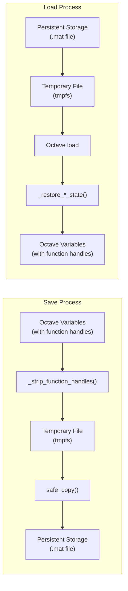

**Sources**: [meqpy/meqpy_impl.py:672-753](), [meqpy/file_utils.py:25-51]()

## Atomic File Operations

The `safe_copy` function in `file_utils` provides atomic file copy operations to prevent corruption from concurrent writes or partial failures. This is critical when multiple processes might attempt to write to the same location.

### Implementation Strategy

The atomic copy process follows these steps:

1. Generate a random intermediate filename in the target directory
2. Copy the source file to the intermediate filename
3. Perform an atomic rename operation to the final target path

Because filesystem rename operations are atomic at the OS level, this ensures that the target file is never in a partially-written state.

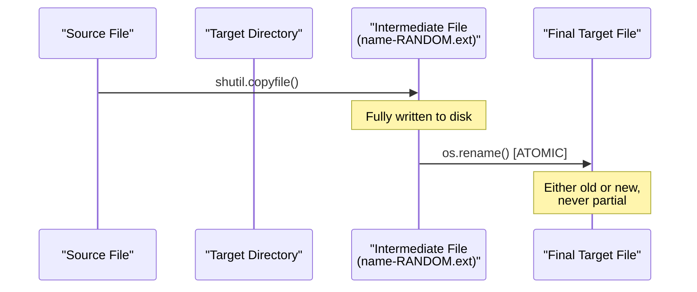

**Key Implementation Details**:
- Random suffix: 9 ASCII letters generated via `random.sample(string.ascii_letters, 9)`
- Target directory creation: Creates parent directories with mode `0o775` if they don't exist
- Intermediate path format: `{stem}-{random}{suffix}` (e.g., `state-abcdefghi.mat`)

**Sources**: [meqpy/file_utils.py:25-51]()

## Function Handle Serialization Challenge

MATLAB/Octave function handles are pointers to executable code and cannot be directly serialized to `.mat` files. MeqPy addresses this by converting function handles to strings before saving and reconstructing them using `str2func` after loading.

### Function Handle Types in MEQ

The MEQ codebase uses function handles in several parameter fields:

| Field Name | Purpose | Example Value |
|------------|---------|---------------|
| `bfct` | Basis function type | `@bfgen`, `@bfgenD`, `@bfdoublet` |
| `infct` | Initialization function | Custom initialization functions |
| `eqfct` | Equilibrium function | Custom equilibrium solvers |
| `bfp` | Basis function parameters | Cell array containing function handles |

### Stripping Function Handles

The `_strip_function_handles` method converts function handles to strings:

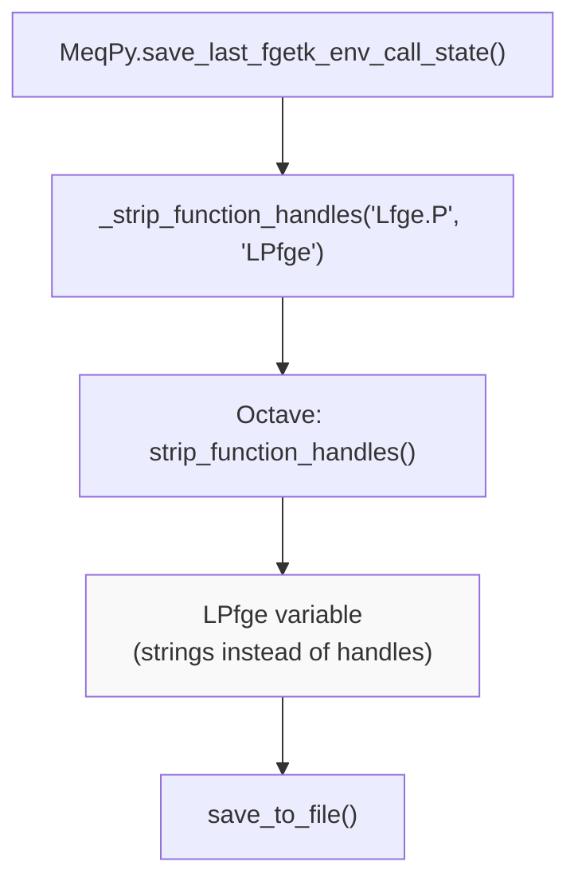

The Octave-side `strip_function_handles` function (called at [meqpy/meqpy_impl.py:667-670]()) converts function handles to their string representation using the specified conversion function (typically `'string'`).

**Sources**: [meqpy/meqpy_impl.py:661-670]()

### Restoring Function Handles

After loading a saved state, function handles must be reconstructed using `str2func`:

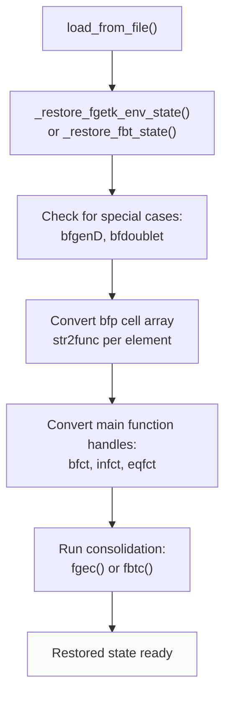

**Special Case: Doublet Basis Functions**

When using doublet basis functions (`bfgenD` or `bfdoublet`), the `bfp` parameter contains a cell array where each row has a function handle in the first column. These must be individually restored:

```octave
if strcmp(LPfge.bfct,'bfgenD') | strcmp(LPfge.bfct,'bfdoublet')
  for iD = 1:size(LPfge.bfp,1)
    LPfge.bfp{iD,1} = str2func(LPfge.bfp{iD,1});
  end
end
```

**Sources**: [meqpy/meqpy_impl.py:581-609](), [meqpy/meqpy_impl.py:636-659]()

## Saving and Loading Simulation States

MeqPy provides different persistence methods depending on the simulation type and use case.

### Generic Variable Persistence

The `save_to_file` and `load_from_file` methods provide general-purpose persistence for any Octave variables.

#### save_to_file Method

**Method Signature**: `save_to_file(file_path: str, variables_to_save: Sequence[str], fields_as_variables: bool = False)`

**Parameters**:
- `file_path`: Output path for the `.mat` file
- `variables_to_save`: List of Octave variable names to save
- `fields_as_variables`: If `True`, saves structure fields as individual top-level variables

**Workflow**:

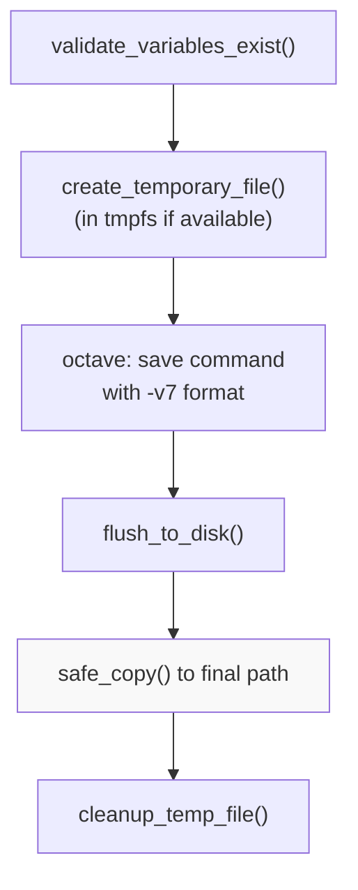

**Example Usage**:
```python
# Save multiple variables
meq.save_to_file('/path/to/state.mat', ['LPfge', 'LGfge', 'State_prev'])

# Save structure fields as individual variables
meq.save_to_file('/path/to/fields.mat', ['Lfge', 'P', 'G'], 
                 fields_as_variables=True)
# This saves Lfge.P as variable 'P' and Lfge.G as variable 'G'
```

**Sources**: [meqpy/meqpy_impl.py:672-723](), [tests/meqpy_test.py:43-133]()

#### load_from_file Method

**Method Signature**: `load_from_file(file_path: str, variables_to_load: Sequence[str])`

**Workflow**:

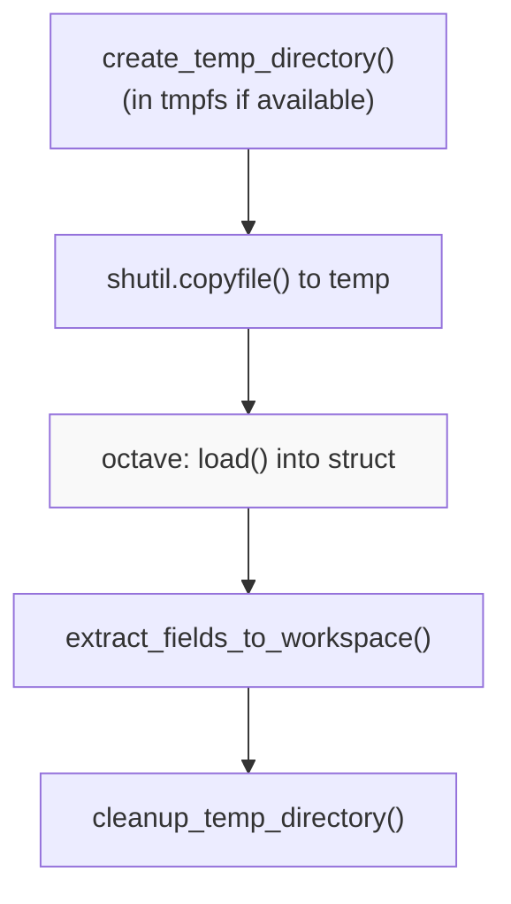

The temporary directory approach is necessary because Octave may not have access to all non-local file paths (e.g., remote filesystems).

**Sources**: [meqpy/meqpy_impl.py:724-739]()

### FGETK Environment State Persistence

The FGETK environment requires saving specific variables to enable rerunning simulation steps for debugging or analysis.

#### Variables Saved for FGETK Environment

| Variable Name | Description | Source Structure |
|---------------|-------------|------------------|
| `LPfge` | FGE parameters (function handles as strings) | `Lfge.P` |
| `LGfge` | FGE geometry | `Lfge.G` |
| `State_prev` | Previous simulation state | Environment state |
| `Actions` | Control actions applied | Input to step |
| `LXfge_sequence` | Input sequence for time steps | Packed LX structures |
| `num_steps` | Number of simulator steps per control step | Configuration |

**Constant Definition**: [meqpy/meqpy_impl.py:45-52]()

#### Saving FGETK Environment State

**Method**: `save_last_fgetk_env_call_state(file_path: str | os.PathLike[str])`

This method saves everything needed to reproduce the last `fgetk_environment_multi_step` call:


**Example Usage**:
```python
# After stepping the environment
ly, stop = meq.step_fgetk_environment(actions)

# Save the state for debugging
meq.save_last_fgetk_env_call_state('/debug/step_123.mat')
```

**Sources**: [meqpy/meqpy_impl.py:567-579]()

#### Restoring FGETK Environment State

**Method**: `_restore_fgetk_env_state(file_path: str | os.PathLike[str])`

This internal method restores the saved state and reconstructs function handles:

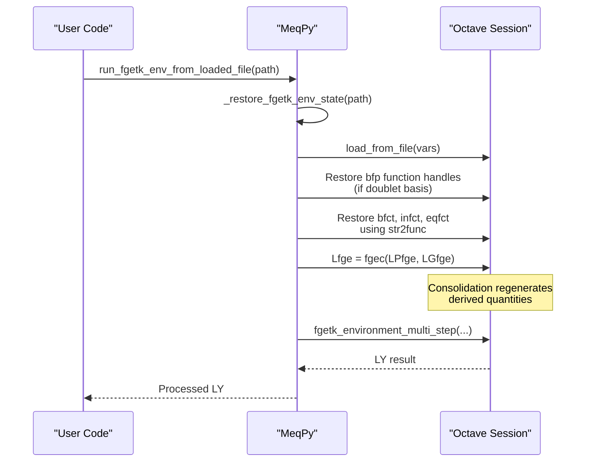

**Public Interface**: `run_fgetk_env_from_loaded_file(file_path: str | os.PathLike[str])`

This method combines restoration with execution:

```python
# Load and rerun a saved environment step
ly = meq.run_fgetk_env_from_loaded_file('/debug/step_123.mat')
```

**Sources**: [meqpy/meqpy_impl.py:581-620]()

### FBT Simulation State Persistence

FBT simulations can be saved to enable reproducibility and debugging of boundary tracing calculations.

#### Variables Saved for FBT

| Variable Name | Description | Source Structure |
|---------------|-------------|------------------|
| `LPfbt` | FBT parameters (function handles as strings) | `Lfbt.P` |
| `LGfbt` | FBT geometry | `Lfbt.G` |
| `LXfbt` | FBT inputs | `LXfbt` |

**Constant Definition**: [meqpy/meqpy_impl.py:54-58]()

#### Saving FBT State

**Method**: `save_run_fbt_inputs(file_path: str | os.PathLike[str])`

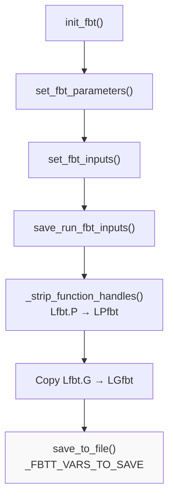

**Example Usage**:
```python
# Initialize and configure FBT
meq.init_fbt('anamak', 1, 0.05, MeqSource.MEQ_DIRECT)
meq.set_fbt_parameters(parameters={'debug': 1})

# Save state before running
meq.save_run_fbt_inputs('/debug/fbt_inputs.mat')

# Run FBT
ly = meq.run_fbt()
```

**Sources**: [meqpy/meqpy_impl.py:622-634]()

#### Restoring FBT State

**Method**: `_restore_fbt_state(file_path: str | os.PathLike[str])`

The restoration process mirrors the FGETK restoration, handling function handles and running consolidation:

```octave
% Special doublet basis function case
if strcmp(LPfbt.bfct,'bfgenD') | strcmp(LPfbt.bfct,'bfdoublet')
  for iD = 1:size(LPfbt.bfp,1)
    LPfbt.bfp{iD,1} = str2func(LPfbt.bfp{iD,1});
  end
end

% Restore main function handles
for var = {'bfct','infct', 'eqfct'}
  if isfield(LPfbt,var) && ischar(LPfbt.(var{:}))
    LPfbt.(var{:}) = str2func(LPfbt.(var{:}));
  end
end

% Run consolidation
Lfbt = fbtc(LPfbt,LGfbt);
```

**Sources**: [meqpy/meqpy_impl.py:636-659]()

## JSON Export for Human-Readable Data

The `save_fields_to_json` method exports specific structure fields to JSON format for easy inspection and sharing.

**Method Signature**: `save_fields_to_json(file_path: str | pathlib.Path, structure: str, field_names: Sequence[str])`

**Workflow**:

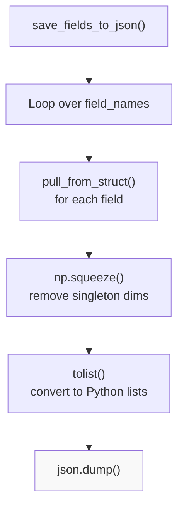

**Example Usage**:
```python
# Export specific FGE parameters to JSON
meq.save_fields_to_json(
    '/path/to/params.json',
    'Lfge.P',
    ['debug', 'maxit', 'tol']
)

# Resulting JSON:
# {
#   "debug": 0.0,
#   "maxit": 100.0,
#   "tol": 1e-6
# }
```

**Key Features**:
- Automatically handles dimension squeezing for scalar values
- Converts NumPy arrays to Python lists for JSON compatibility
- Useful for configuration inspection without loading full `.mat` files

**Sources**: [meqpy/meqpy_impl.py:741-753](), [tests/meqpy_test.py:26-41]()

## Temporary Directory Selection

MeqPy preferentially uses `tmpfs` (RAM-backed filesystem) for temporary files to improve performance and avoid disk I/O bottlenecks.

**Function**: `choose_temporary_directory() -> str | None`

**Selection Logic**:

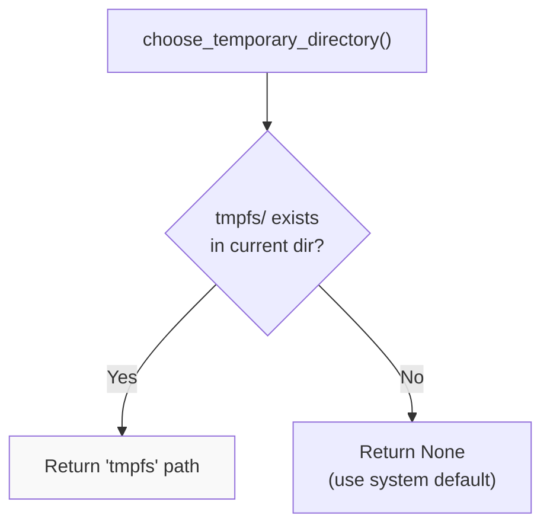

**tmpfs Setup**:
Users can create a tmpfs mount point to enable this optimization:
```bash
# Create directory and mount tmpfs (Linux)
mkdir tmpfs
sudo mount -t tmpfs -o size=1G tmpfs ./tmpfs
```

**Why tmpfs?**:
- **Performance**: RAM-backed storage is much faster than disk
- **No persistence overhead**: Temporary files don't need to survive reboots
- **Reduced disk wear**: Important for SSD longevity in compute environments

**Sources**: [meqpy/meqpy_impl.py:770-784]()

## Complete Persistence Workflow

This diagram shows the complete flow from saving a state through restoration and execution:

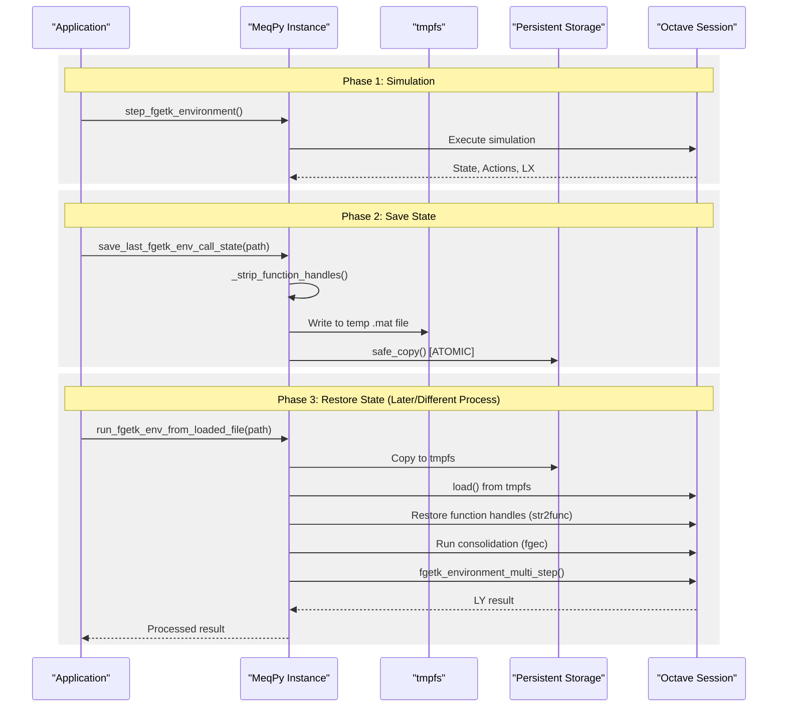

**Sources**: [meqpy/meqpy_impl.py:567-620](), [meqpy/file_utils.py:25-51]()

## Best Practices and Common Patterns

### When to Save State

| Use Case | Recommended Method | Frequency |
|----------|-------------------|-----------|
| Debugging convergence issues | `save_last_fgetk_env_call_state()` | On failure or every N steps |
| Reproducibility testing | `save_run_fbt_inputs()` | Before critical runs |
| Checkpoint recovery | `save_to_file()` with custom vars | Periodic (e.g., every 100 steps) |
| Configuration inspection | `save_fields_to_json()` | Once per configuration |

### Error Handling

All persistence methods validate inputs before attempting file operations:

```python
# Raises ValueError if variables don't exist
meq.save_to_file('/path/to/file.mat', ['NonExistent'])

# Raises ValueError if fields don't exist
meq.save_to_file('/path/to/file.mat', ['Lfge', 'InvalidField'], 
                 fields_as_variables=True)
```

**Sources**: [meqpy/meqpy_impl.py:692-708]()

### Performance Considerations

1. **Use tmpfs when available**: Reduces file I/O latency significantly
2. **Save only necessary variables**: The `_FGETK_ENV_VARS_TO_SAVE` constant specifies minimal set
3. **Avoid frequent saves in tight loops**: Serialize to disk only when needed
4. **Consider JSON for small config exports**: Faster and more portable than `.mat` files

### Testing State Persistence

The test suite in `tests/meqpy_test.py` demonstrates proper usage patterns:

```python
# Test basic save/load cycle
meq_instance.save_to_file(temp_file, ['Foo', 'Bar'])
meq_instance._octave.eval('clear all;')
meq_instance.load_from_file(temp_file, ['Foo', 'Bar'])
# Verify values match

# Test fields_as_variables mode
meq_instance.save_to_file(temp_file, ['Foo'], fields_as_variables=True)
meq_instance.load_from_file(temp_file, ['bar', 'baz'])
# Verify fields extracted correctly
```

**Sources**: [tests/meqpy_test.py:43-133]()

---

**Related Pages**:
- [Data Structures and Conventions](#2.3) - Understanding L, LX, and LY structures
- [FGETK Environment - Time-Dependent Simulations](#3.4) - Context for environment state
- [File Operations (file_utils)](#4.1) - Detailed file operation utilities
- [Error Handling and Debugging](#8.2) - Using saved states for debugging

---

