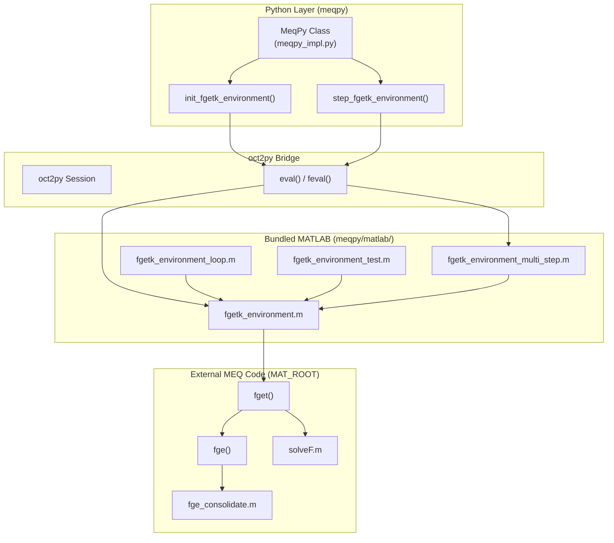
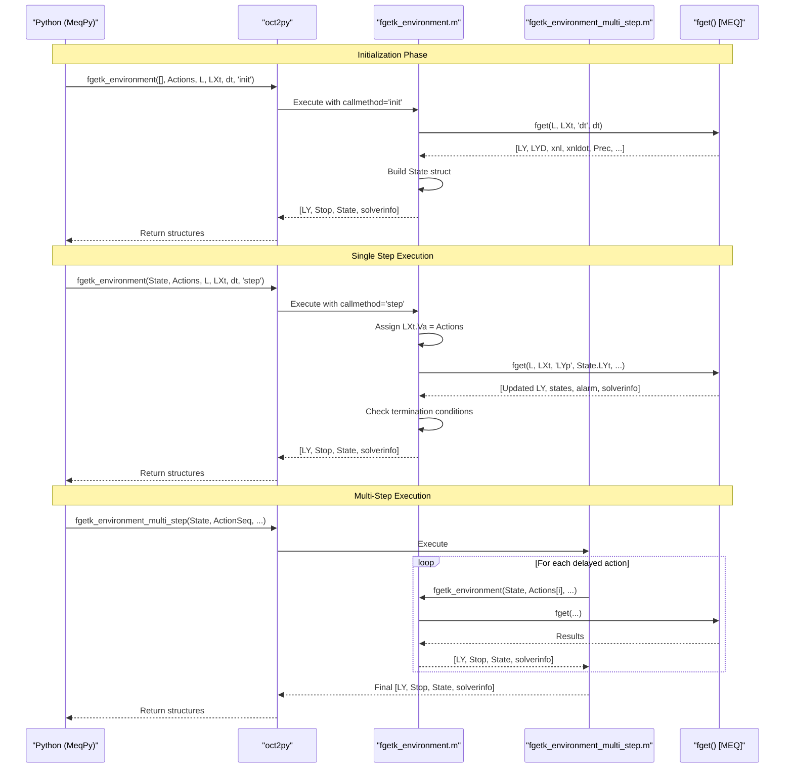
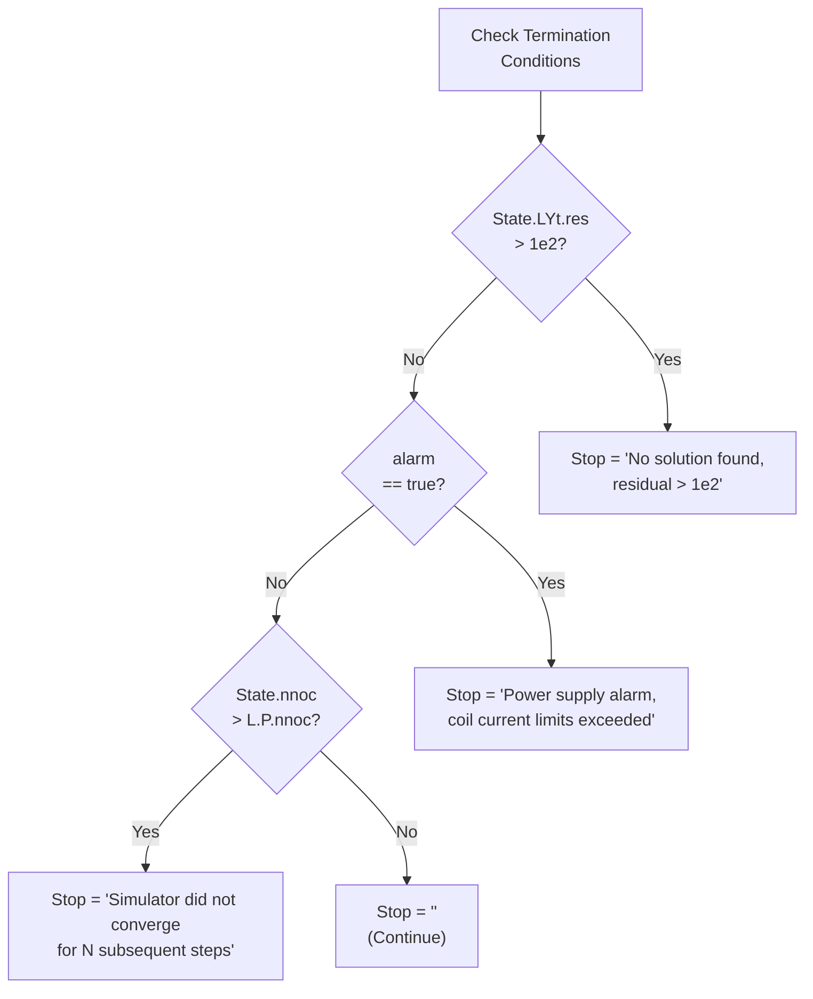

<!-- source: DeepWiki mcp.deepwiki.com · repo google-deepmind/meqpy · page 6 MATLAB/Octave Code Reference · fetched 2026-10-26 -->

# MATLAB/Octave Code Reference

<details>
<summary>Relevant source files</summary>

The following files were used as context for generating this wiki page:

- [MANIFEST.in](MANIFEST.in)
- [meqpy/matlab/__init__.py](meqpy/matlab/__init__.py)
- [meqpy/matlab/fgetk_environment.m](meqpy/matlab/fgetk_environment.m)

</details>


## Purpose and Scope

This document provides a reference for the MATLAB/Octave code that is bundled with the MeqPy Python package. MeqPy includes a small set of custom MATLAB functions in the `meqpy/matlab/` directory that provide time-dependent simulation capabilities not available in the external MEQ codebase.

These bundled functions serve as an "environment" interface for control-oriented simulations, implementing time-stepping logic and state management on top of MEQ's core equilibrium solvers. For detailed documentation on specific functions, see:
- [fgetk_environment.m](#6.1) - Main time-stepping environment function
- [Supporting MATLAB Functions](#6.2) - Helper functions for multi-step execution and testing

For information about how Python code interacts with these MATLAB functions via oct2py, see [Octave Integration Layer](#2.2). For documentation on time-dependent simulation workflows from the Python API perspective, see [FGETK Environment - Time-Dependent Simulations](#3.4).

Sources: [meqpy/matlab/__init__.py:1-15](), [MANIFEST.in:1-1]()

## Bundled Functions Overview

MeqPy bundles four custom MATLAB functions that implement a time-stepping simulation environment:

| Function | Purpose | Called By |
|----------|---------|-----------|
| `fgetk_environment.m` | Core time-stepping function with initialization and step modes | Python `MeqPy` class directly |
| `fgetk_environment_loop.m` | Synchronous loop wrapper for running multiple steps | Python tests and validation scripts |
| `fgetk_environment_multi_step.m` | Batch execution of multiple time steps with action delays | Python `MeqPy.step_fgetk_environment()` |
| `fgetk_environment_test.m` | Test harness for validating environment behavior | MATLAB/Octave test suite |

These functions are stored in the `meqpy/matlab/` directory and are automatically included in the Python package distribution via the `MANIFEST.in` configuration.

Sources: [MANIFEST.in:1-1]()

## Architecture: Python-MATLAB Integration



**Architecture: Integration of bundled MATLAB functions with Python and external MEQ code**

The bundled MATLAB functions act as a coordination layer between MeqPy's Python API and MEQ's core equilibrium solvers. The `fgetk_environment.m` function is called directly from Python through oct2py, while helper functions like `fgetk_environment_multi_step.m` provide batch execution capabilities. These functions maintain internal state structures and call external MEQ functions like `fget()`, `fge()`, and `solveF.m` to perform actual equilibrium calculations.

Sources: [meqpy/matlab/fgetk_environment.m:1-100]()

## Function Call Patterns



**Call pattern: Initialization and time-stepping through bundled MATLAB functions**

The initialization phase calls `fgetk_environment` with an empty `State` and `callmethod='init'`, which internally calls `fget()` to compute the initial equilibrium and builds a `State` structure containing all internal solver states. Subsequent step calls pass the populated `State` structure back with `callmethod='step'`, which updates the state by calling `fget()` with previous states. The `fgetk_environment_multi_step` function wraps multiple step calls to handle action delays efficiently.

Sources: [meqpy/matlab/fgetk_environment.m:14-100]()

## State Management

The `fgetk_environment.m` function maintains a `State` structure that encapsulates all internal solver states across time steps:

| Field | Type | Purpose |
|-------|------|---------|
| `State.it` | scalar | Iteration counter (incremented each step) |
| `State.Prec` | struct | Preconditioner state for iterative solver |
| `State.xnl` | vector | Non-linear state variables (currents, fluxes) |
| `State.xnldot` | vector | Time derivatives of non-linear states |
| `State.Tstate` | struct | Thermal state for temperature evolution |
| `State.PSstate` | struct | Power supply state (voltage/current dynamics) |
| `State.dstate` | struct | Disturbance/diagnostic state |
| `State.nnoc` | scalar | Count of non-converged steps |
| `State.LYt` | struct | Previous time step's LY output (one-step delay) |
| `State.dt` | scalar | Time step size (must remain constant) |
| `State.Vact` | vector | Actual voltages applied to coils |

This state structure is passed between Python and MATLAB at each time step, allowing the simulation to resume from any previous state. The structure preserves all solver internal states required by MEQ's `fget()` function.

Sources: [meqpy/matlab/fgetk_environment.m:40-90]()

## Termination Conditions

The `fgetk_environment.m` function checks for three termination conditions at each step and returns a non-empty `Stop` string if any condition is met:



**Termination condition decision tree in fgetk_environment.m**

The function implements three safety checks: (1) residual threshold to detect solver divergence, (2) power supply alarm flag from `fget()` indicating coil current limit violations, and (3) consecutive non-convergence counter to prevent infinite loops. These checks occur after each `fget()` call at lines [meqpy/matlab/fgetk_environment.m:92-98]().

Sources: [meqpy/matlab/fgetk_environment.m:90-99]()

## Initialization vs. Step Mode

The `fgetk_environment` function operates in two distinct modes controlled by the `callmethod` parameter:

### Initialization Mode (`callmethod='init'`)

When called with `callmethod='init'`:
- `State` parameter must be empty (`[]`)
- `LXt` must contain a single time slice (`numel(LXt.t)==1`)
- Calls `fget(L, LXt, 'dt', dt)` to compute initial equilibrium
- Builds initial `State` structure with solver states
- Returns initial `LY`, empty `Stop` string, populated `State`, and `solverinfo`

Implementation at [meqpy/matlab/fgetk_environment.m:36-54]()

### Step Mode (`callmethod='step'`)

When called with `callmethod='step'` (default if `callmethod` is omitted):
- `State` parameter must be populated from previous call
- Validates that `LXt.t - State.LYt.t` matches `State.dt` (constant time step required)
- Assigns `Actions` to `LXt.Va` (voltage setpoints)
- Calls `fget(L, LXt, 'LYp', State.LYt, 'xnl', State.xnl, ...)` with all previous states
- Returns **previous** `LY` (one-step delay), updated `State`, termination `Stop` string, and `solverinfo`

Implementation at [meqpy/matlab/fgetk_environment.m:56-84]()

The one-step delay in returning `LY` (line 69: `LY = State.LYt`) mimics real-world control systems where measurements are delayed relative to control actions.

Sources: [meqpy/matlab/fgetk_environment.m:33-87]()

## Time Step Validation

The function enforces a constant time step constraint:

```matlab
assert(abs(LXt.t - State.LYt.t - State.dt) < 1e-12, ...
  'dt in LX (%e) - (%e) does not match initial dt (%e). dt needs to be constant.', ...
      LXt.t, State.LYt.t, State.dt)
```

This validation at [meqpy/matlab/fgetk_environment.m:62-64]() ensures that the simulation maintains a constant time step, which is required for the internal solver state evolution in MEQ's `fget()` function. Variable time steps would invalidate the time derivatives stored in `State.xnldot` and could cause solver instability.

Sources: [meqpy/matlab/fgetk_environment.m:62-64]()

## Package Distribution

The bundled MATLAB files are distributed with the Python package through the following mechanism:

```mermaid
graph LR
    subgraph "Source Repository"
        MatlabDir["meqpy/matlab/<br/>*.m files"]
        ManifestIn["MANIFEST.in"]
    end
    
    subgraph "setuptools Build"
        SetupPy["setup.py /<br/>pyproject.toml"]
        IncludeRules["include meqpy/matlab/*.m"]
    end
    
    subgraph "Distribution Package"
        WheelFile["meqpy-X.Y.Z-py3-none-any.whl"]
        InstalledFiles["site-packages/<br/>meqpy/matlab/*.m"]
    end
    
    subgraph "Runtime"
        Oct2PyPath["oct2py.addpath()"]
        OctaveSearch["Octave function<br/>search path"]
    end
    
    MatlabDir --> ManifestIn
    ManifestIn --> IncludeRules
    IncludeRules --> SetupPy
    SetupPy --> WheelFile
    WheelFile --> InstalledFiles
    InstalledFiles --> Oct2PyPath
    Oct2PyPath --> OctaveSearch
```



**Package distribution: From source files to Octave runtime path**

The `MANIFEST.in` file specifies that all `.m` files in `meqpy/matlab/` should be included in the source distribution. During package installation, these files are copied to the Python `site-packages` directory. At runtime, the `octave_utils.create_meq_oct2py_instance()` function adds this directory to Octave's search path, making the bundled functions available for calls through oct2py.

Sources: [MANIFEST.in:1-1](), [meqpy/matlab/__init__.py:1-15]()

## Interaction with External MEQ Code

The bundled MATLAB functions are designed to complement, not replace, the external MEQ codebase:

| Responsibility | Bundled Functions | External MEQ Code |
|----------------|-------------------|-------------------|
| Time-stepping logic | `fgetk_environment.m` | Not provided |
| State management | `fgetk_environment.m` | Partial (internal to solvers) |
| Action delays | `fgetk_environment_multi_step.m` | Not provided |
| Equilibrium solving | Calls MEQ functions | `fge()`, `fget()`, `fgec()` |
| Plasma physics | Delegates to MEQ | All calculations |
| Geometry setup | Delegates to MEQ | `fge_geometry()` |
| Consolidation | Delegates to MEQ | `fge_consolidate()` |
| Preconditioner | Uses MEQ state | `fge_preconditioner()` |

The bundled functions act as a thin coordination layer that maintains state between calls to MEQ's core solvers. They do not reimplement any plasma physics calculations or equilibrium solving algorithms. The external MEQ codebase (located at `MAT_ROOT`) must be available at runtime and is accessed through Octave's normal function search path.

For details on specific bundled function implementations, see:
- [fgetk_environment.m](#6.1) for the main environment function
- [Supporting MATLAB Functions](#6.2) for helper functions

Sources: [meqpy/matlab/fgetk_environment.m:14-100]()

---

