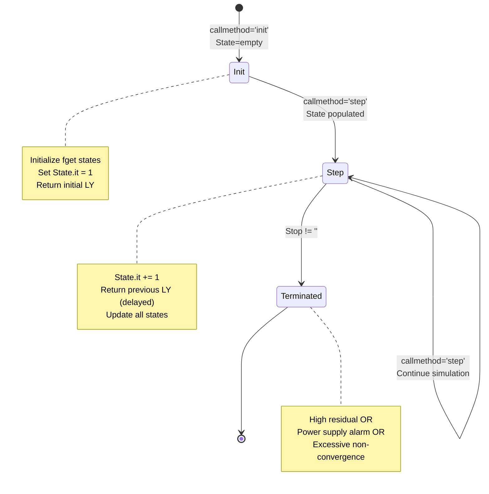
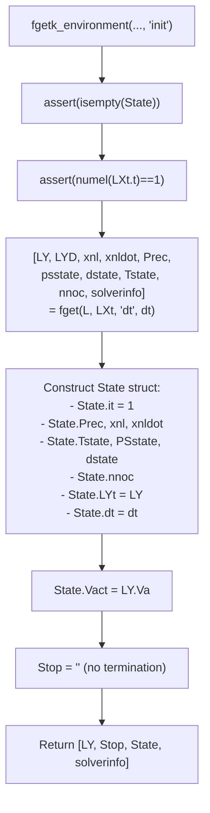
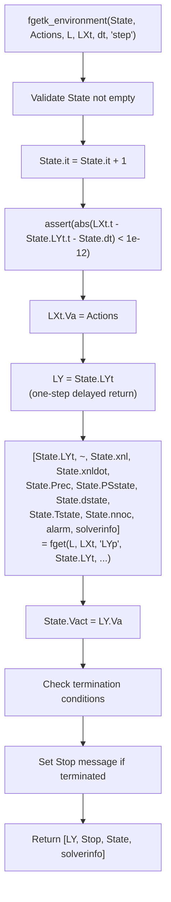
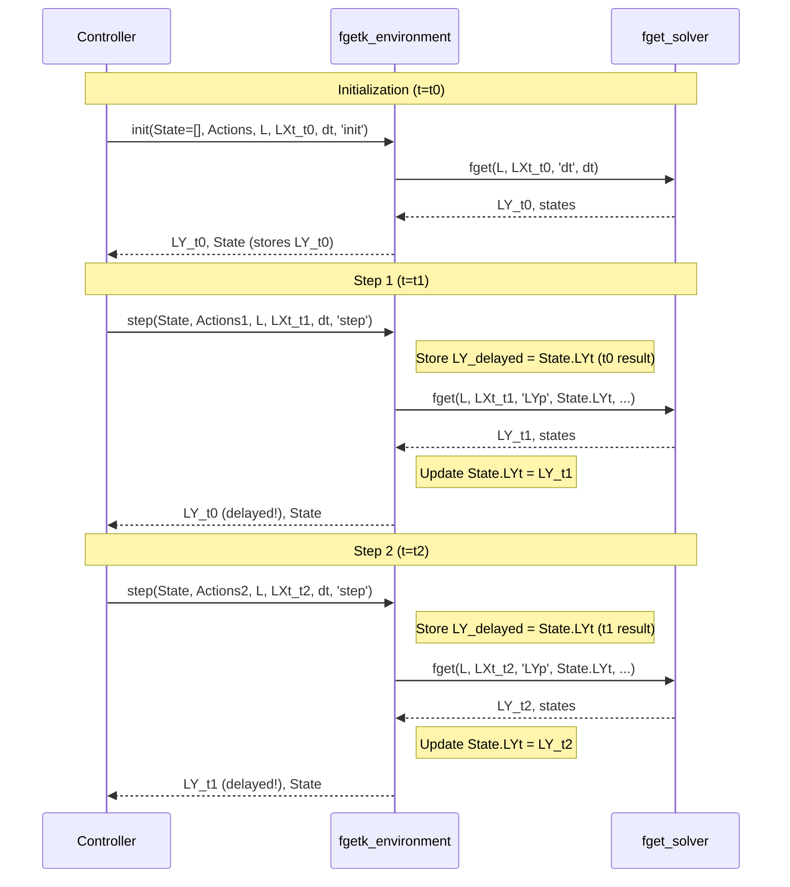
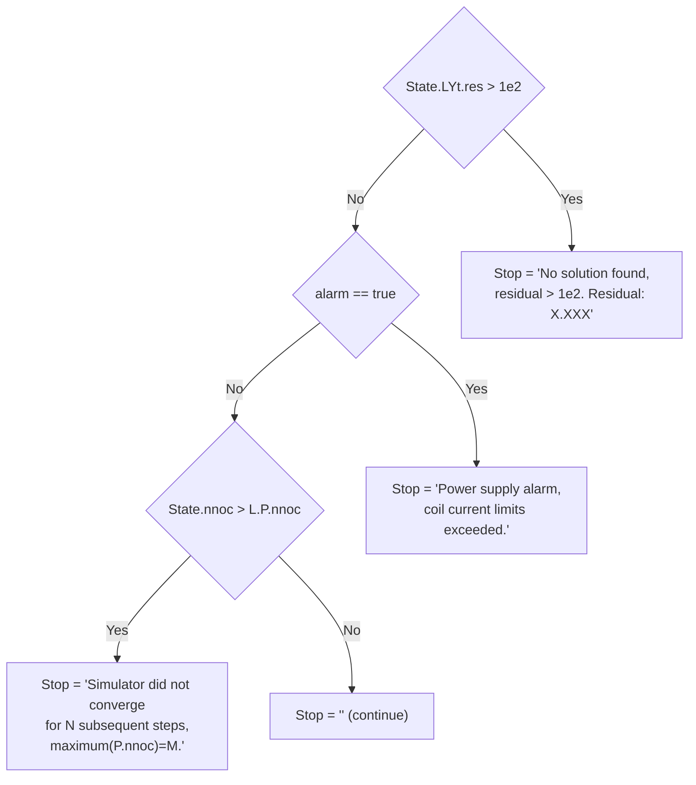
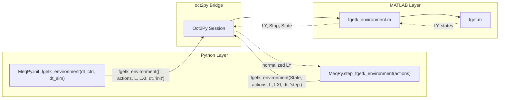
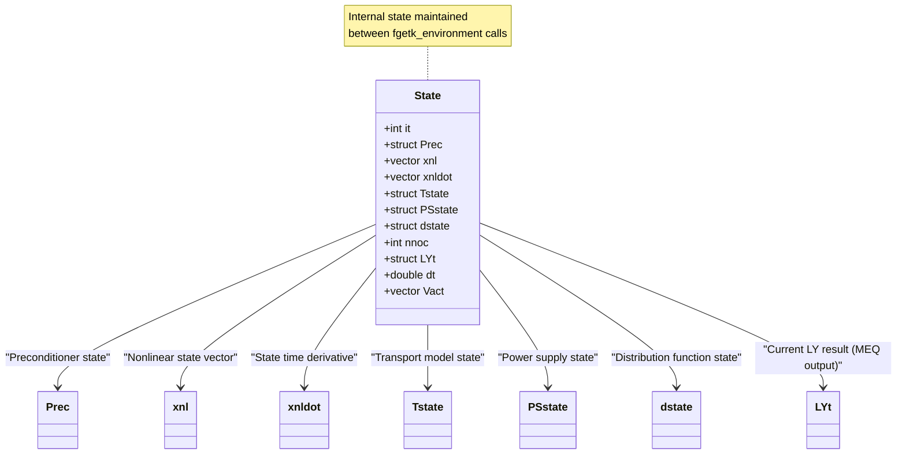
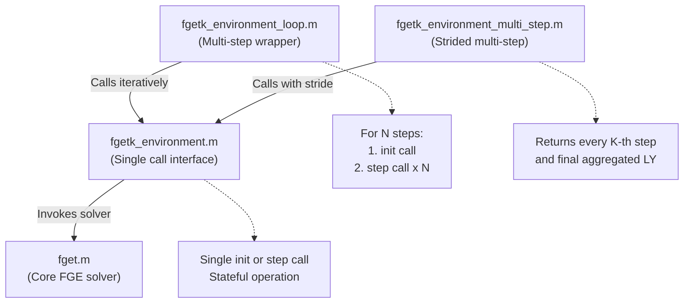

<!-- source: DeepWiki mcp.deepwiki.com · repo google-deepmind/meqpy · page 6.1 fgetk_environment.m · fetched 2026-10-26 -->

# fgetk_environment.m

<details>
<summary>Relevant source files</summary>

The following files were used as context for generating this wiki page:

- [meqpy/matlab/fgetk_environment.m](meqpy/matlab/fgetk_environment.m)
- [meqpy/matlab/fgetk_environment_test.m](meqpy/matlab/fgetk_environment_test.m)

</details>


## Purpose and Scope

`fgetk_environment.m` implements a control-oriented time-series simulation environment for FGE (Fast Grad-Shafranov Equilibrium) computations. This function provides a stateful, step-by-step interface to the underlying `fget` solver, specifically designed for reinforcement learning, control system development, and iterative simulation workflows.

This page documents the MATLAB/Octave implementation of the environment function. For information about the Python interface to this function, see [FGETK Environment - Time-Dependent Simulations](#3.4). For related helper functions that orchestrate multiple steps, see [Supporting MATLAB Functions](#6.2).

**Key Characteristics:**
- **Stateful execution**: Maintains internal state between calls
- **Two-mode operation**: Separate `'init'` and `'step'` calling modes
- **One-step delay**: Returns previous time step results to simulate real-world measurement delays
- **Termination detection**: Monitors convergence and physical constraints

Sources: [meqpy/matlab/fgetk_environment.m:14-30]()

---

## Function Signature

```matlab
function [LY, Stop, State, solverinfo] = fgetk_environment(State, Actions, L, LXt, dt, callmethod)
```

### Input Parameters

| Parameter | Type | Description |
|-----------|------|-------------|
| `State` | struct | Internal state structure (empty for `'init'`, populated for `'step'`) |
| `Actions` | vector | Voltage setpoints from controller/agent, ordered by `L.G.dima` |
| `L` | struct | FGE L structure containing parameters (`L.P`) and geometry (`L.G`) |
| `LXt` | struct | Single time-slice FGE input structure with non-controlled inputs |
| `dt` | scalar | Time step in seconds |
| `callmethod` | string | `'init'` for initialization or `'step'` for time-stepping (default: `'step'`) |

### Output Parameters

| Parameter | Type | Description |
|-----------|------|-------------|
| `LY` | struct | MEQ equilibrium output structure (one-step delayed in `'step'` mode) |
| `Stop` | string | Empty string for normal operation, or termination reason message |
| `State` | struct | Updated internal state structure to pass to next call |
| `solverinfo` | struct | Solver information from `solveF.m` |

Sources: [meqpy/matlab/fgetk_environment.m:14-30]()

---

## Call Mode State Machine

The function operates as a state machine with two distinct modes:



Sources: [meqpy/matlab/fgetk_environment.m:35-87]()

---

## Initialization Mode

When `callmethod='init'`, the function sets up the initial simulation state.

### Initialization Flow



### State Initialization

The initialization call creates a `State` structure with the following fields:

| Field | Source | Purpose |
|-------|--------|---------|
| `State.it` | Set to 1 | Iteration counter |
| `State.Prec` | From `fget` | Preconditioner state |
| `State.xnl` | From `fget` | Nonlinear state vector |
| `State.xnldot` | From `fget` | Time derivative of nonlinear state |
| `State.Tstate` | From `fget` | Transport model state |
| `State.PSstate` | From `fget` | Power supply state |
| `State.dstate` | From `fget` | Distribution function state |
| `State.nnoc` | From `fget` | Non-convergence counter |
| `State.LYt` | From `fget` | Current equilibrium result |
| `State.dt` | Input parameter | Time step (validated to remain constant) |
| `State.Vact` | From `LY.Va` | Actual voltages applied |

Sources: [meqpy/matlab/fgetk_environment.m:36-54]()

---

## Step Mode

When `callmethod='step'`, the function advances the simulation by one time step.

### Step Execution Flow



### Key Behavioral Details

**Constant Time Step Enforcement**: The function validates that the time difference between consecutive `LXt.t` values matches the initialized `dt`:
```matlab
assert(abs(LXt.t - State.LYt.t - State.dt) < 1e-12, ...)
```
This ensures consistent temporal discretization throughout the simulation.

**Action Assignment**: Controller voltages from the `Actions` vector are directly assigned to the input structure:
```matlab
LXt.Va = Actions;
```
The ordering matches `L.G.dima`, which defines the active circuit indices.

**State Propagation**: All internal states are passed to `fget` and updated:
```matlab
[State.LYt, ~, State.xnl, State.xnldot, State.Prec, ...
 State.PSstate, State.dstate, State.Tstate, State.nnoc, alarm, solverinfo] = ...
    fget(L, LXt, 'LYp', State.LYt, 'xnl', State.xnl, 'xnldot', State.xnldot, ...)
```

Sources: [meqpy/matlab/fgetk_environment.m:56-87]()

---

## One-Step Delay Mechanism

A critical design feature is the **one-step delay** in returning equilibrium results:



**Rationale**: This delay mimics real-world tokamak control scenarios where:
- Sensor measurements take time to process
- Diagnostics are not instantaneous
- Control actions affect the future state, but observations lag

**Implementation**: At step `n`, the function returns `State.LYt` from step `n-1` while computing and storing the result for step `n`.

Sources: [meqpy/matlab/fgetk_environment.m:29-30](), [meqpy/matlab/fgetk_environment.m:69]()

---

## Termination Conditions

The function monitors three classes of failures and sets the `Stop` output accordingly:

### Termination Logic



### Termination Conditions Table

| Condition | Check | Stop Message | Physical Meaning |
|-----------|-------|--------------|------------------|
| **High Residual** | `State.LYt.res > 1e2` | `'No solution found, residual > 1e2. Residual: %.3f'` | Equilibrium solver failed to converge to acceptable accuracy |
| **Power Supply Alarm** | `alarm == true` | `'Power supply alarm, coil current limits exceeded.'` | Requested coil currents exceed physical hardware limits |
| **Persistent Non-Convergence** | `State.nnoc > L.P.nnoc` | `'Simulator did not converge for %d subsequent steps, maximum(P.nnoc)=%d.'` | Solver has failed repeatedly, indicating fundamental simulation issues |

**Note**: When `Stop` is non-empty, the simulation should be terminated by the calling code. The Python interface in `MeqPy.step_fgetk_environment` checks for this condition.

Sources: [meqpy/matlab/fgetk_environment.m:90-98]()

---

## Integration with Python MeqPy

The function is called from Python via the `MeqPy` class methods:



**Python Interface Methods**:
- `MeqPy.init_fgetk_environment(dt_ctrl, dt_sim)` calls with `callmethod='init'`
- `MeqPy.step_fgetk_environment(actions)` calls with `callmethod='step'`
- `MeqPy.step_fgetk_environment_multiple(actions, n_steps)` orchestrates multiple steps

The Python layer handles:
- Converting `actions` from Python arrays to MATLAB vectors
- Normalizing returned `LY` structures via `ly_post_processing`
- Checking the `Stop` string for termination
- Managing state persistence

Sources: [meqpy/matlab/fgetk_environment.m:14]()

---

## Usage Example from Tests

The test suite demonstrates typical usage patterns:

### Test Setup and Execution

From [meqpy/matlab/fgetk_environment_test.m:32-90](), the test:

1. **Initializes FGE parameters**:
   ```matlab
   [L, LX] = fge(tok, shot, t0, PP_user{:});
   LX = fgex(tok, time, L, LX);
   ```

2. **Defines control actions**:
   ```matlab
   n_actions = L.G.na;
   PF_voltage = -1000;
   Actions = PF_voltage * ones(n_actions, numel(LX.t));
   ```

3. **Executes using `fgetk_environment_loop`**:
   ```matlab
   LY = fgetk_environment_loop(Actions, L, LX, dt);
   ```

4. **Validates convergence and accuracy**:
   ```matlab
   testCase.verifyTrue(meq_test.check_convergence(L, [], LY));
   testCase.verifyEqual(LY.Fx, LYo.Fx, 'AbsTol', L.Fx0*sqrt(eps));
   ```

### Test Configuration Parameters

| Tokamak | Shot | Time | Equation Source | Current Drive | Geometry |
|---------|------|------|-----------------|---------------|----------|
| `'ana'` | 2 | 0 | `'fbt'` | `'cde_ss_0D'` | Singlet |
| `'tcv'` | 66028 | 0.45 | `'liu'` | `'cde_ss_0D'` | Singlet |
| `'tcv'` | 67151 | 0.03 | `'fbt'` | `'cde_ss_0D'` | Droplet |
| `'tcv'` | 81152 | 0.01 | `'liu'` | `'cde_OhmTor_1D'` | Doublet |

Sources: [meqpy/matlab/fgetk_environment_test.m:22-28](), [meqpy/matlab/fgetk_environment_test.m:32-90]()

---

## State Structure Reference

Complete field listing of the `State` structure:



| Field | Type | Initialization | Update Timing | Purpose |
|-------|------|----------------|---------------|---------|
| `it` | scalar | 1 | Every step | Iteration counter |
| `Prec` | struct | From `fget` | Every step | Preconditioner state for iterative solver |
| `xnl` | vector | From `fget` | Every step | Nonlinear state variables (fluxes, currents) |
| `xnldot` | vector | From `fget` | Every step | Time derivatives of nonlinear states |
| `Tstate` | struct | From `fget` | Every step | Transport model internal state |
| `PSstate` | struct | From `fget` | Every step | Power supply circuit model state |
| `dstate` | struct | From `fget` | Every step | Distribution function state (if applicable) |
| `nnoc` | scalar | From `fget` | Every step | Consecutive non-convergence counter |
| `LYt` | struct | From `fget` | Every step | Current equilibrium solution at time `t` |
| `dt` | scalar | Input | Never | Fixed time step (validated constant) |
| `Vact` | vector | `LY.Va` | Every step | Actual applied voltages (for recording) |

Sources: [meqpy/matlab/fgetk_environment.m:44-53](), [meqpy/matlab/fgetk_environment.m:71-83](), [meqpy/matlab/fgetk_environment.m:89]()

---

## Implementation Details

### Function Handle Considerations

When saving/loading `State` structures, note that some fields may contain function handles (particularly in transport and distribution models). The Python persistence layer handles this via:
- `_strip_function_handles` before saving
- `_restore_*_state` with `str2func` after loading

See [State Persistence and Recovery](#5) for details on serialization.

### Time Step Validation

The strict time step validation at [meqpy/matlab/fgetk_environment.m:62-64]() ensures that:
```matlab
LXt.t - State.LYt.t ≈ State.dt
```

This prevents subtle bugs from variable time stepping and maintains consistency with the initialized `dt`.

### Alarm Signal Propagation

The `alarm` signal from `fget` indicates hardware constraint violations. The function immediately translates this to a termination condition, preventing unphysical simulation states.

Sources: [meqpy/matlab/fgetk_environment.m:62-64](), [meqpy/matlab/fgetk_environment.m:94-95]()

---

## Relationship to Other MATLAB Functions



- **`fgetk_environment.m`**: Low-level stateful interface (this page)
- **`fgetk_environment_loop.m`**: Convenience wrapper for running N sequential steps
- **`fgetk_environment_multi_step.m`**: Advanced wrapper that returns strided outputs
- **`fget.m`**: Core time-stepping FGE solver in the MEQ codebase

See [Supporting MATLAB Functions](#6.2) for documentation on the wrapper functions.

Sources: [meqpy/matlab/fgetk_environment.m:1-100](), [meqpy/matlab/fgetk_environment_test.m:65-89]()

---

