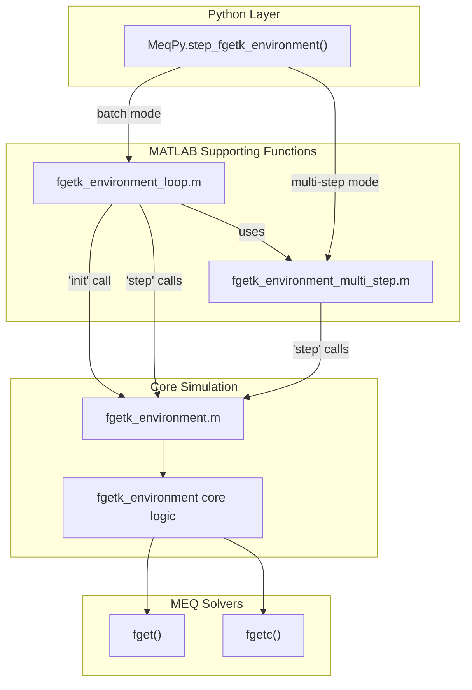
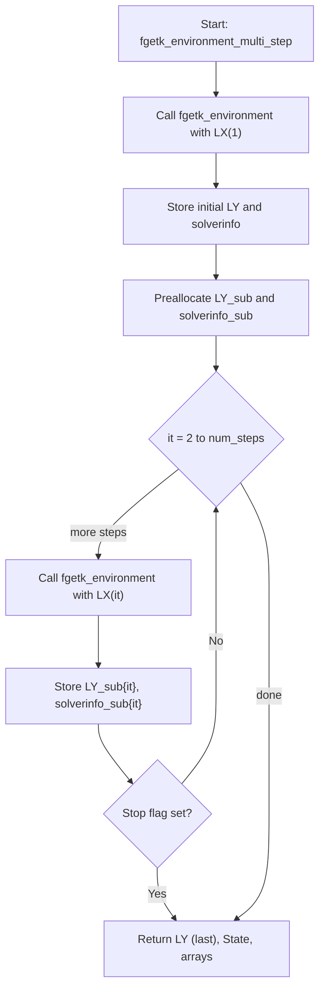
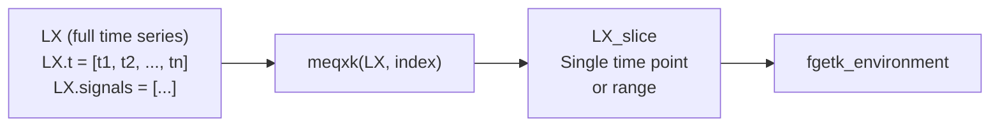
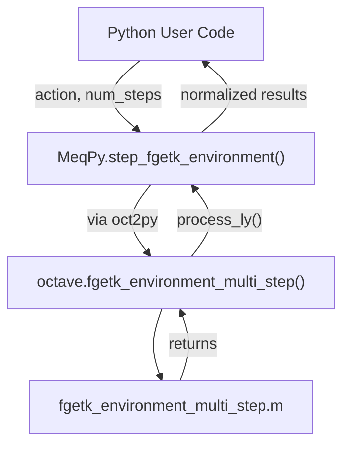

<!-- source: DeepWiki mcp.deepwiki.com · repo google-deepmind/meqpy · page 6.2 Supporting MATLAB Functions · fetched 2026-10-26 -->

# Supporting MATLAB Functions

<details>
<summary>Relevant source files</summary>

The following files were used as context for generating this wiki page:

- [meqpy/matlab/fgetk_environment_loop.m](meqpy/matlab/fgetk_environment_loop.m)
- [meqpy/matlab/fgetk_environment_multi_step.m](meqpy/matlab/fgetk_environment_multi_step.m)

</details>


## Purpose and Scope

This page documents the supporting MATLAB/Octave functions that work in conjunction with `fgetk_environment.m` to provide batch execution and multi-stepping capabilities. These functions are located in the `meqpy/matlab/` directory and are bundled with the MeqPy Python package.

For documentation of the core `fgetk_environment.m` function that these utilities wrap, see [fgetk_environment.m](#6.1). For information on how to use these functions from Python, see [FGETK Environment - Time-Dependent Simulations](#3.4).

## Overview

The MeqPy MATLAB package includes two key supporting functions:

| Function | Purpose | Primary Use Case |
|----------|---------|------------------|
| `fgetk_environment_loop` | Executes open-loop time-series simulations | Batch processing of pre-defined action sequences |
| `fgetk_environment_multi_step` | Steps the environment multiple times with fixed actions | Performance optimization for control loops with action delays |

Both functions abstract away the manual loop management required when calling `fgetk_environment` repeatedly, providing structured interfaces for common simulation patterns.

## Function Relationships



**Sources:** [meqpy/matlab/fgetk_environment_loop.m:1-91](), [meqpy/matlab/fgetk_environment_multi_step.m:1-35]()

## fgetk_environment_loop

### Function Signature

```matlab
[LY, LY_substeps] = fgetk_environment_loop(Actions, L, LX, dt, num_steps)
```

### Description

`fgetk_environment_loop` executes a complete open-loop simulation by iterating through a pre-defined sequence of actions. It handles initialization, time-stepping, and result aggregation automatically.

### Parameters

| Parameter | Type | Description |
|-----------|------|-------------|
| `Actions` | `[n_actions × nt]` matrix | Time sequence of control actions. Each column represents actions at one time step. |
| `L` | struct | Environment configuration structure containing parameters (`L.P`) and geometry (`L.G`). |
| `LX` | struct | Input structure with time vector `LX.t` and external inputs. |
| `dt` | scalar | Simulation time step (seconds). |
| `num_steps` | scalar (optional) | Number of simulation steps per macro-step for multi-stepping. Default: 1. |

### Return Values

| Output | Type | Description |
|--------|------|-------------|
| `LY` | struct array | Packed output structure containing simulation results for each macro-step. |
| `LY_substeps` | struct array (optional) | When `num_steps > 1`, contains detailed results for all sub-steps. Only returned if requested. |

### Operation Modes

The function operates in two distinct modes based on the `num_steps` parameter:

#### Single-Step Mode (`num_steps = 1`)

```mermaid
sequenceDiagram
    participant Caller
    participant Loop as fgetk_environment_loop
    participant Env as fgetk_environment
    
    Caller->>Loop: Actions, L, LX, dt, 1
    Loop->>Env: State=[], mode='init'
    Env-->>Loop: LY0, State
    
    loop for it=2:nt
        Loop->>Env: State, Actions(:,it), mode='step'
        Env-->>Loop: LY(it-1), State
    end
    
    Loop->>Loop: Pack LY array
    Loop-->>Caller: LY (packed)
```

In single-step mode, the function calls `fgetk_environment` once per time step. Each call advances the simulation by `dt` seconds.

**Sources:** [meqpy/matlab/fgetk_environment_loop.m:57-70]()

#### Multi-Step Mode (`num_steps > 1`)

```mermaid
sequenceDiagram
    participant Caller
    participant Loop as fgetk_environment_loop
    participant Multi as fgetk_environment_multi_step
    participant Env as fgetk_environment
    
    Caller->>Loop: Actions, L, LX, dt, num_steps
    Loop->>Env: State=[], mode='init'
    Env-->>Loop: LY0, State
    
    loop for it=2:num_steps:nt-1
        Loop->>Multi: State, Actions(:,it), LXs, num_steps
        
        loop num_steps times
            Multi->>Env: State, Actions, mode='step'
            Env-->>Multi: LY_sub, State
        end
        
        Multi-->>Loop: LY(last), State, LY_sub
    end
    
    Loop->>Loop: Pack LY, LY_substeps
    Loop-->>Caller: LY, LY_substeps
```

In multi-step mode, the function calls `fgetk_environment_multi_step`, which internally performs multiple steps with the same action. This is useful for control systems with action delays where the same control signal persists for multiple simulation steps.

**Sources:** [meqpy/matlab/fgetk_environment_loop.m:71-87]()

### Implementation Details

#### Initialization

The function begins by initializing the simulation and pre-allocating memory:

```matlab
% Initialize environment
[LY0,Stop,State,solverinfo] = fgetk_environment([],[],L,meqxk(LX,1),dt,'init');

% Preallocate buffer
num_macro_steps = ceil((nt-1)/num_steps);
LY = repmat(LY0, num_macro_steps, 1);
```

**Sources:** [meqpy/matlab/fgetk_environment_loop.m:42-48]()

#### Debug Output

When `L.P.debug` is enabled, the function prints progress indicators:

```matlab
dodebug = L.P.debug;
% ...
if dodebug; fprintf('.'); end
```

**Sources:** [meqpy/matlab/fgetk_environment_loop.m:28](), [meqpy/matlab/fgetk_environment_loop.m:59]()

#### Early Termination

The function monitors the `Stop` flag returned by `fgetk_environment` and terminates early if a stop condition is met:

```matlab
if Stop
  fprintf('Stopping due to internal stop criterion:\n %\n', Stop)
  break
end
```

**Sources:** [meqpy/matlab/fgetk_environment_loop.m:66-69](), [meqpy/matlab/fgetk_environment_loop.m:80-83]()

#### Result Packing

Results are packed using `meqlpack` and field-ordered for consistent output:

```matlab
LY = orderfields(meqlpack(LY));
```

**Sources:** [meqpy/matlab/fgetk_environment_loop.m:89]()

### Usage Examples

#### Basic Open-Loop Simulation

```matlab
% Define action sequence
Actions = zeros(3, 100);  % 3 actuators, 100 time steps

% Run simulation
LY = fgetk_environment_loop(Actions, L, LX, 0.001, 1);
```

#### Multi-Step with Sub-Step Recording

```matlab
% Run with 5 substeps per action
[LY, LY_substeps] = fgetk_environment_loop(Actions, L, LX, 0.001, 5);
% LY contains results at every 5th step
% LY_substeps contains all intermediate results
```

## fgetk_environment_multi_step

### Function Signature

```matlab
[LY, Stop, State, solverinfo_sub, LY_sub] = ...
    fgetk_environment_multi_step(State, Actions, L, LX, num_steps)
```

### Description

`fgetk_environment_multi_step` is a helper function that steps the simulation multiple times with fixed actions. It checks for termination conditions at each step and returns detailed results for all sub-steps.

### Parameters

| Parameter | Type | Description |
|-----------|------|-------------|
| `State` | struct | Current simulation state from previous call. |
| `Actions` | `[n_actions × 1]` vector | Control actions to apply for all steps. |
| `L` | struct | Environment configuration structure. |
| `LX` | struct array | Array of `num_steps` input structures, one per sub-step. |
| `num_steps` | scalar | Number of simulation steps to execute. |

### Return Values

| Output | Type | Description |
|--------|------|-------------|
| `LY` | struct | Result from the final step (step `num_steps`). |
| `Stop` | logical/struct | Termination flag. Non-zero if stop condition met. |
| `State` | struct | Updated simulation state for continuation. |
| `solverinfo_sub` | cell array | Solver information for each sub-step. |
| `LY_sub` | cell array | Result structures for all sub-steps. |

### Implementation Flow



**Sources:** [meqpy/matlab/fgetk_environment_multi_step.m:14-35]()

### Key Implementation Details

#### Initial Step Handling

The function first performs one step to retrieve the result from the previous macro-step:

```matlab
[LY,Stop,State,solverinfo] = fgetk_environment(State,Actions,L,meqxk(LX,1),[],'step');
```

This is necessary because `fgetk_environment` returns the result from the *previous* time step by design.

**Sources:** [meqpy/matlab/fgetk_environment_multi_step.m:23]()

#### Memory Initialization

Results are pre-allocated as cell arrays:

```matlab
LY_sub = repmat({LY}, 1, num_steps);
solverinfo_sub = repmat({solverinfo}, 1, num_steps);
```

**Sources:** [meqpy/matlab/fgetk_environment_multi_step.m:26-27]()

#### Sub-Step Iteration

Each subsequent step calls `fgetk_environment` with the same actions but different external inputs:

```matlab
for it=2:num_steps
  [LY_sub{it},Stop,State,solverinfo] = ...
      fgetk_environment(State, Actions, L, meqxk(LX,it), [], 'step');
  solverinfo_sub{it} = solverinfo;
  if Stop, return; end
end
```

**Sources:** [meqpy/matlab/fgetk_environment_multi_step.m:29-33]()

### Usage Context

`fgetk_environment_multi_step` is primarily used by `fgetk_environment_loop` when `num_steps > 1`. It is typically not called directly by users, but rather through the Python API:

```python
# Python example
meqpy_instance.step_fgetk_environment(
    action=action,
    num_steps=5  # Triggers multi-step mode
)
```

## Data Flow and Performance

### LX Structure Slicing

Both functions use `meqxk` to extract time-slice subsets from the `LX` structure:



**Sources:** [meqpy/matlab/fgetk_environment_loop.m:44](), [meqpy/matlab/fgetk_environment_loop.m:63](), [meqpy/matlab/fgetk_environment_loop.m:77]()

### Performance Characteristics

| Mode | Function Calls | Memory Usage | Use Case |
|------|----------------|--------------|----------|
| Single-step | `nt-1` calls to `fgetk_environment` | Low (stores only LY per step) | Standard simulations |
| Multi-step (no substeps) | `ceil((nt-1)/num_steps)` calls | Low (stores only macro-step LY) | Action delay, reduced Python overhead |
| Multi-step (with substeps) | `ceil((nt-1)/num_steps)` calls | High (stores all sub-steps) | Detailed analysis with action delays |

### Action Sequence Validation

The loop function validates that sufficient actions are provided:

```matlab
nt = numel(LX.t);
if size(Actions,2) < nt
  fprintf('Number of actions supplied is shorter than timesteps in LX')
end
```

**Sources:** [meqpy/matlab/fgetk_environment_loop.m:29-32]()

## Error Handling and Assertions

### num_steps Validation

```matlab
assert(num_steps>0, 'num_steps must be positive')
```

This assertion ensures that the multi-stepping parameter is valid.

**Sources:** [meqpy/matlab/fgetk_environment_loop.m:37]()

### Stop Condition Monitoring

Both functions continuously check the `Stop` flag and provide diagnostic output when termination occurs:

```matlab
if Stop
  fprintf('Stopping due to internal stop criterion:\n %\n', Stop)
  break
end
```

The `Stop` variable may contain detailed information about why the simulation terminated (e.g., solver convergence failure, boundary violations).

**Sources:** [meqpy/matlab/fgetk_environment_loop.m:66-69](), [meqpy/matlab/fgetk_environment_multi_step.m:32]()

## Integration with Python API

These MATLAB functions are invoked from Python through the `MeqPy` class methods. The typical call chain is:



The Python layer handles:
- Converting Python arrays to MATLAB-compatible formats
- Invoking the appropriate function based on configuration
- Post-processing results through `ly_post_processing` module
- Managing state persistence

For details on the Python interface, see [FGETK Environment - Time-Dependent Simulations](#3.4).

**Sources:** [meqpy/matlab/fgetk_environment_loop.m:1-91](), [meqpy/matlab/fgetk_environment_multi_step.m:1-35]()

---

