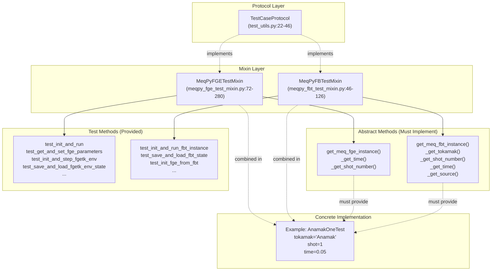
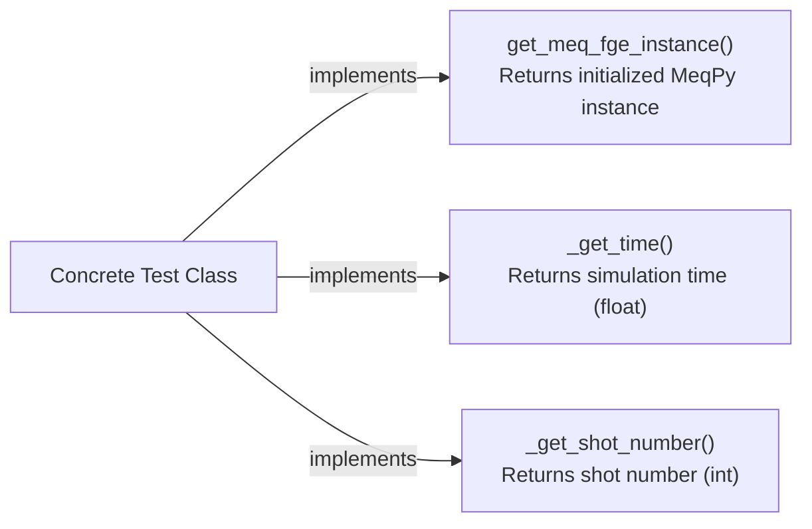
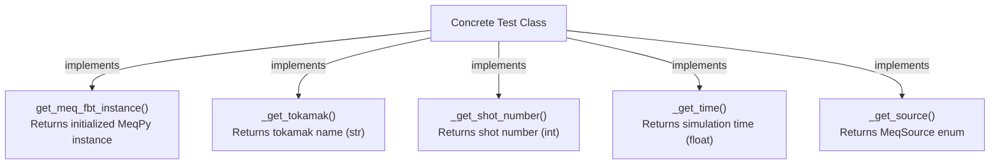
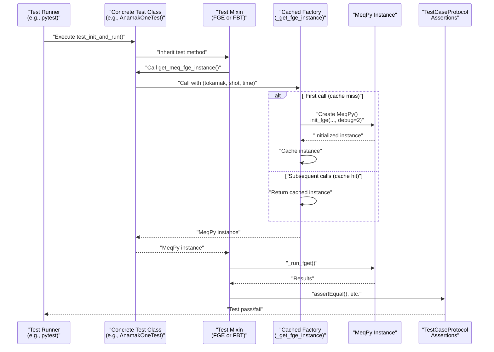
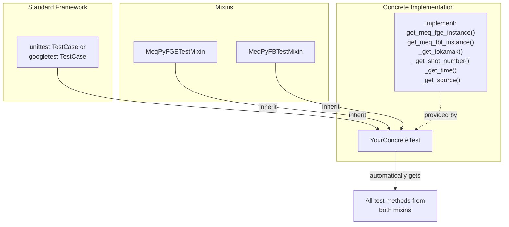

<!-- source: DeepWiki mcp.deepwiki.com · repo google-deepmind/meqpy · page 7 Testing Infrastructure · fetched 2026-10-26 -->

# Testing Infrastructure

<details>
<summary>Relevant source files</summary>

The following files were used as context for generating this wiki page:

- [meqpy/meqpy_fbt_test_mixin.py](meqpy/meqpy_fbt_test_mixin.py)
- [meqpy/meqpy_fge_test_mixin.py](meqpy/meqpy_fge_test_mixin.py)
- [meqpy/test_utils.py](meqpy/test_utils.py)

</details>


## Purpose and Scope

This document describes the testing infrastructure for MeqPy, which uses a sophisticated mixin pattern to enable reusable test logic across different simulation configurations. The testing framework is designed to verify both FGE and FBT simulation modes with parameterized configurations (tokamak type, shot number, time).

For information about the core simulation modes being tested, see [Simulation Modes](#3). For details about the `MeqPy` class methods being validated, see [The MeqPy Class](#2.1).

---

## Architecture Overview

The testing infrastructure is organized into three layers:

1. **Protocol Layer** - `TestCaseProtocol` defines a common assertion interface
2. **Mixin Layer** - `MeqPyFGETestMixin` and `MeqPyFBTestMixin` provide reusable test implementations
3. **Concrete Test Layer** - Specific test classes combine mixins with configuration parameters

This design enables a single implementation of complex test scenarios to be reused across different tokamak configurations, shot numbers, and time points.



**Sources**: meqpy/test_utils.py, meqpy/meqpy_fge_test_mixin.py, meqpy/meqpy_fbt_test_mixin.py

---

## TestCaseProtocol

The `TestCaseProtocol` [meqpy/test_utils.py:22-46]() defines a typing protocol that specifies the assertion methods required for test mixins. This protocol is compatible with `googletest.TestCase` but does not depend on it, allowing the mixins to work with different test frameworks.

### Assertion Methods

| Method | Purpose | Parameters |
|--------|---------|------------|
| `assertEqual` | Assert two values are equal | `a`, `b` |
| `assertAlmostEqual` | Assert floating-point values are approximately equal | `a`, `b`, `places=None` |
| `assertRaisesRegex` | Assert exception is raised with message matching regex | `exception_type`, `regex` |
| `assertFalse` | Assert value is False | `a` |
| `assertSameElements` | Assert two collections contain same elements | `a`, `b` |
| `subTest` | Create a subtest context | `name` |
| `skipTest` | Skip current test | `reason: str` |

The protocol uses `Protocol` from the `typing` module to define a structural subtype that any class implementing these methods can satisfy without explicit inheritance.

**Sources**: meqpy/test_utils.py:15-48

---

## MeqPyFGETestMixin

The `MeqPyFGETestMixin` [meqpy/meqpy_fge_test_mixin.py:72-280]() provides comprehensive test coverage for FGE (Fast Grad-Shafranov Equilibrium) functionality. It implements `TestCaseProtocol` and defines both abstract methods (to be implemented by subclasses) and concrete test methods (ready to use).

### Abstract Methods (Must Implement)

Concrete test classes must implement these methods to provide configuration:



**Sources**: meqpy/meqpy_fge_test_mixin.py:75-89

### Test Instance Caching

The mixin uses a cached factory function `_get_fge_instance` [meqpy/meqpy_fge_test_mixin.py:33-69]() decorated with `@functools.cache` to create and initialize `MeqPy` instances. This caching mechanism:

- Reduces setup time by reusing expensive initialization across tests
- Maintains state across tests (tests can run in any order)
- Requires tests to reset internal state after modifications
- Initializes with `debug=2` for diagnostic output
- Sets `anajac=True` and `usepreconditioner=True` for performance

**Important**: The caching behavior means state persists across tests. Tests that modify state should restore original values to avoid affecting subsequent tests.

**Sources**: meqpy/meqpy_fge_test_mixin.py:33-69

### FGE Test Methods

The mixin provides the following test methods:

#### Basic Execution Tests

| Test Method | What It Validates | File Lines |
|-------------|-------------------|------------|
| `test_init_and_run` | FGE initialization and execution via `_run_fget()` | 91-94 |

#### Parameter Management Tests

| Test Method | What It Validates | File Lines |
|-------------|-------------------|------------|
| `test_get_and_set_fge_parameters` | Reading and writing FGE parameters (debug, usepreconditioner) | 96-118 |
| `test_get_and_set_fge_geometry` | Reading and writing FGE geometry fields (Vamax, Iamax) | 120-138 |
| `test_setting_field_which_does_not_exist_raises_error` | Error handling for invalid parameter names | 140-147 |
| `test_getting_parameter_which_does_not_exist_raises_error` | Error handling when reading non-existent parameters | 149-155 |
| `test_getting_geometry_which_does_not_exist_raises_error` | Error handling when reading non-existent geometry fields | 157-163 |
| `test_getting_input_which_does_not_exist_raises_error` | Error handling when reading non-existent inputs | 165-171 |

#### FGETK Environment Tests

| Test Method | What It Validates | File Lines |
|-------------|-------------------|------------|
| `test_init_and_step_fgetk_env` | Time-dependent simulation initialization and stepping with input overrides | 173-194 |
| `test_init_and_step_fgetk_env_with_delay` | Action delay mechanism via `Vadelay` geometry parameter | 196-245 |

The action delay test verifies that:
- Actions are delayed by the configured number of control timesteps
- Each circuit can have independent delay settings
- Results reflect actions from `delay_steps` control timesteps earlier

#### Persistence Tests

| Test Method | What It Validates | File Lines |
|-------------|-------------------|------------|
| `test_save_and_load_simple_parameter` | Saving and loading single variable (`LXfge`) | 247-258 |
| `test_save_and_load_fgetk_env_state` | Saving complete FGETK environment state and restoring execution | 260-279 |

**Sources**: meqpy/meqpy_fge_test_mixin.py:91-280

---

## MeqPyFBTestMixin

The `MeqPyFBTestMixin` [meqpy/meqpy_fbt_test_mixin.py:46-126]() provides test coverage for FBT (Fast Boundary Tracing) functionality. It follows the same mixin pattern as the FGE tests.

### Abstract Methods (Must Implement)

Concrete test classes must implement these methods:



**Sources**: meqpy/meqpy_fbt_test_mixin.py:49-72

### Test Instance Caching

Similar to FGE, the mixin uses `_get_fbt_instance` [meqpy/meqpy_fbt_test_mixin.py:29-43]() with `@functools.cache` to create cached FBT instances initialized with `debug=2`.

**Sources**: meqpy/meqpy_fbt_test_mixin.py:29-43

### FBT Test Methods

#### Execution and Configuration Tests

| Test Method | What It Validates | File Lines |
|-------------|-------------------|------------|
| `test_init_and_run_fbt_instance` | FBT execution and input modification (gpr parameter) | 89-99 |
| `test_init_and_run_fbt_instance_with_new_control_points` | Setting new control points and verifying plasma position changes | 101-114 |

The control points test verifies:
- Control points can be retrieved via `get_fbt_control_points()`
- Control points can be modified via `set_fbt_control_point()`
- Shifting control points affects plasma boundary position (rA)

#### Persistence Tests

| Test Method | What It Validates | File Lines |
|-------------|-------------------|------------|
| `test_save_and_load_fbt_state` | Saving FBT inputs and restoring execution state | 74-87 |

The persistence test:
- Runs FBT and saves inputs via `save_run_fbt_inputs()`
- Creates new instance and restores via `_restore_fbt_state()`
- Verifies key output fields match: `Ia`, `FB`, `FA`, `isconverged`

#### Integration Tests

| Test Method | What It Validates | File Lines |
|-------------|-------------------|------------|
| `test_init_fge_from_fbt` | Two-stage workflow: FBT results initialize FGE | 116-125 |

This test validates the complete FBT-to-FGE pipeline:
1. Initialize and run FBT
2. Initialize FGE using FBT results via `init_fge_from_fbt_result()`
3. Execute FGE via `_run_fget()`

**Sources**: meqpy/meqpy_fbt_test_mixin.py:74-126

---

## Test Data Flow

The following diagram shows how test data flows through the testing infrastructure during a typical test execution:



**Sources**: meqpy/meqpy_fge_test_mixin.py:33-94, meqpy/meqpy_fbt_test_mixin.py:29-43

---

## Creating Concrete Test Classes

To create a concrete test class, combine one or both mixins with a standard test framework class (e.g., `unittest.TestCase` or `googletest.TestCase`) and implement the required abstract methods.

### Example Structure



### Implementation Requirements

A concrete test class must:

1. **Inherit from Test Framework**: Inherit from `unittest.TestCase`, `googletest.TestCase`, or another class implementing `TestCaseProtocol`
2. **Inherit from Mixins**: Include `MeqPyFGETestMixin` and/or `MeqPyFBTestMixin`
3. **Implement Abstract Methods**: Provide implementations for all abstract methods required by the mixins
4. **Specify Configuration**: Return specific values for tokamak, shot, time, and source parameters

### Common Implementation Pattern

The typical pattern for implementing `get_meq_fge_instance()` or `get_meq_fbt_instance()`:

```python
def get_meq_fge_instance(self) -> meqpy_impl.MeqPy:
    return _get_fge_instance(
        tokamak=self._get_tokamak(),
        shot=self._get_shot_number(),
        time=self._get_time(),
        source=self._get_source(),
        cde=None  # or specific CDE if needed
    )
```

This delegates to the cached factory function with configuration from the abstract methods.

**Sources**: meqpy/meqpy_fge_test_mixin.py:75-79, meqpy/meqpy_fbt_test_mixin.py:49-52

---

## Test Coverage Matrix

The following table summarizes what functionality each mixin tests:

| Functionality Area | FGE Mixin | FBT Mixin |
|-------------------|-----------|-----------|
| Basic execution | ✓ `test_init_and_run` | ✓ `test_init_and_run_fbt_instance` |
| Parameter get/set | ✓ `test_get_and_set_fge_parameters` | N/A |
| Geometry get/set | ✓ `test_get_and_set_fge_geometry` | N/A |
| Input modification | ✓ (via FGETK tests) | ✓ `test_init_and_run_fbt_instance` |
| Control points | N/A | ✓ `test_init_and_run_fbt_instance_with_new_control_points` |
| Error handling | ✓ (multiple tests) | N/A |
| Time-dependent simulation | ✓ `test_init_and_step_fgetk_env` | N/A |
| Action delays | ✓ `test_init_and_step_fgetk_env_with_delay` | N/A |
| State persistence | ✓ `test_save_and_load_simple_parameter`<br/>✓ `test_save_and_load_fgetk_env_state` | ✓ `test_save_and_load_fbt_state` |
| FBT-to-FGE integration | N/A | ✓ `test_init_fge_from_fbt` |

**Sources**: meqpy/meqpy_fge_test_mixin.py, meqpy/meqpy_fbt_test_mixin.py

---

## Running Tests

Tests using these mixins can be executed using standard Python test runners:

### With unittest
```bash
python -m unittest discover meqpy
```

### With pytest
```bash
pytest meqpy/
```

### With googletest (if using Google's test framework)
```bash
python -m meqpy.your_test_module
```

The test framework will automatically discover all test methods (methods starting with `test_`) in classes that inherit from the mixins and the test framework's base class.

**Sources**: meqpy/meqpy_fge_test_mixin.py, meqpy/meqpy_fbt_test_mixin.py

---

