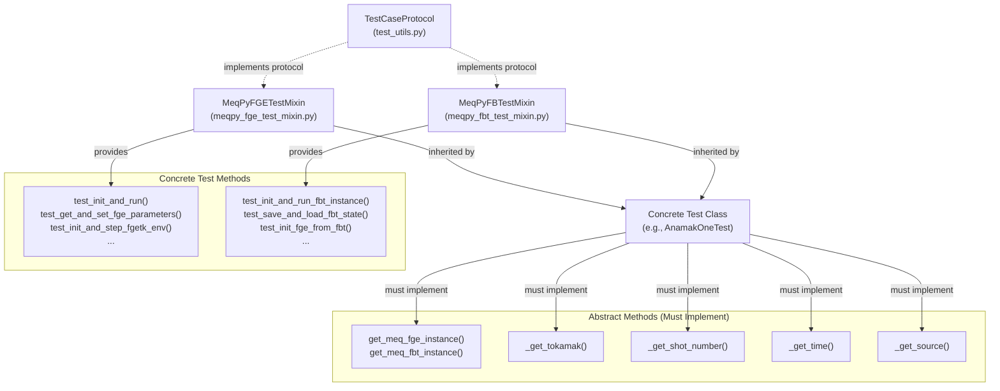
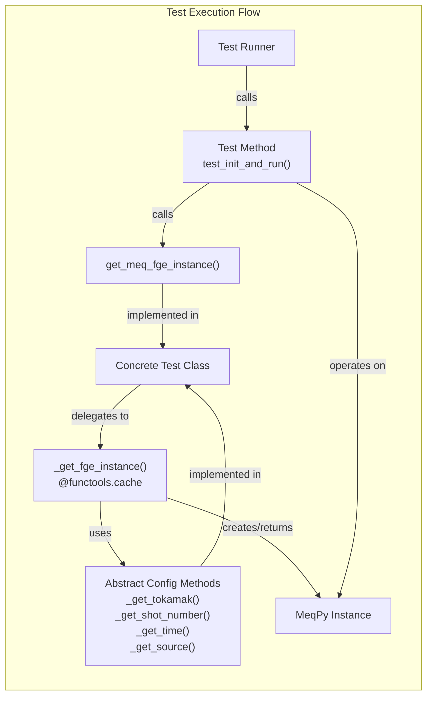
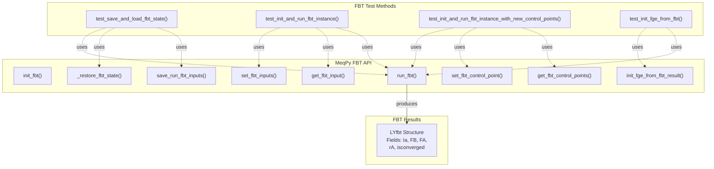
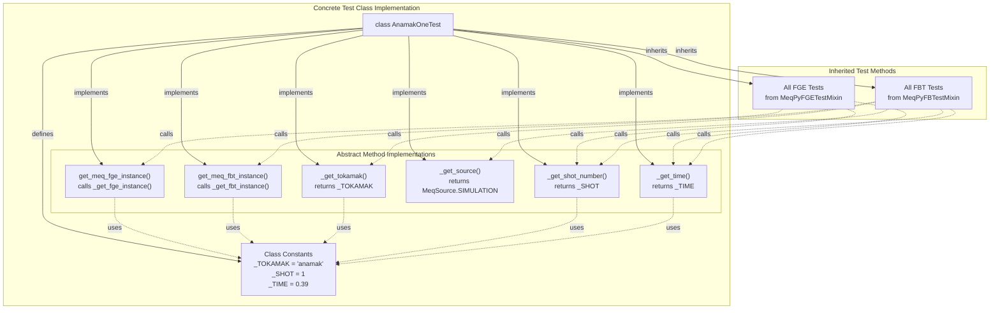

<!-- source: DeepWiki mcp.deepwiki.com · repo google-deepmind/meqpy · page 7.1 Test Mixins and Patterns · fetched 2026-10-26 -->

# Test Mixins and Patterns

<details>
<summary>Relevant source files</summary>

The following files were used as context for generating this wiki page:

- [meqpy/meqpy_fbt_test_mixin.py](meqpy/meqpy_fbt_test_mixin.py)
- [meqpy/meqpy_fge_test_mixin.py](meqpy/meqpy_fge_test_mixin.py)
- [meqpy/test_utils.py](meqpy/test_utils.py)

</details>


This document explains the testing infrastructure in MeqPy, focusing on the mixin pattern used to create reusable test logic for FGE and FBT simulations. It covers the `TestCaseProtocol`, the two primary test mixins (`MeqPyFGETestMixin` and `MeqPyFBTestMixin`), and how to implement concrete test classes.

For information about running specific test implementations, see [Example Test Implementations](#7.2).

## Testing Architecture Overview

The MeqPy testing infrastructure uses a mixin-based architecture that separates test logic from test configuration. This allows the same test suite to be executed against different tokamak configurations by implementing only a few abstract methods.

**Testing Component Hierarchy**



Sources: [meqpy/test_utils.py:1-48](), [meqpy/meqpy_fge_test_mixin.py:1-280](), [meqpy/meqpy_fbt_test_mixin.py:1-126]()

## TestCaseProtocol

The `TestCaseProtocol` class defines the interface required from a test framework. It specifies assertion methods compatible with `googletest.TestCase` without creating a hard dependency on the testing framework.

**Protocol Interface**

| Method | Purpose |
|--------|---------|
| `assertEqual(a, b)` | Assert two values are equal |
| `assertAlmostEqual(a, b, places=None)` | Assert two floating-point values are approximately equal |
| `assertRaisesRegex(exception_type, regex)` | Assert an exception is raised with matching message |
| `assertFalse(a)` | Assert a value is False |
| `assertSameElements(a, b)` | Assert two collections contain the same elements |
| `subTest(name)` | Create a named sub-test context |
| `skipTest(reason)` | Skip a test with a reason |

The protocol uses Python's `typing.Protocol` to define a structural subtype, allowing any class that implements these methods to work with the mixins. This design decouples the test logic from specific testing framework implementations.

Sources: [meqpy/test_utils.py:22-47]()

## Mixin Pattern Structure

Both test mixins follow a consistent architectural pattern:

1. **Protocol Inheritance**: Inherit from `TestCaseProtocol` to specify required assertion methods
2. **Abstract Methods**: Define abstract methods that subclasses must implement for configuration
3. **Concrete Test Methods**: Provide complete test implementations that use the abstract methods
4. **Instance Caching**: Use `@functools.cache` to cache expensive MeqPy instance initialization

**Mixin Interaction Pattern**



Sources: [meqpy/meqpy_fge_test_mixin.py:33-69](), [meqpy/meqpy_fbt_test_mixin.py:29-43]()

## MeqPyFGETestMixin

The `MeqPyFGETestMixin` class provides comprehensive test coverage for FGE (Fast Grad-Shafranov Equilibrium) functionality. It is defined in [meqpy/meqpy_fge_test_mixin.py:72-280]().

### Abstract Methods

Concrete test classes must implement these methods:

| Method | Return Type | Purpose |
|--------|-------------|---------|
| `get_meq_fge_instance()` | `MeqPy` | Returns a MeqPy instance initialized for FGE |
| `_get_time()` | `float` | Returns the simulation time |
| `_get_shot_number()` | `int` | Returns the shot number for the test |

### Cached Instance Factory

The module provides `_get_fge_instance()` at [meqpy/meqpy_fge_test_mixin.py:34-69](), a cached factory function that creates and initializes MeqPy instances:

```python
@functools.cache
def _get_fge_instance(
    tokamak: str,
    shot: int,
    time: float,
    source: meqpy_impl.MeqSource,
    cde: str | None,
) -> meqpy_impl.MeqPy:
```

**Important**: This caching behavior means state is maintained across different tests. Changes to the MeqPy state persist across tests, and tests can occur in any order. Reset internal state after changes when possible.

### Test Methods

The mixin provides the following test implementations:

| Test Method | Purpose | Lines |
|-------------|---------|-------|
| `test_init_and_run()` | Verifies basic FGE initialization and execution | [91-94]() |
| `test_get_and_set_fge_parameters()` | Tests parameter get/set operations | [96-118]() |
| `test_get_and_set_fge_geometry()` | Tests geometry configuration | [120-138]() |
| `test_setting_field_which_does_not_exist_raises_error()` | Validates error handling for invalid parameters | [140-147]() |
| `test_getting_parameter_which_does_not_exist_raises_error()` | Validates error handling for invalid parameter reads | [149-155]() |
| `test_getting_geometry_which_does_not_exist_raises_error()` | Validates error handling for invalid geometry reads | [157-163]() |
| `test_getting_input_which_does_not_exist_raises_error()` | Validates error handling for invalid input reads | [165-171]() |
| `test_init_and_step_fgetk_env()` | Tests FGETK environment initialization and stepping | [173-194]() |
| `test_init_and_step_fgetk_env_with_delay()` | Tests action delays in FGETK environment | [196-245]() |
| `test_save_and_load_simple_parameter()` | Tests basic state persistence | [247-258]() |
| `test_save_and_load_fgetk_env_state()` | Tests complete FGETK environment state save/load | [260-279]() |

**FGE Test Coverage Map**

```mermaid
graph TB
    subgraph "Initialization & Execution"
        InitRun["test_init_and_run()"]
    end
    
    subgraph "Parameter Management"
        GetSetParams["test_get_and_set_fge_parameters()"]
        GetSetGeom["test_get_and_set_fge_geometry()"]
        InvalidParam["test_setting_field_which_does_not_exist_raises_error()"]
        InvalidGet1["test_getting_parameter_which_does_not_exist_raises_error()"]
        InvalidGet2["test_getting_geometry_which_does_not_exist_raises_error()"]
        InvalidGet3["test_getting_input_which_does_not_exist_raises_error()"]
    end
    
    subgraph "FGETK Environment"
        InitStep["test_init_and_step_fgetk_env()"]
        InitStepDelay["test_init_and_step_fgetk_env_with_delay()"]
    end
    
    subgraph "State Persistence"
        SaveLoadSimple["test_save_and_load_simple_parameter()"]
        SaveLoadEnv["test_save_and_load_fgetk_env_state()"]
    end
    
    MeqPyAPI["MeqPy API Methods<br/>init_fge()<br/>set_fge_parameters()<br/>get_fge_parameter()<br/>get_fge_geometry()<br/>get_fge_input()<br/>init_fgetk_environment()<br/>step_fgetk_environment()<br/>save_to_file()<br/>load_from_file()<br/>save_last_fgetk_env_call_state()"]
    
    InitRun -.->|"tests"| MeqPyAPI
    GetSetParams -.->|"tests"| MeqPyAPI
    GetSetGeom -.->|"tests"| MeqPyAPI
    InvalidParam -.->|"tests"| MeqPyAPI
    InvalidGet1 -.->|"tests"| MeqPyAPI
    InvalidGet2 -.->|"tests"| MeqPyAPI
    InvalidGet3 -.->|"tests"| MeqPyAPI
    InitStep -.->|"tests"| MeqPyAPI
    InitStepDelay -.->|"tests"| MeqPyAPI
    SaveLoadSimple -.->|"tests"| MeqPyAPI
    SaveLoadEnv -.->|"tests"| MeqPyAPI
```



Sources: [meqpy/meqpy_fge_test_mixin.py:72-280]()

### Key Test Patterns

**Parameter Testing Pattern** ([meqpy/meqpy_fge_test_mixin.py:96-118]()):
1. Read original parameter value
2. Set new parameter value
3. Verify parameter was updated
4. Reset to original value (for cross-test stability)

**FGETK Environment Testing** ([meqpy/meqpy_fge_test_mixin.py:173-194]()):
- Uses constants `_CONTROL_TIMESTEP = 0.0001` and `_SIMULATOR_TIMESTEP = 0.00002`
- Tests stepping through multiple control cycles
- Verifies time progression matches control timesteps
- Tests parameter variations during stepping

**Delay Testing** ([meqpy/meqpy_fge_test_mixin.py:196-245]()):
- Creates variable delay configurations per action
- Steps environment multiple times with different actions
- Validates that delays are correctly applied by checking action propagation timing

Sources: [meqpy/meqpy_fge_test_mixin.py:26-27](), [meqpy/meqpy_fge_test_mixin.py:96-245]()

## MeqPyFBTestMixin

The `MeqPyFBTestMixin` class provides test coverage for FBT (Fast Boundary Tracing) functionality. It is defined in [meqpy/meqpy_fbt_test_mixin.py:46-126]().

### Abstract Methods

Concrete test classes must implement these methods:

| Method | Return Type | Purpose |
|--------|-------------|---------|
| `get_meq_fbt_instance()` | `MeqPy` | Returns a MeqPy instance initialized for FBT |
| `_get_tokamak()` | `str` | Returns the tokamak name |
| `_get_shot_number()` | `int` | Returns the shot number |
| `_get_time()` | `float` | Returns the simulation time |
| `_get_source()` | `MeqSource` | Returns the data source configuration |

### Cached Instance Factory

The module provides `_get_fbt_instance()` at [meqpy/meqpy_fbt_test_mixin.py:30-43](), similar to the FGE version:

```python
@functools.cache
def _get_fbt_instance(
    tokamak: str,
    shot: int,
    time: float,
    source: meqpy_impl.MeqSource,
    cde: str | None,
) -> meqpy_impl.MeqPy:
```

This factory initializes FBT with `debug=2` for debugging assistance.

### Test Methods

| Test Method | Purpose | Lines |
|-------------|---------|-------|
| `test_save_and_load_fbt_state()` | Tests FBT state persistence and restoration | [74-87]() |
| `test_init_and_run_fbt_instance()` | Tests basic FBT execution and input modification | [89-99]() |
| `test_init_and_run_fbt_instance_with_new_control_points()` | Tests FBT with modified control points | [101-114]() |
| `test_init_fge_from_fbt()` | Tests FBT-to-FGE initialization workflow | [116-125]() |

**FBT Test Coverage and Integration**



Sources: [meqpy/meqpy_fbt_test_mixin.py:46-126]()

### Key Test Patterns

**Input Modification Pattern** ([meqpy/meqpy_fbt_test_mixin.py:89-99]()):
1. Run FBT to get baseline results
2. Get current input value (`gpr` - plasma pressure)
3. Modify input slightly
4. Run FBT again
5. Verify result changed as expected (e.g., `rA` increased)

**Control Point Modification Pattern** ([meqpy/meqpy_fbt_test_mixin.py:101-114]()):
1. Run FBT to get baseline results
2. Get control points structure with `get_fbt_control_points()`
3. Modify control point positions (e.g., shift `r` values)
4. Set new control points with `set_fbt_control_point()`
5. Run FBT again
6. Verify plasma boundary moved as expected

**FBT-to-FGE Integration Pattern** ([meqpy/meqpy_fbt_test_mixin.py:116-125]()):
1. Initialize and run FBT
2. Call `init_fge_from_fbt_result()` with configuration parameters
3. Run FGE solver (`_run_fget()`)
4. This pattern enables two-stage equilibrium reconstruction

Sources: [meqpy/meqpy_fbt_test_mixin.py:89-125]()

## Creating Concrete Test Classes

To create a concrete test class, inherit from one or both mixins and implement the required abstract methods. The typical pattern is:

**Implementation Steps**

1. **Import Required Modules**
   ```python
   from meqpy import meqpy_impl
   from meqpy import meqpy_fge_test_mixin
   from meqpy import meqpy_fbt_test_mixin
   ```

2. **Define Class Inheriting from Mixins and TestCase**
   ```python
   class MyTest(
       meqpy_fge_test_mixin.MeqPyFGETestMixin,
       meqpy_fbt_test_mixin.MeqPyFBTestMixin,
       googletest.TestCase
   ):
   ```

3. **Implement Configuration Methods**
   - Define class constants for tokamak, shot, time, source
   - Implement abstract methods to return these values

4. **Implement Instance Getter Methods**
   - Call cached factory functions with configuration values
   - Return the cached MeqPy instance

**Concrete Test Class Structure**



Sources: [meqpy/meqpy_fge_test_mixin.py:72-280](), [meqpy/meqpy_fbt_test_mixin.py:46-126]()

## Important Considerations

### Instance Caching and Shared State

Both `_get_fge_instance()` and `_get_fbt_instance()` use `@functools.cache` [meqpy/meqpy_fge_test_mixin.py:33](), [meqpy/meqpy_fbt_test_mixin.py:29]() to cache expensive initialization operations. This has important implications:

| Consideration | Impact |
|---------------|--------|
| **State Persistence** | Changes to MeqPy instance state persist across tests |
| **Test Order Independence** | Tests can execute in any order but share the same instance |
| **Performance** | Avoids repeated expensive initialization (Octave session setup, structure initialization) |
| **Reset Requirements** | Tests should reset modified state to original values when possible |

The docstring at [meqpy/meqpy_fge_test_mixin.py:41-50]() explicitly warns about this behavior:

> "NOTE: the caching behavior of this means that state is maintained across different tests, changes to the meq state will be maintained across tests and these tests can occur in any order. Where possible reset the internal state after any changes occur."

### Debug Mode Configuration

Both cached factories set `debug=2` during initialization:
- FGE: [meqpy/meqpy_fge_test_mixin.py:64]()
- FBT: [meqpy/meqpy_fbt_test_mixin.py:40]()

This provides enhanced debugging output during test execution, helping diagnose failures.

### Performance Optimization for FGE

The FGE instance factory sets additional performance parameters at [meqpy/meqpy_fge_test_mixin.py:67-68]():
- `anajac: True` - Use analytical Jacobian
- `usepreconditioner: True` - Enable preconditioning

These settings optimize the FGETK environment execution speed during testing.

### Protected Access in Tests

The mixins use protected methods (prefixed with `_`) from the `MeqPy` class, such as:
- `_run_fget()` [meqpy/meqpy_fge_test_mixin.py:94]()
- `_restore_fbt_state()` [meqpy/meqpy_fbt_test_mixin.py:82]()

The linter warning `protected-access` is explicitly disabled at [meqpy/meqpy_fge_test_mixin.py:30]() and [meqpy/meqpy_fbt_test_mixin.py:26]() since test code often needs to test internal implementation details.

### Temporary File Handling

Tests that verify state persistence use `tempfile.TemporaryDirectory()` for safe file operations:
- [meqpy/meqpy_fge_test_mixin.py:251-258]()
- [meqpy/meqpy_fge_test_mixin.py:269-279]()
- [meqpy/meqpy_fbt_test_mixin.py:76-87]()

This ensures test files are automatically cleaned up regardless of test success or failure.

Sources: [meqpy/meqpy_fge_test_mixin.py:26-70](), [meqpy/meqpy_fbt_test_mixin.py:26-43]()

## Summary

The MeqPy testing infrastructure provides:

1. **Protocol-Based Design**: `TestCaseProtocol` decouples test logic from specific testing frameworks
2. **Reusable Test Logic**: Mixins implement comprehensive test suites that can be applied to different configurations
3. **Minimal Implementation Requirements**: Concrete classes only need to implement configuration methods
4. **Performance Optimization**: Instance caching reduces test execution time
5. **Comprehensive Coverage**: Tests cover initialization, parameter management, execution, state persistence, and integration workflows

This architecture enables efficient testing across multiple tokamak configurations while maintaining a single implementation of complex test scenarios.

Sources: [meqpy/test_utils.py:1-48](), [meqpy/meqpy_fge_test_mixin.py:1-280](), [meqpy/meqpy_fbt_test_mixin.py:1-126]()

---

