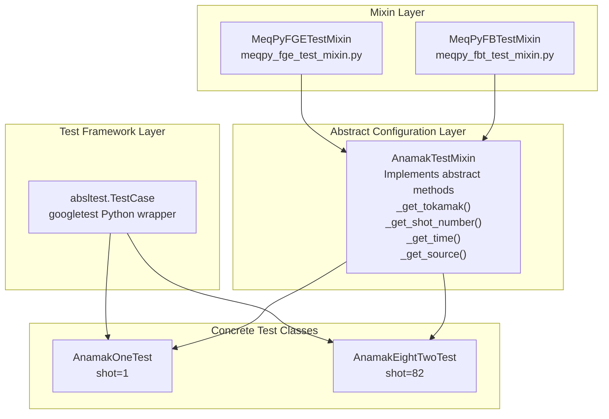
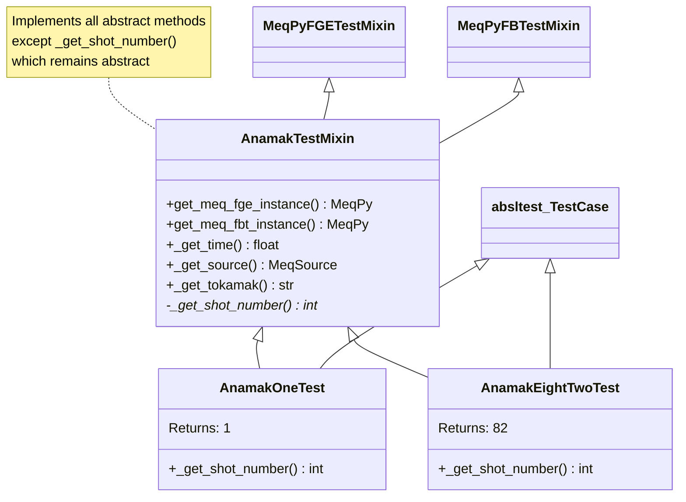
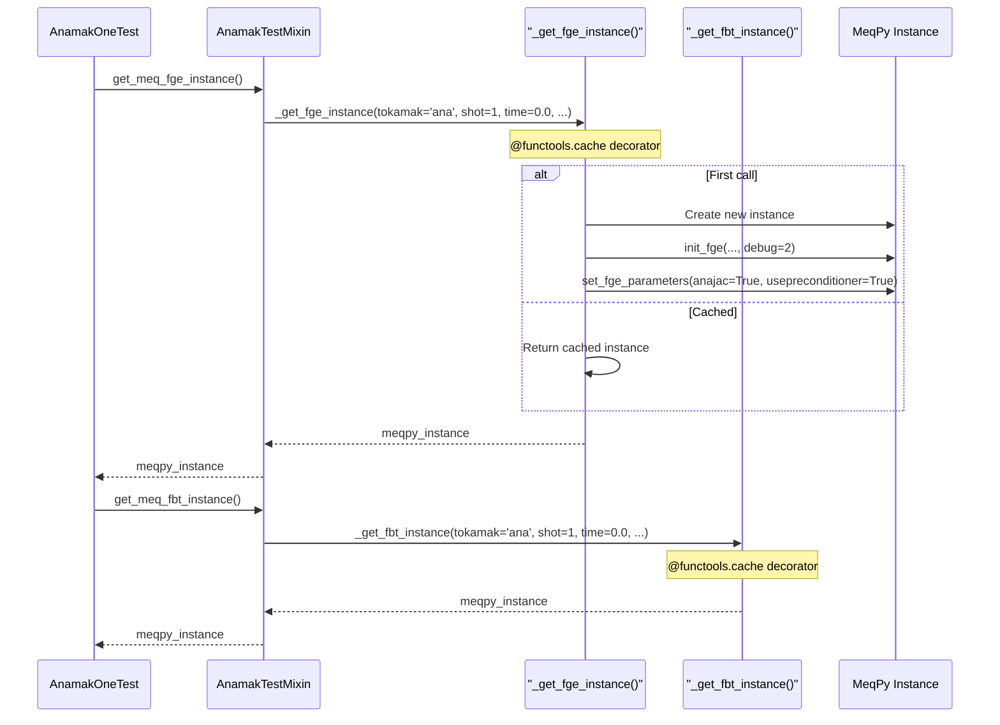
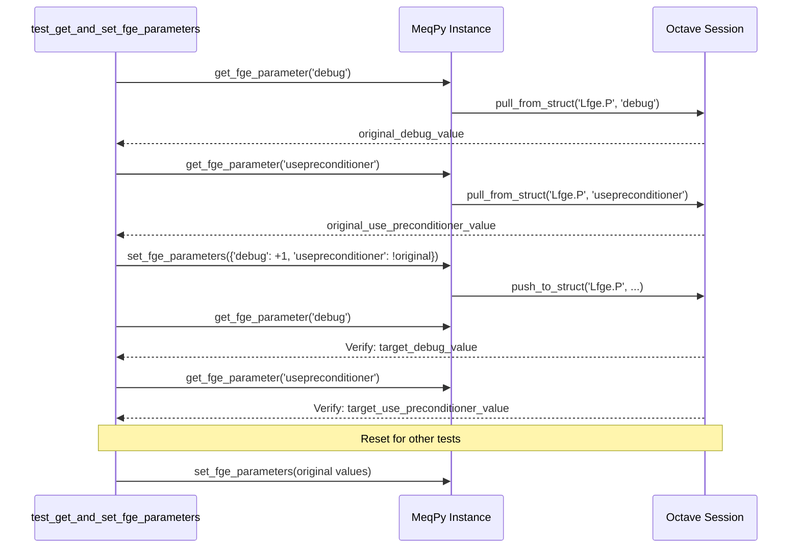
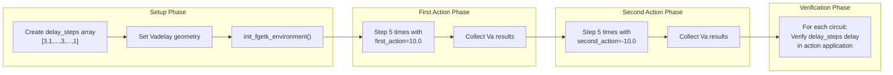
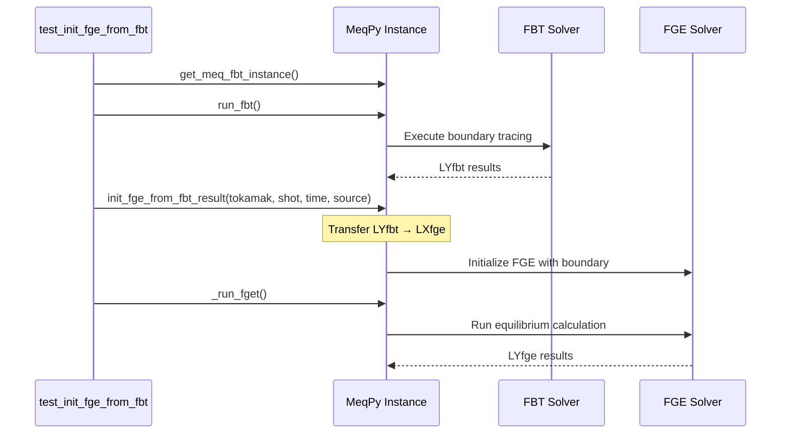

<!-- source: DeepWiki mcp.deepwiki.com · repo google-deepmind/meqpy · page 7.2 Example Test Implementations · fetched 2026-10-26 -->

# Example Test Implementations

<details>
<summary>Relevant source files</summary>

The following files were used as context for generating this wiki page:

- [meqpy/meqpy_fbt_test_mixin.py](meqpy/meqpy_fbt_test_mixin.py)
- [meqpy/meqpy_fge_test_mixin.py](meqpy/meqpy_fge_test_mixin.py)
- [tests/meqpy_anamak_test.py](tests/meqpy_anamak_test.py)

</details>


This document provides concrete examples of test implementations using the MeqPy testing infrastructure. It demonstrates how to create test classes by combining the FGE and FBT test mixins, implement required abstract methods, and structure tests for different tokamak configurations.

For information about the abstract test mixin patterns and protocols, see [Test Mixins and Patterns](#7.1). For details on running and organizing tests, see [Testing Infrastructure](#7).

---

## Overview of Test Structure

MeqPy tests follow a mixin-based pattern where concrete test classes inherit from one or both test mixins (`MeqPyFGETestMixin` and `MeqPyFBTestMixin`) along with a test framework class (typically `absltest.TestCase`). Concrete test implementations must provide configuration methods that specify the tokamak, shot number, time, and data source.



**Diagram: Test Class Inheritance Hierarchy**

Sources: [tests/meqpy_anamak_test.py:1-59](), [meqpy/meqpy_fge_test_mixin.py:72-89](), [meqpy/meqpy_fbt_test_mixin.py:46-72]()

---

## Required Abstract Methods

Concrete test implementations must implement specific abstract methods that provide configuration parameters. The following table shows the methods required by each mixin:

| Mixin | Method | Return Type | Purpose |
|-------|--------|-------------|---------|
| `MeqPyFGETestMixin` | `get_meq_fge_instance()` | `meqpy_impl.MeqPy` | Returns configured MeqPy instance for FGE tests |
| `MeqPyFGETestMixin` | `_get_time()` | `float` | Specifies simulation time |
| `MeqPyFGETestMixin` | `_get_shot_number()` | `int` | Specifies tokamak shot number |
| `MeqPyFBTestMixin` | `get_meq_fbt_instance()` | `meqpy_impl.MeqPy` | Returns configured MeqPy instance for FBT tests |
| `MeqPyFBTestMixin` | `_get_tokamak()` | `str` | Specifies tokamak identifier |
| `MeqPyFBTestMixin` | `_get_shot_number()` | `int` | Specifies tokamak shot number |
| `MeqPyFBTestMixin` | `_get_time()` | `float` | Specifies simulation time |
| `MeqPyFBTestMixin` | `_get_source()` | `meqpy_impl.MeqSource` | Specifies data source (e.g., `MEQ_DIRECT`) |

Sources: [meqpy/meqpy_fge_test_mixin.py:75-89](), [meqpy/meqpy_fbt_test_mixin.py:49-72]()

---

## Anamak Test Implementation

The Anamak test suite provides a complete example of combining both FGE and FBT testing. The implementation uses a three-layer hierarchy: a common mixin defining shared configuration, and concrete test classes specifying individual shot numbers.

### AnamakTestMixin Structure



**Diagram: Anamak Test Class Structure**

The `AnamakTestMixin` implements most abstract methods with Anamak-specific values:

- **`_get_tokamak()`**: Returns `'ana'` for the Anamak tokamak [tests/meqpy_anamak_test.py:42-43]()
- **`_get_time()`**: Returns `0.0` as the simulation time [tests/meqpy_anamak_test.py:36-37]()
- **`_get_source()`**: Returns `meqpy_impl.MeqSource.MEQ_DIRECT` [tests/meqpy_anamak_test.py:39-40]()
- **`_get_shot_number()`**: Left abstract for concrete classes to specify [tests/meqpy_anamak_test.py:21-44]()

Sources: [tests/meqpy_anamak_test.py:21-44]()

### Instance Creation Pattern

The `AnamakTestMixin` delegates instance creation to cached factory functions:



**Diagram: Instance Creation and Caching Flow**

The `get_meq_fge_instance()` method calls `_get_fge_instance()` with configuration parameters [tests/meqpy_anamak_test.py:24-28](). Similarly, `get_meq_fbt_instance()` calls `_get_fbt_instance()` [tests/meqpy_anamak_test.py:30-34](). These factory functions use `@functools.cache` to ensure instances are created only once per unique configuration [meqpy/meqpy_fge_test_mixin.py:33-69](), [meqpy/meqpy_fbt_test_mixin.py:29-43]().

**Important**: Instance caching means state persists across tests. Tests should reset any modified state to avoid cross-test contamination [meqpy/meqpy_fge_test_mixin.py:47-50]().

Sources: [tests/meqpy_anamak_test.py:24-34](), [meqpy/meqpy_fge_test_mixin.py:33-69](), [meqpy/meqpy_fbt_test_mixin.py:29-43]()

### Concrete Test Classes

Concrete test classes specify only the shot number:

**AnamakOneTest** [tests/meqpy_anamak_test.py:46-49]():
```python
class AnamakOneTest(absltest.TestCase, AnamakTestMixin):
  def _get_shot_number(self) -> int:
    return 1
```

**AnamakEightTwoTest** [tests/meqpy_anamak_test.py:52-55]():
```python
class AnamakEightTwoTest(absltest.TestCase, AnamakTestMixin):
  def _get_shot_number(self) -> int:
    return 82
```

Both classes inherit from `absltest.TestCase` (providing test framework functionality) and `AnamakTestMixin` (providing test logic). This pattern allows running the same test suite against different shots.

Sources: [tests/meqpy_anamak_test.py:46-55]()

---

## Available Test Methods

Test classes automatically inherit test methods from the mixins. The following sections detail the available tests.

### FGE Test Methods

| Test Method | Purpose | Key Operations |
|-------------|---------|----------------|
| `test_init_and_run` | Verifies FGE initialization and execution | Calls `_run_fget()` |
| `test_get_and_set_fge_parameters` | Tests parameter get/set operations | Modifies `debug` and `usepreconditioner` |
| `test_get_and_set_fge_geometry` | Tests geometry get/set operations | Modifies `Vamax` and `Iamax` |
| `test_setting_field_which_does_not_exist_raises_error` | Validates error handling for invalid parameters | Expects `ValueError` |
| `test_getting_parameter_which_does_not_exist_raises_error` | Validates error handling for invalid parameter reads | Expects `Oct2PyError` |
| `test_getting_geometry_which_does_not_exist_raises_error` | Validates error handling for invalid geometry reads | Expects `Oct2PyError` |
| `test_getting_input_which_does_not_exist_raises_error` | Validates error handling for invalid input reads | Expects `Oct2PyError` |
| `test_init_and_step_fgetk_env` | Tests time-dependent simulation stepping | Initializes and steps through 3 control cycles |
| `test_init_and_step_fgetk_env_with_delay` | Tests action delay mechanisms | Verifies delayed action application |
| `test_save_and_load_simple_parameter` | Tests basic persistence | Saves/loads `LXfge` structure |
| `test_save_and_load_fgetk_env_state` | Tests time-stepping state persistence | Saves/restores full environment state |

Sources: [meqpy/meqpy_fge_test_mixin.py:91-280]()

#### Parameter Modification Test Example

The `test_get_and_set_fge_parameters` test demonstrates parameter modification and restoration:



**Diagram: Parameter Get/Set Test Flow**

This test modifies parameters, verifies the changes, and restores original values [meqpy/meqpy_fge_test_mixin.py:96-118]().

Sources: [meqpy/meqpy_fge_test_mixin.py:96-118]()

#### Time-Dependent Simulation Test

The `test_init_and_step_fgetk_env` test verifies the FGETK environment:

1. Initializes environment with control timestep `0.0001` and simulator timestep `0.00002` [meqpy/meqpy_fge_test_mixin.py:26-27]()
2. Creates actions array matching the number of circuit names [meqpy/meqpy_fge_test_mixin.py:182-183]()
3. Steps through 3 control cycles [meqpy/meqpy_fge_test_mixin.py:185-191]()
4. Verifies time progression: `t = initial_time + i * control_timestep` [meqpy/meqpy_fge_test_mixin.py:191]()
5. Tests parameter variation through `step_fgetk_environment` [meqpy/meqpy_fge_test_mixin.py:193-194]()

Sources: [meqpy/meqpy_fge_test_mixin.py:173-194]()

#### Action Delay Test

The `test_init_and_step_fgetk_env_with_delay` test validates action delay mechanisms:



**Diagram: Action Delay Test Flow**

The test sets uneven delay values [meqpy/meqpy_fge_test_mixin.py:200-211](), applies two sets of actions [meqpy/meqpy_fge_test_mixin.py:218-231](), and verifies that actions appear in the output after the specified delay [meqpy/meqpy_fge_test_mixin.py:233-245]().

Sources: [meqpy/meqpy_fge_test_mixin.py:196-245]()

### FBT Test Methods

| Test Method | Purpose | Key Operations |
|-------------|---------|----------------|
| `test_save_and_load_fbt_state` | Tests FBT state persistence | Saves with `save_run_fbt_inputs()`, restores with `_restore_fbt_state()` |
| `test_init_and_run_fbt_instance` | Tests FBT execution and input modification | Modifies `gpr` input, verifies `rA` change |
| `test_init_and_run_fbt_instance_with_new_control_points` | Tests control point modification | Shifts control points, verifies boundary movement |
| `test_init_fge_from_fbt` | Tests FBT-to-FGE integration | Runs FBT, initializes FGE with results |

Sources: [meqpy/meqpy_fbt_test_mixin.py:74-126]()

#### FBT Input Modification Test

The `test_init_and_run_fbt_instance` test demonstrates:

1. Run FBT to get baseline `LY` results [meqpy/meqpy_fbt_test_mixin.py:91]()
2. Get current `gpr` input value [meqpy/meqpy_fbt_test_mixin.py:93]()
3. Increase `gpr` by 0.01 [meqpy/meqpy_fbt_test_mixin.py:94]()
4. Set new `gpr` value [meqpy/meqpy_fbt_test_mixin.py:96]()
5. Run FBT again [meqpy/meqpy_fbt_test_mixin.py:97]()
6. Verify `rA` (major radius) increased [meqpy/meqpy_fbt_test_mixin.py:99]()

This tests that FBT responds correctly to input changes and produces physically reasonable results (increasing pressure moves plasma outward).

Sources: [meqpy/meqpy_fbt_test_mixin.py:89-99]()

#### FBT to FGE Integration Test

The `test_init_fge_from_fbt` test validates the two-stage workflow:



**Diagram: FBT to FGE Integration Test Flow**

This test runs FBT first [meqpy/meqpy_fbt_test_mixin.py:118](), then initializes FGE using the FBT result as input boundary [meqpy/meqpy_fbt_test_mixin.py:119-124](), and finally runs the FGE solver [meqpy/meqpy_fbt_test_mixin.py:125](). This validates the complete two-stage equilibrium reconstruction workflow documented in [FBT to FGE Integration](#3.3).

Sources: [meqpy/meqpy_fbt_test_mixin.py:116-126]()

---

## Creating New Test Implementations

To create a new test implementation for a different tokamak or configuration:

### Step 1: Create Configuration Mixin

Define a mixin class that implements shared configuration:

```python
class MyTokamakTestMixin(meqpy_fge_test_mixin.MeqPyFGETestMixin,
                          meqpy_fbt_test_mixin.MeqPyFBTestMixin):
  
  def get_meq_fge_instance(self) -> meqpy_impl.MeqPy:
    return meqpy_fge_test_mixin._get_fge_instance(
        tokamak=self._get_tokamak(),
        shot=self._get_shot_number(),
        time=self._get_time(),
        source=self._get_source(),
        cde=None)
  
  def get_meq_fbt_instance(self) -> meqpy_impl.MeqPy:
    return meqpy_fbt_test_mixin._get_fbt_instance(
        tokamak=self._get_tokamak(),
        shot=self._get_shot_number(),
        time=self._get_time(),
        source=self._get_source(),
        cde=None)
  
  def _get_tokamak(self) -> str:
    return 'my_tokamak'
  
  def _get_time(self) -> float:
    return 0.5
  
  def _get_source(self) -> meqpy_impl.MeqSource:
    return meqpy_impl.MeqSource.MEQ_DIRECT
```

### Step 2: Create Concrete Test Classes

Define concrete test classes for specific shots:

```python
class MyTokamakShot100Test(absltest.TestCase, MyTokamakTestMixin):
  def _get_shot_number(self) -> int:
    return 100

class MyTokamakShot200Test(absltest.TestCase, MyTokamakTestMixin):
  def _get_shot_number(self) -> int:
    return 200
```

### Step 3: Optional Custom Test Methods

Add tokamak-specific test methods to the mixin:

```python
class MyTokamakTestMixin(...):
  # ... abstract method implementations ...
  
  def test_custom_tokamak_feature(self):
    meq_instance = self.get_meq_fge_instance()
    # Custom test logic
```

Sources: [tests/meqpy_anamak_test.py:21-55]()

---

## Test Execution

Tests can be run using the standard Python test runner:

```bash
# Run all tests in a file
python -m pytest tests/meqpy_anamak_test.py

# Run specific test class
python -m pytest tests/meqpy_anamak_test.py::AnamakOneTest

# Run specific test method
python -m pytest tests/meqpy_anamak_test.py::AnamakOneTest::test_init_and_run
```

Or using absltest directly:

```bash
python tests/meqpy_anamak_test.py
```

The test main entry point is defined at [tests/meqpy_anamak_test.py:57-58]().

Sources: [tests/meqpy_anamak_test.py:57-58]()

---

## Test Instance Caching Considerations

The cached instance pattern has important implications:

| Aspect | Behavior | Implications |
|--------|----------|--------------|
| **Creation** | Instances created once per unique parameter set | Tests run faster after first execution |
| **State Persistence** | Modified state persists across tests | Tests must restore modified values |
| **Test Order** | Tests can run in any order | Tests must not depend on execution order |
| **Isolation** | No isolation between tests using same instance | Careful state management required |

The FGE test mixin explicitly resets modified parameters [meqpy/meqpy_fge_test_mixin.py:114-118]() to maintain test independence. This pattern should be followed in all tests that modify instance state.

Sources: [meqpy/meqpy_fge_test_mixin.py:33-69](), [meqpy/meqpy_fge_test_mixin.py:114-118](), [meqpy/meqpy_fbt_test_mixin.py:29-43]()

---

