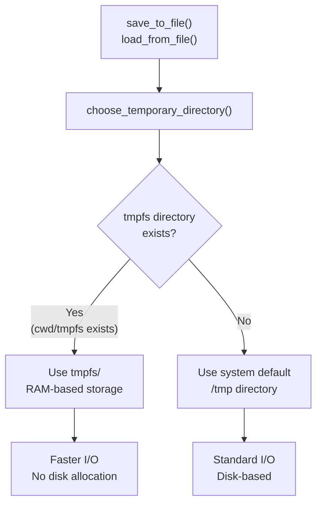
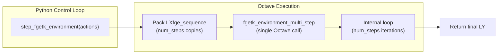
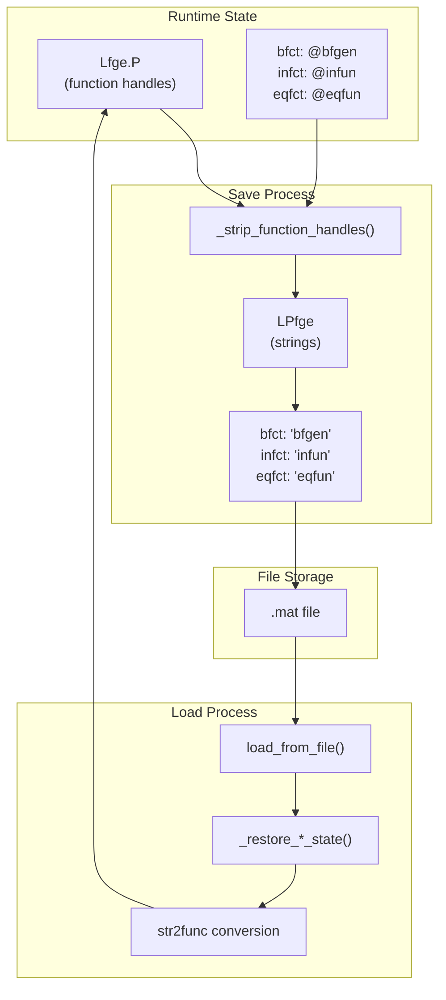
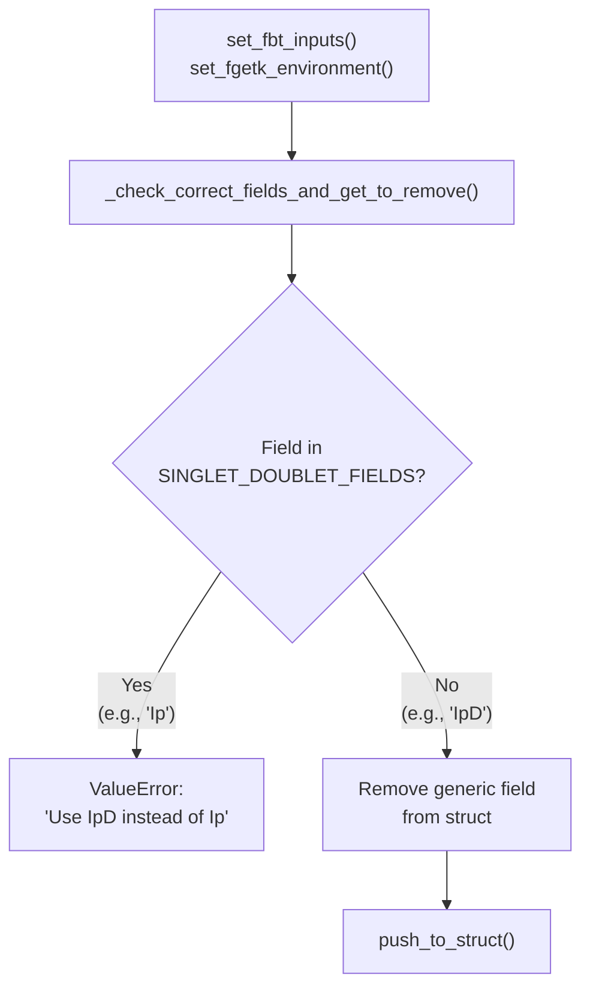
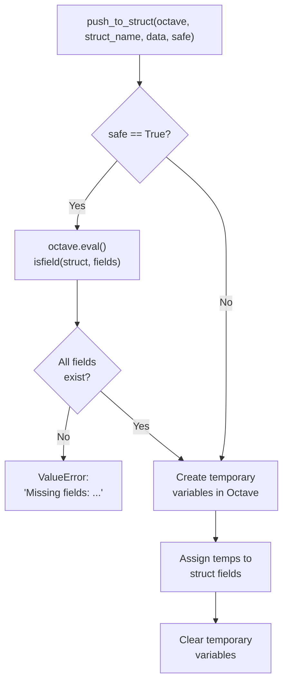
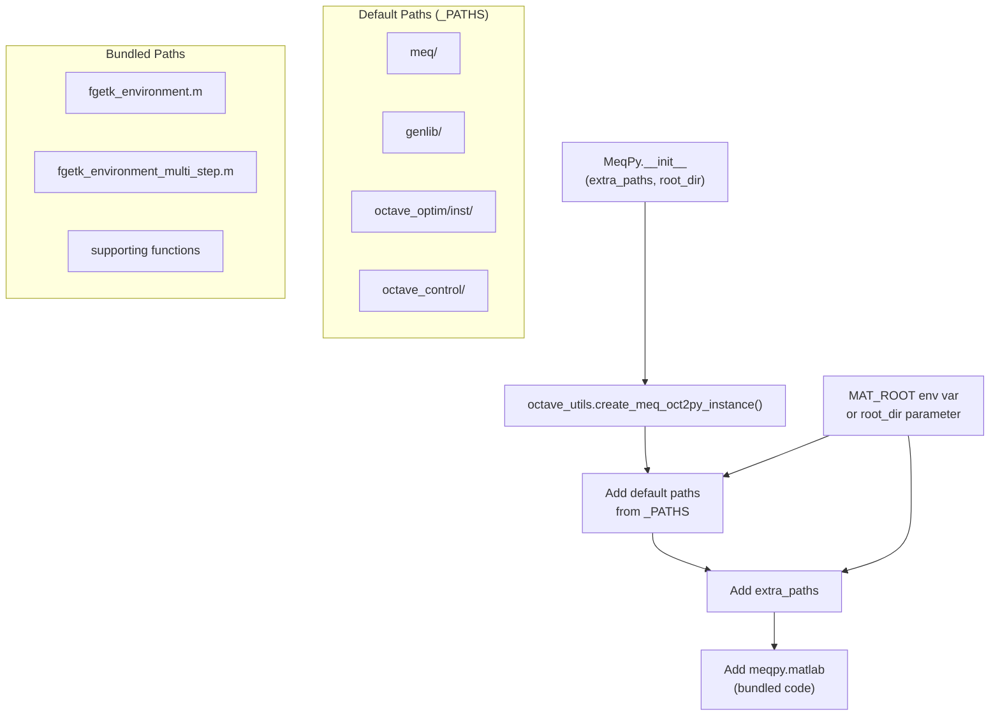
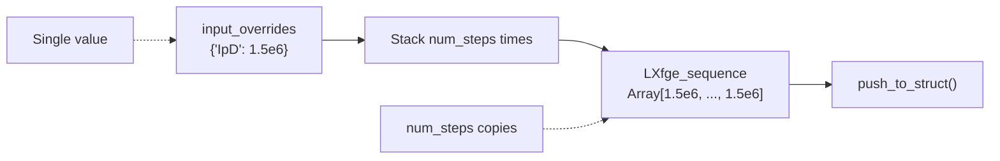
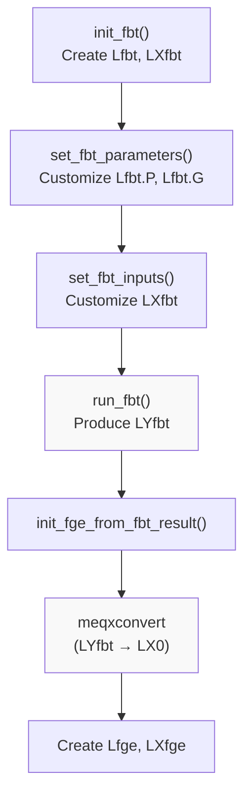

<!-- source: DeepWiki mcp.deepwiki.com · repo google-deepmind/meqpy · page 8 Advanced Topics · fetched 2026-10-26 -->

# Advanced Topics

<details>
<summary>Relevant source files</summary>

The following files were used as context for generating this wiki page:

- [README.md](README.md)
- [meqpy/meqpy_impl.py](meqpy/meqpy_impl.py)
- [meqpy/octave_utils.py](meqpy/octave_utils.py)

</details>


## Purpose and Scope

This page covers advanced usage patterns, performance optimization strategies, and troubleshooting techniques for MeqPy. It is intended for users who are already familiar with basic MeqPy operations and need to optimize performance, handle edge cases, or debug complex simulation scenarios.

For basic configuration of FGE/FBT parameters and geometry, see [Parameter and Geometry Configuration](#8.1). For specific error handling and debugging strategies, see [Error Handling and Debugging](#8.2). For basic state persistence concepts, see [State Persistence and Recovery](#5).

---

## Performance Optimization

### Temporary Directory Selection

MeqPy performs file I/O operations when saving and loading state. The choice of temporary directory significantly impacts performance, especially for frequent save/load operations.

**tmpfs Strategy**: MeqPy automatically prefers tmpfs (RAM-based filesystem) when available, avoiding disk I/O overhead. The `choose_temporary_directory` function implements this selection logic.



**Implementation**: The system checks for a `tmpfs` directory in the current working directory. If present, all temporary file operations use this location.

[meqpy/meqpy_impl.py:770-784]()

**Setup**: To enable tmpfs optimization:
```bash
mkdir tmpfs
# Mount as RAM disk (Linux)
sudo mount -t tmpfs -o size=512M tmpfs tmpfs/
```

Sources: [meqpy/meqpy_impl.py:770-784]()

---

### Struct Operation Batching

When updating multiple parameters, **batch updates** to minimize consolidation overhead. Each call to `set_fge_parameters` or `set_fbt_parameters` triggers a consolidation operation (`fgec` or `fbtc`), which recalculates derived quantities.

**Anti-pattern** (inefficient):
```python
meq.set_fge_parameters(parameters={'debug': 2})
meq.set_fge_parameters(parameters={'nkn': 10})
meq.set_fge_parameters(parameters={'nh': 4})
# Three consolidation operations
```

**Recommended pattern**:
```python
meq.set_fge_parameters(parameters={
    'debug': 2,
    'nkn': 10,
    'nh': 4
})
# Single consolidation operation
```

The `push_to_struct` function groups all data transfers into a single Octave command sequence, minimizing Python-Octave communication overhead.

[meqpy/octave_utils.py:68-133]()

Sources: [meqpy/octave_utils.py:68-133](), [meqpy/meqpy_impl.py:375-396]()

---

### Multi-Step Environment Optimization

For time-dependent simulations, the `step_fgetk_environment` method optimizes execution by pre-packing input sequences. When `control_timestep` > `simulator_timestep`, multiple simulation steps execute in a single Octave call.



**Configuration**:
- `control_timestep / simulator_timestep` must be an integer
- Larger ratios reduce Python-Octave communication overhead
- Trade-off: Coarser control updates vs. fewer cross-language calls

[meqpy/meqpy_impl.py:474-511](), [meqpy/meqpy_impl.py:513-545]()

Sources: [meqpy/meqpy_impl.py:474-511](), [meqpy/meqpy_impl.py:513-545]()

---

## Function Handle Serialization

MATLAB/Octave function handles cannot be directly serialized to `.mat` files. MeqPy implements automatic conversion between function handles and strings during save/load operations.

### Function Handle Lifecycle



### Special Case: Doublet Basis Functions

The `bfp` parameter contains nested function handles when using doublet basis functions (`bfgenD`, `bfdoublet`). The restoration logic handles this multi-level structure.

[meqpy/meqpy_impl.py:593-608]()

**Affected Parameters**:
- `bfct`: Basis function type
- `infct`: Initialization function
- `eqfct`: Equation function
- `bfp`: Basis function parameters (cell array with nested handles)

[meqpy/meqpy_impl.py:661-670]()

Sources: [meqpy/meqpy_impl.py:593-608](), [meqpy/meqpy_impl.py:636-659](), [meqpy/meqpy_impl.py:661-670]()

---

## Singlet vs. Doublet Field Handling

MEQ supports both singlet (single null) and doublet (double null) plasma configurations. Certain parameters have both generic and domain-specific variants.

### Field Naming Convention

| Generic Field | Domain-Specific Field | Usage |
|---------------|----------------------|-------|
| `Ip` | `IpD` | Always use `IpD` |
| `bp` | `bpD` | Always use `bpD` |
| `bt` | `btD` | Always use `btD` |
| `Wk` | `WkD` | Always use `WkD` |
| `li` | `liD` | Always use `liD` |

**Validation**: MeqPy enforces domain-specific field usage to ensure consistent behavior across singlet and doublet configurations. Attempting to set generic fields raises a `ValueError`.

[meqpy/meqpy_impl.py:64-66](), [meqpy/meqpy_impl.py:755-767]()



**Automatic Cleanup**: When setting `IpD`, the generic `Ip` field is automatically removed using `maybe_remove_from_struct` to prevent conflicts.

[meqpy/meqpy_impl.py:412-417]()

Sources: [meqpy/meqpy_impl.py:64-66](), [meqpy/meqpy_impl.py:412-417](), [meqpy/meqpy_impl.py:755-767]()

---

## Advanced Struct Manipulation

The `octave_utils` module provides low-level struct operations for advanced scenarios.

### Safe vs. Unsafe Push Operations

The `push_to_struct` function offers two modes:

**Safe Mode** (`safe=True`, default):
- Validates all field names exist before assignment
- Prevents typos and silent failures
- Recommended for most use cases

[meqpy/octave_utils.py:106-129]()

**Unsafe Mode** (`safe=False`):
- Skips field existence validation
- Allows creating new struct fields dynamically
- Used internally after field removal operations

[meqpy/octave_utils.py:130-132]()



### Conditional Field Removal

Use `maybe_remove_from_struct` to safely remove fields that may or may not exist:

[meqpy/octave_utils.py:155-177]()

This prevents errors when removing optional fields or cleaning up after domain-specific field updates.

Sources: [meqpy/octave_utils.py:68-133](), [meqpy/octave_utils.py:155-177]()

---

## Direct Octave Access

For advanced debugging or operations not exposed through the MeqPy API, use `octave_eval` to execute arbitrary Octave commands.

### Usage Pattern

```python
# Query Octave workspace
var_exists = meq.octave_eval("exist('LYfge', 'var');", nout=1)

# Execute multi-line commands
result = meq.octave_eval("""
    if LYfge.isconverged
        result = LYfge.Ip;
    else
        result = NaN;
    end
""", nout=1)

# Disable logging for frequent operations
value = meq.octave_eval("Lfge.P.debug;", log=False, nout=1)
```

[meqpy/meqpy_impl.py:111-133]()

**Parameters**:
- `cmd`: Octave command string (may contain newlines)
- `log`: Whether to log the command (default `True`)
- `nout`: Number of outputs to capture (default 0 = all)
- `**kwargs`: Additional arguments passed to `oct2py.eval`

**Warning**: Direct Octave manipulation bypasses MeqPy's internal state tracking. Use with caution in production code.

Sources: [meqpy/meqpy_impl.py:111-133]()

---

## State Persistence Patterns

### Full Environment Checkpoint

To save complete environment state for debugging or recovery:

```python
# Save after step
LY, stop = meq.step_fgetk_environment(actions, overrides)
meq.save_last_fgetk_env_call_state("checkpoint.mat")

# Later: Restore and replay
meq._restore_fgetk_env_state("checkpoint.mat")
LY_replay = meq.run_fgetk_env_from_loaded_file("checkpoint.mat")
```

**Saved Variables**:
- `LPfge`: FGE parameters (function handles → strings)
- `LGfge`: FGE geometry
- `State_prev`: Previous simulation state
- `Actions`: Control actions
- `LXfge_sequence`: Input sequence
- `num_steps`: Step count

[meqpy/meqpy_impl.py:45-52](), [meqpy/meqpy_impl.py:567-579]()

### Selective Field Persistence

For saving specific struct fields as JSON (human-readable format):

```python
# Save selected parameters
meq.save_fields_to_json(
    "params.json",
    "Lfge.P",
    ["debug", "nkn", "nh", "dt"]
)
```

[meqpy/meqpy_impl.py:741-752]()

This is useful for:
- Configuration management
- Parameter versioning
- Debugging parameter evolution

Sources: [meqpy/meqpy_impl.py:45-52](), [meqpy/meqpy_impl.py:567-579](), [meqpy/meqpy_impl.py:610-620](), [meqpy/meqpy_impl.py:741-752]()

---

## Octave Path Management

MeqPy automatically configures Octave paths during initialization, but understanding the path resolution is important for troubleshooting.

### Path Resolution Order



**Default Paths**: [meqpy/octave_utils.py:29-34]()
- `meq/`: Core MEQ functions
- `genlib/`: Generated library from MEQ build
- `octave_optim/inst/`: Optimization toolbox
- `octave_control/`: Control system utilities

**Path Configuration**: [meqpy/octave_utils.py:37-53]()

**Precedence**: Bundled paths are added last, allowing user code to override bundled implementations if needed.

Sources: [meqpy/octave_utils.py:29-34](), [meqpy/octave_utils.py:37-53](), [meqpy/octave_utils.py:56-65]()

---

## Memory Management

### Octave Session Cleanup

MeqPy instances hold Octave sessions that consume memory. Proper cleanup is essential in long-running processes.

**Automatic Cleanup**: The destructor `__del__` calls `cleanup()`, but relying on garbage collection timing is unreliable.

[meqpy/meqpy_impl.py:101-102]()

**Explicit Cleanup** (recommended):
```python
try:
    meq = MeqPy()
    # ... operations ...
finally:
    meq.cleanup()  # Explicit cleanup
```

**Cleanup Operations**: [meqpy/meqpy_impl.py:104-109]()
1. Clears all Octave workspace variables
2. Exits oct2py session
3. Marks instance as closed

### Variable Clearing Pattern

After loading and using temporary variables, clear them explicitly:

```python
# Bad: Variables remain in workspace
loaded_data = meq.octave_eval("load('file.mat'); loaded_values;", nout=1)

# Good: Clear after use
meq.octave_eval("""
    loaded_values = load('file.mat');
    my_var = loaded_values.my_var;
    clear loaded_values;
""")
```

This pattern is used throughout MeqPy's internal operations.

[meqpy/meqpy_impl.py:734-739]()

Sources: [meqpy/meqpy_impl.py:101-109](), [meqpy/meqpy_impl.py:724-739]()

---

## Input Override Strategies

### Time-Series Input Management

The `input_overrides` parameter in `step_fgetk_environment` allows dynamic input modification without reinitialization.

**Stacking Behavior**: When `stack_inputs=True` (default for step operations), single-valued overrides are automatically replicated across all internal simulation steps.

[meqpy/meqpy_impl.py:547-562]()



**Use Cases**:
1. **Step-wise overrides**: Changing inputs at control timestep boundaries
2. **Disturbance injection**: Testing response to parameter variations
3. **Constraint enforcement**: Overriding calculated values with measured data

**Initialization Overrides**: During `init_fgetk_environment`, `stack_inputs=False` for single-valued initialization.

[meqpy/meqpy_impl.py:492-501]()

Sources: [meqpy/meqpy_impl.py:474-511](), [meqpy/meqpy_impl.py:513-545](), [meqpy/meqpy_impl.py:547-562]()

---

## Integration Patterns

### FBT → FGE Workflow

For scenarios requiring manual control over FBT execution before FGE initialization:

```python
# Pattern 1: Automatic (single call)
meq.init_fge(tokamak, shot, time, source)
# Internally runs FBT and uses results

# Pattern 2: Manual control (multi-step)
meq.init_fbt(tokamak, shot, time, source)
meq.set_fbt_parameters(parameters={'custom_param': value})
meq.set_fbt_inputs({'IpD': custom_ip})
meq.run_fbt()  # Get LYfbt
meq.init_fge_from_fbt_result(tokamak, shot, time, source)
```

**Pattern 2 Advantages**:
- Custom FBT parameter tuning
- Shape override capabilities
- Manual control point placement
- FBT result inspection before FGE initialization

[meqpy/meqpy_impl.py:239-286]()

### Data Flow



Sources: [meqpy/meqpy_impl.py:135-180](), [meqpy/meqpy_impl.py:239-286](), [meqpy/meqpy_impl.py:329-337](), [meqpy/meqpy_impl.py:369-373]()

---

## Debugging Utilities

### Control Point Inspection

To retrieve and inspect FBT control points:

```python
control_points = meq.get_fbt_control_points()
# Returns oct2py.Struct with fields like:
# - X: X-point control
# - S: Strike point control
# - T: Target point control
# etc.
```

[meqpy/meqpy_impl.py:451-468]()

This is useful for:
- Verifying control point placement
- Debugging boundary tracing issues
- Analyzing magnetic topology

### FBT Input Display

For comprehensive input inspection:

```python
meq.display_fbt_inputs()
# Calls fbtxdisp(Lfbt, LXfbt) in Octave
# Prints formatted input summary to console
```

[meqpy/meqpy_impl.py:366-367]()

Sources: [meqpy/meqpy_impl.py:366-367](), [meqpy/meqpy_impl.py:451-468]()

---

