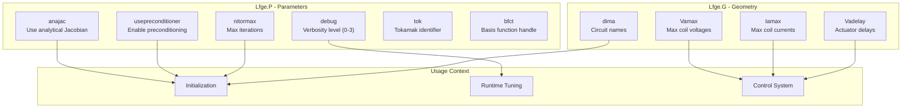
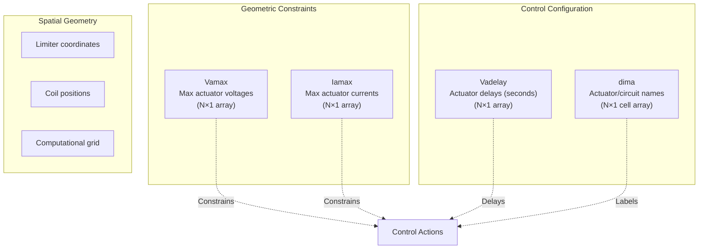
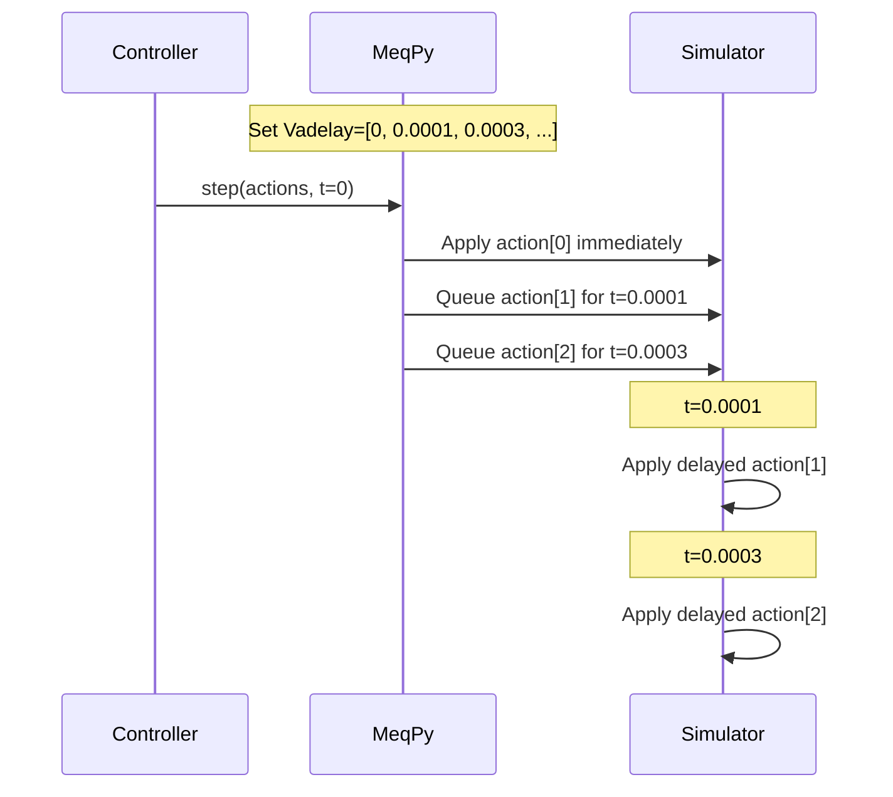
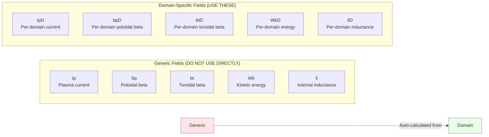
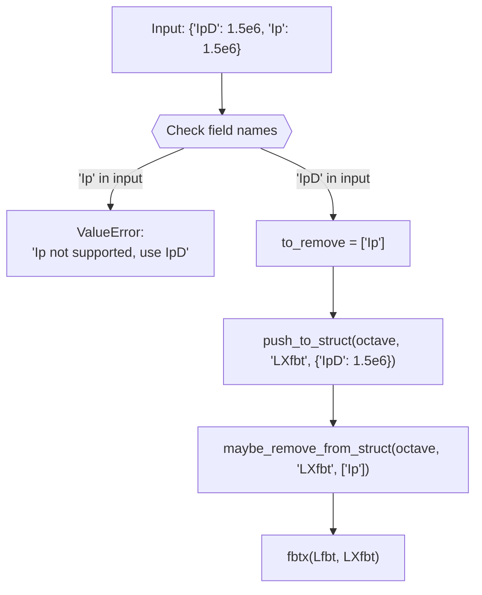
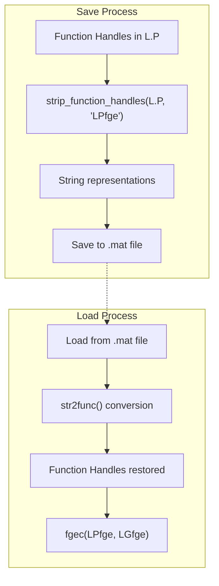

<!-- source: DeepWiki mcp.deepwiki.com · repo google-deepmind/meqpy · page 8.1 Parameter and Geometry Configuration · fetched 2026-10-26 -->

# Parameter and Geometry Configuration

<details>
<summary>Relevant source files</summary>

The following files were used as context for generating this wiki page:

- [meqpy/meqpy_fge_test_mixin.py](meqpy/meqpy_fge_test_mixin.py)
- [meqpy/meqpy_impl.py](meqpy/meqpy_impl.py)

</details>


## Purpose and Scope

This page provides an advanced guide to configuring simulation parameters and geometry settings for FGE (Fast Grad-Shafranov Equilibrium) and FBT (Fast Boundary Tracing) modes. It covers the structure of configuration data, field naming conventions, validation rules, and the consolidation process that maintains internal consistency.

For basic initialization of FGE and FBT, see [FGE - Fast Grad-Shafranov Equilibrium](#3.1) and [FBT - Fast Boundary Tracing](#3.2). For details on input configuration (`LX` structures), see those pages as well. This page focuses specifically on the advanced aspects of parameter (`L.P`) and geometry (`L.G`) configuration.

## Configuration Architecture Overview

Both FGE and FBT simulations maintain configuration in Octave structures with two primary components:

| Component | Structure Field | Purpose | Examples |
|-----------|----------------|---------|----------|
| Parameters | `L.P` | Algorithmic and physical parameters | `debug`, `anajac`, `usepreconditioner`, `nitormax` |
| Geometry | `L.G` | Machine-specific geometric data | `Vamax`, `Iamax`, `Vadelay`, `dima` |

Configuration follows a three-step workflow:


**Configuration Workflow for FGE**

The consolidation step (e.g., `fgec()`, `fbtc()`) recalculates derived quantities to maintain internal consistency after parameter updates.

Sources: [meqpy/meqpy_impl.py:375-396](), [meqpy/meqpy_impl.py:398-410]()

## FGE Parameter Configuration

### Setting FGE Parameters

Parameters are configured using the `set_fge_parameters()` method, which accepts two optional keyword arguments:

```python
meq_instance.set_fge_parameters(
    parameters={'debug': 2, 'anajac': True, 'usepreconditioner': True},
    geometry={'Vamax': new_voltage_limits, 'Vadelay': delays}
)
```

The method performs three operations:
1. Updates fields in `Lfge.P` and `Lfge.G` structures
2. Runs `fgec()` to regenerate derived quantities
3. Maintains consistency across all fields

Sources: [meqpy/meqpy_impl.py:375-396]()

### Common FGE Parameters



**FGE Configuration Hierarchy**

| Parameter Category | Example Fields | Purpose |
|--------------------|----------------|---------|
| Algorithm Control | `anajac`, `usepreconditioner`, `nitormax` | Solver behavior and performance |
| Debug and Logging | `debug`, `verbose` | Diagnostic output level |
| Physical Constraints | `Ipmin`, `Ipmax`, `bpmin`, `bpmax` | Valid ranges for plasma parameters |
| Basis Functions | `bfct`, `bfp`, `infct`, `eqfct` | Function handles for equilibrium calculation |

Sources: [meqpy/meqpy_impl.py:375-396](), [meqpy/meqpy_fge_test_mixin.py:96-118]()

### Retrieving FGE Configuration

Individual parameters and geometry fields can be retrieved:

```python
debug_level = meq_instance.get_fge_parameter('debug')
voltage_limits = meq_instance.get_fge_geometry('Vamax')
entire_l_struct = meq_instance.get_from_fge_l('P')  # Get entire P structure
```

These methods use `pull_from_struct()` from `octave_utils` to extract data from the Octave session.

Sources: [meqpy/meqpy_impl.py:430-440]()

## FGE Geometry Configuration

### Geometry Structure Fields

The `Lfge.G` structure contains machine-specific geometric and control data:



**FGE Geometry Organization**

### Setting Geometry with Validation

Geometry updates must respect the machine's physical capabilities:

```python
# Get current limits
original_vamax = meq_instance.get_fge_geometry('Vamax')
original_iamax = meq_instance.get_fge_geometry('Iamax')

# Update with new values
meq_instance.set_fge_parameters(
    geometry={
        'Vamax': original_vamax * 1.1,  # Increase by 10%
        'Iamax': original_iamax * 1.1
    }
)
```

After setting geometry, the consolidation function `fgec(Lfge.P, Lfge.G)` recalculates derived quantities to ensure consistency.

Sources: [meqpy/meqpy_impl.py:391-396](), [meqpy/meqpy_fge_test_mixin.py:120-138]()

### Actuator Delay Configuration

The `Vadelay` field configures time delays for control actions, critical for realistic simulations:



**Actuator Delay Implementation**

Sources: [meqpy/meqpy_fge_test_mixin.py:196-245]()

## FBT Parameter and Geometry Configuration

### Setting FBT Configuration

FBT configuration follows the same pattern as FGE:

```python
meq_instance.set_fbt_parameters(
    parameters={'debug': 2, 'nitormax': 100},
    geometry={'coil_specific_field': value}
)
```

The consolidation function `fbtc(Lfbt.P, Lfbt.G)` is automatically called after updates.

Sources: [meqpy/meqpy_impl.py:398-410]()

### Retrieving FBT Configuration

```python
debug_level = meq_instance.get_fbt_parameter('debug')
geometry_field = meq_instance.get_fbt_geometry('field_name')
```

Sources: [meqpy/meqpy_impl.py:442-449]()

## FBT Input Configuration

### Setting FBT Inputs

While parameters (`L.P`) and geometry (`L.G`) define the simulation configuration, inputs (`LXfbt`) provide the boundary conditions:

```python
meq_instance.set_fbt_inputs({
    'IpD': plasma_current,
    'bpD': poloidal_beta,
    'btD': toroidal_beta,
    't': time_value
})
```

**Important**: Use domain-specific field names (suffixed with `D`) when available. See [Field Naming Conventions](#field-naming-conventions-and-validation) below.

Sources: [meqpy/meqpy_impl.py:412-417]()

### Control Point Configuration

FBT allows specification of control points for boundary shape:

```python
meq_instance.set_fbt_control_point({
    '1': np.array([[r1, z1], [r2, z2], ...]),  # First control point set
    '2': np.array([[r3, z3], [r4, z4], ...])   # Second control point set
})
```

The method:
1. Clears existing control points
2. Sets new values as `gp1`, `gp2`, etc. in `LXfbt`
3. Calls `fbtx(Lfbt, LXfbt)` to consolidate

Sources: [meqpy/meqpy_impl.py:419-428]()

### Retrieving Control Points

```python
control_points = meq_instance.get_fbt_control_points()
# Returns oct2py.Struct with fields like '1', '2', etc.
```

The implementation dynamically identifies all fields starting with `gp` in `LXfbt`.

Sources: [meqpy/meqpy_impl.py:451-468]()

## Field Naming Conventions and Validation

### Singlet vs Doublet Fields

MEQ supports both singlet and doublet plasma configurations. Certain fields have both generic and domain-specific versions:



**Singlet-Doublet Field Relationships**

The constant `_SINGLET_DOUBLET_FIELDS` defines these special fields:

```python
_SINGLET_DOUBLET_FIELDS = frozenset(["Ip", "bp", "bt", "Wk", "li"])
```

Sources: [meqpy/meqpy_impl.py:64-66]()

### Validation Rules

When setting inputs, the system enforces that domain-specific fields are used:

```python
def _check_correct_fields_and_get_to_remove(values: Iterable[str]) -> Sequence[str]:
    """Validates that we are using the per domain fields."""
    to_remove = []
    for value in values:
        if value in _SINGLET_DOUBLET_FIELDS:
            raise ValueError(f"Input {value} is not supported, please use {value}D.")
        elif value.endswith("D") and value[:-1] in _SINGLET_DOUBLET_FIELDS:
            to_remove.append(value[:-1])
    return to_remove
```

When a domain-specific field (e.g., `IpD`) is set, the generic field (e.g., `Ip`) is automatically removed from the structure to prevent conflicts.

Sources: [meqpy/meqpy_impl.py:755-767]()

### Validation Flow



**Field Validation and Cleanup Process**

Sources: [meqpy/meqpy_impl.py:412-417](), [meqpy/meqpy_impl.py:755-767]()

## Consolidation Process

### Purpose of Consolidation

After updating parameters or geometry, consolidation functions recalculate derived quantities:

| Function | Purpose | Called After |
|----------|---------|--------------|
| `fgec(P, G)` | Consolidate FGE configuration | `set_fge_parameters()` |
| `fbtc(P, G)` | Consolidate FBT configuration | `set_fbt_parameters()` |
| `fgex(tok, t, L, LX)` | Consolidate FGE inputs | Input overrides in FGETK |
| `fbtx(L, LX)` | Consolidate FBT inputs | `set_fbt_inputs()` |

### Consolidation with Function Handles

Some parameters contain function handles (e.g., `bfct`, `infct`, `eqfct`). These require special handling:



**Function Handle Persistence and Restoration**

The restoration code handles special cases:

```octave
% Special doublet basis function case
if strcmp(LPfge.bfct,'bfgenD') | strcmp(LPfge.bfct,'bfdoublet')
  for iD = 1:size(LPfge.bfp,1)
    LPfge.bfp{iD,1} = str2func(LPfge.bfp{iD,1});
  end
end

% Restore main function handles
for var = {'bfct','infct', 'eqfct'}
  if isfield(LPfge,var) && ischar(LPfge.(var{:}))
    LPfge.(var{:}) = str2func(LPfge.(var{:}));
  end
end

% Consolidate with restored handles
Lfge = fgec(LPfge, LGfge);
```

Sources: [meqpy/meqpy_impl.py:593-608](), [meqpy/meqpy_impl.py:644-659]()

## Best Practices

### Batch Parameter Updates

Update multiple parameters in a single call to minimize consolidation overhead:

```python
# Good: Single consolidation
meq_instance.set_fge_parameters(
    parameters={'debug': 2, 'anajac': True, 'usepreconditioner': True},
    geometry={'Vamax': new_vamax, 'Iamax': new_iamax}
)

# Avoid: Multiple consolidations
meq_instance.set_fge_parameters(parameters={'debug': 2})
meq_instance.set_fge_parameters(parameters={'anajac': True})  # Unnecessary consolidation
meq_instance.set_fge_parameters(geometry={'Vamax': new_vamax})  # Another consolidation
```

Sources: [meqpy/meqpy_impl.py:380-383]()

### Resetting Parameters in Tests

When modifying parameters in tests, restore original values to avoid affecting subsequent tests:

```python
def test_parameter_modification(self):
    meq_instance = self.get_meq_fge_instance()
    
    # Save original
    original_value = meq_instance.get_fge_parameter('debug')
    
    # Modify
    meq_instance.set_fge_parameters(parameters={'debug': original_value + 1})
    
    # Test behavior...
    
    # Restore
    meq_instance.set_fge_parameters(parameters={'debug': original_value})
```

This is particularly important when using cached instances in test suites.

Sources: [meqpy/meqpy_fge_test_mixin.py:96-118]()

### Error Handling

Always handle potential errors when setting non-existent fields:

```python
try:
    meq_instance.set_fge_parameters(parameters={'nonexistent_param': 1})
except ValueError as e:
    # Field doesn't exist in L.P
    logging.error(f"Invalid parameter: {e}")
```

The system validates field existence before pushing to Octave structures.

Sources: [meqpy/meqpy_fge_test_mixin.py:140-147](), [meqpy/meqpy_fge_test_mixin.py:149-155]()

### Domain-Specific Fields

Always use domain-specific (`*D`) variants for singlet-doublet fields:

```python
# Correct
meq_instance.set_fbt_inputs({'IpD': 1.5e6, 'bpD': 1.2, 'btD': 2.5})

# Incorrect - will raise ValueError
meq_instance.set_fbt_inputs({'Ip': 1.5e6})  # Error: use IpD instead
```

Sources: [meqpy/meqpy_impl.py:755-767]()

---

