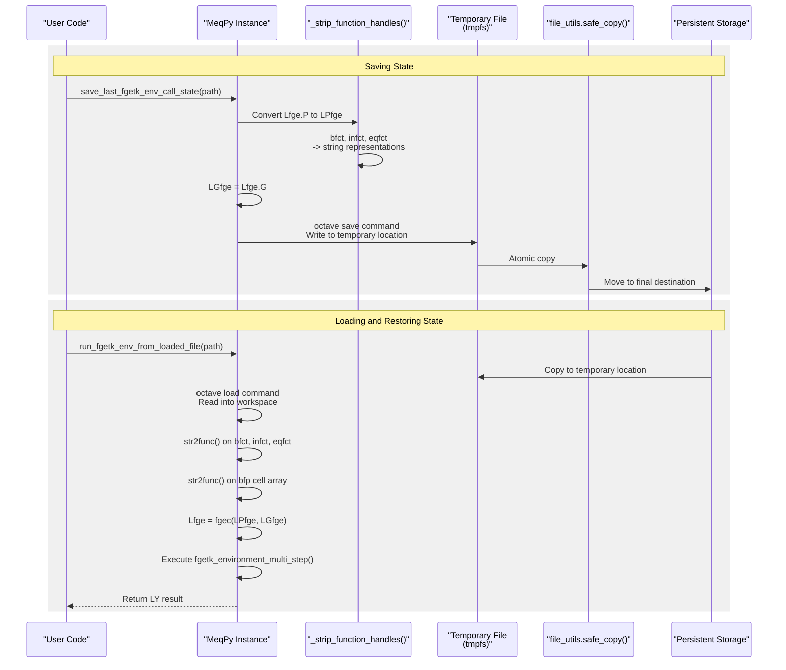
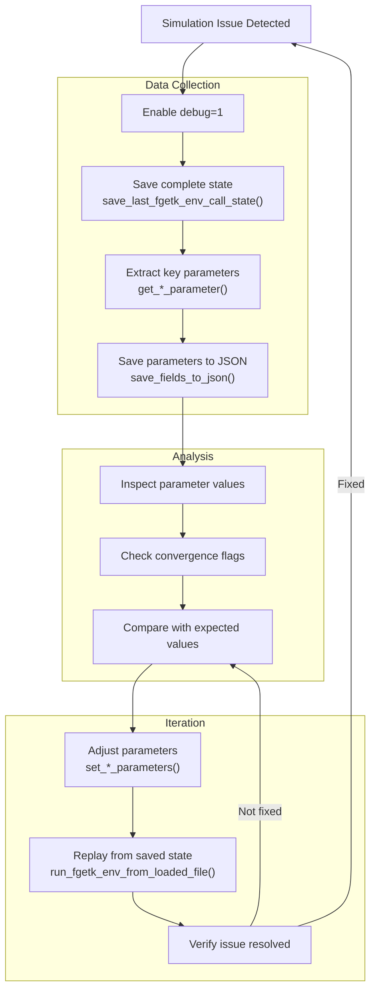

<!-- source: DeepWiki mcp.deepwiki.com · repo google-deepmind/meqpy · page 8.2 Error Handling and Debugging · fetched 2026-10-26 -->

# Error Handling and Debugging

<details>
<summary>Relevant source files</summary>

The following files were used as context for generating this wiki page:

- [meqpy/meqpy_impl.py](meqpy/meqpy_impl.py)
- [meqpy/octave_utils.py](meqpy/octave_utils.py)

</details>


This page documents error handling mechanisms, debugging capabilities, and troubleshooting strategies in MeqPy. It covers common errors, validation mechanisms, debug parameters, and state persistence for debugging.

For information about configuring parameters and geometry, see [Advanced Parameter and Geometry Configuration](#8.1). For information about the testing framework and verification, see [Testing Infrastructure](#7).

## Common Errors and Solutions

MeqPy provides specific error messages and validation mechanisms to help identify and resolve issues quickly.

### Environment Configuration Errors

**Missing MAT_ROOT Environment Variable**

The most common initialization error occurs when the `MAT_ROOT` environment variable is not set. This variable must point to the root directory containing MEQ code.

```python
# Error message:
# KeyError: 'MAT_ROOT'
```

**Solution:** Set the environment variable before creating a `MeqPy` instance:
```bash
export MAT_ROOT=/path/to/meq/installation
```

Alternatively, pass `root_dir` explicitly to the constructor:
```python
meq = MeqPy(root_dir="/path/to/meq/installation")
```

Sources: [meqpy/octave_utils.py:42]()

**Temporary Directory Access Issues**

MeqPy uses temporary files for Octave communication. If the default temporary directory is not accessible, file operations may fail.

**Solution:** MeqPy automatically attempts to use `tmpfs` in the current working directory if available. Ensure either:
- The default system temp directory is writable, or
- Create a `tmpfs` directory in the working directory

Sources: [meqpy/meqpy_impl.py:770-784]()

### Struct Field Validation Errors

**Invalid Field Names**

When setting parameters or inputs, MeqPy validates that field names exist in the target struct:

```python
# Raises ValueError: Struct Lfge.P is missing fields: ['invalid_param']
meq.set_fge_parameters(parameters={'invalid_param': 1.0})
```

This validation occurs in [meqpy/octave_utils.py:107-129]() when `safe=True` (the default).

**Singlet vs. Doublet Field Errors**

Certain fields like `Ip`, `bp`, `bt`, `Wk`, and `li` have both singlet and per-domain versions (suffixed with `D`). MeqPy requires using the per-domain versions:

```python
# Error: ValueError: Input Ip is not supported, please use IpD.
meq.set_fbt_inputs({'Ip': 100000})

# Correct usage:
meq.set_fbt_inputs({'IpD': [100000, 0]})
```

Sources: [meqpy/meqpy_impl.py:64-66](), [meqpy/meqpy_impl.py:755-767]()

### Simulation Convergence Errors

**FBT Convergence Failure**

The `run_fbt()` method raises an error if the boundary tracing algorithm fails to converge:

```python
# Raises ValueError: FBT failed to converge.
result = meq.run_fbt()
```

**Solution:** Use `try_run_fbt()` to handle convergence failures gracefully:

```python
result = meq.try_run_fbt()
if result is None:
    # Handle non-convergence
    logging.warning("FBT did not converge, adjusting parameters...")
    # Adjust parameters and retry
```

Sources: [meqpy/meqpy_impl.py:351-364]()

### State Initialization Errors

**FGE Initialization Without Prior FBT**

When using `init_fge_from_fbt_result()`, FBT must have been run first:

```python
# Raises ValueError: FBT must have been run for this to be possible.
meq.init_fge_from_fbt_result(tokamak, shot, time, source)
```

**Solution:** Ensure FBT has been executed before initializing FGE from its results:

```python
meq.init_fbt(tokamak, shot, time, source)
meq.run_fbt()
meq.init_fge_from_fbt_result(tokamak, shot, time, source)
```

Sources: [meqpy/meqpy_impl.py:275-276]()

**Timestep Validation Errors**

When initializing the FGETK environment, the control timestep must be an integer multiple of the simulator timestep:

```python
# Raises ValueError: Control timestep must be a multiple of simulator timestep...
meq.init_fgetk_environment(control_timestep=0.003, simulator_timestep=0.002)
```

Sources: [meqpy/meqpy_impl.py:481-486]()

## Error Handling Flow Diagram

```mermaid
graph TB
    subgraph "Parameter Setting Operations"
        SetParams["set_fge_parameters()<br/>set_fbt_parameters()"]
        PushStruct["octave_utils.push_to_struct()"]
        ValidateFields{"safe=True?<br/>Validate fields exist"}
        ExecutePush["Push values to<br/>temporary variables"]
        AssignFields["Assign to struct fields"]
        Consolidate["Run consolidation<br/>fgec() or fbtc()"]
        RaiseError["Raise ValueError:<br/>Missing fields"]
    end
    
    subgraph "FBT Execution"
        RunFBT["run_fbt()"]
        TryRunFBT["try_run_fbt()"]
        ExecuteFBT["Execute fbtt()"]
        CheckConverge{"LYfbt.isconverged?"}
        ReturnResult["Return LY"]
        ReturnNone["Return None"]
        RaiseFBTError["Raise ValueError:<br/>FBT failed to converge"]
    end
    
    subgraph "State Initialization"
        InitFGEFromFBT["init_fge_from_fbt_result()"]
        CheckLYfbt{"LYfbt exists<br/>in workspace?"}
        InitFGE["Initialize FGE<br/>from FBT result"]
        RaiseStateError["Raise ValueError:<br/>FBT must have been run"]
    end
    
    SetParams --> PushStruct
    PushStruct --> ValidateFields
    ValidateFields -->|Yes| ExecutePush
    ValidateFields -->|No| AssignFields
    ExecutePush --> AssignFields
    AssignFields --> Consolidate
    ValidateFields -->|Fields missing| RaiseError
    
    RunFBT --> ExecuteFBT
    TryRunFBT --> ExecuteFBT
    ExecuteFBT --> CheckConverge
    CheckConverge -->|Yes| ReturnResult
    CheckConverge -->|No, run_fbt()| RaiseFBTError
    CheckConverge -->|No, try_run_fbt()| ReturnNone
    
    InitFGEFromFBT --> CheckLYfbt
    CheckLYfbt -->|Yes| InitFGE
    CheckLYfbt -->|No| RaiseStateError
```

Sources: [meqpy/octave_utils.py:68-133](), [meqpy/meqpy_impl.py:351-364](), [meqpy/meqpy_impl.py:239-286]()

## Debug Parameters and Configuration

### MEQ Debug Flag

MEQ simulations support a `debug` parameter in the `L.P` structure that controls diagnostic output:

```python
# Enable debug mode
meq.set_fge_parameters(parameters={'debug': 1})

# Check current debug setting
debug_level = meq.get_fge_parameter('debug')
```

When enabled, MEQ functions output additional diagnostic information to help identify convergence issues and parameter problems.

### Octave Command Logging

The `octave_eval()` method provides optional logging of all Octave commands:

```python
# Log command execution (default)
result = meq.octave_eval("disp(Lfge.P.tok);", log=True)

# Suppress logging for performance
result = meq.octave_eval("x = 1 + 1;", log=False)
```

Sources: [meqpy/meqpy_impl.py:111-133]()

### Verbose Octave Output

All `octave_eval()` calls include `verbose=True`, which prints Octave output directly to the console for real-time monitoring.

## State Persistence for Debugging

MeqPy provides comprehensive state saving and loading capabilities to reproduce and debug issues. This is particularly useful for investigating convergence failures or unexpected behavior.

### FGETK Environment State Persistence

**Saving Complete Environment State**

The `save_last_fgetk_env_call_state()` method saves all variables needed to reproduce the last environment step:

```python
meq.init_fgetk_environment(dt_ctrl=0.001, dt_sim=0.0001)
meq.step_fgetk_environment(actions)

# Save state after a problematic step
meq.save_last_fgetk_env_call_state("/path/to/debug_state.mat")
```

This saves:
- `LPfge`: FGE parameters (with function handles converted to strings)
- `LGfge`: FGE geometry
- `State_prev`: Previous state from environment
- `Actions`: Applied actions
- `LXfge_sequence`: Input sequence
- `num_steps`: Number of simulation steps

Sources: [meqpy/meqpy_impl.py:45-52](), [meqpy/meqpy_impl.py:567-579]()

**Restoring and Replaying Environment Steps**

```python
# Load saved state and re-execute
result = meq.run_fgetk_env_from_loaded_file("/path/to/debug_state.mat")
```

The restoration process:
1. Loads all saved variables
2. Converts string representations back to function handles using `str2func()`
3. Runs consolidation to regenerate derived quantities
4. Executes `fgetk_environment_multi_step()` with saved inputs

Sources: [meqpy/meqpy_impl.py:581-620]()

### FBT State Persistence

**Saving FBT Inputs**

```python
meq.init_fbt(tokamak, shot, time, source)
meq.set_fbt_parameters(parameters={...})
meq.set_fbt_inputs(inputs={...})

# Save everything needed to rerun FBT
meq.save_run_fbt_inputs("/path/to/fbt_debug.mat")
```

This saves:
- `LPfbt`: FBT parameters (with function handles as strings)
- `LGfbt`: FBT geometry  
- `LXfbt`: FBT inputs

Sources: [meqpy/meqpy_impl.py:54-58](), [meqpy/meqpy_impl.py:622-634]()

### Function Handle Serialization

MEQ structures contain function handles that cannot be directly serialized to `.mat` files. MeqPy handles this automatically:

**During Save:**
- Function handles in fields like `bfct`, `infct`, `eqfct` are converted to strings
- The `bfp` cell array (for doublet basis functions) also has handles converted

**During Load:**
- String representations are converted back to function handles using `str2func()`
- Consolidation functions (`fgec()` or `fbtc()`) regenerate derived quantities

Sources: [meqpy/meqpy_impl.py:661-670](), [meqpy/meqpy_impl.py:592-608](), [meqpy/meqpy_impl.py:643-659]()

## State Persistence Workflow



Sources: [meqpy/meqpy_impl.py:567-620](), [meqpy/meqpy_impl.py:672-722](), [meqpy/file_utils.py]()

## Validation Mechanisms

### Struct Field Validation

The `push_to_struct()` function provides optional field validation to prevent silent failures:

| Parameter | Type | Description |
|-----------|------|-------------|
| `octave` | `oct2py.Oct2Py` | Octave instance to use |
| `struct_name` | `str` | Name of target struct (e.g., `"Lfge.P"`) |
| `data` | `Mapping[str, Any]` | Field names and values to set |
| `safe` | `bool` | If `True`, validate all fields exist before assignment |

**Validation Process:**

1. Use `isfield()` to check all field names exist
2. If any fields are missing, raise `ValueError` with list of missing fields
3. Only assign values if all fields are valid

**Example:**

```python
# Safe mode (default) - validates fields
octave_utils.push_to_struct(
    octave, 
    "Lfge.P", 
    {"nkn": 15, "invalid": 1.0},  # 'invalid' doesn't exist
    safe=True
)
# Raises: ValueError: Struct Lfge.P is missing fields: ['invalid']

# Unsafe mode - skips validation (use with caution)
octave_utils.push_to_struct(octave, "Lfge.P", {"nkn": 15}, safe=False)
```

Sources: [meqpy/octave_utils.py:68-133]()

### Input Field Validation

When setting FBT or FGE inputs, MeqPy validates that per-domain fields are used correctly:

**Prohibited Fields:**

- `Ip`, `bp`, `bt`, `Wk`, `li` (singlet versions)

**Required Fields:**

- `IpD`, `bpD`, `btD`, `WkD`, `liD` (per-domain versions)

When a per-domain field is set (e.g., `IpD`), the corresponding singlet field (`Ip`) is automatically removed from the struct to avoid conflicts.

Sources: [meqpy/meqpy_impl.py:64-66](), [meqpy/meqpy_impl.py:755-767]()

### Variable Existence Checks

When saving variables to files, MeqPy validates that all specified variables exist in the Octave workspace:

```python
# Raises ValueError if any variable doesn't exist
meq.save_to_file(
    "/path/to/output.mat",
    variables_to_save=["Lfge", "LXfge", "nonexistent"]
)
# Raises: ValueError: Variable nonexistent does not exist in octave.
```

Sources: [meqpy/meqpy_impl.py:706-708]()

## Troubleshooting Strategies

### Diagnostic Information Collection

**1. Extract Current Parameter Values**

```python
# Get specific parameters
debug_mode = meq.get_fge_parameter('debug')
num_knots = meq.get_fge_parameter('nkn')
tokamak = meq.get_fge_parameter('tok')

# Get geometry information
limiter_points = meq.get_fge_geometry('xlim')
```

**2. Display FBT Inputs**

```python
# Print formatted FBT input summary to console
meq.display_fbt_inputs()
```

Sources: [meqpy/meqpy_impl.py:366-367](), [meqpy/meqpy_impl.py:430-449]()

**3. Save Diagnostic Snapshots**

```python
# Save specific fields to JSON for inspection
meq.save_fields_to_json(
    "/path/to/debug_params.json",
    structure="Lfge.P",
    field_names=["nkn", "debug", "tok"]
)
```

Sources: [meqpy/meqpy_impl.py:741-752]()

### Convergence Debugging

**FBT Convergence Issues:**

1. Enable debug mode: `meq.set_fbt_parameters(parameters={'debug': 1})`
2. Examine control points: `control_points = meq.get_fbt_control_points()`
3. Save state before running: `meq.save_run_fbt_inputs("fbt_state.mat")`
4. Use `try_run_fbt()` to handle non-convergence gracefully
5. Adjust parameters and retry

**FGETK Environment Issues:**

1. Save state after problematic step: `meq.save_last_fgetk_env_call_state("error_state.mat")`
2. Load and replay in a clean instance: `meq.run_fgetk_env_from_loaded_file("error_state.mat")`
3. Inspect saved variables in MATLAB/Octave directly for detailed analysis

### Parameter Debugging Workflow



Sources: [meqpy/meqpy_impl.py:375-410](), [meqpy/meqpy_impl.py:567-620](), [meqpy/meqpy_impl.py:741-752]()

### Direct Octave Access for Advanced Debugging

For complex debugging scenarios, direct Octave commands can be executed:

```python
# Execute arbitrary Octave commands
meq.octave_eval("whos", log=True)  # List all variables
meq.octave_eval("disp(Lfge.P)", log=True)  # Display structure
meq.octave_eval("save debug_workspace.mat", log=True)  # Save entire workspace

# Execute with output capture
result = meq.octave_eval("max(LYfge.psi(:))", nout=1)
```

**Warning:** Direct Octave access bypasses MeqPy's validation and state management. Use only when necessary for debugging.

Sources: [meqpy/meqpy_impl.py:111-133]()

## Error Checking Summary Table

| Operation | Validation Performed | Error Type | Prevention Strategy |
|-----------|---------------------|------------|---------------------|
| Parameter setting | Field existence check | `ValueError` | Use `safe=True` in `push_to_struct()` |
| Input setting | Singlet/doublet field check | `ValueError` | Use per-domain fields (e.g., `IpD`) |
| FBT execution | Convergence check | `ValueError` or `None` | Use `try_run_fbt()` for graceful handling |
| FGE from FBT | `LYfbt` existence check | `ValueError` | Ensure `run_fbt()` called first |
| Environment init | Timestep divisibility | `ValueError` | Ensure control_dt is multiple of sim_dt |
| File save | Variable existence | `ValueError` | Check variables exist before saving |
| File save | Field existence (struct mode) | `ValueError` | Validate field names before saving |

Sources: [meqpy/octave_utils.py:68-133](), [meqpy/meqpy_impl.py:351-364](), [meqpy/meqpy_impl.py:275-276](), [meqpy/meqpy_impl.py:481-486](), [meqpy/meqpy_impl.py:694-708]()

---

