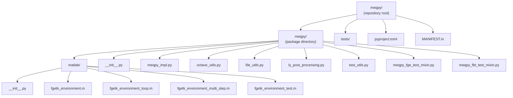
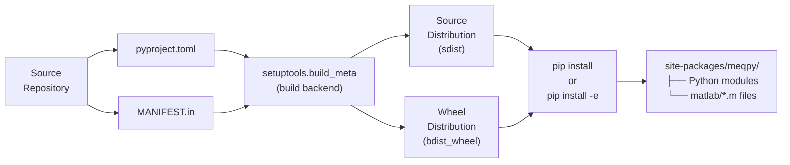
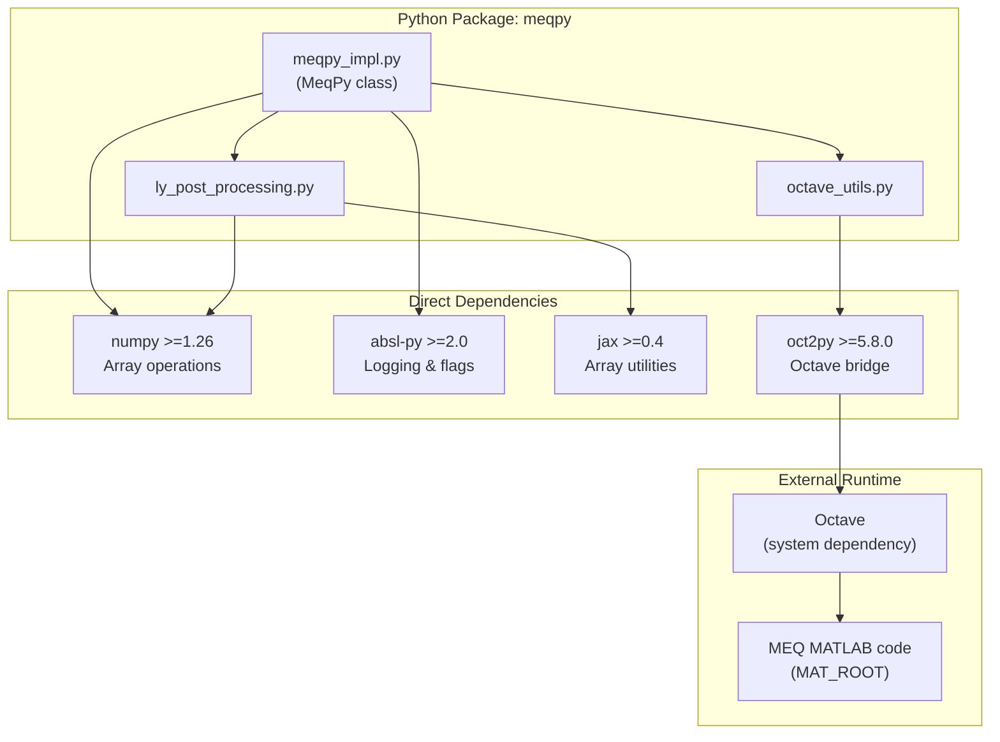
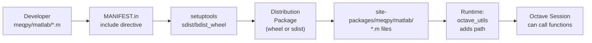

<!-- source: DeepWiki mcp.deepwiki.com · repo google-deepmind/meqpy · page 9.1 Project Structure and Build System · fetched 2026-10-26 -->

# Project Structure and Build System

<details>
<summary>Relevant source files</summary>

The following files were used as context for generating this wiki page:

- [MANIFEST.in](MANIFEST.in)
- [meqpy/matlab/__init__.py](meqpy/matlab/__init__.py)
- [pyproject.toml](pyproject.toml)

</details>


**Purpose and Scope**: This document describes the organizational structure of the MeqPy codebase, its build configuration, dependency management, and how MATLAB/Octave source files are bundled with the Python package. This information is intended for developers who want to understand how to build, modify, or extend the project.

For information about contributing code changes, see [Contributing Guidelines](#9.2). For an overview of the module architecture and runtime interactions, see [Core Architecture](#2).

---

## Package Directory Structure

The MeqPy repository follows a standard Python package layout with additional provisions for bundling MATLAB/Octave code:

```
meqpy/
├── meqpy/                          # Main Python package
│   ├── __init__.py                 # Public API exports
│   ├── meqpy_impl.py              # MeqPy class implementation
│   ├── octave_utils.py            # Oct2Py session management
│   ├── file_utils.py              # Safe file operations
│   ├── ly_post_processing.py     # Result normalization
│   ├── test_utils.py              # Test protocol definitions
│   ├── meqpy_fge_test_mixin.py   # FGE test logic
│   ├── meqpy_fbt_test_mixin.py   # FBT test logic
│   └── matlab/                     # Bundled MATLAB/Octave code
│       ├── __init__.py             # Package marker (empty)
│       ├── fgetk_environment.m    # Time-series simulation
│       ├── fgetk_environment_loop.m
│       ├── fgetk_environment_multi_step.m
│       └── fgetk_environment_test.m
├── tests/                          # Test implementations
├── pyproject.toml                  # Build configuration
├── MANIFEST.in                     # Data file inclusion rules
├── LICENSE
└── README.md
```

### Directory Structure Diagram



**Sources**: Repository structure inferred from [pyproject.toml:1-35](), [MANIFEST.in:1-1](), [meqpy/matlab/__init__.py:1-15]()

---

## Build System Configuration

MeqPy uses **setuptools** with PEP 517-compliant configuration via `pyproject.toml`. The build system is intentionally minimal to facilitate easy installation and distribution.

### Build Backend

The project specifies setuptools as its build backend:

```toml
[build-system]
requires = ["setuptools"]
build-backend = "setuptools.build_meta"
```

This configuration enables building the package using standard Python packaging tools:
```bash
python -m build
```

**Sources**: [pyproject.toml:1-3]()

### Project Metadata

The package metadata is defined declaratively in the `[project]` section:

| Metadata Field | Value | Description |
|----------------|-------|-------------|
| **name** | `meqpy` | Package name for PyPI |
| **version** | `0.1.0` | Semantic version number |
| **description** | "Python wrapper for MEQ." | One-line summary |
| **license** | `{file = "LICENSE"}` | Apache 2.0 license |
| **requires-python** | `>=3.11` | Minimum Python version |
| **readme** | `README.md` | Long description source |

The package supports Python 3.11, 3.12, and 3.13 as indicated by the classifiers at [pyproject.toml:16-18]().

**Sources**: [pyproject.toml:5-28]()

### Build and Installation Flow



**Sources**: [pyproject.toml:1-3](), [MANIFEST.in:1-1]()

---

## Dependency Management

MeqPy has a minimal but carefully selected set of runtime dependencies, each serving a specific architectural role.

### Runtime Dependencies

The required dependencies are specified in the `dependencies` list:

| Package | Version Constraint | Purpose |
|---------|-------------------|---------|
| **numpy** | `>=1.26` | Numerical array operations and data structures |
| **absl-py** | `>=2.0` | Application utilities (flags, logging) |
| **jax** | `>=0.4` | JAX array operations in `ly_post_processing` |
| **oct2py** | `>=5.8.0` | Python-Octave bridge for executing MATLAB code |

**Sources**: [pyproject.toml:22-26]()

### Dependency Architecture



### Dependency Roles

**numpy (>=1.26)**:
- Used throughout `meqpy_impl.py` for array operations
- Return type for simulation results
- Required for compatibility with Octave numeric types

**absl-py (>=2.0)**:
- Provides `absl.logging` for structured logging
- Used for debug output and error messages
- Not required for core functionality, but standardizes logging

**jax (>=0.4)**:
- Used exclusively in `ly_post_processing.py`
- Provides `jax.tree_util` for recursive struct operations
- Enables functional normalization of nested MATLAB structures

**oct2py (>=5.8.0)**:
- Critical dependency for all Octave interaction
- Version 5.8.0+ required for recent Python compatibility
- Manages subprocess communication with Octave runtime
- See [Octave Integration Layer](#2.2) for detailed usage

### External System Requirements

MeqPy requires two external components that are **not** managed by pip:

1. **Octave Runtime**: Must be installed on the system and accessible in `PATH`
2. **MEQ MATLAB Code**: Must be available and referenced via `MAT_ROOT` environment variable

These are verified during `MeqPy` initialization as documented in [Installation and Setup](#1.1).

**Sources**: [pyproject.toml:22-26]()

---

## MATLAB File Bundling

One of the key aspects of MeqPy's build system is the inclusion of MATLAB/Octave source files (`.m` files) as package data. This allows the Python package to provide supplementary MATLAB functions that extend MEQ's core functionality.

### MANIFEST.in Configuration

The inclusion of `.m` files is controlled by the `MANIFEST.in` file at the repository root:

```
include meqpy/matlab/*.m
```

This directive instructs setuptools to include all `.m` files from the `meqpy/matlab/` directory when building source distributions (sdist). Without this directive, non-Python files would be excluded by default.

**Sources**: [MANIFEST.in:1-1]()

### Bundled MATLAB Functions

The following MATLAB functions are included in the distributed package:

| File | Purpose |
|------|---------|
| `fgetk_environment.m` | Main time-series simulation function with init/step/terminate modes |
| `fgetk_environment_loop.m` | Loop-based execution wrapper |
| `fgetk_environment_multi_step.m` | Multi-step execution with action delays |
| `fgetk_environment_test.m` | Test/validation function |

These functions are **not** part of the core MEQ distribution (which is assumed to be present at `MAT_ROOT`). Instead, they provide control-oriented time-stepping functionality specific to reinforcement learning and control applications.

See [fgetk_environment.m](#6.1) for detailed documentation of the main function.

**Sources**: [MANIFEST.in:1-1](), [meqpy/matlab/__init__.py:1-15]()

### Runtime Discovery

At runtime, the bundled MATLAB path is added to the Octave search path by `octave_utils.create_meq_oct2py_instance()`:

```python
# Pseudo-code showing path addition logic
bundled_matlab_dir = os.path.join(os.path.dirname(__file__), 'matlab')
oc.addpath(bundled_matlab_dir)
```

This ensures that the bundled functions are available when MeqPy calls them through oct2py.

**Sources**: Referenced functionality documented in [Octave Integration Layer](#2.2)

### Package Data Flow



**Sources**: [MANIFEST.in:1-1]()

---

## Public API Exposure

The public API of MeqPy is carefully controlled through the top-level `__init__.py` file. This provides a clean interface to users while keeping internal implementation details private.

### API Exports

The `meqpy/__init__.py` file selectively exports:

1. **`MeqPy`** class from `meqpy_impl.py`
2. **`MeqSource`** enum from `meqpy_impl.py`

All other modules (`octave_utils`, `file_utils`, `ly_post_processing`, etc.) are considered internal implementation details and are not exposed in the top-level namespace.

### Import Pattern

Users of the package interact with it through simple imports:

```python
from meqpy import MeqPy, MeqSource

# MeqPy class is the primary interface
meq = MeqPy(root_dir="/path/to/meq")

# MeqSource enum for specifying data sources
source = MeqSource.EFIT
```

This design pattern:
- Provides a stable public API
- Allows internal refactoring without breaking user code
- Follows Python best practices for package design

**Sources**: Public API pattern referenced from [Overview](#1) and [The MeqPy Class](#2.1)

---

## Testing Configuration

The `pyproject.toml` file includes basic pytest configuration:

```toml
[tool.pytest.ini_options]
minversion = "6.0"
addopts = "-ra -q"
testpaths = ["tests"]
```

| Configuration | Value | Purpose |
|--------------|-------|---------|
| `minversion` | `"6.0"` | Minimum pytest version required |
| `addopts` | `"-ra -q"` | Show summary of all test types (-ra), quiet mode (-q) |
| `testpaths` | `["tests"]` | Directory containing test modules |

This configuration enables running tests with:
```bash
pytest
```

For detailed information about the testing infrastructure, see [Testing Infrastructure](#7).

**Sources**: [pyproject.toml:30-35]()

---

## Summary

The MeqPy build system is designed with the following characteristics:

1. **Minimal Dependencies**: Only four runtime dependencies, each with a clear purpose
2. **Standard Tooling**: Uses PEP 517-compliant setuptools configuration
3. **MATLAB Bundling**: Includes supplementary `.m` files via MANIFEST.in
4. **Clean API**: Exports only `MeqPy` and `MeqSource` at the top level
5. **Python 3.11+**: Modern Python version requirement

The structure separates concerns clearly:
- Core implementation in `meqpy_impl.py`
- Utility modules for specific tasks (Octave, files, post-processing)
- MATLAB code isolated in `matlab/` subdirectory
- Tests in separate `tests/` directory

This organization facilitates maintenance, testing, and extension of the codebase.

**Sources**: [pyproject.toml:1-35](), [MANIFEST.in:1-1](), [meqpy/matlab/__init__.py:1-15]()

---

