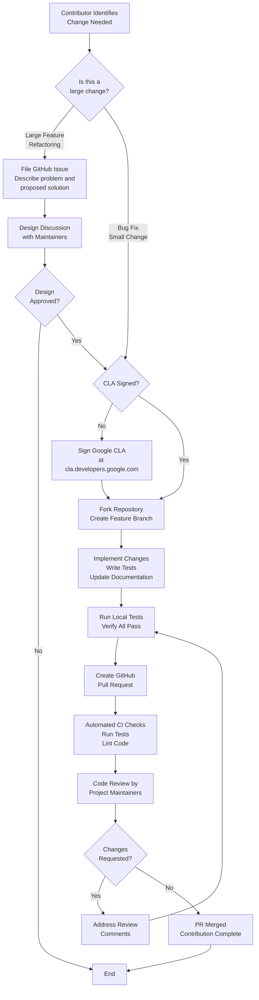
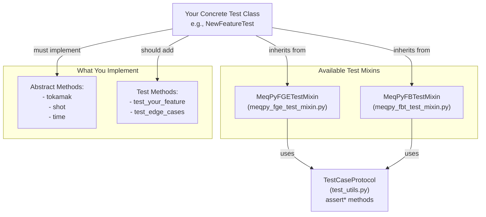

<!-- source: DeepWiki mcp.deepwiki.com · repo google-deepmind/meqpy · page 9.2 Contributing Guidelines · fetched 2026-10-26 -->

# Contributing Guidelines

<details>
<summary>Relevant source files</summary>

The following files were used as context for generating this wiki page:

- [CONTRIBUTING.md](CONTRIBUTING.md)
- [LICENSE](LICENSE)

</details>


## Purpose and Scope

This document describes the process for contributing code, documentation, and bug fixes to the MeqPy project. It covers the legal requirements, submission process, code review workflow, and development practices. For information about the project structure and build system, see [Project Structure and Build System](#9.1). For testing infrastructure details, see [Testing Infrastructure](#7).

---

## Overview of Contribution Types

MeqPy accepts several types of contributions, each with different requirements and processes:

| Contribution Type | Scope | Process |
|------------------|-------|---------|
| **Bug Fixes** | Small code changes addressing specific issues | Direct PR submission |
| **Small Changes** | Documentation, typos, minor improvements | Direct PR submission |
| **New Features** | Significant functionality additions | File issue first, then PR after discussion |
| **Major Refactoring** | Architectural changes, API modifications | File issue first, extensive design discussion required |
| **Documentation** | Wiki improvements, code comments | Direct PR submission |
| **Test Cases** | New test coverage, test infrastructure | Direct PR submission |

**Sources:** [CONTRIBUTING.md:1-35]()

---

## Contribution Workflow

The following diagram illustrates the complete contribution lifecycle from idea to merged code:



**Sources:** [CONTRIBUTING.md:1-35]()

---

## Legal Requirements

### Contributor License Agreement (CLA)

All contributions must be accompanied by a signed Contributor License Agreement. This is a standard requirement for Google open source projects.

**Key Points:**
- The CLA allows Google to use and redistribute your contributions
- You (or your employer) retain copyright to your contribution
- If you've signed a Google CLA for any project, it likely applies here
- Corporate contributors may require employer signature

**Process:**
1. Visit https://cla.developers.google.com/
2. Check if you have an existing agreement
3. If not, sign the appropriate CLA (individual or corporate)
4. Link your GitHub account to the CLA system

**Sources:** [CONTRIBUTING.md:9-21]()

### License Compliance

MeqPy is licensed under the Apache License 2.0. All contributions must be compatible with this license:

- Code must include appropriate license headers
- Dependencies must use Apache 2.0 or compatible licenses
- Modified files should carry prominent notices per Apache 2.0 terms

**Sources:** [LICENSE:1-202](), [CONTRIBUTING.md:1-35]()

---

## Community Guidelines

All interactions in the project must follow [Google's Open Source Community Guidelines](https://opensource.google/conduct/). This includes:

- Respectful and constructive communication
- Welcoming environment for all contributors
- Focus on technical merit of contributions
- Professional conduct in all discussions

**Sources:** [CONTRIBUTING.md:23-26]()

---

## Development Areas and File Structure

Understanding where different types of changes belong is essential for contributors:

```mermaid
graph TB
    subgraph "Python Package: meqpy/"
        Init["__init__.py<br/>(Public API exports)"]
        
        subgraph "Core Implementation"
            MeqPyImpl["meqpy_impl.py<br/>(MeqPy class)<br/>FGE/FBT methods"]
        end
        
        subgraph "Utilities"
            OctUtils["octave_utils.py<br/>(oct2py management)<br/>(struct operations)"]
            FileUtils["file_utils.py<br/>(safe_copy function)"]
            LYProc["ly_post_processing.py<br/>(data normalization)"]
        end
        
        subgraph "Testing"
            TestUtils["test_utils.py<br/>(TestCaseProtocol)"]
            FGEMixin["meqpy_fge_test_mixin.py<br/>(FGE test logic)"]
            FBTMixin["meqpy_fbt_test_mixin.py<br/>(FBT test logic)"]
        end
        
        subgraph "MATLAB Code: matlab/"
            FgetkEnv["fgetk_environment.m"]
            FgetkLoop["fgetk_environment_loop.m"]
            FgetkMulti["fgetk_environment_multi_step.m"]
            FgetkTest["fgetk_environment_test.m"]
        end
    end
    
    subgraph "Tests: tests/"
        FileTest["file_utils_test.py"]
        OctTest["octave_utils_test.py"]
        MeqTest["meqpy_test.py"]
        AnamakTest["anamak_test.py"]
    end
    
    subgraph "Configuration"
        Setup["setup.py<br/>(package metadata)"]
        Manifest["MANIFEST.in<br/>(include MATLAB files)"]
        Pyproject["pyproject.toml<br/>(build system)"]
    end
    
    subgraph "Documentation"
        Readme["README.md"]
        Contributing["CONTRIBUTING.md"]
        License["LICENSE"]
    end
    
    NewFeature["New Feature<br/>Contribution"]
    BugFix["Bug Fix<br/>Contribution"]
    TestAdd["Test<br/>Contribution"]
    DocUpdate["Documentation<br/>Contribution"]
    
    NewFeature -.->|"Modify or extend"| MeqPyImpl
    NewFeature -.->|"May need new"| OctUtils
    NewFeature -.->|"Add MATLAB code"| FgetkEnv
    
    BugFix -.->|"Fix in"| MeqPyImpl
    BugFix -.->|"Fix in"| OctUtils
    BugFix -.->|"Fix in"| FileUtils
    
    TestAdd -.->|"Add to"| AnamakTest
    TestAdd -.->|"Extend mixins"| FGEMixin
    TestAdd -.->|"Extend mixins"| FBTMixin
    
    DocUpdate -.->|"Update"| Readme
    DocUpdate -.->|"Update"| Contributing
```



**Development Guidelines by Area:**

| Area | Files | Guidelines |
|------|-------|-----------|
| **Core API** | `meqpy_impl.py` | Maintain backward compatibility, add docstrings, preserve type hints |
| **Utilities** | `octave_utils.py`, `file_utils.py`, `ly_post_processing.py` | Keep functions pure and testable, add error handling |
| **MATLAB Code** | `matlab/*.m` | Follow MATLAB style, add comments, test in Octave |
| **Tests** | `tests/*.py` | Use mixin patterns, inherit from `TestCaseProtocol`, add assertions |
| **Documentation** | `README.md`, `CONTRIBUTING.md` | Clear examples, proper formatting, accurate information |

**Sources:** [CONTRIBUTING.md:1-35]()

---

## Pull Request Submission Process

### Creating a Pull Request

```mermaid
flowchart LR
    subgraph "Local Development"
        Branch["Create Feature Branch<br/>git checkout -b feature-name"]
        Commit["Make Commits<br/>Clear commit messages"]
        Test["Run Tests Locally<br/>pytest tests/"]
    end
    
    subgraph "GitHub"
        Push["Push Branch<br/>git push origin feature-name"]
        OpenPR["Open Pull Request<br/>Fill out template"]
        LinkIssue["Link Related Issues<br/>Closes #123"]
    end
    
    subgraph "CI/CD"
        AutoTest["Automated Tests Run"]
        LintCheck["Code Style Checks"]
        CoverageCheck["Coverage Analysis"]
    end
    
    subgraph "Review"
        Reviewers["Maintainers Review"]
        Feedback["Provide Feedback"]
        Iterate["Address Comments"]
    end
    
    Branch --> Commit
    Commit --> Test
    Test --> Push
    Push --> OpenPR
    OpenPR --> LinkIssue
    LinkIssue --> AutoTest
    AutoTest --> LintCheck
    LintCheck --> CoverageCheck
    CoverageCheck --> Reviewers
    Reviewers --> Feedback
    Feedback --> Iterate
    Iterate --> Test
```



### Pull Request Template

When creating a PR, include:

1. **Description**: Clear explanation of what the PR does
2. **Motivation**: Why this change is needed
3. **Testing**: How you tested the changes
4. **Related Issues**: Link to any related issue numbers
5. **Breaking Changes**: Flag any API changes
6. **Documentation**: List any documentation updates

**Sources:** [CONTRIBUTING.md:28-35]()

---

## Code Review Process

All submissions require code review by project maintainers, including submissions by existing project members. The review process ensures:

- **Code Quality**: Adherence to project standards
- **Test Coverage**: Adequate tests for new functionality
- **Documentation**: Clear docstrings and comments
- **Compatibility**: No breaking changes without discussion
- **Performance**: Efficient implementation

### Review Criteria

| Criterion | What Reviewers Check |
|-----------|---------------------|
| **Correctness** | Code achieves stated purpose, no logical errors |
| **Testing** | Tests cover new code paths, edge cases handled |
| **Style** | Consistent with existing codebase patterns |
| **Documentation** | Docstrings, comments, and README updates |
| **Dependencies** | No unnecessary new dependencies, versions specified |
| **Backward Compatibility** | Existing code continues to work |
| **Performance** | No significant performance regressions |

### Typical Review Timeline

- **Small PRs** (< 100 lines): 1-3 days
- **Medium PRs** (100-500 lines): 3-7 days
- **Large PRs** (> 500 lines): 1-2 weeks

**Note:** Large PRs should be discussed as issues first to avoid lengthy review cycles.

**Sources:** [CONTRIBUTING.md:30-35]()

---

## Testing Requirements

All code contributions must include appropriate tests. MeqPy uses a mixin-based testing infrastructure:

### Test Structure for Contributors



### Testing Guidelines

1. **Unit Tests**: Test individual functions in isolation
   - Test utilities: `tests/file_utils_test.py`, `tests/octave_utils_test.py`
   - Test core functionality: `tests/meqpy_test.py`

2. **Integration Tests**: Test complete workflows
   - Use test mixins: `meqpy_fge_test_mixin.py`, `meqpy_fbt_test_mixin.py`
   - Example: `tests/anamak_test.py`

3. **Test Requirements**:
   - All new functions must have tests
   - Tests must be deterministic (no random failures)
   - Tests should run in reasonable time (< 1 minute each)
   - Mock external dependencies where appropriate

### Running Tests Locally

```bash
# Run all tests
pytest tests/

# Run specific test file
pytest tests/meqpy_test.py

# Run with verbose output
pytest -v tests/

# Run with coverage
pytest --cov=meqpy tests/
```

**Sources:** Test files in the repository, architectural diagrams showing testing infrastructure

---

## Development Setup

### Prerequisites

1. **Python Environment**: Python 3.8 or later
2. **Octave**: GNU Octave 6.0 or later
3. **MEQ Installation**: MEQ codebase accessible via `MAT_ROOT` environment variable
4. **Dependencies**: Install via `pip install -e .[dev]`

### Environment Configuration

```bash
# Set MEQ root path
export MAT_ROOT=/path/to/meq/installation

# Create virtual environment
python -m venv venv
source venv/bin/activate  # or venv\Scripts\activate on Windows

# Install in editable mode with dev dependencies
pip install -e .[dev]

# Verify installation
python -c "from meqpy import MeqPy; print('MeqPy imported successfully')"
```

### Development Dependencies

Development requires additional packages beyond the runtime dependencies:

- **Testing**: pytest, pytest-cov
- **Linting**: pylint, flake8
- **Type Checking**: mypy
- **Documentation**: sphinx (if applicable)

**Note:** Specific version requirements are defined in `setup.py` and `pyproject.toml`.

**Sources:** [CONTRIBUTING.md:1-35](), architectural diagrams showing project structure

---

## Code Style and Conventions

### Python Code Style

MeqPy follows standard Python conventions:

1. **PEP 8**: Standard Python style guide
2. **Type Hints**: Use type annotations for function signatures
3. **Docstrings**: Google-style docstrings for all public functions
4. **Naming Conventions**:
   - `snake_case` for functions and variables
   - `PascalCase` for classes
   - `UPPER_CASE` for constants

### MATLAB/Octave Code Style

For MATLAB code in `meqpy/matlab/`:

1. **Comments**: Clear comments explaining logic
2. **Function Headers**: Describe purpose, inputs, and outputs
3. **Compatibility**: Ensure code works in both MATLAB and Octave
4. **Testing**: Test in Octave environment before submission

### File Organization

- Keep related functionality in single files
- Limit file size (< 1000 lines recommended)
- Use clear, descriptive filenames
- Place tests in `tests/` directory with `_test.py` suffix

**Sources:** General best practices and project structure

---

## Submitting Large Contributions

For significant changes that modify the API or architecture:

### Issue Discussion Process

1. **File a GitHub Issue**
   - Describe the problem you're solving
   - Propose your solution approach
   - Include diagrams or pseudocode if helpful

2. **Design Discussion**
   - Maintainers will provide feedback
   - Consider alternative approaches
   - Agree on implementation plan

3. **Implementation Plan**
   - Break work into smaller PRs if possible
   - Identify API changes requiring documentation
   - Plan backward compatibility strategy

4. **Documentation Requirements**
   - Update README.md
   - Add docstrings to new functions
   - Create examples if adding major features

### API Changes

If your contribution changes the public API:

- Clearly document breaking changes
- Provide migration guide for existing users
- Consider deprecation warnings before removal
- Update all affected examples and tests

**Sources:** [CONTRIBUTING.md:3-6]()

---

## Getting Help

If you need assistance with your contribution:

1. **Check Existing Documentation**: Review wiki pages for relevant information
2. **Search Issues**: Look for similar questions or problems
3. **Ask in Issues**: Open an issue with your question
4. **Be Specific**: Include code snippets, error messages, and environment details

### Common Contribution Questions

| Question | Answer |
|----------|--------|
| How do I test MATLAB changes? | Use `octave` command-line or test via Python interface |
| Can I add new dependencies? | Discuss in issue first; must be Apache 2.0 compatible |
| How do I handle breaking changes? | File issue first, include migration guide in PR |
| What if tests fail in CI? | Check CI logs, reproduce locally, fix and push updates |
| How long for PR review? | Depends on size; typically 1-7 days |

**Sources:** [CONTRIBUTING.md:1-35]()

---

## Summary Checklist

Before submitting a contribution, verify:

- [ ] CLA signed and linked to GitHub account
- [ ] Issue filed for large changes (if applicable)
- [ ] Code follows project style conventions
- [ ] All tests pass locally
- [ ] New tests added for new functionality
- [ ] Documentation updated (docstrings, README, etc.)
- [ ] Commit messages are clear and descriptive
- [ ] PR description explains changes clearly
- [ ] No unintended changes included (check `git diff`)
- [ ] Breaking changes documented and discussed

**Sources:** [CONTRIBUTING.md:1-35]()