# Page: Overview

# Overview

<details>
<summary>Relevant source files</summary>

The following files were used as context for generating this wiki page:

- [README.md](README.md)
- [meqpy/__init__.py](meqpy/__init__.py)
- [pyproject.toml](pyproject.toml)

</details>


## Purpose and Scope

This page provides a high-level introduction to MeqPy, a Python wrapper for the MEQ tokamak magnetic equilibrium simulation suite. It covers the system's purpose, architecture, core components, and operational patterns. For detailed installation instructions, see [Installation and Setup](#1.1). For a hands-on introduction, see [Quick Start Guide](#1.2). For in-depth information about specific simulation types, see [Simulation Modes](#3).

## What is MeqPy?

MeqPy is a Python interface to MEQ, a suite of codes for tokamak magnetic equilibrium calculations developed by SPC-EPFL. The library enables Python applications to leverage existing Octave/MATLAB implementations of equilibrium solvers without requiring rewrites of the computational core. MeqPy manages the communication between Python and Octave, handles data structure conversions, and provides a Pythonic API for configuring and executing plasma equilibrium simulations.

The primary use cases include:
- **Fast equilibrium reconstruction** using the FGE (Fast Grad-Shafranov Equilibrium) solver
- **Boundary tracing** using the FBT (Fast Boundary Tracing) solver  
- **Time-dependent control simulations** using the FGETK environment for reinforcement learning and control applications

**Sources:** [README.md:1-5](), [meqpy/__init__.py:15]()

## System Architecture

MeqPy follows a layered architecture that separates concerns across Python application code, integration utilities, a bridge layer, and Octave/MATLAB computational code.

### Architectural Layers

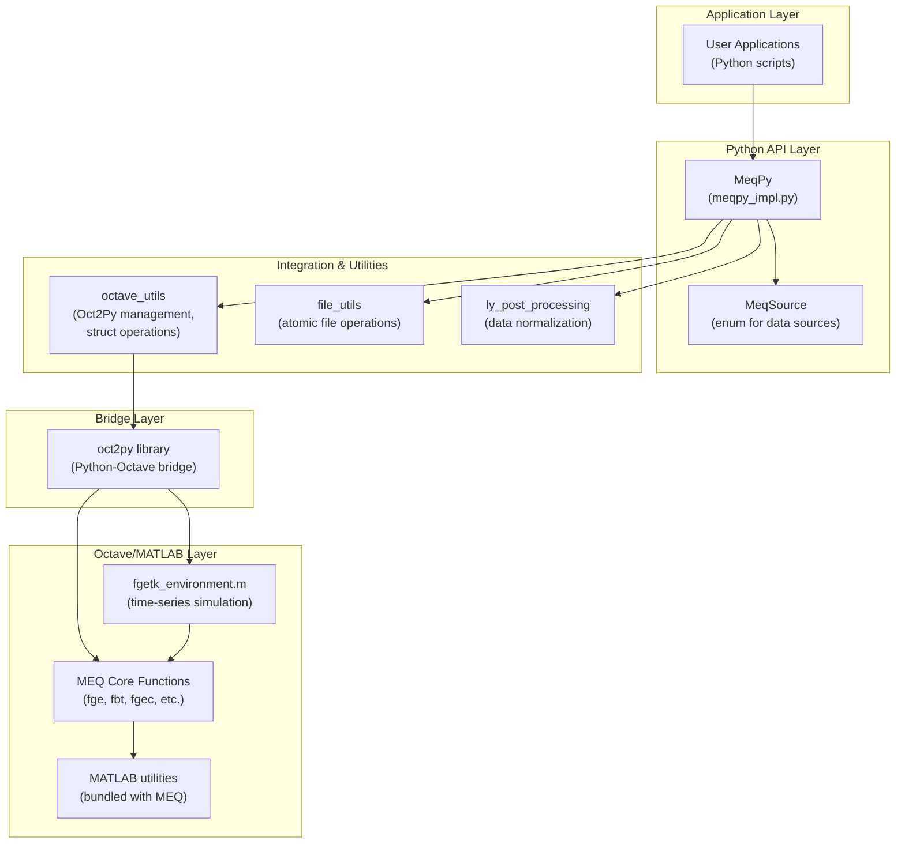

**Sources:** [meqpy/__init__.py:17-18](), [README.md:2-4]()

### Component Interactions

The following diagram maps system concepts to actual code entities:

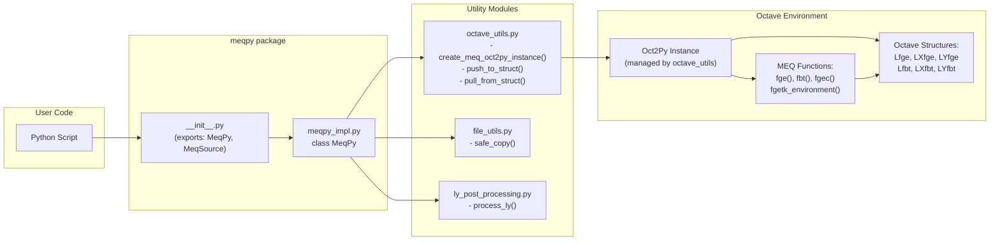

**Sources:** [meqpy/__init__.py:17-20](), [README.md:59-60]()

## Core Components

### MeqPy Class

The `MeqPy` class in [meqpy/meqpy_impl.py]() serves as the primary interface for all operations. It provides methods for:
- Initializing simulation environments (`init_fge`, `init_fbt`)
- Configuring parameters and geometry (`set_fge_parameters`, `set_fge_geometry`)
- Executing simulations (`run_fbt`, `step_fgetk_environment`)
- Managing state persistence (`save_to_file`, `load_from_file`)

The class maintains a single `Oct2Py` instance throughout its lifetime and manages the lifecycle of Octave variables.

**Sources:** [meqpy/__init__.py:17](), [README.md:79]()

### MeqSource Enum

The `MeqSource` enumeration defines data source options for initialization:
- `MEQ_DIRECT`: Load data directly from MEQ databases
- Other sources for different initialization methods

**Sources:** [meqpy/__init__.py:18](), [README.md:71]()

### Integration Utilities

| Module | Purpose | Key Functions |
|--------|---------|---------------|
| `octave_utils` | Manages Oct2Py instances and struct operations | `create_meq_oct2py_instance()`, `push_to_struct()`, `pull_from_struct()` |
| `file_utils` | Provides atomic file operations | `safe_copy()` |
| `ly_post_processing` | Normalizes MATLAB data structures for Python | `process_ly()` |

**Sources:** [README.md:8-50]()

## Simulation Modes

MeqPy supports three primary simulation modes, each with distinct initialization and execution patterns:

### Mode Comparison

| Mode | Octave Structures | Primary Methods | Use Case |
|------|-------------------|-----------------|----------|
| **FGE** | `Lfge`, `LXfge`, `LYfge` | `init_fge()`, `_run_fget()` | Fast equilibrium reconstruction |
| **FBT** | `Lfbt`, `LXfbt`, `LYfbt` | `init_fbt()`, `run_fbt()` | Boundary tracing |
| **FGETK** | Extends FGE structures | `init_fgetk_environment()`, `step_fgetk_environment()` | Time-dependent control simulations |

### Workflow Pattern

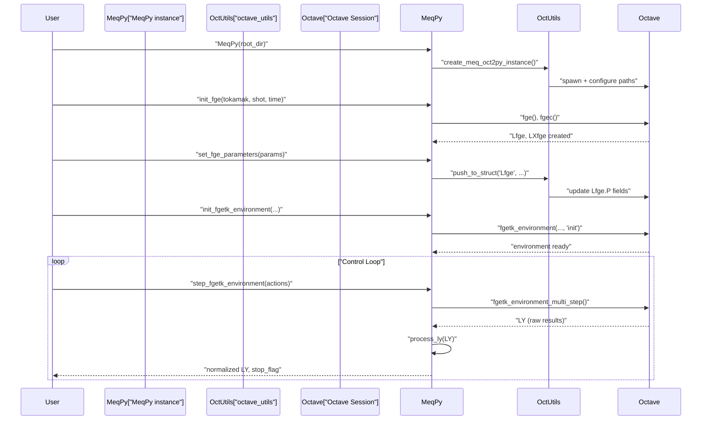

**Sources:** [README.md:59-110]()

## Key Design Patterns

### Structure-Based Configuration

MeqPy uses a structure-based approach inherited from MATLAB/MEQ conventions. Each simulation mode organizes data into three categories:

- **L structures**: Configuration containing parameters (`P`) and geometry (`G`)
- **LX structures**: Input data for simulations
- **LY structures**: Output results from simulations

For example, FGE mode uses `Lfge`, `LXfge`, and `LYfge`, while FBT mode uses `Lfbt`, `LXfbt`, and `LYfbt`.

**Sources:** [README.md:59-60]()

### Octave Session Management

The `octave_utils` module creates and configures a single `Oct2Py` instance per `MeqPy` object. This instance:
- Has its working directory set to the MEQ root
- Has the MEQ `genlib` directory added to its path  
- Persists for the lifetime of the `MeqPy` object
- Enables bidirectional data exchange via struct manipulation

**Sources:** [README.md:10-14](), [README.md:33-43]()

### Data Normalization Pipeline

Output from Octave functions returns MATLAB-style structures that require normalization for Python use. The `ly_post_processing` module converts these structures by:
- Flattening nested fields
- Converting MATLAB arrays to NumPy arrays
- Handling dimension mismatches
- Classifying fields by type

**Sources:** [README.md:86-110]()

### Atomic File Operations

The `file_utils.safe_copy()` function implements atomic file copying using temporary files and rename operations. This ensures data integrity during save/load operations, particularly important when serializing simulation state with function handle conversions.

## Environment Variables and Configuration

MeqPy requires the `MAT_ROOT` environment variable to locate MEQ and associated MATLAB files. This path is used by `octave_utils` to configure the Octave session. Additional paths can be provided via the `extra_paths` parameter in the `MeqPy` constructor or by setting `root_dir` explicitly.

**Sources:** [README.md:33-43](), [pyproject.toml:22-27]()

## Dependencies

| Dependency | Version | Purpose |
|------------|---------|---------|
| `oct2py` | ≥ 5.8.0 | Python-Octave bridge |
| `numpy` | ≥ 1.26 | Numerical operations |
| `jax` | ≥ 0.4 | Data structure handling in post-processing |
| `absl-py` | ≥ 2.0 | Application utilities |
| Octave | (system) | Runtime for MATLAB code execution |

**Sources:** [pyproject.toml:22-27](), [README.md:10-14]()

## Typical Usage Flow

A typical MeqPy workflow follows this pattern:

1. **Initialize**: Create a `MeqPy()` instance, which spawns an Octave session
2. **Configure**: Call `init_fge()` or `init_fbt()` to set up simulation structures
3. **Customize**: Use `set_*_parameters()` and `set_*_geometry()` to adjust configuration
4. **Execute**: 
   - For single-shot: Call `run_fbt()` or `_run_fget()`
   - For time-series: Call `init_fgetk_environment()` then loop with `step_fgetk_environment()`
5. **Persist**: Use `save_to_file()` to checkpoint state for later recovery

Example from the minimal Anamak demonstration:

```python
meq_instance = meqpy.MeqPy()
meq_instance.init_fge(tokamak, shot, time, source, ...)
meq_instance.init_fgetk_environment(control_timestep, simulator_timestep, ...)
for i in range(num_steps):
    LY, stop = meq_instance.step_fgetk_environment(actions, {})
```

**Sources:** [README.md:63-110]()

## Navigation

This overview provides context for understanding MeqPy's architecture. For more specific information:

- Installation procedures: See [Installation and Setup](#1.1)
- Quick start tutorial: See [Quick Start Guide](#1.2)
- Detailed architecture: See [Core Architecture](#2)
- FGE simulations: See [FGE - Fast Grad-Shafranov Equilibrium](#3.1)
- FBT simulations: See [FBT - Fast Boundary Tracing](#3.2)
- Time-dependent control: See [FGETK Environment - Time-Dependent Simulations](#3.4)

---

# Page: Installation and Setup

# Installation and Setup

<details>
<summary>Relevant source files</summary>

The following files were used as context for generating this wiki page:

- [MANIFEST.in](MANIFEST.in)
- [README.md](README.md)
- [pyproject.toml](pyproject.toml)

</details>


## Purpose and Scope

This document provides step-by-step instructions for installing MeqPy and configuring its dependencies. It covers Octave installation, MEQ code setup, Python environment configuration, and verification procedures. For information about running your first simulation after installation, see [Quick Start Guide](#1.2). For detailed information about project structure and build configuration, see [Project Structure and Build System](#9.1).

## Overview

MeqPy is a Python wrapper that interfaces with the MEQ code suite via Octave. The installation process requires setting up multiple components in the correct order:

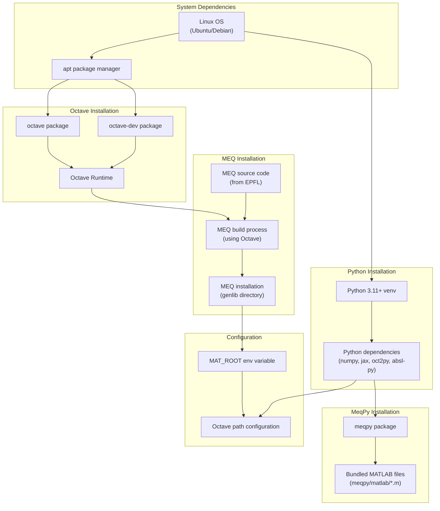

**Installation Dependency Flow**

Sources: [README.md:6-54](), [pyproject.toml:1-35]()

## Prerequisites

### Operating System Requirements

MeqPy is designed for Linux systems. The installation instructions are tested on Ubuntu/Debian-based distributions. Other Linux distributions may require adjustments to package manager commands.

### Required System Packages

The following system packages must be available:
- `octave`: The GNU Octave interpreter (version 5.0 or higher recommended)
- `octave-dev`: Development files for Octave (required for oct2py integration)
- `python3-tk`: Tkinter support for Python (required by some dependencies)
- `python3.11-venv` or higher: Python virtual environment support

Sources: [README.md:10-14](), [README.md:27-28]()

## Step 1: Octave Installation

Install Octave and its development headers using the system package manager:

```bash
sudo apt-get update
sudo apt-get install octave
sudo apt-get install octave-dev
```

**Verification**: After installation, verify Octave is available:

```bash
octave --version
```

The output should display the Octave version number (5.0 or higher recommended).

Sources: [README.md:10-14]()

## Step 2: MEQ Code Installation

### Obtaining MEQ

MEQ is a suite of codes for tokamak magnetic equilibrium calculations developed by SPC-EPFL. Access to MEQ requires authorization from EPFL.

1. Request access via the EPFL Swiss Plasma Center: https://www.epfl.ch/research/domains/swiss-plasma-center/meq/
2. Follow the repository-specific installation instructions provided by EPFL

### Building MEQ

After obtaining the MEQ source code:

```bash
cd <path-to-meq>
# Follow MEQ-specific build instructions using Octave
```

The build process creates a `genlib` directory containing compiled MEQ components. This directory structure is critical for MeqPy operation.

**Directory Structure**: A properly installed MEQ should have the following structure:
```
<MEQ_ROOT>/
├── meq/                  # Core MEQ code
│   ├── genlib/          # Compiled libraries
│   └── ...
└── ...
```

Sources: [README.md:16-23]()

## Step 3: Python Environment Setup

### Creating the Virtual Environment

MeqPy requires Python 3.11 or higher. Create a dedicated virtual environment:

```bash
# Install venv support if not already installed
sudo apt install python3.11-venv

# Create virtual environment
python3 -m venv meqpyvenv

# Activate the environment
source meqpyvenv/bin/activate
```

The virtual environment isolates MeqPy dependencies from other Python projects.

Sources: [README.md:25-31](), [pyproject.toml:21-21]()

### Python Dependencies

MeqPy declares the following Python dependencies in [pyproject.toml:22-27]():

| Dependency | Version Requirement | Purpose |
|------------|-------------------|---------|
| `numpy` | >= 1.26 | Numerical array operations |
| `absl-py` | >= 2.0 | Application utilities and logging |
| `jax` | >= 0.4 | Data structure handling in `ly_post_processing` |
| `oct2py` | >= 5.8.0 | Python-Octave bridge |

These dependencies are automatically installed during MeqPy installation (Step 4).

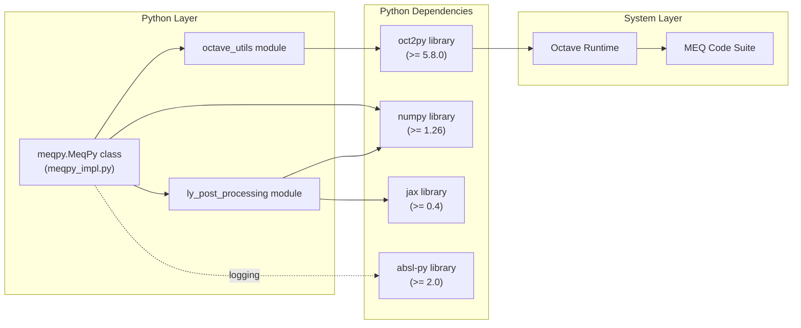

**Python Dependency Chain from MeqPy to System Components**

Sources: [pyproject.toml:22-27]()

## Step 4: MeqPy Package Installation

### Cloning the Repository

```bash
git clone <meqpy-repository-url>
cd meqpy
```

### Installing MeqPy

Install MeqPy in editable mode to enable development and testing:

```bash
pip install -e .
```

The `-e` flag installs the package in "editable" mode, meaning changes to the source code are immediately reflected without reinstallation.

### What Gets Installed

The installation process:

1. Installs all Python dependencies listed in [pyproject.toml:22-27]()
2. Bundles MATLAB/Octave files according to [MANIFEST.in:1]()
3. Makes the `meqpy` package importable in Python

The bundled MATLAB files include:
- `meqpy/matlab/*.m`: Time-series simulation functions (`fgetk_environment.m` and related files)

Sources: [README.md:45-49](), [MANIFEST.in:1](), [pyproject.toml:1-35]()

## Step 5: Environment Configuration

### MAT_ROOT Environment Variable

The `MAT_ROOT` environment variable specifies the root directory containing the MEQ installation. MeqPy uses this to locate MEQ code at runtime.

**Setting MAT_ROOT**: If MEQ is installed at `$HOME/meq`, set:

```bash
export MAT_ROOT=$HOME
```

Note that `MAT_ROOT` should point to the **parent directory** of the `meq` folder, not the `meq` folder itself.

**Persistent Configuration**: To make this permanent, add the export command to your shell configuration file:

```bash
# For bash
echo 'export MAT_ROOT=$HOME' >> ~/.bashrc
source ~/.bashrc

# For zsh
echo 'export MAT_ROOT=$HOME' >> ~/.zshrc
source ~/.zshrc
```

### Alternative: Programmatic Configuration

Instead of using the environment variable, you can specify the path when creating a `MeqPy` instance:

```python
from meqpy import MeqPy

meq = MeqPy(root_dir="/path/to/mat/root")
```

The `root_dir` parameter in the constructor overrides the `MAT_ROOT` environment variable. However, using the environment variable is recommended for testing and development.

Sources: [README.md:33-43]()

### Additional Paths

If you have other MATLAB files outside the standard MEQ installation, pass them using the `extra_paths` parameter:

```python
meq = MeqPy(extra_paths=["/path/to/additional/matlab/files"])
```

Sources: [README.md:36-36]()

## Step 6: Installation Verification

### Running Tests

Verify the installation by running the test suite:

```bash
pytest
```

The test suite exercises core functionality including:
- Octave session initialization (`octave_utils_test`)
- File operations (`file_utils_test`)
- FGE and FBT simulation workflows (`meqpy_fge_test_mixin`, `meqpy_fbt_test_mixin`)

A successful test run indicates that:
- Python dependencies are correctly installed
- Octave is accessible via `oct2py`
- MEQ code is properly located via `MAT_ROOT`
- All system components can communicate

Sources: [README.md:51-54](), [pyproject.toml:30-35]()

### Manual Verification

Test the installation manually with a minimal Python script:

```python
from meqpy import MeqPy

# Create MeqPy instance (will fail if MAT_ROOT not configured)
meq = MeqPy()
print("MeqPy initialized successfully")

# Verify Octave session is working
tokamak = "ana"
shot = 1
time = 0
meq.init_fge(tokamak, shot, time)
print("FGE initialization successful")
```

If this script runs without errors, the installation is complete and functional.

## Installation Architecture

The following diagram shows the file system layout after successful installation:

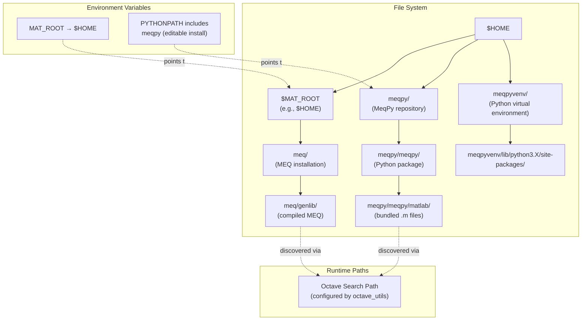

**File System Layout After Installation**

Sources: [README.md:33-43](), [MANIFEST.in:1]()

## Troubleshooting

### Common Issues

**Issue: `oct2py` cannot find Octave**
- Verify Octave is installed: `which octave`
- Ensure `octave` is in your `PATH`
- Check Octave version: `octave --version` (should be 5.0+)

**Issue: `MAT_ROOT` not found errors**
- Verify environment variable: `echo $MAT_ROOT`
- Ensure `MAT_ROOT` points to the parent of the `meq` directory
- Check that `$MAT_ROOT/meq/genlib` exists

**Issue: Import errors for `meqpy` package**
- Verify virtual environment is activated
- Reinstall: `pip install -e .` from the meqpy repository root
- Check Python version: `python --version` (must be 3.11+)

**Issue: Test failures**
- Run with verbose output: `pytest -v`
- Check that MEQ is properly built with a `genlib` directory
- Verify all system packages are installed (`octave-dev`, `python3-tk`)

**Issue: Function handles not found in loaded state files**
- This is expected behavior when loading `.mat` files that contain function handles
- The `meqpy_impl` module includes restoration logic for common function handles
- See [State Persistence and Recovery](#5) for details on function handle management

Sources: [README.md:6-54]()

## Next Steps

After successful installation:
1. Review the [Quick Start Guide](#1.2) for a simple example
2. Explore [Simulation Modes](#3) to understand FGE, FBT, and FGETK environments
3. Consult [Core Architecture](#2) to understand how components interact

---

# Page: Quick Start Guide

# Quick Start Guide

<details>
<summary>Relevant source files</summary>

The following files were used as context for generating this wiki page:

- [README.md](README.md)
- [meqpy/__init__.py](meqpy/__init__.py)
- [meqpy/meqpy_impl.py](meqpy/meqpy_impl.py)

</details>


## Purpose and Scope

This guide provides a practical introduction to running your first MeqPy simulation. It demonstrates the basic workflow for initializing a tokamak equilibrium, setting up a time-dependent simulation environment, and interpreting results. 

For installation instructions and environment configuration, see [Installation and Setup](#1.1). For detailed documentation of simulation modes and advanced configuration, see [Simulation Modes](#3) and [Core Architecture](#2).

Sources: [README.md:56-111]()

---

## Basic Workflow Overview

The typical MeqPy workflow follows this sequence:

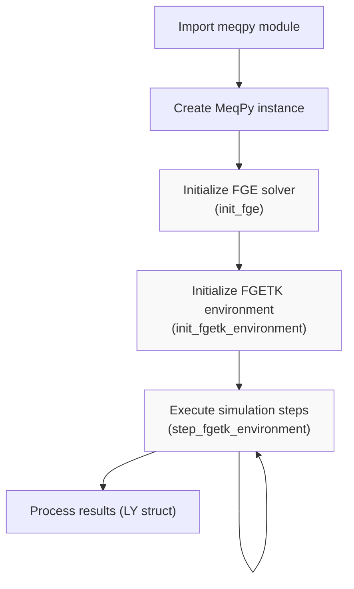

**Diagram: Basic MeqPy Simulation Workflow** - The core sequence from initialization to results extraction.

Sources: [meqpy_impl.py:75-134](), [README.md:56-111]()

---

## Minimal Working Example

This example demonstrates initializing and running a basic time-dependent FGE simulation using the analytical Anamak tokamak:

```python
import meqpy
import numpy as np

# Configuration
tokamak = "ana"  # Anamak analytical tokamak
shot = 2  # Diverted configuration
time = 0.0  # Initial time (seconds)
source = meqpy.MeqSource.MEQ_DIRECT

# Time stepping parameters
control_timestep = 1e-4  # Control action update rate
simulator_timestep = 1e-4  # Internal simulation timestep

# Create MeqPy instance
meq = meqpy.MeqPy()

# Initialize FGE equilibrium solver
meq.init_fge(
    tokamak=tokamak,
    shot=shot,
    time=time,
    source=source,
    default_meq_params={'debug': 2}
)

# Initialize time-dependent environment
original_bp = meq.get_fge_input('bpD')
ly_init, stop = meq.init_fgetk_environment(
    control_timestep=control_timestep,
    simulator_timestep=simulator_timestep,
    input_overrides={'bpD': original_bp * 1.001}
)

# Get control circuit names
circuit_names = meq.get_fgetk_circuit_names()
num_actions = len(circuit_names)

# Define actions (voltages to apply)
actions = np.full((num_actions,), 10.0)

# Execute simulation steps
for i in range(5):
    ly, stop = meq.step_fgetk_environment(actions, {})
    
    print(f"Step {i}: Ip={ly.Ip:.0f}A, FB={ly.FB[0]:.6f}, zA={ly.zA[0]:.6f}")
    
    if stop != 'ok':
        print(f"Simulation stopped: {stop}")
        break
```

Sources: [README.md:56-111](), [meqpy_impl.py:83-97](), [meqpy_impl.py:135-180]()

---

## Step-by-Step Breakdown

### 1. Import and Configuration

```python
import meqpy
```

The `meqpy` package exports two main symbols: the `MeqPy` class and the `MeqSource` enum.

| Parameter | Type | Description |
|-----------|------|-------------|
| `tokamak` | `str` | Tokamak identifier (e.g., "ana" for Anamak) |
| `shot` | `int` | Shot number defining geometry/configuration |
| `time` | `float` | Initial simulation time in seconds |
| `source` | `MeqSource` | Data source (use `MeqSource.MEQ_DIRECT`) |

Sources: [meqpy/__init__.py:15-20](), [meqpy_impl.py:69-73]()

### 2. Create MeqPy Instance

```python
meq = meqpy.MeqPy()
```

This initializes an Octave session and configures MEQ paths. The constructor accepts optional parameters:

| Parameter | Type | Default | Description |
|-----------|------|---------|-------------|
| `root_dir` | `str \| None` | `None` | MEQ installation root (uses `MAT_ROOT` env var if `None`) |
| `extra_paths` | `Sequence[str]` | `()` | Additional paths relative to `root_dir` |

The instance maintains an Octave session throughout its lifetime. Always call `cleanup()` or use context management when done.

Sources: [meqpy_impl.py:83-97]()

### 3. Initialize FGE Solver

```python
meq.init_fge(
    tokamak=tokamak,
    shot=shot,
    time=time,
    source=source,
    default_meq_params={'debug': 2}
)
```

This creates the `Lfge` (configuration) and `LXfge` (inputs) structures in Octave. The `default_meq_params` dictionary sets parameters in `Lfge.P`:

| Common Parameter | Description |
|------------------|-------------|
| `debug` | Debug level (0=off, 1=basic, 2=verbose) |
| `nit` | Maximum iterations for convergence |
| `err` | Convergence error tolerance |

Sources: [meqpy_impl.py:135-180](), [meqpy_impl.py:305-327]()

### 4. Initialize FGETK Environment

```python
ly_init, stop = meq.init_fgetk_environment(
    control_timestep=control_timestep,
    simulator_timestep=simulator_timestep,
    input_overrides={'bpD': original_bp * 1.001}
)
```

This initializes the time-dependent simulation environment by calling `fgetk_environment` with mode `'init'`. Key constraints:

- `control_timestep` must be an integer multiple of `simulator_timestep`
- Returns initial `LY` (results) and stop condition string
- `input_overrides` allows modifying initial conditions

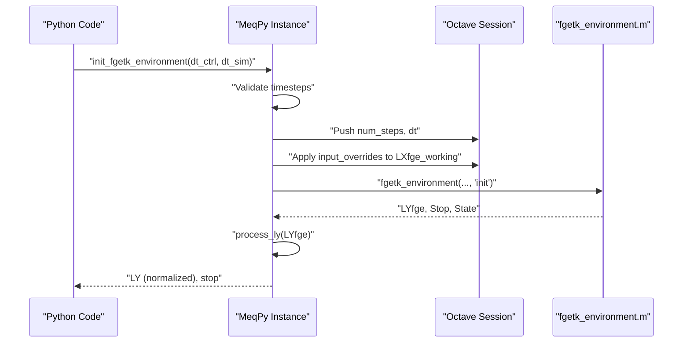

**Diagram: FGETK Environment Initialization Sequence** - Shows the initialization call flow from Python to Octave.

Sources: [meqpy_impl.py:474-511](), [matlab/fgetk_environment.m]()

### 5. Execute Simulation Steps

```python
for i in range(num_steps):
    ly, stop = meq.step_fgetk_environment(actions, input_overrides={})
```

Each call to `step_fgetk_environment` advances the simulation by one control timestep:

| Parameter | Type | Description |
|-----------|------|-------------|
| `actions` | `np.ndarray` | Voltages for each control circuit (shape: `(num_actions,)`) |
| `input_overrides` | `Mapping[str, np.ndarray]` | Optional overrides for LX fields |

**Returns**: Tuple of `(LY, stop)` where:
- `LY` is the results structure (see below)
- `stop` is a string indicating simulation status (`'ok'`, `'diverged'`, etc.)

**Important**: The returned `LY` corresponds to the *previous* timestep, reflecting real control system delays where actions at time `n` are based on observations from time `n-1`.

Sources: [meqpy_impl.py:513-545](), [matlab/fgetk_environment_multi_step.m]()

---

## Understanding Results

The `LY` structure returned by simulation steps contains computed equilibrium quantities:

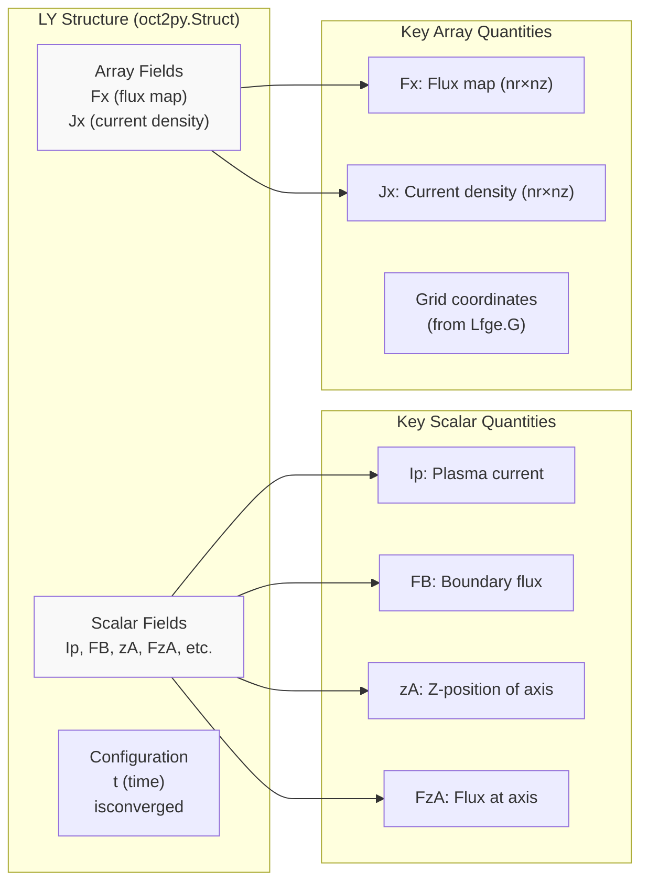

**Diagram: LY Results Structure** - Key fields in the equilibrium results returned by FGE.

### Accessing Result Fields

```python
# Scalar quantities
plasma_current = ly.Ip  # Plasma current (Amperes)
boundary_flux = ly.FB[0]  # Boundary flux (Weber)
z_axis = ly.zA[0]  # Vertical position of magnetic axis (meters)

# 2D arrays (flux map)
flux_map = ly.Fx  # Shape: (nr, nz)
current_density = ly.Jx  # Shape: (nr, nz)

# Grid coordinates (from geometry)
rx = meq.get_fge_geometry('rx').reshape(-1)  # Radial coordinates
zx = meq.get_fge_geometry('zx').reshape(-1)  # Vertical coordinates
```

### Plotting Flux Contours

```python
import matplotlib.pyplot as plt

# Plot flux contours
plt.contour(rx, zx, flux_map - boundary_flux, 21)
plt.contour(rx, zx, flux_map, [boundary_flux], colors='k', linewidths=2)
plt.axis('equal')
plt.xlabel('R (m)')
plt.ylabel('Z (m)')
plt.title(f'Flux Contours at t={ly.t:.4f}s')
plt.show()
```

Sources: [meqpy_impl.py:358-365](), [ly_post_processing.py](), [README.md:96-110]()

---

## Code Entity Reference

The following table maps conceptual operations to specific code entities:

| Operation | Class/Function | File | Purpose |
|-----------|---------------|------|---------|
| Create instance | `MeqPy.__init__()` | [meqpy_impl.py:83-97]() | Initialize Octave session |
| Initialize FGE | `MeqPy.init_fge()` | [meqpy_impl.py:135-180]() | Create `Lfge`, `LXfge` structures |
| Initialize environment | `MeqPy.init_fgetk_environment()` | [meqpy_impl.py:474-511]() | Setup time-dependent simulation |
| Execute step | `MeqPy.step_fgetk_environment()` | [meqpy_impl.py:513-545]() | Advance simulation by one control timestep |
| Get parameter | `MeqPy.get_fge_parameter()` | [meqpy_impl.py:433-434]() | Read value from `Lfge.P` |
| Get geometry | `MeqPy.get_fge_geometry()` | [meqpy_impl.py:436-437]() | Read value from `Lfge.G` |
| Get input | `MeqPy.get_fge_input()` | [meqpy_impl.py:439-440]() | Read value from `LXfge` |
| Normalize results | `process_ly()` | [ly_post_processing.py]() | Convert MATLAB structs to Python-friendly format |

Sources: [meqpy_impl.py:75-785]()

---

## Alternative Workflows

### Two-Stage Initialization (FBT → FGE)

For more control over boundary reconstruction, you can run FBT separately before initializing FGE:

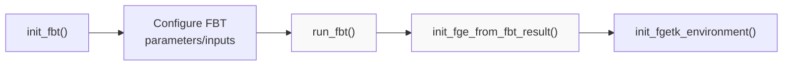

**Diagram: Two-Stage Initialization Workflow** - Using FBT results to initialize FGE.

```python
# Stage 1: Run FBT
meq.init_fbt(tokamak, shot, time, source)
meq.set_fbt_parameters(parameters={'debug': 2})
ly_fbt = meq.run_fbt()

# Stage 2: Initialize FGE from FBT result
meq.init_fge_from_fbt_result(tokamak, shot, time, source)
ly_init, stop = meq.init_fgetk_environment(control_timestep, simulator_timestep)
```

For details on FBT, see [FBT - Fast Boundary Tracing](#3.2) and [FBT to FGE Integration](#3.3).

Sources: [meqpy_impl.py:202-220](), [meqpy_impl.py:239-287]()

---

## Common Patterns

### Accessing Control Circuit Information

```python
# Get list of control circuit names
circuit_names = meq.get_fgetk_circuit_names()
# Returns: array(['OH', 'FUP', 'FLO', ...])

# Get number of circuits for action vector sizing
num_actions = len(circuit_names)
```

Sources: [meqpy_impl.py:564-565]()

### Checking Simulation Status

```python
ly, stop = meq.step_fgetk_environment(actions, {})

if stop != 'ok':
    if stop == 'diverged':
        print("Simulation diverged - check parameters")
    elif stop == 'time_limit':
        print("Reached time limit")
    else:
        print(f"Unexpected stop condition: {stop}")
```

Sources: [meqpy_impl.py:513-545](), [matlab/fgetk_environment.m]()

### Resource Cleanup

```python
# Explicit cleanup
meq.cleanup()

# Or use try-finally
meq = meqpy.MeqPy()
try:
    # ... simulation code ...
finally:
    meq.cleanup()
```

Sources: [meqpy_impl.py:101-109]()

---

## Next Steps

After completing this quick start guide:

- **Detailed Configuration**: Learn about parameter tuning and geometry settings in [Parameter and Geometry Configuration](#8.1)
- **Simulation Modes**: Explore FGE, FBT, and FGETK modes in detail in [Simulation Modes](#3)
- **State Persistence**: Save and load simulation states for debugging in [State Persistence and Recovery](#5)
- **Error Handling**: Understand common errors and debugging strategies in [Error Handling and Debugging](#8.2)

Sources: [meqpy_impl.py:1-785](), [README.md:1-131]()

---

# Page: Core Architecture

# Core Architecture

<details>
<summary>Relevant source files</summary>

The following files were used as context for generating this wiki page:

- [meqpy/__init__.py](meqpy/__init__.py)
- [meqpy/meqpy_impl.py](meqpy/meqpy_impl.py)
- [meqpy/octave_utils.py](meqpy/octave_utils.py)

</details>


## Purpose and Scope

This document explains the layered architecture of MeqPy, detailing how Python components interface with the Octave/MATLAB-based MEQ computational engine. It covers the overall system structure, component responsibilities, and inter-layer communication patterns.

For detailed information about specific components, see:
- The main API class and its methods: [The MeqPy Class](#2.1)
- Octave bridge utilities and struct operations: [Octave Integration Layer](#2.2)
- Data structure conventions between Python and Octave: [Data Structures and Conventions](#2.3)

---

## Architectural Overview

MeqPy implements a **layered architecture** that separates concerns across five distinct layers, enabling Python applications to leverage existing Octave/MATLAB MEQ implementations without requiring reimplementation of the computational core.

### Layer Architecture

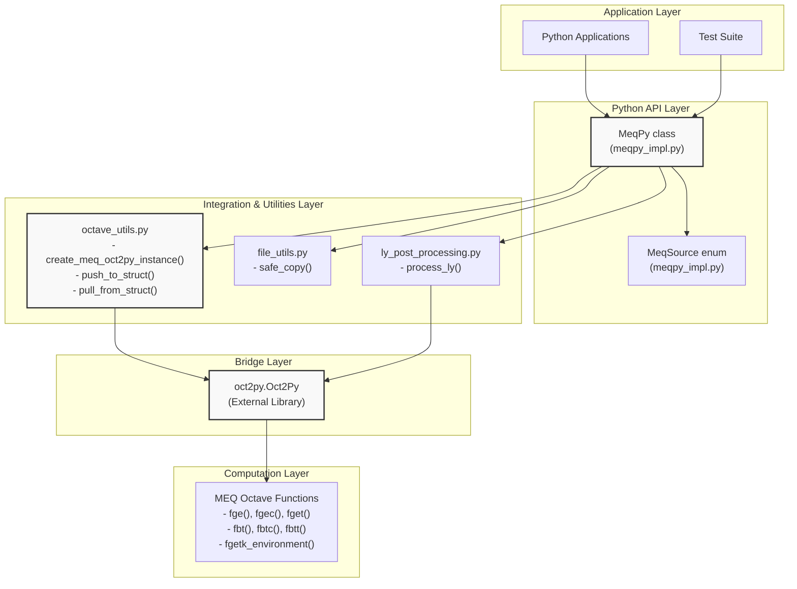

**Sources:** [meqpy/__init__.py:1-21](), [meqpy/meqpy_impl.py:1-100](), [meqpy/octave_utils.py:1-66]()

---

## Component Layers

### Layer 1: Application Layer

The application layer consists of end-user Python code and the test infrastructure. Users interact exclusively with the public API exposed through the `MeqPy` class and `MeqSource` enum.

| Component | Module | Purpose |
|-----------|--------|---------|
| Public API | `meqpy/__init__.py` | Exports `MeqPy` and `MeqSource` |
| User Applications | External | Scientific simulations, control algorithms |
| Test Infrastructure | `meqpy/*_test.py` | Validation and regression testing |

**Sources:** [meqpy/__init__.py:15-20]()

### Layer 2: Python API Layer

The `MeqPy` class in `meqpy_impl.py` serves as the central orchestrator, providing a stateful interface to MEQ functionality.

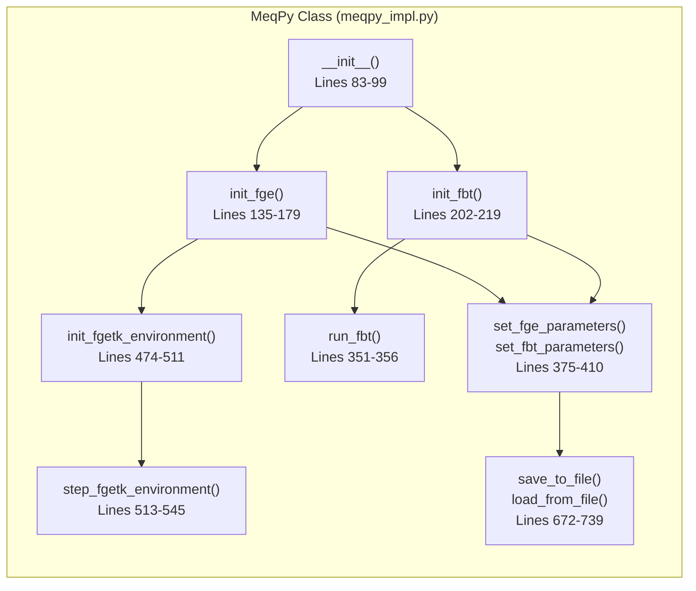

**Key Responsibilities:**
- **Lifecycle Management**: Initializes and maintains the Octave session via `_octave` attribute [meqpy/meqpy_impl.py:95-97]()
- **Simulation Mode Control**: Provides distinct initialization paths for FGE, FBT, and FGETK environments
- **State Persistence**: Implements save/load mechanisms for debugging and reproducibility [meqpy/meqpy_impl.py:672-739]()
- **Parameter Configuration**: Exposes methods to set parameters and geometry for both FGE and FBT modes

The `MeqSource` enum defines data source types, currently supporting `MEQ_DIRECT` for direct MEQ method invocation [meqpy/meqpy_impl.py:69-73]().

**Sources:** [meqpy/meqpy_impl.py:75-134](), [meqpy/meqpy_impl.py:135-240](), [meqpy/meqpy_impl.py:474-545]()

### Layer 3: Integration & Utilities Layer

This layer provides specialized utilities that bridge Python and Octave paradigms.

#### octave_utils Module

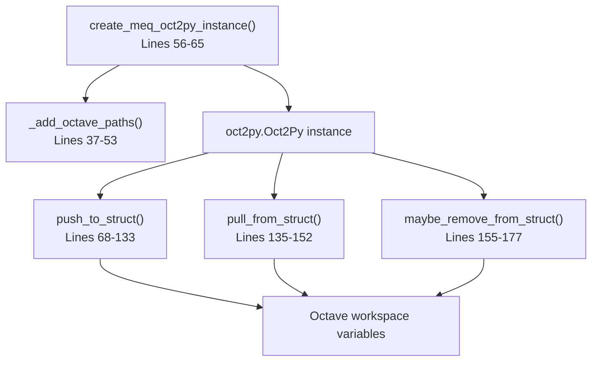

**Functions:**

| Function | Lines | Purpose |
|----------|-------|---------|
| `create_meq_oct2py_instance()` | 56-65 | Creates and configures Oct2Py instance with MEQ paths |
| `push_to_struct()` | 68-133 | Assigns Python dict values to Octave struct fields with validation |
| `pull_from_struct()` | 135-152 | Retrieves Octave struct field values to Python |
| `maybe_remove_from_struct()` | 155-177 | Conditionally removes struct fields if they exist |

The path configuration includes MEQ core, genlib, octave_optim, octave_control, and the bundled `meqpy.matlab` package [meqpy/octave_utils.py:29-51]().

**Sources:** [meqpy/octave_utils.py:56-177]()

#### file_utils Module

Provides atomic file operations via `safe_copy()` to ensure data integrity during persistence operations, particularly important when saving Octave state to `.mat` files.

**Sources:** [meqpy/meqpy_impl.py:720-722]()

#### ly_post_processing Module

The `process_ly()` function normalizes MATLAB-style data structures (LY outputs) into Python-friendly formats, handling dimension squeezing and field classification.

**Sources:** [meqpy/meqpy_impl.py:364](), [meqpy/meqpy_impl.py:511](), [meqpy/meqpy_impl.py:545]()

### Layer 4: Bridge Layer

The `oct2py` library (version ≥ 5.8.0) provides the Python-to-Octave bridge. The `MeqPy` class configures it with `keep_matlab_shapes=True` to preserve array dimensions [meqpy/octave_utils.py:62]().

**Key Features Used:**
- `eval()`: Execute Octave commands
- `push()`: Transfer Python variables to Octave workspace
- `pull()`: Retrieve Octave variables to Python
- `addpath()`, `genpath()`: Configure Octave search paths

**Sources:** [meqpy/octave_utils.py:56-65]()

### Layer 5: Computation Layer

The computation layer consists of Octave/MATLAB functions from the MEQ codebase (located via `MAT_ROOT` environment variable) and bundled MATLAB code in `meqpy.matlab`.

**MEQ Core Functions:**

| Function | Purpose | Called From |
|----------|---------|-------------|
| `fge()` | Initialize FGE structure (L) | [meqpy/meqpy_impl.py:323-326]() |
| `fgec()` | Consolidate FGE structure after parameter changes | [meqpy/meqpy_impl.py:396]() |
| `fget()` | Run time-dependent FGE simulation | [meqpy/meqpy_impl.py:472]() |
| `fbt()` | Initialize FBT structure (L) | [meqpy/meqpy_impl.py:342]() |
| `fbtc()` | Consolidate FBT structure | [meqpy/meqpy_impl.py:410]() |
| `fbtt()` | Run FBT simulation | [meqpy/meqpy_impl.py:360]() |
| `fgetk_environment()` | Time-stepping simulation environment | [meqpy/meqpy_impl.py:507]() |

**Bundled MATLAB Code:**

The `meqpy.matlab` package includes specialized functions for control-oriented simulations:
- `fgetk_environment.m`: Main environment controller
- `fgetk_environment_loop.m`: Inner loop logic
- `fgetk_environment_multi_step.m`: Multi-step execution
- `fgetk_environment_test.m`: Test utilities

**Sources:** [meqpy/octave_utils.py:29-51](), [meqpy/meqpy_impl.py:323-360]()

---

## Data Flow and Communication Patterns

### Initialization Flow

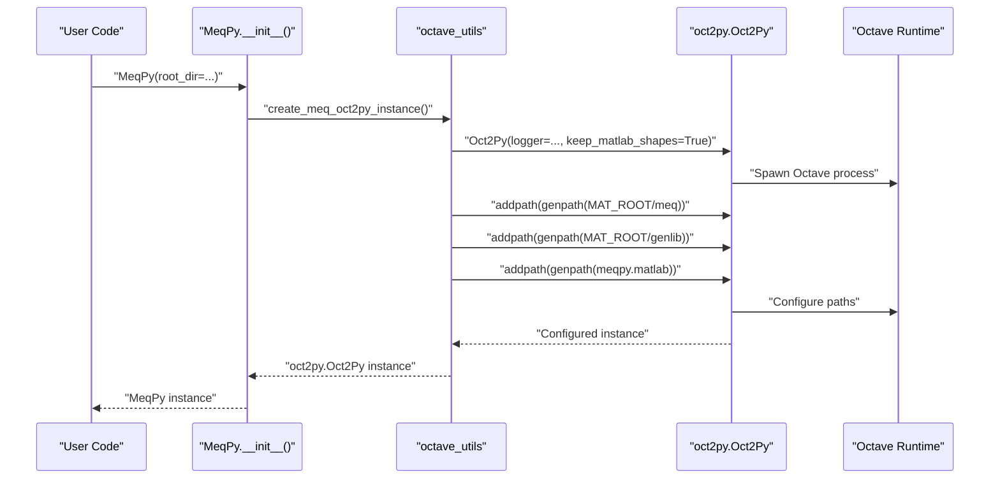

**Sources:** [meqpy/meqpy_impl.py:83-99](), [meqpy/octave_utils.py:56-65](), [meqpy/octave_utils.py:37-53]()

### Parameter Configuration Flow

The parameter configuration flow demonstrates bidirectional communication between Python and Octave:

```mermaid
sequenceDiagram
    participant User as "User Code"
    participant MeqPy as "MeqPy"
    participant OctUtils as "octave_utils"
    participant Oct2Py as "oct2py.Oct2Py"
    participant Octave as "Octave Workspace"
    
    User->>MeqPy: "set_fge_parameters(params={'debug': 1})"
    MeqPy->>OctUtils: "push_to_struct(octave, 'Lfge.P', params)"
    OctUtils->>Oct2Py: "eval('isfield(Lfge.P, {'debug'})')"
    Oct2Py->>Octave: "Check field exists"
    Octave-->>Oct2Py: "True"
    OctUtils->>Oct2Py: "push(['debug_temp'], [1])"
    Oct2Py->>Octave: "Create debug_temp = 1"
    OctUtils->>Oct2Py: "eval('Lfge.P.debug = debug_temp; clear debug_temp;')"
    Oct2Py->>Octave: "Assign and cleanup"
    OctUtils-->>MeqPy: "Complete"
    MeqPy->>Oct2Py: "eval('Lfge = fgec(Lfge.P, Lfge.G);')"
    Oct2Py->>Octave: "Run consolidation"
    Octave-->>Oct2Py: "Updated Lfge"
    MeqPy-->>User: "Parameters set"
```

**Key Design Decisions:**
1. **Field Validation**: `push_to_struct()` validates that all fields exist before assignment to prevent silent failures [meqpy/octave_utils.py:107-129]()
2. **Temporary Variables**: Uses temporary variables during assignment to enable atomic batch updates [meqpy/octave_utils.py:93-101]()
3. **Consolidation**: Always runs consolidation functions (`fgec()`, `fbtc()`) after parameter changes to regenerate derived quantities [meqpy/meqpy_impl.py:396](), [meqpy/meqpy_impl.py:410]()

**Sources:** [meqpy/meqpy_impl.py:375-410](), [meqpy/octave_utils.py:68-133]()

---

## Execution and Result Processing

### Simulation Execution Pattern

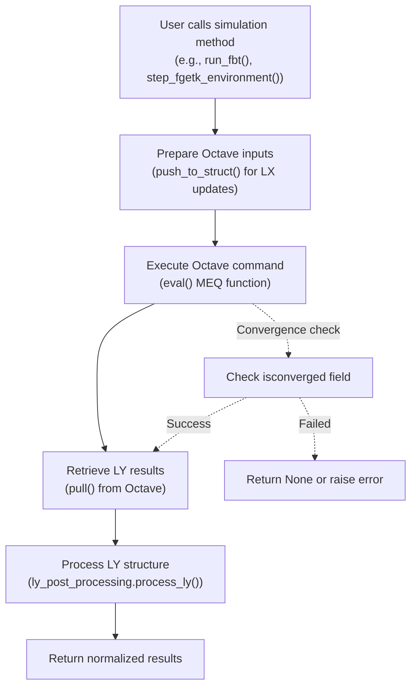

**Example: FBT Execution** [meqpy/meqpy_impl.py:351-364]()

1. **Execute**: `octave_eval("LYfbt = fbtt(Lfbt, LXfbt);")`
2. **Validate**: Check `LYfbt.isconverged` field
3. **Retrieve**: `octave.pull("LYfbt")`
4. **Process**: `ly_post_processing.process_ly(ly)`
5. **Return**: Normalized `oct2py.Struct` to user

**Sources:** [meqpy/meqpy_impl.py:351-364](), [meqpy/meqpy_impl.py:513-545]()

---

## State Management and Persistence

The `MeqPy` class maintains simulation state through the Octave session and provides mechanisms for saving and loading state for debugging and reproducibility.

### State Variables by Mode

| Mode | Configuration (L) | Inputs (LX) | Results (LY) | Additional State |
|------|-------------------|-------------|--------------|------------------|
| FGE | `Lfge` (with `Lfge.P`, `Lfge.G`) | `LXfge` | `LYfge` | - |
| FBT | `Lfbt` (with `Lfbt.P`, `Lfbt.G`) | `LXfbt` | `LYfbt` | - |
| FGETK | `Lfge` (reused) | `LXfge_sequence` | `LYfge` | `State`, `State_prev`, `Actions`, `num_steps` |

**Sources:** [meqpy/meqpy_impl.py:45-58]()

### Persistence Mechanism

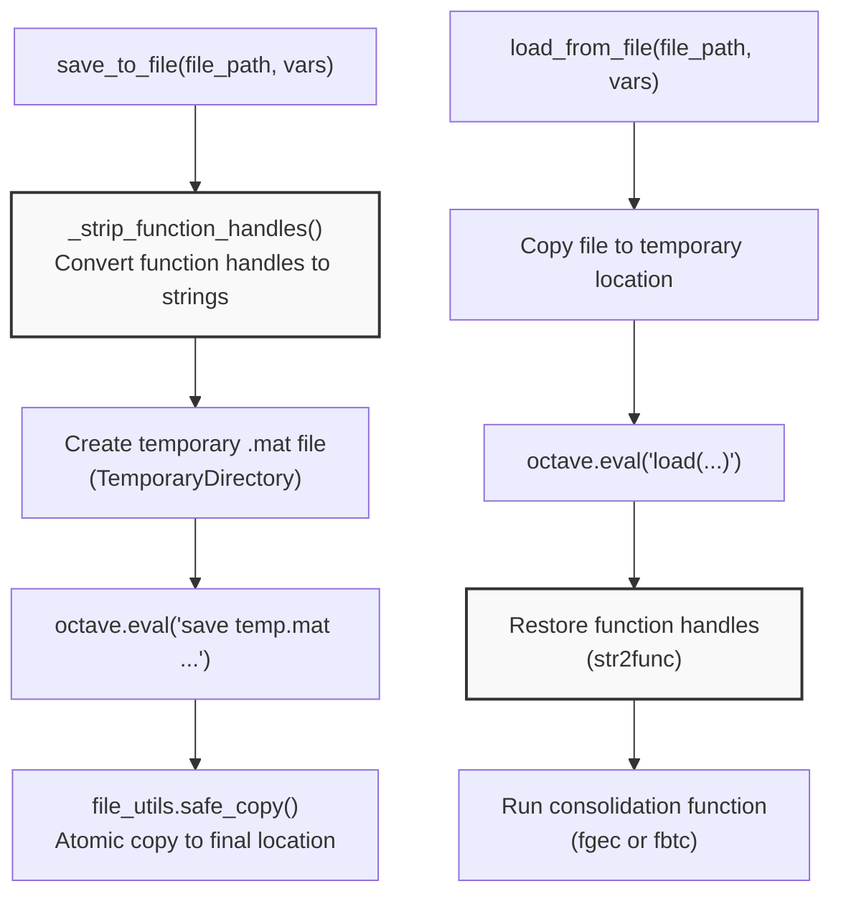

**Function Handle Conversion:**

Octave function handles (e.g., `@bfgen`, `@inflinR`) cannot be directly serialized. The persistence mechanism:
1. **On Save**: Converts function handles to strings using `strip_function_handles()` [meqpy/meqpy_impl.py:661-670]()
2. **On Load**: Reconstructs function handles using `str2func()` and runs consolidation to regenerate derived quantities [meqpy/meqpy_impl.py:593-608]()

**Temporary File Strategy:**

Uses `tmpfs` (if available) or system temp directory for intermediate file operations to avoid Octave's file access limitations [meqpy/meqpy_impl.py:711-722](), [meqpy/meqpy_impl.py:770-784]().

**Sources:** [meqpy/meqpy_impl.py:672-739](), [meqpy/meqpy_impl.py:661-670](), [meqpy/meqpy_impl.py:581-608]()

---

## Lifecycle and Resource Management

### Instance Lifecycle

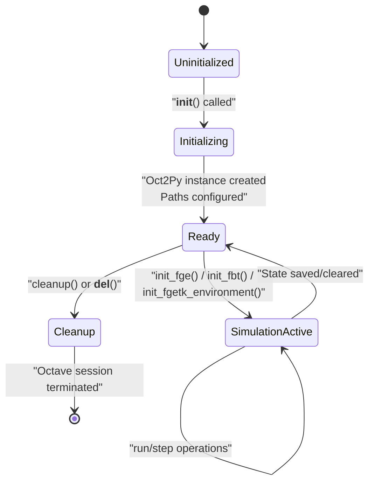

**Key Attributes:**
- `_octave`: The `oct2py.Oct2Py` instance holding Octave session [meqpy/meqpy_impl.py:95-96]()
- `_is_open`: Boolean flag tracking Octave session state [meqpy/meqpy_impl.py:94](), [meqpy/meqpy_impl.py:106-109]()
- `_env_num_steps`: Cached ratio of control timestep to simulator timestep for FGETK mode [meqpy/meqpy_impl.py:99](), [meqpy/meqpy_impl.py:481-487]()

### Cleanup and Resource Release

The `cleanup()` method ensures proper resource release:
1. Clears all Octave workspace variables: `eval("clear all;")`
2. Terminates Octave session: `_octave.exit()`
3. Sets `_is_open = False`

The `__del__()` destructor calls `cleanup()` to ensure cleanup occurs even if not explicitly called [meqpy/meqpy_impl.py:101-109]().

**Sources:** [meqpy/meqpy_impl.py:83-109]()

---

## Cross-Layer Interaction Summary

The following table summarizes how different architectural concerns are addressed across layers:

| Concern | Python API Layer | Integration Layer | Bridge Layer | Computation Layer |
|---------|------------------|-------------------|--------------|-------------------|
| **Simulation Control** | `MeqPy.init_fge()`, `run_fbt()`, `step_fgetk_environment()` | Path configuration, struct operations | Command execution | MEQ algorithms (fge, fbt, fgetk) |
| **Data Transfer** | Method parameters and returns | `push_to_struct()`, `pull_from_struct()` | `push()`, `pull()`, `eval()` | Octave workspace variables |
| **Error Handling** | Convergence checks, ValueError exceptions | Field validation in `push_to_struct()` | Oct2Py exceptions | Octave error messages |
| **State Management** | `save_to_file()`, `load_from_file()` | Function handle conversion | `.mat` file I/O | Persistent workspace variables |
| **Type Conversion** | NumPy arrays, Python dicts | `process_ly()` normalization | oct2py type mapping | MATLAB/Octave arrays, structs |

**Sources:** [meqpy/meqpy_impl.py:75-785](), [meqpy/octave_utils.py:56-177]()

---

## Summary

The MeqPy architecture achieves clean separation of concerns through its five-layer design:

1. **Application Layer**: User-facing Python applications and tests
2. **API Layer**: The `MeqPy` class providing stateful orchestration
3. **Integration Layer**: Utility modules (`octave_utils`, `file_utils`, `ly_post_processing`) bridging Python and Octave paradigms
4. **Bridge Layer**: The `oct2py` library enabling Python-Octave communication
5. **Computation Layer**: MEQ Octave/MATLAB functions performing plasma equilibrium calculations

This architecture enables Python applications to leverage existing MEQ implementations while maintaining type safety, data integrity, and a Pythonic interface. For implementation details of specific components, refer to the sub-pages linked at the beginning of this document.

---

# Page: The MeqPy Class

# The MeqPy Class

<details>
<summary>Relevant source files</summary>

The following files were used as context for generating this wiki page:

- [meqpy/__init__.py](meqpy/__init__.py)
- [meqpy/meqpy_impl.py](meqpy/meqpy_impl.py)

</details>


This document describes the `MeqPy` class, which serves as the primary Python interface for controlling MEQ simulations. The `MeqPy` class manages the Octave session, orchestrates simulation workflows (FGE, FBT, FGETK), and provides methods for parameter configuration, state persistence, and result retrieval.

For information about the Octave integration layer that `MeqPy` relies on, see [Octave Integration Layer](#2.2). For details on the data structures used by MEQ, see [Data Structures and Conventions](#2.3). For specific simulation mode usage, see [Simulation Modes](#3).

**Scope**: This page focuses on the `MeqPy` class itself—its initialization, lifecycle, method organization, and state management. Implementation details of individual simulation modes are covered in their respective sections.

---

## Class Overview

The `MeqPy` class is defined in [meqpy/meqpy_impl.py:75-753]() and serves as a stateful wrapper around an Octave session. It maintains simulation state through Octave variables and provides a Pythonic API for MEQ operations.

### Core Responsibilities

| Responsibility | Description | Key Methods |
|---|---|---|
| **Session Management** | Initialize and maintain Octave session | `__init__`, `cleanup`, `octave_eval` |
| **FGE Operations** | Fast Grad-Shafranov Equilibrium simulations | `init_fge`, `set_fge_parameters`, `_run_fget` |
| **FBT Operations** | Fast Boundary Tracing simulations | `init_fbt`, `run_fbt`, `set_fbt_inputs` |
| **FGETK Environment** | Time-dependent control simulations | `init_fgetk_environment`, `step_fgetk_environment` |
| **State Persistence** | Save and restore simulation state | `save_to_file`, `load_from_file` |
| **Data Access** | Query parameters, geometry, and inputs | `get_fge_parameter`, `get_fbt_geometry` |

**MeqPy Class Structure**

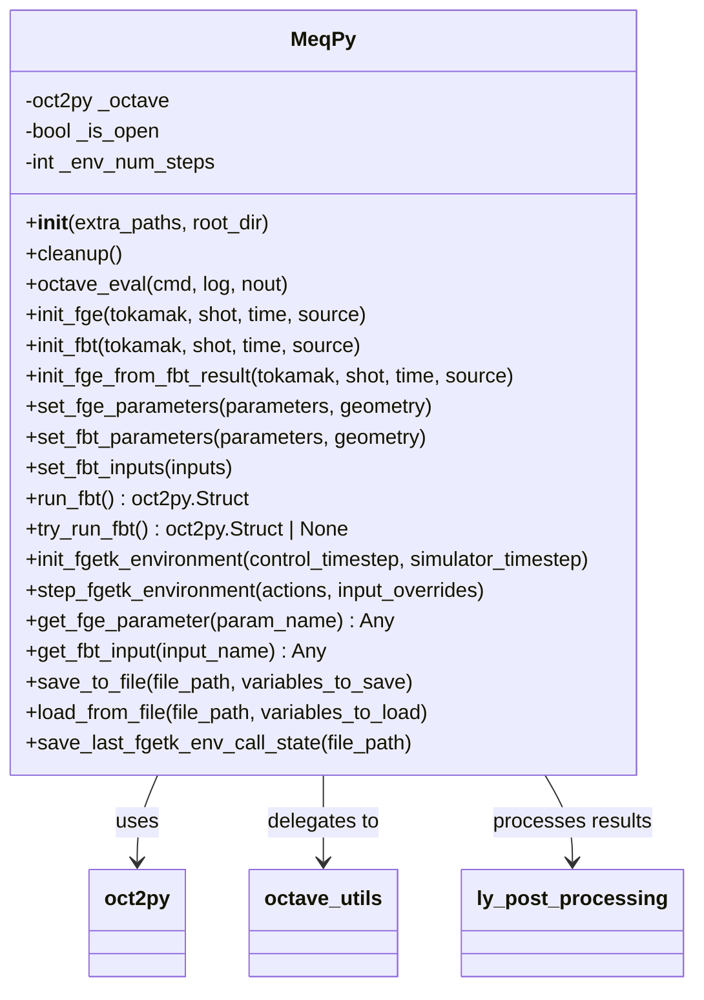

Sources: [meqpy/meqpy_impl.py:75-753]()

---

## Initialization and Lifecycle

### Constructor

The `MeqPy` constructor [meqpy/meqpy_impl.py:83-97]() initializes the Octave session and prepares the MEQ environment:

```python
def __init__(self, *, extra_paths: Sequence[str] = (),
             root_dir: str | None = None):
```

**Parameters:**
- `extra_paths`: Additional paths to add to the Octave path, relative to `root_dir`
- `root_dir`: Root directory for MEQ code (typically the `MAT_ROOT` environment variable)

**Behavior:**
1. Calls `octave_utils.create_meq_oct2py_instance()` [meqpy/meqpy_impl.py:95-96]() to spawn and configure the Octave session
2. Sets `_is_open = True` to track session state
3. Initializes `_env_num_steps = 0` for FGETK environment tracking

**Lifecycle States**

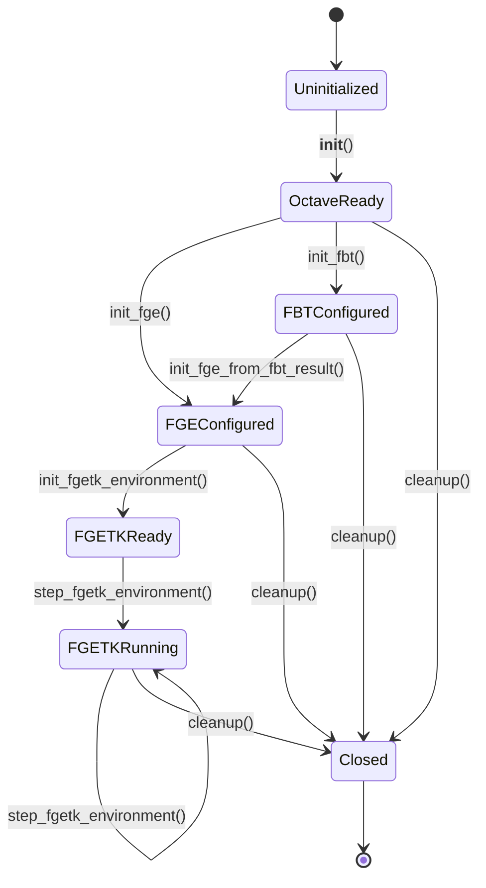

Sources: [meqpy/meqpy_impl.py:83-109]()

### Cleanup and Resource Management

The class implements cleanup through both `__del__` [meqpy/meqpy_impl.py:101-102]() and explicit `cleanup()` [meqpy/meqpy_impl.py:104-109]():

```python
def cleanup(self) -> None:
    """Cleanup the MEQ Oct2py instance."""
    if self._is_open:
        self._octave.eval("clear all;")
        self._octave.exit()
        self._is_open = False
```

The cleanup process:
1. Clears all Octave variables with `clear all`
2. Exits the Octave session via `oct2py`
3. Marks the session as closed to prevent further operations

Sources: [meqpy/meqpy_impl.py:101-109]()

---

## Method Categories

The `MeqPy` class organizes its methods into distinct functional categories, each serving a specific role in the simulation workflow.

### Initialization Methods

**Method Organization by Simulation Type**

```mermaid
graph TB
    subgraph "FGE Initialization"
        init_fge["init_fge()"]
        _init_fge["_init_fge()"]
        _init_fge_directly["_init_fge_directly()"]
        _init_fge_static["_init_fge_static()"]
        init_fge_from_fbt["init_fge_from_fbt_result()"]
    end
    
    subgraph "FBT Initialization"
        init_fbt["init_fbt()"]
        _init_fbt["_init_fbt()"]
        _init_fbt_directly["_init_fbt_directly()"]
    end
    
    subgraph "FGETK Initialization"
        init_fgetk["init_fgetk_environment()"]
    end
    
    subgraph "Helper Methods"
        _set_fge_inputs_using_fbt["_set_fge_inputs_using_fbt()"]
        _set_fbt_inputs_directly["_set_fbt_inputs_directly()"]
        set_fge_input_from_fbt_run["set_fge_input_from_fbt_run()"]
    end
    
    init_fge --> _init_fge
    _init_fge --> _init_fge_directly
    _init_fge --> _set_fge_inputs_using_fbt
    
    init_fge_from_fbt --> _init_fge_static
    init_fge_from_fbt --> set_fge_input_from_fbt_run
    
    init_fbt --> _init_fbt
    _init_fbt --> _init_fbt_directly
    _init_fbt --> _set_fbt_inputs_directly
    
    _set_fge_inputs_using_fbt --> _init_fbt_directly
    _set_fge_inputs_using_fbt --> _set_fbt_inputs_directly
```

Sources: [meqpy/meqpy_impl.py:135-349]()

| Method | Visibility | Purpose | Line Reference |
|---|---|---|---|
| `init_fge` | Public | Initialize FGE with tokamak, shot, time | [135-179]() |
| `init_fbt` | Public | Initialize FBT with tokamak, shot, time | [202-219]() |
| `init_fge_from_fbt_result` | Public | Initialize FGE using existing FBT results | [239-286]() |
| `_init_fge` | Private | Route FGE initialization based on source | [181-200]() |
| `_init_fbt` | Private | Route FBT initialization based on source | [221-237]() |
| `_init_fge_directly` | Private | Call MEQ `fge()` function directly | [305-327]() |
| `_init_fbt_directly` | Private | Call MEQ `fbt()` function directly | [339-343]() |

### Configuration Methods

Configuration methods modify parameters (`L.P`), geometry (`L.G`), and inputs (`LX`) for both FGE and FBT simulations:

| Method | Modifies | Consolidation | Line Reference |
|---|---|---|---|
| `set_fge_parameters` | `Lfge.P`, `Lfge.G` | Calls `fgec()` | [375-396]() |
| `set_fbt_parameters` | `Lfbt.P`, `Lfbt.G` | Calls `fbtc()` | [398-410]() |
| `set_fbt_inputs` | `LXfbt` | Calls `fbtx()` | [412-417]() |
| `set_fbt_control_point` | `LXfbt.gpN` fields | Calls `fbtx()` | [419-428]() |

**Note**: All configuration methods that modify `L.P` or `L.G` call consolidation functions (`fgec`, `fbtc`) to regenerate derived quantities and maintain consistency.

Sources: [meqpy/meqpy_impl.py:375-428]()

### Data Access Methods

Data access methods retrieve values from Octave structures using `octave_utils.pull_from_struct()`:

```mermaid
graph LR
    subgraph "FGE Accessors"
        get_from_fge_l["get_from_fge_l(param_name)"]
        get_fge_parameter["get_fge_parameter(param_name)"]
        get_fge_geometry["get_fge_geometry(param_name)"]
        get_fge_input["get_fge_input(input_name)"]
    end
    
    subgraph "FBT Accessors"
        get_fbt_parameter["get_fbt_parameter(param_name)"]
        get_fbt_geometry["get_fbt_geometry(param_name)"]
        get_fbt_input["get_fbt_input(input_name)"]
        get_fbt_control_points["get_fbt_control_points()"]
    end
    
    subgraph "FGETK Accessors"
        get_fgetk_circuit_names["get_fgetk_circuit_names()"]
    end
    
    get_from_fge_l -.->|"pulls from"| Lfge["Octave: Lfge"]
    get_fge_parameter -.->|"pulls from"| LfgeP["Octave: Lfge.P"]
    get_fge_geometry -.->|"pulls from"| LfgeG["Octave: Lfge.G"]
    get_fge_input -.->|"pulls from"| LXfge["Octave: LXfge"]
    
    get_fbt_parameter -.->|"pulls from"| LfbtP["Octave: Lfbt.P"]
    get_fbt_geometry -.->|"pulls from"| LfbtG["Octave: Lfbt.G"]
    get_fbt_input -.->|"pulls from"| LXfbt["Octave: LXfbt"]
    get_fbt_control_points -.->|"pulls from"| LXfbtGP["Octave: LXfbt.gpN"]
    
    get_fgetk_circuit_names -.->|"pulls from"| LfgeGdima["Octave: Lfge.G.dima"]
```

Sources: [meqpy/meqpy_impl.py:430-566]()

### Execution Methods

| Method | Simulation Mode | Return Type | Line Reference |
|---|---|---|---|
| `run_fbt` | FBT | `oct2py.Struct` | [351-356]() |
| `try_run_fbt` | FBT | `oct2py.Struct \| None` | [358-364]() |
| `_run_fget` | FGE (test only) | `None` | [470-472]() |
| `step_fgetk_environment` | FGETK | `tuple[oct2py.Struct, str]` | [513-545]() |

**FBT Execution Flow:**

```mermaid
sequenceDiagram
    participant User
    participant MeqPy
    participant Octave
    participant LYProc as ly_post_processing
    
    User->>MeqPy: run_fbt()
    MeqPy->>MeqPy: try_run_fbt()
    MeqPy->>Octave: eval("LYfbt = fbtt(Lfbt, LXfbt);")
    Octave-->>MeqPy: LYfbt
    MeqPy->>Octave: eval("~isempty(LYfbt) && LYfbt.isconverged;")
    Octave-->>MeqPy: convergence status
    alt Converged
        MeqPy->>Octave: pull("LYfbt")
        Octave-->>MeqPy: LYfbt (raw)
        MeqPy->>LYProc: process_ly(ly)
        LYProc-->>MeqPy: processed LY
        MeqPy-->>User: oct2py.Struct
    else Not Converged
        MeqPy-->>User: ValueError
    end
```

Sources: [meqpy/meqpy_impl.py:351-364](), [meqpy/meqpy_impl.py:470-472](), [meqpy/meqpy_impl.py:513-545]()

### Persistence Methods

State persistence methods handle saving and loading simulation state to/from `.mat` files:

| Method | Purpose | Variables Saved | Line Reference |
|---|---|---|---|
| `save_to_file` | Generic save operation | User-specified | [672-722]() |
| `load_from_file` | Generic load operation | User-specified | [724-739]() |
| `save_last_fgetk_env_call_state` | Save FGETK environment state | See `_FGETK_ENV_VARS_TO_SAVE` | [567-579]() |
| `save_run_fbt_inputs` | Save FBT inputs | See `_FBTT_VARS_TO_SAVE` | [622-634]() |
| `save_fields_to_json` | Save struct fields to JSON | User-specified | [741-752]() |
| `_restore_fgetk_env_state` | Restore FGETK state | From saved file | [581-608]() |
| `_restore_fbt_state` | Restore FBT state | From saved file | [636-659]() |

**Constants for State Persistence:**

```python
_FGETK_ENV_VARS_TO_SAVE = (
    "LPfge", "LGfge", "State_prev", "Actions", 
    "LXfge_sequence", "num_steps"
)  # [meqpy/meqpy_impl.py:45-52]()

_FBTT_VARS_TO_SAVE = (
    "LPfbt", "LGfbt", "LXfbt"
)  # [meqpy/meqpy_impl.py:54-58]()
```

**Function Handle Conversion**: The persistence methods handle MATLAB function handles specially using `_strip_function_handles()` [meqpy/meqpy_impl.py:661-670]() to convert them to strings before saving, and restore methods convert them back using Octave's `str2func()`.

Sources: [meqpy/meqpy_impl.py:45-58](), [meqpy/meqpy_impl.py:567-752]()

---

## Internal State Management

### Octave Session State

The `MeqPy` class maintains all simulation state within the Octave session through named variables:

**Key Octave Variables**

| Variable | Type | Purpose | Created By |
|---|---|---|---|
| `Lfge` | Struct | FGE configuration (parameters + geometry) | `init_fge`, `fgec` |
| `LXfge` | Struct | FGE inputs | `init_fge`, `fgex` |
| `LYfge` | Struct | FGE results | `_run_fget`, `fget` |
| `Lfbt` | Struct | FBT configuration (parameters + geometry) | `init_fbt`, `fbtc` |
| `LXfbt` | Struct | FBT inputs | `init_fbt`, `fbtx` |
| `LYfbt` | Struct | FBT results | `run_fbt`, `fbtt` |
| `State` | Struct | FGETK environment state | `init_fgetk_environment` |
| `State_prev` | Struct | Previous FGETK state | `step_fgetk_environment` |
| `LXfge_sequence` | Struct | Sequence of FGE inputs for FGETK | `init_fgetk_environment` |
| `Actions` | Array | Control actions for FGETK | `step_fgetk_environment` |

Sources: [meqpy/meqpy_impl.py:135-753]()

### Python Instance State

The `MeqPy` instance maintains minimal state in Python:

```python
class MeqPy:
    _octave: oct2py.Oct2Py          # Octave session
    _is_open: bool                   # Session status flag
    _env_num_steps: int              # FGETK steps per control step
```

**State Fields:**
- `_octave` [meqpy/meqpy_impl.py:95](): The `oct2py.Oct2Py` instance managing the Octave process
- `_is_open` [meqpy/meqpy_impl.py:94](): Boolean flag tracking whether the Octave session is active
- `_env_num_steps` [meqpy/meqpy_impl.py:99](): Number of simulator steps per control step in FGETK environment, computed as `control_timestep / simulator_timestep`

Sources: [meqpy/meqpy_impl.py:94-99]()

---

## Integration with Supporting Modules

### octave_utils Integration

The `MeqPy` class delegates all struct manipulation operations to `octave_utils`:

**Key octave_utils Functions Used**

```mermaid
graph TB
    subgraph "MeqPy Methods"
        set_fge_parameters["set_fge_parameters()"]
        get_fge_parameter["get_fge_parameter()"]
        set_fbt_inputs["set_fbt_inputs()"]
        init["__init__()"]
    end
    
    subgraph "octave_utils Functions"
        create_meq_oct2py_instance["create_meq_oct2py_instance()"]
        push_to_struct["push_to_struct()"]
        pull_from_struct["pull_from_struct()"]
        maybe_remove_from_struct["maybe_remove_from_struct()"]
    end
    
    init --> create_meq_oct2py_instance
    set_fge_parameters --> push_to_struct
    get_fge_parameter --> pull_from_struct
    set_fbt_inputs --> push_to_struct
    set_fbt_inputs --> maybe_remove_from_struct
```

| octave_utils Function | Used By | Purpose |
|---|---|---|
| `create_meq_oct2py_instance` | `__init__` | Initialize Octave session with MEQ paths |
| `push_to_struct` | `set_fge_parameters`, `set_fbt_parameters`, `set_fbt_inputs`, `_process_input_overrides` | Write values to Octave structs |
| `pull_from_struct` | `get_fge_parameter`, `get_fbt_input`, `save_fields_to_json` | Read values from Octave structs |
| `maybe_remove_from_struct` | `set_fbt_inputs`, `init_fgetk_environment` | Remove fields from Octave structs |

Sources: [meqpy/meqpy_impl.py:35](), [meqpy/meqpy_impl.py:95](), [meqpy/meqpy_impl.py:391-416](), [meqpy/meqpy_impl.py:430-468]()

### ly_post_processing Integration

All result structures (`LY`) are processed through `ly_post_processing.process_ly()` before being returned to users:

```python
# In try_run_fbt() [meqpy/meqpy_impl.py:363-364]()
ly = self._octave.pull("LYfbt")
return ly_post_processing.process_ly(ly)

# In step_fgetk_environment() [meqpy/meqpy_impl.py:545]()
ly, stop = self.octave_eval(octave_cmd, nout=2)
return ly_post_processing.process_ly(ly), str(stop)
```

This ensures that MATLAB-style arrays are normalized to NumPy/Python conventions. For details on the normalization process, see [Data Post-Processing](#4.3).

Sources: [meqpy/meqpy_impl.py:36](), [meqpy/meqpy_impl.py:364](), [meqpy/meqpy_impl.py:511](), [meqpy/meqpy_impl.py:545](), [meqpy/meqpy_impl.py:620]()

---

## Advanced Features

### Field Validation

The `_check_correct_fields_and_get_to_remove()` helper function [meqpy/meqpy_impl.py:755-767]() enforces the use of per-domain fields (e.g., `IpD`, `bpD`) instead of generic fields (e.g., `Ip`, `bp`) defined in `_SINGLET_DOUBLET_FIELDS` [meqpy/meqpy_impl.py:64-66](). This ensures compatibility between singlet and doublet tokamak configurations.

**Singlet/Doublet Fields:**
```python
_SINGLET_DOUBLET_FIELDS = frozenset(
    ["Ip", "bp", "bt", "Wk", "li"]
)
```

When a per-domain field like `IpD` is set, the generic field `Ip` is automatically removed from the struct to prevent conflicts.

Sources: [meqpy/meqpy_impl.py:64-67](), [meqpy/meqpy_impl.py:755-767]()

### Temporary Directory Management

The `choose_temporary_directory()` function [meqpy/meqpy_impl.py:770-784]() selects an optimal location for temporary files:

1. Checks for a `tmpfs` directory in the current working directory
2. If found, uses `tmpfs` (in-memory filesystem) for performance
3. Otherwise, falls back to the system default temporary directory

This is used by `save_to_file()` and `load_from_file()` to write temporary files before copying to persistent storage via `file_utils.safe_copy()`.

Sources: [meqpy/meqpy_impl.py:770-784](), [meqpy/meqpy_impl.py:711-722](), [meqpy/meqpy_impl.py:730-733]()

### Direct Octave Evaluation

The `octave_eval()` method [meqpy/meqpy_impl.py:111-133]() provides a wrapper around `oct2py.eval()` with optional logging:

```python
def octave_eval(self, cmd: str, log: bool = True, nout: int = 0, **kwargs):
    """Wrapper for octave eval with optional logging."""
    if log:
        logging.info("Executing octave command: %s", cmd)
    return self._octave.eval(cmd, verbose=True, nout=nout, **kwargs)
```

**Use Cases:**
- Internal use by other `MeqPy` methods
- Advanced debugging scenarios
- Custom operations not covered by standard methods

**Note**: The documentation [meqpy/meqpy_impl.py:114-116]() emphasizes that most MEQ functionality should be accessed through dedicated methods rather than direct Octave commands.

Sources: [meqpy/meqpy_impl.py:111-133]()

---

## Usage Patterns

### Basic FGE Workflow

```python
# Initialize MeqPy instance
meq = MeqPy(root_dir="/path/to/MAT_ROOT")

# Initialize FGE for a specific tokamak/shot/time
meq.init_fge(
    tokamak="anamak",
    shot=1,
    time=0.5,
    source=MeqSource.MEQ_DIRECT
)

# Configure parameters
meq.set_fge_parameters(
    parameters={"debug": 1, "maxit": 100}
)

# Query configuration
debug_value = meq.get_fge_parameter("debug")
```

Sources: [meqpy/meqpy_impl.py:83-179](), [meqpy/meqpy_impl.py:375-437]()

### Two-Stage FBT-to-FGE Workflow

```python
# Initialize and configure FBT
meq.init_fbt(tokamak="anamak", shot=1, time=0.5, source=MeqSource.MEQ_DIRECT)
meq.set_fbt_parameters(parameters={"custom_param": value})
ly_fbt = meq.run_fbt()

# Initialize FGE using FBT results
meq.init_fge_from_fbt_result(
    tokamak="anamak", 
    shot=1, 
    time=0.5, 
    source=MeqSource.MEQ_DIRECT
)
```

Sources: [meqpy/meqpy_impl.py:202-337](), [meqpy/meqpy_impl.py:239-286]()

### FGETK Time-Stepping

```python
# Initialize environment
ly_init, stop = meq.init_fgetk_environment(
    control_timestep=0.01,
    simulator_timestep=0.001
)

# Step through time
actions = np.array([...])  # Control actions
ly, stop = meq.step_fgetk_environment(
    actions=actions,
    input_overrides={"custom_input": value}
)
```

Sources: [meqpy/meqpy_impl.py:474-563]()

### State Persistence

```python
# Save FGETK environment state
meq.save_last_fgetk_env_call_state("/path/to/state.mat")

# Later: restore and rerun
meq = MeqPy(root_dir="/path/to/MAT_ROOT")
ly = meq.run_fgetk_env_from_loaded_file("/path/to/state.mat")
```

Sources: [meqpy/meqpy_impl.py:567-620]()

---

## Public API Surface

The `MeqPy` class is exported through [meqpy/__init__.py:17]() as part of the public API. The companion enum `MeqSource` [meqpy/meqpy_impl.py:69-72]() defines the data source for initialization:

```python
class MeqSource(enum.Enum):
    MEQ_DIRECT = "meq-direct"  # Use MEQ methods directly
```

Currently, only `MEQ_DIRECT` is supported, which uses MEQ's built-in initialization functions (`fge`, `fbt`, `fbtx`, etc.).

Sources: [meqpy/__init__.py:17-18](), [meqpy/meqpy_impl.py:69-72]()

---

# Page: Octave Integration Layer

# Octave Integration Layer

<details>
<summary>Relevant source files</summary>

The following files were used as context for generating this wiki page:

- [meqpy/octave_utils.py](meqpy/octave_utils.py)
- [tests/octave_utils_test.py](tests/octave_utils_test.py)

</details>


## Purpose and Scope

The Octave Integration Layer provides the critical bridge between Python and Octave/MATLAB computation environments. This layer is implemented primarily in the `octave_utils` module and manages all aspects of Octave session lifecycle, path configuration, and bi-directional data exchange through struct manipulation operations. 

The layer enables MeqPy to leverage existing Octave/MATLAB MEQ code without rewriting computational kernels, while providing Pythonic interfaces for configuration and data access. For information about the higher-level MeqPy API that uses this layer, see [The MeqPy Class](#2.1). For details on the data structures exchanged through this layer, see [Data Structures and Conventions](#2.3).

Sources: [meqpy/octave_utils.py:1-178]()

---

## Octave Session Management

### Creating and Configuring Oct2Py Instances

The `create_meq_oct2py_instance()` function serves as the entry point for establishing an Octave session. This function instantiates an `oct2py.Oct2Py` object with specific configurations and automatically adds required paths to the Octave search path.

```mermaid
flowchart TD
    Start["create_meq_oct2py_instance()"]
    CreateOct["Create oct2py.Oct2Py instance<br/>keep_matlab_shapes=True"]
    GetRoot["Determine MAT_ROOT<br/>(from param or env var)"]
    AddPaths["_add_octave_paths()"]
    
    subgraph PathAddition["Path Addition Process"]
        IterPaths["Iterate through paths:<br/>meq, genlib, octave_optim/inst,<br/>octave_control"]
        GenPath["octave.genpath(path)"]
        AddPath["octave.addpath(genpath)"]
        MeqPyPath["Add meqpy.matlab package<br/>using importlib.resources"]
    end
    
    Return["Return configured<br/>oct2py.Oct2Py instance"]
    
    Start --> CreateOct
    CreateOct --> GetRoot
    GetRoot --> AddPaths
    AddPaths --> PathAddition
    IterPaths --> GenPath
    GenPath --> AddPath
    AddPath --> MeqPyPath
    MeqPyPath --> Return
```

**Octave Session Initialization Flow**

The initialization process follows these steps:

1. **Instance Creation**: An `oct2py.Oct2Py` object is created with `keep_matlab_shapes=True` to preserve MATLAB/Octave array dimensionality [meqpy/octave_utils.py:62]().

2. **Root Directory Resolution**: The MEQ root directory is determined either from the `root_dir` parameter or the `MAT_ROOT` environment variable [meqpy/octave_utils.py:41-42]().

3. **Standard Path Addition**: The following paths are added via `genpath()` and `addpath()` [meqpy/octave_utils.py:29-34]():
   - `meq` - Core MEQ functions
   - `genlib` - General library utilities
   - `octave_optim/inst` - Optimization toolbox
   - `octave_control` - Control system functions

4. **Python Package Path Addition**: The bundled `meqpy.matlab` package is located using `importlib.resources` and added to the Octave path [meqpy/octave_utils.py:48-51]().

Sources: [meqpy/octave_utils.py:56-65](), [meqpy/octave_utils.py:37-53]()

### Path Configuration Details

The path configuration mechanism uses Octave's `genpath()` function to recursively discover all subdirectories, ensuring that nested MATLAB/Octave functions are accessible. This is critical because MEQ code is organized hierarchically across multiple directories.

| Path Component | Source | Purpose |
|----------------|--------|---------|
| `meq` | `MAT_ROOT/meq` | Core MEQ equilibrium solvers (FGE, FBT) |
| `genlib` | `MAT_ROOT/genlib` | General utility functions |
| `octave_optim/inst` | `MAT_ROOT/octave_optim/inst` | Optimization algorithms |
| `octave_control` | `MAT_ROOT/octave_control` | Control system utilities |
| `meqpy.matlab` | Python package resources | Python-provided Octave functions (e.g., `fgetk_environment.m`) |

The `MAT_ROOT` environment variable must point to a valid MEQ installation. Additional paths can be provided via the `octave_paths` parameter to `create_meq_oct2py_instance()` [meqpy/octave_utils.py:57-58]().

Sources: [meqpy/octave_utils.py:29-53]()

---

## Struct Operations

Octave/MATLAB structs are the primary data exchange mechanism between Python and Octave. The `octave_utils` module provides three core operations for struct manipulation: `push_to_struct()`, `pull_from_struct()`, and `maybe_remove_from_struct()`.

### Push Operations

The `push_to_struct()` function assigns Python dictionary values to fields of an existing Octave struct. This function implements a sophisticated multi-stage process to ensure data integrity and provide meaningful error messages.

```mermaid
flowchart TD
    Start["push_to_struct(octave, struct_name, data, safe=True)"]
    CheckEmpty{"data empty?"}
    ReturnEarly["Return immediately"]
    
    BuildLists["Build lists:<br/>var_names, var_data<br/>Build octave_cmd string"]
    
    SafeCheck{"safe == True?"}
    
    subgraph SafeMode["Safe Mode"]
        IsField["octave.eval(isfield(...))"]
        CheckAll{"All fields exist?"}
        Push["octave.push(temp vars, data)"]
        Eval["octave.eval(assign & clear)"]
        RaiseError["Raise ValueError<br/>with missing fields"]
    end
    
    subgraph UnsafeMode["Unsafe Mode"]
        PushUnsafe["octave.push(temp vars, data)"]
        EvalUnsafe["octave.eval(assign & clear)"]
    end
    
    Done["Return"]
    
    Start --> CheckEmpty
    CheckEmpty -->|Yes| ReturnEarly
    CheckEmpty -->|No| BuildLists
    BuildLists --> SafeCheck
    
    SafeCheck -->|Yes| IsField
    IsField --> CheckAll
    CheckAll -->|Yes| Push
    Push --> Eval
    Eval --> Done
    CheckAll -->|No| RaiseError
    
    SafeCheck -->|No| PushUnsafe
    PushUnsafe --> EvalUnsafe
    EvalUnsafe --> Done
```

**Push Operation Process Flow**

The push operation consists of several stages [meqpy/octave_utils.py:68-132]():

1. **Empty Check**: If the data dictionary is empty, the function returns immediately without executing any Octave commands [meqpy/octave_utils.py:84-86]().

2. **Command Building**: The function iterates through the data dictionary to build:
   - `var_names`: List of field names to update
   - `var_data`: List of corresponding values
   - `octave_cmd`: String of Octave commands to execute [meqpy/octave_utils.py:93-101]()

3. **Field Validation (Safe Mode)**: When `safe=True` (default), the function validates that all field names exist in the target struct using `isfield()` [meqpy/octave_utils.py:107-110](). If any fields are missing, a `ValueError` is raised with the list of missing fields [meqpy/octave_utils.py:122-129]().

4. **Temporary Variable Assignment**: Values are pushed to temporary variables with names like `{name}_temp` using `octave.push()` [meqpy/octave_utils.py:119]().

5. **Struct Assignment**: A single `octave.eval()` command assigns all temporary variables to their corresponding struct fields and clears the temporaries [meqpy/octave_utils.py:120]().

**Example Octave Command Generated**:
```
Lfge.P.a = a_temp; clear a_temp;
Lfge.P.b = b_temp; clear b_temp;
```

Sources: [meqpy/octave_utils.py:68-132]()

### Pull Operations

The `pull_from_struct()` function retrieves a single field value from an Octave struct. This operation is simpler than push operations since it involves reading rather than modifying data.

```python
# Implementation concept
def pull_from_struct(octave, struct_name, param_name):
    return octave.eval(f'{struct_name}.{param_name};', nout=1)
```

The function constructs a simple Octave expression to access the field and evaluates it with `nout=1` to retrieve the value [meqpy/octave_utils.py:135-152](). The returned value's type depends on the Octave data:

| Octave Type | Python Type | Notes |
|-------------|-------------|-------|
| Scalar | `float` or `int` | Direct conversion |
| Array | `numpy.ndarray` | May contain extra dimensions from MATLAB |
| String | `str` | Converted directly |
| Cell Array | `numpy.ndarray` | Nested array structure |
| Boolean | `bool` | Direct conversion |

**Important**: NumPy arrays returned from Octave may have extra dimensions due to MATLAB's indexing conventions. Users may need to apply `np.squeeze()` to remove singleton dimensions [meqpy/octave_utils.py:141-142]().

Sources: [meqpy/octave_utils.py:135-152](), [tests/octave_utils_test.py:52-59]()

### Remove Operations

The `maybe_remove_from_struct()` function conditionally removes fields from an Octave struct if they exist. This is useful for cleaning up temporary or optional fields.

```mermaid
flowchart LR
    Start["maybe_remove_from_struct(octave, struct_name, param_names)"]
    CheckEmpty{"param_names empty?"}
    ReturnEarly["Return"]
    BuildCmd["Build Octave command:<br/>for each field:<br/>if isfield(...); rmfield(...); end"]
    EvalCmd["octave.eval(cmd)"]
    Done["Return"]
    
    Start --> CheckEmpty
    CheckEmpty -->|Yes| ReturnEarly
    CheckEmpty -->|No| BuildCmd
    BuildCmd --> EvalCmd
    EvalCmd --> Done
```

**Conditional Field Removal Process**

The function generates Octave commands that check for field existence before removal [meqpy/octave_utils.py:155-177]():

```octave
if isfield(Lfge, 'temp_field'); Lfge = rmfield(Lfge, 'temp_field'); end;
```

This pattern prevents errors that would occur from attempting to remove non-existent fields. The function accepts a sequence of field names and processes all removals in a single `octave.eval()` call for efficiency [meqpy/octave_utils.py:172-177]().

Sources: [meqpy/octave_utils.py:155-177]()

---

## Data Type Handling

The Octave integration layer handles various data type conversions between Python and Octave. Understanding these conversions is critical for correct usage.

### Type Conversion Matrix

| Python Type | Octave Type | Conversion Notes | Test Reference |
|-------------|-------------|------------------|----------------|
| `int`, `float` | Scalar double | Direct conversion | [tests/octave_utils_test.py:28-34]() |
| `str` | Character array | Direct conversion | [tests/octave_utils_test.py:44-50]() |
| `list`, `tuple` | Row vector | Converted to 1×N array | [tests/octave_utils_test.py:52-59]() |
| `numpy.ndarray` | Matrix | Preserves shape | [tests/octave_utils_test.py:52-59]() |
| `bool` | Logical | Direct conversion | [tests/octave_utils_test.py:61-65]() |
| `list[str]` | Cell array | Nested array structure | [tests/octave_utils_test.py:67-74]() |

### Shape Preservation

The `keep_matlab_shapes=True` configuration ensures that MATLAB/Octave array shapes are preserved when transferring data [meqpy/octave_utils.py:62](). This is essential for maintaining compatibility with MEQ functions that expect specific array orientations (row vs. column vectors).

**Example**: A Python list `[1, 2, 3]` becomes a 1×3 row vector in Octave, not a 3×1 column vector. This matches MATLAB's default behavior.

### Cell Array Handling

Cell arrays require special handling. When pulled from Octave, they are returned as nested NumPy arrays [tests/octave_utils_test.py:67-74]():

```python
# Octave: a.foo = {"1", "2", "3"};
cell_value = pull_from_struct(octave, 'a', 'foo')
# Result: numpy.ndarray containing [['1', '2', '3']]
python_list = cell_value.tolist()[0]  # Extract to Python list
```

Sources: [meqpy/octave_utils.py:62](), [tests/octave_utils_test.py:28-74]()

---

## Error Handling and Safety

### Safe Mode Field Validation

The `push_to_struct()` function's `safe` parameter (default `True`) provides protection against typos and programming errors. When enabled, the function verifies that all fields exist before attempting assignment [meqpy/octave_utils.py:79-80]().

**Field Validation Process**:

1. Collect all field names from the data dictionary
2. Execute `isfield(struct_name, field_names)` in Octave
3. Check if all results are `true`
4. If any field is missing, raise `ValueError` with the list of missing fields

**Example Error**:
```python
push_to_struct(octave, 'Lfge', {'typo_field': 123})
# Raises: ValueError: Struct Lfge is missing fields: ['typo_field']
```

Test coverage: [tests/octave_utils_test.py:76-80]()

### Oct2Py Error Propagation

When pulling from a struct, if the field does not exist, `oct2py` raises an `Oct2PyError` that propagates to the caller [tests/octave_utils_test.py:82-85]():

```python
pull_from_struct(octave, 'a', 'missing_field')
# Raises: oct2py.utils.Oct2PyError: ...bar...
```

### Unsafe Mode Usage

Setting `safe=False` disables field validation, which can be useful when:
- Performance is critical and fields are known to exist
- Dynamically creating new struct fields (though this is not the typical use case)

When using unsafe mode, non-existent fields will silently create new fields in the Octave struct rather than raising an error [meqpy/octave_utils.py:130-132]().

Sources: [meqpy/octave_utils.py:79-80, 107-129](), [tests/octave_utils_test.py:76-85]()

---

## Integration with MeqPy

The `octave_utils` module is used extensively throughout MeqPy for all Octave interactions. The MeqPy class maintains a single `oct2py.Oct2Py` instance for its lifetime, created during initialization.

```mermaid
graph TB
    MeqPyInit["MeqPy.__init__()"]
    CreateInstance["octave_utils.create_meq_oct2py_instance()"]
    OctaveSession["self._octave: oct2py.Oct2Py"]
    
    subgraph ConfigOps["Configuration Operations"]
        SetParams["set_fge_parameters()"]
        GetParams["get_fge_parameter()"]
        SetGeometry["set_fge_geometry()"]
    end
    
    subgraph StructOps["Struct Operations"]
        PushStruct["octave_utils.push_to_struct()"]
        PullStruct["octave_utils.pull_from_struct()"]
    end
    
    subgraph OctaveStructs["Octave Workspace"]
        Lfge["Lfge (FGE config)"]
        LXfge["LXfge (FGE inputs)"]
        LYfge["LYfge (FGE results)"]
        Lfbt["Lfbt (FBT config)"]
        LXfbt["LXfbt (FBT inputs)"]
        LYfbt["LYfbt (FBT results)"]
    end
    
    MeqPyInit --> CreateInstance
    CreateInstance --> OctaveSession
    
    ConfigOps --> StructOps
    SetParams --> PushStruct
    GetParams --> PullStruct
    SetGeometry --> PushStruct
    
    PushStruct --> Lfge
    PushStruct --> LXfge
    PushStruct --> Lfbt
    PushStruct --> LXfbt
    
    PullStruct --> Lfge
    PullStruct --> LXfge
    PullStruct --> LYfge
    PullStruct --> Lfbt
    PullStruct --> LXfbt
    PullStruct --> LYfbt
```

**MeqPy's Use of Octave Integration**

The diagram illustrates how MeqPy's high-level methods (parameter setting, geometry configuration) are implemented using the struct operation primitives provided by `octave_utils`. Each simulation mode (FGE, FBT) maintains multiple structs in the Octave workspace, and `push_to_struct()`/`pull_from_struct()` provide the mechanism for Python code to read and modify these structs.

Sources: [meqpy/octave_utils.py:1-178]()

---

## Summary

The Octave Integration Layer provides:

1. **Session Management**: Creation and configuration of `oct2py.Oct2Py` instances with proper path setup
2. **Struct Operations**: Robust push/pull/remove operations with optional safety checks
3. **Type Conversion**: Automatic handling of Python↔Octave type conversions
4. **Error Handling**: Validation of field names and meaningful error messages

This layer abstracts the complexities of inter-process communication with Octave, allowing higher-level MeqPy code to focus on simulation logic rather than integration details. The design emphasizes data integrity through safe-by-default operations while providing performance escape hatches when needed.

Sources: [meqpy/octave_utils.py:1-178](), [tests/octave_utils_test.py:1-89]()

---

# Page: Data Structures and Conventions

# Data Structures and Conventions

<details>
<summary>Relevant source files</summary>

The following files were used as context for generating this wiki page:

- [meqpy/ly_post_processing.py](meqpy/ly_post_processing.py)
- [meqpy/meqpy_impl.py](meqpy/meqpy_impl.py)

</details>


## Purpose and Scope

This page documents the core data structures used throughout MeqPy and the underlying MEQ system, including naming conventions, field types, and data flow patterns between Python and Octave. Understanding these structures is essential for configuring simulations, providing inputs, and interpreting results.

For information about how these structures are manipulated through the MeqPy API, see [The MeqPy Class](#2.1). For details on Octave struct operations, see [Octave Struct Manipulation](#4.2). For LY result processing specifics, see [Data Post-Processing](#4.3).

---

## The L/LX/LY Structure System

MEQ organizes simulation data into three primary structure types, each serving a distinct purpose in the computational workflow:

| Structure | Full Name | Purpose | Persistence |
|-----------|-----------|---------|-------------|
| **L** | Configuration Structure | Contains parameters (`L.P`), geometry (`L.G`), and precomputed quantities | Created once, modified through consolidation |
| **LX** | Input Structure | Contains time-dependent inputs and boundary conditions | Created/updated for each simulation |
| **LY** | Output Structure | Contains simulation results and convergence information | Generated by solver functions |

```mermaid
graph TB
    subgraph "Configuration Phase"
        InitFGE["fge(tokamak, shot)"]
        InitFBT["fbt(tokamak, shot)"]
        InitFGE --> Lfge["L (Lfge)<br/>P: Parameters<br/>G: Geometry<br/>Precomputed data"]
        InitFBT --> Lfbt["L (Lfbt)<br/>P: Parameters<br/>G: Geometry<br/>Precomputed data"]
    end
    
    subgraph "Input Phase"
        CreateFGEInput["fgex(tok, time, L, LX0)"]
        CreateFBTInput["fbtxtok(time, L)"]
        Lfge --> CreateFGEInput
        Lfbt --> CreateFBTInput
        CreateFGEInput --> LXfge["LX (LXfge)<br/>Time-dependent inputs<br/>Boundary conditions"]
        CreateFBTInput --> LXfbt["LX (LXfbt)<br/>Measured signals<br/>Control points"]
    end
    
    subgraph "Execution Phase"
        RunFGE["fget(L, LX)"]
        RunFBT["fbtt(L, LX)"]
        Lfge --> RunFGE
        LXfge --> RunFGE
        Lfbt --> RunFBT
        LXfbt --> RunFBT
        RunFGE --> LYfge["LY (LYfge)<br/>Equilibrium solution<br/>Derived quantities"]
        RunFBT --> LYfbt["LY (LYfbt)<br/>Boundary trace<br/>Plasma shape"]
    end
    
    subgraph "Consolidation"
        ModifyParams["User modifies L.P or L.G"]
        Consolidate["fgec(L.P, L.G) or fbtc(L.P, L.G)"]
        ModifyParams --> Consolidate
        Consolidate --> UpdatedL["Updated L with<br/>regenerated quantities"]
    end
```

**Sources:** [meqpy/meqpy_impl.py:147-151](), [meqpy/meqpy_impl.py:323-349](), [meqpy/meqpy_impl.py:360-373]()

---

## Structure Naming Conventions

To maintain clarity when working with both FGE and FBT simulations simultaneously, MeqPy appends mode suffixes to structure variable names in the Octave workspace:

| Python Context | Octave Variable | Structure Type | Mode |
|----------------|-----------------|----------------|------|
| FGE Configuration | `Lfge` | L | Fast Grad-Shafranov Equilibrium |
| FGE Inputs | `LXfge` | LX | Fast Grad-Shafranov Equilibrium |
| FGE Results | `LYfge` | LY | Fast Grad-Shafranov Equilibrium |
| FBT Configuration | `Lfbt` | L | Fast Boundary Tracing |
| FBT Inputs | `LXfbt` | LX | Fast Boundary Tracing |
| FBT Results | `LYfbt` | LY | Fast Boundary Tracing |
| Environment State | `LPfge`, `LGfge` | L.P, L.G | Saved separately for fgetk |

```mermaid
graph LR
    subgraph "Octave Workspace"
        Lfge["Lfge<br/>(L structure)"]
        LXfge["LXfge<br/>(LX structure)"]
        LYfge["LYfge<br/>(LY structure)"]
        Lfbt["Lfbt<br/>(L structure)"]
        LXfbt["LXfbt<br/>(LX structure)"]
        LYfbt["LYfbt<br/>(LY structure)"]
    end
    
    subgraph "Python API"
        GetFGEParam["get_fge_parameter(name)"]
        SetFGEParam["set_fge_parameters(params)"]
        GetFBTParam["get_fbt_parameter(name)"]
        SetFBTInput["set_fbt_inputs(inputs)"]
    end
    
    GetFGEParam -.->|"reads from"| Lfge
    SetFGEParam -.->|"writes to"| Lfge
    GetFBTParam -.->|"reads from"| Lfbt
    SetFBTInput -.->|"writes to"| LXfbt
```

**Sources:** [meqpy/meqpy_impl.py:147-151](), [meqpy/meqpy_impl.py:323-343]()

---

## L Structure - Configuration and Precomputed Data

The `L` structure contains all configuration data and precomputed quantities needed for simulation. It has two primary sub-structures:

### L.P - Parameters

Contains numerical parameters that control solver behavior, physics models, and convergence criteria. These can be modified by the user through `set_fge_parameters()` or `set_fbt_parameters()`.

**Key Parameter Categories:**

| Category | Example Fields | Purpose |
|----------|---------------|---------|
| Solver Control | `debug`, `maxit`, `tol` | Debugging and convergence settings |
| Physics | `Ip`, `bp`, `bt`, `Wk`, `li` | Plasma current, poloidal/toroidal fields, energy, inductance |
| Basis Functions | `bfct`, `infct`, `eqfct` | Function handles for basis functions |
| Grid | `ns`, `nf`, `nr`, `nz` | Grid resolution parameters |
| Tokamak ID | `tok`, `shot` | Machine name and shot number |

### L.G - Geometry

Contains geometric data describing the tokamak structure, including limiter positions, coil locations, and vessel boundaries.

**Key Geometry Fields:**

| Field | Type | Description |
|-------|------|-------------|
| `dima` | Cell array of strings | Circuit/actuator names |
| `rlim`, `zlim` | Vectors | Limiter coordinates |
| `rcl`, `zcl` | Matrices | Coil center positions |
| `nw`, `nh` | Vectors | Coil dimensions (width, height) |

### Consolidation Mechanism

After modifying `L.P` or `L.G`, a consolidation function must be called to regenerate derived quantities:

```mermaid
graph LR
    User["User Code"]
    LPModify["Modify L.P values<br/>via push_to_struct()"]
    LGModify["Modify L.G values<br/>via push_to_struct()"]
    Consolidate["Call fgec(L.P, L.G)<br/>or fbtc(L.P, L.G)"]
    UpdatedL["L with regenerated<br/>precomputed quantities"]
    
    User --> LPModify
    User --> LGModify
    LPModify --> Consolidate
    LGModify --> Consolidate
    Consolidate --> UpdatedL
```

**Sources:** [meqpy/meqpy_impl.py:375-396](), [meqpy/meqpy_impl.py:398-410](), [meqpy/meqpy_impl.py:430-449]()

---

## LX Structure - Inputs

The `LX` structure contains time-dependent inputs and boundary conditions for simulations. Content varies significantly between FGE and FBT modes.

### FGE Inputs (LXfge)

| Field Type | Examples | Description |
|------------|----------|-------------|
| Time | `t` | Simulation time(s) |
| Currents | `Ia`, `Ie`, `Iv` | Actuator, external, vessel currents |
| Profiles | `F0`, `F1`, `Ff` | Flux function profiles |
| Boundary | `rbdry`, `zbdry` | Boundary point coordinates |

### FBT Inputs (LXfbt)

| Field Type | Examples | Description |
|------------|----------|-------------|
| Time | `t` | Simulation time |
| Measurements | `IpD`, `bpD`, `btD` | Measured plasma current, fields (per-domain) |
| Control Points | `gp1`, `gp2`, ..., `gpN` | Shape control point coordinates |
| Profiles | `F0`, `F1` | Initial flux profiles |

### Singlet/Doublet Field Convention

MEQ supports both singlet and doublet configurations. When setting inputs, use per-domain fields (ending in `D`) rather than aggregate fields:

| Aggregate Field | Per-Domain Field | Notes |
|-----------------|------------------|-------|
| `Ip` | `IpD` | **Use `IpD`** - plasma current per domain |
| `bp` | `bpD` | **Use `bpD`** - poloidal field per domain |
| `bt` | `btD` | **Use `btD`** - toroidal field per domain |
| `Wk` | `WkD` | **Use `WkD`** - kinetic energy per domain |
| `li` | `liD` | **Use `liD`** - internal inductance per domain |

When a per-domain field is set, the aggregate field is automatically removed to prevent conflicts:

```mermaid
graph TB
    UserInput["User sets input:<br/>{IpD: value}"]
    Check["_check_correct_fields_and_get_to_remove()"]
    Remove["Remove aggregate field 'Ip'<br/>from LXfbt"]
    Push["push_to_struct('LXfbt', {IpD: value})"]
    Consolidate["fbtx(Lfbt, LXfbt)"]
    
    UserInput --> Check
    Check --> Remove
    Check --> Push
    Remove --> Consolidate
    Push --> Consolidate
```

**Sources:** [meqpy/meqpy_impl.py:64-66](), [meqpy/meqpy_impl.py:412-417](), [meqpy/meqpy_impl.py:755-767]()

---

## LY Structure - Results

The `LY` structure contains simulation outputs, including the computed equilibrium/boundary and derived quantities. It has a convergence flag and extensive physics data.

### Common LY Fields

| Category | Fields | Description |
|----------|--------|-------------|
| Convergence | `isconverged`, `err`, `niter` | Solver status and metrics |
| Time | `t` | Simulation time |
| Current | `Ip`, `IpD` | Total and per-domain plasma current |
| Magnetic Fields | `bp`, `bt`, `bpD`, `btD` | Poloidal and toroidal fields |
| Energy | `Wk`, `Wp` | Kinetic and poloidal energy |
| Shape | `rA`, `zA`, `rX`, `zX` | Separatrix and X-point coordinates |
| Profiles | `q95`, `qmin`, `li` | Safety factor at 95% flux, minimum q, inductance |

### Field Type Classification

`LY` fields are categorized by dimensionality for proper Python/NumPy compatibility:

```mermaid
graph TB
    LY["LY Structure<br/>(from Octave)"]
    
    subgraph "Field Categories"
        Scalar["SCALAR_KEYS<br/>Shape: () or (t)<br/>Examples: Ip, bp, bt, t"]
        Vector["VECTOR_KEYS<br/>Shape: (N,) or (N, t)<br/>Examples: Ia, rA, zA, q95"]
        Matrix2D["MATRIX_WITH_DOMAIN_KEYS<br/>Shape: (N, D) or (N, D, t)<br/>Examples: IpQ, VpQ, kappa"]
        Matrix3D["MATRIX_3D_WITH_DOMAIN_KEYS<br/>Shape: (M, N, D) or (M, N, D, t)<br/>Examples: rq, zq"]
    end
    
    PostProcess["ly_post_processing.process_ly()"]
    
    LY --> PostProcess
    PostProcess --> Scalar
    PostProcess --> Vector
    PostProcess --> Matrix2D
    PostProcess --> Matrix3D
```

**Sources:** [meqpy/ly_post_processing.py:66-94](), [meqpy/meqpy_impl.py:360-364](), [meqpy/meqpy_impl.py:502-511]()

---

## Field Types and Dimension Handling

MeqPy normalizes MATLAB/Octave arrays to Python/NumPy conventions by squeezing singleton dimensions and ensuring consistent shapes.

### Single Timeslice (Default)

For results representing a single point in time:

| Field Category | Target Shape | Processing | Example Fields |
|----------------|--------------|------------|----------------|
| **Scalars** | `()` | Squeeze all dimensions | `Ip`, `bp`, `bt`, `t`, `Wk` |
| **Vectors** | `(N,)` | Squeeze to 1D | `Ia`, `rA`, `zA`, `q95`, `Uf` |
| **Domain Matrices** | `(N, D)` | Add domain dim if missing | `IpQ`, `VpQ`, `kappa` |
| **3D Matrices** | `(M, N, D)` | Add domain dim if missing | `rq`, `zq` |

### Multi-Timeslice (with_time=True)

For results representing a trajectory over time:

| Field Category | Target Shape | Processing | Example Fields |
|----------------|--------------|------------|----------------|
| **Scalars** | `(t,)` | Keep time dimension | `Ip`, `bp`, `bt`, `t`, `Wk` |
| **Vectors** | `(N, t)` | Keep time as last dim | `Ia`, `rA`, `zA`, `q95`, `Uf` |
| **Domain Matrices** | `(N, D, t)` | Add domain if missing, time last | `IpQ`, `VpQ`, `kappa` |
| **3D Matrices** | `(M, N, D, t)` | Add domain if missing, time last | `rq`, `zq` |

```mermaid
graph TB
    MATLABArray["MATLAB Array<br/>(from Octave)<br/>May have singleton dims"]
    
    CheckTime{"with_time flag?"}
    
    ProcessSingle["process_ly_entry()<br/>Squeeze all singleton dims<br/>Scalars -> ()<br/>Vectors -> (N,)"]
    
    ProcessTime["process_ly_entry_with_time()<br/>Keep time dim last<br/>Scalars -> (t,)<br/>Vectors -> (N, t)"]
    
    Result["NumPy Array<br/>Normalized shape"]
    
    MATLABArray --> CheckTime
    CheckTime -->|False| ProcessSingle
    CheckTime -->|True| ProcessTime
    ProcessSingle --> Result
    ProcessTime --> Result
```

### Special Cases

Some fields have non-standard handling:

- **`rBt`**: Classified as scalar but kept as 1D vector for observation compatibility
- **`dz`, `dzg`**: Ignored - not squeezed to preserve MATLAB compatibility
- **`aW`**: Explicitly converted to ndarray before processing due to upstream inconsistencies

**Sources:** [meqpy/ly_post_processing.py:66-114](), [meqpy/ly_post_processing.py:128-166](), [meqpy/ly_post_processing.py:168-219](), [meqpy/ly_post_processing.py:260-267]()

---

## Data Flow Between Structures

Structures can be converted and combined to enable multi-stage workflows:

```mermaid
graph TB
    subgraph "FBT Stage"
        LfbtInit["Lfbt = fbt(tokamak, shot)"]
        LXfbtInit["LXfbt = fbtxtok(time, Lfbt)"]
        RunFBT["LYfbt = fbtt(Lfbt, LXfbt)"]
        
        LfbtInit --> LXfbtInit
        LfbtInit --> RunFBT
        LXfbtInit --> RunFBT
    end
    
    subgraph "FGE Stage"
        LfgeInit["Lfge = fge(tokamak, shot)"]
        Convert["LX0 = meqxconvert(Lfbt, LYfbt, Lfge)"]
        LXfgeInit["LXfge = fgex(tok, time, Lfge, LX0)"]
        RunFGE["LYfge = fget(Lfge, LXfge)"]
        
        LfgeInit --> Convert
        LfgeInit --> LXfgeInit
        LX0 --> LXfgeInit
        LfgeInit --> RunFGE
        LXfgeInit --> RunFGE
    end
    
    RunFBT --> Convert
    
    style Convert fill:#f9f9f9,stroke:#333,stroke-width:2px
```

**Key Conversion Functions:**

| Function | Purpose | Inputs | Output |
|----------|---------|--------|--------|
| `meqxconvert` | Convert FBT result to FGE input | `Lfbt`, `LYfbt`, `Lfge` | `LX0` (initial condition) |
| `fgex` | Create time-sequence LX for FGE | `tok`, `time`, `Lfge`, `LX0` | `LXfge` |
| `fbtx` | Populate defaults in FBT input | `Lfbt`, `LXfbt` | `LXfbt` (consolidated) |

**Sources:** [meqpy/meqpy_impl.py:369-373](), [meqpy/meqpy_impl.py:239-287](), [meqpy/meqpy_impl.py:329-337]()

---

## State Persistence

For debugging and reproducibility, MeqPy can save and restore complete simulation states:

### FGETK Environment State

Variables saved for time-dependent simulations:

```python
_FGETK_ENV_VARS_TO_SAVE = (
    "LPfge",          # Parameters (function handles → strings)
    "LGfge",          # Geometry
    "State_prev",     # Previous state from environment
    "Actions",        # Applied actions
    "LXfge_sequence", # Input sequence
    "num_steps",      # Steps per control timestep
)
```

### FBT State

Variables saved for boundary tracing:

```python
_FBTT_VARS_TO_SAVE = (
    "LPfbt",   # Parameters (function handles → strings)
    "LGfbt",   # Geometry
    "LXfbt",   # Inputs
)
```

### Function Handle Conversion

MATLAB/Octave function handles cannot be directly serialized. MeqPy converts them:

```mermaid
graph LR
    subgraph "Save Process"
        Original["L.P with<br/>function handles"]
        Strip["strip_function_handles()<br/>Convert to strings"]
        SaveFile["Save to .mat file"]
        
        Original --> Strip
        Strip --> SaveFile
    end
    
    subgraph "Load Process"
        LoadFile["Load from .mat file"]
        Restore["str2func()<br/>Convert back to<br/>function handles"]
        Consolidate["fgec() or fbtc()<br/>Regenerate L"]
        Final["L with<br/>function handles"]
        
        LoadFile --> Restore
        Restore --> Consolidate
        Consolidate --> Final
    end
```

**Key Fields Converted:**
- `L.P.bfct` - Basis function
- `L.P.infct` - Initial condition function  
- `L.P.eqfct` - Equilibrium function
- `L.P.bfp{iD,1}` - Doublet basis function parameters

**Sources:** [meqpy/meqpy_impl.py:45-58](), [meqpy/meqpy_impl.py:567-608](), [meqpy/meqpy_impl.py:622-659](), [meqpy/meqpy_impl.py:661-670]()

---

## Python-Octave Data Exchange

Data flows bidirectionally between Python and Octave through the `octave_utils` module:

```mermaid
graph TB
    subgraph "Python Side"
        PythonDict["Python dict/values<br/>{param: value}"]
        PythonGet["Python receives<br/>NumPy array or scalar"]
    end
    
    subgraph "octave_utils Bridge"
        PushOp["push_to_struct()<br/>Convert Python → Octave"]
        PullOp["pull_from_struct()<br/>Convert Octave → Python"]
    end
    
    subgraph "Octave Side"
        OctaveStruct["Octave struct<br/>Lfge.P.param"]
        OctaveValue["Octave matrix/scalar"]
    end
    
    PythonDict --> PushOp
    PushOp --> OctaveStruct
    OctaveValue --> PullOp
    PullOp --> PythonGet
```

**Type Conversions:**

| Python Type | Octave Type | Notes |
|-------------|-------------|-------|
| `dict` | `struct` | Field-by-field assignment |
| `np.ndarray` | Matrix | Shape preserved |
| `float`, `int` | Scalar | Direct conversion |
| `list` | Column vector | Auto-converts to Nx1 |
| `oct2py.Struct` | `struct` | Direct passthrough |

**Sources:** [meqpy/meqpy_impl.py:391-392](), [meqpy/meqpy_impl.py:405-406](), [meqpy/meqpy_impl.py:430-449]()

---

# Page: Simulation Modes

# Simulation Modes

<details>
<summary>Relevant source files</summary>

The following files were used as context for generating this wiki page:

- [README.md](README.md)
- [meqpy/meqpy_impl.py](meqpy/meqpy_impl.py)

</details>


## Purpose and Scope

MeqPy provides three distinct simulation modes for tokamak plasma equilibrium calculations, each serving different purposes in the equilibrium reconstruction and control workflow. This page provides an overview of all three modes, their characteristics, and guidance on when to use each. For detailed implementation guides, see:
- [FGE Mode](#3.1) - Equilibrium reconstruction details
- [FBT Mode](#3.2) - Boundary tracing details  
- [FBT to FGE Integration](#3.3) - Two-stage workflow details
- [FGETK Environment](#3.4) - Time-dependent simulation details

Sources: [meqpy/meqpy_impl.py:15-24]()

---

## Mode Comparison

MeqPy supports three simulation modes that can be used independently or in combination:

| Mode | Primary Function | Key Methods | Output Structure | Use Case |
|------|-----------------|-------------|-----------------|----------|
| **FGE** | Fast Grad-Shafranov Equilibrium | `init_fge()`, `_run_fget()` | `LYfge` | Equilibrium reconstruction from diagnostics |
| **FBT** | Fast Boundary Tracing | `init_fbt()`, `run_fbt()` | `LYfbt` | Plasma boundary shape calculation |
| **FGETK** | Time-dependent FGE Environment | `init_fgetk_environment()`, `step_fgetk_environment()` | `LYfge` (per step) | Control system simulation and design |

Sources: [meqpy/meqpy_impl.py:135-179](), [meqpy/meqpy_impl.py:202-219](), [meqpy/meqpy_impl.py:474-511]()

---

## Simulation Mode Architecture

The following diagram illustrates how the three simulation modes relate to each other and the core Octave structures they operate on:

```mermaid
graph TB
    subgraph "Python API Layer"
        InitFBT["init_fbt()<br/>Line 202"]
        InitFGE["init_fge()<br/>Line 135"]
        InitFGEFromFBT["init_fge_from_fbt_result()<br/>Line 239"]
        InitFGETK["init_fgetk_environment()<br/>Line 474"]
    end
    
    subgraph "FBT Mode"
        FBTStruct["Lfbt (Config)<br/>LXfbt (Inputs)"]
        RunFBT["run_fbt()<br/>Line 351"]
        FBTResult["LYfbt (Results)"]
    end
    
    subgraph "FGE Mode"
        FGEStruct["Lfge (Config)<br/>LXfge (Inputs)"]
        RunFGET["_run_fget()<br/>Line 470"]
        FGEResult["LYfge (Results)"]
    end
    
    subgraph "FGETK Environment Mode"
        FGETKInit["LXfge_sequence<br/>State<br/>Actions"]
        StepFGETK["step_fgetk_environment()<br/>Line 513"]
        FGETKResult["LYfge (Time-series)"]
    end
    
    subgraph "Octave Core Functions"
        FBTFunc["fbtt()"]
        FGEFunc["fget()"]
        FGETKFunc["fgetk_environment_multi_step()"]
        MeqXConvert["meqxconvert()"]
    end
    
    InitFBT --> FBTStruct
    FBTStruct --> RunFBT
    RunFBT --> FBTFunc
    FBTFunc --> FBTResult
    
    InitFGE --> FGEStruct
    FGEStruct --> RunFGET
    RunFGET --> FGEFunc
    FGEFunc --> FGEResult
    
    FBTResult -.->|"set_fge_input_from_fbt_run()<br/>Line 369"| MeqXConvert
    MeqXConvert --> FGEStruct
    InitFGEFromFBT --> MeqXConvert
    
    InitFGETK --> FGEStruct
    InitFGETK --> FGETKInit
    FGETKInit --> StepFGETK
    StepFGETK --> FGETKFunc
    FGETKFunc --> FGETKResult
```

Sources: [meqpy/meqpy_impl.py:135-179](), [meqpy/meqpy_impl.py:202-238](), [meqpy/meqpy_impl.py:239-286](), [meqpy/meqpy_impl.py:474-545]()

---

## FGE Mode: Fast Grad-Shafranov Equilibrium

### Overview

FGE mode solves the Grad-Shafranov equation to compute magnetic equilibrium from diagnostic measurements. It reconstructs the full 2D flux distribution, plasma current profile, and geometric parameters.

### Initialization

FGE is initialized through `init_fge()`, which creates two primary structures:
- **`Lfge`**: Configuration structure containing parameters (`Lfge.P`) and geometry (`Lfge.G`)
- **`LXfge`**: Input structure containing diagnostic measurements and boundary conditions

### Key Methods

| Method | Purpose | Line Reference |
|--------|---------|----------------|
| `init_fge()` | Initialize FGE structures | [135-179]() |
| `_init_fge_directly()` | Direct initialization using MEQ | [305-327]() |
| `_run_fget()` | Execute time-dependent equilibrium solve | [470-472]() |
| `set_fge_parameters()` | Update configuration parameters | [375-396]() |
| `get_fge_parameter()` | Retrieve parameter values | [433-434]() |

### Initialization Sources

FGE can be initialized from two sources:
1. **Direct initialization**: Uses MEQ's `fge()` and `fgec()` functions with tokamak geometry files
2. **From FBT results**: Converts boundary tracing output to FGE inputs via `meqxconvert()`

Sources: [meqpy/meqpy_impl.py:135-179](), [meqpy/meqpy_impl.py:305-327](), [meqpy/meqpy_impl.py:375-396]()

---

## FBT Mode: Fast Boundary Tracing

### Overview

FBT mode computes the plasma boundary shape from a specified set of control points or flux measurements. It traces magnetic field lines to determine the Last Closed Flux Surface (LCFS) and related geometric quantities.

### Initialization

FBT is initialized through `init_fbt()`, which creates:
- **`Lfbt`**: Configuration structure containing parameters (`Lfbt.P`) and geometry (`Lfbt.G`)
- **`LXfbt`**: Input structure containing control points, current, and magnetic field measurements

### Key Methods

| Method | Purpose | Line Reference |
|--------|---------|----------------|
| `init_fbt()` | Initialize FBT structures | [202-219]() |
| `_init_fbt_directly()` | Direct initialization using MEQ | [339-343]() |
| `run_fbt()` | Execute boundary tracing | [351-356]() |
| `try_run_fbt()` | Attempt tracing, return None if failed | [358-364]() |
| `set_fbt_parameters()` | Update configuration parameters | [398-410]() |
| `set_fbt_inputs()` | Update input measurements | [412-417]() |
| `set_fbt_control_point()` | Set geometric control points | [419-428]() |

### Input Handling

FBT inputs use a domain-specific naming convention where fields ending in `D` (e.g., `IpD`, `bpD`) represent per-domain values. The code automatically handles conversion between singlet and doublet configurations by removing non-domain fields when domain fields are set.

Sources: [meqpy/meqpy_impl.py:202-238](), [meqpy/meqpy_impl.py:339-364](), [meqpy/meqpy_impl.py:398-428](), [meqpy/meqpy_impl.py:755-767]()

---

## FGETK Environment: Time-Dependent Simulation

### Overview

The FGETK environment provides a control-oriented interface for time-dependent plasma evolution. It runs FGE in a step-by-step fashion, allowing control actions (coil voltages) to be applied at each timestep.

### Timing Model

The environment supports two distinct timesteps:
- **Control timestep** (`control_timestep`): How often control actions are updated
- **Simulator timestep** (`simulator_timestep`): Internal simulation resolution

The control timestep must be an integer multiple of the simulator timestep. The environment automatically performs multiple simulation steps per control step when these differ.

```mermaid
graph LR
    subgraph "Control Step 1"
        CS1["Actions applied<br/>at t=0"]
        SS1_1["Sim step<br/>t=0→dt"]
        SS1_2["Sim step<br/>t=dt→2dt"]
        SS1_n["Sim step<br/>t=(n-1)dt→ndt"]
    end
    
    subgraph "Control Step 2"
        CS2["Actions applied<br/>at t=ndt"]
        SS2_1["Sim step<br/>t=ndt→(n+1)dt"]
    end
    
    CS1 --> SS1_1
    SS1_1 --> SS1_2
    SS1_2 --> SS1_n
    SS1_n --> CS2
    CS2 --> SS2_1
```

Sources: [meqpy/meqpy_impl.py:474-487]()

### Key Methods

| Method | Purpose | Line Reference |
|--------|---------|----------------|
| `init_fgetk_environment()` | Initialize time-series simulation | [474-511]() |
| `step_fgetk_environment()` | Execute one control step | [513-545]() |
| `get_fgetk_circuit_names()` | Get actuator circuit names | [564-565]() |
| `save_last_fgetk_env_call_state()` | Save environment state for debugging | [567-579]() |

### State Management

The environment maintains several key variables:
- **`LXfge_sequence`**: Packed sequence of inputs for multiple simulation steps
- **`State`**: Current simulation state (position, velocities, history)
- **`State_prev`**: Previous state (for rollback/debugging)
- **`Actions`**: Control actions (coil voltages) to apply
- **`num_steps`**: Number of simulation steps per control step

Sources: [meqpy/meqpy_impl.py:45-52](), [meqpy/meqpy_impl.py:474-545]()

### Action Delay Handling

The FGETK environment implements realistic action delay: the result returned by `step_fgetk_environment()` reflects the state at the **beginning** of the current control step, not the end. This ensures that control decisions at timestep `n+1` are based on observations from timestep `n`, matching real-world tokamak control systems where sensor measurements arrive after the state they measure.

Sources: [meqpy/meqpy_impl.py:528-533](), [README.md:99-109]()

---

## Mode Selection Guide

### Decision Tree

```mermaid
graph TD
    Start["Select Simulation Mode"]
    
    TimeDep{"Need time-dependent<br/>simulation?"}
    Control{"Designing control<br/>system?"}
    BoundaryOnly{"Only need boundary<br/>shape?"}
    
    UseFGETK["Use FGETK Environment<br/>init_fgetk_environment()<br/>step_fgetk_environment()"]
    UseFGE["Use FGE Mode<br/>init_fge()<br/>_run_fget()"]
    UseFBT["Use FBT Mode<br/>init_fbt()<br/>run_fbt()"]
    UseFBTtoFGE["Use FBT→FGE Workflow<br/>init_fbt() → run_fbt()<br/>→ init_fge_from_fbt_result()"]
    
    Start --> TimeDep
    TimeDep -->|Yes| Control
    TimeDep -->|No| BoundaryOnly
    
    Control -->|Yes| UseFGETK
    Control -->|No| UseFGE
    
    BoundaryOnly -->|Yes| UseFBT
    BoundaryOnly -->|No| UseFBTtoFGE
```

Sources: [meqpy/meqpy_impl.py:135-286](), [meqpy/meqpy_impl.py:474-545]()

### Use Case Examples

| Scenario | Recommended Mode | Rationale |
|----------|------------------|-----------|
| Equilibrium reconstruction from experimental data | FGE | Direct solve with full flux distribution |
| Rapid boundary shape estimation | FBT | Faster computation, boundary-focused |
| Initial condition generation for FGE | FBT → FGE | Two-stage workflow with customizable boundary |
| Controller design and testing | FGETK | Step-by-step control with action delays |
| Scenario simulation with varying inputs | FGETK | Time-series evolution with input overrides |
| One-shot equilibrium calculation | FGE | Single solve without time evolution |

Sources: [meqpy/meqpy_impl.py:239-286](), [README.md:56-110]()

---

## Data Structure Patterns

All three modes follow a consistent pattern for organizing simulation data:

### Structure Naming Convention

```mermaid
graph LR
    subgraph "FGE Mode"
        LfgeP["Lfge.P<br/>(Parameters)"]
        LfgeG["Lfge.G<br/>(Geometry)"]
        LXfge["LXfge<br/>(Inputs)"]
        LYfge["LYfge<br/>(Outputs)"]
    end
    
    subgraph "FBT Mode"
        LfbtP["Lfbt.P<br/>(Parameters)"]
        LfbtG["Lfbt.G<br/>(Geometry)"]
        LXfbt["LXfbt<br/>(Inputs)"]
        LYfbt["LYfbt<br/>(Outputs)"]
    end
    
    subgraph "FGETK Mode"
        LfgeP2["Lfge.P<br/>(Parameters)"]
        LfgeG2["Lfge.G<br/>(Geometry)"]
        LXseq["LXfge_sequence<br/>(Input Sequence)"]
        State["State<br/>(Sim State)"]
        LYfge2["LYfge<br/>(Outputs)"]
    end
```

### Common Structure Elements

- **`L.P`**: Parameters controlling solver behavior (convergence criteria, basis functions, debug flags)
- **`L.G`**: Geometric data (grid points, limiter shape, coil positions)
- **`LX`**: Time-specific inputs (currents, magnetic fields, control points)
- **`LY`**: Computed outputs (flux distribution, geometric parameters, convergence status)

For detailed field descriptions, see [Data Structures and Conventions](#2.3).

Sources: [meqpy/meqpy_impl.py:135-179](), [meqpy/meqpy_impl.py:202-238](), [meqpy/meqpy_impl.py:474-511]()

---

## Mode Interaction Workflow

The following diagram shows a typical workflow that uses all three modes in sequence:

```mermaid
sequenceDiagram
    participant User
    participant MeqPy
    participant Octave
    
    rect rgb(245, 245, 245)
        Note over User,Octave: Stage 1: Boundary Calculation
        User->>MeqPy: init_fbt(tokamak, shot, time, source)
        MeqPy->>Octave: fbt(), fbtx()
        Octave-->>MeqPy: Lfbt, LXfbt created
        
        User->>MeqPy: set_fbt_control_point(points)
        MeqPy->>Octave: Update LXfbt
        
        User->>MeqPy: run_fbt()
        MeqPy->>Octave: fbtt(Lfbt, LXfbt)
        Octave-->>MeqPy: LYfbt (boundary shape)
    end
    
    rect rgb(240, 248, 255)
        Note over User,Octave: Stage 2: Equilibrium Initialization
        User->>MeqPy: init_fge_from_fbt_result(tokamak, shot, time, source)
        MeqPy->>Octave: meqxconvert(Lfbt, LYfbt, Lfge)
        MeqPy->>Octave: fgex() for time sequence
        Octave-->>MeqPy: Lfge, LXfge created
    end
    
    rect rgb(255, 250, 240)
        Note over User,Octave: Stage 3: Time-Dependent Control
        User->>MeqPy: init_fgetk_environment(dt_ctrl, dt_sim)
        MeqPy->>Octave: fgetk_environment(..., 'init')
        Octave-->>MeqPy: Initial LYfge, State
        
        loop Control Loop
            User->>MeqPy: step_fgetk_environment(actions, overrides)
            MeqPy->>Octave: fgetk_environment_multi_step(State, Actions, ...)
            Octave-->>MeqPy: LYfge (updated state)
        end
    end
```

Sources: [meqpy/meqpy_impl.py:202-238](), [meqpy/meqpy_impl.py:239-286](), [meqpy/meqpy_impl.py:474-545]()

---

## Configuration and Parameter Management

Each mode supports configuration through parameter and geometry settings. Parameters are consolidated automatically after updates to maintain internal consistency.

### Parameter Update Methods

| Mode | Parameter Method | Geometry Method | Consolidation Function |
|------|-----------------|-----------------|------------------------|
| FGE | `set_fge_parameters()` | `set_fge_parameters(geometry=...)` | `fgec()` |
| FBT | `set_fbt_parameters()` | `set_fbt_parameters(geometry=...)` | `fbtc()` |

### Consolidation Process

After updating parameters or geometry, the corresponding consolidation function (`fgec()` or `fbtc()`) regenerates derived quantities to maintain consistency. This includes:
- Grid spacing and indexing
- Basis function weights
- Geometric constraint matrices
- Precomputed solver coefficients

Sources: [meqpy/meqpy_impl.py:375-410]()

---

## Next Steps

For detailed implementation guides on each mode:
- [FGE Mode](#3.1) - Parameter configuration, input handling, running calculations
- [FBT Mode](#3.2) - Control point management, boundary tracing, convergence
- [FBT to FGE Integration](#3.3) - Two-stage workflow, data conversion, use cases
- [FGETK Environment](#3.4) - Time-stepping, action delays, state management

For information on the underlying data structures, see [Data Structures and Conventions](#2.3).

For state persistence across modes, see [State Persistence and Recovery](#5).

Sources: [meqpy/meqpy_impl.py:1-785]()

---

# Page: FGE - Fast Grad-Shafranov Equilibrium

# FGE - Fast Grad-Shafranov Equilibrium

<details>
<summary>Relevant source files</summary>

The following files were used as context for generating this wiki page:

- [meqpy/meqpy_fge_test_mixin.py](meqpy/meqpy_fge_test_mixin.py)
- [meqpy/meqpy_impl.py](meqpy/meqpy_impl.py)

</details>


## Purpose and Scope

This page documents the Fast Grad-Shafranov Equilibrium (FGE) functionality in MeqPy, which computes the plasma equilibrium state in tokamak simulations by solving the Grad-Shafranov equation. FGE is one of the three main simulation modes provided by MeqPy.

This page covers FGE initialization, parameter and geometry configuration, and running equilibrium calculations. For information about:
- Fast Boundary Tracing (FBT) simulation mode, see [FBT - Fast Boundary Tracing](#3.2)
- Initializing FGE from FBT results, see [FBT to FGE Integration](#3.3)  
- Time-dependent FGE simulations, see [FGETK Environment - Time-Dependent Simulations](#3.4)
- The overall architecture and data flow, see [Core Architecture](#2)

## Overview

FGE solves the Grad-Shafranov equation to compute magnetic equilibrium configurations in tokamaks. The computation is "fast" because it uses precomputed basis functions and geometry information stored in the configuration structure (`Lfge`).

### Key Components

```mermaid
graph TB
    subgraph "Python Layer"
        InitFGE["init_fge()<br/>meqpy_impl.py:135-180"]
        SetParams["set_fge_parameters()<br/>meqpy_impl.py:375-396"]
        RunFGE["_run_fget()<br/>meqpy_impl.py:470-472"]
    end
    
    subgraph "Octave Structures"
        Lfge["Lfge<br/>Configuration Structure"]
        LfgeP["Lfge.P<br/>Parameters"]
        LfgeG["Lfge.G<br/>Geometry"]
        LXfge["LXfge<br/>Input Structure<br/>Time-series inputs"]
        LYfge["LYfge<br/>Result Structure<br/>Computed equilibrium"]
    end
    
    subgraph "Octave Functions"
        fge["fge()<br/>Initialize config"]
        fgec["fgec()<br/>Consolidate config"]
        fgex["fgex()<br/>Create inputs"]
        fget["fget()<br/>Compute equilibrium"]
    end
    
    InitFGE --> fge
    fge --> Lfge
    Lfge --> LfgeP
    Lfge --> LfgeG
    
    SetParams --> LfgeP
    SetParams --> LfgeG
    SetParams --> fgec
    fgec --> Lfge
    
    InitFGE --> fgex
    fgex --> LXfge
    
    RunFGE --> fget
    fget --> LXfge
    fget --> Lfge
    fget --> LYfge
```

**Sources:** [meqpy/meqpy_impl.py:135-180](), [meqpy/meqpy_impl.py:375-396](), [meqpy/meqpy_impl.py:470-472]()

## FGE Data Structures

FGE uses three primary Octave structures that maintain state throughout the simulation lifecycle:

| Structure | Variable Name | Purpose | Key Fields |
|-----------|---------------|---------|------------|
| Configuration | `Lfge` | Stores parameters, geometry, and precomputed quantities | `P` (parameters), `G` (geometry) |
| Inputs | `LXfge` | Time-series boundary conditions and constraints | `t` (time), `bpD` (poloidal beta), `btD` (toroidal beta), `IpD` (plasma current) |
| Results | `LYfge` | Computed equilibrium state | `isconverged`, `psi` (poloidal flux), plasma shapes |

### Lfge - Configuration Structure

The `Lfge` structure contains two main sub-structures:

#### Lfge.P - Parameters

Parameters control the numerical methods and physical models used in FGE calculations. Common parameters include:

- `debug`: Debug output level (0-3)
- `anajac`: Use analytical Jacobian (boolean)
- `usepreconditioner`: Use preconditioner for faster convergence (boolean)
- `bfct`: Basis function type (function handle)
- `infct`: Initialization function (function handle)
- `eqfct`: Equilibrium constraint function (function handle)

#### Lfge.G - Geometry

Geometry fields define the tokamak physical configuration:

- `Vamax`: Maximum coil voltages (array)
- `Iamax`: Maximum coil currents (array)
- `Vadelay`: Action delays for each circuit (array)
- `dima`: Circuit/coil names (cell array)

**Sources:** [meqpy/meqpy_impl.py:375-396](), [meqpy/meqpy_fge_test_mixin.py:96-138]()

### LXfge - Input Structure

`LXfge` represents the boundary conditions and constraints for FGE computation. For time-dependent simulations, it contains time-series data with one column per timestep.

Key input fields (per-domain versions with 'D' suffix should be used):

- `t`: Time values
- `IpD`: Plasma current (per domain)
- `bpD`: Poloidal beta (per domain)
- `btD`: Toroidal beta (per domain)
- `WkD`: Kinetic energy (per domain)
- `liD`: Internal inductance (per domain)

**Note:** Always use per-domain fields (e.g., `IpD`, `bpD`) rather than singlet fields (e.g., `Ip`, `bp`) to maintain compatibility with both singlet and doublet configurations. See [meqpy/meqpy_impl.py:64-66]() for restricted field names.

**Sources:** [meqpy/meqpy_impl.py:329-337](), [meqpy/meqpy_impl.py:755-767]()

### LYfge - Result Structure

`LYfge` contains the computed equilibrium state after running FGE. The structure is post-processed by [ly_post_processing](#4.3) to normalize MATLAB conventions for Python compatibility.

**Sources:** [meqpy/meqpy_impl.py:470-472](), [meqpy/ly_post_processing.py]()

## FGE Initialization

FGE can be initialized through two primary pathways: direct initialization or initialization from FBT results.

```mermaid
sequenceDiagram
    participant User
    participant MeqPy as "MeqPy Instance"
    participant Octave as "Octave Session"
    
    rect rgb(240, 240, 240)
        Note over User,Octave: Direct Initialization Path
        User->>MeqPy: init_fge(tokamak, shot, time, MeqSource.MEQ_DIRECT)
        MeqPy->>Octave: fge(tokamak, shot)
        Octave-->>MeqPy: Lfge created
        MeqPy->>Octave: fbt(tokamak, shot)
        Octave-->>MeqPy: Lfbt created
        MeqPy->>Octave: fbtt(Lfbt, LXfbt)
        Octave-->>MeqPy: LYfbt (boundary trace result)
        MeqPy->>Octave: meqxconvert(Lfbt, LYfbt, Lfge)
        Octave-->>MeqPy: LX0 (converted inputs)
        MeqPy->>Octave: fgex(tokamak, time, Lfge, LX0)
        Octave-->>MeqPy: LXfge created
    end
    
    rect rgb(240, 240, 240)
        Note over User,Octave: Initialization from Existing FBT
        User->>MeqPy: init_fbt(...) + run_fbt()
        User->>MeqPy: init_fge_from_fbt_result(...)
        MeqPy->>Octave: fge(tokamak, shot)
        Octave-->>MeqPy: Lfge created
        MeqPy->>Octave: meqxconvert(Lfbt, LYfbt, Lfge)
        MeqPy->>Octave: fgex(tokamak, time, Lfge, LX0)
        Octave-->>MeqPy: LXfge created
    end
```

**Sources:** [meqpy/meqpy_impl.py:135-201](), [meqpy/meqpy_impl.py:239-287]()

### Direct Initialization

The `init_fge()` method provides the standard initialization pathway. It automatically runs FBT internally to generate initial conditions.

**Method Signature:**
```python
def init_fge(
    tokamak: str,
    shot: int,
    time: float,
    source: MeqSource,
    cde: str | None = None,
    icsint: bool = False,
    ilim: int = 1,
    default_meq_params: MutableMapping[str, Any] | None = None,
    default_fbt_params: MutableMapping[str, Any] | None = None,
) -> None
```

**Parameters:**
- `tokamak`: Tokamak name (e.g., `"anamak"`)
- `shot`: Shot number for tokamak configuration
- `time`: Initial simulation time (seconds)
- `source`: Data source (use `MeqSource.MEQ_DIRECT`)
- `cde`: CDE identifier (optional, unused for `MEQ_DIRECT`)
- `icsint`: Use cubic spline interpolation for initial condition (default: `False`)
- `ilim`: Limiter interpolation method (default: `1`)
- `default_meq_params`: Parameter overrides for `Lfge.P`
- `default_fbt_params`: Parameter overrides for internal FBT run

**Example:**
```python
meq = meqpy.MeqPy()
meq.init_fge(
    tokamak="anamak",
    shot=1,
    time=0.5,
    source=meqpy.MeqSource.MEQ_DIRECT,
    default_meq_params={'debug': 2, 'anajac': True}
)
```

**Sources:** [meqpy/meqpy_impl.py:135-180](), [meqpy/meqpy_fge_test_mixin.py:33-69]()

### Initialization from FBT Results

For advanced use cases where FBT parameters need custom configuration before FGE initialization, use `init_fge_from_fbt_result()`. This requires that FBT has already been initialized and run.

**Method Signature:**
```python
def init_fge_from_fbt_result(
    tokamak: str,
    shot: int,
    time: float,
    source: MeqSource,
    default_meq_params: MutableMapping[str, Any] | None = None,
    cde: str | None = None,
) -> None
```

**Example:**
```python
meq = meqpy.MeqPy()

# First, run FBT with custom parameters
meq.init_fbt("anamak", 1, 0.5, meqpy.MeqSource.MEQ_DIRECT)
meq.set_fbt_parameters(parameters={'custom_param': value})
meq.run_fbt()

# Then initialize FGE using those results
meq.init_fge_from_fbt_result(
    tokamak="anamak",
    shot=1,
    time=0.5,
    source=meqpy.MeqSource.MEQ_DIRECT
)
```

For more details on FBT-to-FGE workflows, see [FBT to FGE Integration](#3.3).

**Sources:** [meqpy/meqpy_impl.py:239-287]()

### Internal Initialization Process

The initialization process involves several Octave function calls:

```mermaid
graph LR
    fge["fge(tokamak, shot)<br/>Create Lfge"]
    fgec["fgec(Lfge.P, Lfge.G)<br/>Consolidate"]
    fbt["fbt(tokamak, shot)<br/>Create Lfbt"]
    fbtt["fbtt(Lfbt, LXfbt)<br/>Run FBT"]
    meqxconvert["meqxconvert(Lfbt, LYfbt, Lfge)<br/>Convert boundary to inputs"]
    fgex["fgex(tokamak, time, Lfge, LX0)<br/>Create time-series LXfge"]
    
    fge --> fgec
    fbt --> fbtt
    fbtt --> meqxconvert
    meqxconvert --> fgex
    fgec --> fgex
```

**Sources:** [meqpy/meqpy_impl.py:305-327](), [meqpy/meqpy_impl.py:329-350]()

## Parameter and Geometry Configuration

After initialization, FGE parameters and geometry can be modified using `set_fge_parameters()`. This method handles both parameter updates and the required consolidation step to maintain internal consistency.

### Setting Parameters

**Method Signature:**
```python
def set_fge_parameters(
    *,
    parameters: Mapping[str, Any] | None = None,
    geometry: Mapping[str, Any] | None = None,
) -> None
```

**Key Points:**
- Parameters are set in `Lfge.P`
- Geometry is set in `Lfge.G`
- The method automatically calls `fgec()` to consolidate changes
- Updates should be batched to minimize consolidation overhead

**Example:**
```python
# Set multiple parameters at once
meq.set_fge_parameters(
    parameters={
        'debug': 2,
        'anajac': True,
        'usepreconditioner': True
    },
    geometry={
        'Vamax': new_voltage_limits,
        'Vadelay': action_delays
    }
)
```

**Sources:** [meqpy/meqpy_impl.py:375-396](), [meqpy/meqpy_fge_test_mixin.py:96-118]()

### Consolidation Process

When parameters or geometry are updated, the `fgec()` Octave function regenerates derived quantities. This ensures that precomputed values remain consistent with the updated configuration.

```mermaid
graph TB
    UpdateP["Update Lfge.P"]
    UpdateG["Update Lfge.G"]
    Consolidate["fgec(Lfge.P, Lfge.G)"]
    NewLfge["Lfge (updated)"]
    
    UpdateP --> Consolidate
    UpdateG --> Consolidate
    Consolidate --> NewLfge
```

**Note:** Consolidation can be computationally expensive, so batch parameter updates when possible.

**Sources:** [meqpy/meqpy_impl.py:394-396]()

### Getting Configuration Values

MeqPy provides several methods to retrieve values from FGE structures:

| Method | Structure | Example Usage |
|--------|-----------|---------------|
| `get_fge_parameter(name)` | `Lfge.P` | `debug = meq.get_fge_parameter('debug')` |
| `get_fge_geometry(name)` | `Lfge.G` | `vamax = meq.get_fge_geometry('Vamax')` |
| `get_fge_input(name)` | `LXfge` | `bp = meq.get_fge_input('bpD')` |
| `get_from_fge_l(name)` | `Lfge` | `full_p = meq.get_from_fge_l('P')` |

**Example:**
```python
# Get single parameter
debug_level = meq.get_fge_parameter('debug')

# Get geometry setting
voltage_limits = meq.get_fge_geometry('Vamax')

# Get entire parameter structure
all_params = meq.get_from_fge_l('P')
```

**Sources:** [meqpy/meqpy_impl.py:430-440](), [meqpy/meqpy_fge_test_mixin.py:96-171]()

## Running FGE Calculations

### Time-Dependent FGE

The `_run_fget()` method runs the time-dependent FGE solver. This is primarily used for testing convergence behavior.

**Method:**
```python
def _run_fget(self) -> None
```

This calls the Octave function `fget(Lfge, LXfge)` which:
1. Iterates through timesteps in `LXfge`
2. Solves the Grad-Shafranov equation at each timestep
3. Stores results in `LYfge`

**Note:** For control-oriented time-series simulations, use the FGETK environment instead (see [FGETK Environment](#3.4)).

**Example:**
```python
meq = meqpy.MeqPy()
meq.init_fge("anamak", 1, 0.5, meqpy.MeqSource.MEQ_DIRECT)
meq._run_fget()  # Runs full time-series simulation
```

**Sources:** [meqpy/meqpy_impl.py:470-472](), [meqpy/meqpy_fge_test_mixin.py:91-94]()

### Solver Configuration

FGE convergence behavior can be tuned through parameters:

| Parameter | Type | Description |
|-----------|------|-------------|
| `anajac` | boolean | Use analytical Jacobian (faster convergence) |
| `usepreconditioner` | boolean | Use preconditioning (improves numerical stability) |
| `debug` | integer (0-3) | Debug output verbosity |
| `maxit` | integer | Maximum iterations |
| `tol` | float | Convergence tolerance |

**Performance Tip:** Enable both `anajac` and `usepreconditioner` for faster simulations:

```python
meq.set_fge_parameters(
    parameters={
        'anajac': True,
        'usepreconditioner': True
    }
)
```

**Sources:** [meqpy/meqpy_fge_test_mixin.py:67-68]()

## Parameter Field Restrictions

When setting FGE inputs, certain fields have per-domain variants that must be used instead of the base field. This ensures compatibility with both singlet and doublet configurations.

### Restricted Fields

The following fields should **not** be set directly. Use their per-domain variants (with 'D' suffix) instead:

- `Ip` → use `IpD`
- `bp` → use `bpD`
- `bt` → use `btD`
- `Wk` → use `WkD`
- `li` → use `liD`

**Enforcement:** Setting restricted fields raises a `ValueError`. See [meqpy/meqpy_impl.py:64-66]() for the complete list.

```mermaid
graph LR
    Input["User Input"]
    Check["_check_correct_fields_and_get_to_remove()"]
    Valid["Valid: Use IpD, bpD, etc."]
    Invalid["Invalid: Use Ip, bp, etc."]
    Error["ValueError raised"]
    Remove["Remove non-D field"]
    
    Input --> Check
    Check -->|D-suffix field| Valid
    Check -->|Non-D field| Invalid
    Invalid --> Error
    Valid --> Remove
    Remove -->|Consolidate| Push["push_to_struct()"]
```

**Sources:** [meqpy/meqpy_impl.py:755-767](), [meqpy/meqpy_impl.py:413-417]()

## Common Workflows

### Typical FGE Setup

```python
import meqpy
import numpy as np

# 1. Create and initialize FGE
meq = meqpy.MeqPy()
meq.init_fge(
    tokamak="anamak",
    shot=1,
    time=0.5,
    source=meqpy.MeqSource.MEQ_DIRECT,
    default_meq_params={
        'debug': 2,
        'anajac': True,
        'usepreconditioner': True
    }
)

# 2. Configure parameters
meq.set_fge_parameters(
    parameters={'debug': 1},
    geometry={'Vamax': new_limits}
)

# 3. Run equilibrium calculation
meq._run_fget()
```

### Testing Parameter Changes

```python
# Save original value
original_value = meq.get_fge_parameter('debug')

# Test with new value
meq.set_fge_parameters(parameters={'debug': 3})
meq._run_fget()

# Restore original
meq.set_fge_parameters(parameters={'debug': original_value})
```

**Sources:** [meqpy/meqpy_fge_test_mixin.py:91-138]()

## Error Handling

### Common Errors

| Error | Cause | Solution |
|-------|-------|----------|
| `ValueError: Input Ip is not supported` | Setting restricted field | Use `IpD` instead of `Ip` |
| `ValueError: foo` | Setting non-existent parameter | Check parameter name spelling |
| `Oct2PyError: structure has no member 'foo'` | Getting non-existent field | Verify field exists in structure |
| `ValueError: FBT must have been run` | Calling `init_fge_from_fbt_result()` without prior FBT | Run `init_fbt()` and `run_fbt()` first |

### Debugging

Enable debug output for troubleshooting:

```python
meq.set_fge_parameters(parameters={'debug': 3})  # Maximum verbosity
```

Debug levels:
- `0`: No debug output
- `1`: Basic information
- `2`: Detailed information  
- `3`: Verbose debug output

**Sources:** [meqpy/meqpy_fge_test_mixin.py:140-171]()

## Related Pages

- [FBT - Fast Boundary Tracing](#3.2) - Using FBT for boundary reconstruction
- [FBT to FGE Integration](#3.3) - Two-stage equilibrium reconstruction
- [FGETK Environment - Time-Dependent Simulations](#3.4) - Control-oriented time-series
- [Data Structures and Conventions](#2.3) - L, LX, LY structure details
- [Octave Struct Manipulation](#4.2) - Low-level struct operations
- [State Persistence and Recovery](#5) - Saving/loading FGE state

---

# Page: FBT - Fast Boundary Tracing

# FBT - Fast Boundary Tracing

<details>
<summary>Relevant source files</summary>

The following files were used as context for generating this wiki page:

- [meqpy/meqpy_fbt_test_mixin.py](meqpy/meqpy_fbt_test_mixin.py)
- [meqpy/meqpy_impl.py](meqpy/meqpy_impl.py)

</details>


## Purpose and Scope

This page documents the Fast Boundary Tracing (FBT) simulation mode in MeqPy. FBT is a rapid method for calculating plasma boundary shapes and magnetic flux surfaces in tokamak equilibria. Unlike FGE, which solves the full Grad-Shafranov equation, FBT uses a simplified approach that traces the plasma boundary based on control points and magnetic field constraints.

FBT is typically used as a first stage in equilibrium reconstruction workflows. Its outputs can be used to initialize FGE simulations for more accurate equilibrium calculations. For information about using FBT results to initialize FGE, see [FBT to FGE Integration](#3.3). For general information about FGE simulations, see [FGE - Fast Grad-Shafranov Equilibrium](#3.1).

**Sources:** [meqpy/meqpy_impl.py:15-24]()

## FBT Data Structures

FBT uses three primary Octave structures that are maintained in the MeqPy instance:

| Structure | Variable Name | Description |
|-----------|---------------|-------------|
| **L** | `Lfbt` | FBT configuration containing parameters (`P` field) and geometry (`G` field) |
| **LX** | `LXfbt` | FBT inputs including control points, coil currents, and plasma parameters |
| **LY** | `LYfbt` | FBT results including boundary coordinates, convergence status, and derived quantities |

```mermaid
graph TB
    subgraph "Configuration Structure: Lfbt"
        LfbtP["Lfbt.P<br/>(Parameters)"]
        LfbtG["Lfbt.G<br/>(Geometry)"]
    end
    
    subgraph "Input Structure: LXfbt"
        LXfbtCP["Control Points<br/>gpr, gpz, gpt, etc."]
        LXfbtCurrent["Currents<br/>Ia, Ip"]
        LXfbtPlasma["Plasma Params<br/>bp, bt, li, etc."]
    end
    
    subgraph "Output Structure: LYfbt"
        LYfbtBoundary["Boundary<br/>rA, zA"]
        LYfbtFlux["Flux Surfaces<br/>FB, FA"]
        LYfbtConverged["isconverged<br/>(bool)"]
    end
    
    LfbtP --> Consolidation["fbtc()<br/>Consolidation"]
    LfbtG --> Consolidation
    Consolidation --> LfbtValid["Valid Lfbt"]
    
    LfbtValid --> InputGen["fbtx()<br/>Input Processing"]
    LXfbtCP --> InputGen
    LXfbtCurrent --> InputGen
    LXfbtPlasma --> InputGen
    InputGen --> LXfbtValid["Valid LXfbt"]
    
    LfbtValid --> Solver["fbtt()<br/>Boundary Tracing"]
    LXfbtValid --> Solver
    Solver --> LYfbtBoundary
    Solver --> LYfbtFlux
    Solver --> LYfbtConverged
```

**Sources:** [meqpy/meqpy_impl.py:202-237](), [meqpy/meqpy_impl.py:339-349]()

## Initialization

FBT initialization requires specifying the tokamak configuration, shot number, and time. The `init_fbt()` method creates the `Lfbt` and `LXfbt` structures.

### Basic Initialization

```python
from meqpy import MeqPy, MeqSource

meq = MeqPy()
meq.init_fbt(
    tokamak='anamak',
    shot=1,
    time=0.5,
    source=MeqSource.MEQ_DIRECT
)
```

The initialization process performs the following steps:

```mermaid
sequenceDiagram
    participant User
    participant MeqPy as "MeqPy Instance"
    participant Octave as "Octave Session"
    
    User->>MeqPy: "init_fbt(tokamak, shot, time, source)"
    
    rect rgb(240, 240, 240)
        Note over MeqPy,Octave: Phase 1: Initialize Lfbt
        MeqPy->>Octave: "fbt(tokamak, shot)"
        Octave-->>MeqPy: "Lfbt structure"
        
        MeqPy->>Octave: "fbtc(Lfbt.P, Lfbt.G)"
        Note over Octave: Consolidates parameters<br/>and geometry
        Octave-->>MeqPy: "Consolidated Lfbt"
    end
    
    rect rgb(240, 240, 240)
        Note over MeqPy,Octave: Phase 2: Initialize LXfbt
        MeqPy->>Octave: "fbtxtok = str2func(['fbtx' Lfbt.P.tok])"
        MeqPy->>Octave: "LXfbt = fbtxtok(time, Lfbt)"
        Note over Octave: Tokamak-specific inputs
        
        MeqPy->>Octave: "LXfbt = fbtx(Lfbt, LXfbt)"
        Note over Octave: Add default values
        Octave-->>MeqPy: "Complete LXfbt"
    end
    
    MeqPy-->>User: "FBT initialized"
```

### Initialization with Default Parameters

You can override default FBT parameters during initialization:

```python
meq.init_fbt(
    tokamak='anamak',
    shot=1,
    time=0.5,
    source=MeqSource.MEQ_DIRECT,
    default_fbt_params={'debug': 2, 'nit': 100}
)
```

**Sources:** [meqpy/meqpy_impl.py:202-237](), [meqpy/meqpy_impl.py:339-349]()

## Parameter Configuration

After initialization, you can modify FBT parameters and geometry settings using the `set_fbt_parameters()` method. This method automatically runs consolidation to maintain consistency.

### Setting Parameters

Parameters are stored in `Lfbt.P`:

```python
# Set individual parameters
meq.set_fbt_parameters(parameters={
    'debug': 2,      # Debug verbosity level
    'nit': 100,      # Maximum iterations
    'tol': 1e-6      # Convergence tolerance
})

# Set geometry parameters
meq.set_fbt_parameters(geometry={
    'R0': 1.5,       # Major radius
    'a': 0.5         # Minor radius
})
```

### Getting Parameters

```python
# Retrieve parameters
debug_level = meq.get_fbt_parameter('debug')
r0 = meq.get_fbt_geometry('R0')
```

### Parameter Update Flow

```mermaid
graph LR
    UserParams["User Parameter<br/>Dictionary"]
    UserGeom["User Geometry<br/>Dictionary"]
    
    UserParams --> Push1["push_to_struct()<br/>Lfbt.P"]
    UserGeom --> Push2["push_to_struct()<br/>Lfbt.G"]
    
    Push1 --> Modified["Modified Lfbt"]
    Push2 --> Modified
    
    Modified --> Consolidate["fbtc(Lfbt.P, Lfbt.G)"]
    Consolidate --> Valid["Valid Lfbt<br/>with Derived Values"]
```

**Note:** The consolidation step regenerates derived quantities in `Lfbt` to maintain consistency after parameter modifications. This is performed automatically by the `set_fbt_parameters()` method.

**Sources:** [meqpy/meqpy_impl.py:398-410](), [meqpy/meqpy_impl.py:442-449]()

## Setting FBT Inputs

FBT inputs in `LXfbt` define the boundary conditions and constraints for the tracing algorithm. There are two primary methods for setting inputs: direct input modification and control point specification.

### Direct Input Modification

The `set_fbt_inputs()` method allows setting individual fields in `LXfbt`:

```python
meq.set_fbt_inputs({
    'IpD': 500000.0,   # Plasma current (Amperes)
    'gpr': 1.7,        # Radial position of geometric center
    'gpz': 0.0,        # Vertical position of geometric center
})
```

**Important:** Use domain-specific fields ending in `D` (e.g., `IpD`) rather than singlet fields (e.g., `Ip`) for compatibility with both singlet and doublet configurations. The method validates this automatically and raises an error if singlet fields are used.

### Control Point Configuration

Control points define specific boundary locations that the FBT algorithm must satisfy. These are stored in `LXfbt` fields prefixed with `gp`.

```python
# Get current control points
control_points = meq.get_fbt_control_points()
# Returns: oct2py.Struct with fields like 'r', 'z', 't', etc.

# Modify control points
control_points['r'] = control_points['r'] + 0.01  # Shift radially
control_points['z'] = control_points['z'] - 0.005  # Shift vertically

# Set new control points
meq.set_fbt_control_point(control_points)
```

The `set_fbt_control_point()` method:
1. Clears existing control point fields (fields starting with `gp`)
2. Sets new control point values
3. Runs `fbtx()` consolidation to ensure consistency

### Control Point Field Structure

Common control point fields in `LXfbt`:

| Field | Description |
|-------|-------------|
| `gpr` | Radial coordinates of control points |
| `gpz` | Vertical coordinates of control points |
| `gpt` | Angular/tangent information |
| `gpp` | Pressure-related constraints |

```mermaid
graph TB
    subgraph "Control Point Workflow"
        GetCP["get_fbt_control_points()"]
        ModifyCP["Modify Control Point<br/>Coordinates"]
        SetCP["set_fbt_control_point(points)"]
    end
    
    subgraph "LXfbt Structure"
        GPR["gpr: radial positions"]
        GPZ["gpz: vertical positions"]
        GPT["gpt: tangent info"]
        Other["other gp* fields"]
    end
    
    GetCP --> Extract["Extract all gp* fields"]
    Extract --> GPR
    Extract --> GPZ
    Extract --> GPT
    Extract --> Other
    
    GPR --> ModifyCP
    GPZ --> ModifyCP
    GPT --> ModifyCP
    Other --> ModifyCP
    
    ModifyCP --> SetCP
    SetCP --> Push["push_to_struct()<br/>LXfbt.gp*"]
    Push --> Consolidate["fbtx(Lfbt, LXfbt)"]
    Consolidate --> ValidLX["Valid LXfbt"]
```

**Sources:** [meqpy/meqpy_impl.py:412-428](), [meqpy/meqpy_impl.py:451-468](), [meqpy/meqpy_fbt_test_mixin.py:101-114]()

## Running FBT

FBT execution is performed by the `run_fbt()` or `try_run_fbt()` methods. These methods call the Octave `fbtt()` function, which performs the boundary tracing calculation.

### Basic Execution

```python
# Run FBT - raises error if not converged
ly = meq.run_fbt()

# Or use try_run_fbt for conditional execution
ly = meq.try_run_fbt()
if ly is None:
    print("FBT did not converge")
else:
    print("FBT converged successfully")
```

### Execution Flow

```mermaid
graph TB
    RunFBT["run_fbt() or<br/>try_run_fbt()"]
    
    RunFBT --> Execute["octave_eval:<br/>LYfbt = fbtt(Lfbt, LXfbt)"]
    
    Execute --> CheckConv{"Check<br/>LYfbt.isconverged"}
    
    CheckConv -->|"False"| NotConverged["try_run_fbt:<br/>Return None<br/><br/>run_fbt:<br/>Raise ValueError"]
    
    CheckConv -->|"True"| Pull["Pull LYfbt from Octave"]
    Pull --> Process["ly_post_processing.<br/>process_ly(ly)"]
    Process --> Return["Return Processed LY"]
```

The `run_fbt()` method differs from `try_run_fbt()` only in error handling:
- `run_fbt()`: Raises `ValueError` if FBT does not converge
- `try_run_fbt()`: Returns `None` if FBT does not converge

### Display Inputs

Before running FBT, you can display the current inputs for verification:

```python
meq.display_fbt_inputs()
```

This calls the Octave `fbtxdisp(Lfbt, LXfbt)` function, which prints a formatted summary of all input values.

**Sources:** [meqpy/meqpy_impl.py:351-367]()

## FBT Results

The `LYfbt` structure returned by FBT contains the calculated boundary shape, flux surfaces, and convergence information. After processing by `ly_post_processing.process_ly()`, the structure is normalized for Python/NumPy compatibility.

### Key Result Fields

| Field | Type | Description |
|-------|------|-------------|
| `isconverged` | bool | Whether FBT converged successfully |
| `rA` | ndarray | Radial coordinates of plasma boundary |
| `zA` | ndarray | Vertical coordinates of plasma boundary |
| `FB` | ndarray | Boundary flux values |
| `FA` | ndarray | Axis flux values |
| `Ia` | ndarray | Coil currents |

### Example Result Access

```python
ly = meq.run_fbt()

if ly.isconverged:
    # Access boundary coordinates
    r_boundary = ly.rA
    z_boundary = ly.zA
    
    # Access flux values
    flux_boundary = ly.FB
    flux_axis = ly.FA
    
    # Access currents
    coil_currents = ly.Ia
```

### Result Processing

The `ly_post_processing.process_ly()` function normalizes the raw Octave struct:
1. Converts MATLAB-style arrays to NumPy arrays
2. Squeezes singleton dimensions
3. Ensures consistent field naming
4. Handles special field types (e.g., booleans, strings)

**Sources:** [meqpy/meqpy_impl.py:351-364](), [meqpy/meqpy_fbt_test_mixin.py:86-99]()

## State Persistence

FBT state can be saved and restored for debugging, checkpointing, or result reproduction. The saved state includes all information needed to re-run the `fbtt()` call.

### Saving FBT State

```python
meq.save_run_fbt_inputs('fbt_state.mat')
```

This saves the following variables to a MATLAB `.mat` file:

| Variable | Description |
|----------|-------------|
| `LPfbt` | Parameters from `Lfbt.P` with function handles converted to strings |
| `LGfbt` | Geometry from `Lfbt.G` |
| `LXfbt` | Complete input structure |

### Loading and Restoring State

```python
# Create new instance
new_meq = MeqPy()

# Restore state (internal method)
new_meq._restore_fbt_state('fbt_state.mat')

# Re-run FBT with restored state
ly = new_meq.run_fbt()
```

### Persistence Flow

```mermaid
graph TB
    subgraph "Save Process"
        SaveCall["save_run_fbt_inputs(path)"]
        Strip["_strip_function_handles()<br/>Convert function handles<br/>to strings"]
        ExtractG["Extract Lfbt.G to LGfbt"]
        TempFile["Write to temporary file<br/>in tmpfs"]
        SafeCopy["file_utils.safe_copy()<br/>Atomic copy to final path"]
    end
    
    subgraph "Load Process"
        LoadCall["_restore_fbt_state(path)"]
        LoadFile["load_from_file()<br/>Read .mat file"]
        Restore["Restore function handles<br/>using str2func"]
        Consolidate["fbtc(LPfbt, LGfbt)<br/>Recreate Lfbt"]
    end
    
    SaveCall --> Strip
    Strip --> ExtractG
    ExtractG --> TempFile
    TempFile --> SafeCopy
    SafeCopy --> DiskFile["Persistent .mat file"]
    
    DiskFile --> LoadCall
    LoadCall --> LoadFile
    LoadFile --> Restore
    Restore --> Consolidate
    Consolidate --> ValidLfbt["Valid Lfbt structure"]
```

### Function Handle Conversion

FBT parameters may contain function handles (e.g., `bfct`, `infct`, `eqfct`) that cannot be directly serialized to `.mat` files. The save process converts these to strings, and the restore process converts them back using Octave's `str2func()`.

Special handling for doublet basis functions:
```octave
if strcmp(LPfbt.bfct,'bfgenD') | strcmp(LPfbt.bfct,'bfdoublet')
  for iD = 1:size(LPfbt.bfp,1)
    LPfbt.bfp{iD,1} = str2func(LPfbt.bfp{iD,1});
  end
end
```

**Sources:** [meqpy/meqpy_impl.py:622-659](), [meqpy/meqpy_fbt_test_mixin.py:74-87]()

## Complete Usage Example

```python
from meqpy import MeqPy, MeqSource

# Initialize MeqPy
meq = MeqPy()

# Initialize FBT
meq.init_fbt(
    tokamak='anamak',
    shot=1,
    time=0.5,
    source=MeqSource.MEQ_DIRECT,
    default_fbt_params={'debug': 2}
)

# Set custom parameters
meq.set_fbt_parameters(parameters={'nit': 150})

# Modify control points
control_points = meq.get_fbt_control_points()
control_points['r'] = control_points['r'] + 0.02
meq.set_fbt_control_point(control_points)

# Set plasma parameters
meq.set_fbt_inputs({'IpD': 500000.0})

# Display inputs for verification
meq.display_fbt_inputs()

# Run FBT
ly = meq.run_fbt()

# Access results
if ly.isconverged:
    print(f"Boundary points: {len(ly.rA)}")
    print(f"Axis flux: {ly.FA}")
    
# Save state for later
meq.save_run_fbt_inputs('fbt_checkpoint.mat')
```

**Sources:** [meqpy/meqpy_impl.py:202-468](), [meqpy/meqpy_fbt_test_mixin.py:89-114]()

---

# Page: FBT to FGE Integration

# FBT to FGE Integration

<details>
<summary>Relevant source files</summary>

The following files were used as context for generating this wiki page:

- [meqpy/meqpy_fbt_test_mixin.py](meqpy/meqpy_fbt_test_mixin.py)
- [meqpy/meqpy_impl.py](meqpy/meqpy_impl.py)

</details>


This page documents the integration mechanism that allows initializing FGE (Fast Grad-Shafranov Equilibrium) simulations using FBT (Fast Boundary Tracing) results, enabling two-stage equilibrium reconstruction workflows. This integration provides greater control over the boundary tracing process before computing the full equilibrium solution.

For details on FBT initialization and configuration, see [FBT - Fast Boundary Tracing](#3.2). For FGE initialization without FBT, see [FGE - Fast Grad-Shafranov Equilibrium](#3.1).

## Purpose and Use Cases

The FBT-to-FGE integration enables advanced equilibrium reconstruction scenarios where:

- **Custom boundary control**: You need to modify FBT parameters or control points before running the equilibrium solver
- **Shape override**: You want to override the default plasma shape determination
- **Iterative refinement**: You need to run FBT multiple times with different parameters before selecting a result for equilibrium calculation
- **Debugging workflows**: You want to inspect or modify FBT results before passing them to FGE

The standard `init_fge()` method internally runs FBT automatically, but `init_fge_from_fbt_result()` gives you explicit control over the FBT execution step.

Sources: [meqpy/meqpy_impl.py:239-286](), [meqpy/meqpy_impl.py:15-24]()

## Two-Stage Reconstruction Workflow

```mermaid
sequenceDiagram
    participant User as User Code
    participant MeqPy as MeqPy Instance
    participant Oct as Octave Session
    participant Lfbt as Lfbt Structure
    participant LYfbt as LYfbt (FBT Results)
    participant Lfge as Lfge Structure
    participant LXfge as LXfge (FGE Inputs)

    rect rgb(245, 245, 245)
        Note over User,LYfbt: Stage 1: FBT Execution
        User->>MeqPy: init_fbt(tokamak, shot, time, source)
        MeqPy->>Oct: fbt(), fbtc()
        Oct-->>Lfbt: Create Lfbt
        MeqPy->>Oct: fbtxtok(time, Lfbt)
        Oct-->>Oct: Create LXfbt
        
        User->>MeqPy: set_fbt_parameters(params)
        User->>MeqPy: set_fbt_control_point(gps)
        User->>MeqPy: run_fbt()
        MeqPy->>Oct: fbtt(Lfbt, LXfbt)
        Oct-->>LYfbt: FBT boundary solution
    end

    rect rgb(245, 245, 245)
        Note over User,LXfge: Stage 2: FGE Initialization from FBT
        User->>MeqPy: init_fge_from_fbt_result(tokamak, shot, time, source)
        MeqPy->>Oct: Check exist('LYfbt')
        MeqPy->>Oct: fge(), fgec()
        Oct-->>Lfge: Create Lfge
        MeqPy->>Oct: meqxconvert(Lfbt, LYfbt, Lfge)
        Oct-->>Oct: Convert FBT results to FGE format
        Note right of Oct: LX0 contains converted<br/>boundary information
        MeqPy->>Oct: fgex(tok, time, Lfge, LX0)
        Oct-->>LXfge: FGE inputs ready
    end

    rect rgb(245, 245, 245)
        Note over User,LXfge: Stage 3: FGE Execution
        User->>MeqPy: _run_fget() or init_fgetk_environment()
        Note right of User: FGE simulation proceeds<br/>with FBT-derived inputs
    end
```

**Workflow Comparison: Standard vs Two-Stage**

| Aspect | Standard `init_fge()` | Two-Stage with `init_fge_from_fbt_result()` |
|--------|----------------------|---------------------------------------------|
| FBT Control | Automatic, internal | Explicit, user-controlled |
| FBT Parameter Access | Via `default_fbt_params` only | Full access via `set_fbt_parameters()` |
| Control Point Modification | Not possible | Available via `set_fbt_control_point()` |
| FBT Result Inspection | Not accessible | Available via `run_fbt()` return value |
| Use Case | Standard simulations | Advanced boundary control |

Sources: [meqpy/meqpy_impl.py:135-180](), [meqpy/meqpy_impl.py:239-286]()

## Core Integration Methods

### init_fge_from_fbt_result()

The primary method for two-stage initialization that requires FBT to have already been run and converged.

```mermaid
graph TB
    Entry["init_fge_from_fbt_result()"]
    CheckLY{"exist('LYfbt')?"}
    Error["Raise ValueError:<br/>'FBT must have been run'"]
    InitStatic["_init_fge_static()<br/>Creates Lfge structure"]
    SetInput["set_fge_input_from_fbt_run()<br/>Converts LYfbt to LXfge"]
    Complete["FGE Ready"]

    Entry --> CheckLY
    CheckLY -->|No| Error
    CheckLY -->|Yes| InitStatic
    InitStatic --> SetInput
    SetInput --> Complete

    class Entry,Complete fill:#e1f5ff
```

**Method Signature and Parameters:**

| Parameter | Type | Purpose |
|-----------|------|---------|
| `tokamak` | `str` | Tokamak identifier (e.g., 'anamak', 'diiid') |
| `shot` | `int` | Shot number for geometry configuration |
| `time` | `float` | Simulation time point |
| `source` | `MeqSource` | Data source (currently `MEQ_DIRECT`) |
| `default_meq_params` | `MutableMapping[str, Any]` | Override L.P parameters for FGE |
| `cde` | `str` | CDE specification (optional) |

Sources: [meqpy/meqpy_impl.py:239-286]()

### set_fge_input_from_fbt_run()

Converts FBT results (`LYfbt`) to FGE inputs (`LXfge`) using the MEQ conversion function.

```mermaid
graph LR
    subgraph "Octave Workspace"
        Lfbt["Lfbt<br/>(FBT Configuration)"]
        LYfbt["LYfbt<br/>(FBT Results)"]
        Lfge["Lfge<br/>(FGE Configuration)"]
    end
    
    subgraph "Conversion Process"
        Convert["meqxconvert(Lfbt, LYfbt, Lfge)"]
        LX0["LX0<br/>(Converted Inputs)"]
        Populate["fgex(tok, time, Lfge, LX0)"]
    end
    
    subgraph "Output"
        LXfge["LXfge<br/>(FGE Ready Inputs)"]
    end
    
    Lfbt --> Convert
    LYfbt --> Convert
    Lfge --> Convert
    Convert --> LX0
    LX0 --> Populate
    Lfge --> Populate
    Populate --> LXfge
```

**Key Data Transformations:**

The `meqxconvert` Octave function extracts the following from `LYfbt`:
- Plasma boundary points
- Current distribution information
- Shape parameters
- Diagnostic measurements

These are reformatted into the `LX0` structure compatible with FGE input requirements. The `fgex` function then populates time-series fields.

Sources: [meqpy/meqpy_impl.py:369-373]()

## Internal FBT Usage in Standard init_fge()

For comparison, the standard `init_fge()` method uses FBT internally through `_set_fge_inputs_using_fbt()`:

```mermaid
graph TB
    InitFGE["init_fge()"]
    InitFGEDirect["_init_fge_directly()<br/>Create Lfge"]
    SetInputsFBT["_set_fge_inputs_using_fbt()"]
    InitFBTDirect["_init_fbt_directly()<br/>Create Lfbt"]
    SetFBTInputs["_set_fbt_inputs_directly()<br/>Create LXfbt"]
    RunFBT["run_fbt()<br/>Generate LYfbt"]
    SetFGEInput["set_fge_input_from_fbt_run()"]
    Complete["FGE Initialized"]

    InitFGE --> InitFGEDirect
    InitFGEDirect --> SetInputsFBT
    SetInputsFBT --> InitFBTDirect
    InitFBTDirect --> SetFBTInputs
    SetFBTInputs --> RunFBT
    RunFBT --> SetFGEInput
    SetFGEInput --> Complete

    class InitFGE fill:#e1f5ff
    class Complete fill:#d4edda
```

This diagram shows that `init_fge()` internally performs all FBT steps automatically but does not expose the intermediate results to the user.

Sources: [meqpy/meqpy_impl.py:329-337](), [meqpy/meqpy_impl.py:181-200]()

## Usage Pattern and Example

### Basic Two-Stage Workflow

```python
# Stage 1: Run FBT with custom control
instance = meqpy.MeqPy()
instance.init_fbt(tokamak='anamak', shot=1, time=0.0, 
                  source=meqpy.MeqSource.MEQ_DIRECT)

# Customize FBT execution
instance.set_fbt_parameters(parameters={'debug': 2})
gps = instance.get_fbt_control_points()
gps['r'] = gps['r'] + 0.01  # Shift plasma boundary
instance.set_fbt_control_point(gps)

# Execute FBT and verify convergence
ly_fbt = instance.run_fbt()

# Stage 2: Initialize FGE using FBT results
instance.init_fge_from_fbt_result(
    tokamak='anamak',
    shot=1,
    time=0.0,
    source=meqpy.MeqSource.MEQ_DIRECT,
    default_meq_params={'debug': 1}
)

# Now run FGE simulation
instance._run_fget()
```

### State Requirements

Before calling `init_fge_from_fbt_result()`, the Octave session must contain:

| Variable | Type | Created By | Purpose |
|----------|------|------------|---------|
| `LYfbt` | Struct | `run_fbt()` or `try_run_fbt()` | FBT converged results |
| `Lfbt` | Struct | `init_fbt()` | FBT configuration (used in conversion) |

The method validates that `LYfbt` exists by checking `exist('LYfbt', 'var')`.

Sources: [meqpy/meqpy_impl.py:275-276]()

## Data Structure Mapping

### FBT Output to FGE Input Conversion

```mermaid
graph LR
    subgraph "FBT Domain"
        LYfbt["LYfbt (FBT Output)"]
        LYfbt_fields["• isconverged<br/>• FA (boundary points)<br/>• FB (boundary values)<br/>• Ia (coil currents)<br/>• rA, zA (plasma center)"]
        LYfbt --> LYfbt_fields
    end
    
    subgraph "Conversion Layer"
        meqxconvert["meqxconvert()<br/>(Octave function)"]
    end
    
    subgraph "FGE Domain"
        LX0["LX0 (Intermediate)"]
        LXfge["LXfge (FGE Input)"]
        LXfge_fields["• t (time)<br/>• Boundary definition<br/>• Current profiles<br/>• Initial conditions"]
        LX0 --> LXfge
        LXfge --> LXfge_fields
    end
    
    LYfbt_fields --> meqxconvert
    meqxconvert --> LX0
    
    style meqxconvert fill:#fff4e1
```

The conversion maintains physical consistency while transforming from boundary-focused (FBT) to equilibrium-focused (FGE) representations.

Sources: [meqpy/meqpy_impl.py:369-373]()

## Comparison with Direct FGE Initialization

### Method Decision Matrix

| Scenario | Use Method | Rationale |
|----------|-----------|-----------|
| Standard simulation | `init_fge()` | Simpler API, automatic FBT |
| Need custom FBT parameters | `init_fge_from_fbt_result()` | Explicit FBT control |
| Shape override required | `init_fge_from_fbt_result()` | Modify control points |
| Testing FBT convergence | `init_fge_from_fbt_result()` | Inspect `LYfbt` before FGE |
| Multiple FBT attempts | `init_fge_from_fbt_result()` | Run FBT until satisfied |
| Debugging workflow | `init_fge_from_fbt_result()` | Checkpoint FBT state |

### Code Path Comparison

```mermaid
graph TB
    subgraph "Direct Path: init_fge()"
        Direct1["User calls init_fge()"]
        Direct2["Internal: _init_fge()"]
        Direct3["Internal: _init_fge_directly()"]
        Direct4["Internal: _set_fge_inputs_using_fbt()"]
        Direct5["Internal: _init_fbt_directly()"]
        Direct6["Internal: run_fbt()"]
        Direct7["Internal: set_fge_input_from_fbt_run()"]
        Direct8["FGE Ready"]
        
        Direct1 --> Direct2
        Direct2 --> Direct3
        Direct3 --> Direct4
        Direct4 --> Direct5
        Direct5 --> Direct6
        Direct6 --> Direct7
        Direct7 --> Direct8
    end
    
    subgraph "Two-Stage Path: init_fge_from_fbt_result()"
        Stage1["User calls init_fbt()"]
        Stage2["User calls set_fbt_parameters()"]
        Stage3["User calls set_fbt_control_point()"]
        Stage4["User calls run_fbt()"]
        Stage5["User inspects LYfbt"]
        Stage6["User calls init_fge_from_fbt_result()"]
        Stage7["Internal: _init_fge_static()"]
        Stage8["Internal: set_fge_input_from_fbt_run()"]
        Stage9["FGE Ready"]
        
        Stage1 --> Stage2
        Stage2 --> Stage3
        Stage3 --> Stage4
        Stage4 --> Stage5
        Stage5 --> Stage6
        Stage6 --> Stage7
        Stage7 --> Stage8
        Stage8 --> Stage9
    end
    
    style Direct1 fill:#e1f5ff
    style Stage1 fill:#e1f5ff
    style Direct8 fill:#d4edda
    style Stage9 fill:#d4edda
```

The two-stage path provides user intervention points (shown in light blue boxes) where the direct path offers none.

Sources: [meqpy/meqpy_impl.py:135-200](), [meqpy/meqpy_impl.py:239-286]()

## Testing and Validation

The test suite validates the FBT-to-FGE integration through the `test_init_fge_from_fbt()` test method:

**Test Workflow:**
1. Creates FBT instance via `get_meq_fbt_instance()`
2. Executes `run_fbt()` to generate `LYfbt`
3. Calls `init_fge_from_fbt_result()` with test parameters
4. Verifies FGE initialization by running `_run_fget()`

This test ensures that:
- FBT results are correctly converted to FGE inputs
- The converted inputs produce valid FGE solutions
- The two-stage workflow is functionally equivalent to direct initialization

Sources: [meqpy/meqpy_fbt_test_mixin.py:116-125]()

## Error Handling

### Common Errors and Solutions

| Error | Cause | Solution |
|-------|-------|----------|
| `ValueError: FBT must have been run` | `LYfbt` doesn't exist | Call `run_fbt()` before `init_fge_from_fbt_result()` |
| `ValueError: FBT failed to converge` | `run_fbt()` returned None | Check FBT parameters, inputs, and control points |
| Invalid parameters after conversion | Parameter mismatch between FBT/FGE | Ensure `default_meq_params` compatible with both |

### Validation Check

The method performs an explicit check before proceeding:

```octave
exist('LYfbt', 'var')  % Must return true
```

If this check fails, a `ValueError` is raised with a clear message indicating that FBT must be run first.

Sources: [meqpy/meqpy_impl.py:275-276]()

## Integration Points Summary

### Key Classes and Methods

| Code Entity | Location | Purpose |
|-------------|----------|---------|
| `MeqPy.init_fge_from_fbt_result()` | [meqpy/meqpy_impl.py:239-286]() | Main two-stage initialization method |
| `MeqPy._init_fge_static()` | [meqpy/meqpy_impl.py:288-303]() | Creates FGE structure without FBT |
| `MeqPy.set_fge_input_from_fbt_run()` | [meqpy/meqpy_impl.py:369-373]() | Converts FBT results to FGE inputs |
| `MeqPy._set_fge_inputs_using_fbt()` | [meqpy/meqpy_impl.py:329-337]() | Internal FBT usage in standard init |
| `MeqPy.run_fbt()` | [meqpy/meqpy_impl.py:351-356]() | Executes FBT and validates convergence |

### Octave Functions Called

| Function | Purpose | Called From |
|----------|---------|-------------|
| `meqxconvert(Lfbt, LYfbt, Lfge)` | Convert FBT output to FGE input format | `set_fge_input_from_fbt_run()` |
| `fgex(tok, time, Lfge, LX0)` | Populate time-series FGE inputs | `set_fge_input_from_fbt_run()` |
| `fge(tokamak, shot)` | Initialize FGE structure | `_init_fge_directly()` |
| `fgec(P, G)` | Consolidate FGE parameters | `_init_fge_directly()` |

Sources: [meqpy/meqpy_impl.py:239-373]()

---

# Page: FGETK Environment - Time-Dependent Simulations

# FGETK Environment - Time-Dependent Simulations

<details>
<summary>Relevant source files</summary>

The following files were used as context for generating this wiki page:

- [meqpy/matlab/fgetk_environment.m](meqpy/matlab/fgetk_environment.m)
- [meqpy/meqpy_fge_test_mixin.py](meqpy/meqpy_fge_test_mixin.py)
- [meqpy/meqpy_impl.py](meqpy/meqpy_impl.py)

</details>


## Purpose and Scope

This page documents the FGETK (Fast Grad-Shafranov Equilibrium Time-dependent Kernel) environment, which enables time-series simulations of tokamak plasma equilibrium evolution for control-oriented applications. The FGETK environment provides a step-by-step interface suitable for reinforcement learning, model predictive control, and other control algorithm development.

For information about initializing FGE for single equilibrium calculations, see [FGE - Fast Grad-Shafranov Equilibrium](#3.1). For general FGE concepts and data structures, also refer to [FGE](#3.1) and [Data Structures and Conventions](#2.3).

**Sources:** [meqpy/meqpy_impl.py:15-24]()

## Overview

The FGETK environment wraps the underlying `fget` time-dependent solver in a control-friendly interface that:

- Maintains internal simulation state between steps
- Accepts control actions (circuit voltages) at each step
- Returns observations from the previous timestep (mimicking real-world measurement delays)
- Supports different control and simulation timesteps
- Handles action delays to model realistic actuator response
- Detects and reports termination conditions

The environment operates in two modes: **initialization** (`'init'`) and **stepping** (`'step'`). State is maintained in a `State` structure that persists across steps.

**Sources:** [meqpy/matlab/fgetk_environment.m:14-31](), [meqpy/meqpy_impl.py:474-620]()

## Architecture

### Component Interaction

```mermaid
graph TB
    subgraph "Python Layer"
        InitEnv["init_fgetk_environment()"]
        StepEnv["step_fgetk_environment()"]
        ProcessOverrides["_process_input_overrides()"]
        GetCircuits["get_fgetk_circuit_names()"]
    end
    
    subgraph "Octave Variables"
        LPfge["LPfge<br/>(Parameters)"]
        LGfge["LGfge<br/>(Geometry)"]
        State["State<br/>(Internal state)"]
        StatePrev["State_prev<br/>(Previous state)"]
        Actions["Actions<br/>(Voltages)"]
        LXfgeSeq["LXfge_sequence<br/>(Input sequence)"]
        NumSteps["num_steps<br/>(Steps per control)"]
    end
    
    subgraph "MATLAB Functions"
        FgetkEnv["fgetk_environment()<br/>mode='init'"]
        FgetkMulti["fgetk_environment_multi_step()"]
        Fget["fget()<br/>(Time integrator)"]
    end
    
    InitEnv --> ProcessOverrides
    InitEnv --> LXfgeSeq
    InitEnv --> NumSteps
    InitEnv --> FgetkEnv
    
    FgetkEnv --> Fget
    FgetkEnv --> State
    
    StepEnv --> ProcessOverrides
    StepEnv --> Actions
    StepEnv --> StatePrev
    StepEnv --> FgetkMulti
    
    FgetkMulti --> Fget
    FgetkMulti --> State
    
    LPfge --> Fget
    LGfge --> Fget
    LXfgeSeq --> Fget
    
    GetCircuits --> LGfge
```

**Sources:** [meqpy/meqpy_impl.py:474-565](), [meqpy/matlab/fgetk_environment.m:14-100]()

### State Management

The FGETK environment maintains a `State` structure in Octave that persists across timesteps:

| State Field | Description | Initialized In |
|-------------|-------------|----------------|
| `State.it` | Iteration counter | `fgetk_environment` 'init' |
| `State.Prec` | Preconditioner for Newton solver | `fget` |
| `State.xnl` | Nonlinear state vector | `fget` |
| `State.xnldot` | Time derivative of state | `fget` |
| `State.Tstate` | Transport state | `fget` |
| `State.PSstate` | Power supply state | `fget` |
| `State.dstate` | Disruption detector state | `fget` |
| `State.nnoc` | Non-convergence counter | `fget` |
| `State.LYt` | Previous timestep result | `fget` |
| `State.dt` | Timestep size | User-specified |
| `State.Vact` | Actual applied voltages | Computed from `LY.Va` |

**Sources:** [meqpy/matlab/fgetk_environment.m:44-53](), [meqpy/matlab/fgetk_environment.m:89]()

## Initialization

### Basic Initialization

Before initializing the FGETK environment, you must have already initialized FGE (see [FGE](#3.1)). The environment initialization requires two timesteps:

- **Control timestep** (`dt_ctrl`): How frequently control actions are applied
- **Simulator timestep** (`dt_sim`): Internal simulation timestep for numerical integration

The control timestep must be an integer multiple of the simulator timestep.

```python
# Example: Control at 100 μs intervals, simulate at 20 μs intervals
meq_instance.init_fgetk_environment(
    control_timestep=0.0001,  # 100 μs
    simulator_timestep=0.00002  # 20 μs
)
```

**Sources:** [meqpy/meqpy_impl.py:474-511](), [meqpy/meqpy_fge_test_mixin.py:26-27]()

### Initialization Flow

```mermaid
sequenceDiagram
    participant User as "User Code"
    participant MeqPy as "MeqPy.init_fgetk_environment()"
    participant Octave as "Octave Session"
    participant FgetkEnv as "fgetk_environment.m"
    participant Fget as "fget.m"
    
    User->>MeqPy: "control_timestep=0.0001<br/>simulator_timestep=0.00002"
    
    Note over MeqPy: "Calculate num_steps = 5"
    MeqPy->>MeqPy: "Validate timestep ratio"
    
    MeqPy->>Octave: "Push num_steps, dt"
    MeqPy->>Octave: "LXfge_working = LXfge"
    
    opt "Input Overrides Provided"
        MeqPy->>Octave: "Update LXfge_working fields"
        MeqPy->>Octave: "LXfge_working = fgex(...)"
    end
    
    MeqPy->>Octave: "LXfge_sequence = repmat(LXfge_working, 1, num_steps)"
    
    MeqPy->>FgetkEnv: "fgetk_environment([],[],Lfge,LXfge_working,dt,'init')"
    
    FgetkEnv->>Fget: "fget(L, LXt, 'dt', dt)"
    Fget-->>FgetkEnv: "LY, LYD, xnl, xnldot, Prec, ..."
    
    Note over FgetkEnv: "Initialize State structure<br/>State.it = 1<br/>State.Prec = Prec<br/>State.xnl = xnl<br/>..."
    
    FgetkEnv-->>MeqPy: "LY, Stop='', State"
    MeqPy-->>User: "processed_LY, stop_string"
```

**Sources:** [meqpy/meqpy_impl.py:474-511](), [meqpy/matlab/fgetk_environment.m:36-54]()

### Input Overrides

The `init_fgetk_environment` method accepts an optional `input_overrides` parameter to modify inputs before initialization:

```python
meq_instance.init_fgetk_environment(
    control_timestep=0.0001,
    simulator_timestep=0.00002,
    input_overrides={'bpD': original_bp * 1.001}
)
```

Overridden inputs are applied to `LXfge_working`, and then `fgex` is called to consolidate derived quantities before creating the input sequence.

**Sources:** [meqpy/meqpy_impl.py:492-501](), [meqpy/meqpy_fge_test_mixin.py:176-179]()

## Stepping the Environment

### Control Step Execution

After initialization, the environment is advanced using `step_fgetk_environment`, which accepts:

1. **Actions**: A 1D numpy array of voltage setpoints for each circuit (in `L.G.dima` order)
2. **Input overrides** (optional): Dictionary mapping input names to values

The method returns the observation from the **previous timestep** and a stop condition string.

```python
num_actions = len(meq_instance.get_fgetk_circuit_names())
actions = np.full((num_actions,), 10.0)  # 10V on all circuits

ly, stop = meq_instance.step_fgetk_environment(actions, {})
```

**Sources:** [meqpy/meqpy_impl.py:513-545](), [meqpy/meqpy_fge_test_mixin.py:182-191]()

### Multi-Step Execution

```mermaid
sequenceDiagram
    participant User as "User Code"
    participant StepEnv as "step_fgetk_environment()"
    participant Octave as "Octave Variables"
    participant MultiStep as "fgetk_environment_multi_step()"
    participant FgetkEnv as "fgetk_environment()"
    participant Fget as "fget()"
    
    User->>StepEnv: "actions, input_overrides"
    
    opt "Input Overrides"
        Note over StepEnv: "Stack overrides to num_steps"
        StepEnv->>Octave: "Update LXfge_sequence fields"
    end
    
    StepEnv->>Octave: "Push Actions vector"
    
    Note over StepEnv: "Update sequence timestamps"
    StepEnv->>Octave: "LXfge_sequence.t = State.LYt.t + State.dt*(1:num_steps)"
    
    StepEnv->>Octave: "State_prev = State"
    
    StepEnv->>MultiStep: "State_prev, Actions, Lfge, LXfge_sequence, num_steps"
    
    loop "For each simulation step (1 to num_steps)"
        MultiStep->>FgetkEnv: "State, Actions_interp, Lfge, LXfge_slice, dt, 'step'"
        FgetkEnv->>Fget: "fget(L, LXt, 'LYp', State.LYt, 'xnl', State.xnl, ...)"
        Note over Fget: "Solve equilibrium at t+dt<br/>using previous state"
        Fget-->>FgetkEnv: "New LYt, xnl, xnldot, ..."
        FgetkEnv->>FgetkEnv: "Update State fields"
        FgetkEnv->>FgetkEnv: "Check termination conditions"
        FgetkEnv-->>MultiStep: "LY, Stop, State"
    end
    
    MultiStep-->>StepEnv: "Final LY, Stop, State"
    StepEnv-->>User: "processed_LY (from State_prev.LYt), stop"
```

When `num_steps > 1`, `fgetk_environment_multi_step` is called, which executes multiple simulation steps for each control step. This function:

1. Interpolates actions based on action delays (see [Action Delays](#action-delays))
2. Calls `fgetk_environment` with mode `'step'` for each simulation timestep
3. Returns the result after all steps complete

The key insight: **the returned `LY` is from `State_prev.LYt`**, representing the observation at the **beginning** of the control interval. This one-step delay mimics realistic control scenarios where measurements are available from the previous timestep.

**Sources:** [meqpy/meqpy_impl.py:513-545](), [meqpy/matlab/fgetk_environment.m:56-83]()

### Circuit Names and Action Ordering

The action array must match the ordering of circuit names returned by `get_fgetk_circuit_names()`:

```python
circuit_names = meq_instance.get_fgetk_circuit_names()
# circuit_names might be ['OH', 'PF1U', 'PF1L', 'PF2U', 'PF2L', ...]

actions = np.array([10.0, 5.0, 5.0, -2.0, -2.0, ...])  # Same length and order
```

**Sources:** [meqpy/meqpy_impl.py:564-565](), [meqpy/meqpy_fge_test_mixin.py:182-183]()

## Action Delays

### Delay Configuration

Action delays model realistic actuator response times and communication latencies. Delays are configured via the `L.G.Vadelay` geometry field:

```python
num_circuits = len(meq_instance.get_fgetk_circuit_names())
delays = np.array([0.0003, 0.0001, 0.0001, 0.0003, ...])  # Seconds per circuit

meq_instance.set_fge_parameters(geometry={'Vadelay': delays})
```

Each circuit can have a different delay. The delay is specified in seconds and must be a multiple of the control timestep.

**Sources:** [meqpy/meqpy_fge_test_mixin.py:208-211]()

### Delay Implementation

```mermaid
graph LR
    subgraph "Action Timeline"
        T0["t=0<br/>Action A0<br/>submitted"]
        T1["t=Δt_ctrl<br/>Action A1<br/>submitted"]
        T2["t=2Δt_ctrl<br/>Action A2<br/>submitted"]
        T3["t=3Δt_ctrl<br/>Action A3<br/>submitted"]
    end
    
    subgraph "Circuit 1: delay=0"
        C1T0["A0 applied<br/>immediately"]
        C1T1["A1 applied"]
        C1T2["A2 applied"]
        C1T3["A3 applied"]
    end
    
    subgraph "Circuit 2: delay=1×Δt_ctrl"
        C2T0["Previous action<br/>continues"]
        C2T1["A0 applied<br/>(1 step late)"]
        C2T2["A1 applied"]
        C2T3["A2 applied"]
    end
    
    subgraph "Circuit 3: delay=3×Δt_ctrl"
        C3T0["Previous action<br/>continues"]
        C3T1["Previous action<br/>continues"]
        C3T2["Previous action<br/>continues"]
        C3T3["A0 applied<br/>(3 steps late)"]
    end
    
    T0 --> C1T0
    T0 -.delay.-> C2T1
    T0 -.longer delay.-> C3T3
    
    T1 --> C1T1
    T1 -.delay.-> C2T2
    
    T2 --> C1T2
    T2 -.delay.-> C2T3
    
    T3 --> C1T3
```

During each control step, actions are interpolated based on their delays using `fgetk_environment_loop.m` or `fgetk_environment_multi_step.m`. Actions with delay `d` are held at their previous value for `d` seconds before the new action takes effect.

**Sources:** [meqpy/meqpy_fge_test_mixin.py:196-245]()

### Delay Testing Example

The test demonstrates delay behavior:

```python
# Set delays: 0, 1, 3, ... control timesteps
delay_steps = [0, 1, 3, ...]
delays = np.array(delay_steps) * control_timestep

# Apply first action for 5 steps
for _ in range(5):
    ly, _ = meq_instance.step_fgetk_environment(first_actions)
    results.append(ly.Va)

# Apply second action for 5 steps
for _ in range(5):
    ly, _ = meq_instance.step_fgetk_environment(second_actions)
    results.append(ly.Va)

# Verify: first action appears after delay_steps[i] + 1 steps
# (The +1 is due to one-step observation delay)
```

**Sources:** [meqpy/meqpy_fge_test_mixin.py:196-245]()

## State Persistence

### Saving Environment State

To save the complete state of the environment for debugging or checkpointing:

```python
meq_instance.save_last_fgetk_env_call_state('/path/to/state.mat')
```

This saves the following variables to a `.mat` file:

| Variable | Description |
|----------|-------------|
| `LPfge` | FGE parameters (function handles converted to strings) |
| `LGfge` | FGE geometry |
| `State_prev` | Previous timestep state |
| `Actions` | Last action vector |
| `LXfge_sequence` | Input sequence for the last step |
| `num_steps` | Number of simulator steps per control step |

**Sources:** [meqpy/meqpy_impl.py:45-52](), [meqpy/meqpy_impl.py:567-579]()

### Loading and Restoring State

To restore and re-run from a saved state:

```python
new_instance = meqpy.MeqPy()
ly = new_instance.run_fgetk_env_from_loaded_file('/path/to/state.mat')
```

The restoration process:
1. Loads all saved variables from the `.mat` file
2. Converts function handle strings back to function handles using `str2func`
3. Runs consolidation (`fgec`) to recreate the `Lfge` structure
4. Executes `fgetk_environment_multi_step` with the restored state

**Sources:** [meqpy/meqpy_impl.py:581-620](), [meqpy/meqpy_fge_test_mixin.py:260-279]()

### Function Handle Conversion

The `Lfge.P` structure contains function handles (e.g., `bfct`, `infct`, `eqfct`) that cannot be directly serialized. During save:

```octave
LPfge = strip_function_handles(Lfge.P, 'string');
```

During load:

```octave
for var = {'bfct','infct', 'eqfct'}
  if isfield(LPfge,var) && ischar(LPfge.(var{:}))
    LPfge.(var{:}) = str2func(LPfge.(var{:}));
  end
end
```

Special handling exists for doublet basis functions where `LPfge.bfp` also contains function handles.

**Sources:** [meqpy/meqpy_impl.py:591-608](), [meqpy/meqpy_impl.py:661-670]()

## Termination Conditions

The environment monitors several conditions that can trigger termination:

```mermaid
graph TD
    Step["step_fgetk_environment()"] --> Check{"Check Stop Conditions"}
    
    Check -->|"State.LYt.res > 1e2"| NoSolution["Stop = 'No solution found,<br/>residual > 1e2'"]
    Check -->|"alarm == true"| PSAlarm["Stop = 'Power supply alarm,<br/>coil current limits exceeded'"]
    Check -->|"State.nnoc > L.P.nnoc"| NonConverge["Stop = 'Simulator did not converge<br/>for N subsequent steps'"]
    Check -->|"All OK"| Continue["Stop = '' (empty string)"]
    
    NoSolution --> Return["Return LY, Stop"]
    PSAlarm --> Return
    NonConverge --> Return
    Continue --> Return
```

### Termination Condition Details

| Condition | Field Checked | Threshold | Meaning |
|-----------|---------------|-----------|---------|
| High residual | `State.LYt.res` | `> 1e2` | Newton solver failed to converge to acceptable tolerance |
| Power supply alarm | `alarm` (from `fget`) | `true` | Coil current limits exceeded (may cause damage) |
| Persistent non-convergence | `State.nnoc` | `> L.P.nnoc` | Solver failed to converge for too many consecutive steps |

When any condition is met, the `Stop` string contains a descriptive message. Otherwise, `Stop` is an empty string.

**Sources:** [meqpy/matlab/fgetk_environment.m:89-98]()

## Complete Usage Example

```python
import numpy as np
from meqpy import MeqPy, MeqSource

# 1. Initialize MeqPy and FGE
meq = MeqPy()
meq.init_fge(
    tokamak='anamak',
    shot=1,
    time=0.1,
    source=MeqSource.MEQ_DIRECT,
    default_meq_params={'debug': 2}
)

# 2. Configure for faster convergence
meq.set_fge_parameters(parameters={
    'anajac': True,
    'usepreconditioner': True
})

# 3. Set action delays (optional)
num_circuits = len(meq.get_fgetk_circuit_names())
delays = np.array([0.0003] * num_circuits)
meq.set_fge_parameters(geometry={'Vadelay': delays})

# 4. Initialize FGETK environment
ly_init, stop = meq.init_fgetk_environment(
    control_timestep=0.0001,
    simulator_timestep=0.00002,
    input_overrides={'bpD': original_bp * 1.01}
)
print(f"Initialization: t={ly_init.t}, stop='{stop}'")

# 5. Run control loop
for step in range(100):
    # Compute actions (e.g., from a controller)
    actions = compute_control_actions(ly_init)
    
    # Step environment
    ly, stop = meq.step_fgetk_environment(actions, {})
    
    if stop:
        print(f"Termination at step {step}: {stop}")
        break
    
    # Use observation for next control decision
    ly_init = ly

# 6. Save final state for debugging
meq.save_last_fgetk_env_call_state('/tmp/final_state.mat')
```

**Sources:** [meqpy/meqpy_fge_test_mixin.py:173-195](), [meqpy/meqpy_impl.py:474-545]()

## Key Implementation Details

### Timestep Validation

The environment strictly enforces that the control timestep is an integer multiple of the simulator timestep:

```python
self._env_num_steps = control_timestep / simulator_timestep
if abs(self._env_num_steps - int(self._env_num_steps)) > 1e-12:
    raise ValueError("Control timestep must be a multiple of simulator timestep")
```

**Sources:** [meqpy/meqpy_impl.py:481-487]()

### Input Override Processing

When `input_overrides` are provided during stepping:

1. Each override value is stacked `num_steps` times along the last dimension
2. The stacked values are pushed to `LXfge_sequence`
3. This creates a sequence where each override is constant across the control interval

```python
if stack_inputs:
    input_overrides = {
        k: np.stack([v] * self._env_num_steps, axis=-1)
        for k, v in input_overrides.items()
    }
```

**Sources:** [meqpy/meqpy_impl.py:547-562](), [meqpy/meqpy_impl.py:535]()

### One-Step Observation Delay

The environment returns `State_prev.LYt` rather than the newly computed `State.LYt`:

```octave
LY = State.LYt; % Must also return previous LY
```

This ensures observations correspond to the state at the **beginning** of the control interval, matching real tokamak measurement latencies.

**Sources:** [meqpy/matlab/fgetk_environment.m:69](), [meqpy/meqpy_fge_test_mixin.py:186-191]()

## Related Functions

The following MATLAB functions support the FGETK environment:

- **`fgetk_environment.m`**: Core environment function with 'init' and 'step' modes
- **`fgetk_environment_multi_step.m`**: Executes multiple simulation steps per control step
- **`fgetk_environment_loop.m`**: Legacy loop-based multi-step implementation
- **`fgetk_environment_test.m`**: Test utilities for the environment

For detailed documentation of these functions, see [Supporting MATLAB Functions](#6.2).

**Sources:** [meqpy/matlab/fgetk_environment.m:1-100]()

---

# Page: Utility Modules

# Utility Modules

<details>
<summary>Relevant source files</summary>

The following files were used as context for generating this wiki page:

- [meqpy/file_utils.py](meqpy/file_utils.py)
- [meqpy/ly_post_processing.py](meqpy/ly_post_processing.py)
- [meqpy/octave_utils.py](meqpy/octave_utils.py)

</details>


This page provides an overview of the three core utility modules that support MeqPy's operation: file operations, Octave integration, and data post-processing. These modules handle the critical infrastructure for Python-Octave communication, atomic file operations, and data normalization between MATLAB and Python conventions.

For detailed documentation on specific utilities, see:
- **File Operations**: [File Operations (file_utils)](#4.1)
- **Octave Struct Manipulation**: [Octave Struct Manipulation (octave_utils)](#4.2)
- **Data Post-Processing**: [Data Post-Processing (ly_post_processing)](#4.3)

For information on how the main `MeqPy` class uses these utilities, see [The MeqPy Class](#2.1).

**Sources:** [meqpy/file_utils.py](), [meqpy/octave_utils.py](), [meqpy/ly_post_processing.py]()

---

## Architecture Overview

The three utility modules form distinct layers in MeqPy's architecture, each addressing a specific integration challenge:

```mermaid
graph TB
    subgraph "MeqPy Core"
        MeqPyClass["MeqPy class<br/>(meqpy_impl.py)"]
    end
    
    subgraph "Utility Layer"
        FileUtils["file_utils<br/>safe_copy()"]
        OctaveUtils["octave_utils<br/>create_meq_oct2py_instance()<br/>push_to_struct()<br/>pull_from_struct()"]
        LYProc["ly_post_processing<br/>process_ly()"]
    end
    
    subgraph "External Systems"
        FileSystem["File System<br/>.mat files"]
        Oct2PyLib["oct2py library"]
        OctaveRuntime["Octave Runtime<br/>Lfge, LXfge, LYfge<br/>Lfbt, LXfbt, LYfbt"]
    end
    
    MeqPyClass -->|"save/load operations"| FileUtils
    MeqPyClass -->|"session management"| OctaveUtils
    MeqPyClass -->|"result normalization"| LYProc
    
    FileUtils -->|"atomic writes"| FileSystem
    OctaveUtils -->|"configure & communicate"| Oct2PyLib
    Oct2PyLib --> OctaveRuntime
    LYProc -->|"read & reshape"| OctaveRuntime
```

**Purpose of Each Module:**

| Module | Primary Responsibility | Key Functions |
|--------|------------------------|---------------|
| `file_utils` | Atomic file operations to prevent corruption | `safe_copy()` |
| `octave_utils` | Bridge between Python and Octave, struct manipulation | `create_meq_oct2py_instance()`, `push_to_struct()`, `pull_from_struct()` |
| `ly_post_processing` | Normalize MATLAB data structures for Python/NumPy | `process_ly()`, field classification constants |

**Sources:** [meqpy/file_utils.py](), [meqpy/octave_utils.py](), [meqpy/ly_post_processing.py]()

---

## Module Interactions in Typical Workflows

The utilities are invoked at different stages of a simulation lifecycle:

```mermaid
sequenceDiagram
    participant User as "User Code"
    participant MeqPy as "MeqPy Instance"
    participant OctUtils as "octave_utils"
    participant LYProc as "ly_post_processing"
    participant FileUtils as "file_utils"
    participant Octave as "Octave Session"
    
    rect rgb(240, 240, 240)
        Note over User,Octave: Initialization Phase
        User->>MeqPy: "MeqPy(root_dir)"
        MeqPy->>OctUtils: "create_meq_oct2py_instance()"
        OctUtils->>Octave: "spawn + configure paths"
    end
    
    rect rgb(245, 245, 245)
        Note over User,Octave: Configuration Phase
        User->>MeqPy: "set_fge_parameters(params)"
        MeqPy->>OctUtils: "push_to_struct('Lfge', params)"
        OctUtils->>Octave: "update Lfge.P fields"
        
        User->>MeqPy: "get_fge_parameter('debug')"
        MeqPy->>OctUtils: "pull_from_struct('Lfge.P', 'debug')"
        OctUtils->>Octave: "read Lfge.P.debug"
        Octave-->>User: "value"
    end
    
    rect rgb(240, 240, 240)
        Note over User,FileUtils: Execution Phase
        User->>MeqPy: "step_fgetk_environment()"
        MeqPy->>Octave: "fgetk_environment_multi_step()"
        Octave-->>MeqPy: "LY (raw MATLAB format)"
        MeqPy->>LYProc: "process_ly(LY)"
        LYProc-->>User: "normalized LY"
    end
    
    rect rgb(245, 245, 245)
        Note over User,FileUtils: Persistence Phase
        User->>MeqPy: "save_last_fgetk_env_call_state(path)"
        MeqPy->>FileUtils: "safe_copy(tmp, path)"
        FileUtils-->>User: "atomic write complete"
    end
```

**Sources:** [meqpy/meqpy_impl.py](), [meqpy/octave_utils.py](), [meqpy/ly_post_processing.py](), [meqpy/file_utils.py]()

---

## Common Data Flow Patterns

### Parameter Configuration Pattern

When setting parameters, data flows from Python dictionaries through `push_to_struct()` to Octave struct fields:

```mermaid
graph LR
    PythonDict["Python dict<br/>{{'debug': 1, 'tol': 1e-6}}"]
    PushFunc["push_to_struct()<br/>octave_utils.py:68-133"]
    TempVars["Temporary Variables<br/>debug_temp, tol_temp"]
    OctaveStruct["Octave Struct<br/>Lfge.P.debug<br/>Lfge.P.tol"]
    
    PythonDict -->|"field validation"| PushFunc
    PushFunc -->|"octave.push()"| TempVars
    TempVars -->|"octave.eval(assignment)"| OctaveStruct
```

**Sources:** [meqpy/octave_utils.py:68-133]()

### Result Normalization Pattern

When reading results, data flows from Octave LY structures through normalization to Python-compatible formats:

```mermaid
graph LR
    OctaveLY["Octave LY<br/>MATLAB-style arrays<br/>extra dimensions"]
    ProcessFunc["process_ly()<br/>ly_post_processing.py:260-268"]
    TreeMap["tree_map_with_path()<br/>process_ly_entry()"]
    NormalizedLY["Normalized LY<br/>NumPy arrays<br/>standard shapes"]
    
    OctaveLY -->|"oct2py.Struct"| ProcessFunc
    ProcessFunc -->|"per-field processing"| TreeMap
    TreeMap -->|"squeezed arrays"| NormalizedLY
```

**Sources:** [meqpy/ly_post_processing.py:260-268](), [meqpy/ly_post_processing.py:128-166]()

---

## Field Classification System

The `ly_post_processing` module defines explicit classification of all LY fields to ensure consistent dimensionality. This is necessary because MATLAB treats all data as matrices, while Python/NumPy has distinct scalar, vector, and matrix types.

### Field Categories

```mermaid
graph TB
    LYStruct["LY Structure Fields"]
    
    LYStruct --> Scalars["SCALAR_KEYS<br/>0D arrays<br/>bp, Ip, t, etc."]
    LYStruct --> Vectors["VECTOR_KEYS<br/>1D arrays<br/>rX, zX, Ia, etc."]
    LYStruct --> Matrices["MATRIX_WITH_DOMAIN_KEYS<br/>2D arrays<br/>AQ, VpQ, PQ, etc."]
    LYStruct --> Matrices3D["MATRIX_3D_WITH_DOMAIN_KEYS<br/>3D arrays<br/>rq, zq"]
    LYStruct --> Ignored["FIELD_KEYS_TO_IGNORE<br/>dz, dzg"]
    
    Scalars -->|"squeeze to ()"| ScalarOutput["Scalar Output<br/>np.float64"]
    Vectors -->|"squeeze to (N,)"| VectorOutput["Vector Output<br/>np.ndarray[N]"]
    Matrices -->|"ensure (N, D)"| MatrixOutput["Matrix Output<br/>np.ndarray[N, D]"]
    Matrices3D -->|"ensure (M, N, D)"| Matrix3DOutput["3D Array Output<br/>np.ndarray[M, N, D]"]
    Ignored -->|"no processing"| IgnoredOutput["Original Format"]
```

**Field Classification Constants:**

| Constant | Defined At | Count | Purpose |
|----------|-----------|-------|---------|
| `SCALAR_KEYS` | [meqpy/ly_post_processing.py:66-70]() | 30 fields | Physics scalars (Ip, bp, t, etc.) |
| `VECTOR_KEYS` | [meqpy/ly_post_processing.py:73-80]() | 63 fields | 1D arrays (positions, currents, etc.) |
| `MATRIX_WITH_DOMAIN_KEYS` | [meqpy/ly_post_processing.py:84-89]() | 37 fields | 2D profiles over flux surface domain |
| `MATRIX_3D_WITH_DOMAIN_KEYS` | [meqpy/ly_post_processing.py:94]() | 2 fields | 3D coordinate arrays (rq, zq) |

**Sources:** [meqpy/ly_post_processing.py:66-106]()

---

## Octave Session Management

The `octave_utils` module manages the lifecycle of Oct2Py instances, which provide the bridge to Octave:

```mermaid
stateDiagram-v2
    [*] --> Creating: "create_meq_oct2py_instance()"
    Creating --> ConfiguringPaths: "Oct2Py(logger, keep_matlab_shapes=True)"
    ConfiguringPaths --> AddingMEQPaths: "_add_octave_paths()"
    AddingMEQPaths --> AddingMEQPaths: "addpath(genpath(MAT_ROOT/meq))"
    AddingMEQPaths --> AddingMEQPaths: "addpath(genpath(MAT_ROOT/genlib))"
    AddingMEQPaths --> AddingMEQPaths: "addpath(genpath(MAT_ROOT/octave_optim))"
    AddingMEQPaths --> AddingMEQPaths: "addpath(genpath(MAT_ROOT/octave_control))"
    AddingMEQPaths --> AddingMeqPyPath: "add matlab package paths"
    AddingMeqPyPath --> Ready: "return octave instance"
    Ready --> StructOps: "push_to_struct() / pull_from_struct()"
    StructOps --> Ready
    Ready --> [*]: "instance destroyed"
```

**Path Configuration:**

The default paths added from `MAT_ROOT` environment variable ([meqpy/octave_utils.py:29-34]()):

| Path | Purpose |
|------|---------|
| `meq` | Core MEQ solver functions (FGE, FBT) |
| `genlib` | General utility functions |
| `octave_optim/inst` | Optimization toolbox |
| `octave_control` | Control system functions |

Additionally, the bundled `meqpy.matlab` package is added to the path ([meqpy/octave_utils.py:48-51]()).

**Sources:** [meqpy/octave_utils.py:29-66]()

---

## Struct Operation Mechanics

The `push_to_struct()` and `pull_from_struct()` functions implement bidirectional data transfer between Python and Octave:

### Push Operation Flow

```mermaid
graph TB
    InputDict["Python dict<br/>params"]
    Validation["Field Validation<br/>isfield() check"]
    TempPush["Push to Temporaries<br/>octave.push([name_temp], values)"]
    Assignment["Batch Assignment<br/>Lfge.P.param1 = param1_temp<br/>clear param1_temp"]
    Complete["Updated Octave Struct"]
    
    InputDict --> Validation
    Validation -->|"safe=True"| TempPush
    Validation -->|"safe=False"| TempPush
    TempPush --> Assignment
    Assignment --> Complete
    
    Validation -.->|"missing fields"| Error["ValueError"]
```

**Key Implementation Details:**

1. **Field Validation** ([meqpy/octave_utils.py:106-129]()): When `safe=True`, verifies all fields exist using `isfield()` before assignment
2. **Temporary Variables** ([meqpy/octave_utils.py:89-102]()): Uses temporary variable names with `_temp` suffix to avoid conflicts
3. **Batch Operations** ([meqpy/octave_utils.py:95-102]()): Builds a single Octave command string for all assignments to minimize communication overhead
4. **Error Handling** ([meqpy/octave_utils.py:122-129]()): Raises `ValueError` with list of missing fields if validation fails

**Sources:** [meqpy/octave_utils.py:68-133]()

### Pull Operation

The `pull_from_struct()` function is simpler, directly evaluating the struct field access:

```mermaid
graph LR
    Request["pull_from_struct(octave, 'Lfge.P', 'debug')"]
    Evaluate["octave.eval('Lfge.P.debug;')"]
    Return["Return value"]
    
    Request --> Evaluate
    Evaluate --> Return
```

**Implementation:** [meqpy/octave_utils.py:135-153]()

**Sources:** [meqpy/octave_utils.py:135-153]()

---

## LY Structure Normalization Details

### Single Timeslice vs. Time Series

The `ly_post_processing` module handles two distinct LY formats:

| Format | Scalar Shape | Vector Shape | Matrix Shape | Processing Function |
|--------|--------------|--------------|--------------|---------------------|
| Single Timeslice | `()` | `(N,)` | `(N, D)` | `process_ly_entry()` |
| Time Series | `(t,)` | `(N, t)` | `(N, D, t)` | `process_ly_entry_with_time()` |

**Key Difference:** MATLAB treats singleton dimensions as optional and allows indexing into them regardless. Python/NumPy requires explicit dimensionality, so the normalization functions ensure consistent shapes.

### Normalization Algorithm

```mermaid
graph TB
    Input["Input: LY field value"]
    KeyPath["Extract key from key_path[-1].name"]
    
    ClassifyKey{"Classify Key"}
    ClassifyKey -->|"in TO_SCALAR"| ProcessScalar["squeeze()"]
    ClassifyKey -->|"in TO_VECTOR"| ProcessVector["atleast_1d(squeeze())"]
    ClassifyKey -->|"in MATRIX_WITH_DOMAIN_KEYS"| ProcessMatrix["ensure 2D<br/>add domain dim if missing"]
    ClassifyKey -->|"in MATRIX_3D_WITH_DOMAIN_KEYS"| Process3D["ensure 3D<br/>add domain dim if missing"]
    ClassifyKey -->|"not classified"| PassThrough["return unchanged"]
    
    ProcessScalar --> Validate["maybe_raise_shape_error()"]
    ProcessVector --> Validate
    ProcessMatrix --> Validate
    Process3D --> Validate
    
    Validate --> Output["Normalized value"]
    PassThrough --> Output
    
    Input --> KeyPath
    KeyPath --> ClassifyKey
```

**Sources:** [meqpy/ly_post_processing.py:128-220]()

### Example Transformations

For a single timeslice LY:

```
Input Field: 'Ip' (SCALAR_KEY)
MATLAB shape: (1, 1) or (1,)
Output shape: () [scalar float]

Input Field: 'rX' (VECTOR_KEY) 
MATLAB shape: (N, 1) or (1, N)
Output shape: (N,)

Input Field: 'AQ' (MATRIX_WITH_DOMAIN_KEY)
MATLAB shape: (N,) [domain dimension squeezed]
Output shape: (N, 1) [domain dimension restored]
```

For a time series LY:

```
Input Field: 'Ip' (SCALAR_KEY)
MATLAB shape: (1, t)
Output shape: (t,)

Input Field: 'rX' (VECTOR_KEY)
MATLAB shape: (N, t) or (1, N, t)
Output shape: (N, t) [singleton first dimension squeezed if present]

Input Field: 'AQ' (MATRIX_WITH_DOMAIN_KEY)
MATLAB shape: (N, t) [domain dimension squeezed]
Output shape: (N, 1, t) [domain dimension restored]
```

**Sources:** [meqpy/ly_post_processing.py:128-220]()

---

## Atomic File Operations

The `safe_copy()` function implements a two-stage write process to prevent file corruption:

```mermaid
sequenceDiagram
    participant Caller as "Caller"
    participant SafeCopy as "safe_copy()"
    participant FS as "File System"
    
    Caller->>SafeCopy: "safe_copy(from_path, to_path)"
    
    alt source doesn't exist
        SafeCopy-->>Caller: "return (no-op)"
    end
    
    SafeCopy->>FS: "check to_path.parent exists"
    alt directory missing
        SafeCopy->>FS: "makedirs(to_path.parent, mode=0o775)"
    end
    
    SafeCopy->>SafeCopy: "generate random suffix"
    Note over SafeCopy: "random_addition = 9 random letters"
    
    SafeCopy->>FS: "copyfile(from_path, tmp_path)"
    Note over FS: "tmp_path = bar-abcdefghi.baz"
    
    SafeCopy->>FS: "rename(tmp_path, to_path)"
    Note over FS: "Atomic operation"
    
    SafeCopy-->>Caller: "return"
```

**Atomic Rename Guarantee:**

The `os.rename()` operation is atomic on POSIX systems, meaning:
- Either the rename completes fully or not at all
- Concurrent processes cannot observe a partially written file at `to_path`
- Prevents corruption from simultaneous writes by multiple processes

**Implementation Details:**

1. **Random Suffix** ([meqpy/file_utils.py:46-48]()): 9 random ASCII letters prevent collisions when multiple processes write simultaneously
2. **Directory Creation** ([meqpy/file_utils.py:44-45]()): Ensures parent directory exists with appropriate permissions
3. **No-op on Missing Source** ([meqpy/file_utils.py:42-43]()): Silently succeeds if source file doesn't exist

**Sources:** [meqpy/file_utils.py:25-51]()

---

## JAX Integration for Tree Operations

The `ly_post_processing` module registers `oct2py.Struct` as a JAX pytree to enable tree mapping operations:

```python
# Registration at meqpy/ly_post_processing.py:41-45
jax.tree_util.register_pytree_with_keys(
    oct2py.Struct,
    _flatten_oct2py_struct,
    _unflatten_oct2py_struct,
)
```

This enables the use of `jax.tree_util.tree_map_with_path()` for processing all fields in an LY structure recursively ([meqpy/ly_post_processing.py:265-267]()).

**Benefits:**

- **Path Information**: `tree_map_with_path` provides the full key path to each field, enabling field-specific processing based on the field name
- **Consistency**: Ensures all fields are processed systematically
- **Composability**: Allows easy composition of validation and transformation operations

**Sources:** [meqpy/ly_post_processing.py:24-45](), [meqpy/ly_post_processing.py:260-279]()

---

## Error Handling Patterns

### Struct Operation Errors

The `push_to_struct()` function validates field names when `safe=True`:

```python
# Validation logic at meqpy/octave_utils.py:108-129
if safe:
    is_field = octave.eval(f'isfield({struct_name}, {var_names_octave_compatible});')
    if not is_field.all():
        missing_fields = [name for name, exists in zip(...) if not exists]
        raise ValueError(f'Struct {struct_name} is missing fields: {missing_fields}')
```

**Common Errors:**

| Error Condition | Exception | Typical Cause |
|----------------|-----------|---------------|
| Field doesn't exist | `ValueError` | Typo in parameter name or wrong struct version |
| Wrong struct name | Runtime error from Octave | Struct not initialized |

**Sources:** [meqpy/octave_utils.py:106-129]()

### Shape Validation Errors

The `maybe_raise_shape_error()` function validates field dimensions after processing:

```python
# Shape validation at meqpy/ly_post_processing.py:116-125
if np.ndim(new_value) != goal:
    err_msg = f'{key} should be {goal} dimensions got {np.ndim(new_value)}...'
    raise ValueError(err_msg)
```

This catches cases where field classifications are incorrect or upstream data format has changed.

**Sources:** [meqpy/ly_post_processing.py:116-126]()

---

## Performance Considerations

### Batch Operations in push_to_struct()

The function builds a single Octave command string to assign all fields ([meqpy/octave_utils.py:95-102]()) rather than executing individual assignments. This minimizes Python-Octave communication overhead, which can be significant.

**Trade-off:**
- **Better**: Single eval with N assignments: 1 round-trip
- **Worse**: N separate evals: N round-trips

### keep_matlab_shapes Configuration

The Oct2Py instance is created with `keep_matlab_shapes=True` ([meqpy/octave_utils.py:62]()):

```python
octave = oct2py.Oct2Py(logger=logger, keep_matlab_shapes=True)
```

This preserves MATLAB's column-vector convention, which is then normalized by `ly_post_processing` in a controlled manner.

**Sources:** [meqpy/octave_utils.py:56-66](), [meqpy/octave_utils.py:89-133]()

---

## Usage Examples

### Setting Multiple Parameters

```python
# Using push_to_struct via MeqPy wrapper
meqpy_instance.set_fge_parameters({
    'debug': 1,
    'tol': 1e-6,
    'maxiter': 100
})

# Internally calls: 
# octave_utils.push_to_struct(octave, 'Lfge.P', params, safe=True)
```

### Reading and Normalizing Results

```python
# After running simulation
raw_ly = octave.eval('LYfge', nout=1)  # Returns oct2py.Struct

# Normalize for Python use
from meqpy import ly_post_processing
normalized_ly = ly_post_processing.process_ly(raw_ly, with_time=False)

# Now fields have predictable shapes:
# normalized_ly.Ip is a scalar (shape ())
# normalized_ly.rX is a 1D array (shape (N,))
# normalized_ly.AQ is a 2D array (shape (N, D))
```

### Safe File Persistence

```python
from meqpy import file_utils
import pathlib

# Copy state file atomically
source = pathlib.Path('/tmp/state.mat')
destination = pathlib.Path('/data/simulation/state.mat')
file_utils.safe_copy(source, destination)

# Even if another process writes to destination simultaneously,
# the atomic rename ensures no corruption
```

**Sources:** [meqpy/octave_utils.py:68-178](), [meqpy/ly_post_processing.py:260-268](), [meqpy/file_utils.py:25-51]()

---

# Page: File Operations (file_utils)

# File Operations (file_utils)

<details>
<summary>Relevant source files</summary>

The following files were used as context for generating this wiki page:

- [meqpy/file_utils.py](meqpy/file_utils.py)
- [tests/file_utils_test.py](tests/file_utils_test.py)

</details>


## Purpose and Scope

This document describes the `file_utils` module, which provides atomic file operations to ensure data integrity during file transfers. The module contains utilities for safely copying files to prevent corruption when multiple processes may access the same destination path simultaneously.

For information about how file operations are used in the broader persistence architecture, see [State Persistence and Recovery](#5). For Octave-specific struct operations and data exchange, see [Octave Struct Manipulation](#4.2).

**Sources:** [meqpy/file_utils.py:1-51]()

## Module Overview

The `file_utils` module is a lightweight utility module located at [meqpy/file_utils.py](). It provides file operation primitives used throughout MeqPy's persistence layer to ensure atomic file writes. The module has no external dependencies beyond Python's standard library (`pathlib`, `shutil`, `os`, `random`, `string`).

The module exports a single public function:
- `safe_copy(from_path, to_path)` - Performs atomic file copying with automatic directory creation

**Sources:** [meqpy/file_utils.py:15-23]()

## The safe_copy Function

### Function Signature and Purpose

```python
def safe_copy(from_path: pathlib.PurePath, to_path: pathlib.PurePath) -> None
```

The `safe_copy` function performs an atomic file copy operation by using an intermediate temporary file followed by an atomic rename. This pattern prevents file corruption when multiple processes attempt to write to the same destination path concurrently.

**Sources:** [meqpy/file_utils.py:25-41]()

### Implementation Details

The function follows a three-stage pipeline to ensure atomicity:

```mermaid
graph LR
    A["Source File<br/>(from_path)"]
    B["Temporary File<br/>(stem-RANDOM.suffix)"]
    C["Destination File<br/>(to_path)"]
    
    A -->|"shutil.copyfile"| B
    B -->|"os.rename<br/>(atomic)"| C
    
    D["Directory Creation"]
    D -.->|"if not exists"| B
```

**Diagram: safe_copy three-stage pipeline showing intermediate temporary file**

#### Stage 1: Directory Creation

```python
if not os.path.exists(to_path.parent):
    os.makedirs(to_path.parent, mode=0o775)
```

If the destination directory does not exist, it is created with permissions `0o775` (owner and group have full access, others have read and execute).

**Sources:** [meqpy/file_utils.py:44-45]()

#### Stage 2: Copy to Temporary File

```python
random_addition = ''.join(random.sample(string.ascii_letters, 9))
new_name = f'{to_path.stem}-{random_addition}{to_path.suffix}'
tmp_path = to_path.with_name(new_name)
shutil.copyfile(from_path, tmp_path)
```

The function generates a temporary filename by appending a 9-character random string to the destination file's stem. For example:
- Destination: `/foo/bar.baz`
- Temporary: `/foo/bar-abcdefghi.baz`

This ensures that concurrent copy operations to the same destination do not interfere with each other during the copy phase.

**Sources:** [meqpy/file_utils.py:46-49]()

#### Stage 3: Atomic Rename

```python
os.rename(tmp_path, to_path)
```

The final stage uses `os.rename`, which is guaranteed to be atomic on POSIX systems. If multiple processes attempt to rename to the same destination simultaneously, only one will succeed, and the destination file will contain complete data from one source or the other (never partial or corrupted data).

**Sources:** [meqpy/file_utils.py:50]()

### Edge Cases

The function handles the following edge case:

```python
if not os.path.exists(from_path):
    return
```

If the source file does not exist, the function silently returns without performing any operation. This allows callers to use `safe_copy` optimistically without checking for file existence first.

**Sources:** [meqpy/file_utils.py:42-43]()

## Integration with MeqPy Persistence Architecture

The `safe_copy` function is integrated into MeqPy's persistence pipeline as shown in the following data flow:

```mermaid
graph TB
    subgraph "MeqPy Persistence Layer"
        SaveAPI["MeqPy.save_to_file()<br/>MeqPy.save_last_fgetk_env_call_state()"]
    end
    
    subgraph "Temporary Storage Pipeline"
        TempDir["tempfile.TemporaryDirectory"]
        OctaveSave["Octave save command<br/>(via oct2py)"]
        TempFile["Temporary .mat file<br/>(in tmpfs)"]
    end
    
    subgraph "Atomic Transfer"
        SafeCopy["file_utils.safe_copy()"]
    end
    
    subgraph "Persistent Storage"
        DestFile["Persistent .mat file"]
    end
    
    SaveAPI --> TempDir
    TempDir --> OctaveSave
    OctaveSave --> TempFile
    TempFile --> SafeCopy
    SafeCopy --> DestFile
```

**Diagram: safe_copy integration in MeqPy persistence pipeline**

The persistence workflow uses `safe_copy` as the final stage when saving simulation state:

1. **Temporary Creation**: MeqPy creates a temporary directory using `tempfile.TemporaryDirectory`
2. **Octave Save**: The Octave session saves variables to a `.mat` file in the temporary directory
3. **Atomic Copy**: `safe_copy` transfers the temporary file to the persistent destination
4. **Cleanup**: The temporary directory is automatically cleaned up

This pattern provides several benefits:

| Benefit | Description |
|---------|-------------|
| **Data Integrity** | Destination files are never in a partially-written state |
| **Concurrent Safety** | Multiple processes can save to the same path without corruption |
| **Fast Writes** | Temporary files in tmpfs provide faster I/O during Octave save operations |
| **Automatic Recovery** | If a process crashes during save, the destination file remains intact |

**Sources:** [meqpy/file_utils.py:25-50](), Diagram 5 from architecture overview

## File Naming Convention

The temporary file naming scheme follows this pattern:

| Component | Source | Example |
|-----------|--------|---------|
| Directory | `to_path.parent` | `/foo/` |
| Stem | `to_path.stem` | `bar` |
| Random Suffix | 9-letter random sample from `string.ascii_letters` | `abcdefghi` |
| Extension | `to_path.suffix` | `.baz` |
| **Full Temporary Path** | - | `/foo/bar-abcdefghi.baz` |

The random suffix ensures uniqueness across concurrent operations while maintaining a recognizable connection to the destination filename.

**Sources:** [meqpy/file_utils.py:46-48]()

## Usage in MeqPy Codebase

The `safe_copy` function is used in the following contexts within MeqPy:

```mermaid
graph TB
    FileCopy["file_utils.safe_copy"]
    
    SaveToFile["meqpy_impl.py:<br/>save_to_file()"]
    SaveFields["meqpy_impl.py:<br/>save_fields_to_json()"]
    SaveState["meqpy_impl.py:<br/>save_last_fgetk_env_call_state()"]
    SaveFgeState["meqpy_impl.py:<br/>save_last_fge_call_state()"]
    
    SaveToFile --> FileCopy
    SaveFields --> FileCopy
    SaveState --> FileCopy
    SaveFgeState --> FileCopy
```

**Diagram: safe_copy usage across MeqPy save methods**

Each of these methods follows a similar pattern:
1. Create a temporary directory
2. Write data to a temporary file
3. Use `safe_copy` to atomically move the file to its final destination
4. Clean up the temporary directory

**Sources:** [meqpy/file_utils.py:25](), architectural context from Diagram 5

## Testing

The module includes a test suite at [tests/file_utils_test.py]() that verifies basic functionality:

### Test Coverage

The test suite (`FileHelpersTest`) validates:

1. **Simple Copy Operation**: Verifies that a file can be copied from one location to another
2. **Content Preservation**: Ensures the copied file contains identical content to the source
3. **Directory Handling**: Tests automatic directory creation when the destination parent does not exist

```python
# Test creates input JSON file, copies it, verifies output
input_file = path / "input.json"
output_file = path / "output.json"
file_utils.safe_copy(pathlib.Path(input_file), pathlib.Path(output_file))
```

**Sources:** [tests/file_utils_test.py:27-37]()

## Error Handling and Edge Cases

### Error Conditions

The `safe_copy` function handles errors through Python's standard exception mechanism:

| Error Condition | Behavior | Exception Type |
|----------------|----------|----------------|
| Source file does not exist | Silently returns (no-op) | None |
| Permission denied on source | Raises exception | `PermissionError` |
| Permission denied on destination directory | Raises exception | `PermissionError` |
| Disk full during copy | Raises exception | `OSError` |
| Disk full during rename | Raises exception | `OSError` |

### Atomicity Guarantees

The atomic rename operation (`os.rename`) provides the following guarantees on POSIX systems:

1. **All-or-nothing**: The destination file either contains the complete new content or remains unchanged
2. **Single winner**: If multiple processes rename to the same destination, exactly one succeeds
3. **No corruption**: Readers never observe partially-written or corrupted content
4. **Same filesystem**: Source and destination must be on the same filesystem for atomicity

**Note**: On non-POSIX systems (e.g., Windows), atomicity guarantees may differ. Consult `os.rename` documentation for platform-specific behavior.

**Sources:** [meqpy/file_utils.py:25-50]()

## Performance Considerations

### Optimization Strategy

The persistence architecture uses `safe_copy` as part of a two-tier storage strategy:

1. **Fast Tier (tmpfs)**: Octave writes to temporary files in memory-backed storage
2. **Slow Tier (disk)**: `safe_copy` transfers completed files to persistent storage

This approach optimizes for:
- **Fast writes**: Octave `save` operations complete quickly in tmpfs
- **Safe persistence**: Only completed files are transferred to disk
- **Minimal overhead**: The random string generation and rename operation add negligible latency

### Scalability

The function is designed for single-file operations. For bulk file transfers, consider:
- Parallelizing copy operations across multiple files
- Using batch rename operations if the underlying filesystem supports them
- Monitoring temporary directory space if working with large files

**Sources:** [meqpy/file_utils.py:1-51](), architectural context from Diagram 5

## Best Practices

When using `safe_copy` in your own code:

1. **Use pathlib.Path objects**: The function signature accepts `pathlib.PurePath`, which provides platform-independent path handling
2. **Prepare for exceptions**: Wrap calls in try-except blocks if you need custom error handling
3. **Clean up temporary files**: Use `tempfile.TemporaryDirectory` as a context manager to ensure cleanup
4. **Verify filesystem**: Ensure source and destination are on the same filesystem for atomic guarantees
5. **Check disk space**: The function does not pre-check available space; handle `OSError` for disk-full conditions

**Sources:** [meqpy/file_utils.py:25-41]()

---

# Page: Octave Struct Manipulation (octave_utils)

# Octave Struct Manipulation (octave_utils)

<details>
<summary>Relevant source files</summary>

The following files were used as context for generating this wiki page:

- [meqpy/octave_utils.py](meqpy/octave_utils.py)
- [tests/octave_utils_test.py](tests/octave_utils_test.py)

</details>


## Purpose and Scope

The `octave_utils` module provides the core interface for Python-Octave data exchange in MeqPy. It manages Oct2Py instance creation, Octave path configuration, and bidirectional struct field manipulation. This module is the primary bridge between Python dictionaries and Octave struct data structures, enabling the MeqPy API to control MEQ simulations without requiring users to interact directly with oct2py.

For information about the broader Octave integration architecture, see [Core Architecture](#2). For details on the MeqPy class that uses these utilities, see [The MeqPy Class](#2.1).

**Sources:** [meqpy/octave_utils.py:1-178]()

---

## Module Overview

The `octave_utils` module consists of four primary functions that work together to enable Python control of Octave-based simulations:

| Function | Purpose | Primary Use Case |
|----------|---------|------------------|
| `create_meq_oct2py_instance` | Initialize Oct2Py with MEQ paths | Session setup |
| `push_to_struct` | Write Python dict values to Octave struct fields | Parameter configuration |
| `pull_from_struct` | Read Octave struct field values to Python | State inspection |
| `maybe_remove_from_struct` | Conditionally remove struct fields | Cleanup operations |

The module bridges the conceptual gap between Python's dictionary-based data structures and MATLAB/Octave's struct-based paradigm, handling type conversions and providing safety mechanisms to prevent silent failures.

**Sources:** [meqpy/octave_utils.py:15-178]()

---

## Oct2Py Instance Creation and Configuration

### Function: `create_meq_oct2py_instance`

The `create_meq_oct2py_instance` function initializes an Oct2Py session configured for MEQ operations. It performs two critical setup tasks:

1. **Creates Oct2Py instance** with `keep_matlab_shapes=True` to preserve MATLAB's shape conventions
2. **Configures Octave search paths** for MEQ dependencies and bundled MATLAB code

```mermaid
graph TD
    CreateFunc["create_meq_oct2py_instance()"]
    Oct2PyInit["oct2py.Oct2Py<br/>keep_matlab_shapes=True"]
    AddPaths["_add_octave_paths()"]
    
    subgraph "Path Configuration"
        EnvVar["MAT_ROOT<br/>environment variable"]
        DefaultPaths["Default MEQ Paths<br/>_PATHS constant"]
        BundledCode["meqpy.matlab<br/>package resources"]
        
        Path1["meq/"]
        Path2["genlib/"]
        Path3["octave_optim/inst/"]
        Path4["octave_control/"]
    end
    
    CreateFunc --> Oct2PyInit
    Oct2PyInit --> AddPaths
    
    AddPaths --> EnvVar
    AddPaths --> DefaultPaths
    AddPaths --> BundledCode
    
    DefaultPaths --> Path1
    DefaultPaths --> Path2
    DefaultPaths --> Path3
    DefaultPaths --> Path4
    
    EnvVar -.->|"base directory for"| Path1
    EnvVar -.->|"base directory for"| Path2
    EnvVar -.->|"base directory for"| Path3
    EnvVar -.->|"base directory for"| Path4
```

**Diagram: Oct2Py Instance Creation and Path Configuration**

**Sources:** [meqpy/octave_utils.py:56-66](), [meqpy/octave_utils.py:37-54](), [meqpy/octave_utils.py:29-34]()

### Path Configuration Details

The `_add_octave_paths` helper function adds multiple directory trees to Octave's search path:

- **MEQ Core Paths** (from `MAT_ROOT`): `meq`, `genlib`, `octave_optim/inst`, `octave_control`
- **Bundled MATLAB Code**: Functions in the `meqpy.matlab` package (e.g., `fgetk_environment.m`)

The function uses `octave.genpath()` to recursively add all subdirectories, ensuring that nested MEQ functions are accessible. The `MAT_ROOT` environment variable must point to the base directory containing the MEQ installation.

**Sources:** [meqpy/octave_utils.py:37-54]()

---

## Struct Manipulation Functions

### Function: `push_to_struct`

The `push_to_struct` function assigns values from a Python dictionary to fields of an Octave struct. It implements a three-stage execution model to ensure atomic operations and field validation.

```mermaid
sequenceDiagram
    participant PythonCode as "Python Code"
    participant PushFunc as "push_to_struct()"
    participant OctaveSession as "Oct2Py Session"
    participant OctaveStruct as "Octave Struct"
    
    PythonCode->>PushFunc: "dict {'field1': val1, 'field2': val2}"
    
    alt safe=True
        PushFunc->>OctaveSession: "isfield(struct, fieldnames)"
        OctaveSession->>PushFunc: "boolean array"
        
        alt All fields exist
            Note over PushFunc: "Stage 1: Validation passed"
        else Missing fields
            PushFunc-->>PythonCode: "ValueError: missing fields"
        end
    end
    
    Note over PushFunc: "Stage 2: Push to temporaries"
    PushFunc->>OctaveSession: "octave.push(['field1_temp', 'field2_temp'], values)"
    
    Note over PushFunc: "Stage 3: Assign and cleanup"
    PushFunc->>OctaveSession: "struct.field1 = field1_temp; clear field1_temp;"
    OctaveSession->>OctaveStruct: "Update fields atomically"
    
    OctaveStruct-->>PythonCode: "Success"
```

**Diagram: push_to_struct Execution Flow**

**Sources:** [meqpy/octave_utils.py:68-133]()

#### Implementation Details

The function operates in three distinct stages:

**Stage 1: Validation (when `safe=True`)**
- Constructs a set of field names from the input dictionary
- Executes `isfield(struct_name, field_names)` in Octave to verify all fields exist
- Raises `ValueError` if any fields are missing, preventing silent failures

**Stage 2: Temporary Variable Creation**
- Uses `octave.push()` to transfer data to temporary variables (e.g., `field_name_temp`)
- Batches all values into a single push operation for efficiency
- Temporary names prevent conflicts with existing Octave variables

**Stage 3: Atomic Assignment**
- Constructs a multi-line Octave command string assigning temporaries to struct fields
- Clears temporary variables immediately after assignment
- Executes as a single `octave.eval()` call to ensure atomicity

**Sources:** [meqpy/octave_utils.py:88-133]()

#### Function Signature

```python
def push_to_struct(
    octave: oct2py.Oct2Py,
    struct_name: str,
    data: Mapping[str, Any] | None,
    safe: bool = True) -> None
```

**Parameters:**
- `octave`: The Oct2Py instance managing the Octave session
- `struct_name`: Name of the target struct variable in Octave workspace
- `data`: Dictionary mapping field names to values (or `None` for no-op)
- `safe`: Enable field existence validation (default: `True`)

**Sources:** [meqpy/octave_utils.py:68-83]()

### Function: `pull_from_struct`

The `pull_from_struct` function retrieves a single field value from an Octave struct. It executes an Octave expression and returns the result to Python.

```mermaid
graph LR
    PythonCall["pull_from_struct(octave, 'Lfge', 'debug')"]
    OctaveEval["octave.eval('Lfge.debug;', nout=1)"]
    OctaveStruct["Octave Workspace<br/>Lfge.P.debug = 1"]
    PythonReturn["Returns: 1<br/>(int)"]
    
    PythonCall --> OctaveEval
    OctaveEval --> OctaveStruct
    OctaveStruct --> PythonReturn
```

**Diagram: pull_from_struct Data Flow**

**Sources:** [meqpy/octave_utils.py:135-153]()

#### Implementation Details

The function constructs an Octave expression of the form `struct_name.param_name;` and evaluates it with `nout=1` to capture a single return value. The oct2py library handles type conversion from Octave to Python, including:

- Scalars → Python primitives (`int`, `float`, `bool`)
- Arrays → NumPy arrays (with MATLAB shape conventions preserved)
- Strings → Python strings
- Cell arrays → NumPy object arrays

**Note:** NumPy arrays returned from Octave may have an extra dimension due to MATLAB's shape conventions. Users should apply `np.squeeze()` when necessary.

**Sources:** [meqpy/octave_utils.py:135-153]()

#### Function Signature

```python
def pull_from_struct(
    octave: oct2py.Oct2Py,
    struct_name: str,
    param_name: str) -> Any
```

**Parameters:**
- `octave`: The Oct2Py instance managing the Octave session
- `struct_name`: Name of the source struct variable (e.g., `'Lfge'`, `'Lfge.P'`)
- `param_name`: Name of the field to retrieve (e.g., `'debug'`, `'n_psi'`)

**Returns:** The field value with appropriate Python type conversion applied.

**Sources:** [meqpy/octave_utils.py:135-153]()

### Function: `maybe_remove_from_struct`

The `maybe_remove_from_struct` function conditionally removes fields from an Octave struct. It uses `isfield()` checks to prevent errors when removing non-existent fields.

```mermaid
graph TD
    RemoveFunc["maybe_remove_from_struct(octave, 'Lfge', ['field1', 'field2'])"]
    BuildCmd["Build Octave command string"]
    
    subgraph "Octave Command for Each Field"
        FieldCheck["if isfield(Lfge, 'field1')"]
        RemoveField["Lfge = rmfield(Lfge, 'field1')"]
        EndIf["end"]
    end
    
    EvalCmd["octave.eval(cmd)"]
    
    RemoveFunc --> BuildCmd
    BuildCmd --> FieldCheck
    FieldCheck --> RemoveField
    RemoveField --> EndIf
    EndIf --> EvalCmd
```

**Diagram: maybe_remove_from_struct Execution Model**

**Sources:** [meqpy/octave_utils.py:155-178]()

#### Implementation Details

For each field name in the input sequence, the function generates an Octave conditional statement:

```octave
if isfield(struct_name, 'field_name'); 
    struct_name = rmfield(struct_name, 'field_name'); 
end;
```

All conditional statements are concatenated and executed in a single `octave.eval()` call. This approach is safe for removing fields that may or may not exist, making it suitable for cleanup operations where field presence is uncertain.

**Sources:** [meqpy/octave_utils.py:169-177]()

#### Function Signature

```python
def maybe_remove_from_struct(
    octave: oct2py.Oct2Py,
    struct_name: str,
    param_names: Sequence[str]) -> None
```

**Parameters:**
- `octave`: The Oct2Py instance managing the Octave session
- `struct_name`: Name of the target struct variable
- `param_names`: Sequence of field names to remove (if they exist)

**Sources:** [meqpy/octave_utils.py:155-168]()

---

## Data Type Handling

### Supported Types

The struct manipulation functions support bidirectional conversion for common data types:

| Python Type | Octave Type | Notes |
|-------------|-------------|-------|
| `int`, `float` | Scalars | Direct conversion |
| `bool` | Logical | Preserves boolean semantics |
| `str` | Character array | Handles single strings |
| `list`, `tuple` | Arrays | Converted to NumPy first |
| `numpy.ndarray` | Matrices | Shape conventions preserved with `keep_matlab_shapes=True` |
| `list` of `str` | Cell arrays | Requires special handling via `.tolist()[0]` |

**Sources:** [tests/octave_utils_test.py:28-75]()

### Shape Conventions

The Oct2Py instance is initialized with `keep_matlab_shapes=True`, which preserves MATLAB's column-major conventions and ensures that:

- MATLAB row vectors `[1, 2, 3]` remain as shape `(1, 3)` in NumPy
- MATLAB column vectors remain as shape `(3, 1)` in NumPy
- Scalar values may be wrapped in arrays depending on context

Users retrieving arrays via `pull_from_struct` may need to apply `np.squeeze()` to remove singleton dimensions for Python processing.

**Sources:** [meqpy/octave_utils.py:62](), [meqpy/octave_utils.py:141-143]()

### Cell Array Handling

Octave cell arrays are converted to NumPy object arrays with nested list structure. To access the contents:

```python
# Octave: a.foo = {"1", "2", "3"}
cell_data = pull_from_struct(octave, 'a', 'foo')
python_list = cell_data.tolist()[0]  # ['1', '2', '3']
```

The `.tolist()[0]` pattern extracts the first (and typically only) element of the outer list, revealing the actual cell contents.

**Sources:** [tests/octave_utils_test.py:67-74]()

---

## Safety Mechanisms and Error Handling

### Field Validation

The `safe=True` parameter (default) in `push_to_struct` provides critical safety by:

1. **Preventing Silent Failures**: Setting a non-existent field in Octave creates it rather than erroring, which can lead to subtle bugs
2. **Early Error Detection**: Validation occurs before any data is pushed, ensuring atomicity
3. **Clear Error Messages**: Missing fields are reported in the exception message

```mermaid
graph TD
    PushCall["push_to_struct(octave, 'Lfge', {'typo_field': 5}, safe=True)"]
    Validate["isfield('Lfge', {'typo_field'})"]
    ValidationResult{{"Field exists?"}}
    RaiseError["Raise ValueError:<br/>'Struct Lfge is missing fields: [typo_field]'"]
    Success["Push and assign values"]
    
    PushCall --> Validate
    Validate --> ValidationResult
    ValidationResult -->|"No"| RaiseError
    ValidationResult -->|"Yes"| Success
```

**Diagram: Field Validation Error Path**

**Sources:** [meqpy/octave_utils.py:106-129]()

### Exception Types

The module can raise the following exceptions:

| Exception | Source Function | Condition |
|-----------|-----------------|-----------|
| `ValueError` | `push_to_struct` | Missing struct fields when `safe=True` |
| `oct2py.utils.Oct2PyError` | `pull_from_struct` | Field does not exist in struct |
| `oct2py.utils.Oct2PyError` | Any function | Octave evaluation error |

**Sources:** [tests/octave_utils_test.py:76-85](), [meqpy/octave_utils.py:127-129]()

### Disabling Safety

Setting `safe=False` bypasses field validation, which may be necessary when:

- Adding new fields dynamically
- Performance is critical and field existence is guaranteed
- Working with non-standard struct manipulation patterns

**Warning**: Disabling safety can mask configuration errors. Use with caution.

**Sources:** [meqpy/octave_utils.py:79]()

---

## Usage Patterns in MeqPy

### Configuration Workflow

The struct manipulation functions enable MeqPy's parameter configuration API:

```mermaid
sequenceDiagram
    participant User as "User Code"
    participant MeqPy as "MeqPy.set_fge_parameters()"
    participant OctUtils as "octave_utils"
    participant Octave as "Octave Workspace"
    
    User->>MeqPy: "{'debug': 1, 'n_psi': 65}"
    MeqPy->>OctUtils: "push_to_struct(octave, 'Lfge.P', params)"
    OctUtils->>Octave: "Validate fields<br/>Push temporaries<br/>Assign to Lfge.P"
    Octave-->>User: "Parameters updated"
    
    Note over User,Octave: Later...
    
    User->>MeqPy: "get_fge_parameter('debug')"
    MeqPy->>OctUtils: "pull_from_struct(octave, 'Lfge.P', 'debug')"
    OctUtils->>Octave: "Evaluate Lfge.P.debug"
    Octave-->>User: "Returns: 1"
```

**Diagram: MeqPy Parameter Configuration Pattern**

This pattern is used throughout MeqPy for:
- Setting FGE parameters via `set_fge_parameters()` → pushes to `Lfge.P`
- Setting FGE geometry via `set_fge_geometry()` → pushes to `Lfge.G`
- Setting FBT inputs via `set_fbt_inputs()` → pushes to `LXfbt`
- Retrieving configuration via `get_fge_parameter()` → pulls from `Lfge.P`

**Sources:** [meqpy/octave_utils.py:68-178]()

### Struct Hierarchy Navigation

The functions support dotted field access for nested structs:

```python
# Access nested fields
value = pull_from_struct(octave, 'Lfge.P', 'debug')  # Lfge.P.debug
push_to_struct(octave, 'Lfge.G', {'R0': 1.65})       # Lfge.G.R0
```

The `struct_name` parameter can represent any level of the struct hierarchy, enabling flexible access patterns.

**Sources:** [meqpy/octave_utils.py:77-78](), [meqpy/octave_utils.py:137]()

---

## Testing Coverage

### Test Suite Structure

The `octave_utils_test.py` module provides comprehensive coverage of struct manipulation operations:

```mermaid
graph TD
    TestClass["OctaveUtilsTest"]
    
    subgraph "Data Type Tests"
        TestSingle["test_push_a_single_value_to_a_struct"]
        TestCollection["test_push_a_collection_of_values_to_a_struct"]
        TestString["test_push_a_string_to_a_struct"]
        TestArray["test_push_an_array_to_a_struct"]
        TestBool["test_push_bool_to_struct"]
        TestCell["test_pull_and_push_a_cell_to_struct"]
    end
    
    subgraph "Error Handling Tests"
        TestMissingPush["test_try_to_push_a_value_to_a_missing_field"]
        TestMissingPull["test_try_to_pull_a_missing_field"]
    end
    
    TestClass --> TestSingle
    TestClass --> TestCollection
    TestClass --> TestString
    TestClass --> TestArray
    TestClass --> TestBool
    TestClass --> TestCell
    TestClass --> TestMissingPush
    TestClass --> TestMissingPull
```

**Diagram: octave_utils Test Coverage**

**Sources:** [tests/octave_utils_test.py:22-88]()

### Key Test Cases

| Test Case | Purpose | Validated Behavior |
|-----------|---------|-------------------|
| `test_push_a_single_value_to_a_struct` | Single field update | Scalar assignment works |
| `test_push_a_collection_of_values_to_a_struct` | Multiple field update | Batch operations are atomic |
| `test_push_a_string_to_a_struct` | String handling | Character array conversion |
| `test_push_an_array_to_a_struct` | Array handling | NumPy array transfer |
| `test_push_bool_to_struct` | Boolean handling | Logical type conversion |
| `test_pull_and_push_a_cell_to_struct` | Cell array round-trip | Complex type preservation |
| `test_try_to_push_a_value_to_a_missing_field` | Error handling | `ValueError` for missing fields |
| `test_try_to_pull_a_missing_field` | Error handling | `Oct2PyError` for missing fields |

**Sources:** [tests/octave_utils_test.py:28-86]()

### Test Setup

Each test creates a fresh Oct2Py instance in `setUp()`:

```python
def setUp(self):
    super().setUp()
    self.octave = oct2py.Oct2Py()
```

This ensures test isolation and prevents cross-test contamination of the Octave workspace. The tests directly create structs using `octave.eval()` to establish known initial states before exercising the utility functions.

**Sources:** [tests/octave_utils_test.py:24-26]()

---

## Summary

The `octave_utils` module provides the essential bridge between Python and Octave for MeqPy:

- **Instance Management**: `create_meq_oct2py_instance()` initializes Oct2Py with correct paths
- **Data Exchange**: `push_to_struct()` and `pull_from_struct()` enable bidirectional struct field access
- **Safety**: Field validation prevents silent failures and provides clear error messages
- **Type Support**: Handles scalars, arrays, strings, booleans, and cell arrays with appropriate conversions
- **Testing**: Comprehensive test suite validates all data types and error conditions

This module is fundamental to MeqPy's architecture, enabling the high-level API in [The MeqPy Class](#2.1) to control MEQ simulations without requiring users to understand oct2py or MATLAB/Octave struct manipulation.

**Sources:** [meqpy/octave_utils.py:1-178](), [tests/octave_utils_test.py:1-89]()

---

# Page: Data Post-Processing (ly_post_processing)

# Data Post-Processing (ly_post_processing)

<details>
<summary>Relevant source files</summary>

The following files were used as context for generating this wiki page:

- [meqpy/ly_post_processing.py](meqpy/ly_post_processing.py)

</details>


## Purpose and Scope

The `ly_post_processing` module normalizes LY (result) data structures returned from MEQ Octave/MATLAB functions to be compatible with Python and NumPy conventions. This module addresses the fundamental incompatibility between MATLAB's implicit singleton dimension handling and Python's explicit array shape requirements.

For information about LY structures and their role in the simulation pipeline, see [Data Structures and Conventions](#2.3). For the complete simulation lifecycle, see [FGETK Environment - Time-Dependent Simulations](#3.4).

**Sources:** [meqpy/ly_post_processing.py:1-23]()

---

## The MATLAB-Python Dimension Problem

MATLAB treats all data as matrices and allows implicit indexing into singleton dimensions. Python and NumPy require explicit shape specifications and do not support automatic singleton dimension expansion. This creates shape mismatches when transferring LY structures from Octave to Python.

### Key Differences

| Aspect | MATLAB/Octave | Python/NumPy |
|--------|---------------|--------------|
| Scalar representation | `[1x1]` matrix | `()` shape (0-dimensional) |
| Singleton time dimension | Can index into `[Nx1]` as `[N]` | Requires explicit squeeze/expand |
| Vector with time | `[N,1]` or `[1,N]` interchangeable | Shape matters for operations |
| Default behavior | Everything is 2D minimum | Scalars are 0D, vectors 1D |

The `ly_post_processing` module bridges this gap by normalizing field shapes based on their semantic meaning rather than their raw MATLAB representation.

**Sources:** [meqpy/ly_post_processing.py:53-65]()

---

## LY Field Classification System

Fields in LY structures are classified into four categories based on their expected dimensionality. This classification is defined by constant frozen sets that determine how each field is processed.

```mermaid
graph TB
    subgraph "Field Classification"
        LYStruct["oct2py.Struct<br/>(LY Result)"]
        
        ScalarFields["SCALAR_KEYS<br/>70 fields<br/>e.g., 'Ip', 'bp', 't'"]
        VectorFields["VECTOR_KEYS<br/>82 fields<br/>e.g., 'rA', 'zA', 'qA'"]
        Matrix2D["MATRIX_WITH_DOMAIN_KEYS<br/>34 fields<br/>e.g., 'AQ', 'VQ', 'PQ'"]
        Matrix3D["MATRIX_3D_WITH_DOMAIN_KEYS<br/>2 fields<br/>'rq', 'zq'"]
        
        LYStruct --> ScalarFields
        LYStruct --> VectorFields
        LYStruct --> Matrix2D
        LYStruct --> Matrix3D
    end
    
    subgraph "Processing Rules"
        WithoutTime["Single Timeslice<br/>process_ly_entry()"]
        WithTime["Multi-Timestep<br/>process_ly_entry_with_time()"]
    end
    
    ScalarFields --> WithoutTime
    ScalarFields --> WithTime
    VectorFields --> WithoutTime
    VectorFields --> WithTime
    Matrix2D --> WithoutTime
    Matrix2D --> WithTime
    Matrix3D --> WithoutTime
    Matrix3D --> WithTime
    
    subgraph "Target Dimensions"
        S0["Scalars: (,) shape"]
        S1["Scalars: (t,) shape"]
        V1["Vectors: (N,) shape"]
        V2["Vectors: (N,t) shape"]
        M2["Matrices: (N,D) shape"]
        M3["Matrices: (N,D,t) shape"]
        M3D["3D Matrices: (M,N,D) shape"]
        M4D["3D Matrices: (M,N,D,t) shape"]
    end
    
    WithoutTime -.->|Scalars| S0
    WithTime -.->|Scalars| S1
    WithoutTime -.->|Vectors| V1
    WithTime -.->|Vectors| V2
    WithoutTime -.->|2D| M2
    WithTime -.->|2D| M3
    WithoutTime -.->|3D| M3D
    WithTime -.->|3D| M4D
```

**Diagram: LY Field Classification and Dimension Mapping**

### Field Category Constants

The classification is defined by four frozen sets:

- **`SCALAR_KEYS`**: 70 fields representing single values per timestep, including plasma current (`'Ip'`), poloidal beta (`'bp'`), and time (`'t'`). These are squeezed to scalar (0-dimensional) arrays for single timeslices.

- **`VECTOR_KEYS`**: 82 fields representing 1D arrays per timestep, such as X-point positions (`'rX'`, `'zX'`), flux surface quantities (`'rA'`, `'zA'`), and coil currents (`'Ia'`).

- **`MATRIX_WITH_DOMAIN_KEYS`**: 34 fields representing 2D arrays with a domain coordinate, including flux surface profiles (`'PQ'`, `'TQ'`, `'VQ'`), shape parameters (`'kappa'`, `'delta'`), and geometry quantities.

- **`MATRIX_3D_WITH_DOMAIN_KEYS`**: 2 fields (`'rq'`, `'zq'`) representing flux surface contour data with shape (M, N, D).

**Sources:** [meqpy/ly_post_processing.py:66-94]()

### Special Cases and Exceptions

Two frozen sets modify default behavior:

```python
SCALAR_KEYS_AS_VECTORS = frozenset(['rBt'])  # Kept as (N,) even though conceptually scalar
FIELD_KEYS_TO_IGNORE = frozenset(['dz', 'dzg'])  # No processing applied
```

The `'rBt'` field (major radius at toroidal field coil) is treated as a vector for observation interface compatibility. Fields in `FIELD_KEYS_TO_IGNORE` are not processed due to special handling requirements that will be addressed in a future MEQ upgrade.

**Sources:** [meqpy/ly_post_processing.py:98-114]()

---

## Single Timeslice Processing

Single timeslice processing handles LY structures representing a single equilibrium state. The `process_ly_entry()` function normalizes each field based on its classification.

### Dimension Transformation Rules

```mermaid
graph LR
    subgraph "Input (MATLAB/Octave)"
        S_in["Scalar<br/>[1,1] or [1]"]
        V_in["Vector<br/>[N,1] or [1,N]"]
        M2_in["2D Matrix<br/>[N] (squeezed)"]
        M3_in["3D Matrix<br/>[M,N] (squeezed)"]
    end
    
    subgraph "process_ly_entry()"
        Func["Field Classification<br/>+ Squeeze/Expand"]
    end
    
    subgraph "Output (Python/NumPy)"
        S_out["Scalar<br/>(,) shape"]
        V_out["Vector<br/>(N,) shape"]
        M2_out["2D Matrix<br/>(N,D) shape"]
        M3_out["3D Matrix<br/>(M,N,D) shape"]
    end
    
    S_in --> Func
    V_in --> Func
    M2_in --> Func
    M3_in --> Func
    
    Func --> S_out
    Func --> V_out
    Func --> M2_out
    Func --> M3_out
```

**Diagram: Single Timeslice Dimension Transformations**

### Processing Logic

The `process_ly_entry()` function at [meqpy/ly_post_processing.py:128-166]() implements the following logic:

1. **Scalar Fields (TO_SCALAR)**: Apply `squeeze()` to remove all singleton dimensions, resulting in 0-dimensional arrays. Validate result is scalar.

2. **Vector Fields (TO_VECTOR)**: Apply `squeeze()` then `np.atleast_1d()` to ensure exactly 1 dimension. Handles both `[N,1]` and `[1,N]` MATLAB representations.

3. **2D Matrix Fields (MATRIX_WITH_DOMAIN_KEYS)**: If input is 1D (domain dimension squeezed), expand with `[:, None]` to restore the domain axis. Otherwise, leave unchanged.

4. **3D Matrix Fields (MATRIX_3D_WITH_DOMAIN_KEYS)**: If input is 2D (domain dimension squeezed), expand with `[:, :, None]` to restore the domain axis.

### Error Handling

The `maybe_raise_shape_error()` helper at [meqpy/ly_post_processing.py:116-126]() validates that processed fields have the expected number of dimensions. If validation fails, it raises a `ValueError` with diagnostic information including the field key, expected dimensions, actual dimensions, and original shape.

**Sources:** [meqpy/ly_post_processing.py:128-166](), [meqpy/ly_post_processing.py:116-126]()

---

## Multi-Timestep Processing

Multi-timestep processing handles LY structures containing time-series data from simulations. When the time dimension is present, all fields gain an additional trailing dimension.

### Dimension Transformation with Time

| Field Type | Single Timeslice | With Time Dimension |
|------------|------------------|---------------------|
| Scalar | `()` | `(t,)` |
| Vector | `(N,)` | `(N, t)` |
| 2D Matrix | `(N, D)` | `(N, D, t)` |
| 3D Matrix | `(M, N, D)` | `(M, N, D, t)` |

The time dimension is always the **last** dimension in the array shape.

### Processing Logic

The `process_ly_entry_with_time()` function at [meqpy/ly_post_processing.py:168-220]() implements dimension-specific logic:

**Scalars with Time:**
```python
# Input: (1, t) or (1, 1, t) from MATLAB
# Output: (t,) for Python
new_value = np.atleast_1d(np.squeeze(value))
```

**Vectors with Time:**
```python
# Input: (N, t) or (1, N, t) from MATLAB
# Output: (N, t) for Python - squeeze all but last dimension
squeeze_dims = tuple([i for i, s in enumerate(value.shape[:-1]) if s == 1])
new_value = np.atleast_2d(np.squeeze(value, axis=squeeze_dims))
```

**2D Matrices with Time:**
```python
# Input: (N, t) when domain squeezed, or (N, D, t)
# Output: (N, D, t) - restore domain dimension if missing
if np.ndim(value) == 2:
    new_value = value[:, None, :]  # Insert domain axis
```

**3D Matrices with Time:**
```python
# Input: (M, N, t) when domain squeezed, or (M, N, D, t)
# Output: (M, N, D, t) - restore domain dimension if missing
if np.ndim(value) == 3:
    new_value = value[:, :, None, :]  # Insert domain axis
```

**Sources:** [meqpy/ly_post_processing.py:168-220]()

---

## JAX PyTree Integration

The module registers `oct2py.Struct` as a JAX pytree, enabling JAX transformations (e.g., `tree_map`, `tree_map_with_path`) to traverse LY structures automatically.

```mermaid
graph TB
    subgraph "JAX PyTree Registration"
        Register["jax.tree_util.register_pytree_with_keys"]
        Flatten["_flatten_oct2py_struct()"]
        Unflatten["_unflatten_oct2py_struct()"]
        
        Register --> Flatten
        Register --> Unflatten
    end
    
    subgraph "Structure Traversal"
        TreeMap["jax.tree_util.tree_map_with_path()"]
        ProcessFunc["process_ly_entry() or<br/>process_ly_entry_with_time()"]
        
        TreeMap --> ProcessFunc
    end
    
    subgraph "oct2py.Struct Representation"
        OctStruct["oct2py.Struct"]
        Keys["keys() method"]
        Values["dict-like access"]
        
        OctStruct --> Keys
        OctStruct --> Values
    end
    
    Flatten --> OctStruct
    Unflatten --> OctStruct
    TreeMap --> OctStruct
```

**Diagram: JAX PyTree Integration for oct2py.Struct**

### Flattening and Unflattening

The `_flatten_oct2py_struct()` function at [meqpy/ly_post_processing.py:24-29]() converts an `oct2py.Struct` into:
- **Flattened data**: List of `(GetAttrKey(k), value)` tuples
- **Auxiliary data**: List of keys for reconstruction

The `_unflatten_oct2py_struct()` function at [meqpy/ly_post_processing.py:32-38]() reconstructs an `oct2py.Struct` from flattened data and auxiliary data.

### Key Paths for Field Identification

JAX's `tree_map_with_path` provides a `key_path` that identifies each field. The processing functions extract the field name from the last element of the key path:

```python
key = key_path[-1].name  # GetAttrKey has .name attribute
```

This enables field-specific processing based on the classification constants. The key path mechanism is documented at [meqpy/ly_post_processing.py:133-140]() and [meqpy/ly_post_processing.py:173-180]().

**Sources:** [meqpy/ly_post_processing.py:24-45](), [meqpy/ly_post_processing.py:133-140]()

---

## Primary API Functions

### `process_ly(ly, with_time=False)`

The main entry point for normalizing LY structures.

**Parameters:**
- `ly`: `oct2py.Struct` containing MEQ results
- `with_time`: `bool` indicating whether the structure contains a time dimension

**Returns:** Normalized `oct2py.Struct` with corrected field dimensions

**Implementation:** [meqpy/ly_post_processing.py:260-268]()

```python
def process_ly(ly: oct2py.Struct, with_time: bool = False) -> oct2py.Struct:
    # Workaround for aW shape issue
    ly.aW = np.asarray(ly.aW)
    if with_time:
        return jax.tree_util.tree_map_with_path(process_ly_entry_with_time, ly)
    else:
        return jax.tree_util.tree_map_with_path(process_ly_entry, ly)
```

The function includes a workaround at [meqpy/ly_post_processing.py:263]() for the `aW` field, which has inconsistent shapes between reset and step operations. This will be removed when fixed upstream.

### `check_ly_shape(ly, with_time=False)`

Validates that all fields in an LY structure conform to expected dimensions.

**Parameters:**
- `ly`: `oct2py.Struct` to validate
- `with_time`: `bool` indicating expected time dimension presence

**Returns:** `bool` indicating whether all fields have correct dimensions

**Implementation:** [meqpy/ly_post_processing.py:270-279]()

The function uses `jax.tree.all()` to verify that every field passes its respective shape check (`check_ly_entry_shape()` or `check_ly_entry_shape_with_time()`).

**Sources:** [meqpy/ly_post_processing.py:260-279]()

---

## Shape Validation Functions

### `check_ly_entry_shape(key_path, value)`

Validates individual field dimensions for single timeslice LY structures. Returns `True` if the field has the expected number of dimensions based on its classification.

**Expected Dimensions:**
- Fields in `TO_SCALAR`: 0 dimensions
- Fields in `TO_VECTOR`: 1 dimension
- Fields in `MATRIX_WITH_DOMAIN_KEYS`: 2 dimensions
- Fields in `MATRIX_3D_WITH_DOMAIN_KEYS`: 3 dimensions
- Fields in `FIELD_KEYS_TO_IGNORE`: Always `True`
- Non-array values: Always `True`

**Implementation:** [meqpy/ly_post_processing.py:222-239]()

### `check_ly_entry_shape_with_time(key_path, value)`

Validates individual field dimensions for multi-timestep LY structures. Expected dimensions are incremented by 1 compared to single timeslice:

**Expected Dimensions:**
- Fields in `TO_SCALAR`: 1 dimension (time vector)
- Fields in `TO_VECTOR`: 2 dimensions (N, t)
- Fields in `MATRIX_WITH_DOMAIN_KEYS`: 3 dimensions (N, D, t)
- Fields in `MATRIX_3D_WITH_DOMAIN_KEYS`: 4 dimensions (M, N, D, t)

**Implementation:** [meqpy/ly_post_processing.py:241-258]()

**Sources:** [meqpy/ly_post_processing.py:222-258]()

---

## Usage in MeqPy Pipeline

The `process_ly()` function is invoked automatically when retrieving results from Octave simulations. The MeqPy class determines the `with_time` parameter based on the simulation context.

```mermaid
sequenceDiagram
    participant User as "User Code"
    participant MeqPy as "MeqPy Instance"
    participant Octave as "Octave Session"
    participant LYProc as "ly_post_processing"
    
    rect rgb(240, 240, 240)
        Note over User,LYProc: Single Equilibrium (no time)
        User->>MeqPy: run_fbt()
        MeqPy->>Octave: fbt()
        Octave-->>MeqPy: LYfbt (raw)
        MeqPy->>LYProc: process_ly(LYfbt, with_time=False)
        LYProc-->>MeqPy: LYfbt (normalized)
        MeqPy-->>User: LYfbt
    end
    
    rect rgb(240, 240, 240)
        Note over User,LYProc: Time Series (with time)
        User->>MeqPy: step_fgetk_environment()
        MeqPy->>Octave: fgetk_environment_multi_step()
        Octave-->>MeqPy: LY (raw, with time)
        MeqPy->>LYProc: process_ly(LY, with_time=True)
        LYProc-->>MeqPy: LY (normalized)
        MeqPy-->>User: LY
    end
```

**Diagram: LY Post-Processing in the Simulation Pipeline**

### Integration Points

1. **FGE/FBT Single-Shot Simulations**: Results from `run_fbt()`, `run_fge()`, and related functions are processed with `with_time=False`.

2. **FGETK Time-Series Simulations**: Results from `step_fgetk_environment()` and trajectory generation are processed with `with_time=True`.

3. **Result Persistence**: Before saving LY structures to files, they are already in normalized form. When loading, no additional processing is needed unless the structure was saved from raw Octave output.

**Sources:** [meqpy/ly_post_processing.py:260-268]()

---

## Summary Table

| Function | Purpose | Primary Use Case |
|----------|---------|------------------|
| `process_ly()` | Normalize entire LY structure | Called automatically by MeqPy after Octave execution |
| `process_ly_entry()` | Normalize single field (no time) | Used internally via `tree_map_with_path` |
| `process_ly_entry_with_time()` | Normalize single field (with time) | Used internally via `tree_map_with_path` |
| `check_ly_shape()` | Validate entire LY structure | Testing and debugging |
| `check_ly_entry_shape()` | Validate single field (no time) | Used internally via `tree_map_with_path` |
| `check_ly_entry_shape_with_time()` | Validate single field (with time) | Used internally via `tree_map_with_path` |
| `_flatten_oct2py_struct()` | Convert struct to pytree format | JAX registration |
| `_unflatten_oct2py_struct()` | Reconstruct struct from pytree | JAX registration |
| `maybe_raise_shape_error()` | Shape validation error handling | Called by processing functions |

**Sources:** [meqpy/ly_post_processing.py:1-279]()

---

# Page: State Persistence and Recovery

# State Persistence and Recovery

<details>
<summary>Relevant source files</summary>

The following files were used as context for generating this wiki page:

- [meqpy/file_utils.py](meqpy/file_utils.py)
- [meqpy/meqpy_impl.py](meqpy/meqpy_impl.py)
- [tests/meqpy_test.py](tests/meqpy_test.py)

</details>


This page explains how MeqPy saves and loads simulation states, handles MATLAB/Octave function handle serialization challenges, and provides mechanisms for debugging and checkpoint recovery. The persistence system enables users to save complete simulation states to disk and restore them later for reproducibility, debugging, or continuing interrupted simulations.

For information about the underlying Octave data structures being persisted, see [Data Structures and Conventions](#2.3). For testing persistence functionality, see [Testing Infrastructure](#7).

## Overview

MeqPy provides a multi-stage persistence architecture that addresses the unique challenges of serializing MATLAB/Octave data structures to Python-accessible formats. The system handles:

1. **Function Handle Conversion**: MATLAB/Octave function handles cannot be directly serialized and must be converted to strings before saving
2. **Atomic File Operations**: Prevents file corruption from concurrent access or partial writes
3. **State Restoration**: Reconstructs function handles and reruns consolidation functions to regenerate derived quantities
4. **Flexible Export Formats**: Supports both `.mat` files for complete state and `.json` files for human-readable field values

The persistence workflow follows this pattern:

```mermaid
graph LR
    subgraph "Save Process"
        A["Octave Variables<br/>(with function handles)"]
        B["_strip_function_handles()"]
        C["Temporary File<br/>(tmpfs)"]
        D["safe_copy()"]
        E["Persistent Storage<br/>(.mat file)"]
    end
    
    subgraph "Load Process"
        F["Persistent Storage<br/>(.mat file)"]
        G["Temporary File<br/>(tmpfs)"]
        H["Octave load"]
        I["_restore_*_state()"]
        J["Octave Variables<br/>(with function handles)"]
    end
    
    A --> B
    B --> C
    C --> D
    D --> E
    
    F --> G
    G --> H
    H --> I
    I --> J
```

**Sources**: [meqpy/meqpy_impl.py:672-753](), [meqpy/file_utils.py:25-51]()

## Atomic File Operations

The `safe_copy` function in `file_utils` provides atomic file copy operations to prevent corruption from concurrent writes or partial failures. This is critical when multiple processes might attempt to write to the same location.

### Implementation Strategy

The atomic copy process follows these steps:

1. Generate a random intermediate filename in the target directory
2. Copy the source file to the intermediate filename
3. Perform an atomic rename operation to the final target path

Because filesystem rename operations are atomic at the OS level, this ensures that the target file is never in a partially-written state.

```mermaid
sequenceDiagram
    participant Src as "Source File"
    participant TmpDir as "Target Directory"
    participant Inter as "Intermediate File<br/>(name-RANDOM.ext)"
    participant Final as "Final Target File"
    
    Src->>Inter: shutil.copyfile()
    Note over Inter: Fully written to disk
    Inter->>Final: os.rename() [ATOMIC]
    Note over Final: Either old or new,<br/>never partial
```

**Key Implementation Details**:
- Random suffix: 9 ASCII letters generated via `random.sample(string.ascii_letters, 9)`
- Target directory creation: Creates parent directories with mode `0o775` if they don't exist
- Intermediate path format: `{stem}-{random}{suffix}` (e.g., `state-abcdefghi.mat`)

**Sources**: [meqpy/file_utils.py:25-51]()

## Function Handle Serialization Challenge

MATLAB/Octave function handles are pointers to executable code and cannot be directly serialized to `.mat` files. MeqPy addresses this by converting function handles to strings before saving and reconstructing them using `str2func` after loading.

### Function Handle Types in MEQ

The MEQ codebase uses function handles in several parameter fields:

| Field Name | Purpose | Example Value |
|------------|---------|---------------|
| `bfct` | Basis function type | `@bfgen`, `@bfgenD`, `@bfdoublet` |
| `infct` | Initialization function | Custom initialization functions |
| `eqfct` | Equilibrium function | Custom equilibrium solvers |
| `bfp` | Basis function parameters | Cell array containing function handles |

### Stripping Function Handles

The `_strip_function_handles` method converts function handles to strings:

```mermaid
graph TB
    A["MeqPy.save_last_fgetk_env_call_state()"]
    B["_strip_function_handles('Lfge.P', 'LPfge')"]
    C["Octave: strip_function_handles()"]
    D["LPfge variable<br/>(strings instead of handles)"]
    E["save_to_file()"]
    
    A --> B
    B --> C
    C --> D
    D --> E
    
    style D fill:#f9f9f9
```

The Octave-side `strip_function_handles` function (called at [meqpy/meqpy_impl.py:667-670]()) converts function handles to their string representation using the specified conversion function (typically `'string'`).

**Sources**: [meqpy/meqpy_impl.py:661-670]()

### Restoring Function Handles

After loading a saved state, function handles must be reconstructed using `str2func`:

```mermaid
graph TB
    A["load_from_file()"]
    B["_restore_fgetk_env_state()<br/>or _restore_fbt_state()"]
    C["Check for special cases:<br/>bfgenD, bfdoublet"]
    D["Convert bfp cell array<br/>str2func per element"]
    E["Convert main function handles:<br/>bfct, infct, eqfct"]
    F["Run consolidation:<br/>fgec() or fbtc()"]
    G["Restored state ready"]
    
    A --> B
    B --> C
    C --> D
    D --> E
    E --> F
    F --> G
    
    style G fill:#f9f9f9
```

**Special Case: Doublet Basis Functions**

When using doublet basis functions (`bfgenD` or `bfdoublet`), the `bfp` parameter contains a cell array where each row has a function handle in the first column. These must be individually restored:

```octave
if strcmp(LPfge.bfct,'bfgenD') | strcmp(LPfge.bfct,'bfdoublet')
  for iD = 1:size(LPfge.bfp,1)
    LPfge.bfp{iD,1} = str2func(LPfge.bfp{iD,1});
  end
end
```

**Sources**: [meqpy/meqpy_impl.py:581-609](), [meqpy/meqpy_impl.py:636-659]()

## Saving and Loading Simulation States

MeqPy provides different persistence methods depending on the simulation type and use case.

### Generic Variable Persistence

The `save_to_file` and `load_from_file` methods provide general-purpose persistence for any Octave variables.

#### save_to_file Method

**Method Signature**: `save_to_file(file_path: str, variables_to_save: Sequence[str], fields_as_variables: bool = False)`

**Parameters**:
- `file_path`: Output path for the `.mat` file
- `variables_to_save`: List of Octave variable names to save
- `fields_as_variables`: If `True`, saves structure fields as individual top-level variables

**Workflow**:

```mermaid
graph TB
    A["validate_variables_exist()"]
    B["create_temporary_file()<br/>(in tmpfs if available)"]
    C["octave: save command<br/>with -v7 format"]
    D["flush_to_disk()"]
    E["safe_copy() to final path"]
    F["cleanup_temp_file()"]
    
    A --> B
    B --> C
    C --> D
    D --> E
    E --> F
    
    style E fill:#f9f9f9
```

**Example Usage**:
```python
# Save multiple variables
meq.save_to_file('/path/to/state.mat', ['LPfge', 'LGfge', 'State_prev'])

# Save structure fields as individual variables
meq.save_to_file('/path/to/fields.mat', ['Lfge', 'P', 'G'], 
                 fields_as_variables=True)
# This saves Lfge.P as variable 'P' and Lfge.G as variable 'G'
```

**Sources**: [meqpy/meqpy_impl.py:672-723](), [tests/meqpy_test.py:43-133]()

#### load_from_file Method

**Method Signature**: `load_from_file(file_path: str, variables_to_load: Sequence[str])`

**Workflow**:

```mermaid
graph TB
    A["create_temp_directory()<br/>(in tmpfs if available)"]
    B["shutil.copyfile() to temp"]
    C["octave: load() into struct"]
    D["extract_fields_to_workspace()"]
    E["cleanup_temp_directory()"]
    
    A --> B
    B --> C
    C --> D
    D --> E
    
    style C fill:#f9f9f9
```

The temporary directory approach is necessary because Octave may not have access to all non-local file paths (e.g., remote filesystems).

**Sources**: [meqpy/meqpy_impl.py:724-739]()

### FGETK Environment State Persistence

The FGETK environment requires saving specific variables to enable rerunning simulation steps for debugging or analysis.

#### Variables Saved for FGETK Environment

| Variable Name | Description | Source Structure |
|---------------|-------------|------------------|
| `LPfge` | FGE parameters (function handles as strings) | `Lfge.P` |
| `LGfge` | FGE geometry | `Lfge.G` |
| `State_prev` | Previous simulation state | Environment state |
| `Actions` | Control actions applied | Input to step |
| `LXfge_sequence` | Input sequence for time steps | Packed LX structures |
| `num_steps` | Number of simulator steps per control step | Configuration |

**Constant Definition**: [meqpy/meqpy_impl.py:45-52]()

#### Saving FGETK Environment State

**Method**: `save_last_fgetk_env_call_state(file_path: str | os.PathLike[str])`

This method saves everything needed to reproduce the last `fgetk_environment_multi_step` call:

```mermaid
graph LR
    A["save_last_fgetk_env_call_state()"]
    B["_strip_function_handles()<br/>Lfge.P → LPfge"]
    C["Copy Lfge.G → LGfge"]
    D["save_to_file()<br/>_FGETK_ENV_VARS_TO_SAVE"]
    
    A --> B
    B --> C
    C --> D
    
    style D fill:#f9f9f9
```

**Example Usage**:
```python
# After stepping the environment
ly, stop = meq.step_fgetk_environment(actions)

# Save the state for debugging
meq.save_last_fgetk_env_call_state('/debug/step_123.mat')
```

**Sources**: [meqpy/meqpy_impl.py:567-579]()

#### Restoring FGETK Environment State

**Method**: `_restore_fgetk_env_state(file_path: str | os.PathLike[str])`

This internal method restores the saved state and reconstructs function handles:

```mermaid
sequenceDiagram
    participant User as "User Code"
    participant MeqPy as "MeqPy"
    participant Octave as "Octave Session"
    
    User->>MeqPy: run_fgetk_env_from_loaded_file(path)
    MeqPy->>MeqPy: _restore_fgetk_env_state(path)
    MeqPy->>Octave: load_from_file(vars)
    MeqPy->>Octave: Restore bfp function handles<br/>(if doublet basis)
    MeqPy->>Octave: Restore bfct, infct, eqfct<br/>using str2func
    MeqPy->>Octave: Lfge = fgec(LPfge, LGfge)
    Note over Octave: Consolidation regenerates<br/>derived quantities
    MeqPy->>Octave: fgetk_environment_multi_step(...)
    Octave-->>MeqPy: LY result
    MeqPy-->>User: Processed LY
```

**Public Interface**: `run_fgetk_env_from_loaded_file(file_path: str | os.PathLike[str])`

This method combines restoration with execution:

```python
# Load and rerun a saved environment step
ly = meq.run_fgetk_env_from_loaded_file('/debug/step_123.mat')
```

**Sources**: [meqpy/meqpy_impl.py:581-620]()

### FBT Simulation State Persistence

FBT simulations can be saved to enable reproducibility and debugging of boundary tracing calculations.

#### Variables Saved for FBT

| Variable Name | Description | Source Structure |
|---------------|-------------|------------------|
| `LPfbt` | FBT parameters (function handles as strings) | `Lfbt.P` |
| `LGfbt` | FBT geometry | `Lfbt.G` |
| `LXfbt` | FBT inputs | `LXfbt` |

**Constant Definition**: [meqpy/meqpy_impl.py:54-58]()

#### Saving FBT State

**Method**: `save_run_fbt_inputs(file_path: str | os.PathLike[str])`

```mermaid
graph TB
    A["init_fbt()"]
    B["set_fbt_parameters()"]
    C["set_fbt_inputs()"]
    D["save_run_fbt_inputs()"]
    E["_strip_function_handles()<br/>Lfbt.P → LPfbt"]
    F["Copy Lfbt.G → LGfbt"]
    G["save_to_file()<br/>_FBTT_VARS_TO_SAVE"]
    
    A --> B
    B --> C
    C --> D
    D --> E
    E --> F
    F --> G
    
    style G fill:#f9f9f9
```

**Example Usage**:
```python
# Initialize and configure FBT
meq.init_fbt('anamak', 1, 0.05, MeqSource.MEQ_DIRECT)
meq.set_fbt_parameters(parameters={'debug': 1})

# Save state before running
meq.save_run_fbt_inputs('/debug/fbt_inputs.mat')

# Run FBT
ly = meq.run_fbt()
```

**Sources**: [meqpy/meqpy_impl.py:622-634]()

#### Restoring FBT State

**Method**: `_restore_fbt_state(file_path: str | os.PathLike[str])`

The restoration process mirrors the FGETK restoration, handling function handles and running consolidation:

```octave
% Special doublet basis function case
if strcmp(LPfbt.bfct,'bfgenD') | strcmp(LPfbt.bfct,'bfdoublet')
  for iD = 1:size(LPfbt.bfp,1)
    LPfbt.bfp{iD,1} = str2func(LPfbt.bfp{iD,1});
  end
end

% Restore main function handles
for var = {'bfct','infct', 'eqfct'}
  if isfield(LPfbt,var) && ischar(LPfbt.(var{:}))
    LPfbt.(var{:}) = str2func(LPfbt.(var{:}));
  end
end

% Run consolidation
Lfbt = fbtc(LPfbt,LGfbt);
```

**Sources**: [meqpy/meqpy_impl.py:636-659]()

## JSON Export for Human-Readable Data

The `save_fields_to_json` method exports specific structure fields to JSON format for easy inspection and sharing.

**Method Signature**: `save_fields_to_json(file_path: str | pathlib.Path, structure: str, field_names: Sequence[str])`

**Workflow**:

```mermaid
graph TB
    A["save_fields_to_json()"]
    B["Loop over field_names"]
    C["pull_from_struct()<br/>for each field"]
    D["np.squeeze()<br/>remove singleton dims"]
    E["tolist()<br/>convert to Python lists"]
    F["json.dump()"]
    
    A --> B
    B --> C
    C --> D
    D --> E
    E --> F
    
    style F fill:#f9f9f9
```

**Example Usage**:
```python
# Export specific FGE parameters to JSON
meq.save_fields_to_json(
    '/path/to/params.json',
    'Lfge.P',
    ['debug', 'maxit', 'tol']
)

# Resulting JSON:
# {
#   "debug": 0.0,
#   "maxit": 100.0,
#   "tol": 1e-6
# }
```

**Key Features**:
- Automatically handles dimension squeezing for scalar values
- Converts NumPy arrays to Python lists for JSON compatibility
- Useful for configuration inspection without loading full `.mat` files

**Sources**: [meqpy/meqpy_impl.py:741-753](), [tests/meqpy_test.py:26-41]()

## Temporary Directory Selection

MeqPy preferentially uses `tmpfs` (RAM-backed filesystem) for temporary files to improve performance and avoid disk I/O bottlenecks.

**Function**: `choose_temporary_directory() -> str | None`

**Selection Logic**:

```mermaid
graph TB
    A["choose_temporary_directory()"]
    B{"tmpfs/ exists<br/>in current dir?"}
    C["Return 'tmpfs' path"]
    D["Return None<br/>(use system default)"]
    
    A --> B
    B -->|Yes| C
    B -->|No| D
    
    style C fill:#f9f9f9
```

**tmpfs Setup**:
Users can create a tmpfs mount point to enable this optimization:
```bash
# Create directory and mount tmpfs (Linux)
mkdir tmpfs
sudo mount -t tmpfs -o size=1G tmpfs ./tmpfs
```

**Why tmpfs?**:
- **Performance**: RAM-backed storage is much faster than disk
- **No persistence overhead**: Temporary files don't need to survive reboots
- **Reduced disk wear**: Important for SSD longevity in compute environments

**Sources**: [meqpy/meqpy_impl.py:770-784]()

## Complete Persistence Workflow

This diagram shows the complete flow from saving a state through restoration and execution:

```mermaid
sequenceDiagram
    participant App as "Application"
    participant MeqPy as "MeqPy Instance"
    participant TmpFS as "tmpfs"
    participant Disk as "Persistent Storage"
    participant Oct as "Octave Session"
    
    rect rgb(240, 240, 240)
        Note over App,Oct: Phase 1: Simulation
        App->>MeqPy: step_fgetk_environment()
        MeqPy->>Oct: Execute simulation
        Oct-->>MeqPy: State, Actions, LX
    end
    
    rect rgb(240, 240, 240)
        Note over App,Oct: Phase 2: Save State
        App->>MeqPy: save_last_fgetk_env_call_state(path)
        MeqPy->>MeqPy: _strip_function_handles()
        MeqPy->>TmpFS: Write to temp .mat file
        MeqPy->>Disk: safe_copy() [ATOMIC]
    end
    
    rect rgb(240, 240, 240)
        Note over App,Oct: Phase 3: Restore State (Later/Different Process)
        App->>MeqPy: run_fgetk_env_from_loaded_file(path)
        MeqPy->>Disk: Copy to tmpfs
        MeqPy->>Oct: load() from tmpfs
        MeqPy->>Oct: Restore function handles (str2func)
        MeqPy->>Oct: Run consolidation (fgec)
        MeqPy->>Oct: fgetk_environment_multi_step()
        Oct-->>MeqPy: LY result
        MeqPy-->>App: Processed result
    end
```

**Sources**: [meqpy/meqpy_impl.py:567-620](), [meqpy/file_utils.py:25-51]()

## Best Practices and Common Patterns

### When to Save State

| Use Case | Recommended Method | Frequency |
|----------|-------------------|-----------|
| Debugging convergence issues | `save_last_fgetk_env_call_state()` | On failure or every N steps |
| Reproducibility testing | `save_run_fbt_inputs()` | Before critical runs |
| Checkpoint recovery | `save_to_file()` with custom vars | Periodic (e.g., every 100 steps) |
| Configuration inspection | `save_fields_to_json()` | Once per configuration |

### Error Handling

All persistence methods validate inputs before attempting file operations:

```python
# Raises ValueError if variables don't exist
meq.save_to_file('/path/to/file.mat', ['NonExistent'])

# Raises ValueError if fields don't exist
meq.save_to_file('/path/to/file.mat', ['Lfge', 'InvalidField'], 
                 fields_as_variables=True)
```

**Sources**: [meqpy/meqpy_impl.py:692-708]()

### Performance Considerations

1. **Use tmpfs when available**: Reduces file I/O latency significantly
2. **Save only necessary variables**: The `_FGETK_ENV_VARS_TO_SAVE` constant specifies minimal set
3. **Avoid frequent saves in tight loops**: Serialize to disk only when needed
4. **Consider JSON for small config exports**: Faster and more portable than `.mat` files

### Testing State Persistence

The test suite in `tests/meqpy_test.py` demonstrates proper usage patterns:

```python
# Test basic save/load cycle
meq_instance.save_to_file(temp_file, ['Foo', 'Bar'])
meq_instance._octave.eval('clear all;')
meq_instance.load_from_file(temp_file, ['Foo', 'Bar'])
# Verify values match

# Test fields_as_variables mode
meq_instance.save_to_file(temp_file, ['Foo'], fields_as_variables=True)
meq_instance.load_from_file(temp_file, ['bar', 'baz'])
# Verify fields extracted correctly
```

**Sources**: [tests/meqpy_test.py:43-133]()

---

**Related Pages**:
- [Data Structures and Conventions](#2.3) - Understanding L, LX, and LY structures
- [FGETK Environment - Time-Dependent Simulations](#3.4) - Context for environment state
- [File Operations (file_utils)](#4.1) - Detailed file operation utilities
- [Error Handling and Debugging](#8.2) - Using saved states for debugging

---

# Page: MATLAB/Octave Code Reference

# MATLAB/Octave Code Reference

<details>
<summary>Relevant source files</summary>

The following files were used as context for generating this wiki page:

- [MANIFEST.in](MANIFEST.in)
- [meqpy/matlab/__init__.py](meqpy/matlab/__init__.py)
- [meqpy/matlab/fgetk_environment.m](meqpy/matlab/fgetk_environment.m)

</details>


## Purpose and Scope

This document provides a reference for the MATLAB/Octave code that is bundled with the MeqPy Python package. MeqPy includes a small set of custom MATLAB functions in the `meqpy/matlab/` directory that provide time-dependent simulation capabilities not available in the external MEQ codebase.

These bundled functions serve as an "environment" interface for control-oriented simulations, implementing time-stepping logic and state management on top of MEQ's core equilibrium solvers. For detailed documentation on specific functions, see:
- [fgetk_environment.m](#6.1) - Main time-stepping environment function
- [Supporting MATLAB Functions](#6.2) - Helper functions for multi-step execution and testing

For information about how Python code interacts with these MATLAB functions via oct2py, see [Octave Integration Layer](#2.2). For documentation on time-dependent simulation workflows from the Python API perspective, see [FGETK Environment - Time-Dependent Simulations](#3.4).

Sources: [meqpy/matlab/__init__.py:1-15](), [MANIFEST.in:1-1]()

## Bundled Functions Overview

MeqPy bundles four custom MATLAB functions that implement a time-stepping simulation environment:

| Function | Purpose | Called By |
|----------|---------|-----------|
| `fgetk_environment.m` | Core time-stepping function with initialization and step modes | Python `MeqPy` class directly |
| `fgetk_environment_loop.m` | Synchronous loop wrapper for running multiple steps | Python tests and validation scripts |
| `fgetk_environment_multi_step.m` | Batch execution of multiple time steps with action delays | Python `MeqPy.step_fgetk_environment()` |
| `fgetk_environment_test.m` | Test harness for validating environment behavior | MATLAB/Octave test suite |

These functions are stored in the `meqpy/matlab/` directory and are automatically included in the Python package distribution via the `MANIFEST.in` configuration.

Sources: [MANIFEST.in:1-1]()

## Architecture: Python-MATLAB Integration

```mermaid
graph TB
    subgraph "Python Layer (meqpy)"
        MeqPyClass["MeqPy Class<br/>(meqpy_impl.py)"]
        InitMethod["init_fgetk_environment()"]
        StepMethod["step_fgetk_environment()"]
    end
    
    subgraph "oct2py Bridge"
        Oct2PyInstance["oct2py Session"]
        OctaveEval["eval() / feval()"]
    end
    
    subgraph "Bundled MATLAB (meqpy/matlab/)"
        FgetkEnv["fgetk_environment.m"]
        FgetkMulti["fgetk_environment_multi_step.m"]
        FgetkLoop["fgetk_environment_loop.m"]
        FgetkTest["fgetk_environment_test.m"]
    end
    
    subgraph "External MEQ Code (MAT_ROOT)"
        FgetFunc["fget()"]
        FgeFunc["fge()"]
        SolveF["solveF.m"]
        Consolidate["fge_consolidate.m"]
    end
    
    MeqPyClass --> InitMethod
    MeqPyClass --> StepMethod
    
    InitMethod --> OctaveEval
    StepMethod --> OctaveEval
    
    OctaveEval --> FgetkEnv
    OctaveEval --> FgetkMulti
    
    FgetkLoop --> FgetkEnv
    FgetkTest --> FgetkEnv
    
    FgetkEnv --> FgetFunc
    FgetkMulti --> FgetkEnv
    
    FgetFunc --> FgeFunc
    FgetFunc --> SolveF
    FgeFunc --> Consolidate
```

**Architecture: Integration of bundled MATLAB functions with Python and external MEQ code**

The bundled MATLAB functions act as a coordination layer between MeqPy's Python API and MEQ's core equilibrium solvers. The `fgetk_environment.m` function is called directly from Python through oct2py, while helper functions like `fgetk_environment_multi_step.m` provide batch execution capabilities. These functions maintain internal state structures and call external MEQ functions like `fget()`, `fge()`, and `solveF.m` to perform actual equilibrium calculations.

Sources: [meqpy/matlab/fgetk_environment.m:1-100]()

## Function Call Patterns

```mermaid
sequenceDiagram
    participant Python as "Python (MeqPy)"
    participant Oct2Py as "oct2py"
    participant FgetkEnv as "fgetk_environment.m"
    participant FgetkMulti as "fgetk_environment_multi_step.m"
    participant Fget as "fget() [MEQ]"
    
    Note over Python,Fget: Initialization Phase
    Python->>Oct2Py: fgetk_environment([], Actions, L, LXt, dt, 'init')
    Oct2Py->>FgetkEnv: Execute with callmethod='init'
    FgetkEnv->>Fget: fget(L, LXt, 'dt', dt)
    Fget-->>FgetkEnv: [LY, LYD, xnl, xnldot, Prec, ...]
    FgetkEnv->>FgetkEnv: Build State struct
    FgetkEnv-->>Oct2Py: [LY, Stop, State, solverinfo]
    Oct2Py-->>Python: Return structures
    
    Note over Python,Fget: Single Step Execution
    Python->>Oct2Py: fgetk_environment(State, Actions, L, LXt, dt, 'step')
    Oct2Py->>FgetkEnv: Execute with callmethod='step'
    FgetkEnv->>FgetkEnv: Assign LXt.Va = Actions
    FgetkEnv->>Fget: fget(L, LXt, 'LYp', State.LYt, ...)
    Fget-->>FgetkEnv: [Updated LY, states, alarm, solverinfo]
    FgetkEnv->>FgetkEnv: Check termination conditions
    FgetkEnv-->>Oct2Py: [LY, Stop, State, solverinfo]
    Oct2Py-->>Python: Return structures
    
    Note over Python,Fget: Multi-Step Execution
    Python->>Oct2Py: fgetk_environment_multi_step(State, ActionSeq, ...)
    Oct2Py->>FgetkMulti: Execute
    loop For each delayed action
        FgetkMulti->>FgetkEnv: fgetk_environment(State, Actions[i], ...)
        FgetkEnv->>Fget: fget(...)
        Fget-->>FgetkEnv: Results
        FgetkEnv-->>FgetkMulti: [LY, Stop, State, solverinfo]
    end
    FgetkMulti-->>Oct2Py: Final [LY, Stop, State, solverinfo]
    Oct2Py-->>Python: Return structures
```

**Call pattern: Initialization and time-stepping through bundled MATLAB functions**

The initialization phase calls `fgetk_environment` with an empty `State` and `callmethod='init'`, which internally calls `fget()` to compute the initial equilibrium and builds a `State` structure containing all internal solver states. Subsequent step calls pass the populated `State` structure back with `callmethod='step'`, which updates the state by calling `fget()` with previous states. The `fgetk_environment_multi_step` function wraps multiple step calls to handle action delays efficiently.

Sources: [meqpy/matlab/fgetk_environment.m:14-100]()

## State Management

The `fgetk_environment.m` function maintains a `State` structure that encapsulates all internal solver states across time steps:

| Field | Type | Purpose |
|-------|------|---------|
| `State.it` | scalar | Iteration counter (incremented each step) |
| `State.Prec` | struct | Preconditioner state for iterative solver |
| `State.xnl` | vector | Non-linear state variables (currents, fluxes) |
| `State.xnldot` | vector | Time derivatives of non-linear states |
| `State.Tstate` | struct | Thermal state for temperature evolution |
| `State.PSstate` | struct | Power supply state (voltage/current dynamics) |
| `State.dstate` | struct | Disturbance/diagnostic state |
| `State.nnoc` | scalar | Count of non-converged steps |
| `State.LYt` | struct | Previous time step's LY output (one-step delay) |
| `State.dt` | scalar | Time step size (must remain constant) |
| `State.Vact` | vector | Actual voltages applied to coils |

This state structure is passed between Python and MATLAB at each time step, allowing the simulation to resume from any previous state. The structure preserves all solver internal states required by MEQ's `fget()` function.

Sources: [meqpy/matlab/fgetk_environment.m:40-90]()

## Termination Conditions

The `fgetk_environment.m` function checks for three termination conditions at each step and returns a non-empty `Stop` string if any condition is met:

```mermaid
graph TD
    CheckStart["Check Termination<br/>Conditions"]
    
    ResCheck{"State.LYt.res<br/>> 1e2?"}
    AlarmCheck{"alarm<br/>== true?"}
    NnocCheck{"State.nnoc<br/>> L.P.nnoc?"}
    
    ResStop["Stop = 'No solution found,<br/>residual > 1e2'"]
    AlarmStop["Stop = 'Power supply alarm,<br/>coil current limits exceeded'"]
    NnocStop["Stop = 'Simulator did not converge<br/>for N subsequent steps'"]
    
    Continue["Stop = ''<br/>(Continue)"]
    
    CheckStart --> ResCheck
    ResCheck -->|Yes| ResStop
    ResCheck -->|No| AlarmCheck
    AlarmCheck -->|Yes| AlarmStop
    AlarmCheck -->|No| NnocCheck
    NnocCheck -->|Yes| NnocStop
    NnocCheck -->|No| Continue
```

**Termination condition decision tree in fgetk_environment.m**

The function implements three safety checks: (1) residual threshold to detect solver divergence, (2) power supply alarm flag from `fget()` indicating coil current limit violations, and (3) consecutive non-convergence counter to prevent infinite loops. These checks occur after each `fget()` call at lines [meqpy/matlab/fgetk_environment.m:92-98]().

Sources: [meqpy/matlab/fgetk_environment.m:90-99]()

## Initialization vs. Step Mode

The `fgetk_environment` function operates in two distinct modes controlled by the `callmethod` parameter:

### Initialization Mode (`callmethod='init'`)

When called with `callmethod='init'`:
- `State` parameter must be empty (`[]`)
- `LXt` must contain a single time slice (`numel(LXt.t)==1`)
- Calls `fget(L, LXt, 'dt', dt)` to compute initial equilibrium
- Builds initial `State` structure with solver states
- Returns initial `LY`, empty `Stop` string, populated `State`, and `solverinfo`

Implementation at [meqpy/matlab/fgetk_environment.m:36-54]()

### Step Mode (`callmethod='step'`)

When called with `callmethod='step'` (default if `callmethod` is omitted):
- `State` parameter must be populated from previous call
- Validates that `LXt.t - State.LYt.t` matches `State.dt` (constant time step required)
- Assigns `Actions` to `LXt.Va` (voltage setpoints)
- Calls `fget(L, LXt, 'LYp', State.LYt, 'xnl', State.xnl, ...)` with all previous states
- Returns **previous** `LY` (one-step delay), updated `State`, termination `Stop` string, and `solverinfo`

Implementation at [meqpy/matlab/fgetk_environment.m:56-84]()

The one-step delay in returning `LY` (line 69: `LY = State.LYt`) mimics real-world control systems where measurements are delayed relative to control actions.

Sources: [meqpy/matlab/fgetk_environment.m:33-87]()

## Time Step Validation

The function enforces a constant time step constraint:

```matlab
assert(abs(LXt.t - State.LYt.t - State.dt) < 1e-12, ...
  'dt in LX (%e) - (%e) does not match initial dt (%e). dt needs to be constant.', ...
      LXt.t, State.LYt.t, State.dt)
```

This validation at [meqpy/matlab/fgetk_environment.m:62-64]() ensures that the simulation maintains a constant time step, which is required for the internal solver state evolution in MEQ's `fget()` function. Variable time steps would invalidate the time derivatives stored in `State.xnldot` and could cause solver instability.

Sources: [meqpy/matlab/fgetk_environment.m:62-64]()

## Package Distribution

The bundled MATLAB files are distributed with the Python package through the following mechanism:

```mermaid
graph LR
    subgraph "Source Repository"
        MatlabDir["meqpy/matlab/<br/>*.m files"]
        ManifestIn["MANIFEST.in"]
    end
    
    subgraph "setuptools Build"
        SetupPy["setup.py /<br/>pyproject.toml"]
        IncludeRules["include meqpy/matlab/*.m"]
    end
    
    subgraph "Distribution Package"
        WheelFile["meqpy-X.Y.Z-py3-none-any.whl"]
        InstalledFiles["site-packages/<br/>meqpy/matlab/*.m"]
    end
    
    subgraph "Runtime"
        Oct2PyPath["oct2py.addpath()"]
        OctaveSearch["Octave function<br/>search path"]
    end
    
    MatlabDir --> ManifestIn
    ManifestIn --> IncludeRules
    IncludeRules --> SetupPy
    SetupPy --> WheelFile
    WheelFile --> InstalledFiles
    InstalledFiles --> Oct2PyPath
    Oct2PyPath --> OctaveSearch
```

**Package distribution: From source files to Octave runtime path**

The `MANIFEST.in` file specifies that all `.m` files in `meqpy/matlab/` should be included in the source distribution. During package installation, these files are copied to the Python `site-packages` directory. At runtime, the `octave_utils.create_meq_oct2py_instance()` function adds this directory to Octave's search path, making the bundled functions available for calls through oct2py.

Sources: [MANIFEST.in:1-1](), [meqpy/matlab/__init__.py:1-15]()

## Interaction with External MEQ Code

The bundled MATLAB functions are designed to complement, not replace, the external MEQ codebase:

| Responsibility | Bundled Functions | External MEQ Code |
|----------------|-------------------|-------------------|
| Time-stepping logic | `fgetk_environment.m` | Not provided |
| State management | `fgetk_environment.m` | Partial (internal to solvers) |
| Action delays | `fgetk_environment_multi_step.m` | Not provided |
| Equilibrium solving | Calls MEQ functions | `fge()`, `fget()`, `fgec()` |
| Plasma physics | Delegates to MEQ | All calculations |
| Geometry setup | Delegates to MEQ | `fge_geometry()` |
| Consolidation | Delegates to MEQ | `fge_consolidate()` |
| Preconditioner | Uses MEQ state | `fge_preconditioner()` |

The bundled functions act as a thin coordination layer that maintains state between calls to MEQ's core solvers. They do not reimplement any plasma physics calculations or equilibrium solving algorithms. The external MEQ codebase (located at `MAT_ROOT`) must be available at runtime and is accessed through Octave's normal function search path.

For details on specific bundled function implementations, see:
- [fgetk_environment.m](#6.1) for the main environment function
- [Supporting MATLAB Functions](#6.2) for helper functions

Sources: [meqpy/matlab/fgetk_environment.m:14-100]()

---

# Page: fgetk_environment.m

# fgetk_environment.m

<details>
<summary>Relevant source files</summary>

The following files were used as context for generating this wiki page:

- [meqpy/matlab/fgetk_environment.m](meqpy/matlab/fgetk_environment.m)
- [meqpy/matlab/fgetk_environment_test.m](meqpy/matlab/fgetk_environment_test.m)

</details>


## Purpose and Scope

`fgetk_environment.m` implements a control-oriented time-series simulation environment for FGE (Fast Grad-Shafranov Equilibrium) computations. This function provides a stateful, step-by-step interface to the underlying `fget` solver, specifically designed for reinforcement learning, control system development, and iterative simulation workflows.

This page documents the MATLAB/Octave implementation of the environment function. For information about the Python interface to this function, see [FGETK Environment - Time-Dependent Simulations](#3.4). For related helper functions that orchestrate multiple steps, see [Supporting MATLAB Functions](#6.2).

**Key Characteristics:**
- **Stateful execution**: Maintains internal state between calls
- **Two-mode operation**: Separate `'init'` and `'step'` calling modes
- **One-step delay**: Returns previous time step results to simulate real-world measurement delays
- **Termination detection**: Monitors convergence and physical constraints

Sources: [meqpy/matlab/fgetk_environment.m:14-30]()

---

## Function Signature

```matlab
function [LY, Stop, State, solverinfo] = fgetk_environment(State, Actions, L, LXt, dt, callmethod)
```

### Input Parameters

| Parameter | Type | Description |
|-----------|------|-------------|
| `State` | struct | Internal state structure (empty for `'init'`, populated for `'step'`) |
| `Actions` | vector | Voltage setpoints from controller/agent, ordered by `L.G.dima` |
| `L` | struct | FGE L structure containing parameters (`L.P`) and geometry (`L.G`) |
| `LXt` | struct | Single time-slice FGE input structure with non-controlled inputs |
| `dt` | scalar | Time step in seconds |
| `callmethod` | string | `'init'` for initialization or `'step'` for time-stepping (default: `'step'`) |

### Output Parameters

| Parameter | Type | Description |
|-----------|------|-------------|
| `LY` | struct | MEQ equilibrium output structure (one-step delayed in `'step'` mode) |
| `Stop` | string | Empty string for normal operation, or termination reason message |
| `State` | struct | Updated internal state structure to pass to next call |
| `solverinfo` | struct | Solver information from `solveF.m` |

Sources: [meqpy/matlab/fgetk_environment.m:14-30]()

---

## Call Mode State Machine

The function operates as a state machine with two distinct modes:

```mermaid
stateDiagram-v2
    [*] --> Init: callmethod='init'<br/>State=empty
    Init --> Step: callmethod='step'<br/>State populated
    Step --> Step: callmethod='step'<br/>Continue simulation
    Step --> Terminated: Stop != ''
    Terminated --> [*]
    
    note right of Init
        Initialize fget states
        Set State.it = 1
        Return initial LY
    end note
    
    note right of Step
        State.it += 1
        Return previous LY (delayed)
        Update all states
    end note
    
    note right of Terminated
        High residual OR
        Power supply alarm OR
        Excessive non-convergence
    end note
```

Sources: [meqpy/matlab/fgetk_environment.m:35-87]()

---

## Initialization Mode

When `callmethod='init'`, the function sets up the initial simulation state.

### Initialization Flow

```mermaid
flowchart TD
    Start["fgetk_environment(..., 'init')"]
    ValidateState["assert(isempty(State))"]
    ValidateLXt["assert(numel(LXt.t)==1)"]
    CallFget["[LY, LYD, xnl, xnldot, Prec,<br/>psstate, dstate, Tstate, nnoc, solverinfo]<br/>= fget(L, LXt, 'dt', dt)"]
    BuildState["Construct State struct:<br/>- State.it = 1<br/>- State.Prec, xnl, xnldot<br/>- State.Tstate, PSstate, dstate<br/>- State.nnoc<br/>- State.LYt = LY<br/>- State.dt = dt"]
    SetVact["State.Vact = LY.Va"]
    SetStop["Stop = '' (no termination)"]
    ReturnOutputs["Return [LY, Stop, State, solverinfo]"]
    
    Start --> ValidateState
    ValidateState --> ValidateLXt
    ValidateLXt --> CallFget
    CallFget --> BuildState
    BuildState --> SetVact
    SetVact --> SetStop
    SetStop --> ReturnOutputs
```

### State Initialization

The initialization call creates a `State` structure with the following fields:

| Field | Source | Purpose |
|-------|--------|---------|
| `State.it` | Set to 1 | Iteration counter |
| `State.Prec` | From `fget` | Preconditioner state |
| `State.xnl` | From `fget` | Nonlinear state vector |
| `State.xnldot` | From `fget` | Time derivative of nonlinear state |
| `State.Tstate` | From `fget` | Transport model state |
| `State.PSstate` | From `fget` | Power supply state |
| `State.dstate` | From `fget` | Distribution function state |
| `State.nnoc` | From `fget` | Non-convergence counter |
| `State.LYt` | From `fget` | Current equilibrium result |
| `State.dt` | Input parameter | Time step (validated to remain constant) |
| `State.Vact` | From `LY.Va` | Actual voltages applied |

Sources: [meqpy/matlab/fgetk_environment.m:36-54]()

---

## Step Mode

When `callmethod='step'`, the function advances the simulation by one time step.

### Step Execution Flow

```mermaid
flowchart TD
    Start["fgetk_environment(State, Actions, L, LXt, dt, 'step')"]
    ValidateState["Validate State not empty"]
    IncrementIt["State.it = State.it + 1"]
    ValidateDt["assert(abs(LXt.t - State.LYt.t - State.dt) < 1e-12)"]
    AssignActions["LXt.Va = Actions"]
    StorePrevLY["LY = State.LYt<br/>(one-step delayed return)"]
    CallFget["[State.LYt, ~, State.xnl, State.xnldot,<br/>State.Prec, State.PSstate, State.dstate,<br/>State.Tstate, State.nnoc, alarm, solverinfo]<br/>= fget(L, LXt, 'LYp', State.LYt, ...)"]
    StoreVact["State.Vact = LY.Va"]
    CheckTermination["Check termination conditions"]
    SetStop["Set Stop message if terminated"]
    Return["Return [LY, Stop, State, solverinfo]"]
    
    Start --> ValidateState
    ValidateState --> IncrementIt
    IncrementIt --> ValidateDt
    ValidateDt --> AssignActions
    AssignActions --> StorePrevLY
    StorePrevLY --> CallFget
    CallFget --> StoreVact
    StoreVact --> CheckTermination
    CheckTermination --> SetStop
    SetStop --> Return
```

### Key Behavioral Details

**Constant Time Step Enforcement**: The function validates that the time difference between consecutive `LXt.t` values matches the initialized `dt`:
```matlab
assert(abs(LXt.t - State.LYt.t - State.dt) < 1e-12, ...)
```
This ensures consistent temporal discretization throughout the simulation.

**Action Assignment**: Controller voltages from the `Actions` vector are directly assigned to the input structure:
```matlab
LXt.Va = Actions;
```
The ordering matches `L.G.dima`, which defines the active circuit indices.

**State Propagation**: All internal states are passed to `fget` and updated:
```matlab
[State.LYt, ~, State.xnl, State.xnldot, State.Prec, ...
 State.PSstate, State.dstate, State.Tstate, State.nnoc, alarm, solverinfo] = ...
    fget(L, LXt, 'LYp', State.LYt, 'xnl', State.xnl, 'xnldot', State.xnldot, ...)
```

Sources: [meqpy/matlab/fgetk_environment.m:56-87]()

---

## One-Step Delay Mechanism

A critical design feature is the **one-step delay** in returning equilibrium results:

```mermaid
sequenceDiagram
    participant Controller
    participant fgetk_environment
    participant fget_solver
    
    Note over Controller,fget_solver: Initialization (t=t0)
    Controller->>fgetk_environment: init(State=[], Actions, L, LXt_t0, dt, 'init')
    fgetk_environment->>fget_solver: fget(L, LXt_t0, 'dt', dt)
    fget_solver-->>fgetk_environment: LY_t0, states
    fgetk_environment-->>Controller: LY_t0, State (stores LY_t0)
    
    Note over Controller,fget_solver: Step 1 (t=t1)
    Controller->>fgetk_environment: step(State, Actions1, L, LXt_t1, dt, 'step')
    Note right of fgetk_environment: Store LY_delayed = State.LYt (t0 result)
    fgetk_environment->>fget_solver: fget(L, LXt_t1, 'LYp', State.LYt, ...)
    fget_solver-->>fgetk_environment: LY_t1, states
    Note right of fgetk_environment: Update State.LYt = LY_t1
    fgetk_environment-->>Controller: LY_t0 (delayed!), State
    
    Note over Controller,fget_solver: Step 2 (t=t2)
    Controller->>fgetk_environment: step(State, Actions2, L, LXt_t2, dt, 'step')
    Note right of fgetk_environment: Store LY_delayed = State.LYt (t1 result)
    fgetk_environment->>fget_solver: fget(L, LXt_t2, 'LYp', State.LYt, ...)
    fget_solver-->>fgetk_environment: LY_t2, states
    Note right of fgetk_environment: Update State.LYt = LY_t2
    fgetk_environment-->>Controller: LY_t1 (delayed!), State
```

**Rationale**: This delay mimics real-world tokamak control scenarios where:
- Sensor measurements take time to process
- Diagnostics are not instantaneous
- Control actions affect the future state, but observations lag

**Implementation**: At step `n`, the function returns `State.LYt` from step `n-1` while computing and storing the result for step `n`.

Sources: [meqpy/matlab/fgetk_environment.m:29-30](), [meqpy/matlab/fgetk_environment.m:69]()

---

## Termination Conditions

The function monitors three classes of failures and sets the `Stop` output accordingly:

### Termination Logic

```mermaid
flowchart TD
    CheckRes{"State.LYt.res > 1e2"}
    CheckAlarm{"alarm == true"}
    CheckNnoc{"State.nnoc > L.P.nnoc"}
    
    StopRes["Stop = 'No solution found,<br/>residual > 1e2. Residual: X.XXX'"]
    StopAlarm["Stop = 'Power supply alarm,<br/>coil current limits exceeded.'"]
    StopNnoc["Stop = 'Simulator did not converge<br/>for N subsequent steps,<br/>maximum(P.nnoc)=M.'"]
    StopEmpty["Stop = '' (continue)"]
    
    CheckRes -->|Yes| StopRes
    CheckRes -->|No| CheckAlarm
    CheckAlarm -->|Yes| StopAlarm
    CheckAlarm -->|No| CheckNnoc
    CheckNnoc -->|Yes| StopNnoc
    CheckNnoc -->|No| StopEmpty
```

### Termination Conditions Table

| Condition | Check | Stop Message | Physical Meaning |
|-----------|-------|--------------|------------------|
| **High Residual** | `State.LYt.res > 1e2` | `'No solution found, residual > 1e2. Residual: %.3f'` | Equilibrium solver failed to converge to acceptable accuracy |
| **Power Supply Alarm** | `alarm == true` | `'Power supply alarm, coil current limits exceeded.'` | Requested coil currents exceed physical hardware limits |
| **Persistent Non-Convergence** | `State.nnoc > L.P.nnoc` | `'Simulator did not converge for %d subsequent steps, maximum(P.nnoc)=%d.'` | Solver has failed repeatedly, indicating fundamental simulation issues |

**Note**: When `Stop` is non-empty, the simulation should be terminated by the calling code. The Python interface in `MeqPy.step_fgetk_environment` checks for this condition.

Sources: [meqpy/matlab/fgetk_environment.m:90-98]()

---

## Integration with Python MeqPy

The function is called from Python via the `MeqPy` class methods:

```mermaid
flowchart LR
    subgraph "Python Layer"
        InitMethod["MeqPy.init_fgetk_environment(dt_ctrl, dt_sim)"]
        StepMethod["MeqPy.step_fgetk_environment(actions)"]
    end
    
    subgraph "oct2py Bridge"
        Oct2PySession["Oct2Py Session"]
    end
    
    subgraph "MATLAB Layer"
        FgetkEnv["fgetk_environment.m"]
        FgetCore["fget.m"]
    end
    
    InitMethod -->|"fgetk_environment([], actions, L, LXt, dt, 'init')"| Oct2PySession
    StepMethod -->|"fgetk_environment(State, actions, L, LXt, dt, 'step')"| Oct2PySession
    Oct2PySession --> FgetkEnv
    FgetkEnv --> FgetCore
    FgetCore -.->|"LY, states"| FgetkEnv
    FgetkEnv -.->|"LY, Stop, State"| Oct2PySession
    Oct2PySession -.->|"normalized LY"| StepMethod
```

**Python Interface Methods**:
- `MeqPy.init_fgetk_environment(dt_ctrl, dt_sim)` calls with `callmethod='init'`
- `MeqPy.step_fgetk_environment(actions)` calls with `callmethod='step'`
- `MeqPy.step_fgetk_environment_multiple(actions, n_steps)` orchestrates multiple steps

The Python layer handles:
- Converting `actions` from Python arrays to MATLAB vectors
- Normalizing returned `LY` structures via `ly_post_processing`
- Checking the `Stop` string for termination
- Managing state persistence

Sources: [meqpy/matlab/fgetk_environment.m:14]()

---

## Usage Example from Tests

The test suite demonstrates typical usage patterns:

### Test Setup and Execution

From [meqpy/matlab/fgetk_environment_test.m:32-90](), the test:

1. **Initializes FGE parameters**:
   ```matlab
   [L, LX] = fge(tok, shot, t0, PP_user{:});
   LX = fgex(tok, time, L, LX);
   ```

2. **Defines control actions**:
   ```matlab
   n_actions = L.G.na;
   PF_voltage = -1000;
   Actions = PF_voltage * ones(n_actions, numel(LX.t));
   ```

3. **Executes using `fgetk_environment_loop`**:
   ```matlab
   LY = fgetk_environment_loop(Actions, L, LX, dt);
   ```

4. **Validates convergence and accuracy**:
   ```matlab
   testCase.verifyTrue(meq_test.check_convergence(L, [], LY));
   testCase.verifyEqual(LY.Fx, LYo.Fx, 'AbsTol', L.Fx0*sqrt(eps));
   ```

### Test Configuration Parameters

| Tokamak | Shot | Time | Equation Source | Current Drive | Geometry |
|---------|------|------|-----------------|---------------|----------|
| `'ana'` | 2 | 0 | `'fbt'` | `'cde_ss_0D'` | Singlet |
| `'tcv'` | 66028 | 0.45 | `'liu'` | `'cde_ss_0D'` | Singlet |
| `'tcv'` | 67151 | 0.03 | `'fbt'` | `'cde_ss_0D'` | Droplet |
| `'tcv'` | 81152 | 0.01 | `'liu'` | `'cde_OhmTor_1D'` | Doublet |

Sources: [meqpy/matlab/fgetk_environment_test.m:22-28](), [meqpy/matlab/fgetk_environment_test.m:32-90]()

---

## State Structure Reference

Complete field listing of the `State` structure:

```mermaid
classDiagram
    class State {
        +int it
        +struct Prec
        +vector xnl
        +vector xnldot
        +struct Tstate
        +struct PSstate
        +struct dstate
        +int nnoc
        +struct LYt
        +double dt
        +vector Vact
    }
    
    note for State "Internal state maintained<br/>between fgetk_environment calls"
    
    State --> Prec : "Preconditioner state"
    State --> xnl : "Nonlinear state vector"
    State --> xnldot : "State time derivative"
    State --> Tstate : "Transport model state"
    State --> PSstate : "Power supply state"
    State --> dstate : "Distribution function state"
    State --> LYt : "Current LY result (MEQ output)"
```

| Field | Type | Initialization | Update Timing | Purpose |
|-------|------|----------------|---------------|---------|
| `it` | scalar | 1 | Every step | Iteration counter |
| `Prec` | struct | From `fget` | Every step | Preconditioner state for iterative solver |
| `xnl` | vector | From `fget` | Every step | Nonlinear state variables (fluxes, currents) |
| `xnldot` | vector | From `fget` | Every step | Time derivatives of nonlinear states |
| `Tstate` | struct | From `fget` | Every step | Transport model internal state |
| `PSstate` | struct | From `fget` | Every step | Power supply circuit model state |
| `dstate` | struct | From `fget` | Every step | Distribution function state (if applicable) |
| `nnoc` | scalar | From `fget` | Every step | Consecutive non-convergence counter |
| `LYt` | struct | From `fget` | Every step | Current equilibrium solution at time `t` |
| `dt` | scalar | Input | Never | Fixed time step (validated constant) |
| `Vact` | vector | `LY.Va` | Every step | Actual applied voltages (for recording) |

Sources: [meqpy/matlab/fgetk_environment.m:44-53](), [meqpy/matlab/fgetk_environment.m:71-83](), [meqpy/matlab/fgetk_environment.m:89]()

---

## Implementation Details

### Function Handle Considerations

When saving/loading `State` structures, note that some fields may contain function handles (particularly in transport and distribution models). The Python persistence layer handles this via:
- `_strip_function_handles` before saving
- `_restore_*_state` with `str2func` after loading

See [State Persistence and Recovery](#5) for details on serialization.

### Time Step Validation

The strict time step validation at [meqpy/matlab/fgetk_environment.m:62-64]() ensures that:
```matlab
LXt.t - State.LYt.t ≈ State.dt
```

This prevents subtle bugs from variable time stepping and maintains consistency with the initialized `dt`.

### Alarm Signal Propagation

The `alarm` signal from `fget` indicates hardware constraint violations. The function immediately translates this to a termination condition, preventing unphysical simulation states.

Sources: [meqpy/matlab/fgetk_environment.m:62-64](), [meqpy/matlab/fgetk_environment.m:94-95]()

---

## Relationship to Other MATLAB Functions

```mermaid
graph TB
    FgetkEnv["fgetk_environment.m<br/>(Single call interface)"]
    FgetkLoop["fgetk_environment_loop.m<br/>(Multi-step wrapper)"]
    FgetkMulti["fgetk_environment_multi_step.m<br/>(Strided multi-step)"]
    Fget["fget.m<br/>(Core FGE solver)"]
    
    FgetkLoop -->|"Calls iteratively"| FgetkEnv
    FgetkMulti -->|"Calls with stride"| FgetkEnv
    FgetkEnv -->|"Invokes solver"| Fget
    
    note1["For N steps:<br/>1. init call<br/>2. step call x N"]
    note2["Returns every K-th step<br/>and final aggregated LY"]
    note3["Single init or step call<br/>Stateful operation"]
    
    FgetkLoop -.-> note1
    FgetkMulti -.-> note2
    FgetkEnv -.-> note3
```

- **`fgetk_environment.m`**: Low-level stateful interface (this page)
- **`fgetk_environment_loop.m`**: Convenience wrapper for running N sequential steps
- **`fgetk_environment_multi_step.m`**: Advanced wrapper that returns strided outputs
- **`fget.m`**: Core time-stepping FGE solver in the MEQ codebase

See [Supporting MATLAB Functions](#6.2) for documentation on the wrapper functions.

Sources: [meqpy/matlab/fgetk_environment.m:1-100](), [meqpy/matlab/fgetk_environment_test.m:65-89]()

---

# Page: Supporting MATLAB Functions

# Supporting MATLAB Functions

<details>
<summary>Relevant source files</summary>

The following files were used as context for generating this wiki page:

- [meqpy/matlab/fgetk_environment_loop.m](meqpy/matlab/fgetk_environment_loop.m)
- [meqpy/matlab/fgetk_environment_multi_step.m](meqpy/matlab/fgetk_environment_multi_step.m)

</details>


## Purpose and Scope

This page documents the supporting MATLAB/Octave functions that work in conjunction with `fgetk_environment.m` to provide batch execution and multi-stepping capabilities. These functions are located in the `meqpy/matlab/` directory and are bundled with the MeqPy Python package.

For documentation of the core `fgetk_environment.m` function that these utilities wrap, see [fgetk_environment.m](#6.1). For information on how to use these functions from Python, see [FGETK Environment - Time-Dependent Simulations](#3.4).

## Overview

The MeqPy MATLAB package includes two key supporting functions:

| Function | Purpose | Primary Use Case |
|----------|---------|------------------|
| `fgetk_environment_loop` | Executes open-loop time-series simulations | Batch processing of pre-defined action sequences |
| `fgetk_environment_multi_step` | Steps the environment multiple times with fixed actions | Performance optimization for control loops with action delays |

Both functions abstract away the manual loop management required when calling `fgetk_environment` repeatedly, providing structured interfaces for common simulation patterns.

## Function Relationships

```mermaid
graph TB
    subgraph "Python Layer"
        PythonCall["MeqPy.step_fgetk_environment()"]
    end
    
    subgraph "MATLAB Supporting Functions"
        Loop["fgetk_environment_loop.m"]
        MultiStep["fgetk_environment_multi_step.m"]
    end
    
    subgraph "Core Simulation"
        FgetkEnv["fgetk_environment.m"]
        FgetkCore["fgetk_environment core logic"]
    end
    
    subgraph "MEQ Solvers"
        Fget["fget()"]
        Fgetc["fgetc()"]
    end
    
    PythonCall -->|"batch mode"| Loop
    PythonCall -->|"multi-step mode"| MultiStep
    
    Loop -->|"'init' call"| FgetkEnv
    Loop -->|"'step' calls"| FgetkEnv
    
    MultiStep -->|"'step' calls"| FgetkEnv
    
    FgetkEnv --> FgetkCore
    FgetkCore --> Fget
    FgetkCore --> Fgetc
    
    Loop -->|"uses"| MultiStep
```

**Sources:** [meqpy/matlab/fgetk_environment_loop.m:1-91](), [meqpy/matlab/fgetk_environment_multi_step.m:1-35]()

## fgetk_environment_loop

### Function Signature

```matlab
[LY, LY_substeps] = fgetk_environment_loop(Actions, L, LX, dt, num_steps)
```

### Description

`fgetk_environment_loop` executes a complete open-loop simulation by iterating through a pre-defined sequence of actions. It handles initialization, time-stepping, and result aggregation automatically.

### Parameters

| Parameter | Type | Description |
|-----------|------|-------------|
| `Actions` | `[n_actions × nt]` matrix | Time sequence of control actions. Each column represents actions at one time step. |
| `L` | struct | Environment configuration structure containing parameters (`L.P`) and geometry (`L.G`). |
| `LX` | struct | Input structure with time vector `LX.t` and external inputs. |
| `dt` | scalar | Simulation time step (seconds). |
| `num_steps` | scalar (optional) | Number of simulation steps per macro-step for multi-stepping. Default: 1. |

### Return Values

| Output | Type | Description |
|--------|------|-------------|
| `LY` | struct array | Packed output structure containing simulation results for each macro-step. |
| `LY_substeps` | struct array (optional) | When `num_steps > 1`, contains detailed results for all sub-steps. Only returned if requested. |

### Operation Modes

The function operates in two distinct modes based on the `num_steps` parameter:

#### Single-Step Mode (`num_steps = 1`)

```mermaid
sequenceDiagram
    participant Caller
    participant Loop as fgetk_environment_loop
    participant Env as fgetk_environment
    
    Caller->>Loop: Actions, L, LX, dt, 1
    Loop->>Env: State=[], mode='init'
    Env-->>Loop: LY0, State
    
    loop for it=2:nt
        Loop->>Env: State, Actions(:,it), mode='step'
        Env-->>Loop: LY(it-1), State
    end
    
    Loop->>Loop: Pack LY array
    Loop-->>Caller: LY (packed)
```

In single-step mode, the function calls `fgetk_environment` once per time step. Each call advances the simulation by `dt` seconds.

**Sources:** [meqpy/matlab/fgetk_environment_loop.m:57-70]()

#### Multi-Step Mode (`num_steps > 1`)

```mermaid
sequenceDiagram
    participant Caller
    participant Loop as fgetk_environment_loop
    participant Multi as fgetk_environment_multi_step
    participant Env as fgetk_environment
    
    Caller->>Loop: Actions, L, LX, dt, num_steps
    Loop->>Env: State=[], mode='init'
    Env-->>Loop: LY0, State
    
    loop for it=2:num_steps:nt-1
        Loop->>Multi: State, Actions(:,it), LXs, num_steps
        
        loop num_steps times
            Multi->>Env: State, Actions, mode='step'
            Env-->>Multi: LY_sub, State
        end
        
        Multi-->>Loop: LY(last), State, LY_sub
    end
    
    Loop->>Loop: Pack LY, LY_substeps
    Loop-->>Caller: LY, LY_substeps
```

In multi-step mode, the function calls `fgetk_environment_multi_step`, which internally performs multiple steps with the same action. This is useful for control systems with action delays where the same control signal persists for multiple simulation steps.

**Sources:** [meqpy/matlab/fgetk_environment_loop.m:71-87]()

### Implementation Details

#### Initialization

The function begins by initializing the simulation and pre-allocating memory:

```matlab
% Initialize environment
[LY0,Stop,State,solverinfo] = fgetk_environment([],[],L,meqxk(LX,1),dt,'init');

% Preallocate buffer
num_macro_steps = ceil((nt-1)/num_steps);
LY = repmat(LY0, num_macro_steps, 1);
```

**Sources:** [meqpy/matlab/fgetk_environment_loop.m:42-48]()

#### Debug Output

When `L.P.debug` is enabled, the function prints progress indicators:

```matlab
dodebug = L.P.debug;
% ...
if dodebug; fprintf('.'); end
```

**Sources:** [meqpy/matlab/fgetk_environment_loop.m:28](), [meqpy/matlab/fgetk_environment_loop.m:59]()

#### Early Termination

The function monitors the `Stop` flag returned by `fgetk_environment` and terminates early if a stop condition is met:

```matlab
if Stop
  fprintf('Stopping due to internal stop criterion:\n %\n', Stop)
  break
end
```

**Sources:** [meqpy/matlab/fgetk_environment_loop.m:66-69](), [meqpy/matlab/fgetk_environment_loop.m:80-83]()

#### Result Packing

Results are packed using `meqlpack` and field-ordered for consistent output:

```matlab
LY = orderfields(meqlpack(LY));
```

**Sources:** [meqpy/matlab/fgetk_environment_loop.m:89]()

### Usage Examples

#### Basic Open-Loop Simulation

```matlab
% Define action sequence
Actions = zeros(3, 100);  % 3 actuators, 100 time steps

% Run simulation
LY = fgetk_environment_loop(Actions, L, LX, 0.001, 1);
```

#### Multi-Step with Sub-Step Recording

```matlab
% Run with 5 substeps per action
[LY, LY_substeps] = fgetk_environment_loop(Actions, L, LX, 0.001, 5);
% LY contains results at every 5th step
% LY_substeps contains all intermediate results
```

## fgetk_environment_multi_step

### Function Signature

```matlab
[LY, Stop, State, solverinfo_sub, LY_sub] = ...
    fgetk_environment_multi_step(State, Actions, L, LX, num_steps)
```

### Description

`fgetk_environment_multi_step` is a helper function that steps the simulation multiple times with fixed actions. It checks for termination conditions at each step and returns detailed results for all sub-steps.

### Parameters

| Parameter | Type | Description |
|-----------|------|-------------|
| `State` | struct | Current simulation state from previous call. |
| `Actions` | `[n_actions × 1]` vector | Control actions to apply for all steps. |
| `L` | struct | Environment configuration structure. |
| `LX` | struct array | Array of `num_steps` input structures, one per sub-step. |
| `num_steps` | scalar | Number of simulation steps to execute. |

### Return Values

| Output | Type | Description |
|--------|------|-------------|
| `LY` | struct | Result from the final step (step `num_steps`). |
| `Stop` | logical/struct | Termination flag. Non-zero if stop condition met. |
| `State` | struct | Updated simulation state for continuation. |
| `solverinfo_sub` | cell array | Solver information for each sub-step. |
| `LY_sub` | cell array | Result structures for all sub-steps. |

### Implementation Flow

```mermaid
graph TD
    Start["Start: fgetk_environment_multi_step"]
    InitCall["Call fgetk_environment with LX(1)"]
    InitLY["Store initial LY and solverinfo"]
    AllocMem["Preallocate LY_sub and solverinfo_sub"]
    
    LoopStart{"it = 2 to num_steps"}
    StepCall["Call fgetk_environment with LX(it)"]
    StoreResult["Store LY_sub{it}, solverinfo_sub{it}"]
    CheckStop{"Stop flag set?"}
    
    Return["Return LY (last), State, arrays"]
    
    Start --> InitCall
    InitCall --> InitLY
    InitLY --> AllocMem
    AllocMem --> LoopStart
    
    LoopStart -->|"more steps"| StepCall
    StepCall --> StoreResult
    StoreResult --> CheckStop
    
    CheckStop -->|"Yes"| Return
    CheckStop -->|"No"| LoopStart
    
    LoopStart -->|"done"| Return
```

**Sources:** [meqpy/matlab/fgetk_environment_multi_step.m:14-35]()

### Key Implementation Details

#### Initial Step Handling

The function first performs one step to retrieve the result from the previous macro-step:

```matlab
[LY,Stop,State,solverinfo] = fgetk_environment(State,Actions,L,meqxk(LX,1),[],'step');
```

This is necessary because `fgetk_environment` returns the result from the *previous* time step by design.

**Sources:** [meqpy/matlab/fgetk_environment_multi_step.m:23]()

#### Memory Initialization

Results are pre-allocated as cell arrays:

```matlab
LY_sub = repmat({LY}, 1, num_steps);
solverinfo_sub = repmat({solverinfo}, 1, num_steps);
```

**Sources:** [meqpy/matlab/fgetk_environment_multi_step.m:26-27]()

#### Sub-Step Iteration

Each subsequent step calls `fgetk_environment` with the same actions but different external inputs:

```matlab
for it=2:num_steps
  [LY_sub{it},Stop,State,solverinfo] = ...
      fgetk_environment(State, Actions, L, meqxk(LX,it), [], 'step');
  solverinfo_sub{it} = solverinfo;
  if Stop, return; end
end
```

**Sources:** [meqpy/matlab/fgetk_environment_multi_step.m:29-33]()

### Usage Context

`fgetk_environment_multi_step` is primarily used by `fgetk_environment_loop` when `num_steps > 1`. It is typically not called directly by users, but rather through the Python API:

```python
# Python example
meqpy_instance.step_fgetk_environment(
    action=action,
    num_steps=5  # Triggers multi-step mode
)
```

## Data Flow and Performance

### LX Structure Slicing

Both functions use `meqxk` to extract time-slice subsets from the `LX` structure:

```mermaid
graph LR
    LXFull["LX (full time series)<br/>LX.t = [t1, t2, ..., tn]<br/>LX.signals = [...]"]
    
    Meqxk["meqxk(LX, index)"]
    
    LXSlice["LX_slice<br/>Single time point<br/>or range"]
    
    LXFull --> Meqxk
    Meqxk --> LXSlice
    
    LXSlice --> FgetkEnv["fgetk_environment"]
```

**Sources:** [meqpy/matlab/fgetk_environment_loop.m:44](), [meqpy/matlab/fgetk_environment_loop.m:63](), [meqpy/matlab/fgetk_environment_loop.m:77]()

### Performance Characteristics

| Mode | Function Calls | Memory Usage | Use Case |
|------|----------------|--------------|----------|
| Single-step | `nt-1` calls to `fgetk_environment` | Low (stores only LY per step) | Standard simulations |
| Multi-step (no substeps) | `ceil((nt-1)/num_steps)` calls | Low (stores only macro-step LY) | Action delay, reduced Python overhead |
| Multi-step (with substeps) | `ceil((nt-1)/num_steps)` calls | High (stores all sub-steps) | Detailed analysis with action delays |

### Action Sequence Validation

The loop function validates that sufficient actions are provided:

```matlab
nt = numel(LX.t);
if size(Actions,2) < nt
  fprintf('Number of actions supplied is shorter than timesteps in LX')
end
```

**Sources:** [meqpy/matlab/fgetk_environment_loop.m:29-32]()

## Error Handling and Assertions

### num_steps Validation

```matlab
assert(num_steps>0, 'num_steps must be positive')
```

This assertion ensures that the multi-stepping parameter is valid.

**Sources:** [meqpy/matlab/fgetk_environment_loop.m:37]()

### Stop Condition Monitoring

Both functions continuously check the `Stop` flag and provide diagnostic output when termination occurs:

```matlab
if Stop
  fprintf('Stopping due to internal stop criterion:\n %\n', Stop)
  break
end
```

The `Stop` variable may contain detailed information about why the simulation terminated (e.g., solver convergence failure, boundary violations).

**Sources:** [meqpy/matlab/fgetk_environment_loop.m:66-69](), [meqpy/matlab/fgetk_environment_multi_step.m:32]()

## Integration with Python API

These MATLAB functions are invoked from Python through the `MeqPy` class methods. The typical call chain is:

```mermaid
graph TD
    PyUser["Python User Code"]
    StepMethod["MeqPy.step_fgetk_environment()"]
    OctaveCall["octave.fgetk_environment_multi_step()"]
    MATFunc["fgetk_environment_multi_step.m"]
    
    PyUser -->|"action, num_steps"| StepMethod
    StepMethod -->|"via oct2py"| OctaveCall
    OctaveCall --> MATFunc
    
    MATFunc -->|"returns"| OctaveCall
    OctaveCall -->|"process_ly()"| StepMethod
    StepMethod -->|"normalized results"| PyUser
```

The Python layer handles:
- Converting Python arrays to MATLAB-compatible formats
- Invoking the appropriate function based on configuration
- Post-processing results through `ly_post_processing` module
- Managing state persistence

For details on the Python interface, see [FGETK Environment - Time-Dependent Simulations](#3.4).

**Sources:** [meqpy/matlab/fgetk_environment_loop.m:1-91](), [meqpy/matlab/fgetk_environment_multi_step.m:1-35]()

---

# Page: Testing Infrastructure

# Testing Infrastructure

<details>
<summary>Relevant source files</summary>

The following files were used as context for generating this wiki page:

- [meqpy/meqpy_fbt_test_mixin.py](meqpy/meqpy_fbt_test_mixin.py)
- [meqpy/meqpy_fge_test_mixin.py](meqpy/meqpy_fge_test_mixin.py)
- [meqpy/test_utils.py](meqpy/test_utils.py)

</details>


## Purpose and Scope

This document describes the testing infrastructure for MeqPy, which uses a sophisticated mixin pattern to enable reusable test logic across different simulation configurations. The testing framework is designed to verify both FGE and FBT simulation modes with parameterized configurations (tokamak type, shot number, time).

For information about the core simulation modes being tested, see [Simulation Modes](#3). For details about the `MeqPy` class methods being validated, see [The MeqPy Class](#2.1).

---

## Architecture Overview

The testing infrastructure is organized into three layers:

1. **Protocol Layer** - `TestCaseProtocol` defines a common assertion interface
2. **Mixin Layer** - `MeqPyFGETestMixin` and `MeqPyFBTestMixin` provide reusable test implementations
3. **Concrete Test Layer** - Specific test classes combine mixins with configuration parameters

This design enables a single implementation of complex test scenarios to be reused across different tokamak configurations, shot numbers, and time points.

```mermaid
graph TB
    subgraph "Protocol Layer"
        Protocol["TestCaseProtocol<br/>(test_utils.py:22-46)"]
    end
    
    subgraph "Mixin Layer"
        FGEMixin["MeqPyFGETestMixin<br/>(meqpy_fge_test_mixin.py:72-280)"]
        FBTMixin["MeqPyFBTestMixin<br/>(meqpy_fbt_test_mixin.py:46-126)"]
    end
    
    subgraph "Abstract Methods (Must Implement)"
        FGEAbstract["get_meq_fge_instance()<br/>_get_time()<br/>_get_shot_number()"]
        FBTAbstract["get_meq_fbt_instance()<br/>_get_tokamak()<br/>_get_shot_number()<br/>_get_time()<br/>_get_source()"]
    end
    
    subgraph "Test Methods (Provided)"
        FGETests["test_init_and_run<br/>test_get_and_set_fge_parameters<br/>test_init_and_step_fgetk_env<br/>test_save_and_load_fgetk_env_state<br/>..."]
        FBTTests["test_init_and_run_fbt_instance<br/>test_save_and_load_fbt_state<br/>test_init_fge_from_fbt<br/>..."]
    end
    
    subgraph "Concrete Implementation"
        ConcreteTest["Example: AnamakOneTest<br/>tokamak='Anamak'<br/>shot=1<br/>time=0.05"]
    end
    
    Protocol -.->|"implements"| FGEMixin
    Protocol -.->|"implements"| FBTMixin
    
    FGEMixin --> FGEAbstract
    FGEMixin --> FGETests
    FBTMixin --> FBTAbstract
    FBTMixin --> FBTTests
    
    FGEMixin -.->|"combined in"| ConcreteTest
    FBTMixin -.->|"combined in"| ConcreteTest
    FGEAbstract -.->|"must provide"| ConcreteTest
    FBTAbstract -.->|"must provide"| ConcreteTest
```

**Sources**: meqpy/test_utils.py, meqpy/meqpy_fge_test_mixin.py, meqpy/meqpy_fbt_test_mixin.py

---

## TestCaseProtocol

The `TestCaseProtocol` [meqpy/test_utils.py:22-46]() defines a typing protocol that specifies the assertion methods required for test mixins. This protocol is compatible with `googletest.TestCase` but does not depend on it, allowing the mixins to work with different test frameworks.

### Assertion Methods

| Method | Purpose | Parameters |
|--------|---------|------------|
| `assertEqual` | Assert two values are equal | `a`, `b` |
| `assertAlmostEqual` | Assert floating-point values are approximately equal | `a`, `b`, `places=None` |
| `assertRaisesRegex` | Assert exception is raised with message matching regex | `exception_type`, `regex` |
| `assertFalse` | Assert value is False | `a` |
| `assertSameElements` | Assert two collections contain same elements | `a`, `b` |
| `subTest` | Create a subtest context | `name` |
| `skipTest` | Skip current test | `reason: str` |

The protocol uses `Protocol` from the `typing` module to define a structural subtype that any class implementing these methods can satisfy without explicit inheritance.

**Sources**: meqpy/test_utils.py:15-48

---

## MeqPyFGETestMixin

The `MeqPyFGETestMixin` [meqpy/meqpy_fge_test_mixin.py:72-280]() provides comprehensive test coverage for FGE (Fast Grad-Shafranov Equilibrium) functionality. It implements `TestCaseProtocol` and defines both abstract methods (to be implemented by subclasses) and concrete test methods (ready to use).

### Abstract Methods (Must Implement)

Concrete test classes must implement these methods to provide configuration:

```mermaid
graph LR
    Subclass["Concrete Test Class"]
    
    Subclass -->|"implements"| GetInstance["get_meq_fge_instance()<br/>Returns initialized MeqPy instance"]
    Subclass -->|"implements"| GetTime["_get_time()<br/>Returns simulation time (float)"]
    Subclass -->|"implements"| GetShot["_get_shot_number()<br/>Returns shot number (int)"]
```

**Sources**: meqpy/meqpy_fge_test_mixin.py:75-89

### Test Instance Caching

The mixin uses a cached factory function `_get_fge_instance` [meqpy/meqpy_fge_test_mixin.py:33-69]() decorated with `@functools.cache` to create and initialize `MeqPy` instances. This caching mechanism:

- Reduces setup time by reusing expensive initialization across tests
- Maintains state across tests (tests can run in any order)
- Requires tests to reset internal state after modifications
- Initializes with `debug=2` for diagnostic output
- Sets `anajac=True` and `usepreconditioner=True` for performance

**Important**: The caching behavior means state persists across tests. Tests that modify state should restore original values to avoid affecting subsequent tests.

**Sources**: meqpy/meqpy_fge_test_mixin.py:33-69

### FGE Test Methods

The mixin provides the following test methods:

#### Basic Execution Tests

| Test Method | What It Validates | File Lines |
|-------------|-------------------|------------|
| `test_init_and_run` | FGE initialization and execution via `_run_fget()` | 91-94 |

#### Parameter Management Tests

| Test Method | What It Validates | File Lines |
|-------------|-------------------|------------|
| `test_get_and_set_fge_parameters` | Reading and writing FGE parameters (debug, usepreconditioner) | 96-118 |
| `test_get_and_set_fge_geometry` | Reading and writing FGE geometry fields (Vamax, Iamax) | 120-138 |
| `test_setting_field_which_does_not_exist_raises_error` | Error handling for invalid parameter names | 140-147 |
| `test_getting_parameter_which_does_not_exist_raises_error` | Error handling when reading non-existent parameters | 149-155 |
| `test_getting_geometry_which_does_not_exist_raises_error` | Error handling when reading non-existent geometry fields | 157-163 |
| `test_getting_input_which_does_not_exist_raises_error` | Error handling when reading non-existent inputs | 165-171 |

#### FGETK Environment Tests

| Test Method | What It Validates | File Lines |
|-------------|-------------------|------------|
| `test_init_and_step_fgetk_env` | Time-dependent simulation initialization and stepping with input overrides | 173-194 |
| `test_init_and_step_fgetk_env_with_delay` | Action delay mechanism via `Vadelay` geometry parameter | 196-245 |

The action delay test verifies that:
- Actions are delayed by the configured number of control timesteps
- Each circuit can have independent delay settings
- Results reflect actions from `delay_steps` control timesteps earlier

#### Persistence Tests

| Test Method | What It Validates | File Lines |
|-------------|-------------------|------------|
| `test_save_and_load_simple_parameter` | Saving and loading single variable (`LXfge`) | 247-258 |
| `test_save_and_load_fgetk_env_state` | Saving complete FGETK environment state and restoring execution | 260-279 |

**Sources**: meqpy/meqpy_fge_test_mixin.py:91-280

---

## MeqPyFBTestMixin

The `MeqPyFBTestMixin` [meqpy/meqpy_fbt_test_mixin.py:46-126]() provides test coverage for FBT (Fast Boundary Tracing) functionality. It follows the same mixin pattern as the FGE tests.

### Abstract Methods (Must Implement)

Concrete test classes must implement these methods:

```mermaid
graph TB
    Subclass["Concrete Test Class"]
    
    Subclass -->|"implements"| GetInstance["get_meq_fbt_instance()<br/>Returns initialized MeqPy instance"]
    Subclass -->|"implements"| GetTokamak["_get_tokamak()<br/>Returns tokamak name (str)"]
    Subclass -->|"implements"| GetShot["_get_shot_number()<br/>Returns shot number (int)"]
    Subclass -->|"implements"| GetTime["_get_time()<br/>Returns simulation time (float)"]
    Subclass -->|"implements"| GetSource["_get_source()<br/>Returns MeqSource enum"]
```

**Sources**: meqpy/meqpy_fbt_test_mixin.py:49-72

### Test Instance Caching

Similar to FGE, the mixin uses `_get_fbt_instance` [meqpy/meqpy_fbt_test_mixin.py:29-43]() with `@functools.cache` to create cached FBT instances initialized with `debug=2`.

**Sources**: meqpy/meqpy_fbt_test_mixin.py:29-43

### FBT Test Methods

#### Execution and Configuration Tests

| Test Method | What It Validates | File Lines |
|-------------|-------------------|------------|
| `test_init_and_run_fbt_instance` | FBT execution and input modification (gpr parameter) | 89-99 |
| `test_init_and_run_fbt_instance_with_new_control_points` | Setting new control points and verifying plasma position changes | 101-114 |

The control points test verifies:
- Control points can be retrieved via `get_fbt_control_points()`
- Control points can be modified via `set_fbt_control_point()`
- Shifting control points affects plasma boundary position (rA)

#### Persistence Tests

| Test Method | What It Validates | File Lines |
|-------------|-------------------|------------|
| `test_save_and_load_fbt_state` | Saving FBT inputs and restoring execution state | 74-87 |

The persistence test:
- Runs FBT and saves inputs via `save_run_fbt_inputs()`
- Creates new instance and restores via `_restore_fbt_state()`
- Verifies key output fields match: `Ia`, `FB`, `FA`, `isconverged`

#### Integration Tests

| Test Method | What It Validates | File Lines |
|-------------|-------------------|------------|
| `test_init_fge_from_fbt` | Two-stage workflow: FBT results initialize FGE | 116-125 |

This test validates the complete FBT-to-FGE pipeline:
1. Initialize and run FBT
2. Initialize FGE using FBT results via `init_fge_from_fbt_result()`
3. Execute FGE via `_run_fget()`

**Sources**: meqpy/meqpy_fbt_test_mixin.py:74-126

---

## Test Data Flow

The following diagram shows how test data flows through the testing infrastructure during a typical test execution:

```mermaid
sequenceDiagram
    participant TestRunner as "Test Runner<br/>(e.g., pytest)"
    participant ConcreteTest as "Concrete Test Class<br/>(e.g., AnamakOneTest)"
    participant Mixin as "Test Mixin<br/>(FGE or FBT)"
    participant CachedFactory as "Cached Factory<br/>(_get_fge_instance)"
    participant MeqPy as "MeqPy Instance"
    participant Assertions as "TestCaseProtocol<br/>Assertions"
    
    TestRunner->>ConcreteTest: "Execute test_init_and_run()"
    ConcreteTest->>Mixin: "Inherit test method"
    Mixin->>ConcreteTest: "Call get_meq_fge_instance()"
    ConcreteTest->>CachedFactory: "Call with (tokamak, shot, time)"
    
    alt "First call (cache miss)"
        CachedFactory->>MeqPy: "Create MeqPy()<br/>init_fge(..., debug=2)"
        MeqPy-->>CachedFactory: "Initialized instance"
        CachedFactory->>CachedFactory: "Cache instance"
    else "Subsequent calls (cache hit)"
        CachedFactory->>CachedFactory: "Return cached instance"
    end
    
    CachedFactory-->>ConcreteTest: "MeqPy instance"
    ConcreteTest-->>Mixin: "MeqPy instance"
    Mixin->>MeqPy: "_run_fget()"
    MeqPy-->>Mixin: "Results"
    Mixin->>Assertions: "assertEqual(), etc."
    Assertions-->>TestRunner: "Test pass/fail"
```

**Sources**: meqpy/meqpy_fge_test_mixin.py:33-94, meqpy/meqpy_fbt_test_mixin.py:29-43

---

## Creating Concrete Test Classes

To create a concrete test class, combine one or both mixins with a standard test framework class (e.g., `unittest.TestCase` or `googletest.TestCase`) and implement the required abstract methods.

### Example Structure

```mermaid
graph TB
    subgraph "Standard Framework"
        TestCase["unittest.TestCase or<br/>googletest.TestCase"]
    end
    
    subgraph "Mixins"
        FGEMixin["MeqPyFGETestMixin"]
        FBTMixin["MeqPyFBTestMixin"]
    end
    
    subgraph "Concrete Implementation"
        YourTest["YourConcreteTest"]
        ImplMethods["Implement:<br/>get_meq_fge_instance()<br/>get_meq_fbt_instance()<br/>_get_tokamak()<br/>_get_shot_number()<br/>_get_time()<br/>_get_source()"]
    end
    
    TestCase -->|"inherit"| YourTest
    FGEMixin -->|"inherit"| YourTest
    FBTMixin -->|"inherit"| YourTest
    ImplMethods -.->|"provided by"| YourTest
    
    YourTest -->|"automatically gets"| AllTests["All test methods from<br/>both mixins"]
```

### Implementation Requirements

A concrete test class must:

1. **Inherit from Test Framework**: Inherit from `unittest.TestCase`, `googletest.TestCase`, or another class implementing `TestCaseProtocol`
2. **Inherit from Mixins**: Include `MeqPyFGETestMixin` and/or `MeqPyFBTestMixin`
3. **Implement Abstract Methods**: Provide implementations for all abstract methods required by the mixins
4. **Specify Configuration**: Return specific values for tokamak, shot, time, and source parameters

### Common Implementation Pattern

The typical pattern for implementing `get_meq_fge_instance()` or `get_meq_fbt_instance()`:

```python
def get_meq_fge_instance(self) -> meqpy_impl.MeqPy:
    return _get_fge_instance(
        tokamak=self._get_tokamak(),
        shot=self._get_shot_number(),
        time=self._get_time(),
        source=self._get_source(),
        cde=None  # or specific CDE if needed
    )
```

This delegates to the cached factory function with configuration from the abstract methods.

**Sources**: meqpy/meqpy_fge_test_mixin.py:75-79, meqpy/meqpy_fbt_test_mixin.py:49-52

---

## Test Coverage Matrix

The following table summarizes what functionality each mixin tests:

| Functionality Area | FGE Mixin | FBT Mixin |
|-------------------|-----------|-----------|
| Basic execution | ✓ `test_init_and_run` | ✓ `test_init_and_run_fbt_instance` |
| Parameter get/set | ✓ `test_get_and_set_fge_parameters` | N/A |
| Geometry get/set | ✓ `test_get_and_set_fge_geometry` | N/A |
| Input modification | ✓ (via FGETK tests) | ✓ `test_init_and_run_fbt_instance` |
| Control points | N/A | ✓ `test_init_and_run_fbt_instance_with_new_control_points` |
| Error handling | ✓ (multiple tests) | N/A |
| Time-dependent simulation | ✓ `test_init_and_step_fgetk_env` | N/A |
| Action delays | ✓ `test_init_and_step_fgetk_env_with_delay` | N/A |
| State persistence | ✓ `test_save_and_load_simple_parameter`<br/>✓ `test_save_and_load_fgetk_env_state` | ✓ `test_save_and_load_fbt_state` |
| FBT-to-FGE integration | N/A | ✓ `test_init_fge_from_fbt` |

**Sources**: meqpy/meqpy_fge_test_mixin.py, meqpy/meqpy_fbt_test_mixin.py

---

## Running Tests

Tests using these mixins can be executed using standard Python test runners:

### With unittest
```bash
python -m unittest discover meqpy
```

### With pytest
```bash
pytest meqpy/
```

### With googletest (if using Google's test framework)
```bash
python -m meqpy.your_test_module
```

The test framework will automatically discover all test methods (methods starting with `test_`) in classes that inherit from the mixins and the test framework's base class.

**Sources**: meqpy/meqpy_fge_test_mixin.py, meqpy/meqpy_fbt_test_mixin.py

---

# Page: Test Mixins and Patterns

# Test Mixins and Patterns

<details>
<summary>Relevant source files</summary>

The following files were used as context for generating this wiki page:

- [meqpy/meqpy_fbt_test_mixin.py](meqpy/meqpy_fbt_test_mixin.py)
- [meqpy/meqpy_fge_test_mixin.py](meqpy/meqpy_fge_test_mixin.py)
- [meqpy/test_utils.py](meqpy/test_utils.py)

</details>


This document explains the testing infrastructure in MeqPy, focusing on the mixin pattern used to create reusable test logic for FGE and FBT simulations. It covers the `TestCaseProtocol`, the two primary test mixins (`MeqPyFGETestMixin` and `MeqPyFBTestMixin`), and how to implement concrete test classes.

For information about running specific test implementations, see [Example Test Implementations](#7.2).

## Testing Architecture Overview

The MeqPy testing infrastructure uses a mixin-based architecture that separates test logic from test configuration. This allows the same test suite to be executed against different tokamak configurations by implementing only a few abstract methods.

**Testing Component Hierarchy**

```mermaid
graph TB
    Protocol["TestCaseProtocol<br/>(test_utils.py)"]
    FGEMixin["MeqPyFGETestMixin<br/>(meqpy_fge_test_mixin.py)"]
    FBTMixin["MeqPyFBTestMixin<br/>(meqpy_fbt_test_mixin.py)"]
    ConcreteTest["Concrete Test Class<br/>(e.g., AnamakOneTest)"]
    
    Protocol -.->|"implements protocol"| FGEMixin
    Protocol -.->|"implements protocol"| FBTMixin
    FGEMixin -->|"inherited by"| ConcreteTest
    FBTMixin -->|"inherited by"| ConcreteTest
    
    subgraph "Abstract Methods (Must Implement)"
        GetInstance["get_meq_fge_instance()<br/>get_meq_fbt_instance()"]
        GetTokamak["_get_tokamak()"]
        GetShot["_get_shot_number()"]
        GetTime["_get_time()"]
        GetSource["_get_source()"]
    end
    
    subgraph "Concrete Test Methods"
        FGETests["test_init_and_run()<br/>test_get_and_set_fge_parameters()<br/>test_init_and_step_fgetk_env()<br/>..."]
        FBTTests["test_init_and_run_fbt_instance()<br/>test_save_and_load_fbt_state()<br/>test_init_fge_from_fbt()<br/>..."]
    end
    
    ConcreteTest -->|"must implement"| GetInstance
    ConcreteTest -->|"must implement"| GetTokamak
    ConcreteTest -->|"must implement"| GetShot
    ConcreteTest -->|"must implement"| GetTime
    ConcreteTest -->|"must implement"| GetSource
    
    FGEMixin -->|"provides"| FGETests
    FBTMixin -->|"provides"| FBTTests
```

Sources: [meqpy/test_utils.py:1-48](), [meqpy/meqpy_fge_test_mixin.py:1-280](), [meqpy/meqpy_fbt_test_mixin.py:1-126]()

## TestCaseProtocol

The `TestCaseProtocol` class defines the interface required from a test framework. It specifies assertion methods compatible with `googletest.TestCase` without creating a hard dependency on the testing framework.

**Protocol Interface**

| Method | Purpose |
|--------|---------|
| `assertEqual(a, b)` | Assert two values are equal |
| `assertAlmostEqual(a, b, places=None)` | Assert two floating-point values are approximately equal |
| `assertRaisesRegex(exception_type, regex)` | Assert an exception is raised with matching message |
| `assertFalse(a)` | Assert a value is False |
| `assertSameElements(a, b)` | Assert two collections contain the same elements |
| `subTest(name)` | Create a named sub-test context |
| `skipTest(reason)` | Skip a test with a reason |

The protocol uses Python's `typing.Protocol` to define a structural subtype, allowing any class that implements these methods to work with the mixins. This design decouples the test logic from specific testing framework implementations.

Sources: [meqpy/test_utils.py:22-47]()

## Mixin Pattern Structure

Both test mixins follow a consistent architectural pattern:

1. **Protocol Inheritance**: Inherit from `TestCaseProtocol` to specify required assertion methods
2. **Abstract Methods**: Define abstract methods that subclasses must implement for configuration
3. **Concrete Test Methods**: Provide complete test implementations that use the abstract methods
4. **Instance Caching**: Use `@functools.cache` to cache expensive MeqPy instance initialization

**Mixin Interaction Pattern**

```mermaid
graph LR
    subgraph "Test Execution Flow"
        TestRunner["Test Runner"]
        ConcreteClass["Concrete Test Class"]
        AbstractMethods["Abstract Config Methods<br/>_get_tokamak()<br/>_get_shot_number()<br/>_get_time()<br/>_get_source()"]
        TestMethod["Test Method<br/>test_init_and_run()"]
        GetInstance["get_meq_fge_instance()"]
        CachedFactory["_get_fge_instance()<br/>@functools.cache"]
        MeqPy["MeqPy Instance"]
    end
    
    TestRunner -->|"calls"| TestMethod
    TestMethod -->|"calls"| GetInstance
    GetInstance -->|"implemented in"| ConcreteClass
    ConcreteClass -->|"delegates to"| CachedFactory
    CachedFactory -->|"uses"| AbstractMethods
    AbstractMethods -->|"implemented in"| ConcreteClass
    CachedFactory -->|"creates/returns"| MeqPy
    TestMethod -->|"operates on"| MeqPy
```

Sources: [meqpy/meqpy_fge_test_mixin.py:33-69](), [meqpy/meqpy_fbt_test_mixin.py:29-43]()

## MeqPyFGETestMixin

The `MeqPyFGETestMixin` class provides comprehensive test coverage for FGE (Fast Grad-Shafranov Equilibrium) functionality. It is defined in [meqpy/meqpy_fge_test_mixin.py:72-280]().

### Abstract Methods

Concrete test classes must implement these methods:

| Method | Return Type | Purpose |
|--------|-------------|---------|
| `get_meq_fge_instance()` | `MeqPy` | Returns a MeqPy instance initialized for FGE |
| `_get_time()` | `float` | Returns the simulation time |
| `_get_shot_number()` | `int` | Returns the shot number for the test |

### Cached Instance Factory

The module provides `_get_fge_instance()` at [meqpy/meqpy_fge_test_mixin.py:34-69](), a cached factory function that creates and initializes MeqPy instances:

```python
@functools.cache
def _get_fge_instance(
    tokamak: str,
    shot: int,
    time: float,
    source: meqpy_impl.MeqSource,
    cde: str | None,
) -> meqpy_impl.MeqPy:
```

**Important**: This caching behavior means state is maintained across different tests. Changes to the MeqPy state persist across tests, and tests can occur in any order. Reset internal state after changes when possible.

### Test Methods

The mixin provides the following test implementations:

| Test Method | Purpose | Lines |
|-------------|---------|-------|
| `test_init_and_run()` | Verifies basic FGE initialization and execution | [91-94]() |
| `test_get_and_set_fge_parameters()` | Tests parameter get/set operations | [96-118]() |
| `test_get_and_set_fge_geometry()` | Tests geometry configuration | [120-138]() |
| `test_setting_field_which_does_not_exist_raises_error()` | Validates error handling for invalid parameters | [140-147]() |
| `test_getting_parameter_which_does_not_exist_raises_error()` | Validates error handling for invalid parameter reads | [149-155]() |
| `test_getting_geometry_which_does_not_exist_raises_error()` | Validates error handling for invalid geometry reads | [157-163]() |
| `test_getting_input_which_does_not_exist_raises_error()` | Validates error handling for invalid input reads | [165-171]() |
| `test_init_and_step_fgetk_env()` | Tests FGETK environment initialization and stepping | [173-194]() |
| `test_init_and_step_fgetk_env_with_delay()` | Tests action delays in FGETK environment | [196-245]() |
| `test_save_and_load_simple_parameter()` | Tests basic state persistence | [247-258]() |
| `test_save_and_load_fgetk_env_state()` | Tests complete FGETK environment state save/load | [260-279]() |

**FGE Test Coverage Map**

```mermaid
graph TB
    subgraph "Initialization & Execution"
        InitRun["test_init_and_run()"]
    end
    
    subgraph "Parameter Management"
        GetSetParams["test_get_and_set_fge_parameters()"]
        GetSetGeom["test_get_and_set_fge_geometry()"]
        InvalidParam["test_setting_field_which_does_not_exist_raises_error()"]
        InvalidGet1["test_getting_parameter_which_does_not_exist_raises_error()"]
        InvalidGet2["test_getting_geometry_which_does_not_exist_raises_error()"]
        InvalidGet3["test_getting_input_which_does_not_exist_raises_error()"]
    end
    
    subgraph "FGETK Environment"
        InitStep["test_init_and_step_fgetk_env()"]
        InitStepDelay["test_init_and_step_fgetk_env_with_delay()"]
    end
    
    subgraph "State Persistence"
        SaveLoadSimple["test_save_and_load_simple_parameter()"]
        SaveLoadEnv["test_save_and_load_fgetk_env_state()"]
    end
    
    MeqPyAPI["MeqPy API Methods<br/>init_fge()<br/>set_fge_parameters()<br/>get_fge_parameter()<br/>get_fge_geometry()<br/>get_fge_input()<br/>init_fgetk_environment()<br/>step_fgetk_environment()<br/>save_to_file()<br/>load_from_file()<br/>save_last_fgetk_env_call_state()"]
    
    InitRun -.->|"tests"| MeqPyAPI
    GetSetParams -.->|"tests"| MeqPyAPI
    GetSetGeom -.->|"tests"| MeqPyAPI
    InvalidParam -.->|"tests"| MeqPyAPI
    InvalidGet1 -.->|"tests"| MeqPyAPI
    InvalidGet2 -.->|"tests"| MeqPyAPI
    InvalidGet3 -.->|"tests"| MeqPyAPI
    InitStep -.->|"tests"| MeqPyAPI
    InitStepDelay -.->|"tests"| MeqPyAPI
    SaveLoadSimple -.->|"tests"| MeqPyAPI
    SaveLoadEnv -.->|"tests"| MeqPyAPI
```

Sources: [meqpy/meqpy_fge_test_mixin.py:72-280]()

### Key Test Patterns

**Parameter Testing Pattern** ([meqpy/meqpy_fge_test_mixin.py:96-118]()):
1. Read original parameter value
2. Set new parameter value
3. Verify parameter was updated
4. Reset to original value (for cross-test stability)

**FGETK Environment Testing** ([meqpy/meqpy_fge_test_mixin.py:173-194]()):
- Uses constants `_CONTROL_TIMESTEP = 0.0001` and `_SIMULATOR_TIMESTEP = 0.00002`
- Tests stepping through multiple control cycles
- Verifies time progression matches control timesteps
- Tests parameter variations during stepping

**Delay Testing** ([meqpy/meqpy_fge_test_mixin.py:196-245]()):
- Creates variable delay configurations per action
- Steps environment multiple times with different actions
- Validates that delays are correctly applied by checking action propagation timing

Sources: [meqpy/meqpy_fge_test_mixin.py:26-27](), [meqpy/meqpy_fge_test_mixin.py:96-245]()

## MeqPyFBTestMixin

The `MeqPyFBTestMixin` class provides test coverage for FBT (Fast Boundary Tracing) functionality. It is defined in [meqpy/meqpy_fbt_test_mixin.py:46-126]().

### Abstract Methods

Concrete test classes must implement these methods:

| Method | Return Type | Purpose |
|--------|-------------|---------|
| `get_meq_fbt_instance()` | `MeqPy` | Returns a MeqPy instance initialized for FBT |
| `_get_tokamak()` | `str` | Returns the tokamak name |
| `_get_shot_number()` | `int` | Returns the shot number |
| `_get_time()` | `float` | Returns the simulation time |
| `_get_source()` | `MeqSource` | Returns the data source configuration |

### Cached Instance Factory

The module provides `_get_fbt_instance()` at [meqpy/meqpy_fbt_test_mixin.py:30-43](), similar to the FGE version:

```python
@functools.cache
def _get_fbt_instance(
    tokamak: str,
    shot: int,
    time: float,
    source: meqpy_impl.MeqSource,
    cde: str | None,
) -> meqpy_impl.MeqPy:
```

This factory initializes FBT with `debug=2` for debugging assistance.

### Test Methods

| Test Method | Purpose | Lines |
|-------------|---------|-------|
| `test_save_and_load_fbt_state()` | Tests FBT state persistence and restoration | [74-87]() |
| `test_init_and_run_fbt_instance()` | Tests basic FBT execution and input modification | [89-99]() |
| `test_init_and_run_fbt_instance_with_new_control_points()` | Tests FBT with modified control points | [101-114]() |
| `test_init_fge_from_fbt()` | Tests FBT-to-FGE initialization workflow | [116-125]() |

**FBT Test Coverage and Integration**

```mermaid
graph TB
    subgraph "FBT Test Methods"
        SaveLoad["test_save_and_load_fbt_state()"]
        InitRun["test_init_and_run_fbt_instance()"]
        ControlPoints["test_init_and_run_fbt_instance_with_new_control_points()"]
        FBTtoFGE["test_init_fge_from_fbt()"]
    end
    
    subgraph "MeqPy FBT API"
        InitFBT["init_fbt()"]
        RunFBT["run_fbt()"]
        SaveInputs["save_run_fbt_inputs()"]
        RestoreFBT["_restore_fbt_state()"]
        SetInputs["set_fbt_inputs()"]
        GetInput["get_fbt_input()"]
        GetCP["get_fbt_control_points()"]
        SetCP["set_fbt_control_point()"]
        InitFGEFromFBT["init_fge_from_fbt_result()"]
    end
    
    subgraph "FBT Results"
        LYfbt["LYfbt Structure<br/>Fields: Ia, FB, FA,<br/>rA, isconverged"]
    end
    
    SaveLoad -.->|"uses"| SaveInputs
    SaveLoad -.->|"uses"| RestoreFBT
    SaveLoad -.->|"uses"| RunFBT
    
    InitRun -.->|"uses"| RunFBT
    InitRun -.->|"uses"| GetInput
    InitRun -.->|"uses"| SetInputs
    
    ControlPoints -.->|"uses"| GetCP
    ControlPoints -.->|"uses"| SetCP
    ControlPoints -.->|"uses"| RunFBT
    
    FBTtoFGE -.->|"uses"| RunFBT
    FBTtoFGE -.->|"uses"| InitFGEFromFBT
    
    RunFBT -->|"produces"| LYfbt
```

Sources: [meqpy/meqpy_fbt_test_mixin.py:46-126]()

### Key Test Patterns

**Input Modification Pattern** ([meqpy/meqpy_fbt_test_mixin.py:89-99]()):
1. Run FBT to get baseline results
2. Get current input value (`gpr` - plasma pressure)
3. Modify input slightly
4. Run FBT again
5. Verify result changed as expected (e.g., `rA` increased)

**Control Point Modification Pattern** ([meqpy/meqpy_fbt_test_mixin.py:101-114]()):
1. Run FBT to get baseline results
2. Get control points structure with `get_fbt_control_points()`
3. Modify control point positions (e.g., shift `r` values)
4. Set new control points with `set_fbt_control_point()`
5. Run FBT again
6. Verify plasma boundary moved as expected

**FBT-to-FGE Integration Pattern** ([meqpy/meqpy_fbt_test_mixin.py:116-125]()):
1. Initialize and run FBT
2. Call `init_fge_from_fbt_result()` with configuration parameters
3. Run FGE solver (`_run_fget()`)
4. This pattern enables two-stage equilibrium reconstruction

Sources: [meqpy/meqpy_fbt_test_mixin.py:89-125]()

## Creating Concrete Test Classes

To create a concrete test class, inherit from one or both mixins and implement the required abstract methods. The typical pattern is:

**Implementation Steps**

1. **Import Required Modules**
   ```python
   from meqpy import meqpy_impl
   from meqpy import meqpy_fge_test_mixin
   from meqpy import meqpy_fbt_test_mixin
   ```

2. **Define Class Inheriting from Mixins and TestCase**
   ```python
   class MyTest(
       meqpy_fge_test_mixin.MeqPyFGETestMixin,
       meqpy_fbt_test_mixin.MeqPyFBTestMixin,
       googletest.TestCase
   ):
   ```

3. **Implement Configuration Methods**
   - Define class constants for tokamak, shot, time, source
   - Implement abstract methods to return these values

4. **Implement Instance Getter Methods**
   - Call cached factory functions with configuration values
   - Return the cached MeqPy instance

**Concrete Test Class Structure**

```mermaid
graph TB
    subgraph "Concrete Test Class Implementation"
        ClassDef["class AnamakOneTest"]
        Constants["Class Constants<br/>_TOKAMAK = 'anamak'<br/>_SHOT = 1<br/>_TIME = 0.39"]
        
        subgraph "Abstract Method Implementations"
            GetTokamak["_get_tokamak()<br/>returns _TOKAMAK"]
            GetShot["_get_shot_number()<br/>returns _SHOT"]
            GetTime["_get_time()<br/>returns _TIME"]
            GetSource["_get_source()<br/>returns MeqSource.SIMULATION"]
            GetFGE["get_meq_fge_instance()<br/>calls _get_fge_instance()"]
            GetFBT["get_meq_fbt_instance()<br/>calls _get_fbt_instance()"]
        end
    end
    
    subgraph "Inherited Test Methods"
        FGETests["All FGE Tests<br/>from MeqPyFGETestMixin"]
        FBTTests["All FBT Tests<br/>from MeqPyFBTestMixin"]
    end
    
    ClassDef -->|"defines"| Constants
    ClassDef -->|"implements"| GetTokamak
    ClassDef -->|"implements"| GetShot
    ClassDef -->|"implements"| GetTime
    ClassDef -->|"implements"| GetSource
    ClassDef -->|"implements"| GetFGE
    ClassDef -->|"implements"| GetFBT
    
    GetFGE -.->|"uses"| Constants
    GetFBT -.->|"uses"| Constants
    GetTokamak -.->|"uses"| Constants
    GetShot -.->|"uses"| Constants
    GetTime -.->|"uses"| Constants
    
    ClassDef -->|"inherits"| FGETests
    ClassDef -->|"inherits"| FBTTests
    
    FGETests -.->|"calls"| GetFGE
    FGETests -.->|"calls"| GetTime
    FGETests -.->|"calls"| GetShot
    
    FBTTests -.->|"calls"| GetFBT
    FBTTests -.->|"calls"| GetTokamak
    FBTTests -.->|"calls"| GetShot
    FBTTests -.->|"calls"| GetTime
    FBTTests -.->|"calls"| GetSource
```

Sources: [meqpy/meqpy_fge_test_mixin.py:72-280](), [meqpy/meqpy_fbt_test_mixin.py:46-126]()

## Important Considerations

### Instance Caching and Shared State

Both `_get_fge_instance()` and `_get_fbt_instance()` use `@functools.cache` [meqpy/meqpy_fge_test_mixin.py:33](), [meqpy/meqpy_fbt_test_mixin.py:29]() to cache expensive initialization operations. This has important implications:

| Consideration | Impact |
|---------------|--------|
| **State Persistence** | Changes to MeqPy instance state persist across tests |
| **Test Order Independence** | Tests can execute in any order but share the same instance |
| **Performance** | Avoids repeated expensive initialization (Octave session setup, structure initialization) |
| **Reset Requirements** | Tests should reset modified state to original values when possible |

The docstring at [meqpy/meqpy_fge_test_mixin.py:41-50]() explicitly warns about this behavior:

> "NOTE: the caching behavior of this means that state is maintained across different tests, changes to the meq state will be maintained across tests and these tests can occur in any order. Where possible reset the internal state after any changes occur."

### Debug Mode Configuration

Both cached factories set `debug=2` during initialization:
- FGE: [meqpy/meqpy_fge_test_mixin.py:64]()
- FBT: [meqpy/meqpy_fbt_test_mixin.py:40]()

This provides enhanced debugging output during test execution, helping diagnose failures.

### Performance Optimization for FGE

The FGE instance factory sets additional performance parameters at [meqpy/meqpy_fge_test_mixin.py:67-68]():
- `anajac: True` - Use analytical Jacobian
- `usepreconditioner: True` - Enable preconditioning

These settings optimize the FGETK environment execution speed during testing.

### Protected Access in Tests

The mixins use protected methods (prefixed with `_`) from the `MeqPy` class, such as:
- `_run_fget()` [meqpy/meqpy_fge_test_mixin.py:94]()
- `_restore_fbt_state()` [meqpy/meqpy_fbt_test_mixin.py:82]()

The linter warning `protected-access` is explicitly disabled at [meqpy/meqpy_fge_test_mixin.py:30]() and [meqpy/meqpy_fbt_test_mixin.py:26]() since test code often needs to test internal implementation details.

### Temporary File Handling

Tests that verify state persistence use `tempfile.TemporaryDirectory()` for safe file operations:
- [meqpy/meqpy_fge_test_mixin.py:251-258]()
- [meqpy/meqpy_fge_test_mixin.py:269-279]()
- [meqpy/meqpy_fbt_test_mixin.py:76-87]()

This ensures test files are automatically cleaned up regardless of test success or failure.

Sources: [meqpy/meqpy_fge_test_mixin.py:26-70](), [meqpy/meqpy_fbt_test_mixin.py:26-43]()

## Summary

The MeqPy testing infrastructure provides:

1. **Protocol-Based Design**: `TestCaseProtocol` decouples test logic from specific testing frameworks
2. **Reusable Test Logic**: Mixins implement comprehensive test suites that can be applied to different configurations
3. **Minimal Implementation Requirements**: Concrete classes only need to implement configuration methods
4. **Performance Optimization**: Instance caching reduces test execution time
5. **Comprehensive Coverage**: Tests cover initialization, parameter management, execution, state persistence, and integration workflows

This architecture enables efficient testing across multiple tokamak configurations while maintaining a single implementation of complex test scenarios.

Sources: [meqpy/test_utils.py:1-48](), [meqpy/meqpy_fge_test_mixin.py:1-280](), [meqpy/meqpy_fbt_test_mixin.py:1-126]()

---

# Page: Example Test Implementations

# Example Test Implementations

<details>
<summary>Relevant source files</summary>

The following files were used as context for generating this wiki page:

- [meqpy/meqpy_fbt_test_mixin.py](meqpy/meqpy_fbt_test_mixin.py)
- [meqpy/meqpy_fge_test_mixin.py](meqpy/meqpy_fge_test_mixin.py)
- [tests/meqpy_anamak_test.py](tests/meqpy_anamak_test.py)

</details>


This document provides concrete examples of test implementations using the MeqPy testing infrastructure. It demonstrates how to create test classes by combining the FGE and FBT test mixins, implement required abstract methods, and structure tests for different tokamak configurations.

For information about the abstract test mixin patterns and protocols, see [Test Mixins and Patterns](#7.1). For details on running and organizing tests, see [Testing Infrastructure](#7).

---

## Overview of Test Structure

MeqPy tests follow a mixin-based pattern where concrete test classes inherit from one or both test mixins (`MeqPyFGETestMixin` and `MeqPyFBTestMixin`) along with a test framework class (typically `absltest.TestCase`). Concrete test implementations must provide configuration methods that specify the tokamak, shot number, time, and data source.

```mermaid
graph TB
    subgraph "Test Framework Layer"
        AbslTest["absltest.TestCase<br/>googletest Python wrapper"]
    end
    
    subgraph "Mixin Layer"
        FGEMixin["MeqPyFGETestMixin<br/>meqpy_fge_test_mixin.py"]
        FBTMixin["MeqPyFBTestMixin<br/>meqpy_fbt_test_mixin.py"]
    end
    
    subgraph "Abstract Configuration Layer"
        AnamakMixin["AnamakTestMixin<br/>Implements abstract methods<br/>_get_tokamak()<br/>_get_shot_number()<br/>_get_time()<br/>_get_source()"]
    end
    
    subgraph "Concrete Test Classes"
        AnamakOne["AnamakOneTest<br/>shot=1"]
        AnamakEightTwo["AnamakEightTwoTest<br/>shot=82"]
    end
    
    FGEMixin --> AnamakMixin
    FBTMixin --> AnamakMixin
    AbslTest --> AnamakOne
    AbslTest --> AnamakEightTwo
    AnamakMixin --> AnamakOne
    AnamakMixin --> AnamakEightTwo
```

**Diagram: Test Class Inheritance Hierarchy**

Sources: [tests/meqpy_anamak_test.py:1-59](), [meqpy/meqpy_fge_test_mixin.py:72-89](), [meqpy/meqpy_fbt_test_mixin.py:46-72]()

---

## Required Abstract Methods

Concrete test implementations must implement specific abstract methods that provide configuration parameters. The following table shows the methods required by each mixin:

| Mixin | Method | Return Type | Purpose |
|-------|--------|-------------|---------|
| `MeqPyFGETestMixin` | `get_meq_fge_instance()` | `meqpy_impl.MeqPy` | Returns configured MeqPy instance for FGE tests |
| `MeqPyFGETestMixin` | `_get_time()` | `float` | Specifies simulation time |
| `MeqPyFGETestMixin` | `_get_shot_number()` | `int` | Specifies tokamak shot number |
| `MeqPyFBTestMixin` | `get_meq_fbt_instance()` | `meqpy_impl.MeqPy` | Returns configured MeqPy instance for FBT tests |
| `MeqPyFBTestMixin` | `_get_tokamak()` | `str` | Specifies tokamak identifier |
| `MeqPyFBTestMixin` | `_get_shot_number()` | `int` | Specifies tokamak shot number |
| `MeqPyFBTestMixin` | `_get_time()` | `float` | Specifies simulation time |
| `MeqPyFBTestMixin` | `_get_source()` | `meqpy_impl.MeqSource` | Specifies data source (e.g., `MEQ_DIRECT`) |

Sources: [meqpy/meqpy_fge_test_mixin.py:75-89](), [meqpy/meqpy_fbt_test_mixin.py:49-72]()

---

## Anamak Test Implementation

The Anamak test suite provides a complete example of combining both FGE and FBT testing. The implementation uses a three-layer hierarchy: a common mixin defining shared configuration, and concrete test classes specifying individual shot numbers.

### AnamakTestMixin Structure

```mermaid
classDiagram
    class AnamakTestMixin {
        +get_meq_fge_instance() MeqPy
        +get_meq_fbt_instance() MeqPy
        +_get_time() float
        +_get_source() MeqSource
        +_get_tokamak() str
        -_get_shot_number()* int
    }
    
    class AnamakOneTest {
        +_get_shot_number() int
        Returns: 1
    }
    
    class AnamakEightTwoTest {
        +_get_shot_number() int
        Returns: 82
    }
    
    MeqPyFGETestMixin <|-- AnamakTestMixin
    MeqPyFBTestMixin <|-- AnamakTestMixin
    AnamakTestMixin <|-- AnamakOneTest
    AnamakTestMixin <|-- AnamakEightTwo Test
    absltest_TestCase <|-- AnamakOneTest
    absltest_TestCase <|-- AnamakEightTwoTest
    
    note for AnamakTestMixin "Implements all abstract methods<br/>except _get_shot_number()<br/>which remains abstract"
```

**Diagram: Anamak Test Class Structure**

The `AnamakTestMixin` implements most abstract methods with Anamak-specific values:

- **`_get_tokamak()`**: Returns `'ana'` for the Anamak tokamak [tests/meqpy_anamak_test.py:42-43]()
- **`_get_time()`**: Returns `0.0` as the simulation time [tests/meqpy_anamak_test.py:36-37]()
- **`_get_source()`**: Returns `meqpy_impl.MeqSource.MEQ_DIRECT` [tests/meqpy_anamak_test.py:39-40]()
- **`_get_shot_number()`**: Left abstract for concrete classes to specify [tests/meqpy_anamak_test.py:21-44]()

Sources: [tests/meqpy_anamak_test.py:21-44]()

### Instance Creation Pattern

The `AnamakTestMixin` delegates instance creation to cached factory functions:

```mermaid
sequenceDiagram
    participant Test as AnamakOneTest
    participant Mixin as AnamakTestMixin
    participant FGECache as "_get_fge_instance()"
    participant FBTCache as "_get_fbt_instance()"
    participant MeqPy as MeqPy Instance
    
    Test->>Mixin: get_meq_fge_instance()
    Mixin->>FGECache: _get_fge_instance(tokamak='ana', shot=1, time=0.0, ...)
    Note over FGECache: @functools.cache decorator
    alt First call
        FGECache->>MeqPy: Create new instance
        FGECache->>MeqPy: init_fge(..., debug=2)
        FGECache->>MeqPy: set_fge_parameters(anajac=True, usepreconditioner=True)
    else Cached
        FGECache->>FGECache: Return cached instance
    end
    FGECache-->>Mixin: meqpy_instance
    Mixin-->>Test: meqpy_instance
    
    Test->>Mixin: get_meq_fbt_instance()
    Mixin->>FBTCache: _get_fbt_instance(tokamak='ana', shot=1, time=0.0, ...)
    Note over FBTCache: @functools.cache decorator
    FBTCache-->>Mixin: meqpy_instance
    Mixin-->>Test: meqpy_instance
```

**Diagram: Instance Creation and Caching Flow**

The `get_meq_fge_instance()` method calls `_get_fge_instance()` with configuration parameters [tests/meqpy_anamak_test.py:24-28](). Similarly, `get_meq_fbt_instance()` calls `_get_fbt_instance()` [tests/meqpy_anamak_test.py:30-34](). These factory functions use `@functools.cache` to ensure instances are created only once per unique configuration [meqpy/meqpy_fge_test_mixin.py:33-69](), [meqpy/meqpy_fbt_test_mixin.py:29-43]().

**Important**: Instance caching means state persists across tests. Tests should reset any modified state to avoid cross-test contamination [meqpy/meqpy_fge_test_mixin.py:47-50]().

Sources: [tests/meqpy_anamak_test.py:24-34](), [meqpy/meqpy_fge_test_mixin.py:33-69](), [meqpy/meqpy_fbt_test_mixin.py:29-43]()

### Concrete Test Classes

Concrete test classes specify only the shot number:

**AnamakOneTest** [tests/meqpy_anamak_test.py:46-49]():
```python
class AnamakOneTest(absltest.TestCase, AnamakTestMixin):
  def _get_shot_number(self) -> int:
    return 1
```

**AnamakEightTwoTest** [tests/meqpy_anamak_test.py:52-55]():
```python
class AnamakEightTwoTest(absltest.TestCase, AnamakTestMixin):
  def _get_shot_number(self) -> int:
    return 82
```

Both classes inherit from `absltest.TestCase` (providing test framework functionality) and `AnamakTestMixin` (providing test logic). This pattern allows running the same test suite against different shots.

Sources: [tests/meqpy_anamak_test.py:46-55]()

---

## Available Test Methods

Test classes automatically inherit test methods from the mixins. The following sections detail the available tests.

### FGE Test Methods

| Test Method | Purpose | Key Operations |
|-------------|---------|----------------|
| `test_init_and_run` | Verifies FGE initialization and execution | Calls `_run_fget()` |
| `test_get_and_set_fge_parameters` | Tests parameter get/set operations | Modifies `debug` and `usepreconditioner` |
| `test_get_and_set_fge_geometry` | Tests geometry get/set operations | Modifies `Vamax` and `Iamax` |
| `test_setting_field_which_does_not_exist_raises_error` | Validates error handling for invalid parameters | Expects `ValueError` |
| `test_getting_parameter_which_does_not_exist_raises_error` | Validates error handling for invalid parameter reads | Expects `Oct2PyError` |
| `test_getting_geometry_which_does_not_exist_raises_error` | Validates error handling for invalid geometry reads | Expects `Oct2PyError` |
| `test_getting_input_which_does_not_exist_raises_error` | Validates error handling for invalid input reads | Expects `Oct2PyError` |
| `test_init_and_step_fgetk_env` | Tests time-dependent simulation stepping | Initializes and steps through 3 control cycles |
| `test_init_and_step_fgetk_env_with_delay` | Tests action delay mechanisms | Verifies delayed action application |
| `test_save_and_load_simple_parameter` | Tests basic persistence | Saves/loads `LXfge` structure |
| `test_save_and_load_fgetk_env_state` | Tests time-stepping state persistence | Saves/restores full environment state |

Sources: [meqpy/meqpy_fge_test_mixin.py:91-280]()

#### Parameter Modification Test Example

The `test_get_and_set_fge_parameters` test demonstrates parameter modification and restoration:

```mermaid
sequenceDiagram
    participant Test as test_get_and_set_fge_parameters
    participant MeqPy as MeqPy Instance
    participant Octave as Octave Session
    
    Test->>MeqPy: get_fge_parameter('debug')
    MeqPy->>Octave: pull_from_struct('Lfge.P', 'debug')
    Octave-->>Test: original_debug_value
    
    Test->>MeqPy: get_fge_parameter('usepreconditioner')
    MeqPy->>Octave: pull_from_struct('Lfge.P', 'usepreconditioner')
    Octave-->>Test: original_use_preconditioner_value
    
    Test->>MeqPy: set_fge_parameters({'debug': +1, 'usepreconditioner': !original})
    MeqPy->>Octave: push_to_struct('Lfge.P', ...)
    
    Test->>MeqPy: get_fge_parameter('debug')
    Octave-->>Test: Verify: target_debug_value
    
    Test->>MeqPy: get_fge_parameter('usepreconditioner')
    Octave-->>Test: Verify: target_use_preconditioner_value
    
    Note over Test,Octave: Reset for other tests
    Test->>MeqPy: set_fge_parameters(original values)
```

**Diagram: Parameter Get/Set Test Flow**

This test modifies parameters, verifies the changes, and restores original values [meqpy/meqpy_fge_test_mixin.py:96-118]().

Sources: [meqpy/meqpy_fge_test_mixin.py:96-118]()

#### Time-Dependent Simulation Test

The `test_init_and_step_fgetk_env` test verifies the FGETK environment:

1. Initializes environment with control timestep `0.0001` and simulator timestep `0.00002` [meqpy/meqpy_fge_test_mixin.py:26-27]()
2. Creates actions array matching the number of circuit names [meqpy/meqpy_fge_test_mixin.py:182-183]()
3. Steps through 3 control cycles [meqpy/meqpy_fge_test_mixin.py:185-191]()
4. Verifies time progression: `t = initial_time + i * control_timestep` [meqpy/meqpy_fge_test_mixin.py:191]()
5. Tests parameter variation through `step_fgetk_environment` [meqpy/meqpy_fge_test_mixin.py:193-194]()

Sources: [meqpy/meqpy_fge_test_mixin.py:173-194]()

#### Action Delay Test

The `test_init_and_step_fgetk_env_with_delay` test validates action delay mechanisms:

```mermaid
graph LR
    subgraph "Setup Phase"
        A["Create delay_steps array<br/>[3,1,...,3,...,1]"] --> B["Set Vadelay geometry"]
        B --> C["init_fgetk_environment()"]
    end
    
    subgraph "First Action Phase"
        C --> D["Step 5 times with<br/>first_action=10.0"]
        D --> E["Collect Va results"]
    end
    
    subgraph "Second Action Phase"
        E --> F["Step 5 times with<br/>second_action=-10.0"]
        F --> G["Collect Va results"]
    end
    
    subgraph "Verification Phase"
        G --> H["For each circuit:<br/>Verify delay_steps delay<br/>in action application"]
    end
```

**Diagram: Action Delay Test Flow**

The test sets uneven delay values [meqpy/meqpy_fge_test_mixin.py:200-211](), applies two sets of actions [meqpy/meqpy_fge_test_mixin.py:218-231](), and verifies that actions appear in the output after the specified delay [meqpy/meqpy_fge_test_mixin.py:233-245]().

Sources: [meqpy/meqpy_fge_test_mixin.py:196-245]()

### FBT Test Methods

| Test Method | Purpose | Key Operations |
|-------------|---------|----------------|
| `test_save_and_load_fbt_state` | Tests FBT state persistence | Saves with `save_run_fbt_inputs()`, restores with `_restore_fbt_state()` |
| `test_init_and_run_fbt_instance` | Tests FBT execution and input modification | Modifies `gpr` input, verifies `rA` change |
| `test_init_and_run_fbt_instance_with_new_control_points` | Tests control point modification | Shifts control points, verifies boundary movement |
| `test_init_fge_from_fbt` | Tests FBT-to-FGE integration | Runs FBT, initializes FGE with results |

Sources: [meqpy/meqpy_fbt_test_mixin.py:74-126]()

#### FBT Input Modification Test

The `test_init_and_run_fbt_instance` test demonstrates:

1. Run FBT to get baseline `LY` results [meqpy/meqpy_fbt_test_mixin.py:91]()
2. Get current `gpr` input value [meqpy/meqpy_fbt_test_mixin.py:93]()
3. Increase `gpr` by 0.01 [meqpy/meqpy_fbt_test_mixin.py:94]()
4. Set new `gpr` value [meqpy/meqpy_fbt_test_mixin.py:96]()
5. Run FBT again [meqpy/meqpy_fbt_test_mixin.py:97]()
6. Verify `rA` (major radius) increased [meqpy/meqpy_fbt_test_mixin.py:99]()

This tests that FBT responds correctly to input changes and produces physically reasonable results (increasing pressure moves plasma outward).

Sources: [meqpy/meqpy_fbt_test_mixin.py:89-99]()

#### FBT to FGE Integration Test

The `test_init_fge_from_fbt` test validates the two-stage workflow:

```mermaid
sequenceDiagram
    participant Test as test_init_fge_from_fbt
    participant MeqPy as MeqPy Instance
    participant FBT as FBT Solver
    participant FGE as FGE Solver
    
    Test->>MeqPy: get_meq_fbt_instance()
    Test->>MeqPy: run_fbt()
    MeqPy->>FBT: Execute boundary tracing
    FBT-->>MeqPy: LYfbt results
    
    Test->>MeqPy: init_fge_from_fbt_result(tokamak, shot, time, source)
    Note over MeqPy: Transfer LYfbt → LXfge
    MeqPy->>FGE: Initialize FGE with boundary
    
    Test->>MeqPy: _run_fget()
    MeqPy->>FGE: Run equilibrium calculation
    FGE-->>MeqPy: LYfge results
```

**Diagram: FBT to FGE Integration Test Flow**

This test runs FBT first [meqpy/meqpy_fbt_test_mixin.py:118](), then initializes FGE using the FBT result as input boundary [meqpy/meqpy_fbt_test_mixin.py:119-124](), and finally runs the FGE solver [meqpy/meqpy_fbt_test_mixin.py:125](). This validates the complete two-stage equilibrium reconstruction workflow documented in [FBT to FGE Integration](#3.3).

Sources: [meqpy/meqpy_fbt_test_mixin.py:116-126]()

---

## Creating New Test Implementations

To create a new test implementation for a different tokamak or configuration:

### Step 1: Create Configuration Mixin

Define a mixin class that implements shared configuration:

```python
class MyTokamakTestMixin(meqpy_fge_test_mixin.MeqPyFGETestMixin,
                          meqpy_fbt_test_mixin.MeqPyFBTestMixin):
  
  def get_meq_fge_instance(self) -> meqpy_impl.MeqPy:
    return meqpy_fge_test_mixin._get_fge_instance(
        tokamak=self._get_tokamak(),
        shot=self._get_shot_number(),
        time=self._get_time(),
        source=self._get_source(),
        cde=None)
  
  def get_meq_fbt_instance(self) -> meqpy_impl.MeqPy:
    return meqpy_fbt_test_mixin._get_fbt_instance(
        tokamak=self._get_tokamak(),
        shot=self._get_shot_number(),
        time=self._get_time(),
        source=self._get_source(),
        cde=None)
  
  def _get_tokamak(self) -> str:
    return 'my_tokamak'
  
  def _get_time(self) -> float:
    return 0.5
  
  def _get_source(self) -> meqpy_impl.MeqSource:
    return meqpy_impl.MeqSource.MEQ_DIRECT
```

### Step 2: Create Concrete Test Classes

Define concrete test classes for specific shots:

```python
class MyTokamakShot100Test(absltest.TestCase, MyTokamakTestMixin):
  def _get_shot_number(self) -> int:
    return 100

class MyTokamakShot200Test(absltest.TestCase, MyTokamakTestMixin):
  def _get_shot_number(self) -> int:
    return 200
```

### Step 3: Optional Custom Test Methods

Add tokamak-specific test methods to the mixin:

```python
class MyTokamakTestMixin(...):
  # ... abstract method implementations ...
  
  def test_custom_tokamak_feature(self):
    meq_instance = self.get_meq_fge_instance()
    # Custom test logic
```

Sources: [tests/meqpy_anamak_test.py:21-55]()

---

## Test Execution

Tests can be run using the standard Python test runner:

```bash
# Run all tests in a file
python -m pytest tests/meqpy_anamak_test.py

# Run specific test class
python -m pytest tests/meqpy_anamak_test.py::AnamakOneTest

# Run specific test method
python -m pytest tests/meqpy_anamak_test.py::AnamakOneTest::test_init_and_run
```

Or using absltest directly:

```bash
python tests/meqpy_anamak_test.py
```

The test main entry point is defined at [tests/meqpy_anamak_test.py:57-58]().

Sources: [tests/meqpy_anamak_test.py:57-58]()

---

## Test Instance Caching Considerations

The cached instance pattern has important implications:

| Aspect | Behavior | Implications |
|--------|----------|--------------|
| **Creation** | Instances created once per unique parameter set | Tests run faster after first execution |
| **State Persistence** | Modified state persists across tests | Tests must restore modified values |
| **Test Order** | Tests can run in any order | Tests must not depend on execution order |
| **Isolation** | No isolation between tests using same instance | Careful state management required |

The FGE test mixin explicitly resets modified parameters [meqpy/meqpy_fge_test_mixin.py:114-118]() to maintain test independence. This pattern should be followed in all tests that modify instance state.

Sources: [meqpy/meqpy_fge_test_mixin.py:33-69](), [meqpy/meqpy_fge_test_mixin.py:114-118](), [meqpy/meqpy_fbt_test_mixin.py:29-43]()

---

# Page: Advanced Topics

# Advanced Topics

<details>
<summary>Relevant source files</summary>

The following files were used as context for generating this wiki page:

- [README.md](README.md)
- [meqpy/meqpy_impl.py](meqpy/meqpy_impl.py)
- [meqpy/octave_utils.py](meqpy/octave_utils.py)

</details>


## Purpose and Scope

This page covers advanced usage patterns, performance optimization strategies, and troubleshooting techniques for MeqPy. It is intended for users who are already familiar with basic MeqPy operations and need to optimize performance, handle edge cases, or debug complex simulation scenarios.

For basic configuration of FGE/FBT parameters and geometry, see [Parameter and Geometry Configuration](#8.1). For specific error handling and debugging strategies, see [Error Handling and Debugging](#8.2). For basic state persistence concepts, see [State Persistence and Recovery](#5).

---

## Performance Optimization

### Temporary Directory Selection

MeqPy performs file I/O operations when saving and loading state. The choice of temporary directory significantly impacts performance, especially for frequent save/load operations.

**tmpfs Strategy**: MeqPy automatically prefers tmpfs (RAM-based filesystem) when available, avoiding disk I/O overhead. The `choose_temporary_directory` function implements this selection logic.

```mermaid
graph TB
    SaveOp["save_to_file()<br/>load_from_file()"]
    ChooseDir["choose_temporary_directory()"]
    CheckTmpfs{"tmpfs directory<br/>exists?"}
    UseTmpfs["Use tmpfs/<br/>RAM-based storage"]
    UseDefault["Use system default<br/>/tmp directory"]
    
    SaveOp --> ChooseDir
    ChooseDir --> CheckTmpfs
    CheckTmpfs -->|"Yes<br/>(cwd/tmpfs exists)"| UseTmpfs
    CheckTmpfs -->|"No"| UseDefault
    
    UseTmpfs --> FileOps["Faster I/O<br/>No disk allocation"]
    UseDefault --> FileOps2["Standard I/O<br/>Disk-based"]
```

**Implementation**: The system checks for a `tmpfs` directory in the current working directory. If present, all temporary file operations use this location.

[meqpy/meqpy_impl.py:770-784]()

**Setup**: To enable tmpfs optimization:
```bash
mkdir tmpfs
# Mount as RAM disk (Linux)
sudo mount -t tmpfs -o size=512M tmpfs tmpfs/
```

Sources: [meqpy/meqpy_impl.py:770-784]()

---

### Struct Operation Batching

When updating multiple parameters, **batch updates** to minimize consolidation overhead. Each call to `set_fge_parameters` or `set_fbt_parameters` triggers a consolidation operation (`fgec` or `fbtc`), which recalculates derived quantities.

**Anti-pattern** (inefficient):
```python
meq.set_fge_parameters(parameters={'debug': 2})
meq.set_fge_parameters(parameters={'nkn': 10})
meq.set_fge_parameters(parameters={'nh': 4})
# Three consolidation operations
```

**Recommended pattern**:
```python
meq.set_fge_parameters(parameters={
    'debug': 2,
    'nkn': 10,
    'nh': 4
})
# Single consolidation operation
```

The `push_to_struct` function groups all data transfers into a single Octave command sequence, minimizing Python-Octave communication overhead.

[meqpy/octave_utils.py:68-133]()

Sources: [meqpy/octave_utils.py:68-133](), [meqpy/meqpy_impl.py:375-396]()

---

### Multi-Step Environment Optimization

For time-dependent simulations, the `step_fgetk_environment` method optimizes execution by pre-packing input sequences. When `control_timestep` > `simulator_timestep`, multiple simulation steps execute in a single Octave call.

```mermaid
graph LR
    subgraph "Python Control Loop"
        StepCall["step_fgetk_environment(actions)"]
    end
    
    subgraph "Octave Execution"
        PackSeq["Pack LXfge_sequence<br/>(num_steps copies)"]
        MultiStep["fgetk_environment_multi_step<br/>(single Octave call)"]
        InternalLoop["Internal loop<br/>(num_steps iterations)"]
    end
    
    StepCall --> PackSeq
    PackSeq --> MultiStep
    MultiStep --> InternalLoop
    InternalLoop --> Return["Return final LY"]
```

**Configuration**:
- `control_timestep / simulator_timestep` must be an integer
- Larger ratios reduce Python-Octave communication overhead
- Trade-off: Coarser control updates vs. fewer cross-language calls

[meqpy/meqpy_impl.py:474-511](), [meqpy/meqpy_impl.py:513-545]()

Sources: [meqpy/meqpy_impl.py:474-511](), [meqpy/meqpy_impl.py:513-545]()

---

## Function Handle Serialization

MATLAB/Octave function handles cannot be directly serialized to `.mat` files. MeqPy implements automatic conversion between function handles and strings during save/load operations.

### Function Handle Lifecycle

```mermaid
graph TB
    subgraph "Runtime State"
        LfgeP["Lfge.P<br/>(function handles)"]
        Fields["bfct: @bfgen<br/>infct: @infun<br/>eqfct: @eqfun"]
    end
    
    subgraph "Save Process"
        Strip["_strip_function_handles()"]
        LPfge["LPfge<br/>(strings)"]
        StrFields["bfct: 'bfgen'<br/>infct: 'infun'<br/>eqfct: 'eqfun'"]
    end
    
    subgraph "File Storage"
        MatFile[".mat file"]
    end
    
    subgraph "Load Process"
        LoadFile["load_from_file()"]
        Restore["_restore_*_state()"]
        Convert["str2func conversion"]
    end
    
    LfgeP --> Strip
    Fields --> Strip
    Strip --> LPfge
    LPfge --> StrFields
    StrFields --> MatFile
    
    MatFile --> LoadFile
    LoadFile --> Restore
    Restore --> Convert
    Convert --> LfgeP
```

### Special Case: Doublet Basis Functions

The `bfp` parameter contains nested function handles when using doublet basis functions (`bfgenD`, `bfdoublet`). The restoration logic handles this multi-level structure.

[meqpy/meqpy_impl.py:593-608]()

**Affected Parameters**:
- `bfct`: Basis function type
- `infct`: Initialization function
- `eqfct`: Equation function
- `bfp`: Basis function parameters (cell array with nested handles)

[meqpy/meqpy_impl.py:661-670]()

Sources: [meqpy/meqpy_impl.py:593-608](), [meqpy/meqpy_impl.py:636-659](), [meqpy/meqpy_impl.py:661-670]()

---

## Singlet vs. Doublet Field Handling

MEQ supports both singlet (single null) and doublet (double null) plasma configurations. Certain parameters have both generic and domain-specific variants.

### Field Naming Convention

| Generic Field | Domain-Specific Field | Usage |
|---------------|----------------------|-------|
| `Ip` | `IpD` | Always use `IpD` |
| `bp` | `bpD` | Always use `bpD` |
| `bt` | `btD` | Always use `btD` |
| `Wk` | `WkD` | Always use `WkD` |
| `li` | `liD` | Always use `liD` |

**Validation**: MeqPy enforces domain-specific field usage to ensure consistent behavior across singlet and doublet configurations. Attempting to set generic fields raises a `ValueError`.

[meqpy/meqpy_impl.py:64-66](), [meqpy/meqpy_impl.py:755-767]()

```mermaid
graph TB
    SetInputs["set_fbt_inputs()<br/>set_fgetk_environment()"]
    Validate["_check_correct_fields_and_get_to_remove()"]
    CheckField{"Field in<br/>SINGLET_DOUBLET_FIELDS?"}
    RaiseError["ValueError:<br/>'Use IpD instead of Ip'"]
    RemoveGeneric["Remove generic field<br/>from struct"]
    PushData["push_to_struct()"]
    
    SetInputs --> Validate
    Validate --> CheckField
    CheckField -->|"Yes<br/>(e.g., 'Ip')"| RaiseError
    CheckField -->|"No<br/>(e.g., 'IpD')"| RemoveGeneric
    RemoveGeneric --> PushData
```

**Automatic Cleanup**: When setting `IpD`, the generic `Ip` field is automatically removed using `maybe_remove_from_struct` to prevent conflicts.

[meqpy/meqpy_impl.py:412-417]()

Sources: [meqpy/meqpy_impl.py:64-66](), [meqpy/meqpy_impl.py:412-417](), [meqpy/meqpy_impl.py:755-767]()

---

## Advanced Struct Manipulation

The `octave_utils` module provides low-level struct operations for advanced scenarios.

### Safe vs. Unsafe Push Operations

The `push_to_struct` function offers two modes:

**Safe Mode** (`safe=True`, default):
- Validates all field names exist before assignment
- Prevents typos and silent failures
- Recommended for most use cases

[meqpy/octave_utils.py:106-129]()

**Unsafe Mode** (`safe=False`):
- Skips field existence validation
- Allows creating new struct fields dynamically
- Used internally after field removal operations

[meqpy/octave_utils.py:130-132]()

```mermaid
graph TB
    PushCall["push_to_struct(octave, struct_name, data, safe)"]
    SafeCheck{"safe == True?"}
    IsField["octave.eval()<br/>isfield(struct, fields)"]
    ValidateAll{"All fields<br/>exist?"}
    RaiseError["ValueError:<br/>'Missing fields: ...'"]
    CreateTemps["Create temporary<br/>variables in Octave"]
    AssignFields["Assign temps to<br/>struct fields"]
    ClearTemps["Clear temporary<br/>variables"]
    
    PushCall --> SafeCheck
    SafeCheck -->|"Yes"| IsField
    SafeCheck -->|"No"| CreateTemps
    IsField --> ValidateAll
    ValidateAll -->|"No"| RaiseError
    ValidateAll -->|"Yes"| CreateTemps
    CreateTemps --> AssignFields
    AssignFields --> ClearTemps
```

### Conditional Field Removal

Use `maybe_remove_from_struct` to safely remove fields that may or may not exist:

[meqpy/octave_utils.py:155-177]()

This prevents errors when removing optional fields or cleaning up after domain-specific field updates.

Sources: [meqpy/octave_utils.py:68-133](), [meqpy/octave_utils.py:155-177]()

---

## Direct Octave Access

For advanced debugging or operations not exposed through the MeqPy API, use `octave_eval` to execute arbitrary Octave commands.

### Usage Pattern

```python
# Query Octave workspace
var_exists = meq.octave_eval("exist('LYfge', 'var');", nout=1)

# Execute multi-line commands
result = meq.octave_eval("""
    if LYfge.isconverged
        result = LYfge.Ip;
    else
        result = NaN;
    end
""", nout=1)

# Disable logging for frequent operations
value = meq.octave_eval("Lfge.P.debug;", log=False, nout=1)
```

[meqpy/meqpy_impl.py:111-133]()

**Parameters**:
- `cmd`: Octave command string (may contain newlines)
- `log`: Whether to log the command (default `True`)
- `nout`: Number of outputs to capture (default 0 = all)
- `**kwargs`: Additional arguments passed to `oct2py.eval`

**Warning**: Direct Octave manipulation bypasses MeqPy's internal state tracking. Use with caution in production code.

Sources: [meqpy/meqpy_impl.py:111-133]()

---

## State Persistence Patterns

### Full Environment Checkpoint

To save complete environment state for debugging or recovery:

```python
# Save after step
LY, stop = meq.step_fgetk_environment(actions, overrides)
meq.save_last_fgetk_env_call_state("checkpoint.mat")

# Later: Restore and replay
meq._restore_fgetk_env_state("checkpoint.mat")
LY_replay = meq.run_fgetk_env_from_loaded_file("checkpoint.mat")
```

**Saved Variables**:
- `LPfge`: FGE parameters (function handles → strings)
- `LGfge`: FGE geometry
- `State_prev`: Previous simulation state
- `Actions`: Control actions
- `LXfge_sequence`: Input sequence
- `num_steps`: Step count

[meqpy/meqpy_impl.py:45-52](), [meqpy/meqpy_impl.py:567-579]()

### Selective Field Persistence

For saving specific struct fields as JSON (human-readable format):

```python
# Save selected parameters
meq.save_fields_to_json(
    "params.json",
    "Lfge.P",
    ["debug", "nkn", "nh", "dt"]
)
```

[meqpy/meqpy_impl.py:741-752]()

This is useful for:
- Configuration management
- Parameter versioning
- Debugging parameter evolution

Sources: [meqpy/meqpy_impl.py:45-52](), [meqpy/meqpy_impl.py:567-579](), [meqpy/meqpy_impl.py:610-620](), [meqpy/meqpy_impl.py:741-752]()

---

## Octave Path Management

MeqPy automatically configures Octave paths during initialization, but understanding the path resolution is important for troubleshooting.

### Path Resolution Order

```mermaid
graph TB
    Init["MeqPy.__init__<br/>(extra_paths, root_dir)"]
    Create["octave_utils.create_meq_oct2py_instance()"]
    DefaultPaths["Add default paths<br/>from _PATHS"]
    ExtraPaths["Add extra_paths"]
    BundledPaths["Add meqpy.matlab<br/>(bundled code)"]
    
    RootDir["MAT_ROOT env var<br/>or root_dir parameter"]
    
    Init --> Create
    Create --> DefaultPaths
    DefaultPaths --> ExtraPaths
    ExtraPaths --> BundledPaths
    
    RootDir --> DefaultPaths
    RootDir --> ExtraPaths
    
    subgraph "Default Paths (_PATHS)"
        P1["meq/"]
        P2["genlib/"]
        P3["octave_optim/inst/"]
        P4["octave_control/"]
    end
    
    subgraph "Bundled Paths"
        B1["fgetk_environment.m"]
        B2["fgetk_environment_multi_step.m"]
        B3["supporting functions"]
    end
```

**Default Paths**: [meqpy/octave_utils.py:29-34]()
- `meq/`: Core MEQ functions
- `genlib/`: Generated library from MEQ build
- `octave_optim/inst/`: Optimization toolbox
- `octave_control/`: Control system utilities

**Path Configuration**: [meqpy/octave_utils.py:37-53]()

**Precedence**: Bundled paths are added last, allowing user code to override bundled implementations if needed.

Sources: [meqpy/octave_utils.py:29-34](), [meqpy/octave_utils.py:37-53](), [meqpy/octave_utils.py:56-65]()

---

## Memory Management

### Octave Session Cleanup

MeqPy instances hold Octave sessions that consume memory. Proper cleanup is essential in long-running processes.

**Automatic Cleanup**: The destructor `__del__` calls `cleanup()`, but relying on garbage collection timing is unreliable.

[meqpy/meqpy_impl.py:101-102]()

**Explicit Cleanup** (recommended):
```python
try:
    meq = MeqPy()
    # ... operations ...
finally:
    meq.cleanup()  # Explicit cleanup
```

**Cleanup Operations**: [meqpy/meqpy_impl.py:104-109]()
1. Clears all Octave workspace variables
2. Exits oct2py session
3. Marks instance as closed

### Variable Clearing Pattern

After loading and using temporary variables, clear them explicitly:

```python
# Bad: Variables remain in workspace
loaded_data = meq.octave_eval("load('file.mat'); loaded_values;", nout=1)

# Good: Clear after use
meq.octave_eval("""
    loaded_values = load('file.mat');
    my_var = loaded_values.my_var;
    clear loaded_values;
""")
```

This pattern is used throughout MeqPy's internal operations.

[meqpy/meqpy_impl.py:734-739]()

Sources: [meqpy/meqpy_impl.py:101-109](), [meqpy/meqpy_impl.py:724-739]()

---

## Input Override Strategies

### Time-Series Input Management

The `input_overrides` parameter in `step_fgetk_environment` allows dynamic input modification without reinitialization.

**Stacking Behavior**: When `stack_inputs=True` (default for step operations), single-valued overrides are automatically replicated across all internal simulation steps.

[meqpy/meqpy_impl.py:547-562]()

```mermaid
graph LR
    Override["input_overrides<br/>{'IpD': 1.5e6}"]
    Stack["Stack num_steps times"]
    Sequence["LXfge_sequence<br/>Array[1.5e6, ..., 1.5e6]"]
    Push["push_to_struct()"]
    
    Override --> Stack
    Stack --> Sequence
    Sequence --> Push
    
    note1["Single value"] -.-> Override
    note2["num_steps copies"] -.-> Sequence
```

**Use Cases**:
1. **Step-wise overrides**: Changing inputs at control timestep boundaries
2. **Disturbance injection**: Testing response to parameter variations
3. **Constraint enforcement**: Overriding calculated values with measured data

**Initialization Overrides**: During `init_fgetk_environment`, `stack_inputs=False` for single-valued initialization.

[meqpy/meqpy_impl.py:492-501]()

Sources: [meqpy/meqpy_impl.py:474-511](), [meqpy/meqpy_impl.py:513-545](), [meqpy/meqpy_impl.py:547-562]()

---

## Integration Patterns

### FBT → FGE Workflow

For scenarios requiring manual control over FBT execution before FGE initialization:

```python
# Pattern 1: Automatic (single call)
meq.init_fge(tokamak, shot, time, source)
# Internally runs FBT and uses results

# Pattern 2: Manual control (multi-step)
meq.init_fbt(tokamak, shot, time, source)
meq.set_fbt_parameters(parameters={'custom_param': value})
meq.set_fbt_inputs({'IpD': custom_ip})
meq.run_fbt()  # Get LYfbt
meq.init_fge_from_fbt_result(tokamak, shot, time, source)
```

**Pattern 2 Advantages**:
- Custom FBT parameter tuning
- Shape override capabilities
- Manual control point placement
- FBT result inspection before FGE initialization

[meqpy/meqpy_impl.py:239-286]()

### Data Flow

```mermaid
graph TB
    InitFBT["init_fbt()<br/>Create Lfbt, LXfbt"]
    SetParams["set_fbt_parameters()<br/>Customize Lfbt.P, Lfbt.G"]
    SetInputs["set_fbt_inputs()<br/>Customize LXfbt"]
    RunFBT["run_fbt()<br/>Produce LYfbt"]
    InitFGEFromFBT["init_fge_from_fbt_result()"]
    Convert["meqxconvert<br/>(LYfbt → LX0)"]
    InitFGE["Create Lfge, LXfge"]
    
    InitFBT --> SetParams
    SetParams --> SetInputs
    SetInputs --> RunFBT
    RunFBT --> InitFGEFromFBT
    InitFGEFromFBT --> Convert
    Convert --> InitFGE
    
    style RunFBT fill:#f9f9f9
    style Convert fill:#f9f9f9
```

Sources: [meqpy/meqpy_impl.py:135-180](), [meqpy/meqpy_impl.py:239-286](), [meqpy/meqpy_impl.py:329-337](), [meqpy/meqpy_impl.py:369-373]()

---

## Debugging Utilities

### Control Point Inspection

To retrieve and inspect FBT control points:

```python
control_points = meq.get_fbt_control_points()
# Returns oct2py.Struct with fields like:
# - X: X-point control
# - S: Strike point control
# - T: Target point control
# etc.
```

[meqpy/meqpy_impl.py:451-468]()

This is useful for:
- Verifying control point placement
- Debugging boundary tracing issues
- Analyzing magnetic topology

### FBT Input Display

For comprehensive input inspection:

```python
meq.display_fbt_inputs()
# Calls fbtxdisp(Lfbt, LXfbt) in Octave
# Prints formatted input summary to console
```

[meqpy/meqpy_impl.py:366-367]()

Sources: [meqpy/meqpy_impl.py:366-367](), [meqpy/meqpy_impl.py:451-468]()

---

# Page: Parameter and Geometry Configuration

# Parameter and Geometry Configuration

<details>
<summary>Relevant source files</summary>

The following files were used as context for generating this wiki page:

- [meqpy/meqpy_fge_test_mixin.py](meqpy/meqpy_fge_test_mixin.py)
- [meqpy/meqpy_impl.py](meqpy/meqpy_impl.py)

</details>


## Purpose and Scope

This page provides an advanced guide to configuring simulation parameters and geometry settings for FGE (Fast Grad-Shafranov Equilibrium) and FBT (Fast Boundary Tracing) modes. It covers the structure of configuration data, field naming conventions, validation rules, and the consolidation process that maintains internal consistency.

For basic initialization of FGE and FBT, see [FGE - Fast Grad-Shafranov Equilibrium](#3.1) and [FBT - Fast Boundary Tracing](#3.2). For details on input configuration (`LX` structures), see those pages as well. This page focuses specifically on the advanced aspects of parameter (`L.P`) and geometry (`L.G`) configuration.

## Configuration Architecture Overview

Both FGE and FBT simulations maintain configuration in Octave structures with two primary components:

| Component | Structure Field | Purpose | Examples |
|-----------|----------------|---------|----------|
| Parameters | `L.P` | Algorithmic and physical parameters | `debug`, `anajac`, `usepreconditioner`, `nitormax` |
| Geometry | `L.G` | Machine-specific geometric data | `Vamax`, `Iamax`, `Vadelay`, `dima` |

Configuration follows a three-step workflow:

```mermaid
graph LR
    A["Python Client"] -->|"set_fge_parameters()"| B["MeqPy Instance"]
    B -->|"push_to_struct()"| C["Octave: Lfge.P / Lfge.G"]
    C -->|"fgec()"| D["Consolidated Lfge"]
    D -->|"pull_from_struct()"| A
    
    style B fill:#f9f9f9
    style C fill:#f9f9f9
    style D fill:#f9f9f9
```

**Configuration Workflow for FGE**

The consolidation step (e.g., `fgec()`, `fbtc()`) recalculates derived quantities to maintain internal consistency after parameter updates.

Sources: [meqpy/meqpy_impl.py:375-396](), [meqpy/meqpy_impl.py:398-410]()

## FGE Parameter Configuration

### Setting FGE Parameters

Parameters are configured using the `set_fge_parameters()` method, which accepts two optional keyword arguments:

```python
meq_instance.set_fge_parameters(
    parameters={'debug': 2, 'anajac': True, 'usepreconditioner': True},
    geometry={'Vamax': new_voltage_limits, 'Vadelay': delays}
)
```

The method performs three operations:
1. Updates fields in `Lfge.P` and `Lfge.G` structures
2. Runs `fgec()` to regenerate derived quantities
3. Maintains consistency across all fields

Sources: [meqpy/meqpy_impl.py:375-396]()

### Common FGE Parameters

```mermaid
graph TB
    subgraph "Lfge.P - Parameters"
        Debug["debug<br/>Verbosity level (0-3)"]
        Anajac["anajac<br/>Use analytical Jacobian"]
        Precond["usepreconditioner<br/>Enable preconditioning"]
        MaxIter["nitormax<br/>Max iterations"]
        Tok["tok<br/>Tokamak identifier"]
        BasisFn["bfct<br/>Basis function handle"]
    end
    
    subgraph "Lfge.G - Geometry"
        Vamax["Vamax<br/>Max coil voltages"]
        Iamax["Iamax<br/>Max coil currents"]
        Vadelay["Vadelay<br/>Actuator delays"]
        Dima["dima<br/>Circuit names"]
    end
    
    subgraph "Usage Context"
        Init["Initialization"]
        Runtime["Runtime Tuning"]
        Control["Control System"]
    end
    
    Debug --> Runtime
    Anajac --> Init
    Precond --> Init
    MaxIter --> Init
    
    Vamax --> Control
    Iamax --> Control
    Vadelay --> Control
    Dima --> Init
```

**FGE Configuration Hierarchy**

| Parameter Category | Example Fields | Purpose |
|--------------------|----------------|---------|
| Algorithm Control | `anajac`, `usepreconditioner`, `nitormax` | Solver behavior and performance |
| Debug and Logging | `debug`, `verbose` | Diagnostic output level |
| Physical Constraints | `Ipmin`, `Ipmax`, `bpmin`, `bpmax` | Valid ranges for plasma parameters |
| Basis Functions | `bfct`, `bfp`, `infct`, `eqfct` | Function handles for equilibrium calculation |

Sources: [meqpy/meqpy_impl.py:375-396](), [meqpy/meqpy_fge_test_mixin.py:96-118]()

### Retrieving FGE Configuration

Individual parameters and geometry fields can be retrieved:

```python
debug_level = meq_instance.get_fge_parameter('debug')
voltage_limits = meq_instance.get_fge_geometry('Vamax')
entire_l_struct = meq_instance.get_from_fge_l('P')  # Get entire P structure
```

These methods use `pull_from_struct()` from `octave_utils` to extract data from the Octave session.

Sources: [meqpy/meqpy_impl.py:430-440]()

## FGE Geometry Configuration

### Geometry Structure Fields

The `Lfge.G` structure contains machine-specific geometric and control data:

```mermaid
graph TB
    subgraph "Geometric Constraints"
        Vamax["Vamax<br/>Max actuator voltages<br/>(N×1 array)"]
        Iamax["Iamax<br/>Max actuator currents<br/>(N×1 array)"]
    end
    
    subgraph "Control Configuration"
        Vadelay["Vadelay<br/>Actuator delays (seconds)<br/>(N×1 array)"]
        Dima["dima<br/>Actuator/circuit names<br/>(N×1 cell array)"]
    end
    
    subgraph "Spatial Geometry"
        Limiter["Limiter coordinates"]
        Coils["Coil positions"]
        Grid["Computational grid"]
    end
    
    Vamax -.->|"Constrains"| Control["Control Actions"]
    Iamax -.->|"Constrains"| Control
    Vadelay -.->|"Delays"| Control
    Dima -.->|"Labels"| Control
```

**FGE Geometry Organization**

### Setting Geometry with Validation

Geometry updates must respect the machine's physical capabilities:

```python
# Get current limits
original_vamax = meq_instance.get_fge_geometry('Vamax')
original_iamax = meq_instance.get_fge_geometry('Iamax')

# Update with new values
meq_instance.set_fge_parameters(
    geometry={
        'Vamax': original_vamax * 1.1,  # Increase by 10%
        'Iamax': original_iamax * 1.1
    }
)
```

After setting geometry, the consolidation function `fgec(Lfge.P, Lfge.G)` recalculates derived quantities to ensure consistency.

Sources: [meqpy/meqpy_impl.py:391-396](), [meqpy/meqpy_fge_test_mixin.py:120-138]()

### Actuator Delay Configuration

The `Vadelay` field configures time delays for control actions, critical for realistic simulations:

```mermaid
sequenceDiagram
    participant Controller
    participant MeqPy
    participant Simulator
    
    Note over MeqPy: Set Vadelay=[0, 0.0001, 0.0003, ...]
    
    Controller->>MeqPy: step(actions, t=0)
    MeqPy->>Simulator: Apply action[0] immediately
    MeqPy->>Simulator: Queue action[1] for t=0.0001
    MeqPy->>Simulator: Queue action[2] for t=0.0003
    
    Note over Simulator: t=0.0001
    Simulator->>Simulator: Apply delayed action[1]
    
    Note over Simulator: t=0.0003
    Simulator->>Simulator: Apply delayed action[2]
```

**Actuator Delay Implementation**

Sources: [meqpy/meqpy_fge_test_mixin.py:196-245]()

## FBT Parameter and Geometry Configuration

### Setting FBT Configuration

FBT configuration follows the same pattern as FGE:

```python
meq_instance.set_fbt_parameters(
    parameters={'debug': 2, 'nitormax': 100},
    geometry={'coil_specific_field': value}
)
```

The consolidation function `fbtc(Lfbt.P, Lfbt.G)` is automatically called after updates.

Sources: [meqpy/meqpy_impl.py:398-410]()

### Retrieving FBT Configuration

```python
debug_level = meq_instance.get_fbt_parameter('debug')
geometry_field = meq_instance.get_fbt_geometry('field_name')
```

Sources: [meqpy/meqpy_impl.py:442-449]()

## FBT Input Configuration

### Setting FBT Inputs

While parameters (`L.P`) and geometry (`L.G`) define the simulation configuration, inputs (`LXfbt`) provide the boundary conditions:

```python
meq_instance.set_fbt_inputs({
    'IpD': plasma_current,
    'bpD': poloidal_beta,
    'btD': toroidal_beta,
    't': time_value
})
```

**Important**: Use domain-specific field names (suffixed with `D`) when available. See [Field Naming Conventions](#field-naming-conventions-and-validation) below.

Sources: [meqpy/meqpy_impl.py:412-417]()

### Control Point Configuration

FBT allows specification of control points for boundary shape:

```python
meq_instance.set_fbt_control_point({
    '1': np.array([[r1, z1], [r2, z2], ...]),  # First control point set
    '2': np.array([[r3, z3], [r4, z4], ...])   # Second control point set
})
```

The method:
1. Clears existing control points
2. Sets new values as `gp1`, `gp2`, etc. in `LXfbt`
3. Calls `fbtx(Lfbt, LXfbt)` to consolidate

Sources: [meqpy/meqpy_impl.py:419-428]()

### Retrieving Control Points

```python
control_points = meq_instance.get_fbt_control_points()
# Returns oct2py.Struct with fields like '1', '2', etc.
```

The implementation dynamically identifies all fields starting with `gp` in `LXfbt`.

Sources: [meqpy/meqpy_impl.py:451-468]()

## Field Naming Conventions and Validation

### Singlet vs Doublet Fields

MEQ supports both singlet and doublet plasma configurations. Certain fields have both generic and domain-specific versions:

```mermaid
graph LR
    subgraph "Generic Fields (DO NOT USE DIRECTLY)"
        Ip["Ip<br/>Plasma current"]
        bp["bp<br/>Poloidal beta"]
        bt["bt<br/>Toroidal beta"]
        Wk["Wk<br/>Kinetic energy"]
        li["li<br/>Internal inductance"]
    end
    
    subgraph "Domain-Specific Fields (USE THESE)"
        IpD["IpD<br/>Per-domain current"]
        bpD["bpD<br/>Per-domain poloidal beta"]
        btD["btD<br/>Per-domain toroidal beta"]
        WkD["WkD<br/>Per-domain energy"]
        liD["liD<br/>Per-domain inductance"]
    end
    
    Generic -.->|"Auto-calculated from"| Domain
    
    style Generic fill:#ffe6e6
    style Domain fill:#e6ffe6
```

**Singlet-Doublet Field Relationships**

The constant `_SINGLET_DOUBLET_FIELDS` defines these special fields:

```python
_SINGLET_DOUBLET_FIELDS = frozenset(["Ip", "bp", "bt", "Wk", "li"])
```

Sources: [meqpy/meqpy_impl.py:64-66]()

### Validation Rules

When setting inputs, the system enforces that domain-specific fields are used:

```python
def _check_correct_fields_and_get_to_remove(values: Iterable[str]) -> Sequence[str]:
    """Validates that we are using the per domain fields."""
    to_remove = []
    for value in values:
        if value in _SINGLET_DOUBLET_FIELDS:
            raise ValueError(f"Input {value} is not supported, please use {value}D.")
        elif value.endswith("D") and value[:-1] in _SINGLET_DOUBLET_FIELDS:
            to_remove.append(value[:-1])
    return to_remove
```

When a domain-specific field (e.g., `IpD`) is set, the generic field (e.g., `Ip`) is automatically removed from the structure to prevent conflicts.

Sources: [meqpy/meqpy_impl.py:755-767]()

### Validation Flow

```mermaid
graph TB
    Input["Input: {'IpD': 1.5e6, 'Ip': 1.5e6}"]
    Check{{"Check field names"}}
    Error["ValueError:<br/>'Ip not supported, use IpD'"]
    ToRemove["to_remove = ['Ip']"]
    Push["push_to_struct(octave, 'LXfbt', {'IpD': 1.5e6})"]
    Remove["maybe_remove_from_struct(octave, 'LXfbt', ['Ip'])"]
    Consolidate["fbtx(Lfbt, LXfbt)"]
    
    Input --> Check
    Check -->|"'Ip' in input"| Error
    Check -->|"'IpD' in input"| ToRemove
    ToRemove --> Push
    Push --> Remove
    Remove --> Consolidate
```

**Field Validation and Cleanup Process**

Sources: [meqpy/meqpy_impl.py:412-417](), [meqpy/meqpy_impl.py:755-767]()

## Consolidation Process

### Purpose of Consolidation

After updating parameters or geometry, consolidation functions recalculate derived quantities:

| Function | Purpose | Called After |
|----------|---------|--------------|
| `fgec(P, G)` | Consolidate FGE configuration | `set_fge_parameters()` |
| `fbtc(P, G)` | Consolidate FBT configuration | `set_fbt_parameters()` |
| `fgex(tok, t, L, LX)` | Consolidate FGE inputs | Input overrides in FGETK |
| `fbtx(L, LX)` | Consolidate FBT inputs | `set_fbt_inputs()` |

### Consolidation with Function Handles

Some parameters contain function handles (e.g., `bfct`, `infct`, `eqfct`). These require special handling:

```mermaid
graph TB
    subgraph "Save Process"
        FH1["Function Handles in L.P"]
        Strip["strip_function_handles(L.P, 'LPfge')"]
        Str["String representations"]
        Save["Save to .mat file"]
        
        FH1 --> Strip
        Strip --> Str
        Str --> Save
    end
    
    subgraph "Load Process"
        Load["Load from .mat file"]
        Restore["str2func() conversion"]
        FH2["Function Handles restored"]
        Consol["fgec(LPfge, LGfge)"]
        
        Load --> Restore
        Restore --> FH2
        FH2 --> Consol
    end
    
    Save -.-> Load
```

**Function Handle Persistence and Restoration**

The restoration code handles special cases:

```octave
% Special doublet basis function case
if strcmp(LPfge.bfct,'bfgenD') | strcmp(LPfge.bfct,'bfdoublet')
  for iD = 1:size(LPfge.bfp,1)
    LPfge.bfp{iD,1} = str2func(LPfge.bfp{iD,1});
  end
end

% Restore main function handles
for var = {'bfct','infct', 'eqfct'}
  if isfield(LPfge,var) && ischar(LPfge.(var{:}))
    LPfge.(var{:}) = str2func(LPfge.(var{:}));
  end
end

% Consolidate with restored handles
Lfge = fgec(LPfge, LGfge);
```

Sources: [meqpy/meqpy_impl.py:593-608](), [meqpy/meqpy_impl.py:644-659]()

## Best Practices

### Batch Parameter Updates

Update multiple parameters in a single call to minimize consolidation overhead:

```python
# Good: Single consolidation
meq_instance.set_fge_parameters(
    parameters={'debug': 2, 'anajac': True, 'usepreconditioner': True},
    geometry={'Vamax': new_vamax, 'Iamax': new_iamax}
)

# Avoid: Multiple consolidations
meq_instance.set_fge_parameters(parameters={'debug': 2})
meq_instance.set_fge_parameters(parameters={'anajac': True})  # Unnecessary consolidation
meq_instance.set_fge_parameters(geometry={'Vamax': new_vamax})  # Another consolidation
```

Sources: [meqpy/meqpy_impl.py:380-383]()

### Resetting Parameters in Tests

When modifying parameters in tests, restore original values to avoid affecting subsequent tests:

```python
def test_parameter_modification(self):
    meq_instance = self.get_meq_fge_instance()
    
    # Save original
    original_value = meq_instance.get_fge_parameter('debug')
    
    # Modify
    meq_instance.set_fge_parameters(parameters={'debug': original_value + 1})
    
    # Test behavior...
    
    # Restore
    meq_instance.set_fge_parameters(parameters={'debug': original_value})
```

This is particularly important when using cached instances in test suites.

Sources: [meqpy/meqpy_fge_test_mixin.py:96-118]()

### Error Handling

Always handle potential errors when setting non-existent fields:

```python
try:
    meq_instance.set_fge_parameters(parameters={'nonexistent_param': 1})
except ValueError as e:
    # Field doesn't exist in L.P
    logging.error(f"Invalid parameter: {e}")
```

The system validates field existence before pushing to Octave structures.

Sources: [meqpy/meqpy_fge_test_mixin.py:140-147](), [meqpy/meqpy_fge_test_mixin.py:149-155]()

### Domain-Specific Fields

Always use domain-specific (`*D`) variants for singlet-doublet fields:

```python
# Correct
meq_instance.set_fbt_inputs({'IpD': 1.5e6, 'bpD': 1.2, 'btD': 2.5})

# Incorrect - will raise ValueError
meq_instance.set_fbt_inputs({'Ip': 1.5e6})  # Error: use IpD instead
```

Sources: [meqpy/meqpy_impl.py:755-767]()

---

# Page: Error Handling and Debugging

# Error Handling and Debugging

<details>
<summary>Relevant source files</summary>

The following files were used as context for generating this wiki page:

- [meqpy/meqpy_impl.py](meqpy/meqpy_impl.py)
- [meqpy/octave_utils.py](meqpy/octave_utils.py)

</details>


This page documents error handling mechanisms, debugging capabilities, and troubleshooting strategies in MeqPy. It covers common errors, validation mechanisms, debug parameters, and state persistence for debugging.

For information about configuring parameters and geometry, see [Advanced Parameter and Geometry Configuration](#8.1). For information about the testing framework and verification, see [Testing Infrastructure](#7).

## Common Errors and Solutions

MeqPy provides specific error messages and validation mechanisms to help identify and resolve issues quickly.

### Environment Configuration Errors

**Missing MAT_ROOT Environment Variable**

The most common initialization error occurs when the `MAT_ROOT` environment variable is not set. This variable must point to the root directory containing MEQ code.

```python
# Error message:
# KeyError: 'MAT_ROOT'
```

**Solution:** Set the environment variable before creating a `MeqPy` instance:
```bash
export MAT_ROOT=/path/to/meq/installation
```

Alternatively, pass `root_dir` explicitly to the constructor:
```python
meq = MeqPy(root_dir="/path/to/meq/installation")
```

Sources: [meqpy/octave_utils.py:42]()

**Temporary Directory Access Issues**

MeqPy uses temporary files for Octave communication. If the default temporary directory is not accessible, file operations may fail.

**Solution:** MeqPy automatically attempts to use `tmpfs` in the current working directory if available. Ensure either:
- The default system temp directory is writable, or
- Create a `tmpfs` directory in the working directory

Sources: [meqpy/meqpy_impl.py:770-784]()

### Struct Field Validation Errors

**Invalid Field Names**

When setting parameters or inputs, MeqPy validates that field names exist in the target struct:

```python
# Raises ValueError: Struct Lfge.P is missing fields: ['invalid_param']
meq.set_fge_parameters(parameters={'invalid_param': 1.0})
```

This validation occurs in [meqpy/octave_utils.py:107-129]() when `safe=True` (the default).

**Singlet vs. Doublet Field Errors**

Certain fields like `Ip`, `bp`, `bt`, `Wk`, and `li` have both singlet and per-domain versions (suffixed with `D`). MeqPy requires using the per-domain versions:

```python
# Error: ValueError: Input Ip is not supported, please use IpD.
meq.set_fbt_inputs({'Ip': 100000})

# Correct usage:
meq.set_fbt_inputs({'IpD': [100000, 0]})
```

Sources: [meqpy/meqpy_impl.py:64-66](), [meqpy/meqpy_impl.py:755-767]()

### Simulation Convergence Errors

**FBT Convergence Failure**

The `run_fbt()` method raises an error if the boundary tracing algorithm fails to converge:

```python
# Raises ValueError: FBT failed to converge.
result = meq.run_fbt()
```

**Solution:** Use `try_run_fbt()` to handle convergence failures gracefully:

```python
result = meq.try_run_fbt()
if result is None:
    # Handle non-convergence
    logging.warning("FBT did not converge, adjusting parameters...")
    # Adjust parameters and retry
```

Sources: [meqpy/meqpy_impl.py:351-364]()

### State Initialization Errors

**FGE Initialization Without Prior FBT**

When using `init_fge_from_fbt_result()`, FBT must have been run first:

```python
# Raises ValueError: FBT must have been run for this to be possible.
meq.init_fge_from_fbt_result(tokamak, shot, time, source)
```

**Solution:** Ensure FBT has been executed before initializing FGE from its results:

```python
meq.init_fbt(tokamak, shot, time, source)
meq.run_fbt()
meq.init_fge_from_fbt_result(tokamak, shot, time, source)
```

Sources: [meqpy/meqpy_impl.py:275-276]()

**Timestep Validation Errors**

When initializing the FGETK environment, the control timestep must be an integer multiple of the simulator timestep:

```python
# Raises ValueError: Control timestep must be a multiple of simulator timestep...
meq.init_fgetk_environment(control_timestep=0.003, simulator_timestep=0.002)
```

Sources: [meqpy/meqpy_impl.py:481-486]()

## Error Handling Flow Diagram

```mermaid
graph TB
    subgraph "Parameter Setting Operations"
        SetParams["set_fge_parameters()<br/>set_fbt_parameters()"]
        PushStruct["octave_utils.push_to_struct()"]
        ValidateFields{"safe=True?<br/>Validate fields exist"}
        ExecutePush["Push values to<br/>temporary variables"]
        AssignFields["Assign to struct fields"]
        Consolidate["Run consolidation<br/>fgec() or fbtc()"]
        RaiseError["Raise ValueError:<br/>Missing fields"]
    end
    
    subgraph "FBT Execution"
        RunFBT["run_fbt()"]
        TryRunFBT["try_run_fbt()"]
        ExecuteFBT["Execute fbtt()"]
        CheckConverge{"LYfbt.isconverged?"}
        ReturnResult["Return LY"]
        ReturnNone["Return None"]
        RaiseFBTError["Raise ValueError:<br/>FBT failed to converge"]
    end
    
    subgraph "State Initialization"
        InitFGEFromFBT["init_fge_from_fbt_result()"]
        CheckLYfbt{"LYfbt exists<br/>in workspace?"}
        InitFGE["Initialize FGE<br/>from FBT result"]
        RaiseStateError["Raise ValueError:<br/>FBT must have been run"]
    end
    
    SetParams --> PushStruct
    PushStruct --> ValidateFields
    ValidateFields -->|Yes| ExecutePush
    ValidateFields -->|No| AssignFields
    ExecutePush --> AssignFields
    AssignFields --> Consolidate
    ValidateFields -->|Fields missing| RaiseError
    
    RunFBT --> ExecuteFBT
    TryRunFBT --> ExecuteFBT
    ExecuteFBT --> CheckConverge
    CheckConverge -->|Yes| ReturnResult
    CheckConverge -->|No, run_fbt()| RaiseFBTError
    CheckConverge -->|No, try_run_fbt()| ReturnNone
    
    InitFGEFromFBT --> CheckLYfbt
    CheckLYfbt -->|Yes| InitFGE
    CheckLYfbt -->|No| RaiseStateError
```

Sources: [meqpy/octave_utils.py:68-133](), [meqpy/meqpy_impl.py:351-364](), [meqpy/meqpy_impl.py:239-286]()

## Debug Parameters and Configuration

### MEQ Debug Flag

MEQ simulations support a `debug` parameter in the `L.P` structure that controls diagnostic output:

```python
# Enable debug mode
meq.set_fge_parameters(parameters={'debug': 1})

# Check current debug setting
debug_level = meq.get_fge_parameter('debug')
```

When enabled, MEQ functions output additional diagnostic information to help identify convergence issues and parameter problems.

### Octave Command Logging

The `octave_eval()` method provides optional logging of all Octave commands:

```python
# Log command execution (default)
result = meq.octave_eval("disp(Lfge.P.tok);", log=True)

# Suppress logging for performance
result = meq.octave_eval("x = 1 + 1;", log=False)
```

Sources: [meqpy/meqpy_impl.py:111-133]()

### Verbose Octave Output

All `octave_eval()` calls include `verbose=True`, which prints Octave output directly to the console for real-time monitoring.

## State Persistence for Debugging

MeqPy provides comprehensive state saving and loading capabilities to reproduce and debug issues. This is particularly useful for investigating convergence failures or unexpected behavior.

### FGETK Environment State Persistence

**Saving Complete Environment State**

The `save_last_fgetk_env_call_state()` method saves all variables needed to reproduce the last environment step:

```python
meq.init_fgetk_environment(dt_ctrl=0.001, dt_sim=0.0001)
meq.step_fgetk_environment(actions)

# Save state after a problematic step
meq.save_last_fgetk_env_call_state("/path/to/debug_state.mat")
```

This saves:
- `LPfge`: FGE parameters (with function handles converted to strings)
- `LGfge`: FGE geometry
- `State_prev`: Previous state from environment
- `Actions`: Applied actions
- `LXfge_sequence`: Input sequence
- `num_steps`: Number of simulation steps

Sources: [meqpy/meqpy_impl.py:45-52](), [meqpy/meqpy_impl.py:567-579]()

**Restoring and Replaying Environment Steps**

```python
# Load saved state and re-execute
result = meq.run_fgetk_env_from_loaded_file("/path/to/debug_state.mat")
```

The restoration process:
1. Loads all saved variables
2. Converts string representations back to function handles using `str2func()`
3. Runs consolidation to regenerate derived quantities
4. Executes `fgetk_environment_multi_step()` with saved inputs

Sources: [meqpy/meqpy_impl.py:581-620]()

### FBT State Persistence

**Saving FBT Inputs**

```python
meq.init_fbt(tokamak, shot, time, source)
meq.set_fbt_parameters(parameters={...})
meq.set_fbt_inputs(inputs={...})

# Save everything needed to rerun FBT
meq.save_run_fbt_inputs("/path/to/fbt_debug.mat")
```

This saves:
- `LPfbt`: FBT parameters (with function handles as strings)
- `LGfbt`: FBT geometry  
- `LXfbt`: FBT inputs

Sources: [meqpy/meqpy_impl.py:54-58](), [meqpy/meqpy_impl.py:622-634]()

### Function Handle Serialization

MEQ structures contain function handles that cannot be directly serialized to `.mat` files. MeqPy handles this automatically:

**During Save:**
- Function handles in fields like `bfct`, `infct`, `eqfct` are converted to strings
- The `bfp` cell array (for doublet basis functions) also has handles converted

**During Load:**
- String representations are converted back to function handles using `str2func()`
- Consolidation functions (`fgec()` or `fbtc()`) regenerate derived quantities

Sources: [meqpy/meqpy_impl.py:661-670](), [meqpy/meqpy_impl.py:592-608](), [meqpy/meqpy_impl.py:643-659]()

## State Persistence Workflow

```mermaid
sequenceDiagram
    participant User as "User Code"
    participant MeqPy as "MeqPy Instance"
    participant Strip as "_strip_function_handles()"
    participant TmpFile as "Temporary File<br/>(tmpfs)"
    participant SafeCopy as "file_utils.safe_copy()"
    participant Storage as "Persistent Storage"
    
    rect rgb(240, 240, 240)
        Note over User,Storage: Saving State
        User->>MeqPy: save_last_fgetk_env_call_state(path)
        MeqPy->>Strip: Convert Lfge.P to LPfge
        Strip->>Strip: bfct, infct, eqfct<br/>-> string representations
        MeqPy->>MeqPy: LGfge = Lfge.G
        MeqPy->>TmpFile: octave save command<br/>Write to temporary location
        TmpFile->>SafeCopy: Atomic copy
        SafeCopy->>Storage: Move to final destination
    end
    
    rect rgb(240, 240, 240)
        Note over User,Storage: Loading and Restoring State
        User->>MeqPy: run_fgetk_env_from_loaded_file(path)
        Storage->>TmpFile: Copy to temporary location
        MeqPy->>MeqPy: octave load command<br/>Read into workspace
        MeqPy->>MeqPy: str2func() on bfct, infct, eqfct
        MeqPy->>MeqPy: str2func() on bfp cell array
        MeqPy->>MeqPy: Lfge = fgec(LPfge, LGfge)
        MeqPy->>MeqPy: Execute fgetk_environment_multi_step()
        MeqPy-->>User: Return LY result
    end
```

Sources: [meqpy/meqpy_impl.py:567-620](), [meqpy/meqpy_impl.py:672-722](), [meqpy/file_utils.py]()

## Validation Mechanisms

### Struct Field Validation

The `push_to_struct()` function provides optional field validation to prevent silent failures:

| Parameter | Type | Description |
|-----------|------|-------------|
| `octave` | `oct2py.Oct2Py` | Octave instance to use |
| `struct_name` | `str` | Name of target struct (e.g., `"Lfge.P"`) |
| `data` | `Mapping[str, Any]` | Field names and values to set |
| `safe` | `bool` | If `True`, validate all fields exist before assignment |

**Validation Process:**

1. Use `isfield()` to check all field names exist
2. If any fields are missing, raise `ValueError` with list of missing fields
3. Only assign values if all fields are valid

**Example:**

```python
# Safe mode (default) - validates fields
octave_utils.push_to_struct(
    octave, 
    "Lfge.P", 
    {"nkn": 15, "invalid": 1.0},  # 'invalid' doesn't exist
    safe=True
)
# Raises: ValueError: Struct Lfge.P is missing fields: ['invalid']

# Unsafe mode - skips validation (use with caution)
octave_utils.push_to_struct(octave, "Lfge.P", {"nkn": 15}, safe=False)
```

Sources: [meqpy/octave_utils.py:68-133]()

### Input Field Validation

When setting FBT or FGE inputs, MeqPy validates that per-domain fields are used correctly:

**Prohibited Fields:**

- `Ip`, `bp`, `bt`, `Wk`, `li` (singlet versions)

**Required Fields:**

- `IpD`, `bpD`, `btD`, `WkD`, `liD` (per-domain versions)

When a per-domain field is set (e.g., `IpD`), the corresponding singlet field (`Ip`) is automatically removed from the struct to avoid conflicts.

Sources: [meqpy/meqpy_impl.py:64-66](), [meqpy/meqpy_impl.py:755-767]()

### Variable Existence Checks

When saving variables to files, MeqPy validates that all specified variables exist in the Octave workspace:

```python
# Raises ValueError if any variable doesn't exist
meq.save_to_file(
    "/path/to/output.mat",
    variables_to_save=["Lfge", "LXfge", "nonexistent"]
)
# Raises: ValueError: Variable nonexistent does not exist in octave.
```

Sources: [meqpy/meqpy_impl.py:706-708]()

## Troubleshooting Strategies

### Diagnostic Information Collection

**1. Extract Current Parameter Values**

```python
# Get specific parameters
debug_mode = meq.get_fge_parameter('debug')
num_knots = meq.get_fge_parameter('nkn')
tokamak = meq.get_fge_parameter('tok')

# Get geometry information
limiter_points = meq.get_fge_geometry('xlim')
```

**2. Display FBT Inputs**

```python
# Print formatted FBT input summary to console
meq.display_fbt_inputs()
```

Sources: [meqpy/meqpy_impl.py:366-367](), [meqpy/meqpy_impl.py:430-449]()

**3. Save Diagnostic Snapshots**

```python
# Save specific fields to JSON for inspection
meq.save_fields_to_json(
    "/path/to/debug_params.json",
    structure="Lfge.P",
    field_names=["nkn", "debug", "tok"]
)
```

Sources: [meqpy/meqpy_impl.py:741-752]()

### Convergence Debugging

**FBT Convergence Issues:**

1. Enable debug mode: `meq.set_fbt_parameters(parameters={'debug': 1})`
2. Examine control points: `control_points = meq.get_fbt_control_points()`
3. Save state before running: `meq.save_run_fbt_inputs("fbt_state.mat")`
4. Use `try_run_fbt()` to handle non-convergence gracefully
5. Adjust parameters and retry

**FGETK Environment Issues:**

1. Save state after problematic step: `meq.save_last_fgetk_env_call_state("error_state.mat")`
2. Load and replay in a clean instance: `meq.run_fgetk_env_from_loaded_file("error_state.mat")`
3. Inspect saved variables in MATLAB/Octave directly for detailed analysis

### Parameter Debugging Workflow

```mermaid
graph TB
    Issue["Simulation Issue Detected"]
    
    subgraph "Data Collection"
        EnableDebug["Enable debug=1"]
        SaveState["Save complete state<br/>save_last_fgetk_env_call_state()"]
        ExtractParams["Extract key parameters<br/>get_*_parameter()"]
        SaveJSON["Save parameters to JSON<br/>save_fields_to_json()"]
    end
    
    subgraph "Analysis"
        InspectParams["Inspect parameter values"]
        CheckConverge["Check convergence flags"]
        CompareExpected["Compare with expected values"]
    end
    
    subgraph "Iteration"
        AdjustParams["Adjust parameters<br/>set_*_parameters()"]
        ReplayState["Replay from saved state<br/>run_fgetk_env_from_loaded_file()"]
        VerifyFix["Verify issue resolved"]
    end
    
    Issue --> EnableDebug
    EnableDebug --> SaveState
    SaveState --> ExtractParams
    ExtractParams --> SaveJSON
    
    SaveJSON --> InspectParams
    InspectParams --> CheckConverge
    CheckConverge --> CompareExpected
    
    CompareExpected --> AdjustParams
    AdjustParams --> ReplayState
    ReplayState --> VerifyFix
    VerifyFix -->|Not fixed| CompareExpected
    VerifyFix -->|Fixed| Issue
```

Sources: [meqpy/meqpy_impl.py:375-410](), [meqpy/meqpy_impl.py:567-620](), [meqpy/meqpy_impl.py:741-752]()

### Direct Octave Access for Advanced Debugging

For complex debugging scenarios, direct Octave commands can be executed:

```python
# Execute arbitrary Octave commands
meq.octave_eval("whos", log=True)  # List all variables
meq.octave_eval("disp(Lfge.P)", log=True)  # Display structure
meq.octave_eval("save debug_workspace.mat", log=True)  # Save entire workspace

# Execute with output capture
result = meq.octave_eval("max(LYfge.psi(:))", nout=1)
```

**Warning:** Direct Octave access bypasses MeqPy's validation and state management. Use only when necessary for debugging.

Sources: [meqpy/meqpy_impl.py:111-133]()

## Error Checking Summary Table

| Operation | Validation Performed | Error Type | Prevention Strategy |
|-----------|---------------------|------------|---------------------|
| Parameter setting | Field existence check | `ValueError` | Use `safe=True` in `push_to_struct()` |
| Input setting | Singlet/doublet field check | `ValueError` | Use per-domain fields (e.g., `IpD`) |
| FBT execution | Convergence check | `ValueError` or `None` | Use `try_run_fbt()` for graceful handling |
| FGE from FBT | `LYfbt` existence check | `ValueError` | Ensure `run_fbt()` called first |
| Environment init | Timestep divisibility | `ValueError` | Ensure control_dt is multiple of sim_dt |
| File save | Variable existence | `ValueError` | Check variables exist before saving |
| File save | Field existence (struct mode) | `ValueError` | Validate field names before saving |

Sources: [meqpy/octave_utils.py:68-133](), [meqpy/meqpy_impl.py:351-364](), [meqpy/meqpy_impl.py:275-276](), [meqpy/meqpy_impl.py:481-486](), [meqpy/meqpy_impl.py:694-708]()

---

# Page: Developer Reference

# Developer Reference

<details>
<summary>Relevant source files</summary>

The following files were used as context for generating this wiki page:

- [CONTRIBUTING.md](CONTRIBUTING.md)
- [LICENSE](LICENSE)
- [pyproject.toml](pyproject.toml)

</details>


## Purpose and Scope

This section provides information for developers who want to contribute to, extend, or understand the internal architecture of MeqPy. It covers project organization, build system configuration, development environment setup, and contribution workflow at a high level.

For detailed information on specific topics:
- Project structure, build configuration, and dependency management: see [Project Structure and Build System](#9.1)
- Contribution guidelines, CLA requirements, and code review process: see [Contributing Guidelines](#9.2)
- Testing patterns and how to write tests: see [Testing Infrastructure](#7)
- Core architecture and design patterns: see [Core Architecture](#2)

---

## Package Organization

The MeqPy codebase follows a hierarchical structure with clear separation between Python implementation, utility modules, testing infrastructure, and bundled Octave/MATLAB code.

### Directory Layout

```mermaid
graph TB
    subgraph "meqpy Package Root"
        Init["__init__.py<br/>Public API exports"]
        
        subgraph "Core Implementation"
            Impl["meqpy_impl.py<br/>MeqPy class"]
        end
        
        subgraph "Utility Modules"
            OctUtils["octave_utils.py<br/>Oct2Py management"]
            FileUtils["file_utils.py<br/>Safe file operations"]
            LYProc["ly_post_processing.py<br/>Result normalization"]
            TestUtils["test_utils.py<br/>Testing protocol"]
        end
        
        subgraph "Test Mixins"
            FGETest["meqpy_fge_test_mixin.py<br/>FGE test logic"]
            FBTTest["meqpy_fbt_test_mixin.py<br/>FBT test logic"]
        end
        
        subgraph "matlab Subdirectory"
            FgetkEnv["fgetk_environment.m"]
            FgetkLoop["fgetk_environment_loop.m"]
            FgetkMulti["fgetk_environment_multi_step.m"]
            FgetkTest["fgetk_environment_test.m"]
        end
    end
    
    Init --> Impl
    Impl --> OctUtils
    Impl --> FileUtils
    Impl --> LYProc
    FGETest --> Impl
    FBTTest --> Impl
    FGETest --> TestUtils
    FBTTest --> TestUtils
```

**Sources:** Architecture Diagram 6

### Module Responsibilities

| Module | Primary Responsibility | Key Classes/Functions |
|--------|----------------------|----------------------|
| `meqpy_impl.py` | Main simulation control and orchestration | `MeqPy` class |
| `octave_utils.py` | Oct2Py instance management, struct operations | `create_meq_oct2py_instance()`, `push_to_struct()`, `pull_from_struct()` |
| `file_utils.py` | Atomic file operations for data integrity | `safe_copy()` |
| `ly_post_processing.py` | Normalize MATLAB structures to Python-friendly formats | `process_ly()` |
| `test_utils.py` | Testing infrastructure protocol | `TestCaseProtocol` |
| `meqpy_fge_test_mixin.py` | Reusable FGE testing logic | `MeqPyFGETestMixin` |
| `meqpy_fbt_test_mixin.py` | Reusable FBT testing logic | `MeqPyFBTestMixin` |

The package exports a minimal public API through `__init__.py`, exposing only the `MeqPy` class and `MeqSource` enum. Internal implementation details remain private to the package.

**Sources:** Architecture Diagram 6, [pyproject.toml]()

---

## Build System and Dependencies

MeqPy uses modern Python packaging standards with `pyproject.toml` configuration and `setuptools` as the build backend.

### Build Configuration Overview

```mermaid
graph TB
    subgraph "Build System"
        PyProject["pyproject.toml"]
        BuildBackend["setuptools.build_meta"]
        Manifest["MANIFEST.in"]
    end
    
    subgraph "Package Metadata"
        Name["name: meqpy"]
        Version["version: 0.1.0"]
        License["Apache 2.0"]
        Python["requires-python: >=3.11"]
        Classifiers["classifiers:<br/>Python 3.11/3.12/3.13<br/>Science/Research"]
    end
    
    subgraph "Dependencies"
        NumPy["numpy >=1.26"]
        Oct2Py["oct2py >=5.8.0"]
        JAX["jax >=0.4"]
        AbslPy["absl-py >=2.0"]
    end
    
    subgraph "Testing"
        Pytest["pytest >=6.0"]
        TestConfig["pytest.ini_options<br/>testpaths: tests/"]
    end
    
    subgraph "Data Files"
        MatlabFiles["matlab/*.m files"]
    end
    
    PyProject --> BuildBackend
    PyProject --> Name
    PyProject --> Version
    PyProject --> License
    PyProject --> Python
    PyProject --> Classifiers
    PyProject --> NumPy
    PyProject --> Oct2Py
    PyProject --> JAX
    PyProject --> AbslPy
    PyProject --> Pytest
    PyProject --> TestConfig
    Manifest --> MatlabFiles
```

**Sources:** [pyproject.toml:1-35]()

### Python Version Requirements

MeqPy requires Python 3.11 or later. Supported versions are explicitly listed in classifiers:
- Python 3.11
- Python 3.12
- Python 3.13

**Sources:** [pyproject.toml:16-18](), [pyproject.toml:21]()

### Runtime Dependencies

| Dependency | Minimum Version | Purpose |
|------------|----------------|---------|
| `numpy` | 1.26 | Numerical array operations and data structures |
| `oct2py` | 5.8.0 | Python-Octave bridge for MEQ integration |
| `jax` | 0.4 | Data structure manipulation in `ly_post_processing` |
| `absl-py` | 2.0 | Application utilities and logging infrastructure |

These dependencies are specified in `pyproject.toml` and automatically installed with the package.

**Sources:** [pyproject.toml:22-27]()

### External System Requirements

Beyond Python dependencies, MeqPy requires two external components:

```mermaid
graph LR
    subgraph "Python Environment"
        MeqPy["meqpy package"]
        Oct2PyLib["oct2py library"]
    end
    
    subgraph "System Dependencies"
        Octave["Octave Runtime<br/>(system install)"]
    end
    
    subgraph "External Codebase"
        MEQ["MEQ MATLAB/Octave Code<br/>(MAT_ROOT environment variable)"]
    end
    
    MeqPy --> Oct2PyLib
    Oct2PyLib --> Octave
    Octave --> MEQ
```

1. **Octave Runtime**: Must be installed system-wide and accessible to `oct2py`
2. **MEQ Codebase**: The MEQ MATLAB/Octave code must be installed and the `MAT_ROOT` environment variable must point to its location

**Sources:** Architecture Diagram 1, Architecture Diagram 6

---

## Testing Configuration

### Pytest Setup

Test configuration is defined in `pyproject.toml`:

```toml
[tool.pytest.ini_options]
minversion = "6.0"
addopts = "-ra -q"
testpaths = ["tests"]
```

This configures pytest to:
- Require pytest version 6.0 or later
- Show short test summary info for all except passed tests (`-ra`)
- Decrease verbosity (`-q`)
- Look for tests in the `tests/` directory

**Sources:** [pyproject.toml:30-35]()

### Test Infrastructure Architecture

```mermaid
graph TB
    subgraph "Test Protocol"
        Protocol["TestCaseProtocol<br/>test_utils.py"]
    end
    
    subgraph "Test Mixins"
        FGEMixin["MeqPyFGETestMixin<br/>meqpy_fge_test_mixin.py"]
        FBTMixin["MeqPyFBTestMixin<br/>meqpy_fbt_test_mixin.py"]
    end
    
    subgraph "Concrete Tests"
        Concrete["Test Classes<br/>(combine mixins + config)"]
    end
    
    subgraph "System Under Test"
        MeqPyClass["MeqPy class<br/>meqpy_impl.py"]
        Utils["Utility modules"]
    end
    
    Protocol -.->|"implements"| FGEMixin
    Protocol -.->|"implements"| FBTMixin
    FGEMixin --> Concrete
    FBTMixin --> Concrete
    Concrete -.->|"tests"| MeqPyClass
    Concrete -.->|"tests"| Utils
```

The testing infrastructure uses a mixin pattern to enable code reuse. For detailed information on writing tests, see [Testing Infrastructure](#7).

**Sources:** Architecture Diagram 4

---

## Contribution Process

### Contributor License Agreement (CLA)

All contributions to MeqPy must be accompanied by a Contributor License Agreement. The CLA:
- Allows contributors (or their employers) to retain copyright
- Grants Google permission to use and redistribute contributions
- May already be on file if you've contributed to other Google projects

Check your CLA status or sign a new agreement at: https://cla.developers.google.com/

**Sources:** [CONTRIBUTING.md:9-21]()

### Contribution Workflow

```mermaid
sequenceDiagram
    participant Dev as "Developer"
    participant Issue as "GitHub Issues"
    participant PR as "GitHub Pull Request"
    participant CLA as "CLA System"
    participant Review as "Code Reviewers"
    
    rect rgb(240, 240, 240)
        Note over Dev,CLA: Prerequisites
        Dev->>CLA: "Sign Google CLA"
        CLA-->>Dev: "CLA verified"
    end
    
    rect rgb(240, 240, 240)
        Note over Dev,PR: Small Changes & Bug Fixes
        Dev->>Dev: "Make changes"
        Dev->>PR: "Create pull request"
        PR->>Review: "Request review"
        Review->>PR: "Approve/request changes"
        PR->>Dev: "Merge"
    end
    
    rect rgb(240, 240, 240)
        Note over Dev,Review: Large Contributions
        Dev->>Issue: "File issue with proposal"
        Review->>Dev: "Discuss design & ideas"
        Dev->>Dev: "Implement after agreement"
        Dev->>PR: "Create pull request"
        Review->>PR: "Review implementation"
        PR->>Dev: "Merge"
    end
```

**Sources:** [CONTRIBUTING.md:1-35]()

### Contribution Types

| Contribution Type | Required Process |
|------------------|------------------|
| **Small changes and bug fixes** | Submit PR directly for review |
| **Large contributions** | File issue first to discuss design and approach |
| **All submissions** | Must pass code review via GitHub PR |
| **Community conduct** | Follow [Google's Open Source Community Guidelines](https://opensource.google/conduct/) |

**Sources:** [CONTRIBUTING.md:1-35]()

---

## License

MeqPy is licensed under the **Apache License, Version 2.0**. Key points:

- Open source license permitting use, modification, and distribution
- Requires preservation of copyright and license notices in distributions
- Provided "AS IS" without warranties or conditions
- Includes patent license grant from contributors
- Full license text available in [LICENSE]()

**Sources:** [LICENSE:1-202](), [pyproject.toml:9]()

---

## Code Organization Principles

### Layered Architecture

```mermaid
graph TB
    subgraph "Application Layer"
        UserCode["User Python Applications"]
    end
    
    subgraph "API Layer"
        PublicAPI["__init__.py<br/>Exports: MeqPy, MeqSource"]
    end
    
    subgraph "Implementation Layer"
        MeqPyImpl["meqpy_impl.py<br/>MeqPy class"]
    end
    
    subgraph "Utility Layer"
        OctaveUtil["octave_utils"]
        FileUtil["file_utils"]
        LYUtil["ly_post_processing"]
    end
    
    subgraph "Bridge Layer"
        Oct2Py["oct2py library"]
    end
    
    subgraph "Computation Layer"
        Octave["Octave Runtime"]
        MEQ["MEQ MATLAB/Octave Code"]
    end
    
    UserCode --> PublicAPI
    PublicAPI --> MeqPyImpl
    MeqPyImpl --> OctaveUtil
    MeqPyImpl --> FileUtil
    MeqPyImpl --> LYUtil
    OctaveUtil --> Oct2Py
    Oct2Py --> Octave
    Octave --> MEQ
```

The architecture follows clear separation of concerns:
- **API Layer**: Minimal, stable public interface
- **Implementation Layer**: Core simulation orchestration
- **Utility Layer**: Focused, single-responsibility helpers
- **Bridge Layer**: Python-Octave communication
- **Computation Layer**: MEQ numerical algorithms

**Sources:** Architecture Diagram 1

### Public API Design

The public API is intentionally minimal, exposing only:
- `MeqPy` class: Main simulation control interface
- `MeqSource` enum: Data source configuration

This design allows internal refactoring without breaking user code. All other classes and functions are considered private implementation details.

**Sources:** Architecture Diagram 6

---

## File Bundling

MeqPy bundles Octave/MATLAB files with the Python package to provide additional functionality. Files in `matlab/` subdirectory include:

| File | Purpose |
|------|---------|
| `fgetk_environment.m` | Main time-dependent simulation environment |
| `fgetk_environment_loop.m` | Single-step simulation loop |
| `fgetk_environment_multi_step.m` | Multi-step batch execution |
| `fgetk_environment_test.m` | Test harness for environment simulation |

These files are packaged with the distribution using `MANIFEST.in` configuration.

**Sources:** Architecture Diagram 6, Architecture Diagram 1

---

## Extension Points

### Adding New Simulation Modes

To add a simulation mode beyond FGE and FBT:

1. Add initialization method to `MeqPy` class (e.g., `init_new_mode()`)
2. Add parameter configuration methods (e.g., `set_new_mode_parameters()`)
3. Add execution methods (e.g., `run_new_mode()`)
4. Follow L/LX/LY structure pattern for consistency

**Sources:** Architecture Diagram 2

### Adding Utility Functions

To add new utility functions:

1. Place in appropriate module (`octave_utils.py`, `file_utils.py`, etc.)
2. Ensure single responsibility and clear naming
3. Add comprehensive unit tests
4. Document with docstrings

**Sources:** Architecture Diagram 6

### Extending Test Infrastructure

To create new test mixins:

1. Implement `TestCaseProtocol` interface for assertion compatibility
2. Define abstract methods for subclasses to implement
3. Follow patterns from `MeqPyFGETestMixin` and `MeqPyFBTestMixin`
4. Document expected configuration parameters

**Sources:** Architecture Diagram 4, [pyproject.toml:30-35]()

---

## Development Environment Setup

Basic setup steps for developers:

1. Clone repository: `git clone https://github.com/google-deepmind/meqpy`
2. Install Python 3.11 or later
3. Install Octave and ensure it's in PATH
4. Set `MAT_ROOT` environment variable to MEQ installation location
5. Install in editable mode: `pip install -e .`
6. Verify setup: `pytest`

For detailed installation instructions, see [Installation and Setup](#1.1).

**Sources:** [pyproject.toml:21](), Architecture diagrams

---

## Additional Resources

For more detailed information:
- **Project structure, build configuration, packaging details**: [Project Structure and Build System](#9.1)
- **Contribution guidelines, code review process**: [Contributing Guidelines](#9.2)
- **Testing patterns and examples**: [Testing Infrastructure](#7)
- **Architecture overview**: [Core Architecture](#2)
- **Installation details**: [Installation and Setup](#1.1)

**Sources:** [CONTRIBUTING.md](), [pyproject.toml]()

---

# Page: Project Structure and Build System

# Project Structure and Build System

<details>
<summary>Relevant source files</summary>

The following files were used as context for generating this wiki page:

- [MANIFEST.in](MANIFEST.in)
- [meqpy/matlab/__init__.py](meqpy/matlab/__init__.py)
- [pyproject.toml](pyproject.toml)

</details>


**Purpose and Scope**: This document describes the organizational structure of the MeqPy codebase, its build configuration, dependency management, and how MATLAB/Octave source files are bundled with the Python package. This information is intended for developers who want to understand how to build, modify, or extend the project.

For information about contributing code changes, see [Contributing Guidelines](#9.2). For an overview of the module architecture and runtime interactions, see [Core Architecture](#2).

---

## Package Directory Structure

The MeqPy repository follows a standard Python package layout with additional provisions for bundling MATLAB/Octave code:

```
meqpy/
├── meqpy/                          # Main Python package
│   ├── __init__.py                 # Public API exports
│   ├── meqpy_impl.py              # MeqPy class implementation
│   ├── octave_utils.py            # Oct2Py session management
│   ├── file_utils.py              # Safe file operations
│   ├── ly_post_processing.py     # Result normalization
│   ├── test_utils.py              # Test protocol definitions
│   ├── meqpy_fge_test_mixin.py   # FGE test logic
│   ├── meqpy_fbt_test_mixin.py   # FBT test logic
│   └── matlab/                     # Bundled MATLAB/Octave code
│       ├── __init__.py             # Package marker (empty)
│       ├── fgetk_environment.m    # Time-series simulation
│       ├── fgetk_environment_loop.m
│       ├── fgetk_environment_multi_step.m
│       └── fgetk_environment_test.m
├── tests/                          # Test implementations
├── pyproject.toml                  # Build configuration
├── MANIFEST.in                     # Data file inclusion rules
├── LICENSE
└── README.md
```

### Directory Structure Diagram

```mermaid
graph TB
    Root["meqpy/<br/>(repository root)"]
    
    PkgDir["meqpy/<br/>(package directory)"]
    MatlabDir["matlab/"]
    TestsDir["tests/"]
    
    Init["__init__.py"]
    Impl["meqpy_impl.py"]
    OctUtils["octave_utils.py"]
    FileUtils["file_utils.py"]
    LYProc["ly_post_processing.py"]
    TestUtils["test_utils.py"]
    FGEMixin["meqpy_fge_test_mixin.py"]
    FBTMixin["meqpy_fbt_test_mixin.py"]
    
    MatlabInit["__init__.py"]
    FgetkEnv["fgetk_environment.m"]
    FgetkLoop["fgetk_environment_loop.m"]
    FgetkMulti["fgetk_environment_multi_step.m"]
    FgetkTest["fgetk_environment_test.m"]
    
    PyProject["pyproject.toml"]
    Manifest["MANIFEST.in"]
    
    Root --> PkgDir
    Root --> TestsDir
    Root --> PyProject
    Root --> Manifest
    
    PkgDir --> Init
    PkgDir --> Impl
    PkgDir --> OctUtils
    PkgDir --> FileUtils
    PkgDir --> LYProc
    PkgDir --> TestUtils
    PkgDir --> FGEMixin
    PkgDir --> FBTMixin
    PkgDir --> MatlabDir
    
    MatlabDir --> MatlabInit
    MatlabDir --> FgetkEnv
    MatlabDir --> FgetkLoop
    MatlabDir --> FgetkMulti
    MatlabDir --> FgetkTest
```

**Sources**: Repository structure inferred from [pyproject.toml:1-35](), [MANIFEST.in:1-1](), [meqpy/matlab/__init__.py:1-15]()

---

## Build System Configuration

MeqPy uses **setuptools** with PEP 517-compliant configuration via `pyproject.toml`. The build system is intentionally minimal to facilitate easy installation and distribution.

### Build Backend

The project specifies setuptools as its build backend:

```toml
[build-system]
requires = ["setuptools"]
build-backend = "setuptools.build_meta"
```

This configuration enables building the package using standard Python packaging tools:
```bash
python -m build
```

**Sources**: [pyproject.toml:1-3]()

### Project Metadata

The package metadata is defined declaratively in the `[project]` section:

| Metadata Field | Value | Description |
|----------------|-------|-------------|
| **name** | `meqpy` | Package name for PyPI |
| **version** | `0.1.0` | Semantic version number |
| **description** | "Python wrapper for MEQ." | One-line summary |
| **license** | `{file = "LICENSE"}` | Apache 2.0 license |
| **requires-python** | `>=3.11` | Minimum Python version |
| **readme** | `README.md` | Long description source |

The package supports Python 3.11, 3.12, and 3.13 as indicated by the classifiers at [pyproject.toml:16-18]().

**Sources**: [pyproject.toml:5-28]()

### Build and Installation Flow

```mermaid
graph LR
    Source["Source<br/>Repository"]
    PyProject["pyproject.toml"]
    Manifest["MANIFEST.in"]
    
    BuildStep["setuptools.build_meta<br/>(build backend)"]
    
    SourceDist["Source<br/>Distribution<br/>(sdist)"]
    Wheel["Wheel<br/>Distribution<br/>(bdist_wheel)"]
    
    Install["pip install<br/>or<br/>pip install -e"]
    
    SitePackages["site-packages/meqpy/<br/>├── Python modules<br/>└── matlab/*.m files"]
    
    Source --> PyProject
    Source --> Manifest
    
    PyProject --> BuildStep
    Manifest --> BuildStep
    
    BuildStep --> SourceDist
    BuildStep --> Wheel
    
    SourceDist --> Install
    Wheel --> Install
    
    Install --> SitePackages
```

**Sources**: [pyproject.toml:1-3](), [MANIFEST.in:1-1]()

---

## Dependency Management

MeqPy has a minimal but carefully selected set of runtime dependencies, each serving a specific architectural role.

### Runtime Dependencies

The required dependencies are specified in the `dependencies` list:

| Package | Version Constraint | Purpose |
|---------|-------------------|---------|
| **numpy** | `>=1.26` | Numerical array operations and data structures |
| **absl-py** | `>=2.0` | Application utilities (flags, logging) |
| **jax** | `>=0.4` | JAX array operations in `ly_post_processing` |
| **oct2py** | `>=5.8.0` | Python-Octave bridge for executing MATLAB code |

**Sources**: [pyproject.toml:22-26]()

### Dependency Architecture

```mermaid
graph TB
    subgraph "Python Package: meqpy"
        MeqPyImpl["meqpy_impl.py<br/>(MeqPy class)"]
        OctUtils["octave_utils.py"]
        LYProc["ly_post_processing.py"]
    end
    
    subgraph "Direct Dependencies"
        NumPy["numpy >=1.26<br/>Array operations"]
        AbslPy["absl-py >=2.0<br/>Logging & flags"]
        JAX["jax >=0.4<br/>Array utilities"]
        Oct2Py["oct2py >=5.8.0<br/>Octave bridge"]
    end
    
    subgraph "External Runtime"
        Octave["Octave<br/>(system dependency)"]
        MEQCode["MEQ MATLAB code<br/>(MAT_ROOT)"]
    end
    
    MeqPyImpl --> NumPy
    MeqPyImpl --> AbslPy
    MeqPyImpl --> OctUtils
    MeqPyImpl --> LYProc
    
    OctUtils --> Oct2Py
    LYProc --> JAX
    LYProc --> NumPy
    
    Oct2Py --> Octave
    Octave --> MEQCode
```

### Dependency Roles

**numpy (>=1.26)**:
- Used throughout `meqpy_impl.py` for array operations
- Return type for simulation results
- Required for compatibility with Octave numeric types

**absl-py (>=2.0)**:
- Provides `absl.logging` for structured logging
- Used for debug output and error messages
- Not required for core functionality, but standardizes logging

**jax (>=0.4)**:
- Used exclusively in `ly_post_processing.py`
- Provides `jax.tree_util` for recursive struct operations
- Enables functional normalization of nested MATLAB structures

**oct2py (>=5.8.0)**:
- Critical dependency for all Octave interaction
- Version 5.8.0+ required for recent Python compatibility
- Manages subprocess communication with Octave runtime
- See [Octave Integration Layer](#2.2) for detailed usage

### External System Requirements

MeqPy requires two external components that are **not** managed by pip:

1. **Octave Runtime**: Must be installed on the system and accessible in `PATH`
2. **MEQ MATLAB Code**: Must be available and referenced via `MAT_ROOT` environment variable

These are verified during `MeqPy` initialization as documented in [Installation and Setup](#1.1).

**Sources**: [pyproject.toml:22-26]()

---

## MATLAB File Bundling

One of the key aspects of MeqPy's build system is the inclusion of MATLAB/Octave source files (`.m` files) as package data. This allows the Python package to provide supplementary MATLAB functions that extend MEQ's core functionality.

### MANIFEST.in Configuration

The inclusion of `.m` files is controlled by the `MANIFEST.in` file at the repository root:

```
include meqpy/matlab/*.m
```

This directive instructs setuptools to include all `.m` files from the `meqpy/matlab/` directory when building source distributions (sdist). Without this directive, non-Python files would be excluded by default.

**Sources**: [MANIFEST.in:1-1]()

### Bundled MATLAB Functions

The following MATLAB functions are included in the distributed package:

| File | Purpose |
|------|---------|
| `fgetk_environment.m` | Main time-series simulation function with init/step/terminate modes |
| `fgetk_environment_loop.m` | Loop-based execution wrapper |
| `fgetk_environment_multi_step.m` | Multi-step execution with action delays |
| `fgetk_environment_test.m` | Test/validation function |

These functions are **not** part of the core MEQ distribution (which is assumed to be present at `MAT_ROOT`). Instead, they provide control-oriented time-stepping functionality specific to reinforcement learning and control applications.

See [fgetk_environment.m](#6.1) for detailed documentation of the main function.

**Sources**: [MANIFEST.in:1-1](), [meqpy/matlab/__init__.py:1-15]()

### Runtime Discovery

At runtime, the bundled MATLAB path is added to the Octave search path by `octave_utils.create_meq_oct2py_instance()`:

```python
# Pseudo-code showing path addition logic
bundled_matlab_dir = os.path.join(os.path.dirname(__file__), 'matlab')
oc.addpath(bundled_matlab_dir)
```

This ensures that the bundled functions are available when MeqPy calls them through oct2py.

**Sources**: Referenced functionality documented in [Octave Integration Layer](#2.2)

### Package Data Flow

```mermaid
graph LR
    DevSource["Developer<br/>meqpy/matlab/*.m"]
    
    ManifestRule["MANIFEST.in<br/>include directive"]
    
    BuildProcess["setuptools<br/>sdist/bdist_wheel"]
    
    DistPkg["Distribution<br/>Package<br/>(wheel or sdist)"]
    
    InstallSite["site-packages/meqpy/matlab/<br/>*.m files"]
    
    Runtime["Runtime:<br/>octave_utils<br/>adds path"]
    
    OctaveSession["Octave Session<br/>can call functions"]
    
    DevSource --> ManifestRule
    ManifestRule --> BuildProcess
    BuildProcess --> DistPkg
    DistPkg --> InstallSite
    InstallSite --> Runtime
    Runtime --> OctaveSession
```

**Sources**: [MANIFEST.in:1-1]()

---

## Public API Exposure

The public API of MeqPy is carefully controlled through the top-level `__init__.py` file. This provides a clean interface to users while keeping internal implementation details private.

### API Exports

The `meqpy/__init__.py` file selectively exports:

1. **`MeqPy`** class from `meqpy_impl.py`
2. **`MeqSource`** enum from `meqpy_impl.py`

All other modules (`octave_utils`, `file_utils`, `ly_post_processing`, etc.) are considered internal implementation details and are not exposed in the top-level namespace.

### Import Pattern

Users of the package interact with it through simple imports:

```python
from meqpy import MeqPy, MeqSource

# MeqPy class is the primary interface
meq = MeqPy(root_dir="/path/to/meq")

# MeqSource enum for specifying data sources
source = MeqSource.EFIT
```

This design pattern:
- Provides a stable public API
- Allows internal refactoring without breaking user code
- Follows Python best practices for package design

**Sources**: Public API pattern referenced from [Overview](#1) and [The MeqPy Class](#2.1)

---

## Testing Configuration

The `pyproject.toml` file includes basic pytest configuration:

```toml
[tool.pytest.ini_options]
minversion = "6.0"
addopts = "-ra -q"
testpaths = ["tests"]
```

| Configuration | Value | Purpose |
|--------------|-------|---------|
| `minversion` | `"6.0"` | Minimum pytest version required |
| `addopts` | `"-ra -q"` | Show summary of all test types (-ra), quiet mode (-q) |
| `testpaths` | `["tests"]` | Directory containing test modules |

This configuration enables running tests with:
```bash
pytest
```

For detailed information about the testing infrastructure, see [Testing Infrastructure](#7).

**Sources**: [pyproject.toml:30-35]()

---

## Summary

The MeqPy build system is designed with the following characteristics:

1. **Minimal Dependencies**: Only four runtime dependencies, each with a clear purpose
2. **Standard Tooling**: Uses PEP 517-compliant setuptools configuration
3. **MATLAB Bundling**: Includes supplementary `.m` files via MANIFEST.in
4. **Clean API**: Exports only `MeqPy` and `MeqSource` at the top level
5. **Python 3.11+**: Modern Python version requirement

The structure separates concerns clearly:
- Core implementation in `meqpy_impl.py`
- Utility modules for specific tasks (Octave, files, post-processing)
- MATLAB code isolated in `matlab/` subdirectory
- Tests in separate `tests/` directory

This organization facilitates maintenance, testing, and extension of the codebase.

**Sources**: [pyproject.toml:1-35](), [MANIFEST.in:1-1](), [meqpy/matlab/__init__.py:1-15]()

---

# Page: Contributing Guidelines

# Contributing Guidelines

<details>
<summary>Relevant source files</summary>

The following files were used as context for generating this wiki page:

- [CONTRIBUTING.md](CONTRIBUTING.md)
- [LICENSE](LICENSE)

</details>


## Purpose and Scope

This document describes the process for contributing code, documentation, and bug fixes to the MeqPy project. It covers the legal requirements, submission process, code review workflow, and development practices. For information about the project structure and build system, see [Project Structure and Build System](#9.1). For testing infrastructure details, see [Testing Infrastructure](#7).

---

## Overview of Contribution Types

MeqPy accepts several types of contributions, each with different requirements and processes:

| Contribution Type | Scope | Process |
|------------------|-------|---------|
| **Bug Fixes** | Small code changes addressing specific issues | Direct PR submission |
| **Small Changes** | Documentation, typos, minor improvements | Direct PR submission |
| **New Features** | Significant functionality additions | File issue first, then PR after discussion |
| **Major Refactoring** | Architectural changes, API modifications | File issue first, extensive design discussion required |
| **Documentation** | Wiki improvements, code comments | Direct PR submission |
| **Test Cases** | New test coverage, test infrastructure | Direct PR submission |

**Sources:** [CONTRIBUTING.md:1-35]()

---

## Contribution Workflow

The following diagram illustrates the complete contribution lifecycle from idea to merged code:

```mermaid
flowchart TD
    Start["Contributor Identifies<br/>Change Needed"]
    
    CheckSize{"Is this a<br/>large change?"}
    
    FileIssue["File GitHub Issue<br/>Describe problem and<br/>proposed solution"]
    
    Discussion["Design Discussion<br/>with Maintainers"]
    
    Approval{"Design<br/>Approved?"}
    
    CheckCLA{"CLA Signed?"}
    
    SignCLA["Sign Google CLA<br/>at cla.developers.google.com"]
    
    Fork["Fork Repository<br/>Create Feature Branch"]
    
    Implement["Implement Changes<br/>Write Tests<br/>Update Documentation"]
    
    LocalTest["Run Local Tests<br/>Verify All Pass"]
    
    CreatePR["Create GitHub<br/>Pull Request"]
    
    AutoChecks["Automated CI Checks<br/>Run Tests<br/>Lint Code"]
    
    CodeReview["Code Review by<br/>Project Maintainers"]
    
    ChangesNeeded{"Changes<br/>Requested?"}
    
    MakeChanges["Address Review<br/>Comments"]
    
    Merge["PR Merged<br/>Contribution Complete"]
    
    End["End"]
    
    Start --> CheckSize
    CheckSize -->|"Large Feature<br/>Refactoring"| FileIssue
    CheckSize -->|"Bug Fix<br/>Small Change"| CheckCLA
    
    FileIssue --> Discussion
    Discussion --> Approval
    Approval -->|"No"| End
    Approval -->|"Yes"| CheckCLA
    
    CheckCLA -->|"No"| SignCLA
    CheckCLA -->|"Yes"| Fork
    SignCLA --> Fork
    
    Fork --> Implement
    Implement --> LocalTest
    LocalTest --> CreatePR
    CreatePR --> AutoChecks
    AutoChecks --> CodeReview
    
    CodeReview --> ChangesNeeded
    ChangesNeeded -->|"Yes"| MakeChanges
    MakeChanges --> LocalTest
    ChangesNeeded -->|"No"| Merge
    
    Merge --> End
```

**Sources:** [CONTRIBUTING.md:1-35]()

---

## Legal Requirements

### Contributor License Agreement (CLA)

All contributions must be accompanied by a signed Contributor License Agreement. This is a standard requirement for Google open source projects.

**Key Points:**
- The CLA allows Google to use and redistribute your contributions
- You (or your employer) retain copyright to your contribution
- If you've signed a Google CLA for any project, it likely applies here
- Corporate contributors may require employer signature

**Process:**
1. Visit https://cla.developers.google.com/
2. Check if you have an existing agreement
3. If not, sign the appropriate CLA (individual or corporate)
4. Link your GitHub account to the CLA system

**Sources:** [CONTRIBUTING.md:9-21]()

### License Compliance

MeqPy is licensed under the Apache License 2.0. All contributions must be compatible with this license:

- Code must include appropriate license headers
- Dependencies must use Apache 2.0 or compatible licenses
- Modified files should carry prominent notices per Apache 2.0 terms

**Sources:** [LICENSE:1-202](), [CONTRIBUTING.md:1-35]()

---

## Community Guidelines

All interactions in the project must follow [Google's Open Source Community Guidelines](https://opensource.google/conduct/). This includes:

- Respectful and constructive communication
- Welcoming environment for all contributors
- Focus on technical merit of contributions
- Professional conduct in all discussions

**Sources:** [CONTRIBUTING.md:23-26]()

---

## Development Areas and File Structure

Understanding where different types of changes belong is essential for contributors:

```mermaid
graph TB
    subgraph "Python Package: meqpy/"
        Init["__init__.py<br/>(Public API exports)"]
        
        subgraph "Core Implementation"
            MeqPyImpl["meqpy_impl.py<br/>(MeqPy class)<br/>FGE/FBT methods"]
        end
        
        subgraph "Utilities"
            OctUtils["octave_utils.py<br/>(oct2py management)<br/>(struct operations)"]
            FileUtils["file_utils.py<br/>(safe_copy function)"]
            LYProc["ly_post_processing.py<br/>(data normalization)"]
        end
        
        subgraph "Testing"
            TestUtils["test_utils.py<br/>(TestCaseProtocol)"]
            FGEMixin["meqpy_fge_test_mixin.py<br/>(FGE test logic)"]
            FBTMixin["meqpy_fbt_test_mixin.py<br/>(FBT test logic)"]
        end
        
        subgraph "MATLAB Code: matlab/"
            FgetkEnv["fgetk_environment.m"]
            FgetkLoop["fgetk_environment_loop.m"]
            FgetkMulti["fgetk_environment_multi_step.m"]
            FgetkTest["fgetk_environment_test.m"]
        end
    end
    
    subgraph "Tests: tests/"
        FileTest["file_utils_test.py"]
        OctTest["octave_utils_test.py"]
        MeqTest["meqpy_test.py"]
        AnamakTest["anamak_test.py"]
    end
    
    subgraph "Configuration"
        Setup["setup.py<br/>(package metadata)"]
        Manifest["MANIFEST.in<br/>(include MATLAB files)"]
        Pyproject["pyproject.toml<br/>(build system)"]
    end
    
    subgraph "Documentation"
        Readme["README.md"]
        Contributing["CONTRIBUTING.md"]
        License["LICENSE"]
    end
    
    NewFeature["New Feature<br/>Contribution"]
    BugFix["Bug Fix<br/>Contribution"]
    TestAdd["Test<br/>Contribution"]
    DocUpdate["Documentation<br/>Contribution"]
    
    NewFeature -.->|"Modify or extend"| MeqPyImpl
    NewFeature -.->|"May need new"| OctUtils
    NewFeature -.->|"Add MATLAB code"| FgetkEnv
    
    BugFix -.->|"Fix in"| MeqPyImpl
    BugFix -.->|"Fix in"| OctUtils
    BugFix -.->|"Fix in"| FileUtils
    
    TestAdd -.->|"Add to"| AnamakTest
    TestAdd -.->|"Extend mixins"| FGEMixin
    TestAdd -.->|"Extend mixins"| FBTMixin
    
    DocUpdate -.->|"Update"| Readme
    DocUpdate -.->|"Update"| Contributing
```

**Development Guidelines by Area:**

| Area | Files | Guidelines |
|------|-------|-----------|
| **Core API** | `meqpy_impl.py` | Maintain backward compatibility, add docstrings, preserve type hints |
| **Utilities** | `octave_utils.py`, `file_utils.py`, `ly_post_processing.py` | Keep functions pure and testable, add error handling |
| **MATLAB Code** | `matlab/*.m` | Follow MATLAB style, add comments, test in Octave |
| **Tests** | `tests/*.py` | Use mixin patterns, inherit from `TestCaseProtocol`, add assertions |
| **Documentation** | `README.md`, `CONTRIBUTING.md` | Clear examples, proper formatting, accurate information |

**Sources:** [CONTRIBUTING.md:1-35]()

---

## Pull Request Submission Process

### Creating a Pull Request

```mermaid
flowchart LR
    subgraph "Local Development"
        Branch["Create Feature Branch<br/>git checkout -b feature-name"]
        Commit["Make Commits<br/>Clear commit messages"]
        Test["Run Tests Locally<br/>pytest tests/"]
    end
    
    subgraph "GitHub"
        Push["Push Branch<br/>git push origin feature-name"]
        OpenPR["Open Pull Request<br/>Fill out template"]
        LinkIssue["Link Related Issues<br/>Closes #123"]
    end
    
    subgraph "CI/CD"
        AutoTest["Automated Tests Run"]
        LintCheck["Code Style Checks"]
        CoverageCheck["Coverage Analysis"]
    end
    
    subgraph "Review"
        Reviewers["Maintainers Review"]
        Feedback["Provide Feedback"]
        Iterate["Address Comments"]
    end
    
    Branch --> Commit
    Commit --> Test
    Test --> Push
    Push --> OpenPR
    OpenPR --> LinkIssue
    LinkIssue --> AutoTest
    AutoTest --> LintCheck
    LintCheck --> CoverageCheck
    CoverageCheck --> Reviewers
    Reviewers --> Feedback
    Feedback --> Iterate
    Iterate --> Test
```

### Pull Request Template

When creating a PR, include:

1. **Description**: Clear explanation of what the PR does
2. **Motivation**: Why this change is needed
3. **Testing**: How you tested the changes
4. **Related Issues**: Link to any related issue numbers
5. **Breaking Changes**: Flag any API changes
6. **Documentation**: List any documentation updates

**Sources:** [CONTRIBUTING.md:28-35]()

---

## Code Review Process

All submissions require code review by project maintainers, including submissions by existing project members. The review process ensures:

- **Code Quality**: Adherence to project standards
- **Test Coverage**: Adequate tests for new functionality
- **Documentation**: Clear docstrings and comments
- **Compatibility**: No breaking changes without discussion
- **Performance**: Efficient implementation

### Review Criteria

| Criterion | What Reviewers Check |
|-----------|---------------------|
| **Correctness** | Code achieves stated purpose, no logical errors |
| **Testing** | Tests cover new code paths, edge cases handled |
| **Style** | Consistent with existing codebase patterns |
| **Documentation** | Docstrings, comments, and README updates |
| **Dependencies** | No unnecessary new dependencies, versions specified |
| **Backward Compatibility** | Existing code continues to work |
| **Performance** | No significant performance regressions |

### Typical Review Timeline

- **Small PRs** (< 100 lines): 1-3 days
- **Medium PRs** (100-500 lines): 3-7 days
- **Large PRs** (> 500 lines): 1-2 weeks

**Note:** Large PRs should be discussed as issues first to avoid lengthy review cycles.

**Sources:** [CONTRIBUTING.md:30-35]()

---

## Testing Requirements

All code contributions must include appropriate tests. MeqPy uses a mixin-based testing infrastructure:

### Test Structure for Contributors

```mermaid
graph TB
    YourTest["Your Concrete Test Class<br/>e.g., NewFeatureTest"]
    
    subgraph "Available Test Mixins"
        FGEMixin["MeqPyFGETestMixin<br/>(meqpy_fge_test_mixin.py)"]
        FBTMixin["MeqPyFBTestMixin<br/>(meqpy_fbt_test_mixin.py)"]
    end
    
    Protocol["TestCaseProtocol<br/>(test_utils.py)<br/>assert* methods"]
    
    subgraph "What You Implement"
        AbstractMethods["Abstract Methods:<br/>- tokamak<br/>- shot<br/>- time"]
        TestMethods["Test Methods:<br/>- test_your_feature<br/>- test_edge_cases"]
    end
    
    YourTest -->|"inherits from"| FGEMixin
    YourTest -->|"inherits from"| FBTMixin
    FGEMixin -->|"uses"| Protocol
    FBTMixin -->|"uses"| Protocol
    
    YourTest -->|"must implement"| AbstractMethods
    YourTest -->|"should add"| TestMethods
```

### Testing Guidelines

1. **Unit Tests**: Test individual functions in isolation
   - Test utilities: `tests/file_utils_test.py`, `tests/octave_utils_test.py`
   - Test core functionality: `tests/meqpy_test.py`

2. **Integration Tests**: Test complete workflows
   - Use test mixins: `meqpy_fge_test_mixin.py`, `meqpy_fbt_test_mixin.py`
   - Example: `tests/anamak_test.py`

3. **Test Requirements**:
   - All new functions must have tests
   - Tests must be deterministic (no random failures)
   - Tests should run in reasonable time (< 1 minute each)
   - Mock external dependencies where appropriate

### Running Tests Locally

```bash
# Run all tests
pytest tests/

# Run specific test file
pytest tests/meqpy_test.py

# Run with verbose output
pytest -v tests/

# Run with coverage
pytest --cov=meqpy tests/
```

**Sources:** Test files in the repository, architectural diagrams showing testing infrastructure

---

## Development Setup

### Prerequisites

1. **Python Environment**: Python 3.8 or later
2. **Octave**: GNU Octave 6.0 or later
3. **MEQ Installation**: MEQ codebase accessible via `MAT_ROOT` environment variable
4. **Dependencies**: Install via `pip install -e .[dev]`

### Environment Configuration

```bash
# Set MEQ root path
export MAT_ROOT=/path/to/meq/installation

# Create virtual environment
python -m venv venv
source venv/bin/activate  # or venv\Scripts\activate on Windows

# Install in editable mode with dev dependencies
pip install -e .[dev]

# Verify installation
python -c "from meqpy import MeqPy; print('MeqPy imported successfully')"
```

### Development Dependencies

Development requires additional packages beyond the runtime dependencies:

- **Testing**: pytest, pytest-cov
- **Linting**: pylint, flake8
- **Type Checking**: mypy
- **Documentation**: sphinx (if applicable)

**Note:** Specific version requirements are defined in `setup.py` and `pyproject.toml`.

**Sources:** [CONTRIBUTING.md:1-35](), architectural diagrams showing project structure

---

## Code Style and Conventions

### Python Code Style

MeqPy follows standard Python conventions:

1. **PEP 8**: Standard Python style guide
2. **Type Hints**: Use type annotations for function signatures
3. **Docstrings**: Google-style docstrings for all public functions
4. **Naming Conventions**:
   - `snake_case` for functions and variables
   - `PascalCase` for classes
   - `UPPER_CASE` for constants

### MATLAB/Octave Code Style

For MATLAB code in `meqpy/matlab/`:

1. **Comments**: Clear comments explaining logic
2. **Function Headers**: Describe purpose, inputs, and outputs
3. **Compatibility**: Ensure code works in both MATLAB and Octave
4. **Testing**: Test in Octave environment before submission

### File Organization

- Keep related functionality in single files
- Limit file size (< 1000 lines recommended)
- Use clear, descriptive filenames
- Place tests in `tests/` directory with `_test.py` suffix

**Sources:** General best practices and project structure

---

## Submitting Large Contributions

For significant changes that modify the API or architecture:

### Issue Discussion Process

1. **File a GitHub Issue**
   - Describe the problem you're solving
   - Propose your solution approach
   - Include diagrams or pseudocode if helpful

2. **Design Discussion**
   - Maintainers will provide feedback
   - Consider alternative approaches
   - Agree on implementation plan

3. **Implementation Plan**
   - Break work into smaller PRs if possible
   - Identify API changes requiring documentation
   - Plan backward compatibility strategy

4. **Documentation Requirements**
   - Update README.md
   - Add docstrings to new functions
   - Create examples if adding major features

### API Changes

If your contribution changes the public API:

- Clearly document breaking changes
- Provide migration guide for existing users
- Consider deprecation warnings before removal
- Update all affected examples and tests

**Sources:** [CONTRIBUTING.md:3-6]()

---

## Getting Help

If you need assistance with your contribution:

1. **Check Existing Documentation**: Review wiki pages for relevant information
2. **Search Issues**: Look for similar questions or problems
3. **Ask in Issues**: Open an issue with your question
4. **Be Specific**: Include code snippets, error messages, and environment details

### Common Contribution Questions

| Question | Answer |
|----------|--------|
| How do I test MATLAB changes? | Use `octave` command-line or test via Python interface |
| Can I add new dependencies? | Discuss in issue first; must be Apache 2.0 compatible |
| How do I handle breaking changes? | File issue first, include migration guide in PR |
| What if tests fail in CI? | Check CI logs, reproduce locally, fix and push updates |
| How long for PR review? | Depends on size; typically 1-7 days |

**Sources:** [CONTRIBUTING.md:1-35]()

---

## Summary Checklist

Before submitting a contribution, verify:

- [ ] CLA signed and linked to GitHub account
- [ ] Issue filed for large changes (if applicable)
- [ ] Code follows project style conventions
- [ ] All tests pass locally
- [ ] New tests added for new functionality
- [ ] Documentation updated (docstrings, README, etc.)
- [ ] Commit messages are clear and descriptive
- [ ] PR description explains changes clearly
- [ ] No unintended changes included (check `git diff`)
- [ ] Breaking changes documented and discussed

**Sources:** [CONTRIBUTING.md:1-35]()