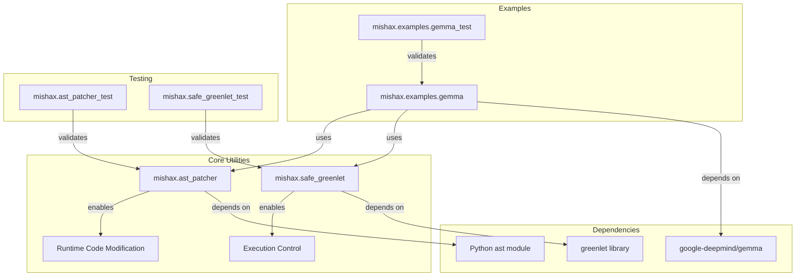
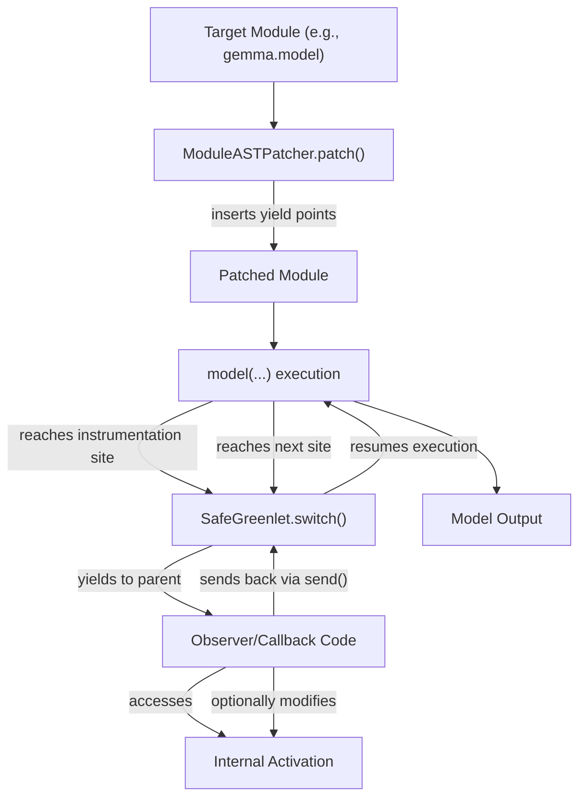
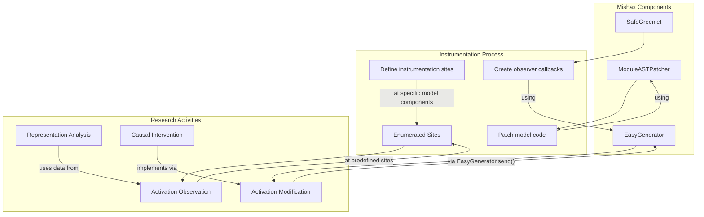

<!-- source: DeepWiki mcp.deepwiki.com · repo google-deepmind/mishax · page 1 Overview · fetched 2026-10-26 -->

# Overview

<details>
<summary>Relevant source files</summary>

The following files were used as context for generating this wiki page:

- [README.md](README.md)
- [pyproject.toml](pyproject.toml)

</details>


Mishax is a utility library for mechanistic interpretability research on neural networks, particularly focused on language models. It enables inspection and modification of model internals during execution without extensive changes to the original codebase.

## Purpose and Scope

This document provides an overview of the Mishax repository, its core components, architecture, and key use cases. Mishax offers tools that allow researchers to probe model internals, modify activations during execution, and analyze model behavior at a granular level.

For detailed installation instructions, see [Installation and Setup](#1.1). For a deeper dive into the system's organization, see [Project Architecture](#1.2).

Sources: [README.md:3-5]()

## Key Components

Mishax consists of two primary utilities that can be used together to enable mechanistic interpretability research:

### AST Patcher

The `mishax.ast_patcher` module enables running code from other libraries with source-level code modifications applied at runtime. It allows:

- Insertion of instrumentation code at specific points in model execution
- Addition of probes to observe internal activations
- Intervention at arbitrary locations in model code

This approach avoids the need to fork and maintain modified versions of target libraries.

### Safe Greenlet

The `mishax.safe_greenlet` module transforms complex callback-based functions into ordinary-looking Python loops that can:

- Iterate over internal values during model execution
- Allow replacement of these values with modified versions
- Provide clean integration with JAX's functional programming paradigm

Safe Greenlet builds on the `greenlet` library to enable coroutine-like behavior that can yield control from deep within call stacks.

### Gemma Example

The repository includes an example in `mishax.examples.gemma` demonstrating instrumentation of the Gemma language model. This example showcases how the core utilities can be applied to a real-world model.

Sources: [README.md:5-11](), [pyproject.toml:19-23]()

## System Architecture

### Code Module Structure



Sources: [README.md:36-43](), [pyproject.toml:19-23]()

The core utilities (`ast_patcher` and `safe_greenlet`) provide the foundation for applications like the Gemma example. The diagram shows the dependencies and relationships between the different components of the Mishax repository.

## Functional Workflow

### Model Instrumentation Process



Sources: [README.md:7-9]()

The diagram illustrates how Mishax enables model instrumentation:

1. The `ModuleASTPatcher` transforms code at runtime to insert instrumentation points
2. When execution reaches these points, control yields to observer code via `SafeGreenlet`
3. Observer code can access and modify internal activations
4. Execution continues until the next instrumentation point

This workflow allows researchers to observe and modify model internals during execution without extensive code changes.

## Use Cases for Mechanistic Interpretability

Mishax supports several key research activities:

### Instrumentation Capabilities



Sources: Based on functionality described in [README.md:3-11]()

This diagram shows how Mishax components enable different research activities:

1. **Activation Observation**: Accessing internal activations at various points in model execution
2. **Activation Modification**: Replacing values to test causal hypotheses
3. **Representation Analysis**: Studying the properties of learned representations
4. **Causal Intervention**: Testing how changes to internal states affect model behavior

## Installation and Quick Start

To install Mishax:

```
python3 -m pip install git+git://github.com/google-deepmind/mishax.git
```

With dependencies for the Gemma example:

```
python3 -m pip install git+git://github.com/google-deepmind/mishax.git[gemma]
```

For development:

```
python3 -m pip install git+git://github.com/google-deepmind/mishax.git[dev]
```

A Colab tutorial demonstrating Gemma instrumentation is available as referenced in [README.md:45-48]().

Sources: [README.md:17-48]()

## Related Documentation

For more detailed information about specific components:

- [AST Patcher](#2): Documentation of the runtime code modification system
- [Safe Greenlet](#3): Details on the structured concurrency tools
- [Gemma Instrumentation Example](#4): In-depth explanation of the Gemma example
- [Mechanistic Interpretability Guide](#5): Holistic guide for research applications

---

