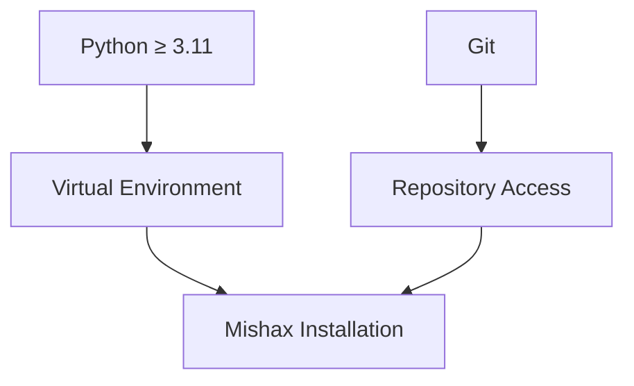
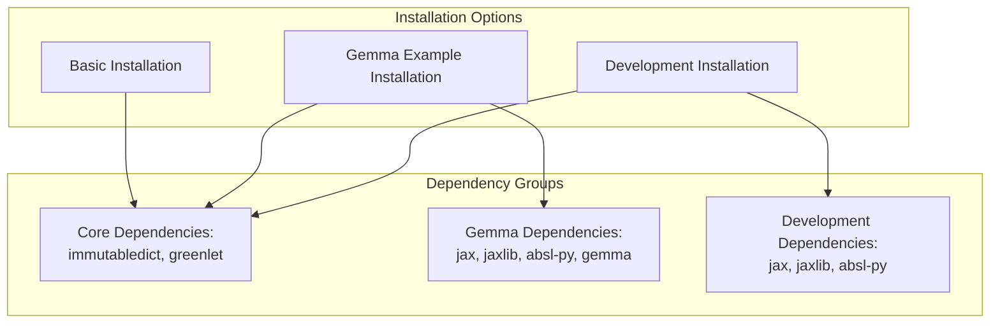
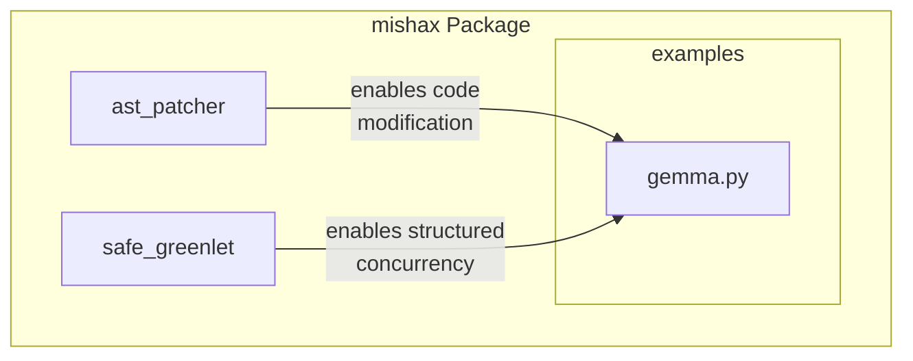
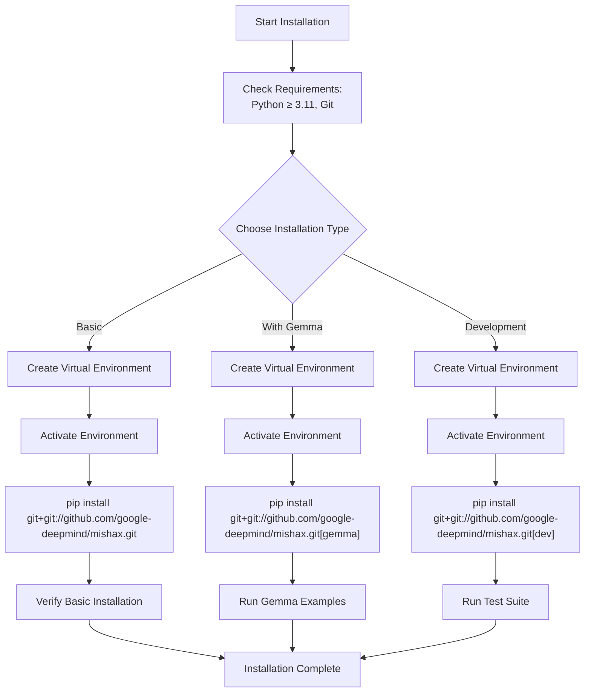

<!-- source: DeepWiki mcp.deepwiki.com · repo google-deepmind/mishax · page 1.1 Installation and Setup · fetched 2026-10-26 -->

# Installation and Setup

<details>
<summary>Relevant source files</summary>

The following files were used as context for generating this wiki page:

- [README.md](README.md)
- [pyproject.toml](pyproject.toml)

</details>


This document provides comprehensive instructions for installing and setting up the Mishax library on your system. It covers basic installation, installation with specific dependencies for examples, and verification steps. For a high-level understanding of how Mishax components work together, see [Project Architecture](#1.2).

## System Requirements

Before installing Mishax, ensure your system meets the following requirements:

- Python 3.11 or higher
- Ability to create Python virtual environments
- Git (for cloning the repository)



Sources: [pyproject.toml:13](), [README.md:19-23]()

## Installation Options

Mishax offers multiple installation configurations depending on your needs:

| Installation Type | Purpose | Main Dependencies |
|-------------------|---------|-------------------|
| Basic | Core functionality only | immutabledict, greenlet |
| Gemma | Includes Gemma example dependencies | jax, jaxlib, absl-py, gemma |
| Development | For contributing to Mishax | jax, jaxlib, absl-py |



Sources: [pyproject.toml:19-23](), [README.md:17-31]()

## Basic Installation

To install the basic Mishax package with only core dependencies:

1. Create a virtual environment:
```bash
python3 -m venv $HOME/mishax-venv
```

2. Activate the virtual environment:
```bash
source $HOME/mishax-venv/bin/activate
```

3. Install Mishax from GitHub:
```bash
python3 -m pip install git+git://github.com/google-deepmind/mishax.git
```

This installation provides access to the core components: `mishax.ast_patcher` and `mishax.safe_greenlet`.

Sources: [README.md:19-23](), [pyproject.toml:19]()

## Installing with Gemma Example Dependencies

To use the Gemma instrumentation example, install Mishax with the additional Gemma dependencies:

```bash
python3 -m venv $HOME/mishax-venv
source $HOME/mishax-venv/bin/activate
python3 -m pip install git+git://github.com/google-deepmind/mishax.git[gemma]
```

This installs the following additional dependencies:
- jax
- jaxlib
- absl-py
- gemma (from GitHub)

Sources: [README.md:25-31](), [pyproject.toml:22]()

## Installing for Development

If you plan to contribute to Mishax or run the test suite:

```bash
python3 -m venv $HOME/mishax-venv
source $HOME/mishax-venv/bin/activate
python3 -m pip install git+git://github.com/google-deepmind/mishax.git[dev]
```

Sources: [README.md:35-43](), [pyproject.toml:23]()

## Package Structure After Installation

Once installed, the Mishax package provides the following main components:



Sources: [README.md:7-11]()

## Verifying Installation

### Running Tests

To verify your installation, you can run the Mishax test suite:

```bash
python3 -m mishax.ast_patcher_test
python3 -m mishax.safe_greenlet_test
python3 -m mishax.examples.gemma_test  # requires [gemma] dependencies
```

The tests will validate that all components are functioning correctly.

Sources: [README.md:35-43]()

### Testing the Gemma Example

A Colab notebook is available for testing the Gemma instrumentation example:
[Colab Tutorial](https://colab.research.google.com/drive/1rP2cgyx0wXjVt72db7dL1la0VqUaMu0S#revisionId=0Bxemsxg8RNFNekR6VFh3MnhmRjd3QUhKSlN0cnk1YVBVeHRZPQ)

The notebook demonstrates how to use Mishax to instrument and interact with Gemma model internals.

Sources: [README.md:45-48]()

## Installation Process Flow

The complete installation process follows this sequence:



Sources: [README.md:17-43]()

## Deactivating the Environment

When you're done working with Mishax, deactivate the virtual environment:

```bash
deactivate
```

Sources: [README.md:33]()

## Troubleshooting

### Common Issues

- **Python Version**: Ensure you have Python 3.11 or higher installed
- **Path Issues**: If commands are not found, check that your virtual environment is activated
- **Dependency Conflicts**: Try creating a fresh virtual environment if you encounter dependency conflicts

If you encounter issues with the installation, check the [official GitHub repository](https://github.com/google-deepmind/mishax) for the most up-to-date information or to report issues.

Sources: [pyproject.toml:13](), [pyproject.toml:26-27]()

---

