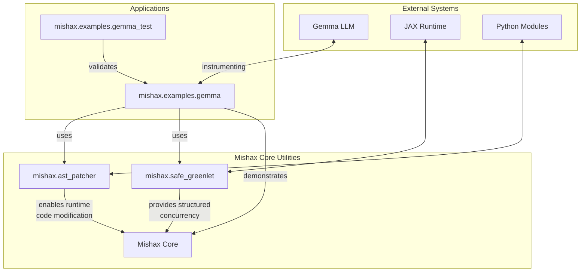
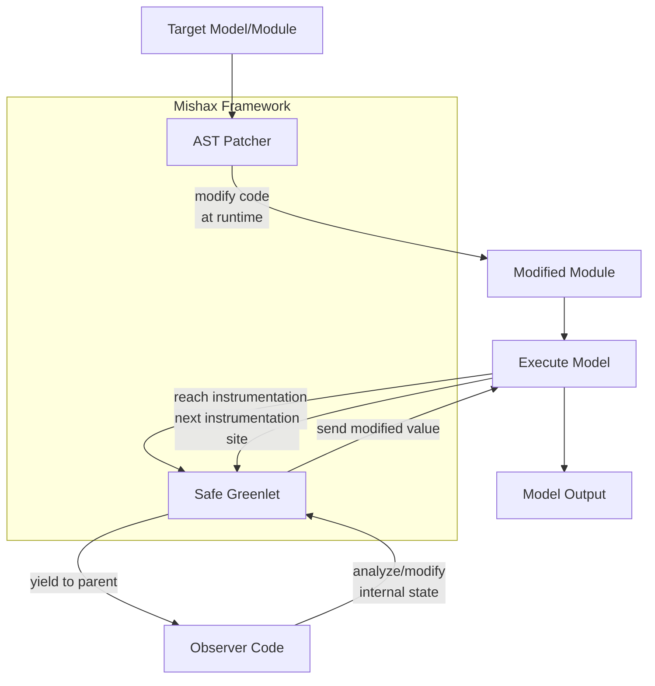
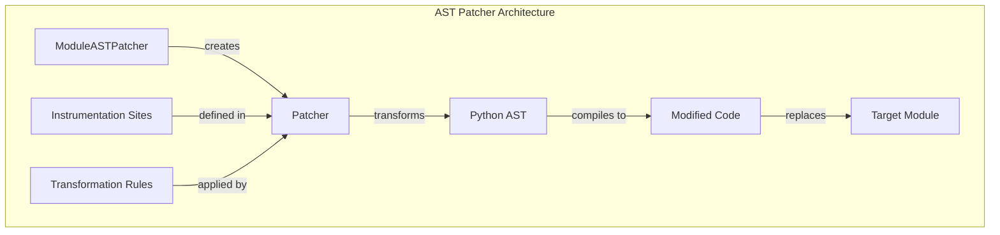
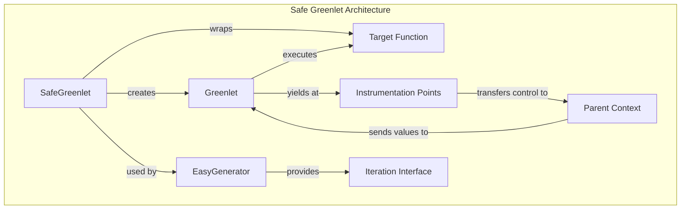
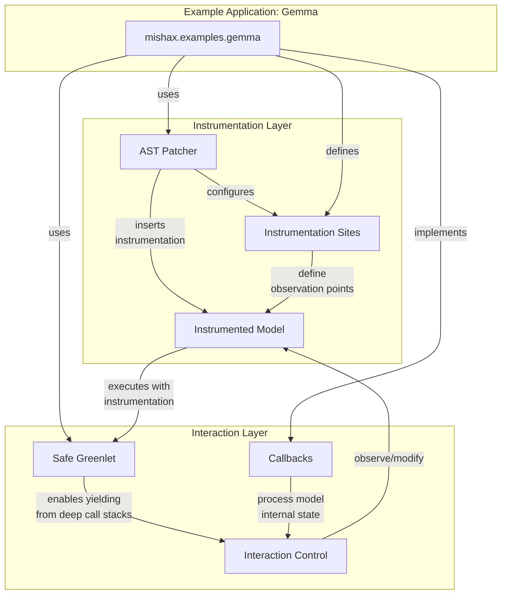
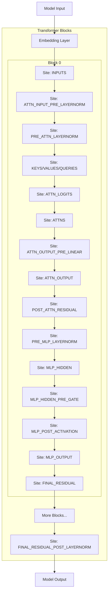
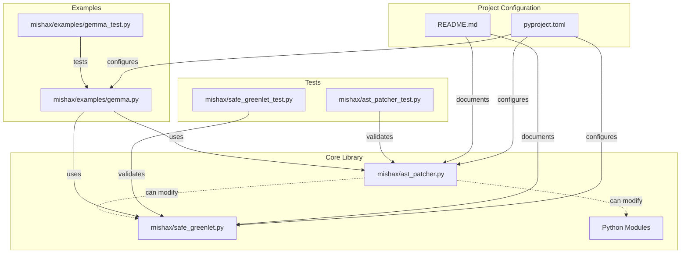
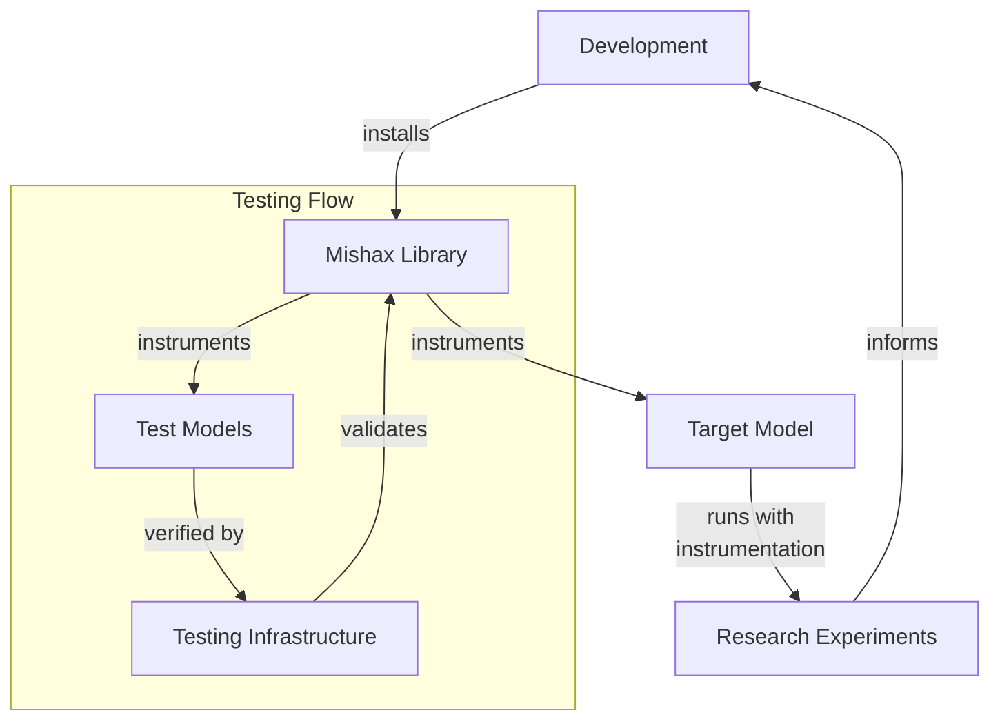

<!-- source: DeepWiki mcp.deepwiki.com · repo google-deepmind/mishax · page 1.2 Project Architecture · fetched 2026-10-26 -->

# Project Architecture

Relevant source files

The following files were used as context for generating this wiki page:

- [README.md](README.md)
- [mishax/__init__.py](mishax/__init__.py)
- [pyproject.toml](pyproject.toml)

## Purpose and Scope

This document provides a comprehensive overview of the Mishax project architecture, explaining how its components work together to enable mechanistic interpretability research. It covers the structural organization of the codebase, the relationships between key components, and the functional flow of execution when using Mishax for model instrumentation.

For specific details about installing Mishax, refer to [Installation and Setup](#1.1). For in-depth documentation of individual components, see [AST Patcher](#2) and [Safe Greenlet](#3).

Sources: [README.md:3-11]()

## High-Level Architecture Overview

Mishax consists of two primary utility components that work together to enable model instrumentation:

The architecture revolves around two complementary utilities:

1. **AST Patcher (`mishax.ast_patcher`)**: Enables runtime modification of Python code, allowing users to instrument existing codebases without forking them. It uses Python's Abstract Syntax Tree (AST) capabilities to modify modules at runtime.

2. **Safe Greenlet (`mishax.safe_greenlet`)**: Provides structured concurrency for deep call stacks, allowing users to transform complex functions with callbacks into simpler iterative interfaces. This makes it easier to interact with and modify internal values during execution.

3. **Example Implementation (`mishax.examples.gemma`)**: Demonstrates how both utilities can be combined to instrument the Gemma language model, providing a practical application of the architecture.

Sources: [README.md:5-11](), [pyproject.toml:18-19]()

## Functional Flow

The following diagram illustrates how Mishax operates when instrumenting a model:

The functional flow follows these steps:

1. The AST Patcher modifies target code at runtime to insert instrumentation points
2. The modified code executes normally until an instrumentation point is reached
3. At instrumentation points, Safe Greenlet yields control to observer code
4. Observer code can analyze or modify the internal state of the model
5. Control returns to the model execution with potentially modified values
6. This cycle repeats at each instrumentation point

This approach allows for non-invasive inspection and modification of model internals during execution, making it ideal for mechanistic interpretability research.

Sources: [README.md:7-9]()

## Component Architecture

### AST Patcher

The AST Patcher component enables runtime modification of Python code:

The AST Patcher works by:
1. Taking a target module and transformation specifications
2. Parsing the module's source code into an Abstract Syntax Tree (AST)
3. Applying transformations to the AST to insert instrumentation code
4. Recompiling the modified AST back into executable code
5. Replacing the original module with the modified version

This allows for precise insertion of instrumentation points without modifying the original source files.

Sources: [README.md:7](), [README.md:13-15]()

### Safe Greenlet

The Safe Greenlet component provides structured concurrency for deep call stacks:

Safe Greenlet operates by:
1. Wrapping a target function in a greenlet (a lightweight cooperative thread)
2. Executing the function in the greenlet until it yields at an instrumentation point
3. Transferring control back to the parent context, which can analyze or modify state
4. Receiving modified values from the parent context and resuming execution
5. Providing an iteration interface that makes this process look like a simple Python loop

This makes it possible to interact with deep call stacks as if they were simple iterators, greatly simplifying complex instrumentation tasks.

Sources: [README.md:9](), [pyproject.toml:19]()

## Mishax for Model Instrumentation

When using Mishax for mechanistic interpretability, the components work together to instrument a model:

The Gemma example demonstrates this architecture by:
1. Using AST Patcher to instrument the Gemma model code
2. Defining instrumentation sites at key points in the model's computation
3. Using Safe Greenlet to interact with these sites during model execution
4. Implementing callbacks that analyze and potentially modify model activations

This layered approach separates concerns between instrumentation (code modification) and interaction (runtime behavior), providing a flexible framework for mechanistic interpretability research.

Sources: [README.md:11](), [pyproject.toml:22]()

## Neural Network Instrumentation Architecture

Mishax enables the instrumentation of various points within a neural network architecture, as demonstrated by the Gemma example:

The instrumentation architecture allows for:
1. Defining specific points in the neural network computation graph where values can be observed
2. Intercepting and potentially modifying these values during execution
3. Analyzing the internal behavior of the model at different stages of computation
4. Conducting targeted interventions to test causal hypotheses about model behavior

This makes it possible to perform detailed mechanistic interpretability research on complex neural network architectures.

Sources: [README.md:11](), [pyproject.toml:22]()

## Module Structure and Dependencies

The Mishax codebase has a clean, modular structure with clear dependencies:

### Dependencies

The project has minimal core dependencies:

| Component | Required Dependencies |
|-----------|----------------------|
| `mishax.ast_patcher` | `immutabledict` |
| `mishax.safe_greenlet` | `greenlet` |
| `mishax.examples.gemma` | `jax`, `jaxlib`, `absl-py`, `gemma` |

The lightweight core dependencies allow for easy integration with existing projects, while the example implementation demonstrates how to use Mishax with specific model frameworks like JAX and Gemma.

Sources: [pyproject.toml:19-23](), [README.md:38-43]()

## Integration with Development Workflow

Mishax is designed to integrate smoothly into existing development workflows:

The project includes comprehensive tests for each component, allowing users to verify functionality before integrating Mishax into their projects. The clean separation of concerns between the AST Patcher and Safe Greenlet components makes it possible to use each independently or together, depending on specific research needs.

Sources: [README.md:35-43](), [README.md:45-48]()

## Summary

The Mishax architecture provides a powerful framework for mechanistic interpretability research through its two core components:

1. **AST Patcher**: Enables runtime code modification to insert instrumentation points
2. **Safe Greenlet**: Provides structured concurrency for interacting with deep call stacks

These components work together to transform complex model codebases into instrumented versions that allow for detailed inspection and modification of internal states. The architecture's layered design separates concerns between instrumentation and interaction, providing a flexible framework that can be adapted to different research needs.

The Gemma example demonstrates how this architecture can be applied to a real language model, providing a template for researchers to follow when instrumenting their own models for mechanistic interpretability research.

Sources: [README.md:3-11]()

---

