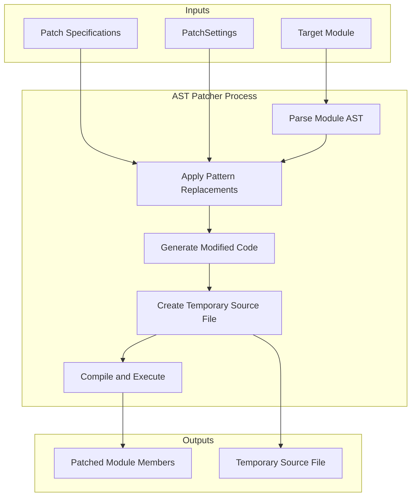
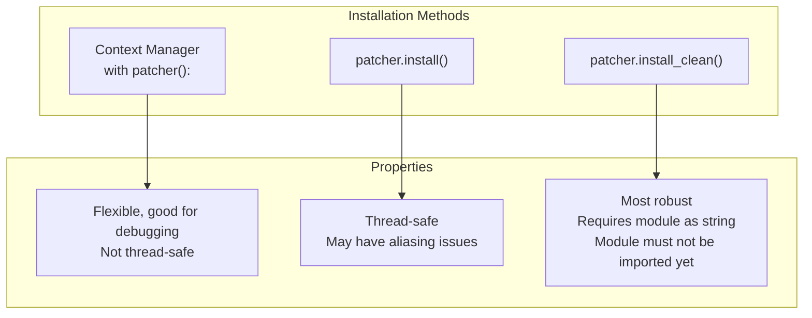
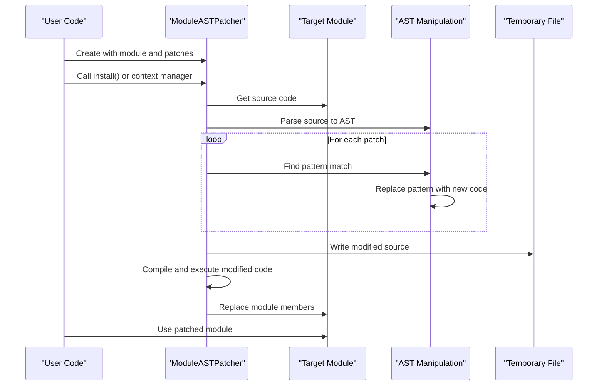
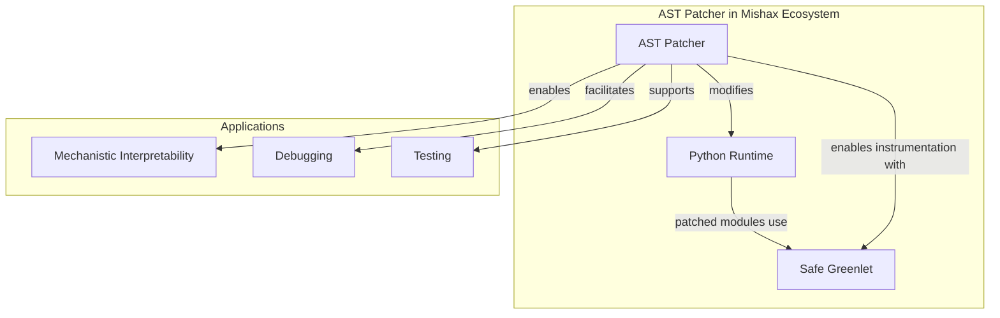

<!-- source: DeepWiki mcp.deepwiki.com · repo google-deepmind/mishax · page 2 AST Patcher · fetched 2026-10-26 -->

# AST Patcher

<details>
<summary>Relevant source files</summary>

The following files were used as context for generating this wiki page:

- [mishax/ast_patcher.py](mishax/ast_patcher.py)
- [mishax/ast_patcher_test.py](mishax/ast_patcher_test.py)

</details>


The AST Patcher is a core component of the Mishax framework that enables runtime modification of Python code by manipulating the Abstract Syntax Tree (AST). This system allows for dynamically altering module behavior without changing the original source files, making it ideal for instrumentation, debugging, and mechanistic interpretability research. For information about using the patched modules with structured concurrency, see [Safe Greenlet](#3).

## Overview

The AST Patcher provides mechanisms to modify imported Python modules by specifying code replacements as "before" and "after" patterns. These patterns are applied to the AST representation of the module's source code, generating a new version that is used at runtime. The patching occurs in memory and creates temporary files for debugger and stack trace visibility.



Sources: [mishax/ast_patcher.py:36-308]()

## Key Components

### ModuleASTPatcher

The core class that handles the patching process. It takes a module (either as a string name or an already-imported module), patch settings, and patch specifications for specific objects in the module.

### PatchSettings

A configuration class that controls the patching behavior:

- `prefix`: Code to add near the top of the patched module
- `allow_num_matches_upto`: Controls how many pattern matches are allowed for each patch

```mermaid
classDiagram
    class "ModuleASTPatcher" {
        +module: ModuleType|str
        -_settings: PatchSettings
        -_patches_per_object: dict
        -_updated_members: dict
        -_original_members: dict
        -_src: str
        -_path: str
        -_globals: dict
        +__init__(module, settings, **patches_per_object)
        +install()
        +is_installed(): bool
        +install_clean()
        +__call__(): ContextManager
        +updated_members: property
        +original_members: property
        +globals: property
        +src: property
        +path: property
        -_setup()
    }
    
    class "PatchSettings" {
        +prefix: str|None
        +allow_num_matches_upto: Mapping[str, int]|None
    }
    
    class "PatchError" {
        +message: str
    }
    
    ModuleASTPatcher --> PatchSettings: uses
    ModuleASTPatcher --> PatchError: may raise
```

Sources: [mishax/ast_patcher.py:36-50](), [mishax/ast_patcher.py:52-54](), [mishax/ast_patcher.py:64-108]()

## Patch Specification

Patches are specified as pairs of "before" and "after" code blocks. The "before" block represents the code to be matched, and the "after" block is the replacement code. There are two ways to specify these pairs:

1. **Alternating format**: A flat list of strings alternating between "before" and "after" code
2. **Tuple format**: A list of tuples, each containing a "before" and "after" code block

The patcher applies these patches by finding the corresponding AST patterns in the module's source code and replacing them with the patched versions.

Example patch specification:
```python
# Alternating format
patches = ["x += 2", "x += 2\nhit_patch()"]

# Tuple format
patches = [("x += 2", "x += 2\nhit_patch()")]
```

Sources: [mishax/ast_patcher.py:107-113](), [mishax/ast_patcher_test.py:79-82]()

## Installation Methods

The AST Patcher provides three ways to apply patches, with different trade-offs between flexibility and robustness:



### Context Manager

Using the patcher as a context manager is the most flexible approach, suitable for prototyping and debugging:

```python
patcher = ModuleASTPatcher(my_module, **patches)
with patcher():
    # Code that uses the patched module
```

### Install Method

The `install()` method provides a thread-safe way to apply patches at any time:

```python
patcher = ModuleASTPatcher(my_module, **patches)
patcher.install()
# All subsequent code uses the patched module
```

### Install Clean Method

The `install_clean()` method is the most robust approach, applying patches when a module is first imported:

```python
patcher = ModuleASTPatcher("module.name", **patches)
patcher.install_clean()
import module.name  # Module is imported with patches applied
```

Sources: [mishax/ast_patcher.py:125-166](), [mishax/ast_patcher_test.py:164-196]()

## Patching Process



The patching process follows these steps:

1. The user creates a `ModuleASTPatcher` with a target module and patch specifications
2. The patcher retrieves the source code of the target module members
3. For each member to be patched:
   - The source code is parsed into an AST
   - Each "before" pattern is matched in the AST
   - Matched patterns are replaced with the corresponding "after" AST
4. A temporary file is created with the modified source code
5. The modified code is compiled and executed in a new environment
6. Module members are replaced with the patched versions

Sources: [mishax/ast_patcher.py:213-307]()

## Example Use Cases

### Basic Patching

```python
# Patch a function to add logging
patcher = ModuleASTPatcher(
    target_module,
    some_function=[
        "result = calculate(x, y)",
        "result = calculate(x, y)\nprint(f'Result: {result}')"
    ]
)

with patcher():
    # Calls to some_function will now print the result
    target_module.some_function(1, 2)
```

### Multiple Patches with Prefix

```python
# Add imports and patch multiple places in a module
patcher = ModuleASTPatcher(
    target_module,
    PatchSettings(prefix="import logging\nlogger = logging.getLogger(__name__)"),
    function_a=["return result", "logger.info(f'Result: {result}')\nreturn result"],
    function_b=["process(data)", "logger.debug('Processing data')\nprocess(data)"]
)

patcher.install()  # Apply patches permanently
```

### Allowing Multiple Matches

```python
# Patch all instances of a pattern
patcher = ModuleASTPatcher(
    target_module,
    PatchSettings(allow_num_matches_upto={"my_function": 5}),
    my_function=["self.value", "self.value * 2"]
)
```

Sources: [mishax/ast_patcher_test.py:72-96](), [mishax/ast_patcher_test.py:110-122](), [mishax/ast_patcher_test.py:154-162]()

## Limitations and Considerations

Using the AST Patcher introduces several important considerations:

1. **Version Dependencies**: Patches may break if the target module changes, especially changes to implementation details that patches rely on.

2. **State Changes**: If the patched module definitions affect global state during execution, these state changes will occur again when patches are applied.

3. **Threading Issues**: Using the context manager approach isn't thread-safe, as it temporarily modifies the module.

4. **Debugging Complexity**: While patched code provides proper stack traces, debugging can be more complex when working with dynamically modified code.

5. **Multiple Matches**: By default, patches must match exactly once. Use `allow_num_matches_upto` to allow multiple matches.



Sources: [mishax/ast_patcher.py:91-105](), [mishax/ast_patcher_test.py:142-152]()

## Integration with Other Mishax Components

The AST Patcher is designed to work seamlessly with other Mishax components, particularly Safe Greenlet for structured concurrency. This combination is powerful for instrumenting machine learning models:

1. Use AST Patcher to modify model code and insert instrumentation points
2. Use Safe Greenlet to control execution flow at those instrumentation points
3. Observe or modify internal model states as the model executes

Sources: [mishax/ast_patcher.py:16-35]()

---

