<!-- source: DeepWiki mcp.deepwiki.com · repo google-deepmind/mishax · page 2.1 AST Patcher Usage Patterns · fetched 2026-10-26 -->

# AST Patcher Usage Patterns

Relevant source files

The following files were used as context for generating this wiki page:

- [mishax/ast_patcher.py](mishax/ast_patcher.py)
- [mishax/ast_patcher_test.py](mishax/ast_patcher_test.py)

## Purpose and Scope

This page documents common usage patterns for the AST Patcher system in Mishax. The AST Patcher enables runtime modification of Python code by transforming the Abstract Syntax Tree (AST) of target modules. This page focuses on practical patterns for applying patches, rather than the detailed API reference (for which, see [AST Patcher API Reference](#2.2)).

## Overview of AST Patcher

The AST Patcher allows you to modify Python modules at runtime by patching their source code. This is particularly useful for instrumenting model code without modifying the original source files.

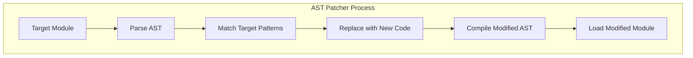

Sources: [mishax/ast_patcher.py:61-308]()

## Basic Usage Patterns

The AST Patcher provides three primary patterns for applying patches, each with different characteristics regarding scope, thread safety, and persistence.

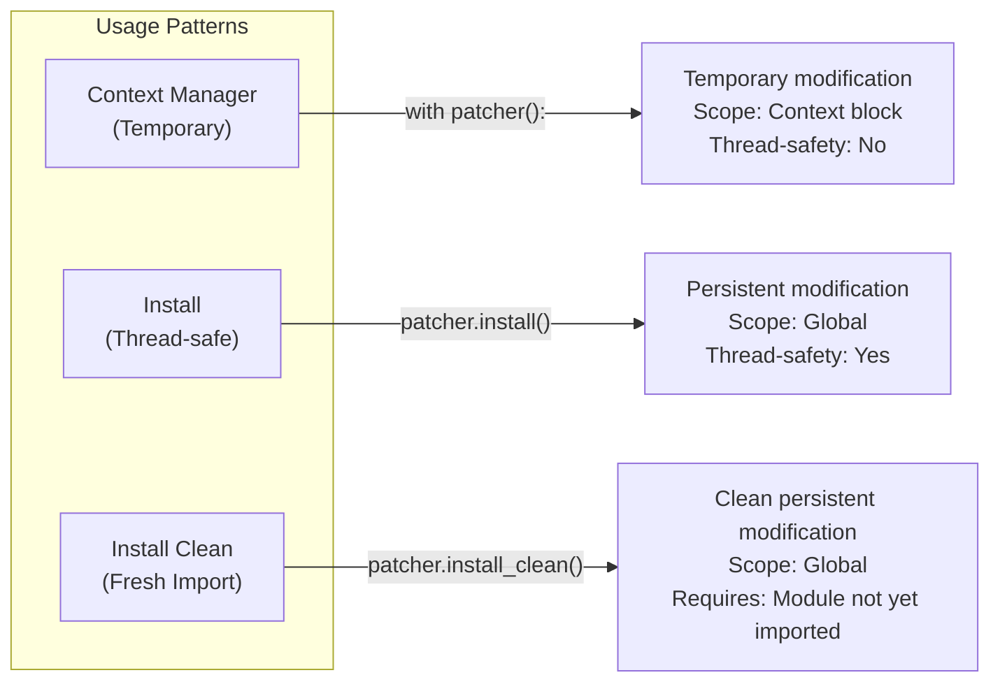

Sources: [mishax/ast_patcher.py:65-87](), [mishax/ast_patcher.py:125-166]()

### Context Manager Pattern

The context manager pattern applies patches temporarily within a block of code:

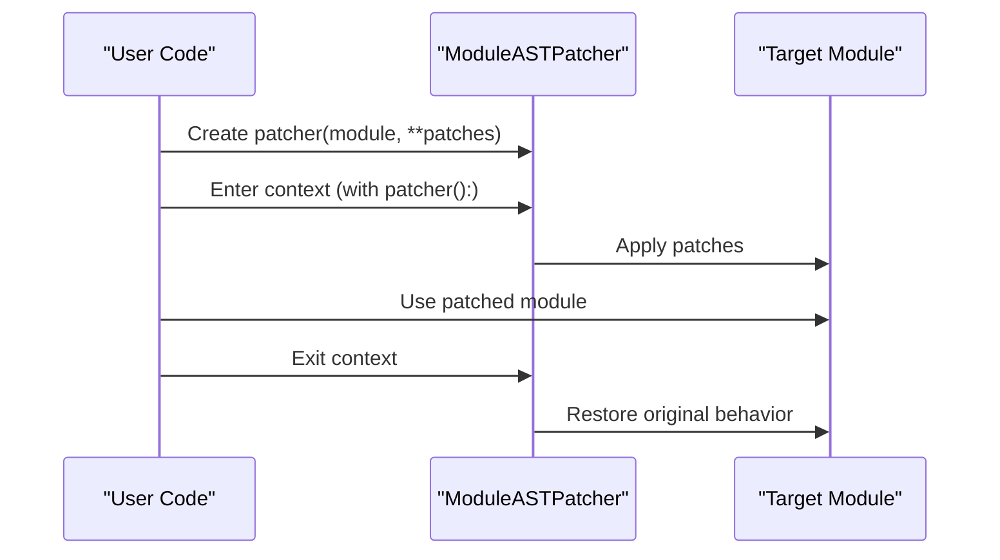

Sources: [mishax/ast_patcher.py:166-172](), [mishax/ast_patcher_test.py:87-95]()

### Installation Pattern

The installation pattern applies patches persistently:

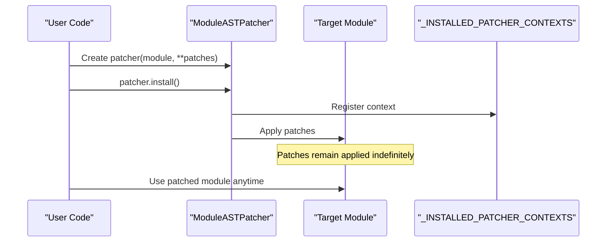

Sources: [mishax/ast_patcher.py:125-143](), [mishax/ast_patcher_test.py:83-96]()

### Clean Installation Pattern

The clean installation pattern ensures that patches are applied to a freshly imported module:

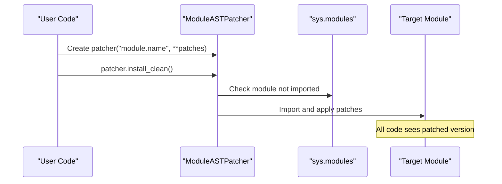

Sources: [mishax/ast_patcher.py:149-164](), [mishax/ast_patcher_test.py:163-196]()

## Patch Specification Patterns

### Patch Format

Patches are specified as pairs of code snippets representing "before" and "after" states:

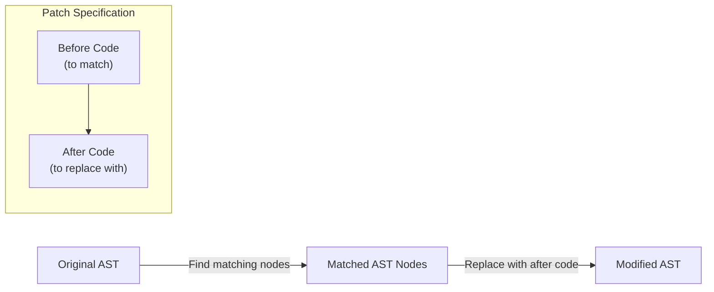

Sources: [mishax/ast_patcher.py:238-294]()

There are two ways to specify patches:

1. As tuples of (before, after) code snippets
2. As a flat list alternating between before and after snippets

Sources: [mishax/ast_patcher.py:240-246]()

### Simple Statement Patches

For patching statements within a function or method:

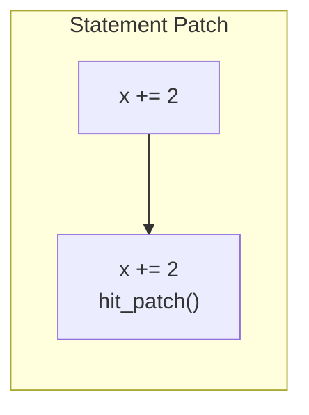

Sources: [mishax/ast_patcher_test.py:79-82]()

### Expression Patches

For patching expressions (values) within code:

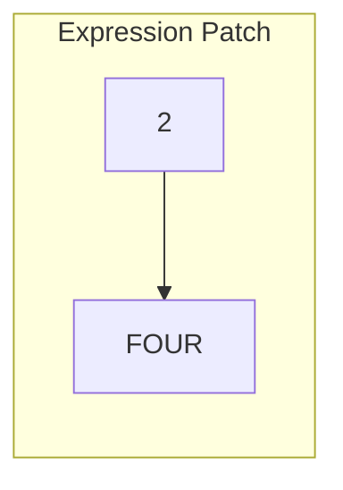

Sources: [mishax/ast_patcher_test.py:112-121]()

### Using a Prefix

The prefix setting allows adding code at the top of the patched module, useful for imports or defining constants:

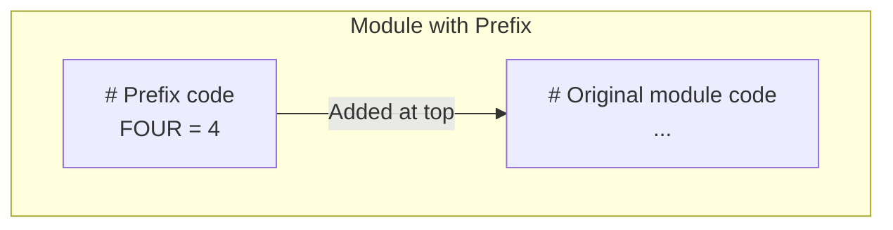

Sources: [mishax/ast_patcher.py:36-49](), [mishax/ast_patcher_test.py:112-116]()

## Advanced Usage Patterns

### Controlling Match Behavior

By default, the patcher requires exactly one match for each pattern. For cases where multiple matches are expected, use `allow_num_matches_upto`:

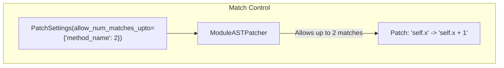

Sources: [mishax/ast_patcher.py:36-49](), [mishax/ast_patcher_test.py:153-161]()

### Accessing Generated Source and Path

For debugging or introspection, you can access the generated source code and its path:

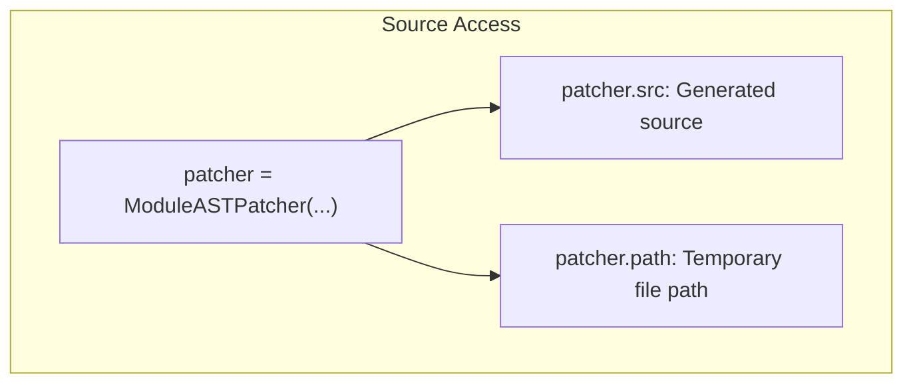

Sources: [mishax/ast_patcher.py:192-211](), [mishax/ast_patcher_test.py:124-140]()

## Common Usage Scenarios

### Patching Class Methods

One of the most common use cases is instrumenting class methods:

| Purpose | Before Pattern | After Pattern |
|---------|---------------|---------------|
| Add logging | `return result` | `print(f"Result: {result}")\nreturn result` |
| Count calls | `def method_name(self):` | `def method_name(self):\n    global counter\n    counter += 1` |
| Modify return value | `return x` | `return x * 2` |

Sources: [mishax/ast_patcher_test.py:71-95]()

### Patching Decorated Classes

The AST Patcher preserves decorators and metaclasses of patched classes:

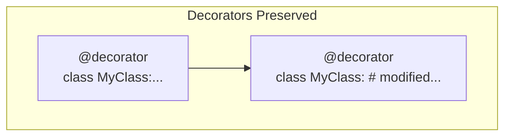

Sources: [mishax/ast_patcher_test.py:100-107]()

### Error Handling

When a patch doesn't match or matches too many times, a `PatchError` is raised:

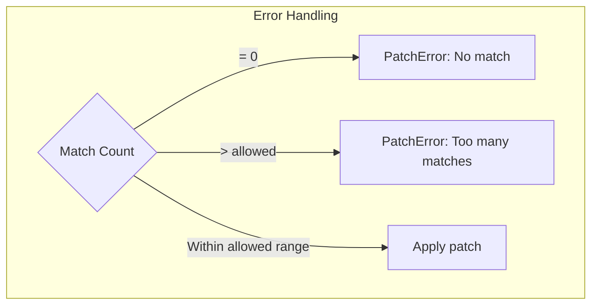

Sources: [mishax/ast_patcher.py:52-54](), [mishax/ast_patcher.py:270-291](), [mishax/ast_patcher_test.py:142-151]()

## Best Practices

### When to Use Each Pattern

| Pattern | Best For | Cautions |
|---------|----------|----------|
| Context Manager | Testing, debugging, temporary modifications | Not thread-safe |
| Install | Production use, applying patches at runtime | May have aliasing issues with already imported modules |
| Install Clean | Ensuring consistency across all imports | Requires module to be specified as string and not yet imported |

Sources: [mishax/ast_patcher.py:80-87](), [mishax/ast_patcher.py:125-164]()

### Pattern Combinations

You can combine patterns as needed, with the more persistent patterns taking precedence:

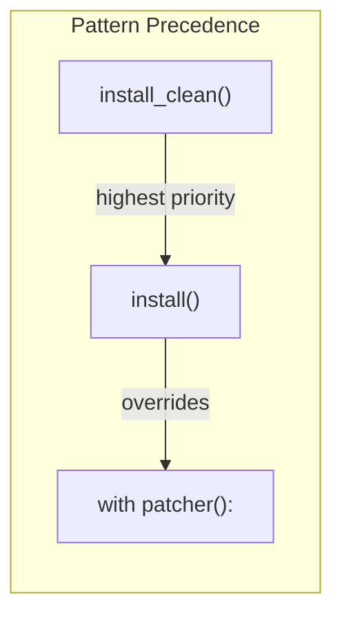

Sources: [mishax/ast_patcher.py:135-139](), [mishax/ast_patcher_test.py:188-196]()

### Limitations and Cautions

The AST Patcher has some important limitations to be aware of:

1. Target module changes (e.g., version upgrades) may break patches
2. Patching relies on implementation details rather than interfaces
3. Re-applying module definitions may trigger global state changes multiple times

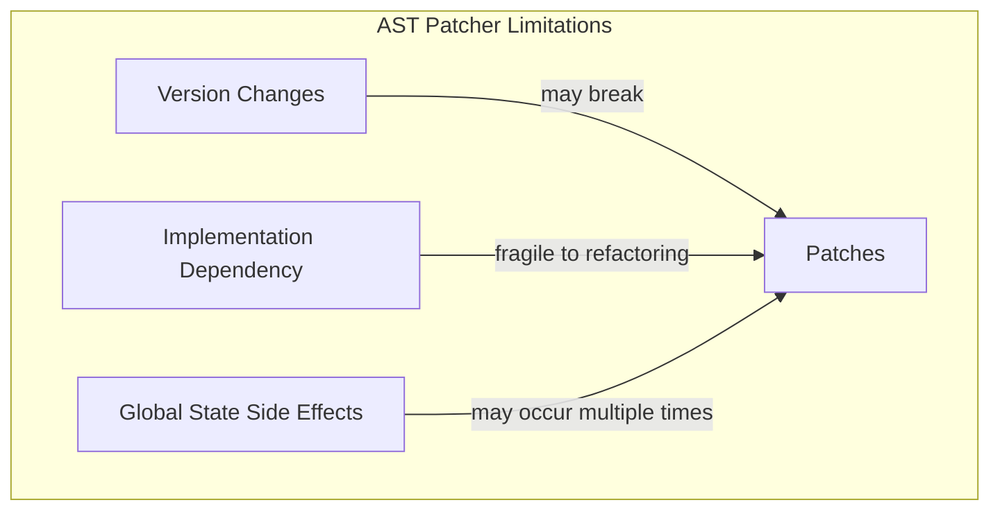

Sources: [mishax/ast_patcher.py:91-104]()

## Related Components

AST Patcher is typically used in conjunction with Safe Greenlet for comprehensive model instrumentation:

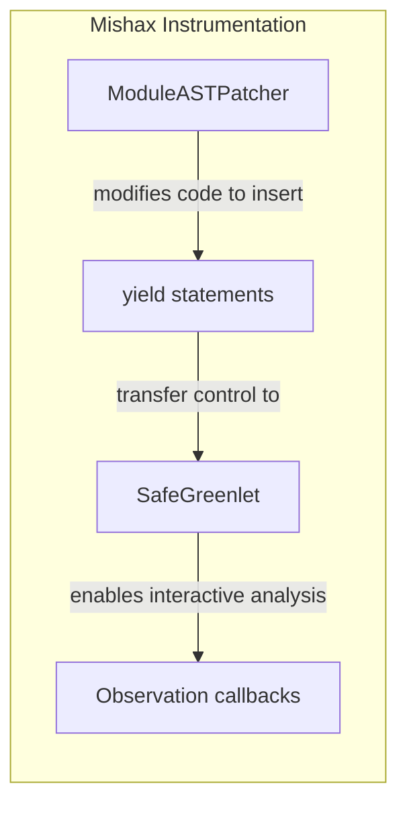

Sources: [mishax/ast_patcher.py:16-35]()

For more information on how to use AST Patcher with Safe Greenlet, see [Safe Greenlet Usage Patterns](#3.1).

---

