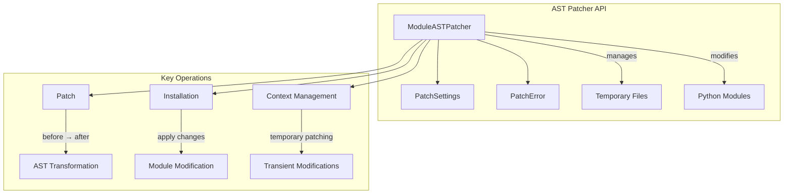
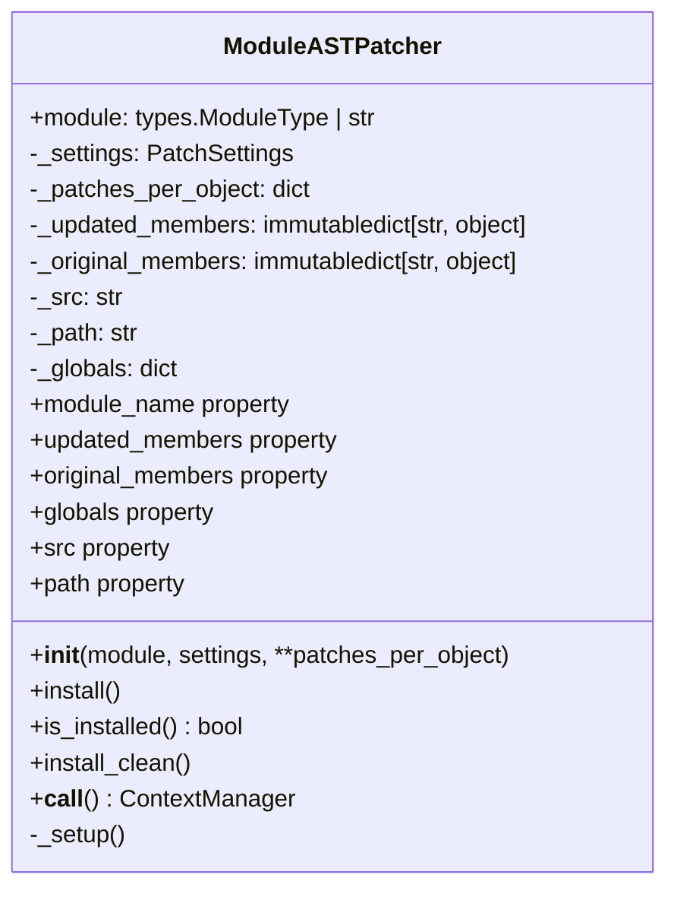
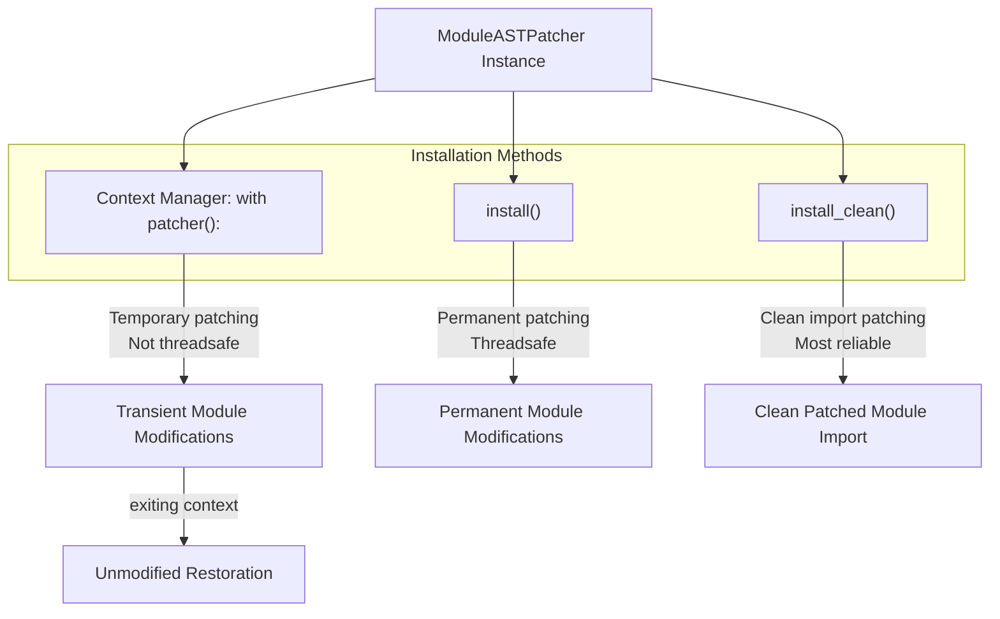
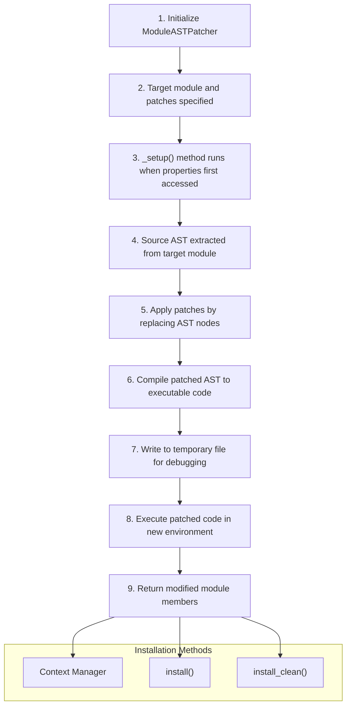
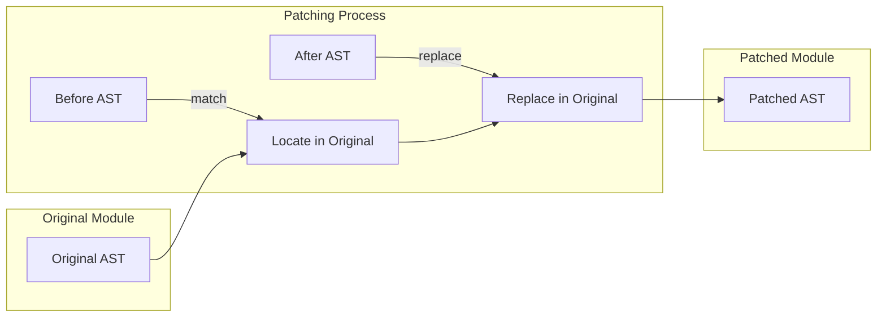

<!-- source: DeepWiki mcp.deepwiki.com · repo google-deepmind/mishax · page 2.2 AST Patcher API Reference · fetched 2026-10-26 -->

# AST Patcher API Reference

<details>
<summary>Relevant source files</summary>

The following files were used as context for generating this wiki page:

- [mishax/ast_patcher.py](mishax/ast_patcher.py)

</details>


This document provides a comprehensive API reference for the AST Patcher system in Mishax. The AST Patcher enables runtime modification of Python code by applying patches to the Abstract Syntax Tree (AST) of target modules. For usage patterns and examples, see [AST Patcher Usage Patterns](#2.1).

## Overview

The AST Patcher API allows developers to modify Python code at runtime by replacing specific portions of a module's AST with alternative implementations. This enables powerful instrumentation and modification capabilities without changing source files.



Sources: [mishax/ast_patcher.py:36-308]()

## Core Classes

### PatchSettings

A configuration class that controls how the AST patcher applies patches to modules.

```python
@dataclasses.dataclass(frozen=True, kw_only=True, slots=True)
class PatchSettings:
    prefix: str | None = None
    allow_num_matches_upto: Mapping[str, int] | None = None
```

| Attribute | Type | Description |
|-----------|------|-------------|
| `prefix` | `str \| None` | Optional code to add near the top of the patched module, before the patched module members themselves. |
| `allow_num_matches_upto` | `Mapping[str, int] \| None` | Maximum number of places to apply each patch, specified as a mapping from member names. If not specified, the patcher will fail if there isn't exactly one match for each patch. |

Sources: [mishax/ast_patcher.py:36-49]()

### PatchError

Exception raised when patches don't match the target source.

```python
class PatchError(ValueError):
    """Raised when patches don't match the target source."""
```

Sources: [mishax/ast_patcher.py:52-53]()

### ModuleASTPatcher

The primary class for patching Python modules at runtime.



Sources: [mishax/ast_patcher.py:64-308]()

#### Constructor

```python
def __init__(
    self,
    module: types.ModuleType | str,
    settings: PatchSettings = PatchSettings(),
    /,
    **patches_per_object: str | Sequence[str] | Sequence[tuple[str, str]],
)
```

| Parameter | Type | Description |
|-----------|------|-------------|
| `module` | `types.ModuleType \| str` | The module to patch, either as a module object or module name string. |
| `settings` | `PatchSettings` | Optional configuration settings for patching behavior. |
| `**patches_per_object` | `str \| Sequence[str] \| Sequence[tuple[str, str]]` | Patches to apply, keyed by module member name. |

Sources: [mishax/ast_patcher.py:107-124]()

#### Installation Methods

The ModuleASTPatcher provides three ways to apply patches:



Sources: [mishax/ast_patcher.py:125-173]()

##### install()

Installs the patches on the target module permanently, ensuring all code will subsequently see the patched version.

```python
def install(self) -> None
```

This method is threadsafe and can be called at any point, but may occasionally produce incorrect results due to module aliasing.

Sources: [mishax/ast_patcher.py:125-143]()

##### is_installed()

Checks whether the patcher is currently installed.

```python
def is_installed(self) -> bool
```

Returns `True` if the patcher is installed, `False` otherwise.

Sources: [mishax/ast_patcher.py:145-147]()

##### install_clean()

Installs the patches on a freshly imported module.

```python
def install_clean(self) -> None
```

This method requires the module to be specified as a string and not already imported. It ensures all code that imports the patched module will get the patched version, avoiding aliasing issues.

Sources: [mishax/ast_patcher.py:149-164]()

#### Context Manager Usage

The ModuleASTPatcher can be used as a context manager for temporary patching.

```python
@contextlib.contextmanager
def __call__(self):
    # Implementation to temporarily patch module
```

This allows using the patcher in a `with` statement, which will apply patches while in the context and restore the original module when exiting.

Sources: [mishax/ast_patcher.py:166-173]()

#### Properties

The ModuleASTPatcher provides several properties to access internal state:

| Property | Type | Description |
|----------|------|-------------|
| `module_name` | `str` | Name of the target module. |
| `updated_members` | `immutabledict[str, object]` | Patched module members. |
| `original_members` | `immutabledict[str, object]` | Original (unpatched) module members. |
| `globals` | `dict[str, object]` | Global namespace of the patched module. |
| `src` | `str` | Source code of the patched module. |
| `path` | `str` | Path to the temporary file containing the patched source. |

Sources: [mishax/ast_patcher.py:174-211]()

## Patching Process

The AST patcher transforms code through a series of steps:



Sources: [mishax/ast_patcher.py:213-307]()

## Patch Format

The AST patcher accepts patches in two formats:

1. **Flat Format**: A sequence of alternating "before" and "after" strings: `[before1, after1, before2, after2, ...]`
2. **Tuple Format**: A sequence of (before, after) tuples: `[(before1, after1), (before2, after2), ...]`

Each "before" string must exactly match the AST structure of a code fragment in the target module. The corresponding "after" string provides the replacement code.

Sources: [mishax/ast_patcher.py:237-253]()

### Patch Application Process



Sources: [mishax/ast_patcher.py:283-294]()

## Error Handling

The AST patcher provides detailed error messages in the following scenarios:

1. **No Matches**: When a "before" pattern doesn't match any part of the target AST.
2. **Too Many Matches**: When a "before" pattern matches more than the allowed number of times.
3. **Expression vs Statement Mismatch**: When trying to replace an expression with statements or vice versa.

Each error includes the source code for better debugging.

Sources: [mishax/ast_patcher.py:271-291]()

## Usage Considerations

When using the AST Patcher API, consider the following:

1. **Module Changes**: Patching depends on implementation details, not interfaces. Module upgrades may break patches even if interfaces remain unchanged.
2. **Global State**: If the original module initialization modified global state, patching will cause this to happen again.
3. **Thread Safety**: The context manager is not threadsafe, while `install()` and `install_clean()` are.
4. **Debugging**: Patched code is written to temporary files for easier debugging and stacktrace visibility.

Sources: [mishax/ast_patcher.py:91-104]()

---

