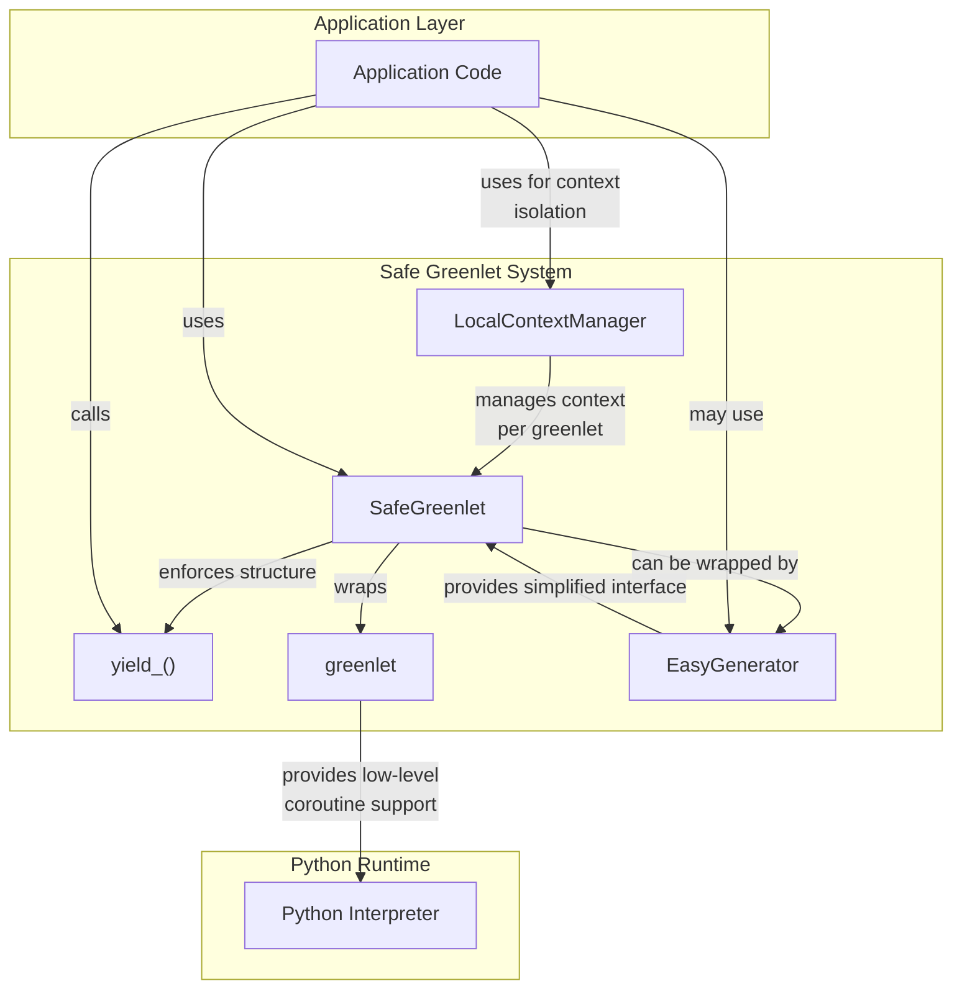
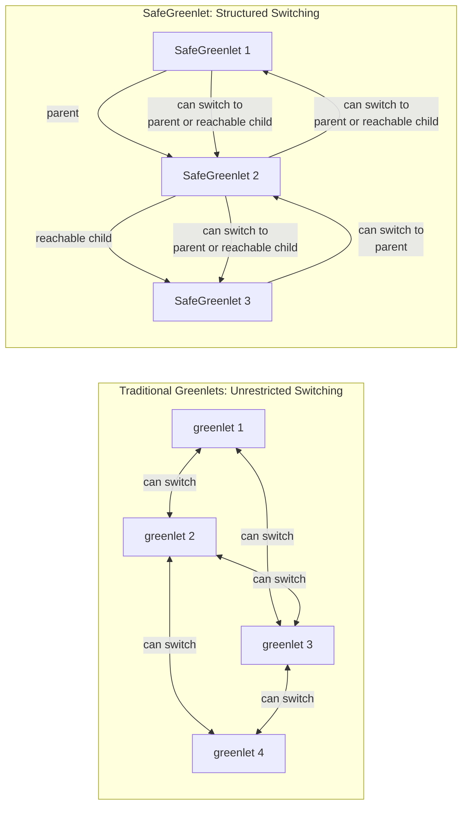
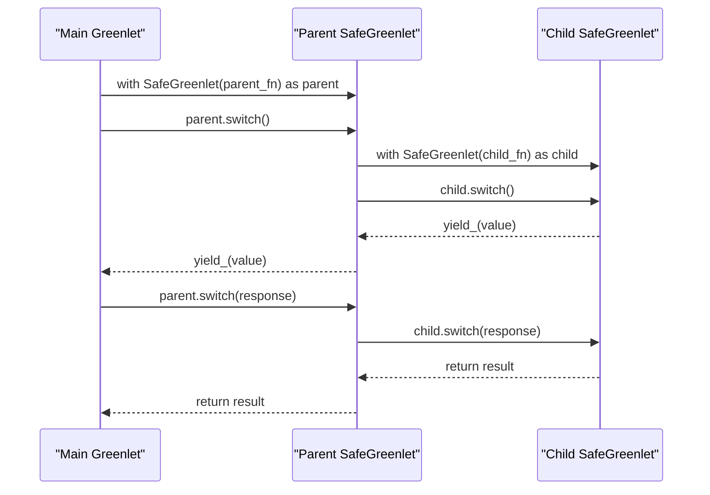
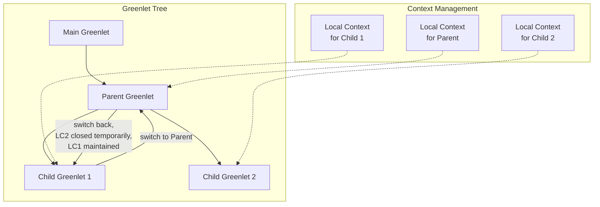

<!-- source: DeepWiki mcp.deepwiki.com · repo google-deepmind/mishax · page 3 Safe Greenlet · fetched 2026-10-26 -->

# Safe Greenlet

<details>
<summary>Relevant source files</summary>

The following files were used as context for generating this wiki page:

- [mishax/safe_greenlet.py](mishax/safe_greenlet.py)
- [mishax/safe_greenlet_test.py](mishax/safe_greenlet_test.py)

</details>


Safe Greenlet is a library for structured concurrency and non-local yield operations within Python. It provides a wrapper around the [greenlet](https://greenlet.rtfd.io) library that enforces safety constraints, making it easier to write correct concurrent code, particularly in the context of JAX programs that need to remain jittable.

For information about using Safe Greenlet for mechanistic interpretability with specific models, see the [Gemma Instrumentation Example](#4).

## Overview

The Safe Greenlet library enables developers to instrument code locations deep within call stacks (such as in neural network forward passes) by providing a way to temporarily suspend execution, inspect or modify state, and then resume. Unlike traditional Python generators that require `yield` statements at every level of the call stack, Safe Greenlet allows for non-local yields from arbitrary call depths.



Sources: [mishax/safe_greenlet.py:16-96](). [mishax/safe_greenlet.py:256-318]()

## Structured Concurrency and Safety

Traditional greenlets are powerful but can make reasoning about code behavior difficult, similar to using `goto` statements. Safe Greenlet imposes structure on greenlet usage to avoid common pitfalls:



Sources: [mishax/safe_greenlet.py:24-64]()

### Safety Constraints

Safe Greenlet enforces three ground rules:

1. Each greenlet must have at most one child greenlet it can switch or throw to at any time (the "reachable child")
2. The context manager ensures the reachable child exits when the parent context exits
3. The calling code must ensure global state is kept consistent between subsequent switches to the same greenlet

These rules help prevent interleaving problems where cleanup code might run in the wrong order or global state becomes inconsistent.

Sources: [mishax/safe_greenlet.py:97-108]()

## Core Components

### SafeGreenlet

`SafeGreenlet` is a context-managed greenlet that extends the standard `greenlet` class while implementing the `Generator` interface. It enforces structured switching to prevent many common errors.

```python
with SafeGreenlet(some_function) as glet:
    # glet is now the reachable child of the current greenlet
    value = glet.switch()  # Switch to glet, passing control to some_function
    # When some_function yields, control returns here with the yielded value
```

Sources: [mishax/safe_greenlet.py:256-337]()

### yield_ Function

The `yield_` function allows yielding from any point in the call stack, not just from the top-level generator function:

```python
def deep_function():
    # This works from any depth in the call stack
    result = yield_(value)  # Yields value, receives result when resumed
```

Sources: [mishax/safe_greenlet.py:182-193]()

### EasyGenerator

`EasyGenerator` provides a simplified interface for sending values to and receiving values from generators:

```python
with easy_greenlet(some_function) as gen:
    value = next(gen)  # Start the generator
    gen.sendval = new_value  # Set value to send on next iteration
    next_value = next(gen)  # Resume with new_value
    final_value = gen.retval  # Get returned value after generator completes
```

Sources: [mishax/safe_greenlet.py:339-390]()

### LocalContextManager

`LocalContextManager` ensures that context managers are properly entered and exited as execution moves between greenlets:

```python
with LocalContextManager(lambda: some_context_manager()) as ctx:
    # Context is active only in this greenlet
    yield_()  # When control leaves this greenlet, context is exited
    # When control returns, context is re-entered
```

Sources: [mishax/safe_greenlet.py:409-477]()

## Usage Patterns

### Basic Yielding and Switching



Sources: [mishax/safe_greenlet.py:75-96](), [mishax/safe_greenlet_test.py:33-46]()

### Instrumentation Pattern

One of the primary use cases for Safe Greenlet is instrumenting deep call stacks, such as those found in neural network forward passes:

```python
def instrumented_forward_pass(inputs, params):
    # ... calculation steps ...
    
    # At an instrumentation site, yield control to caller
    modified_activation = yield_(original_activation)
    
    # Resume with possibly modified activation
    # ... more calculation steps ...
```

Sources: [mishax/safe_greenlet.py:75-96]()

### Context Management for State Isolation



Sources: [mishax/safe_greenlet.py:409-477](), [mishax/safe_greenlet_test.py:128-159]()

## Implementation Details

### Safe Switching Between Greenlets

SafeGreenlet restricts switching to ensure safety. A greenlet can only switch to:

1. Its parent greenlet
2. Its currently reachable child greenlet (set via the context manager)

The `_managed_switch` function enforces these constraints and handles the proper closing and reopening of local contexts when switching between greenlets.

Sources: [mishax/safe_greenlet.py:220-244]()

### Reachability Tracking

The implementation uses Python's context variables system to track the reachable child of each greenlet:

```python
_REACHABLE_CHILD = contextvars.ContextVar[
    weakref.ReferenceType['SafeGreenlet']
]('reachable_child')
```

This ensures that the safe switching constraints are enforced at runtime.

Sources: [mishax/safe_greenlet.py:137-139](), [mishax/safe_greenlet.py:196-209]()

### Generator Interface Compliance

SafeGreenlet implements the standard Generator interface (as per PEP 342), allowing it to be used like a normal generator with `next()`, `send()`, `throw()`, and `close()` methods.

Sources: [mishax/safe_greenlet.py:321-336]()

## Advanced Features

### Yield From in Greenlets

The `yield_from` function provides functionality similar to Python's built-in `yield from` statement, but works within greenlets:

```python
def delegating_greenlet():
    # Delegate to another generator or iterator
    result = yield_from(some_generator)
```

Sources: [mishax/safe_greenlet.py:488-528]()

### Avoiding Sendval References

The EasyGenerator wrapper can be configured to avoid keeping references to sent values with `avoid_sendval_refs=True`, which is useful for avoiding false positives in JAX tracer leak checking:

```python
with easy_greenlet(run_function, avoid_sendval_refs=True) as gen:
    # No references to sent values are kept beyond what the run_function needs
    gen.sendval = some_jax_array
    result = next(gen)
```

Sources: [mishax/safe_greenlet.py:339-352](), [mishax/safe_greenlet_test.py:492-516]()

## Example: A Simple Instrumentation Case

Here's a basic example of how SafeGreenlet can be used for instrumentation:

```python
def model_forward_pass(inputs):
    # Deep in the call stack...
    layer_output = compute_layer(inputs)
    
    # Yield to allow inspection/modification
    modified_output = yield_(layer_output)
    
    # Continue with possibly modified output
    return next_layer(modified_output)

with SafeGreenlet(model_forward_pass) as glet:
    # Start the forward pass
    first_output = glet.switch(model_inputs)
    
    # Inspect or modify the output
    analysis_result = analyze(first_output)
    modified_output = apply_intervention(first_output)
    
    # Resume with modified output
    final_result = glet.switch(modified_output)
```

Sources: [mishax/safe_greenlet.py:75-96]()

## Related Components

For information on how to use Safe Greenlet with AST Patcher to instrument models, see the [AST Patcher](#2) wiki page. For practical examples of Safe Greenlet in action, see the [Gemma Instrumentation Example](#4).

---

