<!-- source: DeepWiki mcp.deepwiki.com · repo google-deepmind/mishax · page 3.1 Safe Greenlet Usage Patterns · fetched 2026-10-26 -->

# Safe Greenlet Usage Patterns

Relevant source files

The following files were used as context for generating this wiki page:

- [mishax/safe_greenlet.py](mishax/safe_greenlet.py)
- [mishax/safe_greenlet_test.py](mishax/safe_greenlet_test.py)

## Purpose and Scope

This document outlines common usage patterns for the `safe_greenlet` system in Mishax. Safe Greenlet provides structured concurrency primitives built on top of the [greenlet](https://greenlet.rtfd.io) library, enabling non-local yields from deep within call stacks while maintaining predictable control flow. This is particularly useful for instrumenting machine learning models without modifying the entire call stack.

For detailed API reference information, see [Safe Greenlet API Reference](#3.2).

## Understanding Safe Greenlet

The `safe_greenlet` module provides a controlled subset of greenlet functionality designed to make concurrent code easier to reason about and less prone to state management errors. It enables "lightweight coroutines for in-process sequential concurrent programming" with enhanced safety guarantees.

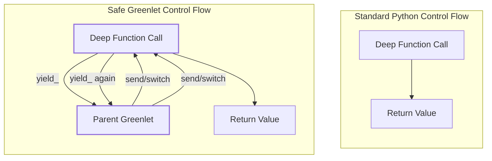

Sources: [mishax/safe_greenlet.py:16-96]()

### Key Problems Safe Greenlet Solves

Safe Greenlet addresses two key challenges when yielding from deep call stacks:

1. **Yield from any call depth**: Traditional `yield` statements can only appear directly in generator functions. Safe Greenlet's `yield_` function allows yielding from any depth in the call stack.

2. **Structured state management**: Greenlets can create complex flow control that's hard to reason about. Safe Greenlet enforces rules that make state management more predictable.

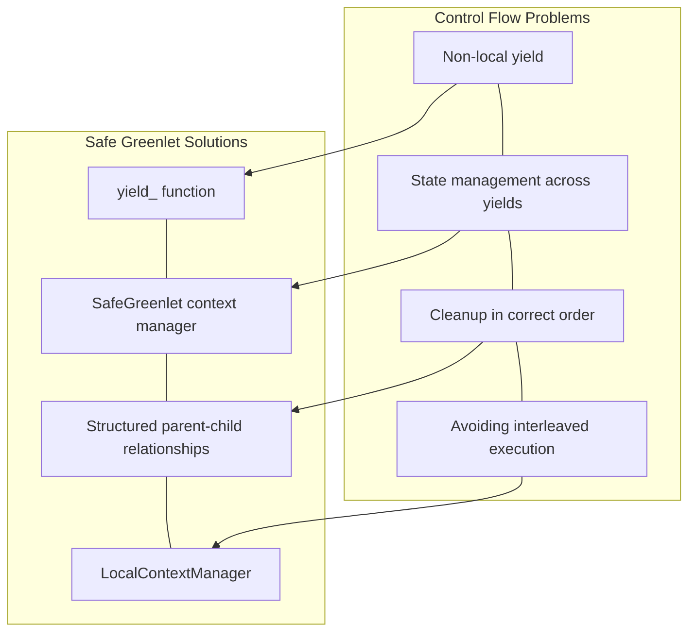

Sources: [mishax/safe_greenlet.py:75-96]()

## Basic Usage Patterns

### Creating and Running SafeGreenlets

The fundamental usage pattern for Safe Greenlet is the context manager pattern with `with` statements:

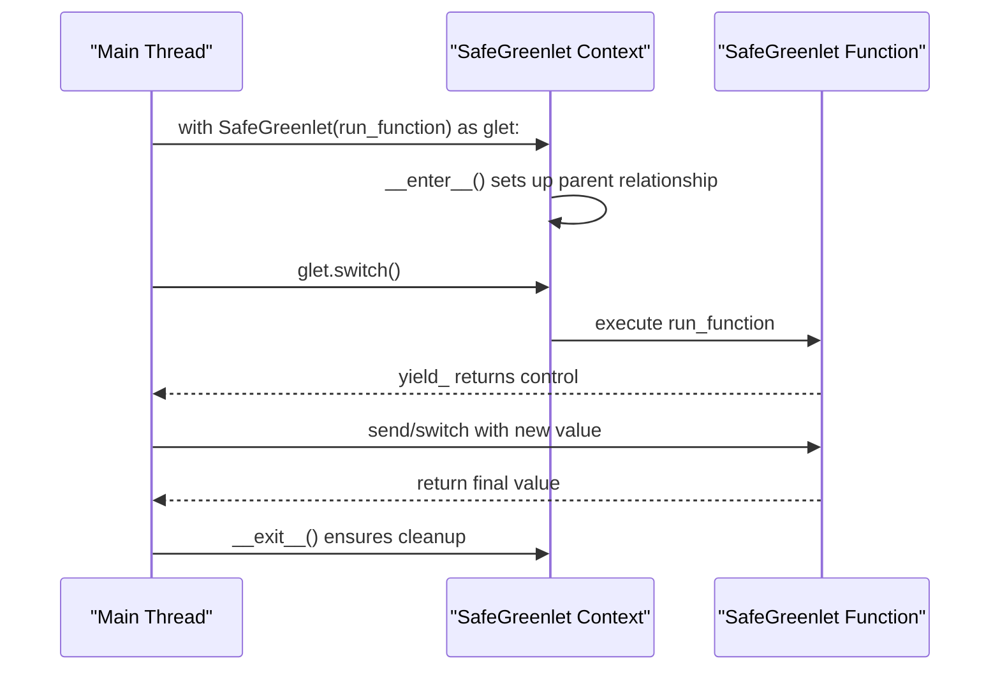

Sources: [mishax/safe_greenlet.py:256-338](), [mishax/safe_greenlet_test.py:33-44]()

### Basic Usage Example Flow

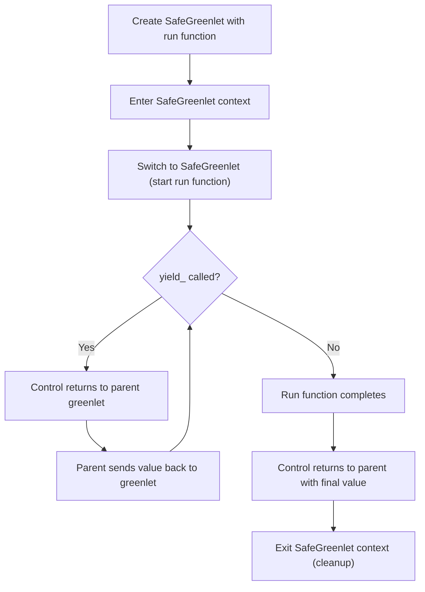

Sources: [mishax/safe_greenlet.py:182-193](), [mishax/safe_greenlet_test.py:33-44]()

### Using `yield_` For Non-local Yields

The `yield_` function is a key feature that allows yielding from deep within a call stack:

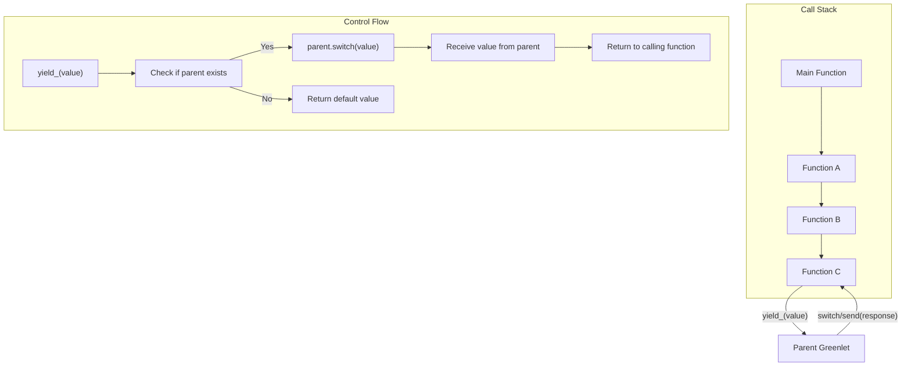

Sources: [mishax/safe_greenlet.py:182-193]()

## Advanced Usage Patterns

### Using EasyGenerator for Simplified Interaction

The `EasyGenerator` wrapper provides a more ergonomic interface for interacting with SafeGreenlets:

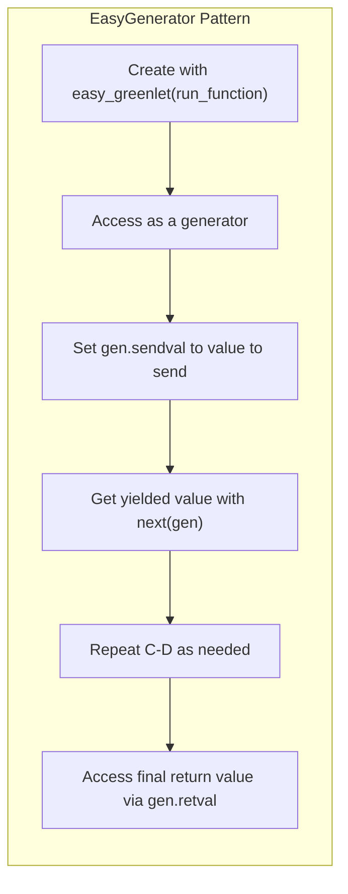

Sources: [mishax/safe_greenlet.py:339-406]()

### Managing Local Context with LocalContextManager

The `LocalContextManager` helps maintain greenlet-local state that is properly cleaned up when control transfers between greenlets:

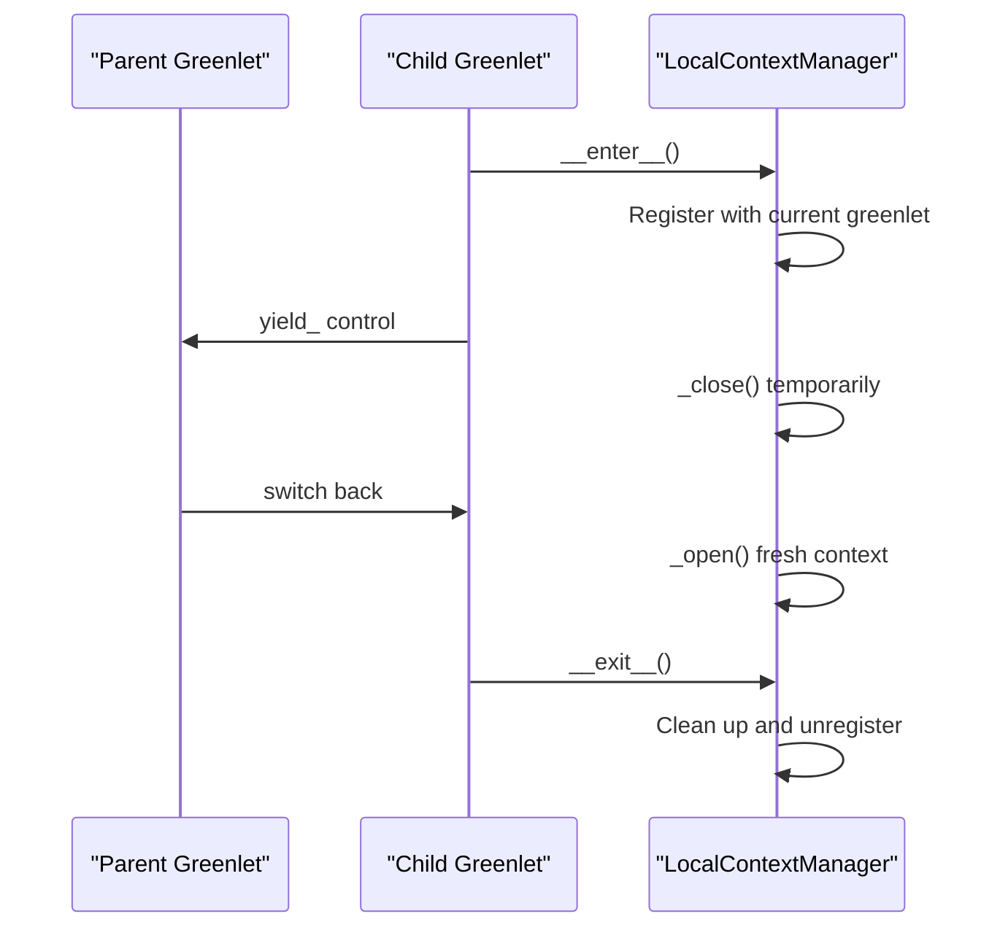

Sources: [mishax/safe_greenlet.py:409-478](), [mishax/safe_greenlet_test.py:128-158]()

### Yield-from Pattern with `yield_from`

The `yield_from` function allows composing generators and greenlets:

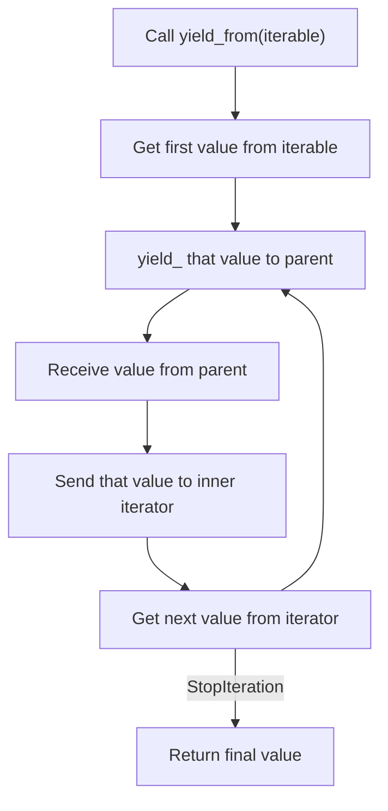

Sources: [mishax/safe_greenlet.py:480-528]()

## SafeGreenlet Structure and Restrictions

SafeGreenlet enforces three important rules to make greenlet-based code safer:

1. Each greenlet can have at most one "reachable child" at any time
2. The context manager ensures the reachable child is properly exited
3. Global state must be kept consistent between switches to the same greenlet

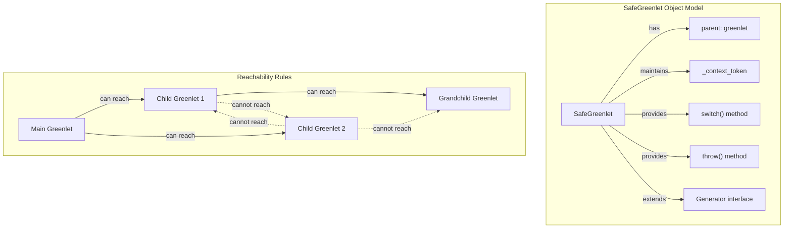

Sources: [mishax/safe_greenlet.py:97-114](), [mishax/safe_greenlet.py:256-291]()

## Common Instrumentation Pattern

A typical pattern for using SafeGreenlet for model instrumentation:

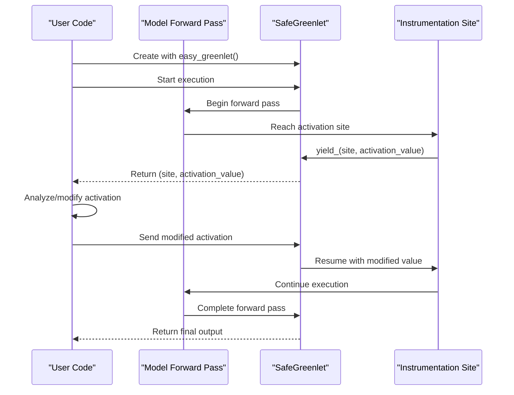

Sources: [mishax/safe_greenlet.py:75-96]()

## Best Practices

### Ensuring Proper Cleanup

Always use SafeGreenlet as a context manager to ensure proper cleanup:

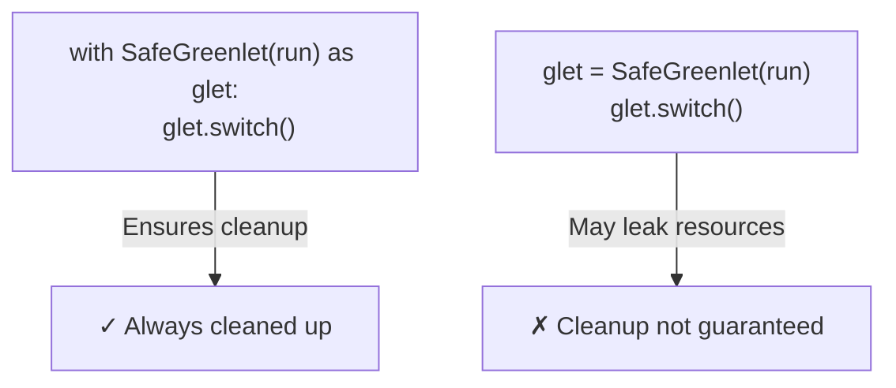

Sources: [mishax/safe_greenlet.py:256-291](), [mishax/safe_greenlet_test.py:160-216]()

### Avoiding Interleaved Execution

SafeGreenlet prevents interleaved execution through parent-child relationships:

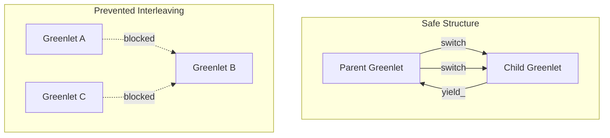

Sources: [mishax/safe_greenlet.py:97-114](), [mishax/safe_greenlet_test.py:97-109]()

### Managing State with LocalContextManager

Use `LocalContextManager` to isolate state between greenlets:

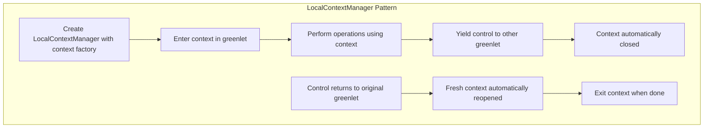

Sources: [mishax/safe_greenlet.py:409-478](), [mishax/safe_greenlet_test.py:128-158]()

## Common Error Scenarios and Solutions

| Error | Cause | Solution |
|-------|-------|----------|
| `RuntimeError: Target greenlet is outside its context!` | Attempting to switch to a SafeGreenlet not in a `with` block | Always use SafeGreenlet as a context manager |
| `RuntimeError: Context already exists!` | Nested context for same SafeGreenlet | Don't use the same SafeGreenlet in nested contexts |
| `RuntimeError: Target greenlet is not reachable!` | Attempting to switch to a non-child SafeGreenlet | Only switch to direct child greenlets |
| `RuntimeError: Raising StopIteration in a generator is not permitted` | Explicitly raising StopIteration | Return values instead of raising StopIteration |

Sources: [mishax/safe_greenlet.py:220-243](), [mishax/safe_greenlet_test.py:46-60](), [mishax/safe_greenlet_test.py:97-109]()

## Integration with JAX

When using SafeGreenlet with JAX, special care must be taken to avoid keeping references to tracer values:

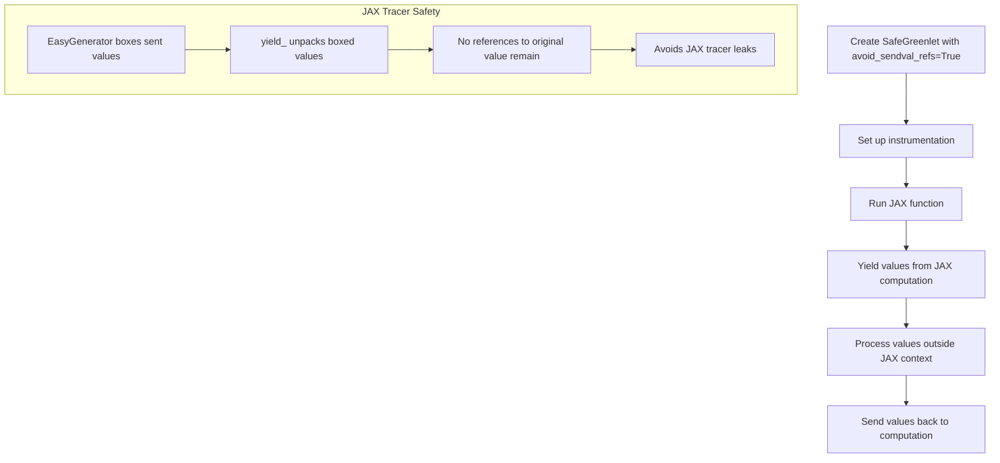

Sources: [mishax/safe_greenlet.py:339-352](), [mishax/safe_greenlet_test.py:492-516]()

## SafeGreenlet in the Mishax Architecture

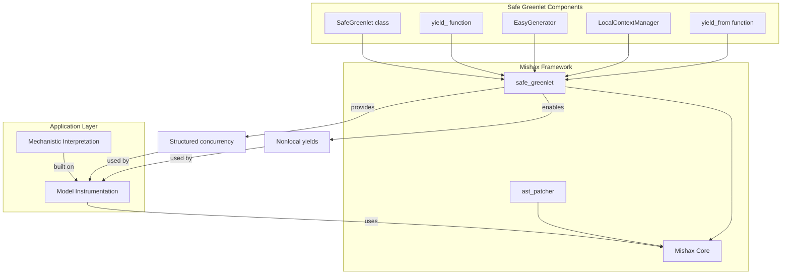

Sources: [mishax/safe_greenlet.py:16-23]()

## Summary

Safe Greenlet provides a structured approach to using greenlet for concurrent programming with clear control flow and state management. By following the patterns described in this page, you can safely instrument deep call stacks, access and modify intermediate values, and maintain proper cleanup and error handling across yields and switches.

---

