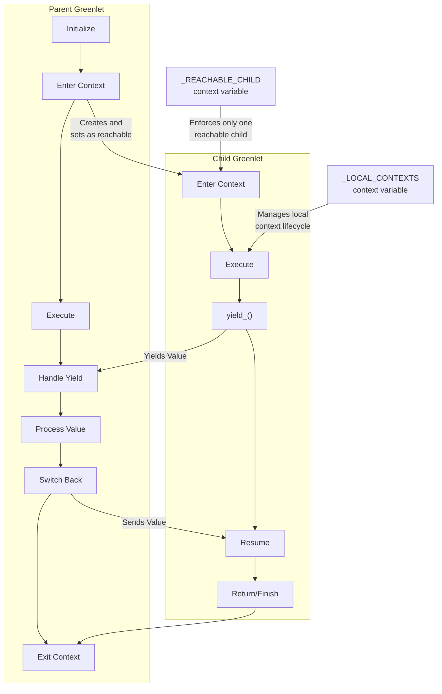
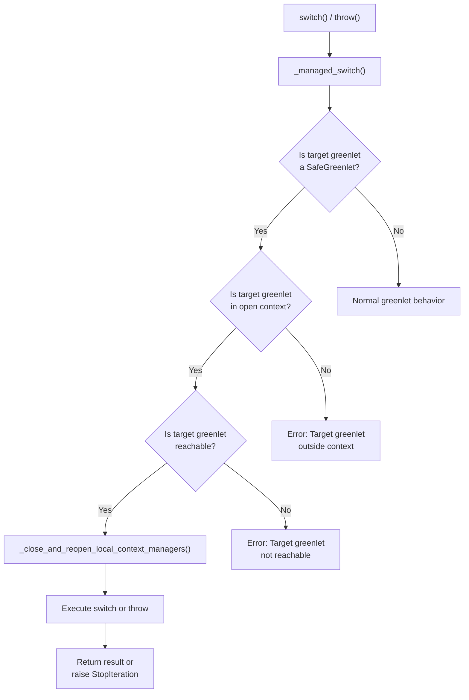

<!-- source: DeepWiki mcp.deepwiki.com · repo google-deepmind/mishax · page 3.2 Safe Greenlet API Reference · fetched 2026-10-26 -->

# Safe Greenlet API Reference

<details>
<summary>Relevant source files</summary>

The following files were used as context for generating this wiki page:

- [mishax/safe_greenlet.py](mishax/safe_greenlet.py)

</details>


## Purpose and Scope

This document provides a comprehensive API reference for the Safe Greenlet system in Mishax, which enables structured concurrency and non-local yields within Python code. The Safe Greenlet system is particularly useful for instrumenting code at arbitrary call stack depths while maintaining jittability in JAX. For usage patterns and examples, see [Safe Greenlet Usage Patterns](#3.1).

## Core Components Overview

The Safe Greenlet system provides a controlled subset of the greenlet library's functionality with additional safety guarantees around structured concurrency. This allows for pausing execution at arbitrary points in a call stack, transferring control to a parent coroutine, and later resuming execution.

```mermaid
classDiagram
    class "SafeGreenlet" {
        +context_token
        +send(value)
        +throw(type, value)
        +switch()
        +close()
    }
    
    class "EasyGenerator" {
        +sendval
        +retval
        +inner_gen
        +avoid_sendval_refs
        +send(value)
        +throw(type, value)
        +close()
    }
    
    class "LocalContextManager" {
        +context_manager_fn
        +context_manager
        +glet
        +close_temporarily()
    }
    
    "SafeGreenlet" --|> "greenlet.greenlet"
    "SafeGreenlet" --|> "Generator"
    "EasyGenerator" --|> "Generator"
    "easy_greenlet()" ..> "SafeGreenlet" : creates
    "easy_greenlet()" ..> "EasyGenerator" : wraps
    "yield_()" ..> "SafeGreenlet" : interacts with
```

Sources: [mishax/safe_greenlet.py:156-407]()

## Execution Flow

```mermaid
sequenceDiagram
    participant "Parent Greenlet" as Parent
    participant "SafeGreenlet" as Child
    participant "yield_()" as Yield
    
    Parent->>+Child: Create and enter context
    note right of Child: __enter__() sets current greenlet as parent
    Child->>+Child: Begin execution
    Child->>Yield: Call yield_(value)
    Yield->>Parent: Switch to parent with value
    Parent->>Parent: Process value
    Parent->>Child: Send new value via send() or switch()
    Child->>Child: Resume from yield_()
    Child-->>-Parent: Return or raise StopIteration
    Parent->>-Child: Exit context, close greenlet if needed
```

Sources: [mishax/safe_greenlet.py:182-193](), [mishax/safe_greenlet.py:256-337]()

## Global Functions

### yield_

```python
def yield_(*args, default: Any = _NOT_PROVIDED) -> Any
```

Implements non-local yield functionality, allowing yielding to the parent greenlet from any point in the call stack. If called from the main greenlet without a default value, it raises a `RuntimeError`.

**Parameters:**
- `*args`: Values to yield to the parent greenlet (first arg if multiple provided)
- `default`: Optional default value to return if called from the main greenlet

**Returns:**
- The value sent back from the parent greenlet when switching back to this greenlet

Sources: [mishax/safe_greenlet.py:182-193]()

### yield_from

```python
def yield_from(
    iterable: Generator[Any, _SendT, _ReturnT],
    default_value_to_send: _SendT | _Sentinel = _NOT_PROVIDED,
) -> _ReturnT
```

An equivalent to Python's built-in `yield from` that can be called within a greenlet. This allows delegating to a sub-generator while preserving the yield/send semantics.

**Parameters:**
- `iterable`: A generator or iterable to delegate to
- `default_value_to_send`: Optional default value to use when yielding from the main greenlet

**Returns:**
- The return value of the delegated generator

Sources: [mishax/safe_greenlet.py:488-529]()

### easy_greenlet

```python
def easy_greenlet(
    run: Callable[..., _ReturnT] | None = None,
    avoid_sendval_refs: bool = True,
) -> ContextManager['EasyGenerator[Any, Any, _ReturnT]']
```

Creates a `SafeGreenlet` wrapped in an `EasyGenerator` for convenience. Returns a context manager that yields the wrapped generator.

**Parameters:**
- `run`: The function to execute in the greenlet
- `avoid_sendval_refs`: Whether to avoid keeping references to sent values (preventing JAX tracer leaks)

**Returns:**
- A context manager that yields an `EasyGenerator` wrapping the `SafeGreenlet`

Sources: [mishax/safe_greenlet.py:392-406]()

## SafeGreenlet Class

```python
class SafeGreenlet(greenlet.greenlet, Generator[_YieldT, _SendT, _ReturnT])
```

A context-managed greenlet that enforces structured concurrency constraints. It subclasses both `greenlet.greenlet` and `Generator`, providing the full Generator interface.

### Key Attributes

- `parent`: The greenlet that created this `SafeGreenlet` context (read-only)
- `dead`: Boolean indicating if the greenlet has finished execution

### Methods

#### __enter__ / __exit__

Allows `SafeGreenlet` to be used as a context manager, ensuring it's properly initialized and cleaned up.

```python
def __enter__(self) -> 'SafeGreenlet[_YieldT, _SendT, _ReturnT]'
def __exit__(self, *args)
```

#### send

```python
def send(self, value: _SendT) -> _YieldT
```

Sends a value to the greenlet, resuming execution. Follows the Generator protocol.

#### throw

```python
def throw(self, *args, **kwargs) -> _YieldT
```

Throws an exception into the greenlet, resuming execution from there.

#### switch

```python
def switch(self, *args, **kwargs) -> _YieldT | _ReturnT
```

Switches execution to this greenlet, optionally passing values.

#### close

```python
def close(self) -> None
```

Closes the greenlet by throwing a `GeneratorExit` exception into it.

Sources: [mishax/safe_greenlet.py:256-337]()

## EasyGenerator Class

```python
class EasyGenerator(Generator[_YieldT, _SendT, _ReturnT])
```

A wrapper around a generator that provides an easier-to-use interface. Manages the `sendval` for the next iteration and captures the `retval` from a completed generator.

### Key Attributes

- `sendval`: The value to send in the next iteration
- `retval`: The return value captured when the generator completes
- `inner_gen`: The wrapped generator
- `avoid_sendval_refs`: Boolean controlling sendval reference handling

### Methods

#### __init__

```python
def __init__(
    self,
    inner_gen: Generator[_YieldT, _SendT, _ReturnT],
    avoid_sendval_refs: bool = True,
)
```

Initializes the wrapper with the given generator and reference handling settings.

#### send / __next__ / throw / close

Standard Generator protocol methods, delegating to the wrapped generator while managing the `sendval` and `retval` attributes.

Sources: [mishax/safe_greenlet.py:339-389]()

## LocalContextManager Class

```python
class LocalContextManager(ContextManager[Any])
```

A context manager that keeps a context open only within the current greenlet. When execution switches away from the greenlet, the context is automatically closed, and reopened when execution returns.

### Methods

#### __init__

```python
def __init__(self, context_manager_fn: Callable[[], ContextManager[Any]])
```

Initializes with a function that creates a fresh context manager whenever needed.

#### __enter__ / __exit__

```python
def __enter__(self) -> Any
def __exit__(self, exc_typ=None, exc_val=None, exc_tb=None)
```

Standard context manager protocol methods, managing the greenlet-local context.

#### close_temporarily

```python
def close_temporarily(self)
```

Context manager that closes the context temporarily and reopens it when exiting. Used internally during greenlet switching.

Sources: [mishax/safe_greenlet.py:409-478]()

## Structured Concurrency Implementation

The following diagram illustrates how SafeGreenlet enforces structured concurrency constraints:



Sources: [mishax/safe_greenlet.py:137-142](), [mishax/safe_greenlet.py:196-254]()

## Safety Mechanisms

The Safe Greenlet system enforces several safety mechanisms to prevent the pitfalls of unrestricted greenlet usage:

1. **One reachable child constraint**: Each greenlet can have at most one reachable child at any time
2. **Context management**: SafeGreenlet uses the context manager protocol to ensure proper initialization and cleanup
3. **Local context switching**: The LocalContextManager ensures contexts are correctly closed and reopened during greenlet switching
4. **Managed switching**: All greenlet switching is done through _managed_switch, which enforces reachability constraints and handles context switching



Sources: [mishax/safe_greenlet.py:220-254]()

## Integration with JAX

The Safe Greenlet system is designed to work well with JAX, allowing for instrumenting code at arbitrary call stack depths while maintaining jittability. The `avoid_sendval_refs` flag in EasyGenerator is particularly important for preventing false positives from JAX's tracer leak checker.

Key JAX-specific features:

1. **Value boxing**: When `avoid_sendval_refs=True`, sent values are wrapped in a `_BoxedSendVal` to ensure no references remain after values are consumed
2. **Structured concurrency**: The constraints imposed by SafeGreenlet ensure that JAX's global state isn't corrupted by interleaved greenlet execution

Sources: [mishax/safe_greenlet.py:164-179](), [mishax/safe_greenlet.py:339-389]()

---

