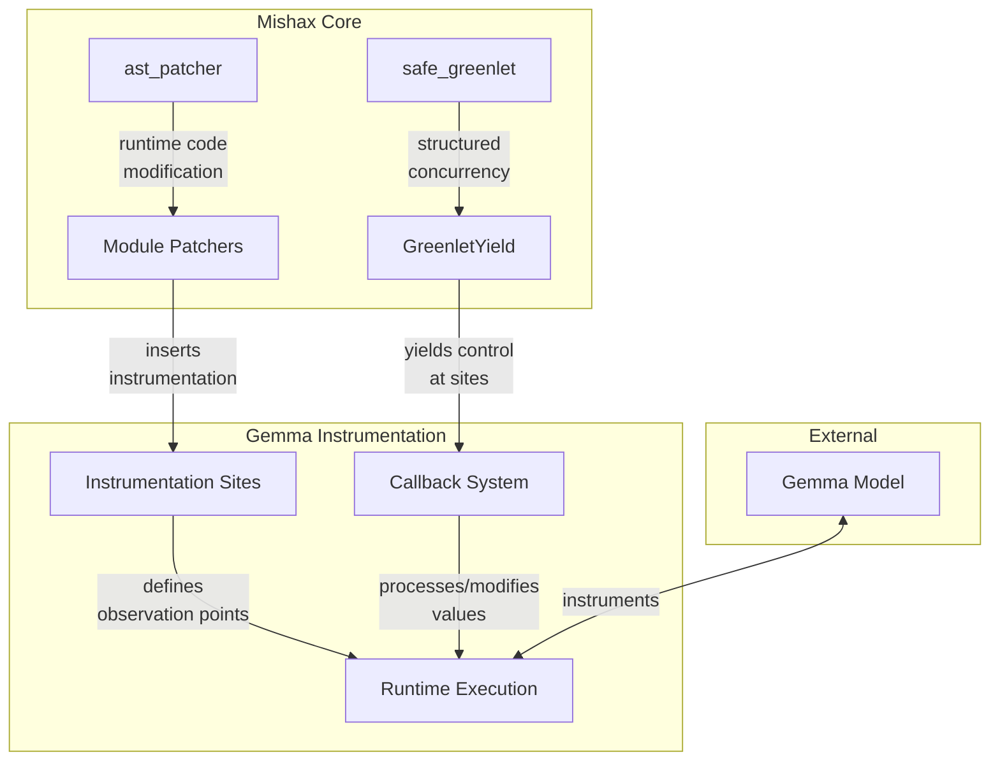
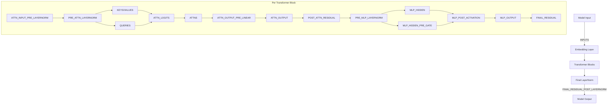
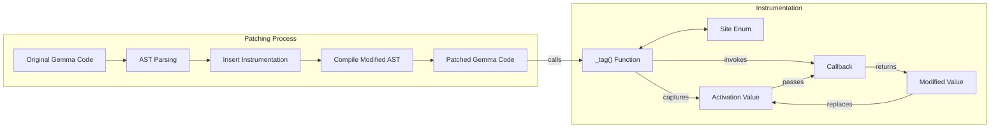
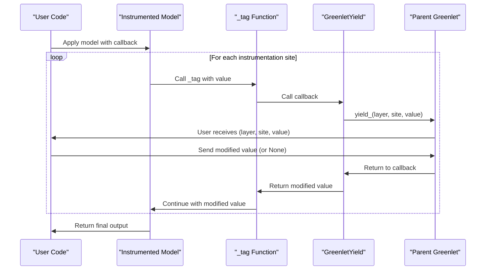
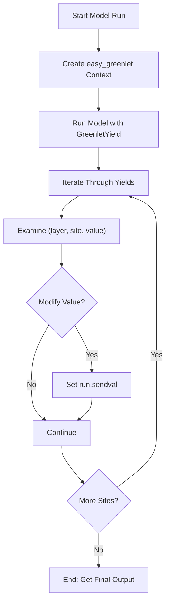

<!-- source: DeepWiki mcp.deepwiki.com · repo google-deepmind/mishax · page 4 Gemma Instrumentation Example · fetched 2026-10-26 -->

# Gemma Instrumentation Example

<details>
<summary>Relevant source files</summary>

The following files were used as context for generating this wiki page:

- [mishax/examples/gemma.py](mishax/examples/gemma.py)
- [mishax/examples/gemma_test.py](mishax/examples/gemma_test.py)

</details>


This page documents the Gemma instrumentation example provided in the Mishax repository. This example demonstrates how to use Mishax's core utilities to instrument the Gemma language model for mechanistic interpretability research. It covers the implementation of instrumentation sites, how to access model activations, and how to intervene in the model's forward pass.

For information on the core utilities that enable this functionality, see [AST Patcher](#2) and [Safe Greenlet](#3).

## Architecture Overview

The Gemma instrumentation example demonstrates how to combine AST patching and structured concurrency to enable real-time observation and modification of a model's internal state during execution.



Sources: [mishax/examples/gemma.py:16-20](), [mishax/examples/gemma.py:197-206]()

## Instrumentation Sites

The Gemma instrumentation defines specific points within the model's forward pass where values can be observed or modified. These sites are defined as an enumeration in the `Site` class.



The instrumentation sites are organized hierarchically, with some sites being specific to a layer and others being global. This is reflected in the `path_from_block` attribute of each site.

Sources: [mishax/examples/gemma.py:42-77]()

## Implementation Details

### Code Patching Mechanism

The Gemma instrumentation works by patching the Gemma model code at runtime using the AST patcher. Two main patchers are defined:

1. `MODULES_PATCHER`: patches the Gemma modules (e.g., Attention, FeedForward, Block)
2. `TRANSFORMER_PATCHER`: patches the main Transformer module



Each patch inserts a call to the `_tag` function at a specific point in the model's code. The `_tag` function takes the current module, the site, and the value at that site, and applies any registered callback to the value.

Sources: [mishax/examples/gemma.py:80-193]()

### Interaction with the Model

To interact with the model during execution, the `GreenletYield` callback is provided. This callback yields control back to the parent greenlet, allowing the parent to observe and modify values during the model's execution.



Sources: [mishax/examples/gemma.py:264-293](), [mishax/examples/gemma_test.py:133-166]()

## Using the Instrumentation

### Installation

To use the Gemma instrumentation, you first need to install the patchers. Two methods are provided:

- `install()`: Installs the patchers so that all new module instances will be instrumented
- `install_clean()`: Same as `install()`, but ensures a fresh import of the patched modules

```python
from mishax.examples import gemma
gemma.install_clean()  # Install patchers with fresh imports
```

Sources: [mishax/examples/gemma.py:197-206](), [mishax/examples/gemma_test.py:26]()

### Creating Callbacks

To interact with the model during execution, you need to create a callback that will be called at each instrumentation site. The callback should be a callable that takes three arguments:

1. `layer`: The layer index, or `None` for global sites
2. `site`: The instrumentation site
3. `value`: The value at that site

The callback should return a modified value to replace the original, or `None` to leave it unchanged.

The `GreenletYield` class is provided as a special callback that yields control back to the parent greenlet, allowing for interactive intervention.

Sources: [mishax/examples/gemma.py:209-293]()

### Setting Up Model Variables

To use a callback with a model, you need to create the appropriate variables using `vars_from_callback`:

```python
from mishax.examples import gemma
import jax

# Create the callback variables
callback_vars = gemma.vars_from_callback(gemma.GreenletYield(), model)

# Apply the model with the callback variables
model.apply(
    params | callback_vars,  # Combine model parameters with callback variables
    input_tokens,
    positions,
    cache,
    attention_mask,
    mutable=True,  # Required to collect activations
)
```

Sources: [mishax/examples/gemma.py:247-260](), [mishax/examples/gemma_test.py:134-142]()

### Using Safe Greenlet for Interaction

To interact with the model during execution, use the `safe_greenlet.easy_greenlet` context manager:



Sources: [mishax/examples/gemma_test.py:133-166](), [mishax/examples/gemma_test.py:227-261]()

## Example: Activation Intervention

The following example demonstrates how to use the Gemma instrumentation to observe activations and perform interventions:

```python
with safe_greenlet.easy_greenlet(
    lambda: model.apply(
        params | gemma.vars_from_callback(gemma.GreenletYield(), model),
        input_tokens,
        positions,
        cache,
        attention_mask,
        mutable=True,
    ),
) as run:
    keys_layer0 = None
    
    # Iterate through all instrumentation sites
    for layer, site, value in run:
        # Store layer 0 keys
        if layer == 0 and site == gemma.Site.KEYS:
            keys_layer0 = value
        
        # Replace layer 1 keys with layer 0 keys
        elif layer == 1 and site == gemma.Site.KEYS:
            run.sendval = keys_layer0
        
        # Zero out attention outputs in layer 1
        elif layer == 1 and site == gemma.Site.ATTN_OUTPUT_PRE_LINEAR:
            run.sendval = jnp.zeros_like(value)
    
    # Access the final result and collected activations
    result, mutations = run.retval
    activations = mutations[gemma.ACTIVATIONS]
```

This example demonstrates three types of interventions:
1. Observing values at specific sites
2. Replacing values at one site with values from another site
3. Zeroing out values at a specific site

Sources: [mishax/examples/gemma_test.py:133-166](), [mishax/examples/gemma_test.py:241-261]()

## Collected Activations

When running a model with the GreenletYield callback and `mutable=True`, all activations at all sites are collected in the `ACTIVATIONS` collection. The structure of this collection matches the hierarchical nature of the instrumentation sites:

```
activations
├── layer_0
│   ├── attn
│   │   ├── Site.KEYS: [value]
│   │   ├── Site.VALUES: [value]
│   │   └── ...
│   ├── Site.ATTN_OUTPUT: [value]
│   ├── Site.POST_ATTN_RESIDUAL: [value]
│   └── ...
├── layer_1
│   ├── ...
└── Site.FINAL_RESIDUAL_POST_LAYERNORM: [value]
```

Each value is stored in a list, which can contain multiple entries if the site was visited multiple times (e.g., when using a jitted model with multiple calls).

Sources: [mishax/examples/gemma.py:80-88](), [mishax/examples/gemma_test.py:167-175](), [mishax/examples/gemma_test.py:271-275]()

## JIT Compatibility

The Gemma instrumentation is compatible with jitted models, but there are some considerations to be aware of:

1. When a jitted function is called multiple times with the same inputs, the instrumentation callbacks may only be called on the first invocation due to JIT caching.
2. With jitted models, it's important to clean up references to values after using them to avoid tracer leaks.

The example in `gemma_test.py` demonstrates how to correctly work with jitted models:

```python
# Delete values after use to avoid tracer leaks
for layer, site, value in run:
    if layer == 1 and site == gemma.Site.KEYS:
        run.sendval = keys_0
        # Clean up reference to avoid tracer leak
        keys_0 = None
    # ...
    # Clean up reference to avoid tracer leak
    del value
```

Sources: [mishax/examples/gemma_test.py:241-260](), [mishax/examples/gemma_test.py:66-74]()

## Validation Functions

The Gemma instrumentation includes validation functions to help ensure correct usage:

- `_validate_model`: Ensures that the model being used has been properly instrumented
- `_validate_callback`: Ensures that the callback is a callable that is compatible with JAX's pytree system

Sources: [mishax/examples/gemma.py:225-245]()

---

