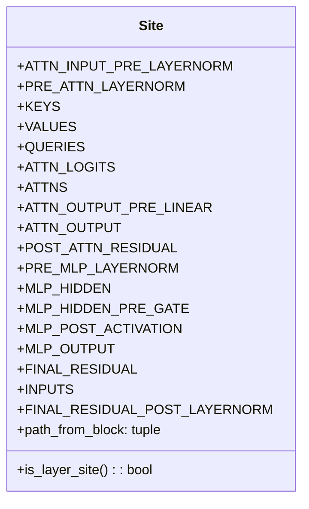
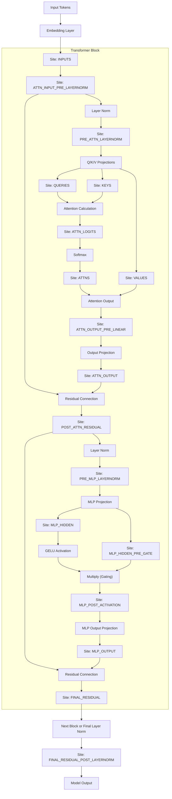
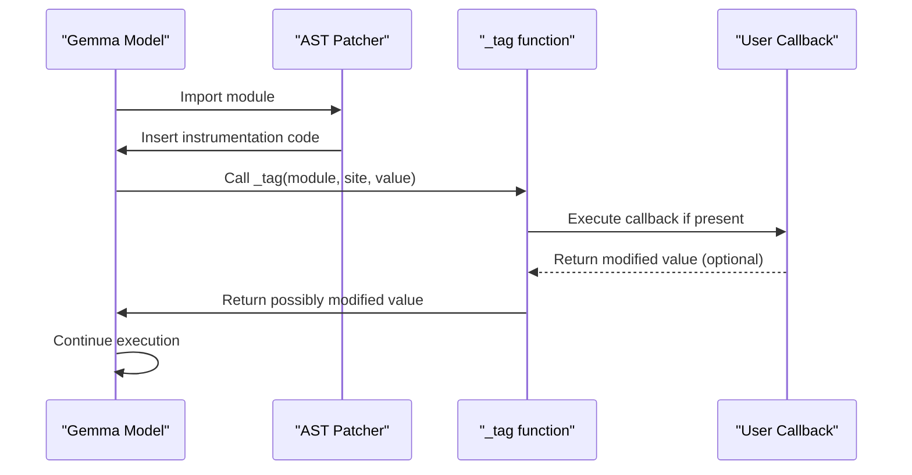
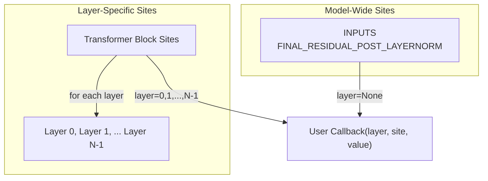

<!-- source: DeepWiki mcp.deepwiki.com · repo google-deepmind/mishax · page 4.1 Instrumentation Sites · fetched 2026-10-26 -->

# Instrumentation Sites

<details>
<summary>Relevant source files</summary>

The following files were used as context for generating this wiki page:

- [mishax/examples/gemma.py](mishax/examples/gemma.py)

</details>


## Purpose and Overview

This page documents the instrumentation sites available in Mishax for accessing and modifying internal activations of a neural network model. Instrumentation sites represent specific points in a model's forward pass where values can be observed, captured, or modified. In the context of the Gemma example, these sites are strategically placed throughout the transformer architecture to enable mechanistic interpretability research.

For information about how to perform interventions at these sites, see [Activation Intervention](#4.2). For implementing custom callbacks to process data from these sites, see [Implementing Custom Callbacks](#4.3).

Sources: [mishax/examples/gemma.py:42-78]()

## Instrumentation Site Definition

In Mishax, instrumentation sites are formally defined using the `Site` enum class in the Gemma example:



Each site is defined with two pieces of information:
1. The site name (as an enum value)
2. The path from the transformer block (if applicable)

Sites are categorized into two types:
- **Layer-specific sites**: Sites that exist within each transformer layer
- **Model-wide sites**: Sites that exist once in the entire model (e.g., model inputs)

The `is_layer_site()` method determines whether a site exists within each layer or is model-wide.

Sources: [mishax/examples/gemma.py:42-78]()

## Available Instrumentation Sites

The Gemma example defines the following instrumentation sites:

| Site | Description | Type | Path |
|------|-------------|------|------|
| `INPUTS` | Model input embeddings | Model-wide | None |
| `ATTN_INPUT_PRE_LAYERNORM` | Input to attention before layer normalization | Layer | Block |
| `PRE_ATTN_LAYERNORM` | Output of layer norm before attention | Layer | Block |
| `KEYS` | Key vectors in attention | Layer | Block→attn |
| `VALUES` | Value vectors in attention | Layer | Block→attn |
| `QUERIES` | Query vectors in attention | Layer | Block→attn |
| `ATTN_LOGITS` | Raw attention logits | Layer | Block→attn |
| `ATTNS` | Attention probabilities (after softmax) | Layer | Block→attn |
| `ATTN_OUTPUT_PRE_LINEAR` | Attention output before projection | Layer | Block→attn |
| `ATTN_OUTPUT` | Attention output after projection | Layer | Block |
| `POST_ATTN_RESIDUAL` | After residual connection post-attention | Layer | Block |
| `PRE_MLP_LAYERNORM` | Output of layer norm before MLP | Layer | Block |
| `MLP_HIDDEN` | First hidden activations in MLP | Layer | Block→mlp |
| `MLP_HIDDEN_PRE_GATE` | Second hidden activations in MLP (for gating) | Layer | Block→mlp |
| `MLP_POST_ACTIVATION` | MLP activations after GELU | Layer | Block→mlp |
| `MLP_OUTPUT` | MLP output after projection | Layer | Block |
| `FINAL_RESIDUAL` | Final output of block after residual | Layer | Block |
| `FINAL_RESIDUAL_POST_LAYERNORM` | Final layer norm output | Model-wide | None |

Sources: [mishax/examples/gemma.py:42-78](), [mishax/examples/gemma.py:96-194]()

## Instrumentation Sites in Model Architecture

The following diagram illustrates where each instrumentation site is located within a transformer block architecture:



This diagram shows the flow of data through a transformer block and indicates where each instrumentation site captures or can modify values.

Sources: [mishax/examples/gemma.py:42-78](), [mishax/examples/gemma.py:96-194]()

## Implementation Details

Instrumentation sites are implemented using AST patching to insert calls to the `_tag` function at specific points in the model code. This function handles both the recording of activations and the execution of callbacks:



The AST patcher modifies two key modules:
1. `gemma.deprecated.modules` - Contains transformer block components (attention, MLP)
2. `gemma.deprecated.transformer` - Contains the overall transformer model

For each site, specific code is inserted to:
1. Call the `_tag` function with the current module, site enum, and tensor value
2. Potentially replace the value with the callback's return value
3. Record the value in the activation collection if not initializing

Sources: [mishax/examples/gemma.py:80-88](), [mishax/examples/gemma.py:96-194]()

## AST Patches for Different Sites

The following table shows which code locations are modified to insert instrumentation for each site:

| Module | Component | Site | Code Location |
|--------|-----------|------|--------------|
| modules | Attention | ATTN_OUTPUT_PRE_LINEAR | Before attn_vec_einsum |
| modules | Attention | KEYS, VALUES | After apply_rope |
| modules | Attention | QUERIES, ATTN_LOGITS | Before and after einsum |
| modules | Attention | ATTNS | After softmax |
| modules | FeedForward | MLP_HIDDEN, MLP_HIDDEN_PRE_GATE, MLP_POST_ACTIVATION | During GELU activation |
| modules | Block | ATTN_INPUT_PRE_LAYERNORM, PRE_ATTN_LAYERNORM | Before and after pre_attention_norm |
| modules | Block | ATTN_OUTPUT, POST_ATTN_RESIDUAL | Before and after residual connection |
| modules | Block | PRE_MLP_LAYERNORM | After pre_ffw_norm |
| modules | Block | MLP_OUTPUT | After mlp |
| modules | Block | FINAL_RESIDUAL | After final residual |
| transformer | Transformer | INPUTS | After embedder.encode |
| transformer | Transformer | FINAL_RESIDUAL_POST_LAYERNORM | After final_norm |

Sources: [mishax/examples/gemma.py:96-194]()

## Accessing Instrumentation Sites

There are two primary ways to interact with instrumentation sites:

1. **Using callbacks**: You can register a callback function that will be called at each instrumentation site.
2. **Using Greenlet yields**: You can use a special callback (`GreenletYield`) that yields control back to the parent greenlet.

### Callback Registration

To register a callback for instrumentation sites:

```python
def my_callback(layer, site, value):
    # Process or modify the value
    # Return a new value to replace it, or None to keep it as is
    return None

# Get variables dict to provide during model execution
variables = gemma.vars_from_callback(my_callback, model)

# Run the model with the variables
outputs = model.apply(variables, ...)
```

The `vars_from_callback` function creates a dictionary of variables that associates the callback with each instrumentation site.

Sources: [mishax/examples/gemma.py:209-260]()

### Layer-Specific vs. Model-Wide Sites

When setting up callbacks, it's important to understand which sites are layer-specific and which are model-wide:



For layer-specific sites, the callback receives the layer index (0-based). For model-wide sites, the layer parameter is `None`.

Sources: [mishax/examples/gemma.py:215-223](), [mishax/examples/gemma.py:251-260]()

## Using GreenletYield for Interactive Analysis

The `GreenletYield` callback is particularly useful for interactive analysis as it yields control back to the parent greenlet:

```python
# Create a GreenletYield callback
callback = gemma.GreenletYield()

# Create variables with the callback
variables = gemma.vars_from_callback(callback, model)

# Run the model with safe_greenlet
with safe_greenlet.easy_generator(lambda: model.apply(variables, ...)) as generator:
    # Interact with each instrumentation site
    for layer, site, value in generator:
        # Process value
        # Optionally modify and yield back
        yield value  # or modified_value
```

This allows for interactive inspection and modification of internal activations during model execution.

Sources: [mishax/examples/gemma.py:263-293]()

## Practical Application

Instrumentation sites enable several types of analysis and intervention:

1. **Activation Monitoring**: Record and analyze activations at different points
2. **Intervention Studies**: Modify activations to study their effect on model behavior
3. **Feature Attribution**: Investigate which neurons or attention heads are responsible for specific behaviors
4. **Mechanistic Interpretability**: Develop and test hypotheses about how the model processes information

For specific implementation examples, see the [Activation Intervention](#4.2) and [Implementing Custom Callbacks](#4.3) pages.

Sources: [mishax/examples/gemma.py:1-20]()

---

