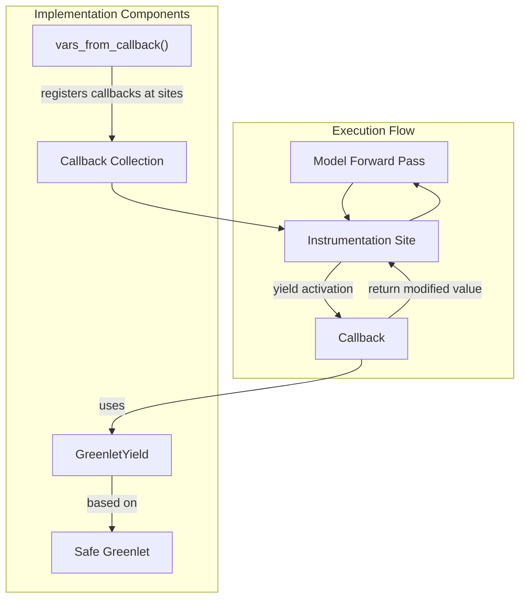
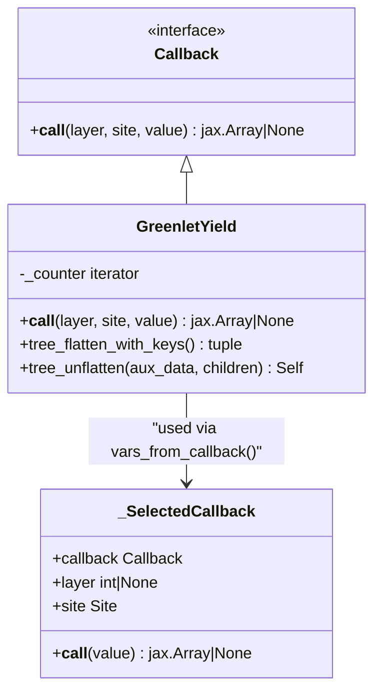
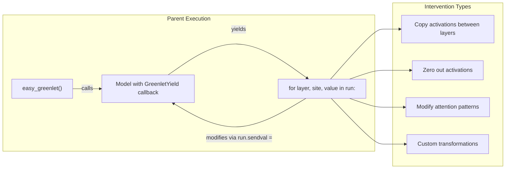
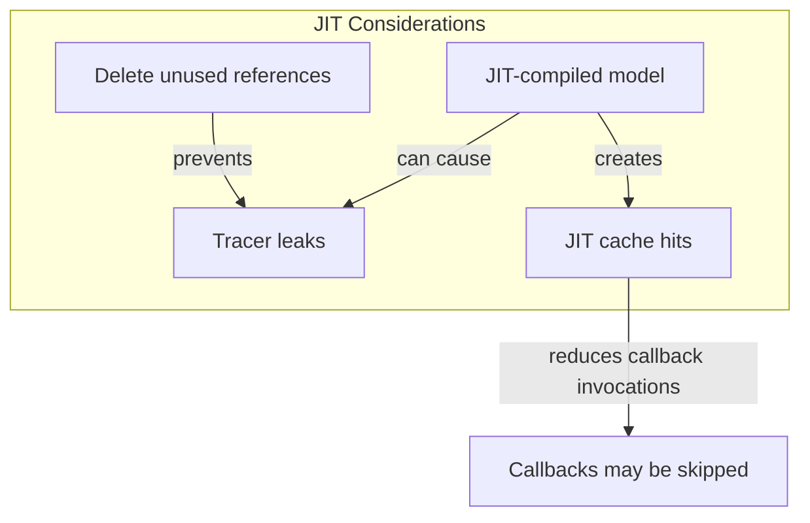
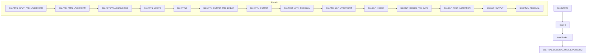

<!-- source: DeepWiki mcp.deepwiki.com · repo google-deepmind/mishax · page 4.2 Activation Intervention · fetched 2026-10-26 -->

# Activation Intervention

<details>
<summary>Relevant source files</summary>

The following files were used as context for generating this wiki page:

- [mishax/examples/gemma.py](mishax/examples/gemma.py)
- [mishax/examples/gemma_test.py](mishax/examples/gemma_test.py)

</details>


## Purpose and Scope

This document explains how to intervene in model activations using the Mishax instrumentation framework. Activation intervention allows you to observe and modify internal model states during a forward pass, enabling precise control over model behavior for mechanistic interpretability research.

For information about configuring instrumentation sites, see [Instrumentation Sites](#4.1), and for implementing custom callbacks to process activations, see [Implementing Custom Callbacks](#4.3).

Sources: [mishax/examples/gemma.py:42-78](), [mishax/examples/gemma.py:209-293]()

## Intervention Architecture

Mishax enables activation intervention through a combination of AST patching and safe greenlets. The system follows this general pattern:



Diagram: Activation Intervention Flow

Sources: [mishax/examples/gemma.py:247-260](), [mishax/examples/gemma_test.py:133-142]()

## Setting Up for Intervention

To perform activation interventions, you need to:

1. Install the patchers to instrument the model
2. Create a callback function for intervention
3. Apply the callback to the model during execution

### Installing Patchers

```python
from mishax.examples import gemma

# Install patchers to modify Gemma model code at runtime
gemma.install()
# Or use install_clean() to ensure fresh imports
gemma.install_clean()
```

Sources: [mishax/examples/gemma.py:197-206]()

### Preparing the Callback

Mishax provides the `GreenletYield` callback class which yields activations to the parent greenlet, allowing for interactive intervention:



Diagram: Callback Class Hierarchy

Sources: [mishax/examples/gemma.py:264-293](), [mishax/examples/gemma.py:215-223]()

### Applying the Callback

To apply a callback to the model, use the `vars_from_callback` function:

```python
# Create variables with callback registration
callback_vars = gemma.vars_from_callback(gemma.GreenletYield(), model)

# Apply to model with mutable=True to collect activations
model.apply(
    params | callback_vars,  # Combine model parameters with callback variables
    *model_inputs,
    mutable=True,
)
```

The `vars_from_callback` function creates a dictionary of callbacks specialized for each instrumentation site and layer, which are provided to the model during execution.

Sources: [mishax/examples/gemma.py:247-260](), [mishax/examples/gemma_test.py:134-142]()

## Intervention Techniques

### Using `easy_greenlet` for Interactive Intervention

The `safe_greenlet.easy_greenlet` function provides a convenient way to interact with model activations:



Diagram: Interactive Intervention Pattern

Sources: [mishax/examples/gemma_test.py:128-191](), [mishax/examples/gemma_test.py:217-291]()

### Example: Copying Activations Between Layers

This example demonstrates copying key vectors from layer 0 to layer 1:

```python
with safe_greenlet.easy_greenlet(
    lambda: model.apply(
        params | gemma.vars_from_callback(gemma.GreenletYield(), model),
        *model_inputs,
        mutable=True,
    ),
) as run:
    keys_0 = None
    for layer, site, value in run:
        if layer == 0 and site == gemma.Site.KEYS:
            keys_0 = value  # Store layer 0 keys
        elif layer == 1 and site == gemma.Site.KEYS:
            run.sendval = keys_0  # Replace layer 1 keys with layer 0 keys
```

Sources: [mishax/examples/gemma_test.py:147-156]()

### Example: Zeroing Activations

This example demonstrates zeroing out attention outputs at a specific layer:

```python
if layer == 1 and site == gemma.Site.ATTN_OUTPUT_PRE_LINEAR:
    run.sendval = jnp.zeros_like(value)
```

Sources: [mishax/examples/gemma_test.py:157-158]()

## Working with JIT-Compiled Models

When working with JIT-compiled models, there are additional considerations to prevent tracer leaks:



Diagram: JIT-specific considerations

Sources: [mishax/examples/gemma.py:265-274](), [mishax/examples/gemma_test.py:217-260]()

### Preventing Tracer Leaks

When working with JIT-compiled models, you need to be careful about tracer leaks. To prevent them:

1. Delete references to activations after using them:
   ```python
   keys_0 = value
   # Later after using keys_0:
   keys_0 = None
   ```

2. Delete the yielded value after processing:
   ```python
   for layer, site, value in run:
       # Process value
       # ...
       del value  # Necessary to avoid a tracer leak
   ```

Sources: [mishax/examples/gemma_test.py:252-253](), [mishax/examples/gemma_test.py:258-259]()

### Handling JIT Cache Hits

JIT compilation caches function outputs, which can cause callbacks to be invoked fewer times than expected. This can be an issue if you need to intervene on every forward pass. The `CallJitTransformerThrice` class in the examples demonstrates how to address this by forcing multiple executions.

Sources: [mishax/examples/gemma_test.py:65-86](), [mishax/examples/gemma_test.py:194-211]()

## Collecting Activation Values

When running a model with callbacks, activations can be collected in the `ACTIVATIONS` collection:

```python
# Run model with mutable=True to collect activations
output, mutated = model.apply(
    params | callback_vars,
    *model_inputs,
    mutable=True,
)

# Access collected activations
activations = mutated[gemma.ACTIVATIONS]

# Example: accessing keys from layer 0
layer_0_keys = activations['layer_0']['attn'][gemma.Site.KEYS][0]
```

The collected activations are organized by layer and site, and can be accessed after model execution.

Sources: [mishax/examples/gemma.py:80-88](), [mishax/examples/gemma_test.py:167-174]()

## Available Instrumentation Sites

Activation intervention can be performed at any of the instrumentation sites defined in the `Site` enum. Here's a diagram of the instrumentation sites available in a transformer block:



Diagram: Instrumentation Sites in Transformer Architecture

Sources: [mishax/examples/gemma.py:42-78]()

## Implementation Details

### Callback Validation

The `vars_from_callback` function validates the provided callback to ensure it's a callable and that all leaves of the callback pytree are ArrayLike:

```python
def _validate_callback(callback: Callback):
  if not isinstance(callback, Callable):
    raise ValueError('Callback must be a callable.')
  if not all(
      isinstance(leaf, jax.typing.ArrayLike)
      for leaf in jax.tree.leaves(callback)
  ):
    raise ValueError(
        'Callback must be a pytree with ArrayLike leaves. Consider using'
        ' `jax.tree_util.Partial` or `flax.struct`.'
    )
```

This ensures compatibility with JAX's transformation system.

Sources: [mishax/examples/gemma.py:234-245]()

### Model Validation

The `vars_from_callback` function also validates the model to ensure it has been properly instrumented:

```python
def _validate_model(model: 'transformer.Transformer'):
  if not (
      TRANSFORMER_PATCHER.is_installed() and MODULES_PATCHER.is_installed()
  ) or isinstance(model, TRANSFORMER_PATCHER.original_members['Transformer']):
    raise RuntimeError(
        'Please install the patchers before constructing the transformer.'
    )
```

This prevents applying callbacks to models that haven't been properly instrumented.

Sources: [mishax/examples/gemma.py:225-232]()

## Table of Common Intervention Patterns

| Intervention Type | Description | Example Code |
|-------------------|-------------|-------------|
| Copy Activations | Copy activations from one layer/site to another | `if layer == target_layer and site == target_site: run.sendval = stored_activation` |
| Zero Activations | Zero out activations at a specific site | `run.sendval = jnp.zeros_like(value)` |
| Scale Activations | Multiply activations by a scalar | `run.sendval = value * scale_factor` |
| Add Noise | Add noise to activations | `run.sendval = value + jax.random.normal(key, value.shape)` |
| Replace with Constant | Replace activations with a constant value | `run.sendval = jnp.ones_like(value) * constant` |
| Selective Modification | Modify only specific dimensions or heads | `modified = value.at[..., dims].set(new_values); run.sendval = modified` |

Sources: [mishax/examples/gemma_test.py:147-161]()

---

