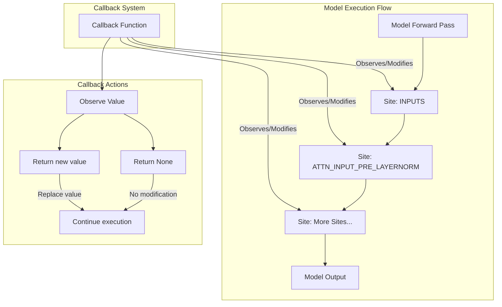
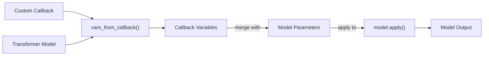
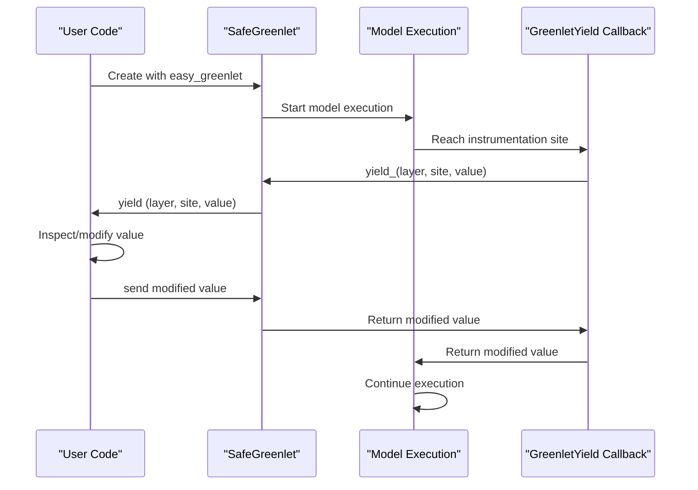

<!-- source: DeepWiki mcp.deepwiki.com · repo google-deepmind/mishax · page 4.3 Implementing Custom Callbacks · fetched 2026-10-26 -->

# Implementing Custom Callbacks

<details>
<summary>Relevant source files</summary>

The following files were used as context for generating this wiki page:

- [mishax/examples/gemma.py](mishax/examples/gemma.py)
- [mishax/examples/gemma_test.py](mishax/examples/gemma_test.py)

</details>


This document explains how to create and use custom callbacks for model instrumentation in Mishax. Callbacks are a key mechanism that allows you to observe and modify internal model activations at specified instrumentation sites. If you're looking for information about the instrumentation sites themselves, see [Instrumentation Sites](#4.1). For details on how to perform interventions, see [Activation Intervention](#4.2).

## Understanding Callbacks in Mishax

Callbacks in Mishax are functions that get called at predefined points during a model's forward pass. They provide a way to observe or modify values at specific instrumentation sites within the model.



Sources: [mishax/examples/gemma.py:42-88](), [mishax/examples/gemma.py:210-222]()

## Callback Interface

The callback interface in Mishax is defined as:

```mermaid
classDiagram
    class Callback {
        <<TypeAlias>>
        Called at each site and layer
        (layer, site, value) -> value or None
    }
    
    class _SelectedCallback {
        callback: Callback
        layer: int | None
        site: Site
        __call__(value) -> value or None
    }
    
    class GreenletYield {
        __call__(layer, site, value) -> value from yield_()
        tree_flatten_with_keys() -> tuple
        tree_unflatten(aux_data, children) -> Self
    }
    
    Callback <|-- GreenletYield
    Callback --> _SelectedCallback : wrapped by
```

A callback is a callable that:
1. Takes three parameters: `layer` (integer or None), `site` (a `Site` enum value), and `value` (a JAX array)
2. Returns either a modified JAX array (to replace the original value) or `None` (to leave the original value unchanged)

Sources: [mishax/examples/gemma.py:210-222](), [mishax/examples/gemma.py:263-293]()

## Creating Basic Callbacks

To create a custom callback, you need to define a function or callable class that follows the callback interface.

### Basic Callback Structure

```python
def my_callback(layer: int | None, site: gemma.Site, value: jax.Array) -> jax.Array | None:
    # Observe or modify the value
    # Return a modified value or None
    return None
```

### JAX Pytree Requirements

For callbacks to work properly with JAX's JIT compilation, they must be pytrees with JAX-compatible leaves. This means:

1. All leaves in a callback must be JAX array-like objects
2. The callback must be serializable via JAX's tree utilities

To validate your callback, Mishax uses the `_validate_callback` function:

Sources: [mishax/examples/gemma.py:234-244]()

### Handling Different Sites and Layers

Callbacks receive both the layer and site information, allowing you to implement site-specific or layer-specific logic:

```python
def layer_specific_callback(layer: int | None, site: gemma.Site, value: jax.Array) -> jax.Array | None:
    if layer == 1 and site == gemma.Site.KEYS:
        # Modify only keys in layer 1
        return modified_value
    return None
```

Sources: [mishax/examples/gemma.py:121-141]()

## Using Callbacks with Models

To use a callback with a model, you need to:
1. Create your callback function
2. Use `vars_from_callback` to create variables for your model
3. Apply these variables to your model during inference



### The vars_from_callback Function

The `vars_from_callback` function takes your callback and the model, and returns a set of variables that will invoke your callback at the appropriate sites:

```python
callback_vars = gemma.vars_from_callback(my_callback, model)
```

This function:
1. Validates the model is properly instrumented
2. Validates the callback follows the required interface
3. Creates a specialized callback for each layer and site
4. Organizes these callbacks in the structure expected by the model

Sources: [mishax/examples/gemma.py:247-260]()

### Applying Callbacks to Models

To apply your callback during model inference:

```python
output = model.apply(
    params | callback_vars,  # Merge parameters with callback variables
    input_tokens,
    positions,
    cache,
    attention_mask,
    mutable=True,  # Required to collect activations
)
```

Sources: [mishax/examples/gemma_test.py:134-142]()

## Special Callback: GreenletYield

The `GreenletYield` callback is a special type that allows interactive inspection and modification of model activations:



This callback:
1. Is registered as a JAX pytree with special handling for JIT compilation
2. Yields control to a parent greenlet when called
3. Returns the value sent back from the parent

To use `GreenletYield`:

```python
with safe_greenlet.easy_greenlet(
    lambda: model.apply(
        params | gemma.vars_from_callback(gemma.GreenletYield(), model),
        input_tokens,
        positions,
        cache,
        attention_mask,
        mutable=True,
    ),
) as run:
    for layer, site, value in run:
        # Inspect value
        if condition:
            # Modify value
            run.sendval = modified_value
```

Sources: [mishax/examples/gemma.py:263-293](), [mishax/examples/gemma_test.py:133-161]()

## Example Use Cases

### Observing Values

This example collects activations from specific layers and sites:

```python
def observation_callback(layer, site, value):
    if layer == 1 and site == gemma.Site.KEYS:
        print(f"Layer 1 keys shape: {value.shape}")
    return None  # Return None to keep the original value
```

### Modifying Values

This example zeroes out specific activations:

```python
def zeroing_callback(layer, site, value):
    if layer == 1 and site == gemma.Site.ATTN_OUTPUT_PRE_LINEAR:
        return jnp.zeros_like(value)  # Return zeros to replace activations
    return None  # Return None for other sites
```

### Cross-Layer Intervention

This example copies activations from one layer to another:

```python
class CrossLayerCallback:
    def __init__(self):
        self.layer0_keys = None
    
    def __call__(self, layer, site, value):
        if layer == 0 and site == gemma.Site.KEYS:
            self.layer0_keys = value
            return None
        elif layer == 1 and site == gemma.Site.KEYS:
            return self.layer0_keys  # Replace layer 1 keys with layer 0 keys
        return None
```

Sources: [mishax/examples/gemma_test.py:141-161](), [mishax/examples/gemma_test.py:241-257]()

## Best Practices and Limitations

### Avoiding Tracer Leaks

When using `GreenletYield` with JIT-compiled models:
1. Delete activation values after using them in the loop
2. Set temporary variables to `None` after use

```python
for layer, site, value in run:
    # Process value
    run.sendval = processed_value
    # Avoid tracer leak
    del value
```

Sources: [mishax/examples/gemma_test.py:242-259]()

### Performance Considerations

Callbacks can impact performance, especially when:
1. Running with JIT compilation
2. Processing large arrays
3. Performing complex operations inside callbacks

### Validation Requirements

Ensure your callbacks and models meet the validation requirements:
1. Models must be instrumented before creating the transformer
2. Callbacks must be callables with JAX-compatible leaves

Sources: [mishax/examples/gemma.py:225-244]()

## Callback Application Table

| Callback Type | Use Case | Example |
|---------------|----------|---------|
| Simple function | Basic observations | Print activation shapes or statistics |
| Function returning values | Value intervention | Replace specific activations with zeros |
| Stateful class | Cross-layer intervention | Copy activations between layers |
| GreenletYield | Interactive exploration | Dynamically inspect and modify activations |

Sources: [mishax/examples/gemma.py:210-222](), [mishax/examples/gemma.py:263-293](), [mishax/examples/gemma_test.py:126-191]()

---

