<!-- source: DeepWiki mcp.deepwiki.com · repo google-deepmind/mishax · page 5 Mechanistic Interpretability Guide · fetched 2026-10-26 -->

# Mechanistic Interpretability Guide

<details>
<summary>Relevant source files</summary>

The following files were used as context for generating this wiki page:

- [README.md](README.md)
- [mishax/ast_patcher.py](mishax/ast_patcher.py)
- [mishax/examples/gemma.py](mishax/examples/gemma.py)
- [mishax/safe_greenlet.py](mishax/safe_greenlet.py)

</details>


## Purpose and Scope

This guide provides a comprehensive overview of using Mishax for mechanistic interpretability research on neural networks, particularly language models. Mechanistic interpretability aims to understand how models work internally by examining their activations and manipulating internal states during forward passes. This document covers the process of instrumenting models, capturing internal activations, and performing targeted interventions to test causal hypotheses about model behavior.

For information about the core utilities that power these capabilities, see [AST Patcher](#2) and [Safe Greenlet](#3). For a concrete implementation example, see [Gemma Instrumentation Example](#4).

Sources: [README.md:5-11]()

## Mechanistic Interpretability Overview

Mechanistic interpretability focuses on understanding neural networks by directly examining their internal mechanisms rather than treating them as black boxes. With Mishax, this involves:

1. **Instrumentation**: Inserting probe points at key locations in model code
2. **Activation capture**: Examining internal representations during execution
3. **Targeted intervention**: Modifying intermediate values to test hypotheses
4. **Causal analysis**: Analyzing how modifications affect model outputs

Mishax combines two powerful capabilities to enable this research:
- Runtime code modification via AST patching
- Structured concurrency via safe greenlets

This allows researchers to observe and modify values at any point in a model's forward pass without needing to fork and modify the original model codebase.

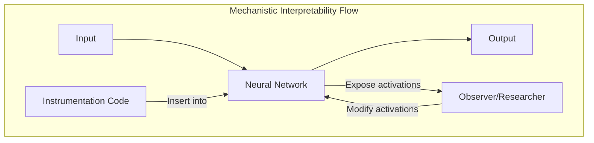

Sources: [README.md:5-9](), [mishax/examples/gemma.py:16-20]()

## Instrumentation Architecture

The Mishax instrumentation architecture consists of several key components working together:

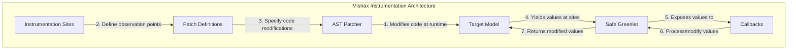

Sources: [mishax/ast_patcher.py:64-105](), [mishax/safe_greenlet.py:16-23](), [mishax/examples/gemma.py:37-78]()

### Instrumentation Sites

Instrumentation sites define specific points in the model's computation graph where you want to observe or modify values. In the Gemma example, these are implemented as an enum:

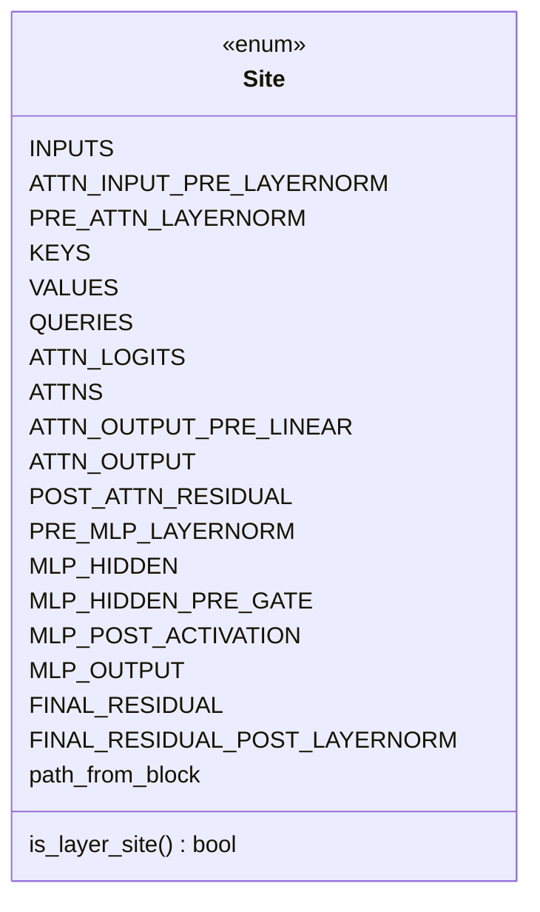

Each site represents a specific tensor in the model's computation. Some sites are associated with specific layers (like attention heads or MLP blocks), while others are global (like model inputs or final outputs).

Sources: [mishax/examples/gemma.py:42-78]()

### Mapping Sites to Neural Network Architecture

The following diagram maps instrumentation sites to the standard transformer architecture:

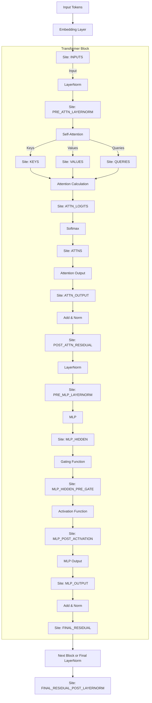

Sources: [mishax/examples/gemma.py:42-78](), [mishax/examples/gemma.py:96-182]()

## Setting Up Instrumentation

### Creating AST Patches

AST patches define how to modify the original model code to insert instrumentation. Each patch specifies:
1. Original code to match
2. Modified code with instrumentation

The Gemma example defines patches for:
- Attention module
- FeedForward module
- Block module
- Transformer module

For example, to instrument attention logits, this patch is used:

```
# Original code
'logits = jnp.einsum("BTNH,BSNH->BTNS", query_scaled, key_proj)'

# Modified code with instrumentation
'''
query_scaled = tag(self, Site.QUERIES, query_scaled)
logits = jnp.einsum("BTNH,BSNH->BTNS", query_scaled, key_proj)
logits = tag(self, Site.ATTN_LOGITS, logits)
'''
```

These patches are organized into `ModuleASTPatcher` objects that target specific modules.

Sources: [mishax/examples/gemma.py:96-194](), [mishax/ast_patcher.py:64-105]()

### Installing Patches

Patches must be installed before the target modules are imported:

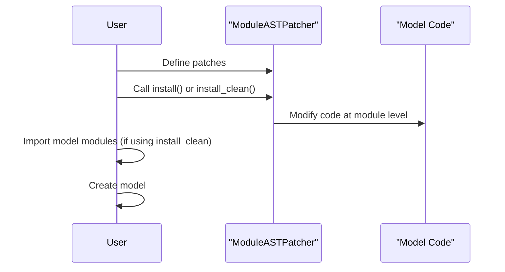

The Gemma example provides two installation methods:
- `install()`: Use when modules are already imported
- `install_clean()`: Use before importing modules (preferred for cleaner patching)

Sources: [mishax/examples/gemma.py:196-206](), [mishax/ast_patcher.py:125-166]()

## Working with Callbacks

Callbacks are functions that receive values from instrumentation sites and can optionally modify them.

### Callback Types

Mishax supports different callback patterns:

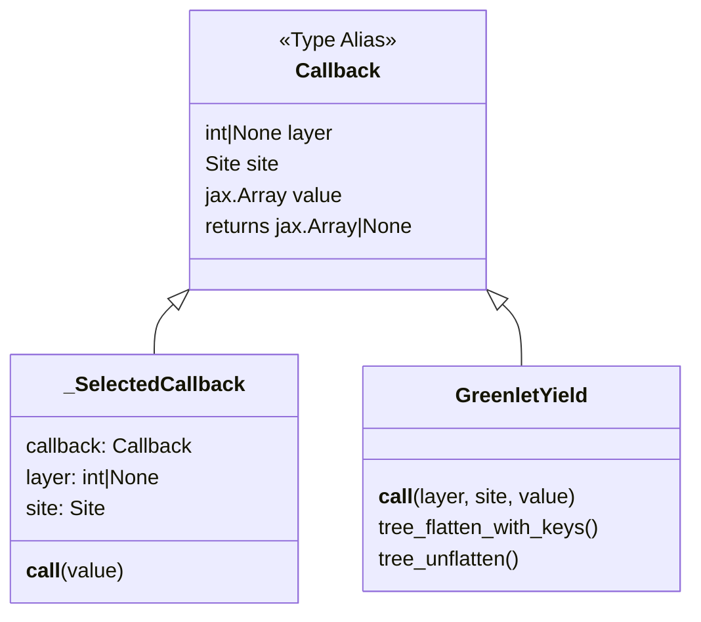

A callback should:
- Accept parameters for layer, site, and the JAX array value
- Return either a modified value (to replace the original) or None (to keep the original)

Sources: [mishax/examples/gemma.py:209-244]()

### Using GreenletYield for Interactive Exploration

The `GreenletYield` callback is particularly useful as it yields control back to the calling code, allowing for interactive exploration and modification:

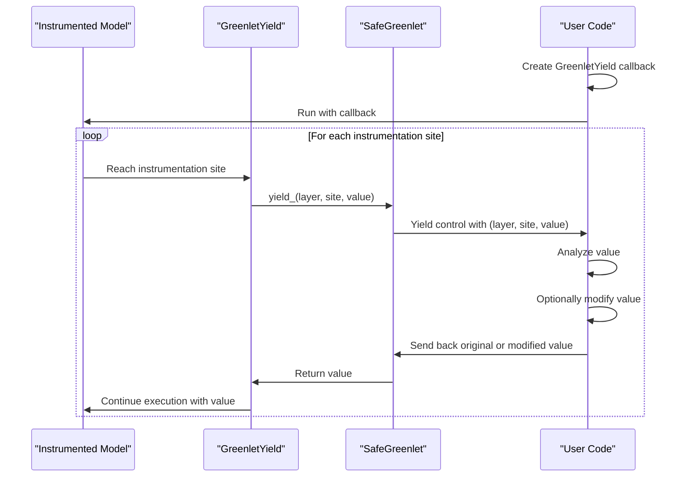

Sources: [mishax/examples/gemma.py:262-293](), [mishax/safe_greenlet.py:182-193]()

## Common Workflows

### Activation Capture

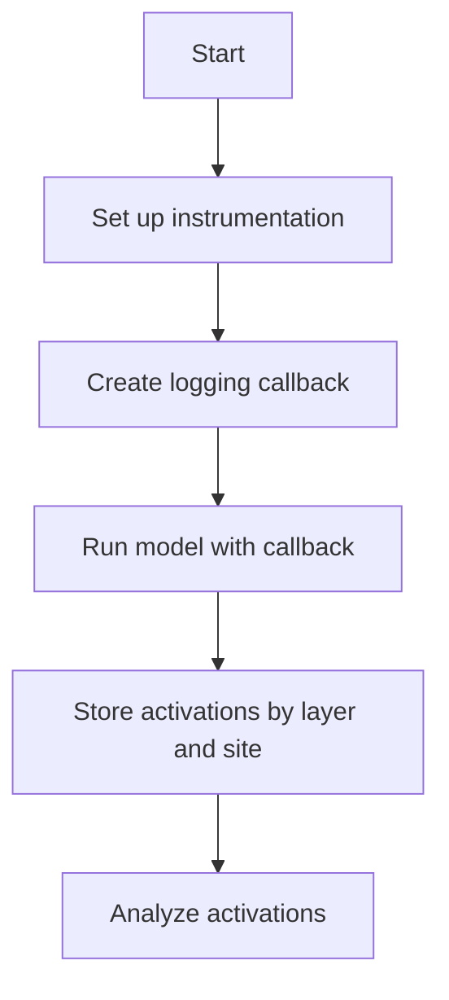

### Targeted Intervention

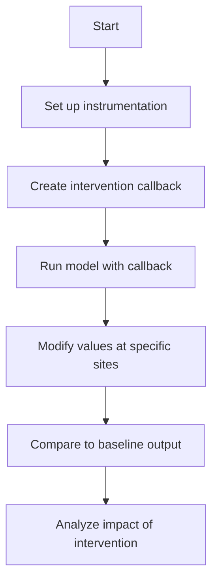

### Causal Tracing

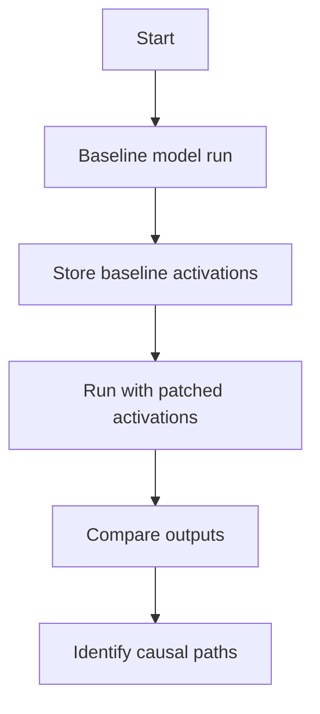

Sources: [mishax/examples/gemma.py:209-293]()

## Implementation Example

The following diagram shows how to implement a basic activation capture workflow using Mishax:

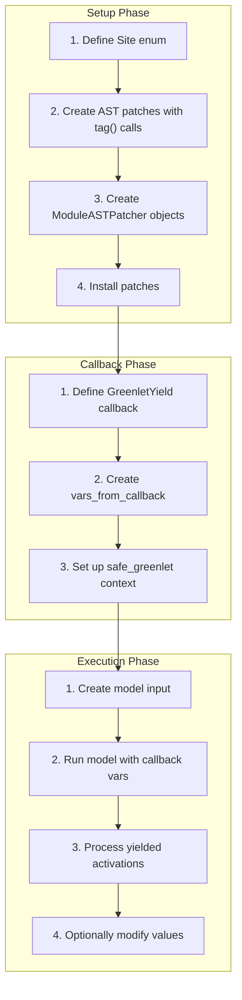

Sources: [mishax/examples/gemma.py:16-293]()

## Best Practices

When using Mishax for mechanistic interpretability:

1. **Performance considerations**:
   - Cache activations when possible rather than recomputing
   - Be aware that intercepting every site can slow down execution

2. **JAX compatibility**:
   - Ensure callbacks are JAX-compatible (use JAX operations)
   - Be careful with tracer leaks when working with JAX values

3. **Patching safety**:
   - Test patches thoroughly as model code changes can break them
   - Use minimal patches focused on specific components of interest

4. **Memory management**:
   - Be mindful of memory usage when storing large activations
   - Consider using streaming approaches for large models

Sources: [mishax/examples/gemma.py:264-277](), [mishax/ast_patcher.py:90-105](), [README.md:13-15]()

## Conclusion

Mishax provides a powerful framework for mechanistic interpretability research, enabling deep inspection and modification of neural network internals without invasive code changes. By combining AST patching and structured concurrency, it allows researchers to test hypotheses about how models process information and make decisions.

For practical examples, see the [Gemma Instrumentation Example](#4), which demonstrates these techniques on a production-grade language model.

Sources: [README.md:5-11](), [mishax/examples/gemma.py:16-20]()

---

