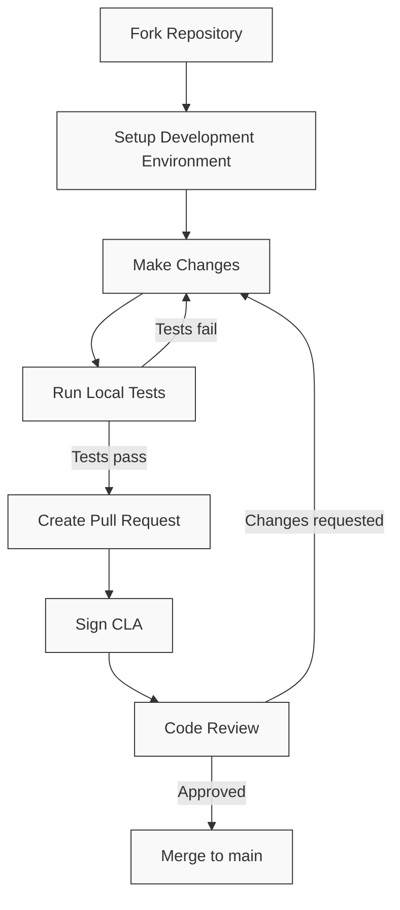
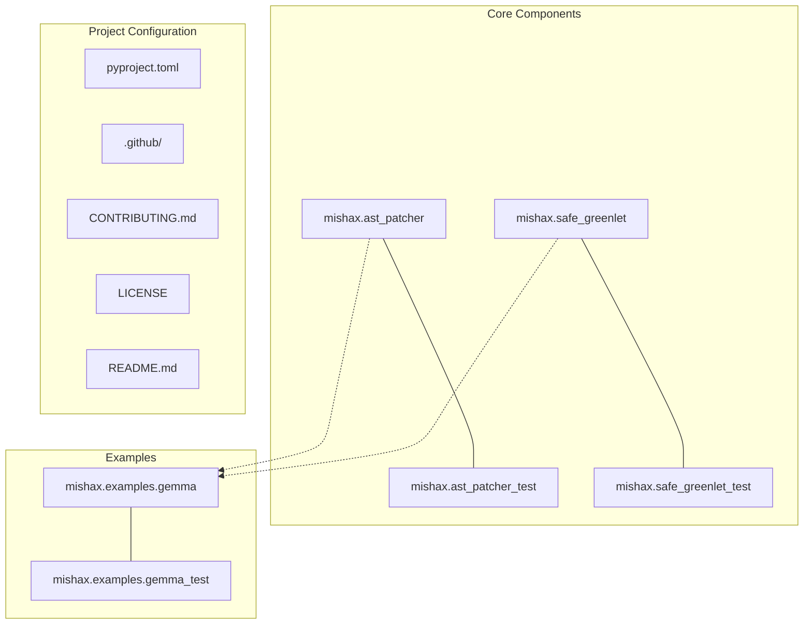
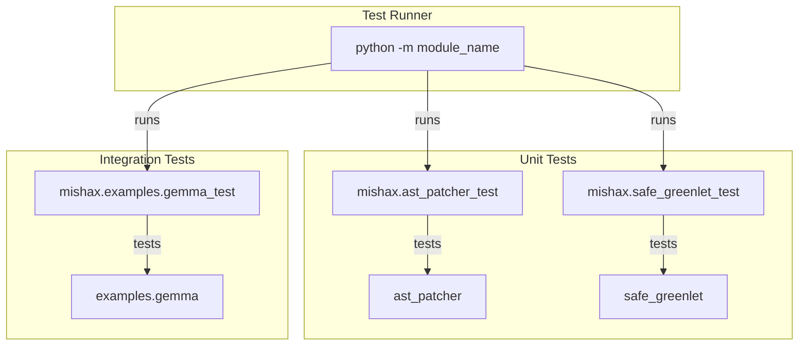
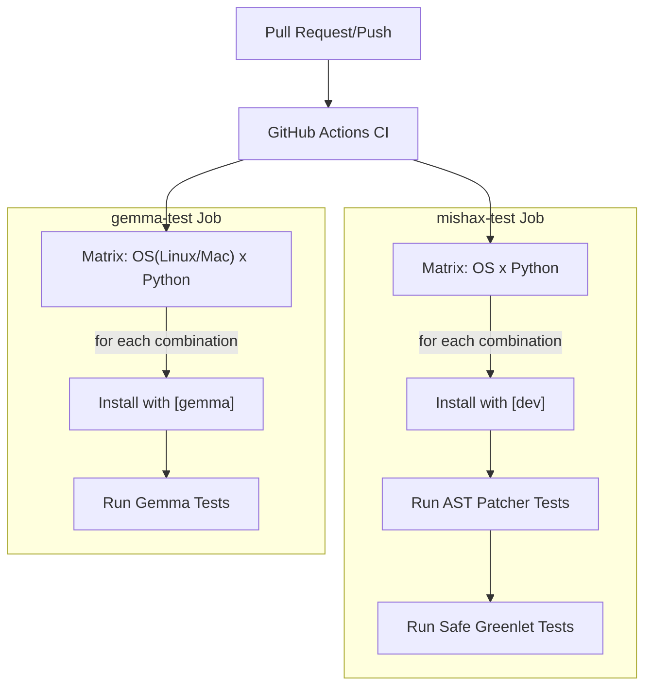
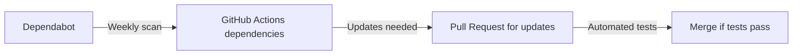

<!-- source: DeepWiki mcp.deepwiki.com · repo google-deepmind/mishax · page 6 Development and Contributing · fetched 2026-10-26 -->

# Development and Contributing

<details>
<summary>Relevant source files</summary>

The following files were used as context for generating this wiki page:

- [.github/dependabot.yml](.github/dependabot.yml)
- [.github/workflows/ci.yml](.github/workflows/ci.yml)
- [CONTRIBUTING.md](CONTRIBUTING.md)
- [LICENSE](LICENSE)

</details>


This page provides comprehensive information for developers who wish to contribute to the Mishax project. It covers the development workflow, environment setup, testing practices, and contribution guidelines. For information about using Mishax for mechanistic interpretability research, see [Mechanistic Interpretability Guide](#5).

## Overview of Contributing Process

Contributing to Mishax follows a standard open-source workflow with some specific requirements due to its Google DeepMind origins. The diagram below illustrates the overall contribution process:



Sources: [CONTRIBUTING.md]()

## Setting Up the Development Environment

To set up your development environment for Mishax:

1. **Fork and clone the repository**:
   ```bash
   git clone https://github.com/your-username/mishax.git
   cd mishax
   ```

2. **Install with development dependencies**:
   ```bash
   pip install -e '.[dev]'
   ```

3. **For Gemma example development, install with Gemma dependencies**:
   ```bash
   pip install -e '.[gemma]'
   ```

The development environment supports Python 3.11, 3.12, and 3.13.

Sources: [.github/workflows/ci.yml:32-34]()

## Project Structure

Mishax is organized into core components and examples. Understanding this structure is essential for effective contribution:



Sources: [.github/workflows/ci.yml:35-39](), [.github/workflows/ci.yml:66-67]()

## Coding Standards and Guidelines

When contributing to Mishax, adhere to these coding standards:

1. **Python Style**: Follow PEP 8 guidelines for code formatting
2. **Documentation**: Document all public functions, classes, and modules
3. **Testing**: Write tests for new functionality
4. **Type Hints**: Use type annotations for function parameters and return values

## Testing Framework

Mishax employs a straightforward testing approach with separate test modules for each main component. The testing structure mirrors the component organization:



To run the tests locally:

```bash
# Run ast_patcher tests
python -m mishax.ast_patcher_test

# Run safe_greenlet tests
python -m mishax.safe_greenlet_test

# Run gemma example tests
python -m mishax.examples.gemma_test
```

Sources: [.github/workflows/ci.yml:35-39](), [.github/workflows/ci.yml:66-67]()

## CI/CD Pipeline

Mishax uses GitHub Actions for continuous integration. The CI workflow runs on every push to the main branch and on all pull requests.

### CI Workflow Architecture



The CI pipeline runs on multiple operating systems (Ubuntu, macOS, Windows) and Python versions (3.11, 3.12, 3.13) to ensure broad compatibility. For the Gemma examples, tests run only on Ubuntu and macOS with Python 3.11 and 3.12.

Sources: [.github/workflows/ci.yml:10-67]()

### Dependency Management

Mishax uses GitHub's Dependabot to automatically keep GitHub Actions dependencies up to date:



Sources: [.github/dependabot.yml:1-13]()

## Pull Request Process

When submitting a pull request to Mishax:

1. **Create a focused PR** that addresses a specific issue or feature
2. **Ensure tests pass** on your local machine before submitting
3. **Sign the Contributor License Agreement** (CLA) if you haven't already
4. **Respond to review comments** promptly
5. **Rebase your branch** if necessary to resolve conflicts

Sources: [CONTRIBUTING.md:15-20]()

## Contributor License Agreement

All contributions to Mishax require a Contributor License Agreement (CLA):

1. Visit https://cla.developers.google.com/ to sign the CLA
2. You generally only need to submit a CLA once for all Google projects
3. The CLA is required even for small contributions

Sources: [CONTRIBUTING.md:3-13]()

## License

Mishax is licensed under the Apache License 2.0, which allows:

- Free use, modification, and distribution
- Use in proprietary software
- Patent grants

When contributing, all your submissions will be subject to the same Apache 2.0 license.

Sources: [LICENSE](), [CONTRIBUTING.md:131-137]()

## Community Guidelines

This project follows [Google's Open Source Community Guidelines](https://opensource.google/conduct/). All contributors are expected to adhere to these guidelines when interacting with the community.

Sources: [CONTRIBUTING.md:23-25]()

---

