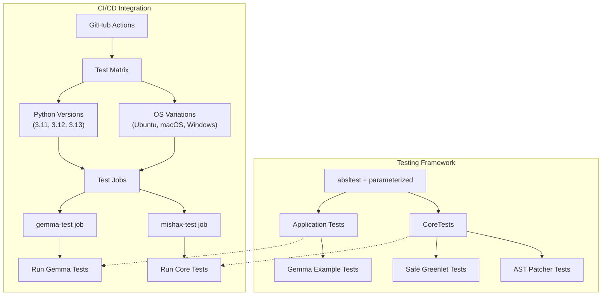
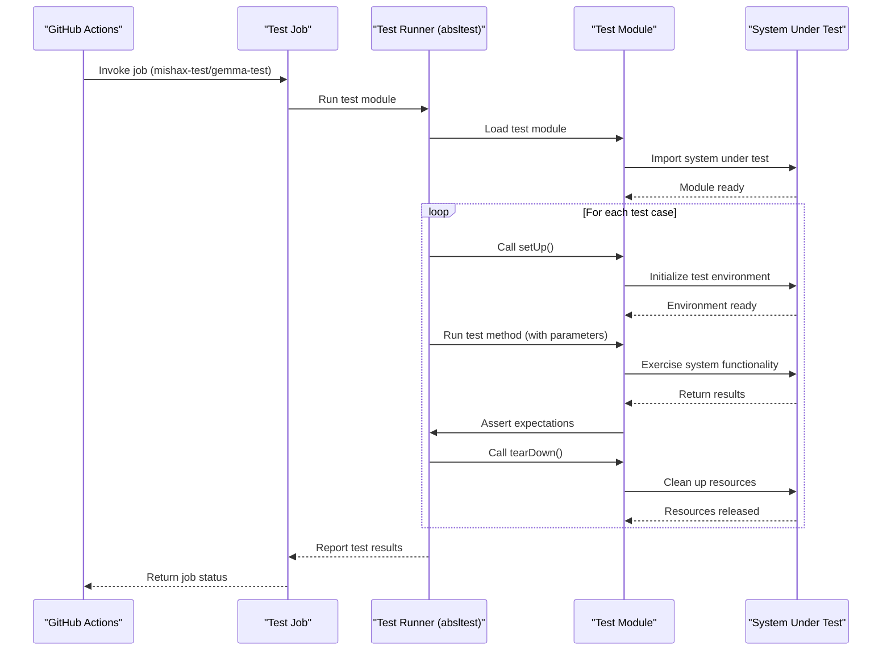
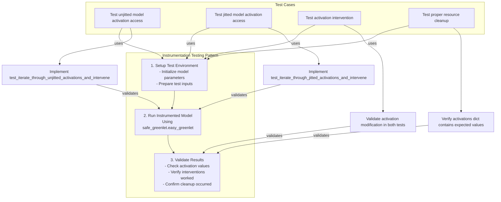

<!-- source: DeepWiki mcp.deepwiki.com · repo google-deepmind/mishax · page 6.1 Testing Framework · fetched 2026-10-26 -->

# Testing Framework

<details>
<summary>Relevant source files</summary>

The following files were used as context for generating this wiki page:

- [.github/dependabot.yml](.github/dependabot.yml)
- [.github/workflows/ci.yml](.github/workflows/ci.yml)
- [mishax/ast_patcher_test.py](mishax/ast_patcher_test.py)
- [mishax/examples/gemma_test.py](mishax/examples/gemma_test.py)
- [mishax/safe_greenlet_test.py](mishax/safe_greenlet_test.py)

</details>


## Purpose and Scope

This document describes the testing framework used in the Mishax project. It covers the approach, tools, and patterns used to validate the core components (`ast_patcher` and `safe_greenlet`) as well as the example implementations (such as Gemma instrumentation). For information about the CI/CD pipeline that runs these tests, see [CI/CD Pipeline](#6.2).

Sources: [.github/workflows/ci.yml:1-67]()

## Testing Architecture Overview

Mishax employs a comprehensive testing approach that validates functionality at multiple levels. The testing framework is built on Google's `absltest` and uses parameterized testing extensively to cover various scenarios with minimal code duplication.

### Test Hierarchy



Sources: [.github/workflows/ci.yml:10-67](), [mishax/ast_patcher_test.py:16-20](), [mishax/safe_greenlet_test.py:25-28](), [mishax/examples/gemma_test.py:17-19]()

## Core Test Components

The Mishax testing framework consists of several key test modules that validate different aspects of the codebase:

```mermaid
classDiagram
    class "absltest.TestCase" {
        +setUp()
        +assertEqual()
        +assertRaises()
        +etc...
    }
    
    class "parameterized.TestCase" {
        +@parameterized.parameters()
        +@parameterized.product()
    }
    
    class "AstPatcherTest" {
        +test_patch()
        +test_decorator_still_applied()
        +test_patch_expr_and_prefix()
        +test_stacktrace()
        +test_no_double_patch_by_default()
        +test_can_double_patch()
        +test_install_clean()
    }
    
    class "SafeGreenletTest" {
        +test_call_a_greenlet_that_calls_a_greenlet()
        +test_non_reentrant()
        +test_self_switch_or_throw()
        +test_during_one_greenlet_call_a_function_that_uses_another()
        +test_block_unreachable_child()
        +test_custody_belongs_to_cleanup_greenlet()
        +test_local_context()
        +test_clean_up_parricide()
        +test_no_interleaved_contexts_from_random_spawn_and_switch()
    }
    
    class "GeneratorTest" {
        +test_len_0_generators()
        +test_immediate_error_generators()
        +test_immediate_stopiteration_generators()
        +test_generator_holds_onto_sendval_unless_boxed()
        +test_error_catching_generators()
    }
    
    class "GemmaTest" {
        +test_iterate_through_unjitted_activations_and_intervene()
        +test_iterate_through_jitted_activations_and_intervene()
        +test_validate_non_pytree_callback()
        +test_validate_uninstrumented_model()
        +test_base_transformer_still_in_use()
    }
    
    "absltest.TestCase" <|-- "parameterized.TestCase"
    "parameterized.TestCase" <|-- "AstPatcherTest"
    "parameterized.TestCase" <|-- "SafeGreenletTest"
    "parameterized.TestCase" <|-- "GeneratorTest"
    "parameterized.TestCase" <|-- "GemmaTest"
```

Sources: [mishax/ast_patcher_test.py:70-198](), [mishax/safe_greenlet_test.py:31-545](), [mishax/examples/gemma_test.py:104-306]()

## Test Types and Coverage

Mishax employs several types of tests to ensure comprehensive coverage:

### Unit Tests for Core Components

The core components (`ast_patcher` and `safe_greenlet`) have dedicated test files that verify their functionality:

1. **AST Patcher Tests** (`ast_patcher_test.py`):
   - Tests code patching for different class types
   - Verifies patched code runs as expected
   - Checks proper error handling for invalid patch scenarios
   - Tests preservation of decorators and metadata
   - Validates installation and context management functionality

2. **Safe Greenlet Tests** (`safe_greenlet_test.py`):
   - Tests basic greenlet functionality
   - Verifies error handling and propagation
   - Tests structured concurrency patterns
   - Validates proper cleanup and resource management
   - Tests generator-style interfaces and behavior

### Integration Tests for Example Applications

The Gemma instrumentation example has its own test file that verifies the integration between core components and the application:

**Gemma Example Tests** (`examples/gemma_test.py`):
   - Tests activation extraction and intervention for unjitted models
   - Tests jitted model instrumentation
   - Validates proper cleanup of resources
   - Tests error handling for invalid configurations

Sources: [mishax/ast_patcher_test.py:70-198](), [mishax/safe_greenlet_test.py:31-545](), [mishax/examples/gemma_test.py:104-306]()

## Parameterized Testing

The Mishax testing framework makes extensive use of the `parameterized` library to run tests with different configurations. This approach allows testing multiple scenarios without duplicating code.

### Example from AST Patcher Tests

```
@parameterized.product(
    cls_name=[PlainClass.__name__, FancyClass.__name__], install=[True, False]
)
def test_patch(self, cls_name: str, install: bool):
    # Test code patching with different class types and installation options
```

This approach tests code patching functionality across different class types (plain classes and classes with metaclasses) and with different installation behaviors.

### Example from Gemma Tests

```
@parameterized.product(
    [
        dict(
            model=JIT_MODEL,
            visits_per_site=1,
            mutable=True,
        ),
        dict(
            model=CALL_JIT_TRANSFORMER_THRICE,
            visits_per_site=3,
            mutable=True,
        ),
        dict(
            model=CALL_JIT_TRANSFORMER_THRICE,
            visits_per_site=3,
            mutable=False,
        ),
    ],
    [
        dict(use_cache=True, attn_mask=ATTENTION_MASK),
        dict(use_cache=False, attn_mask=ATTENTION_MASK[..., :SEQ_SIZE]),
    ],
)
def test_iterate_through_jitted_activations_and_intervene(self, ...)
```

This tests model instrumentation with different model configurations, caching strategies, and mutability settings.

Sources: [mishax/ast_patcher_test.py:72-74](), [mishax/examples/gemma_test.py:193-215]()

## Test Execution Flow

The following diagram illustrates how tests are executed in the Mishax framework:



Sources: [.github/workflows/ci.yml:10-67](), [mishax/ast_patcher_test.py:70-198](), [mishax/safe_greenlet_test.py:31-545](), [mishax/examples/gemma_test.py:104-306]()

## CI Integration

Tests are run automatically via GitHub Actions in a matrix of different operating systems and Python versions:

| Job | Operating Systems | Python Versions | Tests Run |
|-----|-------------------|----------------|-----------|
| mishax-test | Ubuntu, macOS, Windows | 3.11, 3.12, 3.13 | `ast_patcher_test.py`, `safe_greenlet_test.py` |
| gemma-test | Ubuntu, macOS | 3.11, 3.12 | `examples/gemma_test.py` |

This ensures the code works correctly across different environments and Python versions.

Sources: [.github/workflows/ci.yml:10-67]()

## Testing Instrumentation Code

Testing code instrumentation presents unique challenges due to its dynamic nature. The Mishax testing framework employs several strategies to validate instrumentation correctness:



Sources: [mishax/examples/gemma_test.py:128-291]()

### Key Testing Patterns for Instrumentation

1. **Setup-Run-Validate Pattern**:
   - Setup test model and parameters
   - Run instrumented model with greenlet/generator pattern
   - Validate outputs and side effects

2. **Intervention Testing**:
   - Extract values at instrumentation points
   - Modify values and send them back
   - Verify the modifications affected the model's behavior

3. **Resource Cleanup Verification**:
   - Use weakrefs to track object lifecycle
   - Check that resources are properly released
   - Verify instrumentation state is cleaned up

Example from Gemma tests:
```python
with safe_greenlet.easy_greenlet(
    lambda: MODEL.apply(
        self.params | gemma.vars_from_callback(gemma.GreenletYield(), MODEL),
        TOKEN_INPUT,
        self.positions,
        self.empty_cache if use_cache else None,
        attn_mask,
        mutable=True,
    ),
) as run:
    keys_0 = None
    found_activations = []
    for layer, site, value in run:
        # Perform interventions and collect data
        # ...
        found_activations.append((layer, site))
```

This pattern allows tests to inspect and modify internal model state during execution.

Sources: [mishax/examples/gemma_test.py:133-161](), [mishax/examples/gemma_test.py:227-260]()

## Best Practices for Writing Tests

Based on the existing tests in Mishax, here are best practices for writing new tests:

1. **Use parameterized tests** to cover multiple scenarios with minimal code duplication
2. **Test both positive and negative cases** to ensure proper error handling
3. **Verify proper resource cleanup** using weakrefs and reference counting
4. **Use subtests** to organize related test cases and improve test output
5. **Test with different configurations** (e.g., jitted vs unjitted, with or without caching)
6. **Validate internal state** by accessing and modifying intermediate values

Sources: [mishax/ast_patcher_test.py:72-74](), [mishax/safe_greenlet_test.py:327-376](), [mishax/examples/gemma_test.py:193-215]()

---

