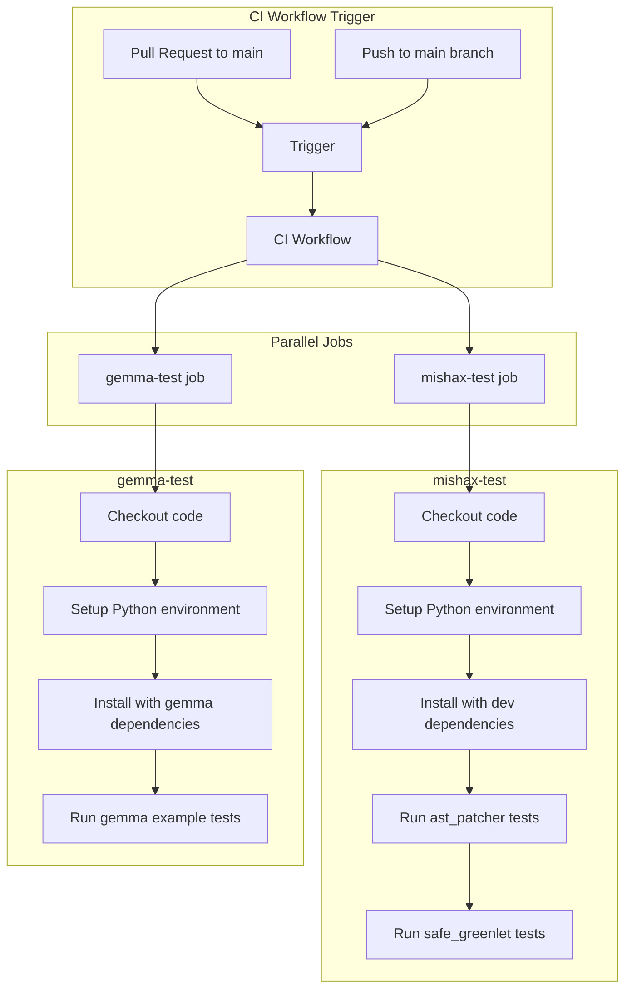
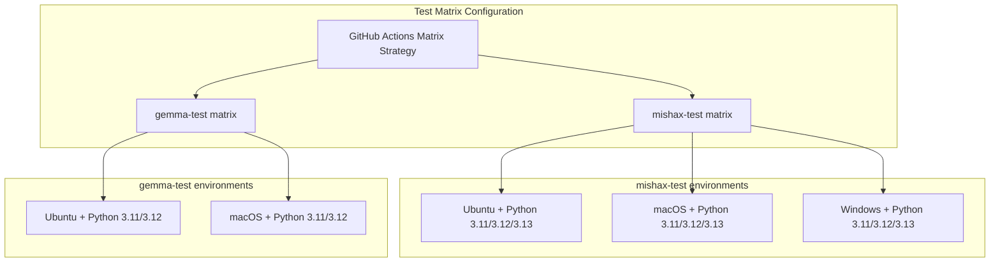
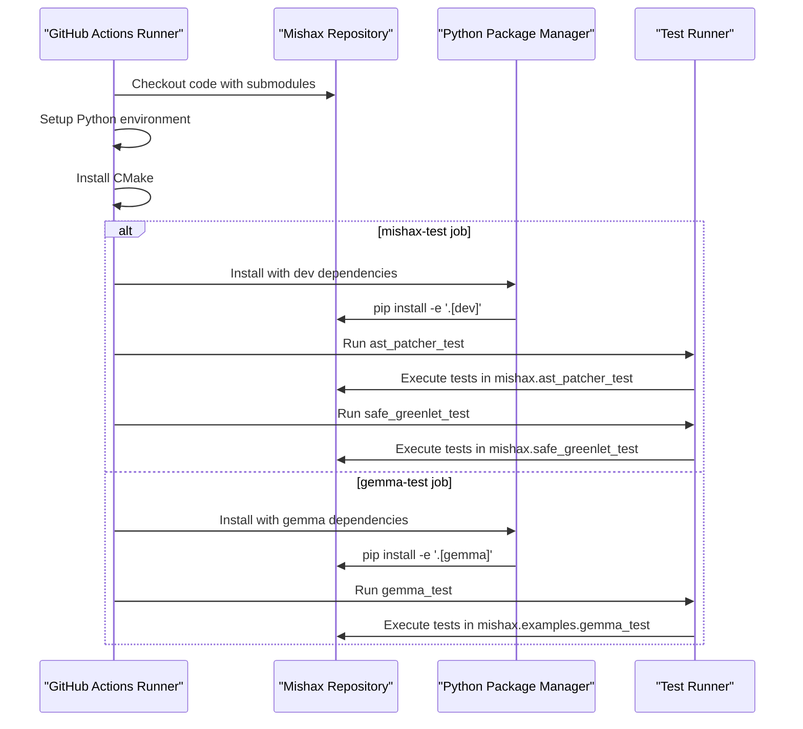
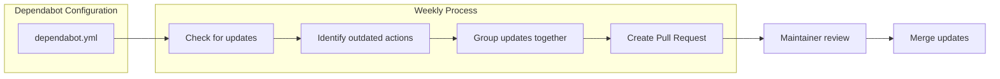

<!-- source: DeepWiki mcp.deepwiki.com · repo google-deepmind/mishax · page 6.2 CI/CD Pipeline · fetched 2026-10-26 -->

# CI/CD Pipeline

Relevant source files

The following files were used as context for generating this wiki page:

- [.github/dependabot.yml](.github/dependabot.yml)
- [.github/workflows/ci.yml](.github/workflows/ci.yml)

This document describes the continuous integration and continuous deployment (CI/CD) pipeline for the Mishax repository. It explains how automated testing and integration are set up across different platforms and Python versions. For information about the testing framework itself, see [Testing Framework](#6.1).

## CI Workflow Overview

Mishax uses GitHub Actions to automate testing across multiple platforms and Python versions. The CI workflow is triggered automatically on:
- Every push to the `main` branch
- Every pull request targeting the `main` branch

The workflow consists of two separate jobs that run in parallel:
1. `mishax-test`: Tests the core components (ast_patcher and safe_greenlet)
2. `gemma-test`: Tests the Gemma instrumentation example

Sources: [.github/workflows/ci.yml:1-9](), [.github/workflows/ci.yml:9-40](), [.github/workflows/ci.yml:41-67]()

## Test Matrix Strategy

The CI pipeline uses a matrix strategy to test the codebase under various environments. This ensures that Mishax works correctly across different operating systems and Python versions.

### Core Components Test Matrix

The `mishax-test` job runs on the following matrix:

| Operating System | Python Versions |
|------------------|----------------|
| Ubuntu (latest)  | 3.11, 3.12, 3.13 |
| macOS (latest)   | 3.11, 3.12, 3.13 |
| Windows (latest) | 3.11, 3.12, 3.13 |

### Gemma Example Test Matrix

The `gemma-test` job runs on a slightly different matrix:

| Operating System | Python Versions |
|------------------|----------------|
| Ubuntu (latest)  | 3.11, 3.12 |
| macOS (latest)   | 3.11, 3.12 |

Note that the Gemma example tests do not run on Windows and do not test Python 3.13, which reflects platform-specific limitations or compatibility issues with the Gemma dependencies.

Sources: [.github/workflows/ci.yml:10-16](), [.github/workflows/ci.yml:42-48]()

## Workflow Steps

Each job in the CI workflow follows a similar sequence of steps, with minor differences depending on the job-specific requirements.

### mishax-test Job Steps

1. **Checkout code**: Fetches the repository including submodules
2. **Setup Python**: Installs the specified Python version (3.11, 3.12, or 3.13)
3. **Install CMake**: Ensures the necessary build tools are available
4. **Install dependencies**: Installs Mishax with development dependencies using `pip install -e '.[dev]'`
5. **Run ast_patcher tests**: Executes tests for the AST patcher component
6. **Run safe_greenlet tests**: Executes tests for the safe greenlet component

### gemma-test Job Steps

1. **Checkout code**: Fetches the repository including submodules
2. **Setup Python**: Installs the specified Python version (3.11 or 3.12)
3. **Install CMake**: Ensures the necessary build tools are available
4. **Install dependencies**: Installs Mishax with Gemma-specific dependencies using `pip install -e '.[gemma]'`
5. **Run gemma tests**: Executes tests for the Gemma instrumentation example

Sources: [.github/workflows/ci.yml:18-39](), [.github/workflows/ci.yml:49-67]()

## Dependency Management with Dependabot

Mishax uses GitHub's Dependabot to automatically keep GitHub Actions dependencies up to date. This ensures that the CI pipeline always uses the latest versions of actions, which helps maintain security and reliability.

### Dependabot Configuration

Dependabot is configured to:
- Monitor the GitHub Actions ecosystem for updates
- Group all actions updates into a single pull request for easier review
- Check for updates on a weekly schedule

Sources: [.github/dependabot.yml:1-13]()

## Failure Handling Strategy

The CI workflow is configured with `fail-fast: false` in the matrix strategy. This means that if one environment in the matrix fails, the tests will continue to run on other environments. This approach provides more comprehensive feedback on failures across different platforms and Python versions, rather than stopping at the first failure.

This strategy helps to:
- Identify platform-specific issues
- Ensure all environment combinations are tested regardless of failures in other environments
- Provide complete test results for developers to analyze

Sources: [.github/workflows/ci.yml:13-14](), [.github/workflows/ci.yml:44-45]()