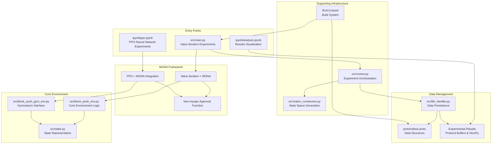
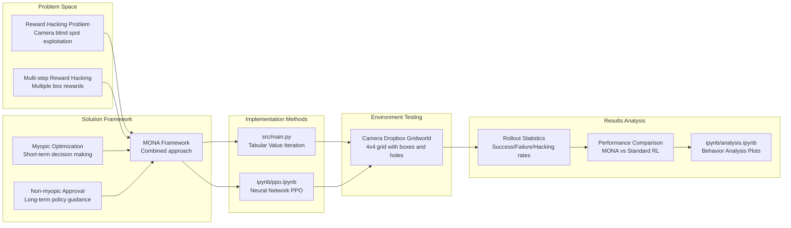
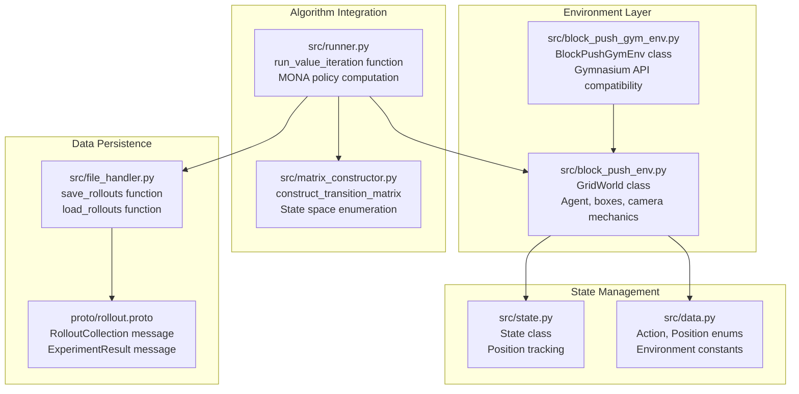

<!-- source: DeepWiki mcp.deepwiki.com · repo google-deepmind/mona · page 1 Overview · fetched 2026-10-26 -->

# Overview

<details>
<summary>Relevant source files</summary>

The following files were used as context for generating this wiki page:

- [README.md](README.md)

</details>


This document provides a comprehensive overview of the MONA (Myopic Optimization with Non-myopic Approval) research codebase. The system implements and evaluates a novel approach to preventing reward hacking in reinforcement learning through the Camera Dropbox gridworld environment.

For detailed information about the reward hacking problem, see [The Reward Hacking Problem](#1.1). For the technical details of the MONA framework, see [MONA Framework](#1.2). For installation and setup instructions, see [Installation and Dependencies](#2.1).

## Purpose and Research Context

The MONA repository implements a research system designed to study and mitigate multi-step reward hacking in reinforcement learning. The system provides a controlled experimental environment where agents can exploit reward mechanisms over longer trajectories, allowing researchers to evaluate the effectiveness of the MONA framework against traditional RL approaches.

The codebase supports two primary experimental methodologies: tabular value iteration for precise analytical results and neural network-based PPO for scalable learning approaches. Both methods integrate the MONA framework to demonstrate how myopic optimization with non-myopic approval can prevent reward hacking behaviors.

Sources: [README.md:1-27]()

## System Architecture

The MONA system consists of several interconnected components that work together to provide a complete research platform:

### High-Level System Architecture



Sources: [README.md:39-48](), [src/main.py:1](), [ipynb/ppo.ipynb:1](), [ipynb/analysis.ipynb:1]()

## Experimental Workflow

The research workflow follows a structured approach from problem definition through results analysis:

### MONA Research Pipeline



Sources: [README.md:7-26](), [README.md:41-43]()

## Key Entry Points and Components

The system provides three main entry points for different aspects of the research pipeline:

| Entry Point | Purpose | Key Components |
|-------------|---------|----------------|
| `src/main.py` | Tabular value iteration experiments | `runner.py`, `matrix_constructor.py`, `block_push_env.py` |
| `ipynb/ppo.ipynb` | Neural network PPO experiments | `block_push_gym_env.py`, Stable Baselines3 integration |
| `ipynb/analysis.ipynb` | Results visualization and analysis | Data loading utilities, plotting functions |

### Core System Components



Sources: [src/main.py:1](), [src/runner.py:1](), [src/block_push_env.py:1](), [src/block_push_gym_env.py:1](), [src/state.py:1](), [src/data.py:1](), [proto/rollout.proto:1]()

## Data Flow and Organization

The system organizes experimental data using a parameter-encoded directory structure that ensures reproducibility and easy comparison across different experimental configurations:

### Experimental Parameter Configuration

| Parameter Category | Examples | Files |
|-------------------|----------|-------|
| Reward Functions | `R=bad`, `R=good` | Defined in `src/data.py` |
| Initial Value Functions | `V_init=good`, `V_init=bad`, `V_init=zero` | Computed in `src/runner.py` |
| Environment Setup | `shape=4_4`, `boxes=2`, `step_penalty=0.01` | Configured in `src/block_push_env.py` |
| Noise Parameters | `noise_init=0.5` | Applied in value function initialization |

The system automatically creates directory structures like:
```
data/R=bad-V_init=good-noise_init=0.5-step_penalty=0.01-shape=4_4-boxes=2/
├── rollouts.textproto
├── value_matrix.npy
└── policy_arrays/ (for PPO experiments)
```

Sources: [README.md:76-83](), [README.md:93-98]()

## Build System and Dependencies

The system uses Bazel as its primary build system with automatic dependency management:

- **Protocol Buffers**: Automatically compiled from `proto/rollout.proto`
- **Python Dependencies**: Managed through `requirements.in` and installed by Bazel
- **External Dependencies**: Defined in `MODULE.bazel` for reproducible builds

The build system ensures that all components are properly linked and that protocol buffer definitions are synchronized across the codebase.

Sources: [README.md:55-58](), [BUILD.bazel:1](), [MODULE.bazel:1]()

---

