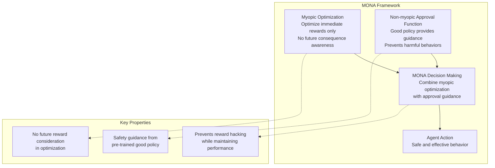
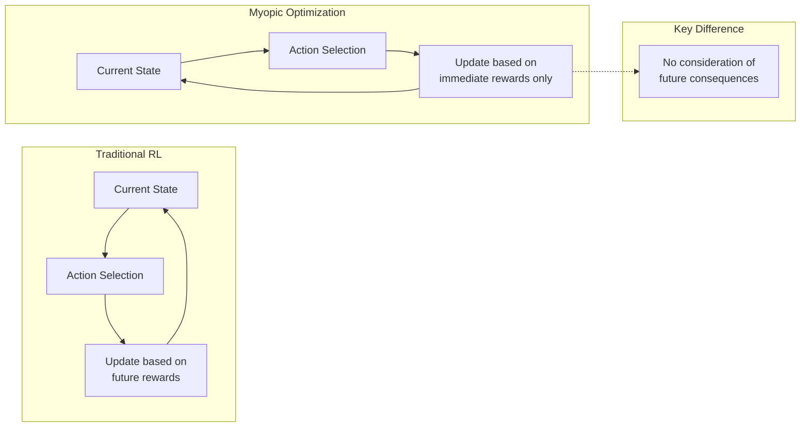
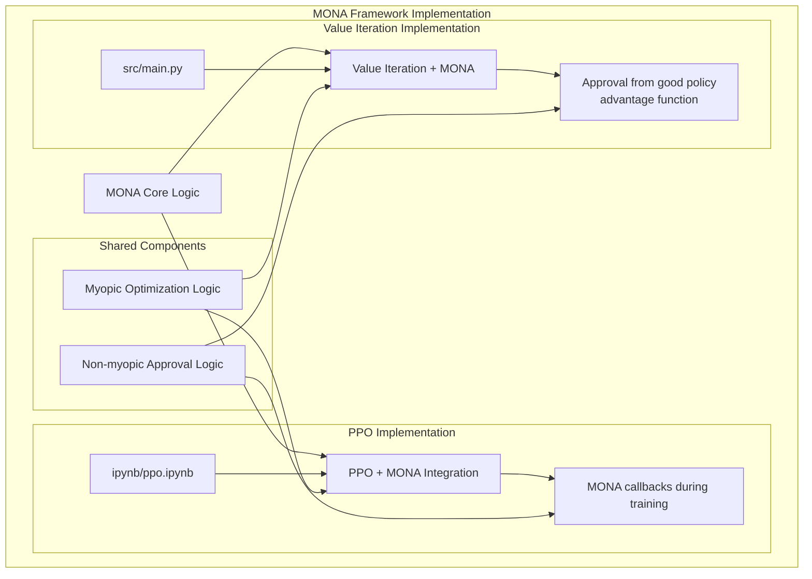
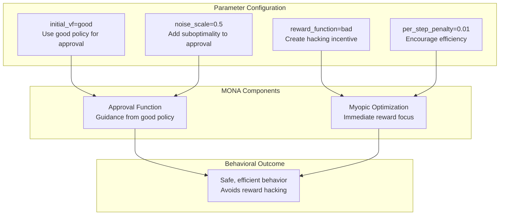

<!-- source: DeepWiki mcp.deepwiki.com · repo google-deepmind/mona · page 1.2 MONA Framework · fetched 2026-10-26 -->

# MONA Framework

Relevant source files

The following files were used as context for generating this wiki page:

- [README.md](README.md)

This document explains the Myopic Optimization with Non-myopic Approval (MONA) framework - the core algorithmic approach used to mitigate reward hacking in reinforcement learning environments. This page covers the conceptual framework, its two key components, and how they are implemented in the codebase.

For details about the specific reward hacking problem MONA addresses, see [The Reward Hacking Problem](#1.1). For information about the experimental implementations of MONA, see [Value Iteration Method](#3.1) and [PPO Neural Network Method](#3.2).

## Conceptual Framework

MONA combines two complementary optimization strategies to prevent multi-step reward hacking while maintaining effective learning:

1. **Myopic Optimization**: The agent optimizes only immediate rewards without considering future consequences of current actions
2. **Non-myopic Approval**: A separate "good" policy provides approval guidance to prevent harmful long-term behaviors

### MONA Framework Architecture

Sources: [README.md:22-26]()

## Myopic Optimization Component

The myopic optimization component ensures the agent does not update based on future rewards achieved by the same agent. This prevents the agent from "choosing" reward hacking strategies even if it "knows" how to perform them.

### Myopic Optimization Mechanism

Sources: [README.md:22-26]()

## Non-myopic Approval Function

The approval function provides safety guidance from a pre-trained "good" policy. This component ensures that while the optimization is myopic, the overall behavior remains aligned with intended objectives.

### Approval Function Components

| Component | Purpose | Implementation |
|-----------|---------|----------------|
| Good Policy | Provides reference behavior that avoids reward hacking | Pre-trained to only push one box into hole |
| Advantage Function | Quantifies how much better actions are than baseline | Derived from good policy |
| Noise Addition | Makes approval function suboptimal but realistic | Standard deviation of 0.5 added to value function |

Sources: [README.md:67-69]()

## Framework Implementation

MONA is implemented in two experimental approaches within the codebase:

### Implementation Architecture

Sources: [README.md:41-43]()

## Configuration Parameters

The MONA framework operates with several key parameters that control its behavior:

### Core MONA Parameters

| Parameter | Description | Example Value | Effect |
|-----------|-------------|---------------|---------|
| `initial_vf` | Source of approval function | `good` | Uses good policy for approval |
| `noise_scale` | Noise added to approval function | `0.5` | Makes approval function suboptimal |
| `reward_function` | Reward structure | `bad` | Defines reward hacking incentive |
| `per_step_penalty` | Step cost | `0.01` | Encourages efficient completion |

### Parameter Impact on MONA Behavior

Sources: [README.md:77-82]()

## Integration with Experimental Methods

MONA integrates differently with the two experimental approaches:

### Value Iteration Integration

- Uses tabular methods with exact state enumeration
- Approval function computed from advantage of good policy
- Myopic updates applied during value iteration process
- Results in deterministic policies with MONA guidance

### PPO Integration  

- Uses neural network function approximation
- MONA implemented through specialized callbacks during training
- Combines policy gradient updates with approval constraints
- Produces stochastic policies with MONA regularization

Sources: [README.md:41-43](), [README.md:93-98]()

---

