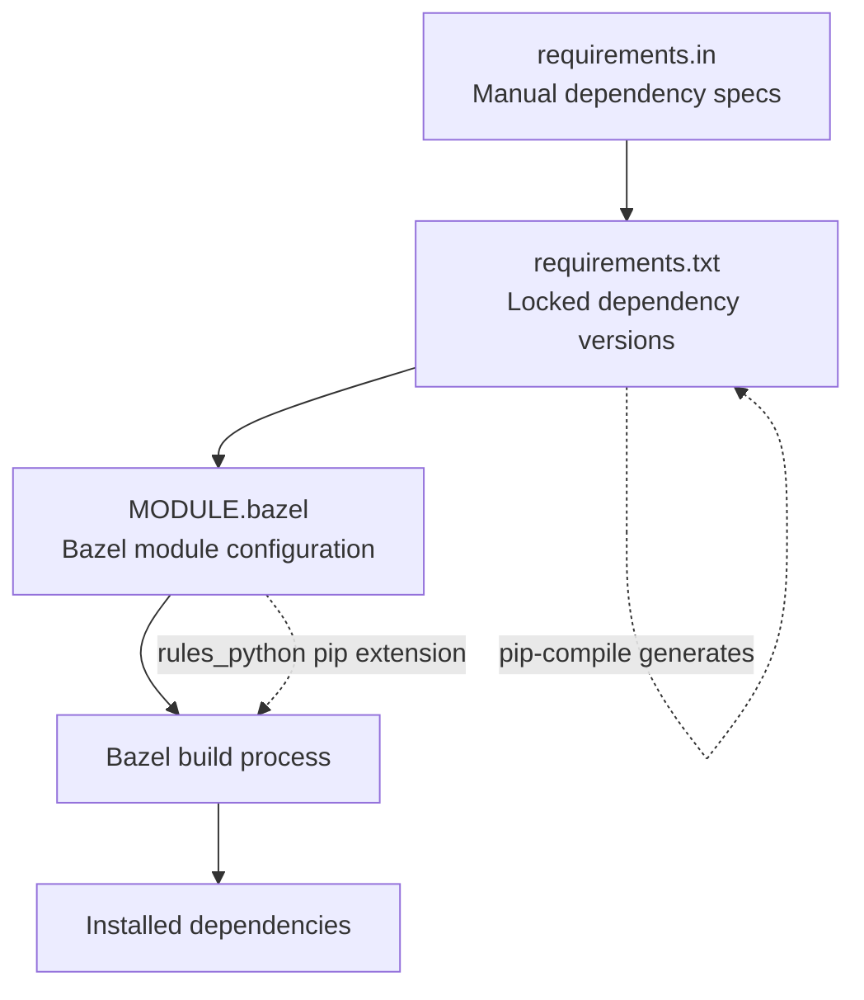
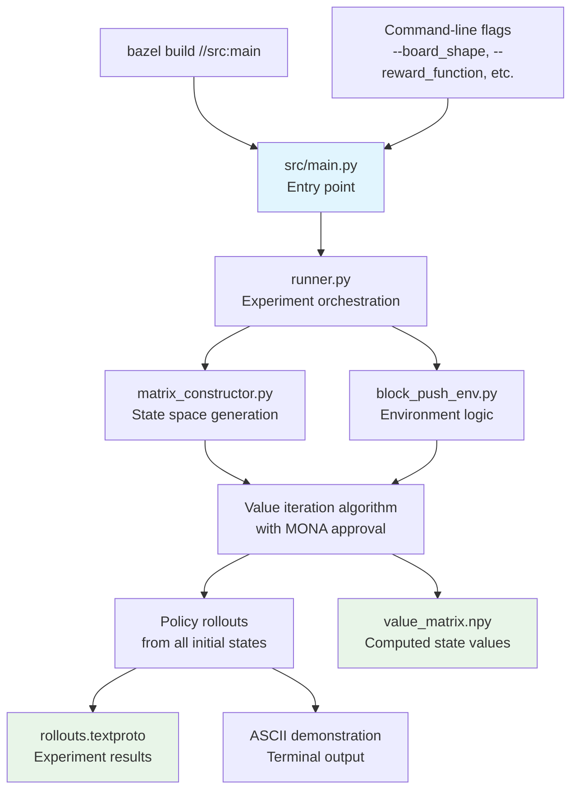
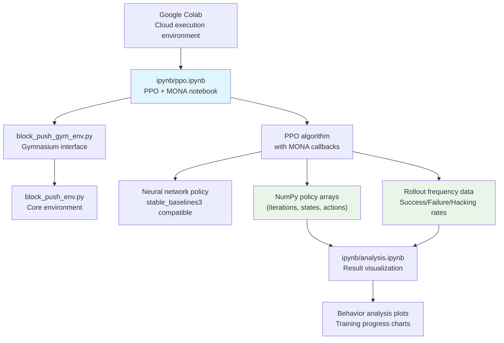
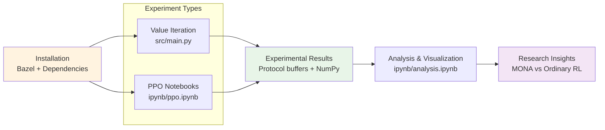

<!-- source: DeepWiki mcp.deepwiki.com · repo google-deepmind/mona · page 2 Getting Started · fetched 2026-10-26 -->

# Getting Started

<details>
<summary>Relevant source files</summary>

The following files were used as context for generating this wiki page:

- [MODULE.bazel](MODULE.bazel)
- [README.md](README.md)
- [requirements.txt](requirements.txt)

</details>


This page guides you through installing MONA, running your first experiments, and understanding the basic workflow. MONA provides two main experimental approaches: tabular value iteration and PPO with neural networks. This page covers the essential steps to get both working.

For detailed information about the MONA framework itself, see [MONA Framework](#1.2). For in-depth coverage of the experimental methods, see [Experimental Approaches](#3). For environment details, see [Camera Dropbox Environment](#4).

## Installation and Dependencies

MONA uses Bazel as its primary build system and supports both local execution and cloud notebook environments.

### Bazel Installation

The recommended way to run MONA experiments is using Bazel, which handles protocol buffer compilation and dependency management automatically.

**Requirements:**
- Bazel 8.1.0 (tested version)
- Python 3.11
- Linux or macOS environment

Install Bazel from the [official installation guide](https://bazel.build).

### Python Dependencies

MONA's dependencies are managed through Bazel's pip integration. The key dependencies include:

| Package | Purpose |
|---------|---------|
| `gymnasium==1.0.0` | RL environment interface |
| `numpy==2.2.1` | Numerical computations |
| `absl-py==2.1.0` | Command-line flags and logging |
| `sympy==1.13.3` | Symbolic mathematics |
| `pytest==8.3.4` | Testing framework |

Dependencies are automatically installed when you run Bazel commands.

**Dependency Management Workflow:**



Sources: [MODULE.bazel:11-16](), [requirements.txt:1-151]()

### Alternative: Cloud Notebooks

For PPO experiments, you can use Google Colab without local installation. The notebooks handle their own dependency installation through `apt-get` and `pip` commands.

## Running Value Iteration Experiments

Value iteration experiments use tabular methods and are executed through `src/main.py` with Bazel.

### Basic Command Structure

```bash
bazel build //src:main && \
bazel-bin/src/main [FLAGS]
```

### Essential Flags

| Flag | Purpose | Example Value |
|------|---------|---------------|
| `--board_shape` | Grid dimensions | `4,4` |
| `--max_boxes` | Number of boxes | `2` |
| `--reward_function` | Reward type | `bad` |
| `--initial_vf` | Initial value function | `good` |
| `--data_dir` | Output directory | `data/` |

### Complete Example Command

```bash
bazel build //src:main && \
bazel-bin/src/main --board_shape=4,4 --max_boxes=2 --episode_step_limit=50 \
   --min_blocking_boxes=1 --reward_function=bad --per_step_penalty=0.01 \
   --skip_existing_results=true --initial_vf=good --noise_scale=0.5 \
   --data_dir=data/ --save_init_value_matrix --save_rollouts_level=3 \
   --show_demo=true
```

This command creates a 4×4 gridworld with 2 boxes, runs MONA value iteration, and saves results to the `data/` directory.

**Value Iteration Experiment Workflow:**



Sources: [README.md:55-83](), [README.md:41]()

## Running PPO Experiments

PPO experiments use neural networks and are executed through Jupyter notebooks, typically in Google Colab.

### Notebook Access

**PPO Notebook:** `ipynb/ppo.ipynb`
- Implements PPO with MONA approval functions
- Outputs neural network policies and training data
- Can be run in Google Colab or local Jupyter

**Analysis Notebook:** `ipynb/analysis.ipynb` 
- Loads and visualizes experimental results
- Generates plots comparing MONA vs ordinary RL
- Works with both value iteration and PPO outputs

### PPO Output Format

PPO experiments generate:
- **Neural policies**: Compatible with `stable_baselines3`
- **Policy arrays**: Shape `(num_iterations, num_states, num_actions)` 
- **Rollout statistics**: Success/failure/hacking rates during training

**PPO Experiment Workflow:**



Sources: [README.md:87-111](), [README.md:42-43]()

## Understanding Outputs

Both experimental approaches generate structured outputs for analysis.

### Value Iteration Outputs

**Directory Structure:**
```
data/R=bad-V_init=good-noise_init=0.5-step_penalty=0.01-shape=4_4-boxes=2/
├── rollouts.textproto          # Experiment results in protocol buffer format
└── value_matrix.npy            # Computed state values as NumPy array
```

**Key Output Components:**

| File | Format | Contents |
|------|--------|----------|
| `rollouts.textproto` | Protocol Buffer | Individual rollout trajectories, success/failure/hacking statistics |
| `value_matrix.npy` | NumPy Array | State value function computed by value iteration |

### PPO Outputs

PPO experiments generate arrays that can be loaded directly into analysis notebooks:
- **Neural policies**: Full `stable_baselines3` model files
- **Policy probability distributions**: Training progression data
- **Rollout statistics**: Performance metrics over training

### ASCII Demonstration

When using `--show_demo=true`, value iteration experiments display an ASCII visualization of a sample rollout:

```
Agent: A, Box: B, Hole: H, Camera: C, Wall: #
Step-by-step visualization of agent behavior
```

Sources: [README.md:70-75](), [README.md:93-98]()

## Next Steps

After running your first experiments:

1. **Analyze Results**: Use `ipynb/analysis.ipynb` to visualize and compare experimental outcomes
2. **Explore Parameters**: Modify reward functions, noise levels, and environment configurations
3. **Understand MONA**: Review the [MONA Framework](#1.2) page for theoretical background
4. **Deep Dive**: See [Experimental Approaches](#3) for detailed method explanations
5. **Environment Details**: See [Camera Dropbox Environment](#4) for comprehensive environment documentation

**Complete MONA Workflow:**



Sources: [README.md:39-49](), [README.md:105-111]()

---

